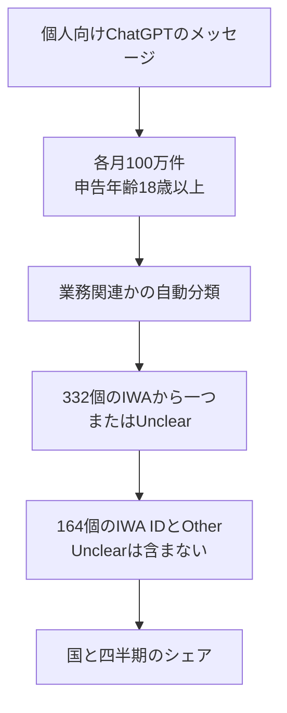

OpenAI Economic Research は 2026年10月26日、個人向け ChatGPT の業務関連メッセージを、国と四半期で比べられる活動別の集計として公開しました。対象は個人向けプランのメッセージで、enterprise（組織向けプラン）のメッセージは含まれません。

この記事では、公開の範囲、表の1行の意味、ファイル上の主な数字、数字を読むときの境界、育成と評価で分ける三つの層を、この順で説明します。

*この記事の全体像。以下、順に解説します。*

## 個人向けChatGPTの業務活動データとは

公開物の名前は OpenAI Signals v3.0 です。中身は、個人向け ChatGPT の業務関連メッセージを、O*NET の Intermediate Work Activity（中間作業活動。職業ごとの細かい作業を束ねた層で、さらに粗い分類の下にあります。以下 IWA）に結び、国と四半期で比較できる集計です。O*NET は、米国労働省系の職業情報データベースです。

ライセンスは CC BY 4.0 です。研究者は、国ごとの作業の違いを追い、他の経済指標と突合できます。

### メッセージから集計行まで

標本は、2024年7月から2026年9月まで、各月100万件の個人向けメッセージです。これは月次標本の期間です。IWA の国×四半期の表が持つ期間は、2025年第1四半期から2026年第3四半期までで、単位は四半期です。同じ配布 zip の別の集計表は、2024年7月まで含むものがあります。

対象アカウントは、個人向けプランで、申告年齢が18歳以上です。削除されたアカウントと、学習への利用を拒否したアカウントは除きます。enterprise のメッセージと Codex は含みません。Codex は、データ辞書（Signals の README PDF。以下、辞書）が enterprise のメッセージと並べて、この集計の外だと名指しする名前です。辞書は、その結果として business use（業務での利用）を過小にしうると書きます。個人向け集計の公開ページも、enterprise と Codex を除くと、業務と技術の利用を過小に表しうると書きます。

分類は、人が会話を読まず、個人を識別する情報を除いたあとの自動分類です。出すのは集計値だけです。差分プライバシーのノイズを加えます。差分プライバシーは、集計にノイズを加える手続きです。

分類器のプロンプトは、332個の IWA から一つを選ぶか、Unclear とします。Unclear は、332個のどれか一つに定めないときの出力です。O*NET 31.0 の対応表「GWAs to IWAs」も 332 rows です。GWA は Generalized Work Activity の略で、IWA より粗い作業の分類です。332は、O*NET が持つ中間作業の一覧です。公開表の活動バケットは165個です。内訳は、個別に残す基準を超えた IWA ID が164個と、残りを束ねた `Other IWA` です。`Other IWA` は、その基準に届かず個別 ID にしなかった活動の束です。シェアが小さいから、既に個別 ID になった活動をこの束へ移す、という規則ではありません。個別に残す基準の数値は公開表にありません。

日次の重みは、標本の日別構成を、その月の実際の送信割合に合わせるためのものです。上限は1.5です。ユーザーを等しく数える重みとは書かれていません。

IWA の国×四半期は、その国の四半期合計で、ウェイトとノイズのあとの実効メッセージが1000未満のときは、その国の四半期をまとめて出しません。これは、活動ごとの行を消す規則ではありません。合計が1000以上の国では、シェアが小さい活動の行も残ります。実効メッセージは、重みとノイズを加えたあとの件数です。公開された行のシェアは、その国とその四半期の業務関連メッセージに占める割合です。他の多くの系列の下限は100です。系列は、同じ配布 zip に入った別の集計表です。1000件の非表示は、164個の ID を残す基準とは別です。

### ファイル上の主な数字

発表文（公開ブログ『ChatGPT’s expanding world of work』。以下、発表文）は「165 work activities」「nearly 100 countries」と書きます。展開した CSV（配布 zip 内のファイル時刻は2026年10月22日）では、列 `iwa_cleaned`（その CSV の IWA 識別子）は164 ID と `Other IWA` を合わせた165値です。国は延べ94です。7四半期すべてに行がある国は74です。2025-01-01始まりの四半期は90か国、2026-07-01始まりは76か国です。

| 見方 | 国数 |
| --- | --- |
| CSV の延べ国数 | 94 |
| 2025-01-01 始まりの四半期 | 90 |
| 2026-07-01 始まりの四半期 | 76 |
| 7四半期すべてに行がある国 | 74 |

74か国を等加重し、各国内のシェア上位10活動を足した平均は、2025-01-01始まりの四半期で0.560427、2026-07-01始まりで0.510520です。等加重は、国の大小で重みを変えず、国を同じ重みで平均することです。シェアは、業務関連メッセージに占める割合です。発表文の56.0%と51.1%は、この再計算と小数第1位で一致します。

| 四半期の始まり | 74か国を等加重した上位10の合計 | 発表文 |
| --- | --- | --- |
| 2025-01-01 | 0.560427 | 56.0% |
| 2026-07-01 | 0.510520 | 51.1% |

2026-07-01始まりの四半期で、日本の業務関連メッセージのうち最大は「文書や資料を編集する」（4.A.2.b.1.I07）の0.14505です。次いで「視覚的なデザインや表示を作る」（4.A.2.b.2.I18）の0.06663です。米国も最大は同じ文書編集で0.17102、次が視覚デザインの0.07629です。

| 活動 | 日本 | 米国 |
| --- | --- | --- |
| 文書や資料を編集する（4.A.2.b.1.I07） | 0.14505 | 0.17102 |
| 視覚的なデザインや表示を作る（4.A.2.b.2.I18） | 0.06663 | 0.07629 |

同じ公開物の別系列では、2026年9月のメッセージのうち業務関連は、全体0.322、日本0.285、米国0.331です。いずれも小数第3位の公開値です。

| 範囲 | 2026年9月の業務関連の割合 |
| --- | --- |
| 全体 | 0.322 |
| 日本 | 0.285 |
| 米国 | 0.331 |

### 1行が持つもの

公開される1行は、国と四半期と活動バケットの組み合わせに対する、業務関連メッセージのシェアです。会話本文も、送り手の職種も、成果も、列にはありません。Unclear を付けたメッセージが、このシェアの分母に残るかは、公開された列の説明にはありません。

O*NET では、職業ごとの細かい作業が Detailed Work Activity です。それを束ねたものが IWA です。さらに粗いものが Generalized Work Activity です。この公開が国別に出しているのは、IWA の層です。

## 注意点

この表が測っているのは、個人プランに残り、学習利用を拒否していないアカウントのメッセージが、分類器によってどの活動へ振られたか、です。職が置き換わった割合でも、作業が完了した割合でも、人に残すべき判断の一覧でもありません。

### チャットに来ない作業

公開元は、この活動リストへ対応づけた米国職業について、雇用加重したタスクの約43%が、個別行の外の Other IWA だと書きます。この Other は、公開表の `Other IWA` と同じ束です。雇用加重は、発表文がタスク構成の重みとして使う語です。人数か時間かの内訳は、CSV にありません。例は、資材の移動、車両の運転、医療記録の維持など、公開元が元の米国標本で安定して現れなかったと書く活動です。どの標本を指すかの表も、CSV にはありません。この約43%は、発表文と同じ公開ブログの記載であり、同じ配布物の24個の CSV には計算表がありません。チャットに来ない作業が雇用の側に厚く残る、という対比の向きは、公開元自身が示しています。

約43%の雇用加重が、どの職業とタスクの対応で計算されたかは、公開 CSV からは分かりません。

### 活動名の一致

活動名の一致は強くありません。分類プロンプトの検証論文は、Chatterji らの NBER Working Paper 34255（2025）『How People Use ChatGPT』です。その Table 5 では、IWA 分類の人間のみの Fleiss κ は 0.34 [0.23, 0.45] です。角括弧は、論文の表が併記した区間です。Fleiss κ は、複数の注釈者のラベルがどれだけ揃うかを表す一致の係数です。検証の条件は、WildChat（検証に使った公開の会話集）の100件、人間の注釈者2人、332分類です。

モデルを注釈者に加えた Fleiss κ は 0.47 [0.40, 0.53] です。人間同士の Cohen κ は 0.37 です。Cohen κ は、二者の判定がどれだけ揃うかを表す一致の係数です。モデル対人間多数派の Cohen κ は、注釈者が2人のため報告がありません。

同じ表の業務の二値分類は、人間のみの Fleiss κ が 0.66 [0.54, 0.76] です。モデル対多数派の Cohen κ は 0.83 [0.72, 0.92]（n=149）で、IWA 分類より高いです。「業務として来ているか」は、活動名の識別より、検証上は堅いです。

検証入力は、本番の ChatGPT ログそのものではありません。人間には、前のメッセージの1文要約が渡ります。モデルが見る前文そのものではありません。論文本文 B.1.4 は、IWA の Fleiss κ を 0.47、人間のみの Cohen κ を 0.27 と書きます。これは Table 5 の人間のみの列と一致しません。この記事は、表の数値を採ります。

1メッセージは1ラベルに潰れます。論文の例では、近い活動（創作の執筆と、芸術・商業向けの執筆）が別ラベルになりうると書かれています。

### 差分プライバシーと時点の比較

2026年7月から9月の初回公開は、ε=1、δ=1/N です。ε と δ は、辞書がプライバシー予算を示すときに組で書く値です。ε が大きい側が、累積の予算が緩い側です。δ=1/N の N が何の件数かは、この脚注だけでは特定できません。再公開を重ねた期間ほど、累積の予算は緩みます。辞書の脚注では、2025年12月以前は ε=5、2026年1月から3月は ε=3、2026年4月から6月は ε=2 です。2025年第1四半期を含む古い側（ε=5）は、2026年7月から9月の初回公開（ε=1）より緩い側です。

件数に足すノイズの σ は、集計ごとに3から4のあいだと辞書が書きます。シェアの標準誤差の列はありません。

v3.0 は過去期間も月100万件で出し直しています。2025年第1四半期と2026年第3四半期の公開値は、どちらもその標本サイズです。上位10の集中が56.0%から51.1%へ下がったこと自体は、再計算と一致します。差には、実際の利用構成の変化に加え、集計の不確実性と、期間ごとの累積プライバシー予算の違いが影響しえます。2025年12月以前の ε=5 は、2026年7月から9月の ε=1 より緩い側です。寄与の内訳は、この公開値だけでは分かりません。

### 細かい順位

国×活動の細かい順位は、分母が公開されていません。四半期合計が1000件を少し超えるだけの国では、165分割の小さい行は、件数ノイズに対して不安定になりえます。これは、辞書が公表した標準誤差ではなく、σ と閾値からの注意です。大きい国の上位活動では、この注意は弱くなります。

2026年7月始まりの四半期で国数が76まで減った理由は、公開値だけでは分かれません。利用の縮小か、1000件閾値による非表示か、分母が列に無いので切り分けられません。

学習オプトアウトと削除が、活動シェアを何ポイント動かしているかも、一次の数値は見当たりません。

### 業務メッセージの doing の比

同じ zip の別系列には、asking、doing、expressing という三つのラベルがあります。ここでの比は、業務関連メッセージに占める doing の割合を、非業務メッセージに占める doing の割合で割った値です。三つのラベルがどの種類の発話を分けるかは、この比の定義には書かれていません。公開された小数第3位からの計算では、2024年7月から2026年9月の27か月のうち、最小は約1.54（2024年10月）、最大は約2.06（2026年6月）です。月によって2倍を超えます。全期間の性質ではありません。発表文はこの比を見出しにしていません。

### 米国の職業リストへの分類

O*NET は米国の職業情報です。O*NET Resource Center は、データベースが米国経済の職業を覆うと書きます。別製品の一次研究（Handa et al., arXiv:2503.04761v1, Section 4.1）は、O*NET が U.S.-centric（米国の職業に寄っている）であるため他地域の職とタスクを見落とし、グローバルな利用分布を歪めうると、自らの Claude.ai（Anthropic の対話製品）分析の限界として書きます。日本の行も、日本の職務記述ではなく、この米国リストへの分類結果です。

### 三値と二値の境界

辞書には、work、schoolwork、other の三値と、IWA 表の分母である二値の work_related があります。schoolwork は、その三値ラベルの一つです。辞書は、work、schoolwork、other のどれが work_related に入るかを書いていません。二値プロンプトの例は短く、詳しい境界例は三値プロンプト側にあります。学習、転職、起業を、同じ境界で落としているとは書かれていません。

2026年10月26日のこの公開自体への独立した検証は、2026年10月28日時点では見つかっていません。

## 作業の種類で切る問いに、この表はどこまで答えるか

育成と評価の単位を、職種の置換率だけに置かず、作業の種類で切る、という問い自体は、この公開と合います。切る材料は、この表の細かい順位ではありません。個人プランのメッセージが、どの活動へ分類されているかの地図に限ります。

この読みを支える点は、次のとおりです。

- 公開元は、職種名ではなく IWA で、国と時点を比較できる形を、CSV と辞書つきで出しています。74か国の上位10の集中は、発表文と再計算が小数第1位で一致します。
- 日本と米国の先頭は、どちらも文書編集と視覚デザインです。職種名の一覧では見えない共通の作業意図が、少なくともこの分類器の上では並びます。
- 雇用加重タスクとの差（約43%が Other。公開ブログの記載で、CSV では未再計算）を、公開元は「チャットの利用」と「米国の仕事」の差として明示しています。置換率と利用シェアを分ける理由になります。
- 同じ人間のみの Fleiss κ で比べると、業務の二値は 0.66 [0.54, 0.76]、IWA は 0.34 [0.23, 0.45] です。業務の二値には、モデル対人間多数派の Cohen κ 0.83 [0.72, 0.92] もあります。IWA にはその列がありません。

この読みを止める点は、次のとおりです。

- IWA の人間一致は Fleiss κ 0.34 です。1メッセージは1ラベルに潰れます。近い活動が別ラベルになりうる、という論文の例があります。活動名を、評価項目の正式名称にする精度はありません。
- 単位はメッセージの加重シェアです。同じ意図の往復は、複数回カウントされえます。送り手の人数でも、作業の完了でもありません。
- enterprise と Codex は除外され、辞書は business use の過小を認めます。組織の本番利用の代表標本ではありません。
- 国別の細目は、標準誤差がなく、期間によってプライバシー予算が違います。小さいシェアの順位は、辞書が保証する精度の外に置いた方がよいです。
- 出力が文書に入ったか、人が直したか、着想で止まったかは、この表からは観測できません。Handa et al. は、自らのデータについても、出力が成果物に入ったか、人が直したか、着想で止まったかを観測できない、と同種の限界を書いています。

総合すると、職種置換率の代わりにこの順位表を評価制度へ入れる、という置き換えは支持されません。地図として上位の作業種類を知り、正式な項目と成果は自社の作業名と別測定で持つ、という使い方なら、上の反証のあとでも残ります。

## 育成と評価では三つの層を混ぜない

人材育成と評価では、次の三つの層を混ぜません。

1. 個人向け ChatGPT に来たメッセージの分類地図です。この公開は、ここだけを国と四半期で出します。日本で読むなら、2026年第3四半期の先頭が、文書編集、視覚デザイン、言語・文化情報の解釈、教育・職業上の助言、マーケ素材の作成である、という並びまでを使います。2026-07-01 始まりの日本のシェアは、文書編集 0.14505、視覚デザイン 0.06663 の次に、言語・文化情報の解釈（4.A.4.a.1.I03）が 0.04534、教育・職業上の助言（4.A.4.b.6.I07）が 0.04250、マーケ素材の作成（4.A.2.b.2.I12）が 0.03566 です。この5つより下の順位は使いません。
2. 組織の本番利用です。enterprise、API、Codex、他社ツールは別物です。この表で小さい活動は、組織で起きていないのではありません。個人プランのチャットに来ていないだけ、がありえます。
3. 人に残す判断です。メッセージが活動ラベルに乗ったことは、その作業の品質も、人が確認したかも、評価してよい成果も示しません。評価に残すのは、ラベルの外で確認できる判断に限ります。例は、事実の採否、対外的な責任、例外の処理です。

日本の2026年第3四半期で先頭の文書編集（シェア 0.14505）を、この三層に置くと次のようになります。第1層では、個人プランの業務関連メッセージのうち、この分類器が文書編集へ振った割合が約14.5%だと読みます。第2層では、自社の本番利用量を、この14.5%から推定しません。第3層では、チャットに出した文書の事実と、対外的な責任を、ラベルとは別に人が持つかを書きます。シェアの大小では、その分け方を決めません。

逆転条件は二つです。IWA 分類の人間一致が、自社の作業一覧で実用に足るまで上がるか。企業プランを同じ活動一覧で出した公開が、個人プランと同じ順位を示すか。どちらかが満たされるまでは、この表を評価項目の一覧にしません。

直近では、次の三つを分けて書きます。

1. 自社の頻出作業を10個書き、この164 ID に無理に当てはめません。文書編集、視覚化、説明、助言のように、粗い束で対応づけます。
2. その束ごとに、「チャットに出してよいか」と「人が最終判断を持つか」を分けて書きます。シェアの大小では分けません。
3. 組織の利用量は、個人プランの国別シェアではなく、自社の enterprise または API のログか、作業時間の自己申告で別に取ります。

## まとめ

Signals v3.0 は、個人向け ChatGPT の業務関連メッセージを、165個の活動バケットへ自動分類し、国と四半期のシェアとして公開した集計です。74か国の上位10活動の集中は、2025年第1四半期の56.0%から2026年第3四半期の51.1%へ下がり、発表文と再計算は小数第1位で一致します。日本と米国の先頭は、どちらも文書編集と視覚デザインです。

この表は、職の置換率でも、作業の完了でも、評価項目の一覧でもありません。活動名の人間一致は、業務の有無より弱く、enterprise と Codex は入っていません。使うなら、個人プランに来た作業種類の地図までに留め、組織の利用量と、人に残す判断は別の層で持ちます。

この記事が少しでも参考になった、あるいは改善点などがあれば、ぜひリアクションやコメント、SNSでのシェアをいただけると励みになります！

## 参考リンク

- [ChatGPT’s expanding world of work](https://openai.com/index/chatgpt-expanding-world-of-work)（OpenAI、2026-10-26）
- [Download data and methodology](https://openai.com/signals/data-download/)（OpenAI Signals v3.0、CC BY 4.0）
- [OpenAI Signals の個人向けデータ](https://openai.com/signals/data/)
- [OpenAI Signals README Version 3.0（データ辞書 PDF）](https://cdn.openai.com/signals/data-dictionary.pdf)
- [Signals CSV zip](https://cdn.openai.com/signals/data-download-csv.zip)（zip 内ファイル時刻は 2026-10-22）
- [How People Use ChatGPT（NBER Working Paper 34255）](https://www.nber.org/papers/w34255)（Chatterji et al., 2025）
- [O*NET 31.0 Database](https://www.onetcenter.org/database.html)（O*NET Resource Center。GWAs to IWAs は 332 rows）
- [Which Economic Tasks are Performed with AI?](https://arxiv.org/html/2503.04761v1)（Handa et al., arXiv:2503.04761v1、2025-02-11）
