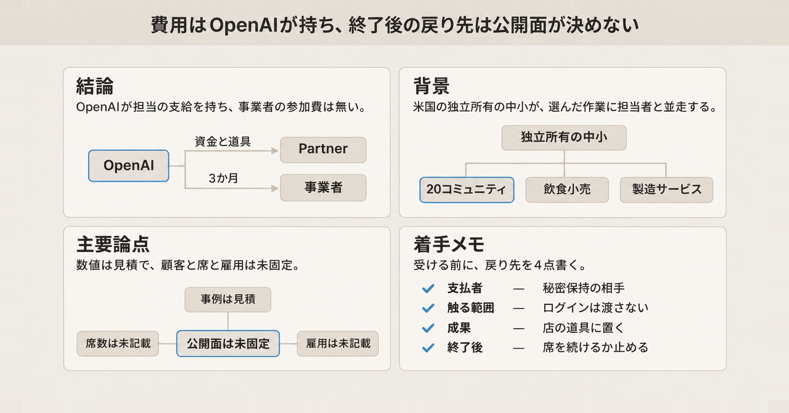
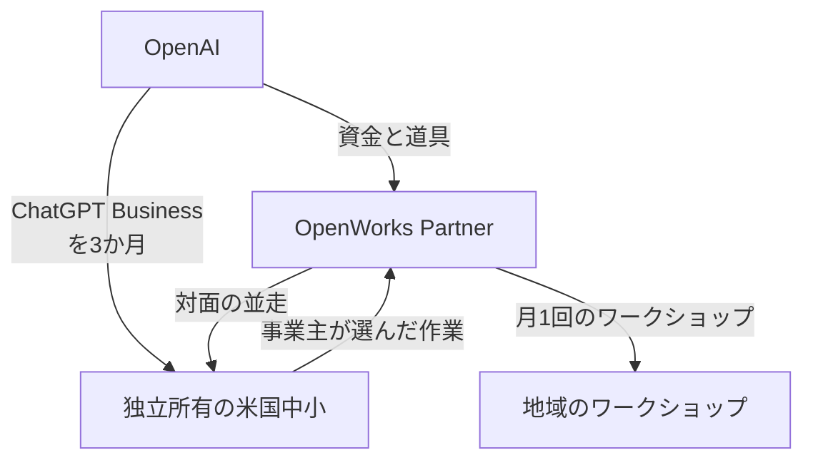

OpenWorks は、OpenAI が 2026年11月23日に公開した、米国の小規模事業者向けの現場支援です。OpenAI が地域の担当者に資金と道具を渡し、その担当者が、事業者の選んだ作業に並走します。事例に出てくる数値は、OpenAI の紹介ページに載った見積と発言です。

この記事では、2026年11月24日に取得した公開ページ、申請フォーム、ChatGPT Business の利用契約に沿って、仕組みの中身、数値の読み方、費用を誰が持つか、着手前に残すメモ、終了後のアカウントとファイルを整理します。

*この記事の全体像。以下、順に解説します。*

## OpenWorksとは

OpenWorks は、独立して所有されている米国の中小を対象にした現場支援です。飲食、小売、サービス、製造が例に挙がります。対象外は、software / SaaS、ベンチャーキャピタルから出資を受けた事業、プライベートエクイティが所有する事業です。プライベートエクイティは、公開ページが private equity-owned と書いて対象外に置く語です。語の定義は、ページにありません。パイロットの公開一覧は、米国の 20 コミュニティです。

地域の担当者は OpenWorks Partner と呼びます。OpenAI のページは "We fund and equip OpenWorks Partners" と書きます。Jake Ottiger の告知と、OpenAI 公式アカウントの告知も、OpenAI が地域の担当者に資金を出すと書いています。事業者側の参加は、ページの語で free です。担当者へは、月あたり最大 8,000 ドルの stipend（月額の支給）が出ます。並走に加え、事業者は ChatGPT Business を 3 か月、無償で受け取ります。ChatGPT Business は、1 人あたりの席で料金が公開されている ChatGPT の有料プランです。席は、その料金が 1 人分ずつ付く利用者枠です。OpenWorks は、このプランを事業者へ 3 か月無償で渡すと書いています。

告知の著者は Jake Ottiger です。プロフィールは openworks @openai です。2026年11月23日の投稿で、2 か月前に OpenAI へ加わったと書いています。公式事例では、Tiny Things と Sign Badgers の Partner でもあります。

### 担当者と事業者に公開されている条件

担当者の公開条件は三つです。毎月、地域の事業者と働く日を割くこと。コミュニティで月 1 回ワークショップを開くこと。経営者と従業員が自分で使える技能を付けること。月額 stipend は up to $8,000 と書かれ、下限と支払月数は書かれていません。

Partner の応募は、個人と小規模チームです。ソフトウェアと AI のコンサルティングは、既存の顧客の仕事と並行して応募するよう、ページが勧めています。申請フォームには、会社名または practice name（屋号）の欄があります。フォームは、月 4 日の無償の hands-on（実務に手を動かす支援）と、月 1 回のワークショップを約束できるかを聞きます。この無償は、Partner に聞く 4 日の側の語です。stipend とどう差し引くかは、フォームに書かれていません。選択肢は Yes、Not yet、I’d need to learn more です。対面できるかは、別の質問です。

事業者は、意味のある作業を自分で選び、すでに使っている道具で実習します。技術経験は不要、とページが書きます。申請者の役割は、Owner/co-owner、Employee、Other から選びます。この Owner は、申請者が選ぶ役割の名前です。

パイロットの内訳は、中西部 7、南部 8、西部 4、北東部 1（New York）です。町が一覧に無くても、そこへ持っていく応募ができる、と Ottiger の続報が書いています。公開ページには nationwide（全国）という語もあり、20 コミュニティの一覧と同じ文面の中にあります。

事業者が受け取ると書かれているのは、一対一の支援、既存の道具での実習、ChatGPT Business の 3 か月無償です。ワークスペースは、OpenAI の Help Center（製品のヘルプ記事）が、所有者、データの書き出し、離脱の単位として書く名前です。この所有者は、申請フォームの役割名 Owner とは別の箇所の語です。席の種類、席の数、ワークスペースの所有者は、OpenWorks のページとフォームにはありません。

紹介事例は 4 件です。作業は、在庫の可視化、飲食店へのメール、仕入先価格の確認、発注と出荷の突き合わせに及びます。四つの事例で、作業に使ったアカウントの名義は書かれていません。

### 三つの当事者と二つの流れ

公開されている関係は、三つの当事者と、二つの流れです。お金と道具は OpenAI から Partner へ行きます。無償の製品期間は OpenAI から事業者へ行きます。作業の中身は事業者が選び、Partner が並走します。

Partner と事業者のあいだに、参加費の矢印はありません。

## 注意点

### 一覧の外を、終わった作業と読まない

nationwide と、パイロット一覧の 20 コミュニティは、同じ文面の中にあります。一覧に無い町は、Partner の応募で追加する、という呼び方です。20 の外で、すでに作業が終わっているとは、一覧だけでは読めません。

### 事例の数値は見積と発言である

測定方法と監査人は、紹介ページにありません。数値は、次の人に帰属する見積か発言です。

| 事例 | ページ上の言い方 | ページが帰属させている人 |
|---|---|---|
| Tiny Things（Fargo） | 外注すれば around $50,000 | Jordan の見積 |
| Ghost Grow 843（Charleston） | 反応率 20% から 75%、4 か月で飲食店の新規 10 件 | Garret の見積 |
| Sign Badgers（Fargo） | 価格確認は 15 分から 20 分、とページが書く。週 2 時間から 5 時間の節約は Jen の発言 | ページの叙述と Jen |
| Black Paper Party（Bentonville, Arkansas） | thousands of dollars のチャージバックを避けた | 担当 Partner の氏名は無い |

Black Paper Party のページは、仕入先の請求の誤りを見つけて争い、そのチャージバックを避けたと書いています。チャージバックという語自体の定義は、ページにありません。避けた費用がどの種類の請求かも、ページは定義していません。

Bentonville は、20 コミュニティの一覧にありません。公式ページは、この事例が一覧の外なのか、一覧の前の作業なのかを説明していません。四つを「20 コミュニティの成果」と束ねる根拠は、ページにありません。

同じ 20 と 75 を、地元局は別の指標で書いています。公式ページは、Garret の見積として response rate（反応率）と書きます。WCSC（Live 5 News、2026年11月23日）は、Ottiger の話として sales conversion rate（販売の成約率）と書き、氏名を Garrett と綴ります。局は、この増加が OpenWorks のリーダーシップから共有された結果だと書きます。一つの監査数値としては扱えません。

同じ局は、看板製造の運営担当者について、翌日およそ 10,000 ドルの注文があったと Ottiger が言った、と書きます。公式の Sign Badgers の本文に、10,000 ドルはありません。公式事例と、局の逸話を、一つの成果にまとめません。

### 月 8,000 ドルと、月 4 日の質問

月 8,000 ドルは上限です。12 か月続くとは書かれていません。年 96,000 ドルという換算は、公式の主張ではありません。

申請の「4 日」は、フォームの質問です。Not yet と I’d need to learn more が選択肢にあります。「4 日を約束しないと参加できない」は、公開フォームの文言より強い読みです。

### 紹介する人と、同名の別会社

事例は、プログラムの担当者が紹介ページに書いた、顧客の見積を含みます。Ottiger は告知の著者であり、Tiny Things と Sign Badgers の Partner でもあります。

同名の別会社があります。O.P.E.N. America, Inc.（openworksweb.com）は、清掃のフランチャイズです。そちらの開示文書にある stipend や雇用条項を、OpenAI の OpenWorks には使えません。

## 似た現場支援は費用の主体で分かれる

現場に人が入る支援は、役割名が似ていても、費用の置き場所が違います。OpenAI 自身が、2026年9月30日に別の型を発表しています。America's SBDC は、全米の中小企業支援機関のネットワークです。その既存アドバイザーを、OpenAI Academy が訓練する、という提携です。OpenAI Academy は、この記事が訓練の主体として書いている名前です。アドバイザーを選ぶのは America's SBDC だと、その記事は書きます。

OpenWorks のページは、OpenAI が Partner に資金を出すと書きます。訓練する相手の給与主体と、並走する人の stipend の主体は、公開文のうえで別です。

| 軸 | OpenWorks（2026年11月23日公開） | SBDC 提携（2026年9月30日の記事） | 事業者が費用を払う顧問 |
|---|---|---|---|
| 担当の費用 | OpenAI が Partner を fund すると書く。月あたり最大 8,000 ドル | 記事は訓練と認定を書く。アドバイザーの給与主体は書かない。選定は SBDC | 役務契約の発注者 |
| 雇用の公開 | Partner 個人の雇用形態は未記載。告知者本人は OpenAI に加わったと投稿している | 既存の SBDC アドバイザーを訓練する、と書く | 契約の相手 |
| 事業者の参加費 | free | 記事はワークショップと助言を書く。参加費の額は、取得した記事には無い | 契約金額 |
| 期間の公開 | ChatGPT Business の 3 か月。Partner の任期は未記載 | 初期段階の計画。around 150 人の訓練、対面で at least 1,000 事業者、は目標の書き方 | 契約期間 |
| 成果の置き場所 | ページは、チームが自分で使える技能と道具、と書く。アカウントの名義は未記載 | 研修とガイドが中心 | 契約で決める |
| 地理 | 米国、掲載 20 コミュニティ、対面 | 全米の SBDC ネットワーク、と記事が書く | 契約で決める |

日本の事業者が、2026年11月24日の OpenWorks の公開条件で申込対象に入る、というページは見つかっていません。公式は、米国の独立所有と、対面できる都市を書いています。比較に使えるのは、費用の主体と、終了時に権限を誰へ戻すかです。

## 着手のメモに書く四点

公開の OpenWorks は、次の四点を、受入側の代わりに書いていません。ChatGPT Business の Services Agreement（利用契約。Updated: 2025-12-01、Effective: 2026-01-01）が埋めるのは、その契約の Customer（契約上の顧客）が誰かで決まる範囲に限られます。OpenWorks のページは、3 か月の Customer が事業者だと書いていません。

### 支払者と秘密保持の相手

stipend の文言上の支払者は OpenAI です。事業者は、ページ上、参加費を払いません。公開条件では、事業者が Partner の参加費を払う関係にはなっていません。Partner の雇用形態を示す契約文は、公開面にはありません。

ページは、コンサルティングを既存顧客と並行できる、と勧めています。既存顧客と、OpenWorks の先との情報の隔壁は、ページにありません。着手前に書くのは、Partner が誰の仕事として来るか、秘密保持の相手が OpenAI か Partner の会社か、です。

告知者本人については、雇用主が何も無い、とまでは言えません。Ottiger は OpenAI に加わったと投稿し、プロフィールも OpenAI の OpenWorks です。これは、Partner 全員の雇用契約が公開されている、という意味にはなりません。

### 触ってよいシステム

事例が触れているのは、在庫ツール、メールの下書き、Codex、発注と出荷の記録です。Codex は、Sign Badgers の事例で、ChatGPT と並べて在庫の追跡と仕入先価格の確認に使うとページが書いている名前です。何の製品か、ページは定義していません。誰のログインで接続したかは、ページにありません。

Services Agreement 3.1 は、Customer のアカウント資格情報と個人ログインを、複数人で共有しない、と書きます。3.2 は、End User（エンドユーザー）のアカウントを一人にだけ発行する、と書きます。この条項が効くのは、事業者が Customer であるときです。着手前に書くのは、Partner を事業者のワークスペースへ招待するか、Partner の個人のチャットへ事業データを置かないか、在庫や会計の認証情報を渡さないか、です。

事業者のフォームは、HIPAA（米国の医療情報の規則）の健康情報、カードと銀行、その他の個人情報、機密、特別なセキュリティ要件を、任意で聞きます。フォームは、その中身を書くな、とも注記します。Services Agreement 5.4 は、Healthcare Addendum（医療情報の追加契約）なしに、PHI（保護対象の医療情報）を処理しない、と書きます。フォームの質問は、処理してよいという許可ではありません。

### 成果の帰属

Services Agreement 4.1 は、Customer と OpenAI のあいだで、Input（入力）の所有は Customer が保持し、Output（出力）は Customer が持つ、と書きます。4.2 は、Customer が明示的に同意しない限り、Customer Content（顧客コンテンツ）をサービスの開発や改善に使わない、と書きます。4.4 は、Output が他の利用者と似ることがある、と書きます。9.1 は、サービス自体の知的財産は Customer に移らない、と書きます。9.3 は、Feedback を出した場合、OpenAI が制限や対価なしに使える、と書きます。

この条項が事業者を守るのは、事業者が Customer である範囲です。在庫のダッシュボードが表計算や、店の既存ツール側にあるなら、そのファイルの置き場所は製品契約の外です。Partner の個人アカウントに残った手順も、外です。着手前に書くのは、成果ファイルを店のツールに置くこと、ワークスペースの Owner（所有者）を店の人にすること、改善提案として渡すメモと事業データを分けること、です。

### 終了のあと

無償として書かれている期間は、ChatGPT Business の 3 か月です。Partner の stipend が何か月続くかは、ページにありません。WCSC は、無償期間のあと購読を払い続けるかは経営者が決められる、と Ottiger が言った、と書きます。WCSC は、月額請求なら Standard が 1 人あたり月 25 ドル、Premium が 1 人あたり月 125 ドル、と書きます。無償の 3 か月がそのどちらか、何席か、自動更新か、Owner が誰かは、WCSC の記事も書いていません。

製品の一覧価格は、2026年11月24日に取得した料金ページのドル注記と Help Center では、次のとおりです。同じ取得の料金ページは、見出しを円で出していました。ドルは注記の額です。

| 席 | 月額 | 年額なら 1 人あたり月額 |
|---|---|---|
| Standard | 25 ドル | 20 ドル |
| Premium | 125 ドル | 100 ドル |

料金ページの FAQ は、Business を 2 users から、と書きます。本文には、従業員 2 人から 200 人のチーム、ともあります。年額のドル注記そのものに、2 人以上とは書いてありません。Help は、有料の Standard または Premium を 1 席から始められると書く記事と、申込時は有料席が少なくとも 2 だと書く記事が並びます。これは、席種ごとの最低数ではありません。OpenWorks の 3 か月が何席で、どの席種かは、この差を解いても決まりません。Services Agreement 6.6 は、料金ページの変更が掲載の 14 日後に効力を持つ、と書きます。上の額は、2026年11月24日の掲載です。

終了時の中身に近いのは、Agreement が終了したときの 11.3 です。OpenAI が Customer に与えた権利は直ちに終わり、OpenAI は 30 日以内に Customer Content を削除します。例外は、法令上の保持と、書面で別段の合意がある場合です。3 か月の無償が終わると Agreement が終わる、とは OpenWorks もこの契約も書いていません。有料で続くなら、削除は、その契約が終わるときの話です。

Help Center の書き出しは、記事をまたぐと条件が揃いません。データとプライバシーの記事は、メンバーが Settings から自分のデータを書き出せず、Owner は Export data が使えるときにメンバーのデータを書き出せる、と書きます。一般 FAQ は、ワークスペースを離れる前の書き出しについて No と書きます。deactivated（無効化）になるとデータは残るが、ユーザーはアクセスを失い、再開できるのは Owner だけ、とも書きます。残したい手順は、無償期間のあいだに、店のファイルへ写す前提で置いた方が、書き出し記事の不一致に依存しません。

着手前に書くのは、Owner のメール、3 か月後に席を続けるか止めるか、止める前に写すファイル、Partner の席を誰が外すか、です。

## 公開条件だけでは戻し先が決まらない

現在の読みはこうです。OpenWorks は、事業者との役務契約の外で、OpenAI が地域担当の stipend を持つ現場投入です。受入側が着手前に四点を書かないと、公開条件だけでは、アカウントとファイルの戻し先が決まりません。

支持は、費用の文言が OpenAI 側にあること、参加が free であること、専用の参加規約が 2026年11月24日の公開面では見つからなかったことです。確認した公開面は、OpenWorks のページ、Partner と事業者のフォーム、Services Agreement、2026年9月30日の SBDC の記事、openai.com 内の「OpenWorks」と契約を結ぶ検索です。検索は、清掃フランチャイズの同名会社に当たりました。見つからなかったことを、社内契約が存在しない、とは書きません。

反証は、この読みの一部を狭めます。終了後の課金は、インタビューでは経営者の選択として語られています。入力と出力の帰属、学習への不使用、資格情報の共有禁止、PHI の追加契約は、Customer が事業者なら、製品契約がすでに書いています。公式は、技能と道具を店側が自分で使い続ける、と目的に置いています。だから「知識は必ず Partner の側へ戻る」「課金は必ず自動で続く」「帰属の条項が何も無い」は、公開資料より強い言い方です。

残るのは、Customer が誰か、Partner の雇用形態、触ってよいシステムの一覧、終了時の書き出しと席の削除が、OpenWorks の公開面では受入側の代わりに固定されていない、という点です。

まだ公開面で固定されていない問いは、次のとおりです。

- Partner 全員について、従業員、業務委託、助成のどれで stipend が払われるか。告知者本人の投稿は、その人の所属までは話します。
- 3 か月のワークスペースの Customer、Owner、席種、席数。
- stipend の実額、支払月数、パイロットの終了日。
- Bentonville の事例と、20 コミュニティの関係。
- 書き出しについて、Help の二記事のどちらが、2026年11月24日の製品の挙動か。
- Services Agreement 14.2 は、重大な過失もしくは故意の不正行為、補償義務、Customer の支払義務を除き、各当事者の責任総額が、原因の直前 12 か月に Customer が OpenAI へ払った総額を超えない、と書きます。無償期間でその支払額が無いときの数え方と、現場の並走がこの契約の Services に含まれるかは、公開面では決まっていません。法的結論としては扱いません。
- 日本を含む米国外を、後日の募集で対象にするか。2026年11月24日の対象文は、米国です。

## 発注側が現場投入を比べる軸

発注側が現場投入を比べるときは、役割名を揃えません。揃える軸は二つです。担当の費用を誰が払うか。終了時に、アカウントとファイルが誰の手元に残るか。

OpenWorks は、その軸では「ベンダーが担当の stipend を持つ」側に置けます。2026年9月30日の SBDC 提携は、「既存の支援機関にいる人を訓練する」側に置けます。事業者が費用を払う顧問は、「役務契約の中に、権限の戻し方を書ける」側に置けます。

米国の対象事業者が OpenWorks を受けるなら、四点を着手のメモに書きます。公開ページは、そのメモの代わりにはなっていません。製品契約が埋める部分は、店が Customer になり、Owner が店の人であるときに限って使います。

上の地理の限定のとおり、日本の事業者への直接の申込案内は、今回の公開条件にはありません。使えるのは、自社の現場支援を役割名で比較してしまうのを避けるための対照です。

この読みが弱まるのは、OpenAI が Partner の契約を公開し、雇用、アクセス、成果の置き場所、終了時の席とファイルを、そこで固定したときです。2026年11月24日の公開面では、その固定は確認できませんでした。

## まとめ

OpenWorks は、OpenAI が地域担当の stipend を持ち、米国の独立所有の中小が選んだ作業に並走する現場支援です。事業者の参加は free です。ChatGPT Business は 3 か月無償です。パイロットの掲載は 20 コミュニティです。

事例の数値は見積と発言です。全国で作業が終わった実績や、stipend の年額には読めません。同名の清掃フランチャイズとは別のプログラムです。

似た現場支援は、担当の費用を誰が払うかと、終了時にアカウントとファイルが誰の手元に残るかで分けます。米国の対象事業者が受けるなら、支払者と秘密保持、触ってよいシステム、成果の置き場所、終了後の席とファイルを、着手のメモに書きます。製品契約が埋めるのは、店が Customer で、Owner が店の人であるときです。

日本の事業者への直接の申込案内は、今回の公開条件にはありません。

この記事が少しでも参考になった、あるいは改善点などがあれば、ぜひリアクションやコメント、SNSでのシェアをいただけると励みになります！

## 参考リンク

- [OpenWorks プログラムページ](https://openai.com/openworks/)（2026年11月24日取得）
- [Partner 申請](https://openai.com/form/openworks-partner/)
- [事業者申請](https://openai.com/form/openworks-business/)
- [Jake Ottiger の告知](https://x.com/jakeottiger/status/2124916627485434127)（2026年11月23日 17:22:57 GMT）
- [Jake Ottiger の続報](https://x.com/jakeottiger/status/2124929521811877995)（2026年11月23日 18:14:11 GMT）
- [OpenAI 公式アカウントの告知](https://x.com/OpenAI/status/2124922133545714160)（2026年11月23日 17:44:50 GMT）
- [OpenAI Services Agreement](https://openai.com/policies/services-agreement/)（Updated: 2025-12-01、Effective: 2026-01-01）
- [ChatGPT 料金](https://openai.com/business/chatgpt-pricing/)（2026年11月24日取得）
- [ChatGPT Business の席とロール](https://help.openai.com/en/articles/8542216-managing-members-seat-types-and-roles-in-chatgpt-business)
- [ChatGPT Business のデータとプライバシー](https://help.openai.com/en/articles/8798634-managing-data-sharing-and-privacy-in-chatgpt-business)
- [America’s SBDC との提携](https://openai.com/index/helping-small-businesses-put-ai-to-work/)（2026年9月30日）
- [WCSC / Live 5 News](https://www.live5news.com/2026/11/23/new-openai-program-offering-free-ai-training-charleston-small-businesses/)（2026年11月23日）
