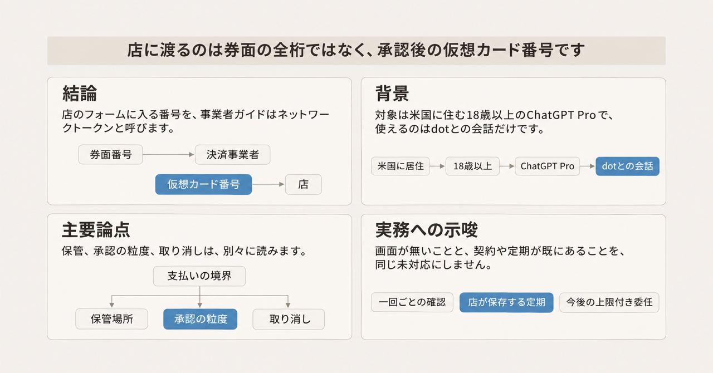
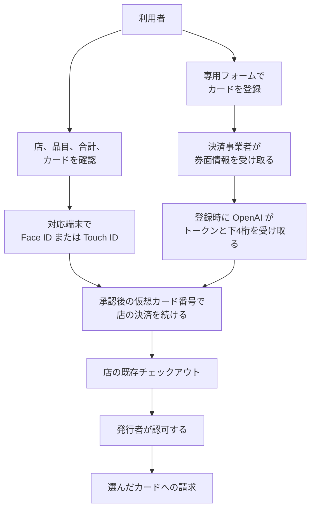

2026-11-13、OpenAI は ChatGPT Wallet を発表しました。利用者が対象のクレジットカードを一度登録し、購入の前に店、品目、合計、使うカードを確認して承認すると、ChatGPT 側のエージェントである dot が店の支払いを終えます。承認のあと、カードネットワークが券面番号（カードに印字された番号）の代わりになる決済トークンを出し、請求は選んだカードに付きます。

この記事では、公式ブログ、ヘルプ、Wallet Terms、Privacy Notice、事業者向けガイドが、登録、承認、店への引き渡しをどう分けているかを整理します。対象範囲、券面情報の収集先、承認の単位、取消の窓口を、文書の文言に沿って確認できます。

日本での提供時期は、確認した公式文書には記載がありません。

*この記事の全体像。以下、順に解説します。*

## ChatGPT Walletとは

ChatGPT Wallet は、OpenAI が 2026-11-13 に発表した支払い機能です。dot は、利用者に代わって店の支払いを終える ChatGPT 側のエージェントです。

利用者は、対象のクレジットカードを一度登録します。購入の前に、店、品目、合計、使うカードを確認して承認します。承認のあと、カードネットワークが決済トークンを出します。決済トークンは、券面番号（カードに印字された番号）の代わりに店へ渡る番号です。請求は、選んだカードに付きます。

### 対象と使える場所

最初の対象は、米国に住む 18 歳以上の ChatGPT Pro です。Pro は、ChatGPT の有料サブスクリプションの名前です。機能は段階的に出ます。条件を満たすアカウントでも、まだ表示されないことがあります。カードは、米国発行かつ米国の請求先である必要があります。

使える場所は、dot との会話に限られます。通常の Chat、Work、単体の Codex は、dot との会話とは別のスレッドです。Wallet は、そこでは使えません。

2025-09-29 の Instant Checkout は、ChatGPT 内で商品を買う別機能です。ギフトカード等を入れるドル残高も、別の残高機能です。ChatGPT Wallet は、そのどちらとも別の機能です。

### 登録できるカードと、番号の入れ方

提携先として、公式ブログは American Express、Chase、Mastercard、Visa を挙げます。ヘルプの対象カードも、この四つです。

デビットカードは使えません。利用者が用意したバーチャルカードは、開始時点では登録できません。このバーチャルカードは、利用者が自分で用意したカードです。承認後に dot が使う仮想カード番号とは別です。仮想カード番号は、券面の代わりに生成される決済トークンの番号で、手持ちのカードと異なり得ます。Chase は本会員だけが登録できます。authorized user（本会員が追加した家族会員）は登録できません。

カード番号、有効期限、セキュリティコードは、チャット欄ではなく専用フォームに入れます。銀行が、確認コードや銀行アプリでの承認を求めることがあります。

Privacy Notice は、2026-11-12 に発効した ChatGPT Wallet のプライバシー通知です。Notice では、券面の番号とセキュリティコードを集めるのは決済サービス事業者です。カード登録時に OpenAI が受け取るカード情報として Notice が例示するのは、次のものです。

- トークン化された資格情報（登録時に、券面の全桁の代わりとして OpenAI が受け取るもの）
- ネットワーク、発行者、種別
- 下4桁、有効期限
- 請求国または郵便番号
- 適格性の信号（そのカードを使えるかどうかの状態）

全桁の番号とセキュリティコードは受け取らない、と Notice は書きます。同じ Notice は、購入時に連絡先、取引の明細、承認の結果、端末や不正対策の情報も集めると書きます。

### 承認と、店が受け取るもの

購入の承認は、ヘルプでは対応端末の Face ID または Touch ID です。今の端末でできないときは、同じ ChatGPT アカウントに入った対応端末へ、リンクまたは QR コードで続けます。

承認後、ヘルプでは決済トークンが生成されます。決済トークンは券面の代わりで、独自の番号、セキュリティコード、有効期限を持ちます。dot が店のフォームへ入れる仮想カード番号は、この決済トークンの番号です。レシート上、手持ちのカードと異なり得ます。事業者ガイドの FAQ がネットワークトークンと呼ぶのは、そのフォームで店が受け取る番号のことです。券面の全桁は、店の受領範囲に入りません。登録時に OpenAI が受け取るトークン化された資格情報と、この承認後の決済トークンを、文書は同じ一つだとは書いていません。トークンと元の口座を結びつける識別子として、Payment Account Reference（PAR）を使います。

支払いは、店の既存の支払いフォームで動きます。Wallet 専用の実装を、新たに足す前提にはなっていません。ChatGPT の有料プランに登録した支払い方法と、ギフトカード等のドル残高とは、別に管理されます。店が同意のもとで保存する定期の資格とは、別です。

価格、在庫、配送、返品、問い合わせは、店が扱います。OpenAI は購入資金を保持しません。販売者は店です。カード発行者は、選んだカードの発行者です。

カードを Wallet から外すと、新しい Wallet 支払いには使えなくなります。提出済みの購入、銀行側のカード、保持が必要な記録は、削除だけでは消えません。

### 登録から請求までの段

登録、承認、トークン、店の受諾は、別の段です。承認が終わった段と、店が注文を受けた段は、別です。図で OpenAI から dot へ向かう線は、登録の段と承認後の段がつながることを示します。登録時のトークンと承認後の仮想カード番号が同じ一つかは、文書が書いていません。

店には、トークン以外の信号も渡り得ます。Privacy Notice は、正当性の判断のため、端末、セキュリティ、不正の情報を店へ出し得ると書きます。事業者ガイドは、Forwarded ヘッダに、利用者側で観測した IP、推定国、タイムゾーン、user-agent などが載り得ると書きます。Forwarded ヘッダは、その付帯情報を店へ載せるための HTTP ヘッダです。全サイトで常に全部が付く、とは書いていません。

## 注意点

### 「最初のウォレット」は複合した自己主張です

公式ブログは、エージェントが利用者の実際のカード詳細にアクセスせず、購入ごとにセキュリティチェックを求める最初のウォレットである、と書きます。この文は、OpenAI の複合した自己主張です。

2025-04-30 の Visa Intelligent Commerce は、カード詳細をトークンに置き換え、消費者が支出上限と条件を設定する、と発表しています。2026-04-28 の Google は、Agent Payments Protocol（エージェント決済の手順）の更新として、Human Not Present を書いています。Human Not Present は、事前の利用者指示に基づき、人がその場にいなくてもエージェントが支払う方式です。どちらも、ChatGPT Wallet という製品ではありません。

したがって、これらの発表だけで、OpenAI の「最初のウォレット」という複合文を偽とは断じません。一方で、資格情報の分離や上限付きの委任を、OpenAI が初めて示したと読む根拠にはなりません。

週に 12 億人が ChatGPT を使う、という数は、2026-11-13 の同じブログにある OpenAI の自己申告です。独立した計測としては確認していません。

### 保管の文言は、文書ごとに粗さが違います

ヘルプは “ChatGPT Wallet securely stores your card details” と書きます。Privacy Notice は、全桁とセキュリティコードを OpenAI が受け取らない、と書きます。細かいほうは Notice です。

「OpenAI のサーバが券面の全桁を持つ」とは、Notice からは読めません。「どこにも券面情報が残らない」とも読めません。決済サービス事業者は、underlying card data（元の券面情報）を、契約とネットワーク規則に従って保持します。

「エージェントにはカード番号が渡らない」は、券面の実際の番号についての文です。ヘルプは、承認後に dot が、仮想カード番号、つまり決済トークンの番号を使ってチェックアウトを終える、と書きます。レシート上、手持ちのカードと異なり得ます。仮想番号がモデルの会話本文に入るかは、確認した文書にはありません。

### 購入ごとの生体認証の外側

ヘルプの現行手順は、購入のたびに内容を見て、生体認証することです。次の三つは、その手順の外側にあります。

Wallet Terms は、2026-11-12 に発効した ChatGPT Wallet の利用規約です。Terms §1 は、提出前に各購入を確認して承認するか、あらかじめ ChatGPT に承認権限を与えるか、のどちらかを利用者に求めています。上限、品目、期間を設定する画面の手順は、ヘルプからは見つかりませんでした。ブログは、その種の委任を “Over time, we expect” と将来に置いています。

利用者が定期または継続の支払いに同意すると、店がその支払い資格を保存し、同意した条件で再び請求できます。管理と停止の窓口は店です。2回目以降に生体認証を求める、とは書いていません。事業者ガイドは、別の購入へその資格を使い回すな、と書きます。定期は、既存チェックアウトが対応し、同意がある場合に、merchant-initiated transaction として認めます。これは、店が起点となって、保存済みの資格で再び請求する取引です。

Terms §8 は、カード追加や購入提出の前に求め得る確認として、パスキー、端末確認、生体、パスコード、その他の方法を並べています。ヘルプの「生体が必要」より広いです。生体が端末の中で行われる場合、指紋や顔の画像そのものを OpenAI は受け取りません。

生体認証が失敗した回数で、誰がロックするかは、ヘルプにも規約にもありません。確認が完了しないうちは、ヘルプの手順は承認完了に進みません。承認完了の表示名は Ready to check out です。文書は、この未完了の注文提出を止める主体として、OpenAI のオペレーターを挙げていません。オペレーターは、OpenAI 側の運用担当です。別端末への引き渡しは、同じアカウントにサインインした端末なら続けられる、とだけ書きます。

### 承認のあと、取消の窓口は分かれます

完了した注文の取消は、店に連絡します。承認したあと、店が受ける前に OpenAI が取り消す手段は、確認した文書にはありません。身に覚えのない請求の窓口は、発行者です。承認前だけ、リクエストを decline できます。decline は、その購入依頼を拒否することです。OpenAI が何秒以内なら承認を取り消せる、という猶予は文書にありません。

規約 §9 は、OpenAI が取引を拒否、遅延、遮断できると書きます。これは、利用者向けの取消ボタンの秒数ではありません。規約 §7 は、Wallet 経由の購入、本人確認、第三者によるデータの取扱いについて、OpenAI が責任を負わないと書きます。争いの宛先は、発行者、ネットワーク、店などに限られます。ヘルプは、承認内容と違う購入やアカウントの不正について、OpenAI Support への連絡も案内します。連絡経路があることと、§7 の責任不負担は、別です。

Ready to check out は、承認が終わった印です。店が注文を受けた印ではありません。チェックアウトが失敗しても、保留の請求が残ることがあります。ヘルプは、再試行の前に店へ注文の有無を確認し、保留の解除時期は発行者に尋ねるよう書きます。会話中のエラーだけでは、注文の成否も、仮押さえの解除時期も分かりません。公式ブログは、サイトがエージェントを誤って止め、リスクシステムが正当な購入を拒否または取消し得ると書きます。リスクシステムは、店側が購入の正当性を判定する仕組みです。

カード登録時に、発行者または決済サービス事業者が、一時的な確認のオーソリを置くことがあります。オーソリは、購入完了前の与信の仮押さえです。これは購入完了ではなく、確認後に取り消される、と規約 §3 は書きます。金額が画面上で誤っていても、承認すると、その表示内容が指示になります。規約 §4 は、AI は誤り得るので、正しいときだけ承認するよう書きます。

### 対象は「米国の Pro」より狭いです

段階提供のため、条件を満たす Pro でも未表示があり得ます。18 歳未満は不可です。米国外の居住と、米国外の請求先は、規約の利用条件に入っていません。

### 報道が公式の範囲で伝えたこと

ITmedia（公開 2026-11-16 08:00、更新 09:49）は、次を公式の範囲で伝えています。発表日、Pro、米国、18 歳、dots のみ、四つのカード、チャット欄に番号を入れないこと、生体または別端末、トークン、店が価格と配送と返品を持つこと、承認は注文確定ではないこと、事前承認は将来計画であること、です。報道の dots は、公式ブログが複数形で書く dot と同じエージェントです。

同じ記事が足していない切り分けは、次です。

- 券面の全桁を受け取らないのは OpenAI であり、決済サービス事業者は受け取ります。
- 店とエージェントに渡さないのは券面の実際の番号であり、承認後の仮想番号はチェックアウトに使われます。
- 事前承認の設定画面は未記載ですが、規約 §1 は事前の権限付与をすでに書いています。定期の再請求は、現行のヘルプにあります。
- 生体が失敗したときの回数、ロック、OpenAI による取消猶予は、公式にも記事にもありません。

### 文書が閉じていない問い

次は、確認した公式文書だけでは閉じていません。

- 仮想カード番号とセキュリティコードが、モデルの入力に入るか、ブラウザ操作のメモリに留まるか。
- トークンが単回か、失敗したチェックアウトのあと再利用できるか、有効時間はどれか。
- Terms §1 の事前付与に対応する画面が、すでに一部のアカウントで有効か。
- 生体認証が何回失敗すると無効になるか。無効にする主体は、端末か、OpenAI か、発行者か。
- 仮押さえが落ちるまでの時間。
- 日本を含む提供拡大の時期。

## いまの文書が支持する範囲

現時点で文書が揃えて言えるのは、次の範囲です。現行の画面手順は、表示された一回の購入を利用者が確認し、対応端末で生体認証してから、ネットワークトークンで店の既存チェックアウトを通します。券面の全桁は、OpenAI 本体の受領範囲に入りません。上限付きの自律決済は、ブログでは今後の期待であり、ヘルプに設定手順はありません。ただし、事前付与の契約文と、同意済み定期の再請求は、現行の文面にあります。

ブログとヘルプが一致して書いているのは、発表日、対象、トークンの定義、購入ごとの確認です。店が全桁を受け取らないことは、事業者ガイド accept-payments の FAQ が明文で書きます。OpenAI が全桁とセキュリティコードを受け取らないことは、Privacy Notice が明文で書きます。デビット不可、開始時点の利用者バーチャルカード不可、Chase の家族会員不可、Chat / Work / Codex 不可は、ヘルプが明文で書きます。

読みを狭める点は、次です。

- ヘルプの保管表現は Notice より粗く、「OpenAI が券面を保管する」と誤読できます。
- dot は承認後に仮想カード番号を使います。実行系は、会話のモデルではなく、この支払い操作を行う側です。課金できる番号を、実行系が扱います。
- 定期と Terms §1 は、毎回の生体認証では閉じません。
- Terms §8 はパスコード等を許容します。生体だけが唯一の確認手段である、とは規約が保証しません。
- 承認は注文ではありません。取消の実働は、店と発行者に分かれます。カード削除は、提出済みの注文を取り消しません。
- Visa Intelligent Commerce（2025-04-30）と Google の Agent Payments Protocol（2026-04-28）は、トークンと事前指示という隣接する設計を、この Wallet より前に公にしています。同一製品の先行実装の証明ではありません。

## 支払い設計で分ける三つの境界

人の資格情報を、エージェントのプロンプトへ渡さない、という分離を金銭に伸ばすとき、この製品は三つの境界に分かれます。画面の有無、契約の文言、店が保存する定期を、一つの「未対応」にまとめないことが、読みの基準です。

### 保管場所

券面の番号とセキュリティコードの収集先は、文書上は決済サービス事業者です。OpenAI が受け取るカード詳細として Notice が挙げるのは、トークンと下4桁などの例です。エージェントである dot が承認後に扱うのは、券面とは別の仮想カード番号です。

したがって、モデルに PAN を貼らないことは必要です。PAN は、券面の番号そのものです。それだけで、支払い能力がエージェントの実行系から消えるわけではありません。仮想番号が会話ログに残るかは未記載です。ログに番号が出ないことは、この文書からは保証できません。

判断基準は、次の二つを分けて書くことです。OpenAI が券面の全桁を受領範囲に入れていないこと。実行系が、課金できる仮想番号を扱って店のチェックアウトを終えること。

### 承認の粒度

今のヘルプで操作できるのは、一購入ごとの確認と、端末での認証です。反復は二つに分かれます。同意した定期は、店が資格を保存して再請求できます。上限、品目、期間を利用者が事前に置く画面は、ヘルプにはありません。契約は、各購入の承認に代えて、事前に権限を与える、という文をすでに持ちます。ブログは、その自律決済を今後の期待として書きます。

支出権限を常駐させる設計では、画面が無いことと、契約と定期が開いていることを、分けて扱います。2025-09-29 の Instant Checkout を、この Wallet の保証として流用しません。Instant Checkout の当時の対象は、米国の Plus、Pro、Free、Etsy、カードオンファイルまたはエクスプレス決済、購入確定の確認です。Plus と Free も、Pro と同じく ChatGPT の利用プランの名前です。

判断基準は、次の三つです。今の画面で利用者が操作できるのは、表示された一回分の確認か。定期の再請求は、店が保存した資格と同意に乗っているか。上限付きの事前委任は、ブログの今後の期待に留まっているか。

### 取り消し

承認前は、decline できます。承認後に OpenAI が何秒で取り消すかは、文書にありません。成立した注文の窓口は店です。保留や、身に覚えのない請求の窓口は発行者です。カードを外しても、提出済みの注文と、決済サービス事業者の原データは残り得ます。不成立のあと、確認せず再試行すると、仮押さえが重なり得ます。ヘルプは、再試行の前に店へ注文の有無を確認するよう案内しています。

生体が失敗したときに自動で止める係は、公開文書にはいません。確認が終わらなければ、その手順では提出に進みません。確認の成功条件には、同じアカウントの別端末も含まれます。

判断基準は、操作の時刻で窓口を分けることです。承認前の拒否、承認後で店が受ける前の取消、成立した注文、保留と身に覚えのない請求、を同じ「OpenAI が取り消す」にまとめません。

## まとめ

ChatGPT Wallet の現行手順は、表示された一回の購入を確認し、対応端末で生体認証したあと、店の既存チェックアウトを通すものです。店のフォームに入るのは、決済トークンの番号である仮想カード番号です。事業者ガイドは、その受領物をネットワークトークンと呼びます。券面の全桁は OpenAI の受領範囲に入らず、決済サービス事業者が収集します。

上限付きの自律決済は、ブログでは今後の期待です。契約の事前付与と、同意済み定期の再請求は、現行の文面にあります。承認は注文の成立ではなく、取消は店と発行者に分かれます。

導入や接続の判断では、保管場所、承認の粒度、取り消しの窓口を分けて読んでください。画面に無いことと、契約や定期が開いていることを、同じ未対応として扱わないことが基準です。

この記事が少しでも参考になった、あるいは改善点などがあれば、ぜひリアクションやコメント、SNSでのシェアをいただけると励みになります！

## 参考リンク

- [OpenAI, “Introducing ChatGPT Wallet”, 2026-11-13](https://openai.com/index/introducing-chatgpt-wallet/)
- [OpenAI Help Center, “Making purchases with ChatGPT Wallet”](https://help.openai.com/en/articles/20001654-making-purchases-with-chatgpt-wallet)
- [OpenAI, “ChatGPT Wallet terms”, Effective 2026-11-12](https://openai.com/policies/chatgpt-wallet-terms/)
- [OpenAI, “ChatGPT Wallet Privacy Notice”, Effective 2026-11-12](https://openai.com/policies/chatgpt-wallet-privacy-notice/)
- [OpenAI Developers, “Accept payments”](https://developers.openai.com/commerce/guides/accept-payments.md)
- [OpenAI, “Buy it in ChatGPT: Instant Checkout and the Agentic Commerce Protocol”, 2025-09-29](https://openai.com/index/buy-it-in-chatgpt/)
- [OpenAI Help Center, “Using your ChatGPT balance”（別機能のドル残高）](https://help.openai.com/articles/20001508)
- [Visa, “Find and Buy with AI: Visa Unveils New Era of Commerce”, 2025-04-30](https://usa.visa.com/about-visa/newsroom/press-releases.releaseId.21361.html)
- [Google, “We’re donating Agent Payments Protocol to the FIDO Alliance”, 2026-04-28](https://blog.google/products-and-platforms/platforms/google-pay/agent-payments-protocol-fido-alliance/)
- [ITmedia NEWS, 2026-11-16](https://www.itmedia.co.jp/news/article/2611/16/2000003208/)
