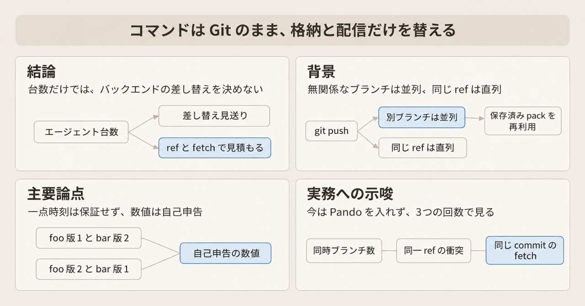
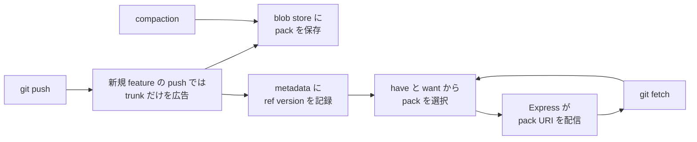

エージェントへ並列の作業を任せるとき、1サイクルに載せる範囲は、モデルの呼び出し枠より前に、版管理が同時に受けられる量から見積もれます。OpenAI は 2026-11-02 のエンジニアリング記事で、自社モノレポの開発全体を載せる Git リポジトリのバックエンド Pando を説明しました（Aaron Friel、Taylor Blau、Ted Nyman）。記事中の数値は同社の自己申告です。この記事は、Pando がコマンドと格納と配信をどう分けたかを整理し、発注側が今の見積もりに使える単位を示します。

*この記事の全体像。以下、順に解説します。*

## Pandoとは

Pando は、OpenAI が自社モノレポの開発全体を載せるために作った Git リポジトリのバックエンドです。エンジニアとエージェントが打つコマンドは Git のままです。push された pack の保存、ブランチ先端の記録、同じ履歴を多数の読み手へ配る経路を、従来の Git サーバとは別の実装にしています。pack は、Git がオブジェクトをまとめて転送するファイルです。

### コマンドと格納の分離

Pando が分けるのは、人が触るコマンドと、オブジェクトと ref の置き場です。ref はブランチとタグの名前です。Git のオブジェクト（blob、tree、commit、tag）と ref を同期の単位にしたまま、サーバ実装だけを替えます。クライアントはこれまでどおり `git push` と `git fetch` を出します。サーバは pack を展開してローカルリポジトリを更新する代わりに、pack のバイト列と、ブランチ先端の版を、別々の水平スケールするストアへ書きます。

### push が書くもの

push では、受け取った pack を blob store の不変オブジェクトとして保存します。blob store は、その pack のバイト列を置く保存先です。同時に、新しい先端、その pack、依存する過去の ref version を metadata store に記録します。ref version は、ブランチ先端の版を積んだ記録です。無関係なブランチの push は並列に受けます。競合するのは同じ ref だけです。

1回の push が同期的に書くメタデータは、OpenAI の記事が O(1) と呼ぶ量です。

### fetch が読むもの

fetch では、have と want を ref version の列に写し、必要な保存済み pack を選びます。have はクライアントが既に持つコミット、want は欲しいコミットです。HTTP 応答に同梱する inline pack は空にします。実体は Git protocol v2 の packfile-uri で渡します。protocol v2 は Git のスマート通信の第2版です。packfile-uri は、pack のバイト列を応答へ埋め込まず、URI で別途渡す仕組みです。読み手は交渉で pack の場所を受け取り、地域キャッシュの Express から同じバイト列を取ります。Express は、その地域キャッシュから pack を配る配信層の名前です。

fetch の pack 選択は、クライアントが持つ版から欲しい版までの ref version 上の距離を Δ として、O(log Δ) のメタデータ読み取りです。

リポジトリ全体の一点時刻は保証しません。OpenAI の記事の例では、フルクローンの交渉中に `foo` と `bar` が両方動くと、一方のクライアントは foo の版1と bar の版2を見ます。もう一方は逆の組み合わせを見ることがあります。

### pack を残す compaction

圧縮とファイル数の削減は compaction が担います。compaction は、push のたびに作る L0 pack を、バックグラウンドで L4 までの cover にまとめる処理です。L0 は push 直後の段、L4 はそのまとめの最後の段です。cover は、より小さい pack 群を覆うまとめの pack です。あいだの段も含め、各レベルの pack は捨てません。

### 広告は trunk だけ

新規の feature ブランチへの push では、既定で trunk だけをクライアントへ広告します。広告は、交渉のときにサーバがクライアントへ返す ref の一覧です。feature ブランチは本線から分かれた作業用ブランチ、trunk は開発の本線です。数百万ブランチの全一覧を毎回配りません。

### 移行の入口と公開されているもの

本番投入は、既存システムへの読み書きプロキシから始めました。その後、Git CLI の内部ラッパーでクライアントを段階移行しました。公開物は、Git クライアントのフォーク [openai/git](https://github.com/openai/git) と、[パッチトラッカー](https://oai-git.openai.chatgpt.site/) です。パッチトラッカーは、そのフォークの upstream 向けパッチを数える公開ページです。

新規の feature ブランチへの push では、書き手は `git push` から入り、trunk だけの広告を経て、pack を blob store へ、先端の版を metadata へ書きます。読み手は `git fetch` から入り、have と want で pack を選び、Express の URI から同じバイト列を取ります。compaction は blob store 側の pack をまとめます。metadata の ref version は、fetch の pack 選択に使われます。

## 注意点

ここまでの本番値は、OpenAI の自己申告です。第三者の再計測は公開されていません。

### 同じ比率を別の改善として足さない

導入部は median push latency を nearly 5x 短縮したと書きます。移行の節は median push の遅延を nearly 80% 減らしたと書きます。どちらも同じ指標の名前です。5倍短縮を、所要時間が約5分の1になったと読むと、80% 減と比は合います。前後の絶対値、標本、テイルはありません。この2文を、独立した改善として足せません。

信頼性は、作り替え前に時として 90% を下回ったとあります。分母は公開されていません。push、fetch、merge のどれを、どの時間窓で数えたかは分かりません。移行後の merge は「改善した」とだけ書かれ、成功率の後値はありません。

1日 nearly a petabyte、handful of CPU cores で 1日 a petabyte、1時間に 57 TB 超、そのバイトの 99% 超がローカルディスクキャッシュ、Express のヒット率 99% 超、標準クラウド VM で 10 Gbps を飽和、同時 push は many thousands of clients、という記述も同じ記事の自己申告です。1時間の 57 TB を 24 倍して、日次の petabyte と同一視しません。

### シミュレーションの位置づけ

シミュレーション画面は "Synthetic teaching models, not production benchmarks" と明記しています。比較した three-phase commit 側は、リポジトリ全体の一貫性を緩めた設定です。図の勝敗は本番ベンチマークではありません。

設定は、1,000 クライアントがそれぞれ別ブランチを選んで繰り返し push するものです。同一 ref への集中でも、リポジトリ数の閾値でもありません。キャプションの Mean push to fetch は、各クライアントの push の初回から再試行まで、独立した読み手がそのコミットを検証するまでを含みます。ビルドとテストは含みません。

### bitmap 計測の条件

クライアントフォークの bitmap 計測は、Pando の push 遅延ではありません。[openai/git のコミット `89fbe6e55f1e`](https://github.com/openai/git/commit/89fbe6e55f1e73b6ace3f9a46a36d66bfa12b3bd) は、1.37-million-commit のモノレポで、MIDX bitmap の書き込みが n=2、984.726 秒対 200.058 秒、actual fetch が n=4、169.303 秒対 10.651 秒だったと書きます。条件は Hyperfine 1.20.0、64 コア、tmpfs、protocol v2 の file:// です。ネットワークとコールドストレージは含みません。actual clone はほぼ同じです（839.591 秒対 830.168 秒）。clone 全体の rev-list は、グラフ選択側が遅いと書かれています。対のどちらが変更前かは、公開されている対の数値だけでは決まりません。

### 大きい push と、捨てない pack

同期的なメタデータ更新は、新しい先端を直ちに fetch できるためだと記事が書きます。非常に大きい push では、同期的に書くのはコミットの一部だけで、全コミットのメタデータを同期的に書くわけではありません。その一部に新しい先端が含まれるかは、記事に書かれていません。受けた push の検証は single pass decode だと書きます。検証条件は公開されていません。

pack は全レベルで保持し、従来の garbage collection はしない、と記事が書きます。容量の上限は公開されていません。同じ ref、とくに trunk への push は直列のままです。

### 公開フォークを Pando の説明書として読まない

公開フォークの README は、upstream Git の紹介のままです。Pando の説明はありません。2026-11-04 時点の star は約 260 です。default branch `codex` の先端は 2026-10-19 の `9fe64f46` です。`pushedAt` が 2026-11-04 なのは、任意ブランチへの push であり、先端の日付ではありません。パッチトラッカーは 2026-10-31 時点で、upstream 向けパッチ 50、自ビルドのトピック 23、upstream の上に載せるコミット 92 と数えています。

構築過程も自己申告です。10週間、Rust、GPT-6 Astra による Lean と TLA+、数百時間の連続セッションと書かれています。証明の範囲と手順は公開されていません。記事は技術の共有を探索中と書きます。Greg Brockman は 2026-11-03 に、他者への提供を検討していると投稿しました。提供済みではありません。

### 仕様として残っていない境界

「Git 互換」は、OpenAI の記事の範囲では、プロトコルとクライアントの操作感を保つという意味です。explicit haves は、trunk だけを広告しても、feature ブランチの先端を `--force-with-lease` の検査に使える、と記事が書く capability です。`--force-with-lease` は、リモートの先端が自分が最後に見た版と一致するときだけ push を通す検査です。pack の前提から外すとは、その ref を pack の生成条件から外し、`--force-with-lease` の検査には残すことです。stock Git は、packfile-uri を要求する引数を足していない公式の Git です。次の境界は、一次記事、Git 公式、公開フォークのソースで確認したものです。

| 境界 | 一次資料が言っていること | まだ仕様になっていないこと |
|---|---|---|
| pack | push で受け取った pack を再利用する。fetch は packfile-uri だけを使い、inline は空の packfile だと記事が書く | 空 pack がオブジェクト 0 個の妥当な pack だと、Git 公式の packfile-uri 文書は言っていない |
| packfile-uri を要求する条件 | protocol v2 だけで、クライアントが `packfile-uris` とプロトコル名を送ったとき、サーバは URI を返してよい | `fetch.uriprotocols` の文書上の既定は empty。stock Git の fetch-pack.c も `openai/git` の `9fe64f46` も、未設定ならその引数を出さない。記事は、引数を出さないクライアントへ何を返すかを書いていない |
| 公式サーバ実装との差 | Git 公式の実験的設定は `uploadpack.blobPackfileUri` で、指定した blob を URI に置き換える | 記事は Pando がこの設定キーを使うとは書いていない。Pando が配るのは push 由来の pack である |
| explicit haves | trunk だけを広告しても、feature ブランチの先端は `--force-with-lease` の検査に使える、と記事が書く。[`send-pack` の `a3eae730`](https://github.com/openai/git/commit/a3eae730133768ea334731d2f48a80aff724fb5d) は、その ref を pack の前提からは外す | この capability を広告しないサーバでは、従来どおり全広告 ref が pack の前提になる |
| 並列ダウンロード | 記事は、公開 Git ビルドが独立 pack を並列に取得し index できると書く | `9fe64f46` の fetch-pack.c では、並列用の `fetch.packfileurijobs` の初期値は 1。1 より大きいときだけ、サーバが `no-ref-delta` を出している場合に並列側へ進む。`no-ref-delta` は、その条件の名前で、中身は書かれていない |
| URI の認証 | 公式文書の Future work は、URI に追加 HTTP ヘッダ（認証を例示）を載せるにはプロトコル変更が必要だとし、マニュアルは 2.38.0 以降 2.56.0 までこの項を更新していない | フォーク側の別コミットは、クライアントが pack の URL へ自分で Authorization を付け、HTTP 401 を最大 3 回やり直す。プロトコルにヘッダ枠を足した、という記載は公式文書に無い |
| フック | 記事が hooks と言う箇所は、レガシー連携の webhooks が 1 回だけである | pre-receive、update、post-receive を Pando がどう扱うかは記載が無い。非対応とは断定できない |
| LFS | 記事にもパッチトラッカーの取得テキストにも Git LFS は無い | Codex のクラウド環境が GitHub の LFS を取る、という 2025 年のコミュニティ投稿は別製品である。Pando の対応可否には使わない |
| 部分クローン | fetch 計画の入力として記事が書くのは、have と want のコミット ID と、ブランチの依存 pack である | `--filter`、shallow、promisor は protocol v2 では packfile-uri とは別引数である。Pando が filter を計画に使うかは記載が無い。フォークが promisor pack の再パックを扱うのはクライアントの maintenance であり、サーバの保証ではない |
| 権限付きリモート | リモートの認証方式（SSH か smart HTTP か、トークンのスコープ）は記事に無い | 確認できた事前条件は explicit haves と `--force-with-lease` までである |
| 複数ブランチの同時刻 | 単一 ref の更新は直列。リポジトリ全体の一点時刻は捨てたと記事が書く | 複数のリリースブランチを同じ瞬間の組として読む監査、バックアップ、ミラーは、このモデルの外で自分の整合を取る必要がある |
| 積み上げブランチ | 積み上げブランチは、前のブランチの上に次のブランチを積む使い方です。trunk 以外のオブジェクトは再送します。同一ブランチへの連続 push も同様です。モノレポではこの pack の中央値が 20 KiB 未満、99 パーセンタイルが 3 MiB 未満だったと記事が書きます | このサイズは OpenAI のモノレポでの自己申告であり、別リポジトリの見積もりには使えない |

URI 認証のフォーク側コミットは [`b1d4e8326428`](https://github.com/openai/git/commit/b1d4e8326428d6f48fdb1765c367c15f5160313d)（2026-09-10T22:10:23Z）です。`codex` への merge は `d5a012faa55f`（2026-10-19）です。同じ題の別オブジェクト `e760968074`（2026-09-10T19:49:23Z、親が異なる）もあります。同一パッチとは扱いません。

### まだ閉じない問い

- URI を要求しない stock Git に対し、Pando が通常の pack を生成して返すのか、空 pack のまま失敗するのか。
- サーバ側フック、LFS、`--filter`、shallow を、本番の Pando が受けているのか。
- リモート認証の方式と、Express の pack URL を誰が取れるのか。
- median の前後、とくに push のテイルと、移行後の merge 成功率。
- モノレポの履歴サイズと、1日の checkout 回数。Anthropic が公開した規模との位置関係は、OpenAI 側の記事からは計算できない。
- explicit haves が upstream の default branch に含まれているか。コミットオブジェクトは git/git の API が返したが、包含の比較はタイムアウトし、default branch への包含は未確認である。upstream に入った別の修正として、fetch-pack の [`c4244bdfe6`](https://github.com/git/git/commit/c4244bdfe6d28ed552e10f1e37387978549b36ed)（2026-07-27、Junio C Hamano の Signed-off-by）はある。これは packfile URI が "pack" 出力を受け付ける修正であり、explicit haves の包含確認そのものではない。

## 同じ負荷への別の境界

同じ「エージェントが Git の耐量を超える」という局面で、Anthropic は別の境界を公開しています。出典は 2026-10-13 の "Redesigning source control at Anthropic"（2026-10-15 更新）です。数値も自己申告です。

Anthropic の記事は、自社の負荷は unusual で、近い将来に同じ問題を持つ組織は多くないと見ています。大多数のリポジトリでは、クローンがオフラインで完結する Git の設計が適切だとも書きます。2026-05 のモノレポは 1日あたり約 2,500 件の merge、2026-09 は 1日 30,000 件超です。main の履歴だけで almost 100 GB、圧縮した作業コピーは 25 GB 超です。CI の checkout は 1日 on the order of 25 million です。素朴に毎回取り切ると 1日 600 PB 超になる、という見積もりです。実測トラフィックではありません。shallow、sparse、promisor、数百台の内部ミラー、blob storage の seed を使ったうえで、seed が先端から遅れ、履歴に依存する diff と blame の保守が重くなった、と書きます。

彼らが作った Scion は、Git をモノレポから外しています。クライアントは常時オンラインです。サーバが commit、merge、blame を計算し、packfile を持ちません。ref は main とリリースブランチ以外を discourage します。理由は、global な状態がスケールの障害になる、というものです。移行は 5か月です。Scion とレビュー面 Antique を 7人で作った、と書きます。インフラの CPU とメモリは以前の Git ミラー比で 200 倍小さく、checkout は分単位から秒単位、CI の CPU は 25% 空いた、各段のキャッシュヒットは 99% 超、とも書きます。一般の Git 代替にはしない、とも明記します。

記事の末尾は、Git サーバは Git クライアントと同じ動きをしなくてよい、サーバ側 RPC と交渉プロトコルは変えられる、と書きます。これは、Pando が採った「コマンドは Git、実装は別」に近い助言です。自社のモノレポでは、その助言より前に Git を降りています。

Meta の Sapling は、公開されているソース管理は当時も今も、数千万のファイル、コミット、ブランチがあるリポジトリを扱えない、と公式導入に書きます。その規模は、まだ公開されていない Sapling サーバと仮想ファイルシステムと組んだときのもので、操作は `sl` です。Git リポジトリとの往来は CLI が担い、Git サポートには、まだ残る引っかかりがあり得る、とも書きます。UX とリポジトリ形式は分けられる、という記述は、Pando の「コマンドは Git、格納は別」に近いです。ただし、公開 Git 相当だけでは Meta の規模は扱えない、という一次でもあります。Pando の数値を反証した記事ではありません。

OpenAI の記事が比較したもう一つの型は、blob storage 上の単一マニフェストに全 ref 更新を順序づける write-ahead log です。pack のアップロードは並列でも、無関係なブランチが同じマニフェストの compare-and-swap で競合します。compare-and-swap は、見た値が今も同じときだけ更新を成功させる操作です。レプリカが pack の索引作成に遅れると、新しい commit の fetch が待ちます。Pando はこの競合を ref 単位に縮めた、という主張です。この比較のシミュレーションは、教材であり本番値ではありません。

## コマンドを残す選択の射程

現時点の結論は次です。人が打つコマンドを Git のままにできるのは、OpenAI が自社モノレポで採った設計選択としては、一次記事と公開クライアントで裏付けがあります。それを「どの組織でも、エージェント台数だけ見ればバックエンドを差し替えれば足りる」と一般化すると、反証が勝ちます。

裏付けは4点です。

- 記事は、作業を止めず、チームの Git の使い方を変えずに、モノレポの全開発を Pando へ移したと書きます。移行手段は、読み書きプロキシと、Git CLI の内部ラッパーです。
- 競合単位を ref pointer の compare-and-swap に限る、という記述は、並走の単位を「開発者の操作回数」ではなく「同時に動かすブランチ」で数える見積もりと整合します。
- pack の再利用と地域キャッシュは、同じ commit を CI とエージェントが繰り返し取る負荷に対する設計です。
- explicit haves のクライアント修正は、公開フォークの `a3eae730` まで辿れます。packfile-uri が "pack" 出力を受け付ける修正は、upstream の fetch-pack `c4244bdfe6` まで辿れます。explicit haves が upstream の default branch に含まれるかは未確認です。主張のすべてが、非公開実装の中だけにはありません。

一般化を止める側は、次のとおりです。

- Pando は、複数 ref の一点時刻を保証しません。`foo` と `bar` が別々の版の組み合わせになる例がそれです。因果一貫性は、複数の ref を同じ瞬間の組として読む性質です。この一点時刻を前提にするツールは、黙って壊れることがあります。OpenAI の記事は、利用者がこの欠落を気にしないものとして書いています。気にする運用は、自分で検出する必要があります。
- trunk だけを広告する設計は、積み上げブランチと同一ブランチの連続 push で、trunk 外のオブジェクトを再送します。エージェントが狭いブランチを積み上げる働き方ほど、この再送が効きます。
- 速い fetch は、クライアントが packfile-uri を要求し、空の inline pack を理解できることが前提に読めます。既定の stock Git はその引数を出しません。性能のために OpenAI は、自前の Git 配布を開発者マシンと ChatGPT デスクトップアプリへ配っています。
- フック、LFS、部分クローン、リモート認証は、一次記事の保証一覧に入っていません。記載が無いことを非対応と短絡しません。保証があるとも書きません。
- 90% の分母、5x と 80% の測定手順、テイルレイテンシ、移行後の merge 成功率は公開されていません。公開情報の範囲では、この数値を覆す独立計測は見当たりません。見つからないことは、数値が正しいことの証明ではありません。
- 移行で Git の操作を変えていない、という記述と並んで、legacy API、webhook、リポジトリダウンロードに依存する数百の連携も移した、と記事が書きます。コマンドが同じであることと、周辺連携の移行が不要であることは別です。
- Anthropic は、部分クローンとミラーを使い切ったあと、Git クライアント互換をモノレポの条件から外しました。常時オンラインで checkout が数千万回の領域では、別の一次事例が「Git のまま」を選んでいません。

## 作業範囲は ref と fetch 回数から逆算する

エージェントの 1サイクルに載せる範囲は、実行環境の台数からではなく、版管理が同時に受けられる ref と、同じ履歴の fetch 回数から逆算します。

今採る運用に、Pando の導入は含みません。サーバは公開されておらず、互換の未記載部分を自分のリポジトリで試す手段がありません。

1. 並走させるエージェントごとに、ブランチか worktree を分けます。worktree は、同じリポジトリに対する別の作業ディレクトリです。見積もりの単位は、同時に動くブランチ数と、main など同一 ref への衝突回数です。同一 ref に集めるほど、Pando 型の並列は効きません。
2. CI とエージェントが同じ commit を何回 fetch するかを、モデル呼び出しとは別に数えます。ここが先に詰まるなら、作業範囲を広げる前に取得回数を減らします。
3. 履歴の大きさで詰まるなら、今使えるのは Git 自身の shallow、sparse、partial clone です。Pando の記事は、これらをサーバ機能として保証していません。効いたかどうかは、checkout 時間と転送量で見ます。
4. 複数ブランチを同じ瞬間の組として読む処理（リリース判定、監査、ミラー）は、Pando が保証しない一点時刻を必要とします。このような処理が中心なら、Git 互換のバックエンドへ移る判断を保留します。

ホストが GitHub のままなら、公式のリポジトリ制限が別の上限になります。2026-11-04 に確認した文書では、推奨上限として、Git の読み取りはリポジトリあたり 15回/秒、push は 6回/分、ブランチは 5,000、同一ブランチへの open pull request は 1,000、マージは 1回/分です。push サイズ 2 GB と単一オブジェクト 100 MB は enforced です。単一オブジェクトの推奨上限は 1 MB、オンディスクの推奨は 10 GB です。これは Pando の測定ではありません。エージェントの台数を増やす前に、同じリポジトリへの fetch と push の頻度がこの推奨に当たるかを見ます。

再評価を始める目安は2つです。履歴が数十 GB を超え、checkout が 1日に数千万回へ近づき、partial clone とミラーの保守が破綻したら、Git クライアントを残すかどうかを、その組織の測定とオフライン要件で判断します。Anthropic の数字は同社の状況であり、移行の一般的な閾値ではありません。OpenAI が Pando を外部提供し、認証、フック、LFS、部分クローン、stock Git での fetch の仕様を公開したら、その仕様で再評価します。

## まとめ

Pando は、Git のコマンドを残し、pack の保存とブランチ先端の記録と配信だけを別実装にした、OpenAI のモノレポ向けバックエンドです。無関係なブランチの push は並列に進み、同じ ref は直列のままです。fetch は保存済み pack を packfile-uri で再利用します。リポジトリ全体の一点時刻は保証しません。

本番の倍率と転送量は自己申告です。nearly 5x と nearly 80% は、同じ median push の比率として読む範囲にあります。シミュレーションの勝敗は教材です。空の inline pack、stock Git が packfile-uri を要求しないこと、フック、LFS、部分クローン、認証は、保証一覧に入っていません。サーバは未公開であり、他者への提供は検討表明までです。

今の見積もり単位は、同時に動くブランチ数と、同一 ref への衝突と、同じ commit の fetch 回数です。GitHub 上なら、公式の推奨回数と enforced のサイズが別の上限になります。Pando を採るかは、外部仕様が公開されてから、その仕様で判断します。

この記事が少しでも参考になった、あるいは改善点などがあれば、ぜひリアクションやコメント、SNSでのシェアをいただけると励みになります！

## 参考リンク

- [OpenAI, "Scaling Git at OpenAI"（2026-11-02）](https://openai.com/index/scaling-git-at-openai)
- [Git Documentation, packfile-uri（最終更新表示 2.38.0、2.56.0 まで no changes）](https://git-scm.com/docs/packfile-uri)
- [Git Documentation, Git Protocol v2](https://git-scm.com/docs/gitprotocol-v2)
- [openai/git default branch `codex` tip `9fe64f46`（committer 2026-10-19）](https://github.com/openai/git)
- [openai/git `a3eae730` send-pack: honor explicit-haves capability（2026-09-15）](https://github.com/openai/git/commit/a3eae730133768ea334731d2f48a80aff724fb5d)
- [openai/git `b1d4e8326428` http: authenticate packfile-URI downloads（2026-09-10T22:10:23Z。codex への merge は `d5a012faa55f`、2026-10-19）](https://github.com/openai/git/commit/b1d4e8326428d6f48fdb1765c367c15f5160313d)
- [openai/git `89fbe6e55f1e` pack-bitmap 計測](https://github.com/openai/git/commit/89fbe6e55f1e73b6ace3f9a46a36d66bfa12b3bd)
- [git/git `c4244bdfe6` fetch-pack: accept "pack" output for packfile URIs（2026-07-27）](https://github.com/git/git/commit/c4244bdfe6d28ed552e10f1e37387978549b36ed)
- [OpenAI Git patch tracker](https://oai-git.openai.chatgpt.site/)
- [Greg Brockman, 2026-11-03](https://x.com/gdb/status/2117435285021810921)
- [Anthropic, "Redesigning source control at Anthropic"（2026-10-13、2026-10-15 更新）](https://www.anthropic.com/research/redesigning-source-control)
- [Sapling SCM, Introduction](https://sapling-scm.com/docs/introduction/)
- [GitHub Docs, Repository limits（2026-11-04 に確認）](https://docs.github.com/en/repositories/creating-and-managing-repositories/repository-limits)
