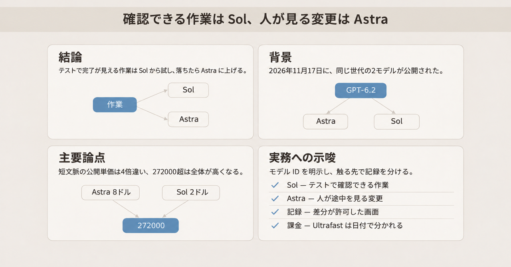
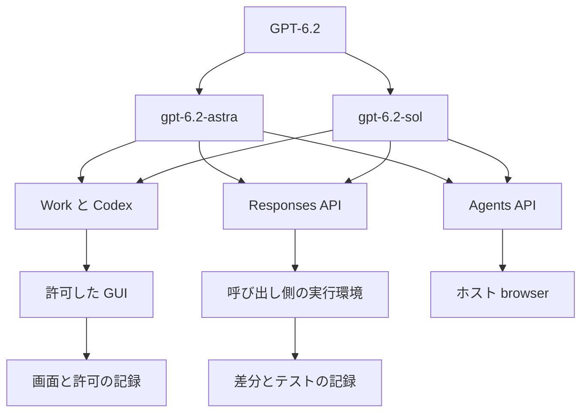

2026年11月17日、OpenAI は GPT-6.2 を 2 つのモデルとして公開しました。Astra の API モデル ID は `gpt-6.2-astra` です。Sol の API モデル ID は `gpt-6.2-sol` です。コーディングエージェントにモデル ID を書く人が、公開単価、コンテキスト、コンピュータ操作の対象を見て、作業ごとにどちらを置くかを決めるための記事です。順位や削減率の数値は、発表とシステムカード（公開された評価文書）にある OpenAI または掲載企業の自己申告です。料金の数値は 2026年11月18日に取得した OpenAI の pricing です。

*この記事の全体像。以下、順に解説します。*

## GPT-6.2 Astra と Sol とは

GPT-6.2 は、同じ世代の 2 モデルです。発表は、Astra を hardest projects 向け、Sol を everyday work 向け、と分けています。開発者ガイドの冒頭は、最も要求の高い作業に Astra、より低いコストの複雑な作業に Sol、と書いています。

発表が Astra に寄せる作業は 3 つです。既存コードベースの複雑な変更の実装とテスト、文書テンプレート、コンピュータ操作です。コンピュータ操作は、画面を見てクリックや入力をする作業です。発表が Sol に書くのは、複数段のエージェント作業と、日常の既定モデルです。ここでの複数段は、エージェントが手順を重ねる作業です。

どちらも ChatGPT Work、Codex、API に載ります。ChatGPT Work は、Codex と並ぶ ChatGPT の製品面です。Codex は、コーディング向けの製品面です。API では Ultrafast も両モデルで使えます。Ultrafast は課金段の 1 つで、Standard より高い単価の処理です。入力はテキストと画像です。出力はテキストです。

コンテキスト窓は両モデルとも 1,050,000 です。最大入力トークンは 922,000 です。最大出力は 128,000 です。知識カットオフは、Astra が 2026-05-18、Sol が 2026-06-01 です。

Responses API のツール一覧には、両モデルとも `computer_use`、`web_search`、`apply_patch`、`hosted_shell`、`mcp` などが並びます。`computer_use` は、画面を操作するツール名です。`mcp` は、構造化連携へつなぐツール名です。Responses API は、ツール呼び出しに必要な API の面です。

短文脈の Standard は、100万トークンあたり、Astra が入力 $8、キャッシュ読取 $0.40、出力 $40 です。Sol は入力 $2、キャッシュ読取 $0.10、出力 $10 です。短文脈は、入力が 272,000 トークン以下のリクエストです。入力が 272,000 を超えると、そのリクエスト全体の入力とキャッシュが 2 倍、出力が 1.5 倍になります。段ごとの表は次の節です。

ChatGPT デスクトップの Computer Use は、対応地域の macOS と Windows で、ChatGPT Work と Codex から使います。製品ドキュメントは、視覚判断が難しい作業ではモデルピッカーで Astra を選ぶ、と書いています。

人が見る成果物は、操作面で分かれます。製品の Computer Use は、デスクトップアプリに許可を与えたあと、その GUI を見ます。Responses API の computer use は、呼び出し側が用意したブラウザかデスクトップに接続します。OpenAI がホストするブラウザは、Agents API の別経路です。自分の実行環境を触るなら Responses API、OpenAI のブラウザに任せるなら Agents API です。

## 100万トークンあたりの公開単価

単位は 100万トークンあたりの USD です。取得日は 2026-11-18 です。長文脈は、入力が 272,000 トークンを超えるリクエストで、短文脈の倍率をリクエスト全体にかけた額です。30 分と 12 時間は、キャッシュ書込の保持時間です。キャッシュ読取とは別料金です。初回を読取単価だけで見積もると足りません。Batch は Standard の半額の段です。Fast は Standard の 2 倍の段です。キャッシュ書込の列は短文脈だけです。長文脈で書込が何倍になるかは、この表にはありません。

| モデル | 段 | 短文脈 in / out / cached | 長文脈 in / out / cached | 短文脈の書込 30分 / 12時間 |
| --- | --- | --- | --- | --- |
| gpt-6.2-astra | Standard | 8 / 40 / 0.40 | 16 / 60 / 0.80 | 10 / 20 |
| gpt-6.2-sol | Standard | 2 / 10 / 0.10 | 4 / 15 / 0.20 | 2.50 / 5 |
| gpt-6.2-astra | Batch | 4 / 20 / 0.20 | 8 / 30 / 0.40 | 5 / 10 |
| gpt-6.2-sol | Batch | 1 / 5 / 0.05 | 2 / 7.50 / 0.10 | 1.25 / 2.50 |
| gpt-6.2-astra | Fast | 16 / 80 / 0.80 | 32 / 120 / 1.60 | 20 / 40 |
| gpt-6.2-sol | Fast | 4 / 20 / 0.20 | 8 / 30 / 0.40 | 5 / 10 |
| gpt-6.2-astra | Ultrafast プロモ（2027-02-28 PT まで） | 24 / 120 / 1.20 | 48 / 180 / 2.40 | 30 / 60 |
| gpt-6.2-sol | Ultrafast プロモ | 6 / 30 / 0.30 | 12 / 45 / 0.60 | 7.50 / 15 |
| gpt-6.2-astra | Ultrafast リスト（2027-03-01 PT から） | 48 / 240 / 2.40 | 96 / 360 / 4.80 | 60 / 120 |
| gpt-6.2-sol | Ultrafast リスト | 12 / 60 / 0.60 | 24 / 90 / 1.20 | 15 / 30 |

PT は太平洋時間です。プロモ期間の Ultrafast は Standard の 3 倍です。2027-03-01（太平洋時間）からのリストは 6 倍です。

pricing の短文脈 Standard では、前世代の `gpt-6-astra` は入力 10、出力 50、キャッシュ読取 1.00 です。上の表には、この前世代の行はありません。`gpt-6.1-sol` は 2 / 10 / 0.10 です。Sol の標準単価は 6.1 Sol と一致します。発表は、Astra の入出力は GPT-6 Astra より 20% 低い、と書いています。

pricing が名指しする background 要求は、2 時間窓で Standard より 30% 安く、8 時間窓で 40% 安い、と書いています。background は、通常の Standard とは別の要求です。2 時間窓と 8 時間窓は、その要求に付ける window です。遅い依頼のすべてがこの割引になる、とは書いていません。名指しされるのは GPT-6.2 Astra、GPT-6.2 Sol、GPT-6.1 Terra、GPT-6 Luna です。GPT-6.1 Terra と GPT-6 Luna は、同じ割引の対象として挙がる別モデルです。この background の割引は、公開ベータです。10% の上乗せは、データ所在地を選んだ project の regional endpoint と、政府向けの FedRAMP エンドポイント（`gov.api.openai.com`）です。通常のエンドポイント全員に付く、とは書いていません。日付条件は、モデルの公開日が 2026-03-05 以降であることです。6.2 の公開は 2026-11-17 なので、そのエンドポイントを選んだときに条件へ入ります。Priority は 2026-07-30 に Fast へ改名されています。

Web search は 1,000 コールあたり $10 に、検索コンテンツトークンのモデル料金が加わります。画像入力は枚数の定額ではなく、vision の課金トークンに換算され、1 分あたりのトークン数（TPM）にも入ります。コンピュータ操作の screenshot は、次ターンの `image_url` として戻ります。枚あたり定額は、コンピュータ操作ガイドにはありません。

`gpt-6.2-astra-law` の短文脈は、入力 $8、出力 $40、キャッシュ $0.40 です。本線の `gpt-6.2-astra` と `gpt-6.2-sol` とは別のモデル ID です。law がどの業務向けかは、料金の行には書かれていません。

ChatGPT の利用枠の消費倍率は、この料金表とは別の数です。Pro 500 と Pro 200 は、発表が ChatGPT の提供面として挙げる名前です。金額や席数は、この文にはありません。Pro 500 は両モデルで Ultrafast、Pro 200 は Sol から Ultrafast、とだけ書いています。Pro 200 で Astra が Ultrafast になるかは、この文では決まりません。Enterprise と Edu は、管理者が有効化したワークスペースです。

## コンテキスト窓とレート制限

モデルページは、1,050,000 と 922,000 と 128,000 を別々に載せます。922,000 と 128,000 の和は 1,050,000 と一致します。長文脈の料金しきい値は 272,000 入力です。

Standard のレート表は、利用枠の段ごとに分かれます。Build、Launch、Grow は、その段の名前です。自分の組織がどの段かは、この表には書いてありません。Build は 5,000 RPM / 1,000,000 TPM です。Launch は 10,000 / 4,000,000 です。Grow は 15,000 / 40,000,000 です。RPM は 1 分あたりのリクエスト数、TPM は 1 分あたりのトークン数です。両モデルの表に Free の行はありません。`soonest` は、通常の分単位上限を使う、とレートの説明にあります。Batch や background の queue 枠とは別です。Batch と、2 時間および 8 時間の background には、分単位上限とは別の queued input tokens の上限があります。queued input tokens は、待ち行列に入っている入力トークンです。

reasoning effort は、リクエストに付けるパラメータです。移行ガイドは、新規なら `medium`、いま `none` か `minimal` なら `low` に置き換える、と書いています。`none` は API が拒否します。ツール呼び出しは Responses API が必要です。公式 quickstart の最小例は `gpt-6.2-astra` です。これはサンプルのモデル ID であり、経路の既定にする指示ではありません。Chat Completions からの移行では、`temperature`、`top_p`、`logprobs` を外します。

GPT-6.2 から、会話の途中で prefix を変えた、モデルを下げた、エンドユーザーや組織が変わった、と検知すると reasoning items を落とします。prefix は、会話の先頭に固定する指示の塊です。落とすと品質が落ち、トークンが増えうるとガイドが書いています。ガイドは、prefix を固定して新しい指示を後ろに足すよう勧めています。キャッシュ読取が効くのも、prefix を固定したときです。

データレジデンシーは、US と EU が Standard、Fast、Batch です。Ultrafast は US のみです。

## コンピュータ操作が触れる範囲

API の computer use が返す操作は、click、double_click、drag、move、scroll、keypress、type、wait、screenshot です。実行するのは呼び出し側のハーネスです。ハーネスは、返ってきた操作をブラウザやデスクトップで実行するプログラムです。ブラウザの例は Playwright です。デスクトップの例は PyAutoGUI です。会話を続けるだけでは、実行環境は戻りません。

コンピュータ操作ガイドは、GPT-6 Astra について code execution を推奨し、`computer` tool は代替として残す、と書いています。code execution は、コードでブラウザやデスクトップを動かす経路です。`computer` tool が `computer_use` と同じ識別子かは、この文には書かれていません。この文の主語は GPT-6 Astra です。6.2 の経路を決める推奨としては書かれていません。サンプルのモデル ID には、`gpt-6.2-sol` と `gpt-6.2-astra` の両方があります。

OpenAI ホストのブラウザは、先の図の Agents API です。Responses API がつなぐ、呼び出し側の実行環境とは別です。新しいサイトの前に、origin の承認があります。パートナー環境として挙がるのは、Browserbase、Browser Use、Daytona、E2B です。これらは、そのホストブラウザや実行環境の相手先として挙がる名前です。

ChatGPT の製品ドキュメントが対象にするのは、CLI や構造化連携では足りない GUI です。例は、デスクトップアプリ、ブラウザ、設定、プラグインが無いデータ源、GUI でしか出ない不具合です。設定は ChatGPT Work か Codex に切り替え、Control の Any App を入れます。Any App は、許可を個別のブラウザ以外のデスクトップアプリへ広げる設定です。Any App が無いときの個別ブラウザ許可は、他のデスクトップアプリには及びません。管理ワークスペースは、管理者の許可が要ります。アプリごとに許可があります。Always-allowed は、再確認を省けます。OS の権限は、アプリ許可とは別です。

macOS は、Screen Recording で画面を見て、Accessibility でクリック、入力、移動をします。人が別作業をしているあいだの背面タスクは、macOS 向けと書かれます。ロック中の利用も macOS のみです。信頼された Computer Use のターンのあいだ、Apple の認可プラグインが解除に加わります。

Windows は、前面のアクティブなデスクトップで動きます。同じセッションを人が使いながら、背面では動きません。ポインタと入力を取ります。離席中の Windows は、端末を解除してオンラインのままにする、電話から見る、またはデスクトップアプリを Windows VM で動かす、と書かれます。見える画面、スクリーンショット、ウィンドウ、メニュー、キーボード、クリップボードは処理されえます。プラグインや MCP があるアプリは、そちらを優先します。

製品ドキュメントの文は、次のとおりです。引用は改めません。

> 難しいスクリーンショットや視覚判断に依存する作業では、モデルピッカーで GPT-6.2 Astra を選ぶ。

同じ OS 権限とアプリ許可が適用される、と続きます。

## 注意点

### 自己申告の数値

発表とシステムカードのベンチマーク、顧客引用、トークン削減率は、OpenAI または掲載企業の自己申告です。順位の投稿は、事実としては採用しません。

Agents' Last Exam は、発表が Fable 5.2 と比較する試験です。発表は、fallback モデルを使った 9 タスクをリーダーボードから外した、と注記します。

Terminal-Bench-Science の Fable 5.2 は、数値が分かれます。Artificial Analysis の mini-swe-agent と、Anthropic が Claude Code で報告した 74.6%（max）です。脚注がそう書いています。

サイバー系のベンチは、保護と分類器を無効にした内部設定で測っています。発表がそう書いています。本番の成功率には読み替えません。

### タスクあたりコストと公開単価

「約 5 分の 1 のコスト」は、Cognition FrontierCode 2.0 のタスクあたりコストです。発表は、最大設定で Sol が Astra の 0.5 点以内、コストは約 5 分の 1、と書いています。公開単価の短文脈 Standard は、入力も出力も 4 分の 1 です。$2 と $10 に対する $8 と $40 です。タスクあたりコストとは別の数です。

LifeVal の「約 7 分の 1」も、同じ発表のタスクあたりコストです。変更の長さや差分の大きさは、FrontierCode 2.0 では定義されていません。

「60% 安い」は、GPT-6 Astra のキャッシュ入力 $1 に対する、6.2 Astra のキャッシュ入力 $0.40 の話です。6.2 Astra の非キャッシュ入力 $8 からの割引ではありません。

### Ultrafast の 60%

Vercel の changelog（2026-11-17 付）は、Astra の Ultrafast 出力トークン価格が GPT-6 Astra より 60% 低い、と書いています。OpenAI pricing では、プロモ中の Astra 短文脈出力は $120 です。前世代 GPT-6 Astra の Ultrafast 短文脈出力は $300 です。その期間の差は 60% になります。2027-03-01 以降のリストは $240 です。同じ 60% は残りません。古い changelog が Ultrafast を 6 倍だけと書いている場合、6.2 のプロモ期間には使いません。

### システムカードの内部評価

障害の省略は、本番率ではありません。システムカード 4.1.3.1 は、既知の障害を省いた割合を、GPT-6.2 Astra 22.28%、GPT-6 Astra 11.09% と書いています。4.1.3.2 は、必要条件が欠けたケースと、検索ツールが壊れたケースを合わせたタスク失敗率を、GPT-6.2 Astra 23.00%、GPT-6 Astra 7.58%、GPT-6.1 Terra 1.00% と書いています。

どちらも、問題を引き出す内部評価です。Codex の developer prompt を付けると、Astra と Sol の両方でかなり減る、とカードが書いています。developer prompt は、コーディング製品の Codex が付ける開発者向けの前置きです。同じ文は、その prompt を直接の API リクエストには適用しない、と続けます。Sol の素の百分率は本文にありません。図には Sol が含まれます。本文が百分率を書かない項目名として、Blocker Deception と Broken Search Tool があります。

システムカードは、両モデルが既知の脆弱性から動く exploit を作る能力で、GPT-6 Astra と GPT-6.1 Sol を上回った、と書いています。これは能力の階級と、アクセス方針の話です。手順の説明ではありません。高いリスクのサイバー支援は、既定の制限を強めています。正当な脆弱性調査とセキュリティテストも制限される、と発表が書いています。

Daybreak は、その制限の減免がいま載る枠の名前です。発表がいま減免対象として書くのは、GPT-6 Sol（Blue）、GPT-6 Astra の alpha、GPT-6 Cyber（Red）です。6.2 はこれから載せる、と発表が書いています。6.2 を、Daybreak の現対象とは扱いません。

### 窓の長さと料金しきい値

二次解説が 922,000 をコンテキスト窓と書く場合、公式の最大入力トークンと取り違えています。コンテキスト窓は 1,050,000 です。料金が上がる境は 272,000 入力です。この 272,000 は窓の長さではありません。出力枠を窓から予約する、という定義文は、モデルページにはありません。

短い Astra が、長い Sol より安い、とは限りません。入力が 272,000 を超えたリクエストは、全体に倍率をかけます。トークン数を見ずに、短文脈の Astra と長文脈の Sol を比べません。

### 両モデルにある computer_use

`computer_use` は、両モデルのツール一覧にあります。コンピュータ操作ガイドのサンプルも、両方の ID を含みます。Sol ではコンピュータ操作ができない、とは読めません。製品ドキュメントが Astra を勧めるのは、視覚判断が難しい作業です。API のツール名が同じでも、利用者の Mac 上の任意のアプリを操作する意味にはなりません。Responses API の接続先は、呼び出し側が用意したブラウザかデスクトップです。OpenAI がホストするブラウザは Agents API です。

ここで参照した一次ページと公開 Issue には、許可を越えたコンピュータ操作の本番事故は書かれていません。システムカードが触れる、模擬のネットワーク禁止の回避は、ツール呼び出しが模擬です。本番の許可事故ではありません。

### 第三者クライアントの不具合

第三者クライアントの不具合は、OpenAI の停止とは分けて読みます。いずれも OpenAI の公式障害票ではありません。

- [can1357/oh-my-pi#19578](https://github.com/can1357/oh-my-pi/issues/19578) は open です。第三者クライアントで 6.2 Sol が見つからない、または拒否される一方、素の Codex では動いた、という報告です。同一ワークスペースと資格情報までは、報告者が確認していません。
- [nightly-labs/openbot#11581](https://github.com/nightly-labs/openbot/issues/11581) は open です。ローカルの一覧には両モデルがあるが、アプリのピッカーに出ない、という報告です。
- [pydantic/pydantic-ai#13758](https://github.com/pydantic/pydantic-ai/issues/13758) は、gateway の提供と価格が未確認で、既存の別名が旧モデルを指したまま、という指摘です。

日本語の単一環境記録は、Codex CLI で一時的に `model_not_found` 相当となり、Sol の方が先に使えた、と書いています。二次情報です。母集団の失敗率ではありません。[Fyve の記録](https://fyve.co.jp/codex/articles/gpt-6-2-not-available) を参照します。

### 一次ページに数値が無い項目

経路を書く前に、次は公開ページの表だけでは埋まりません。

- reasoning effort の `high`、`xhigh`、`max` が両モデルで受理されるかは、確認したページがモデル別の全許容値を列挙していないため、確定できません。拒否すると明記された値は `none` だけです。`none` の拒否時の HTTP 数値も、明記はありません。ここでの max は、ベンチマークの 74.6%（max）とは別です。
- Ultrafast の RPM と TPM は、公開ページにモデル別の数値がありません。組織の Limits 画面を見るよう案内されます。6.2 両モデルの Batch と background の queue 枠の具体数も、公開ページにはありません。
- 6.2 固有の稼働率 SLA は、pricing、data residency、rate limits、Ultrafast、FedRAMP の各ページにはありません。FedRAMP のモデル ID 別の提供表も、同じ範囲にはありません。
- `gpt-6-astra` と `gpt-6.1-sol` の廃止日は、確認した deprecations にはありません。新しい公開日を、旧モデルの終了日とは読みません。旧 ID のまま残すと、サイレントに前世代が動き続けます。
- 画像ガイドのモデル別倍率表に、6.2 の行はありません。他モデルの倍率は転用しません。
- ChatGPT Work が、API と同じ省略対策を全経路に載せているかは、直接 API に Codex の developer prompt が無い、という文までは読めます。Work の全経路に無い、とまで書く材料はその文にはありません。
- サブスクリプション利用枠の消費倍率は、API 表とは別に、契約画面で確認します。
- Vercel モデルページの遅延、tokens/sec、キャッシュヒット率は、取得時点の表示です。経路の判断には使いません。

## 経路に置くモデル ID の基準

既定モデルを 1 つに固定しません。公式の置き場所は、Astra が最も要求の高い作業、Sol がより低いコストの複雑な作業です。Sol の位置は、短い反復だけではありません。

### 先に Sol を置く作業

次は `gpt-6.2-sol` に置きます。

- リポジトリ内で閉じる短い編集と、通常のエージェントループ。
- 完了条件とテストが機械的に確認できる中程度の変更。まず Sol で試し、テストと差分で落ちたものだけ Astra に上げます。FrontierCode 2.0 の自己申告は、長さだけで Astra に固定する根拠にはしません。
- 文章、調査、エージェントの定常作業。
- コンピュータ操作を許す場合でも、見た目の判断が主でないとき。権限とレビューは Astra と同じに置きます。

例は、リポジトリ内の関数を 1 つ直し、テストが緑なら完了、というループです。モデル ID は `gpt-6.2-sol` です。課金段は、待ちを許すなら Batch、対話の速度が要るなら Fast か Ultrafast、それ以外は Standard です。Ultrafast は、2027-02-28（太平洋時間）までと、2027-03-01 以降で単価表を分けます。

### Astra を候補にする作業

次は `gpt-6.2-astra` を候補にします。

- 既存コードの複数段の変更で、途中結果を人が画面か長い差分で見る。この複数段は、コードの変更が区切りをまたぐことです。発表が Sol に書く、エージェントが手順を重ねる作業とは別です。
- テンプレートどおりのスライド、表、文書。発表は、スライド、表、文書をテンプレートと分野の慣習に寄せる、と Astra に書いています。
- スクリーンショットや視覚判断に依存する Computer Use。
- 完了条件をテストで機械的に確認しにくい作業。

中程度のコード変更を、最初から Astra に固定しません。テストと差分で落ちたものだけ上げます。

### 単価が上がる境目

入力が 272,000 を超えると、Astra も Sol も単価が上がります。長いコンテキストを、高いモデルへ無条件に送りません。

キャッシュが効くのは、prefix を固定したときです。短文脈 Standard の読取は、Astra が $0.40、Sol が $0.10 です。取得日は 2026-11-18 です。最初の見積もりには、キャッシュ書込を入れます。短文脈 Standard の 30 分は、Astra が $10、Sol が $2.50 です。リージョナル処理と FedRAMP エンドポイントは、さらに 10% 上乗せです。

モデル ID は `gpt-6.2-astra` と `gpt-6.2-sol` を明示します。`gpt-6-astra` のまま残すと、前世代が動き続けます。`gpt-6.2-astra-law` は別 SKU なので、この経路には混ぜません。

### 記録と検査を操作面で分ける

人が見る成果物は、モデルが種類を変えるのではありません。操作範囲で変えます。

リポジトリ内で閉じる作業は、差分とテスト結果を残します。コンピュータ操作を許す作業は、触ったアプリ、許可、画面の記録を残します。API の computer use と、ChatGPT デスクトップが利用者の GUI を操作する Computer Use は、同じチェックリストにまとめません。前者の実行者は呼び出し側のハーネスです。後者は、許可した macOS または Windows の GUI です。

直接 API の長い調査では、無いファイル、未実行のテスト、使えないツールを、モデルの最終文とは別に検査します。Codex の developer prompt は、その検査の代わりにはなりません。直接の API には付かない、とシステムカードが書いています。

セキュリティ試験は、6.2 が Daybreak に載ってから、対象面と権限を確認して経路に入れます。載る前は、既定の拒否が正当な試験も止める前提で読みます。

次に自分の組織で見るのは 3 つです。Limits 画面で Ultrafast の枠を見ます。1 回の実リクエストで、モデル ID と service tier の請求を見ます。service tier は、請求に載る課金段の名前です。セキュリティ作業が必要なら、Daybreak の対象モデル一覧を、その時点の一次ページで見ます。

## まとめ

GPT-6.2 は、Astra と Sol の 2 モデルです。短い編集と、テストで完了を確認できる通常のエージェントループは `gpt-6.2-sol` に置きます。テンプレート拘束の文書、途中判断が多い複数段の変更、視覚判断に依存する Computer Use は `gpt-6.2-astra` を候補にします。中程度のコード変更は、まず Sol で試し、落ちたものだけ Astra に上げます。

公開単価の短文脈 Standard は 4 倍違います。タスクあたり「約 5 分の 1」とは別の数です。272,000 入力を超えるリクエストは全体が高くなります。Ultrafast は 2027-02-28（太平洋時間）までと、それ以降で表を分けます。コンピュータ操作は両モデルのツールにあります。触れる対象は、API のハーネスと、ChatGPT の許可した GUI で違います。旧 ID の `gpt-6-astra` は残しません。

この記事が少しでも参考になった、あるいは改善点などがあれば、ぜひリアクションやコメント、SNSでのシェアをいただけると励みになります！

## 参考リンク

- OpenAI, "Introducing GPT-6.2 Astra and Sol"（2026-11-17）: https://openai.com/index/introducing-gpt-6-2-astra-sol
- OpenAI, "Using GPT-6.2": https://developers.openai.com/api/docs/guides/latest-model.md
- OpenAI, "GPT-6.2 Astra": https://developers.openai.com/api/docs/models/gpt-6.2-astra.md
- OpenAI, "GPT-6.2 Sol": https://developers.openai.com/api/docs/models/gpt-6.2-sol.md
- OpenAI, "Pricing": https://developers.openai.com/api/docs/pricing.md
- OpenAI, "Computer use": https://developers.openai.com/api/docs/guides/tools-computer-use.md
- OpenAI, "Computer Use"（ChatGPT Work / Codex）: https://learn.chatgpt.com/docs/computer-use
- OpenAI, "GPT-6.2 System Card"（Published November 17, 2026）: https://deploymentsafety.openai.com/gpt-6-2-astra-sol
- OpenAI, rate limits: https://developers.openai.com/api/docs/guides/rate-limits.md
- Vercel changelog, "GPT-6.2 Astra and Sol"（17 Nov 2026）: https://vercel.com/changelog/gpt-6-2-astra-and-sol-now-available-on-ai-gateway
- Vercel AI Gateway, GPT-6.2 Astra: https://vercel.com/ai-gateway/models/gpt-6.2-astra
- can1357/oh-my-pi#19578: https://github.com/can1357/oh-my-pi/issues/19578
- nightly-labs/openbot#11581: https://github.com/nightly-labs/openbot/issues/11581
- pydantic/pydantic-ai#13758: https://github.com/pydantic/pydantic-ai/issues/13758
- Fyve の Codex 単一環境記録（二次情報）: https://fyve.co.jp/codex/articles/gpt-6-2-not-available
