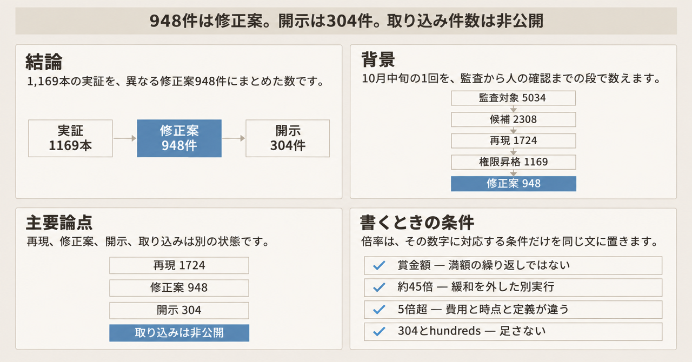
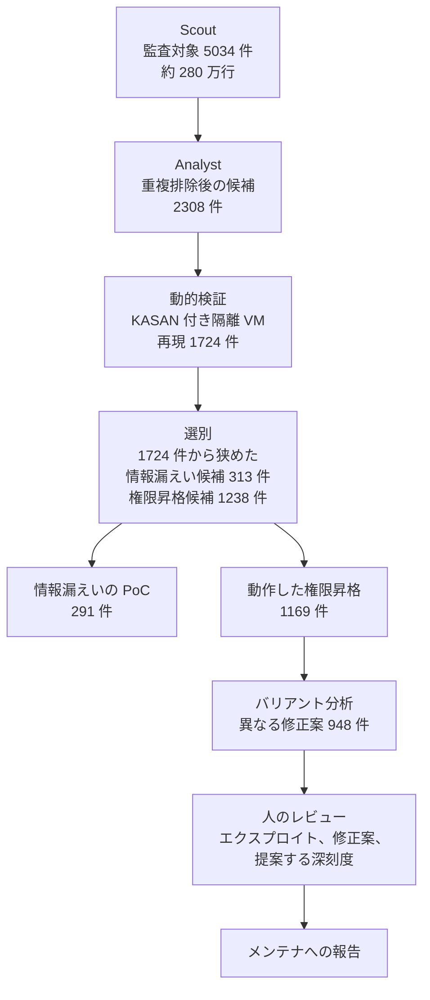

2026年11月4日、OpenAI は Linux カーネルを対象にした自律パイプラインの実行結果を公開しました。一次記事は [A thousand fewer paths to root](https://openai.com/index/a-thousand-fewer-paths-to-root) です。2026年10月中旬の1回の実行について、ローカル権限昇格の修正案 948 件を、メンテナがレビューするための候補として作った、と書いています。ローカル権限昇格は、そのマシンに入れる低い権限から、より強い権限へ上がる欠陥です。メンテナは、カーネルの変更を本線へ取り込むかを決める人たちです。

翌日の製品記事 [Introducing GPT-6 Cyber](https://openai.com/index/introducing-gpt-6-cyber/) は、同じ実行を GPT-6 Cyber の成果として説明しています。重大な所見 304 件を、修正案つきでメンテナに開示した、と書いています。重大な所見は、その記事が開示数に使う呼び方です。6月22日の [Patch the Planet](https://openai.com/index/patch-the-planet/) は、同じ系統の取り組みで、展開と開示の主導をメンテナが保つ、と書いています。展開と開示は、その記事がメンテナの主導として並べる二つの語です。

この記事では、パイプラインの段、各段の件数、報告の中身、費用として並ぶ数字を、公開記事の定義に沿って整理します。修正案を作る組織と、それを取り込むメンテナを分けて書くための材料です。数値は、断りのない限り、2026年11月4日のブログに書かれた OpenAI の自己申告です。

*この記事の全体像。以下、順に解説します。*

## Linuxカーネル向け自律パイプラインとは

パイプラインは、次の順で進みます。

1. 監査対象を選ぶ。
2. 候補を分析する。
3. 隔離環境で動的に再現する。
4. 情報漏えいとローカル権限昇格を選ぶ。情報漏えいは、ローカル権限昇格とは別に数える、もう一方の種類です。
5. エクスプロイトを作る。エクスプロイトは、その欠陥が狙った結果まで届くことを示す実証です。
6. バリアント分析で修正案を作る。バリアント分析は、似た欠陥を、異なる修正案の件数へまとめる段です。
7. 人がレビューする。

10月中旬の実行について、公開記事が各段に置いている数は次のとおりです。費用の単位は、記事が書く API credits です。API credits は、その実行の API 利用分として記事が並べる金額です。

Scout は、監査対象を絞る段の名前です。Analyst は、重複を除いた候補を出す段の名前です。KASAN は Kernel Address Sanitizer の略で、再現を見る隔離 VM のカーネルで有効にした検出機構です。隔離 VM は、ほかの環境から分けた仮想マシンです。PoC は、情報漏えいが起きることを示す実証として記事が数えているものです。エクスプロイト段で有効にした緩和は、SMEP、SMAP、KASLR、HARDENED_USERCOPY の四つです。SMEP は Supervisor Mode Execution Prevention、SMAP は Supervisor Mode Access Prevention、KASLR は Kernel Address Space Layout Randomization の略です。HARDENED_USERCOPY は、記事が名前のまま挙げる保護です。ここでの説明は、公開記事がこれらを有効にしたと書く点までです。

| 段 | 公開されている数 | 記事が添える条件 |
|---|---|---|
| Scout | 監査対象 5,034。約 280 万行。カーネルの約 7% | カーネルの一部に絞る |
| Analyst | 重複を除いた候補 2,308。12 時間。316,549 ドル | 候補を出す |
| 動的検証 | 再現 1,724。候補 2,308 件に対する約 74.7%。30 時間。73,330 ドル | KASAN を有効にした隔離 VM |
| 選別 | 情報漏えい候補 313。ローカル権限昇格の候補 1,238。44,194 ドル | 再現 1,724 件から狭めた結果 |
| エクスプロイト | 情報漏えいの PoC 291。動作したローカル権限昇格 1,169 | SMEP、SMAP、KASLR、HARDENED_USERCOPY を有効にした一般的なデスクトップ構成 |
| バリアント分析 | 異なる修正案 948 | 記事がユニークな総数と呼ぶときの、修正案の件数 |
| 人のレビュー | 手続きの記述 | 報告の前に、OpenAI のセキュリティ研究者が見る |

5,034 は監査対象の件数です。1 件がファイルか関数かは、記事に書かれていません。約 7% は、約 280 万行がカーネル全体に占める割合です。

エンドツーエンドの API credits は 1,213,430 ドルです。記事は、1 件あたり 1,279 ドルと書いています。この 1 件は、異なる修正案 948 件で割った側です。

件数は、次の順で減っていきます。948 は、最後の「異なる修正案」の段です。1,169 は、その直前の「動作したエクスプロイト」の段です。

選別は、再現した 1,724 件から、攻撃経路が見込めないものを除き、情報漏えい候補 313 件とローカル権限昇格候補 1,238 件へ狭めています。二つの和は 1,551 です。1,724 との差は 173 です。この 173 の内訳は、記事に件数がありません。948 件は、動作したローカル権限昇格 1,169 本を畳んだ修正案です。情報漏えいの PoC 291 件は、この 948 件に含まれません。

発見から報告までの分担は、公開記事の上では三つに分かれます。OpenAI のパイプラインが、候補、再現、エクスプロイト、修正案を作ります。OpenAI のセキュリティ研究者が、報告の前に、エクスプロイトと修正案と提案する深刻度を見ます。カーネルのメンテナが、何を取り込むかを決めます。6月22日の記事も、メンテナが展開と開示の主導を保つ、と書いています。展開が修正の配信なのか公開なのかは、その文だけでは分かりません。意味を足して書きません。

報告の束は四つです。原因分析、最小のクラッシュ再現、候補パッチ、完全なエクスプロイトです。

モデルの呼び方は、二つの記事で違います。11月4日の記事は、この実行のモデルを upcoming cyber model と書いています。upcoming cyber model は、その時点で「これから出るサイバー向けモデル」と置く呼び方です。11月5日の製品記事は、同じ 948 と 1,724 を GPT-6 Cyber の成果として書いています。

## 注意点

11月4日の記事の見出し、要約、ファネル図は、948 を「動作したローカル権限昇格エクスプロイト」とも呼びます。詳細節だけが、1,169 本の動作したエクスプロイトと、948 件の異なる修正案を分けています。引用するときは、948 をバリアント分析のあとの修正案の件数とし、1,169 を動作したエクスプロイトの本数とします。

### 送った件数と、取り込んだ件数

11月4日の記事は、重大な脆弱性について hundreds of reports and patches を既に送り、残りは Patch the Planet の partner と段階的に送る、と書いています。hundreds of reports and patches は、数百件の報告と修正案、という書き方です。partner は、Patch the Planet の協力先として記事が書く相手です。メンテナと同じか別の組織かは、記事に書かれていません。何を重大としたかの基準も、記事にありません。11月5日の製品記事は、同じ実行について、重大な所見 304 件を修正案つきでメンテナに開示し、ほかの脆弱性は修正に向けて作業中である、と書いています。

304 は、公開されている「開示した」側の数です。948 全件を送った、とはどちらの記事も書いていません。304 は、取り込み件数でもありません。

自律スキャンと手動分析が 10 日で終わった時点の観測として、記事は次を並べます。この 10 日は、表の 12 時間や 30 時間とは、記事の中で結ばれていません。上流でパッチ済みが 61、staging patch が 43、公開の場で報告または議論されているものが 299 です。上流は、カーネルの本線です。staging patch は、本線に入る前の準備段階のパッチとして記事が並べる数です。61、43、299 の和は 403 です。記事は、この和を 948 の内訳としては書いていません。

11月4日の記事の Reflections は、100 件超がほかの貢献者によるパッチまたは staging patch で、さらに約 300 件が公開で議論されていた、と書いています。Reflections は、その記事の中の節です。この 100 件超と約 300 件が、61、43、299 と同じ集計だとは書いていません。61 を、OpenAI の修正案が取り込まれた件数として読む根拠は、記事の中にありません。304 と、61、43、299 を結ぶ文もありません。

### 検証済みが指す範囲

動的検証の 1,724 は、三つの条件に絞ったうえで、KASAN を有効にした隔離 VM で再現した件数です。三つの条件は、低い権限で届くこと、特別な capability が不要であること、メモリ破壊の測定できる証拠があることです。capability は、通常の利用者権限に加えて付く特権です。KASAN は、その再現のときにカーネルで有効にした検出機構です。

再現しなかった残りについて、記事は三つを挙げます。高い権限が要るもの、時間内に再現できない競合や特定のきっかけ、モデルの誤解析 3.1% です。3.1% の分母は、記事にありません。

エクスプロイト段の成功は、その環境で root shell が取れたことです。root shell は、管理者権限でコマンドを実行できる状態です。記事は、初期の実行で、成功 200 件のうち 20 件が、割り当てられた欠陥とは別の未知の欠陥で root を取っていた、と書いています。その後、制約を強め、最終のエクスプロイトが割り当てられた脆弱性を使っているかを、独立に確認する、と書いています。この 20 件対 200 件は、10月の 948 件に対する監査率としては書かれていません。

人が見た範囲として公開されているのは、報告の前に、研究者がエクスプロイト、修正案、提案する深刻度を見る、という手続きです。行単位でレビューした差分の件数、受理率、却下率は、記事にありません。

パッチの品質について、記事は次のように書いています。最初の直接指示では、機能的には正しい一方、余分なコード、性能のトレードオフ、スタイルのずれ、バリアントの見落としがありました。反復で品質は上がり、これは進行中の研究です。少数の例では、人が書いたパッチの問題を、取り込み前の試作が見つけました。948 件のすべてがメンテナの基準を満たした、とは書いていません。

新しい手法については、エージェントが作ったエクスプロイト 166 本を標本とし、OpenAI は知る限り少なくとも 10 件は新しい、と書いています。この 166 本は、後の表にある 7 月の unique LPE 166 と同じ集合だとは書いていません。共有した手法は、第三者のカーネル専門家にとっても新しかった、とも書いています。公開されている分類の件数は、永続的な elastic object を使う散布が 2、ページのグルーミングが 2、データのみの権限昇格または任意書き込みが 5、任意の型混乱が 1 です。この 2、2、5、1 は、新しいとした 10 件の内訳です。これらは分類名です。手法の中身は、公開記事が安全のため省略しています。手順はここには書きません。

10月の実行について、カーネルの tag、commit、ディストリビューション名は、記事にありません。対象の書き方は、「当時の latest Linux kernel master」と「一般的な stock desktop OS」です。latest Linux kernel master は、その時点の開発本線の先端です。stock desktop OS は、特別な改造をしていない一般的なデスクトップ OS です。

### 費用と賞金の倍率

段階別の API credits を足すと、1,213,428 ドルになります。内訳は、Scout が 3,426 ドル、Analyst が 316,549 ドル、動的検証が 73,330 ドル、選別が 44,194 ドル、エクスプロイト段が 775,929 ドルです。公表の 1,213,430 ドルとの差は 2 ドルで、丸めの範囲です。

エクスプロイト段の内訳は、情報漏えいが 84,929 ドル、ローカル権限昇格が 691,000 ドルです。成功したエクスプロイトの平均は、ある文では 359 ドル、別の文では 1,169 件に対して 360 ドルです。失敗 69 件の平均は 3,922 ドルです。1,169 と 69 の和は 1,238 で、ローカル権限昇格の候補の数と一致します。3,922 ドルを 69 件の合計と読むと、成功の平均より安くなり、記事の「失敗の方が高い」という記述と合いません。したがって 3,922 ドルは、失敗 1 件あたりの平均として読む数字です。

候補 1 件あたりの平均は、ローカル権限昇格が約 558 ドル、情報漏えいが約 271 ドルです。1,213,430 を 948 で割ると 1,279.99 です。記事の 1,279 ドルは、ドル未満を切り捨てた値と一致します。1,169 で割ると約 1,038 ドルです。

記事は、費用より方法を優先し、費用は上限である、と書いています。1 時間進まなければ打ち切る規則にしていた場合、ExploitDev の費用は減った、とも書いています。ExploitDev は、エクスプロイトを作る段の費用として記事が呼ぶ部分です。人のレビュー時間は、この分母に入っていません。

賞金の比較は、記事自身が hypothetical valuation と呼んでいます。hypothetical valuation は、受け取った賞金ではなく、仮に単価を掛けた評価額です。Pwn2Own の歴史的な 20,000 ドルを 948 に掛けると 18,960,000 ドルです。TyphoonPWN の 70,000 ドルを 948 に掛けると 66,360,000 ドルです。1,213,430 ドルに対する比は、約 15.6 倍と約 54.7 倍です。記事の「約 16 倍から 55 倍」と一致します。これは受け取った賞金ではありません。

[Pwn2Own Berlin 2026 の規則](https://www.zerodayinitiative.com/Pwn2OwnBerlin2026Rules.html) では、ローカル権限昇格は非管理者のアカウントから始まり、カーネルの脆弱性を使います。RHEL for Workstations の表示賞は 20,000 ドルです。先着の成功者が取ります。競技者は現地参加です。試行は 3 回、各 10 分、合計 30 分です。SecurityWeek の 2026-05-18 の記事は、RHEL、Windows、NVIDIA のエクスプロイトが 2,500 ドルから 50,000 ドルの幅だった、と伝えています。これは二次の報道で、公式の結果ページを根拠にしていません。

[TyphoonPWN 2026](https://typhooncon.com/typhoonpwn-2026/) の商品ページは、Linux の権限昇格を最大 70,000 ドルと書いています。[FAQ](https://typhooncon.com/typhoonpwn-2026-faq/) では、最初の成功者が満額、2 位が 50%、3 位が 25% で、3 件の成功でそのカテゴリは終わります。対象は、その時点の完全にパッチされた CentOS 9、Debian 13、Ubuntu 26.04 以降の LTS です。70,000 ドルを 948 回、満額で足す条件は、この規則の上にはありません。

kernelCTF に合わせた別実行は、112 時間、API credits 約 32,936 ドルです。費用の 83.7% が発見側です。発見側の残りを何と呼ぶかは、記事にありません。情報漏えいの PoC が 25 件、ローカル権限昇格のエクスプロイトが 21 件です。kernelCTF は、公開規則で対象カーネルと報酬を定める競技で、OpenAI がこの別実行の比較に使っています。記事は、latest kernel が kernelCTF の SLAB_VIRTUAL と両立しないため、その緩和を設定から外した、と書いています。SLAB_VIRTUAL は、現行の hardened 設定に含まれるメモリ割り当て側の緩和です。現行規則の hardened 設定は SLAB_VIRTUAL=y を含みます。したがって 21 件は、現行の公式設定そのものでの受理実績としては書かれていません。

「受理されれば約 150 万ドル、約 45 倍」は、条件付きです。約 45 倍は、別実行の約 32,936 ドルに対する比です。現行の単一報酬 71,337 ドルを 21 に掛けると 1,498,077 ドルで、約 150 万ドルと桁は合います。この掛け算は、21 件がそれぞれ満額で受理される、という意味ではありません。現行規則は、対象を Linux 7.2-rc5 の hardened 設定に固定します。カーネル版ごとに受理は 1 件です。スロットは、研究者 1 人につき 1 件の受理の枠です。1 回の実行が 5 分を超えると、その回を失敗として数えます。受理の条件には、20 回中 70% 以上の安定性と、最新 LTS 6.12 でクラッシュを起こせることも含まれます。出典は OpenAI の記事と、2026-11-06 に確認した kernelCTF の現行規則です。

OpenAI は、執筆時点で kernelCTF が 2026 年に受理した confirmed 0-day のローカル権限昇格は 26 件、と書いています。confirmed 0-day は、その記事が「確認された未知の欠陥」として数える呼び方です。2026-11-06 の公開スプレッドシートでは、一つのフィルタの行数が 26 でした。条件は、2026 年の flag 提出、ラベルがちょうど 0-day、CVE 列が CVE- で始まる、です。その 26 行の CVE 文字列は 21 種です。この 21 種は、別実行で得たエクスプロイト 21 件と同じ集合だとは書いていません。Flags が invalid flag (signature error) の 1 行を含みます。flag は、そのシートが数える提出です。その 1 行を除くと 25 行です。CVE の有無を問わない 2026 年の 0-day ラベルは 235 行です。slot stats は、公開スプレッドシートの集計タブの名前です。その 2026 年の「0-day #」の合計は 94 です。Winners タブの 4 行を足すと、26 より大きくなります。記事執筆時点のシートは、別途回収していません。26 は、この一つのフィルタの行数としては再現できます。受理済みの総数として、独立に確認できた数としては置けません。この行は、OpenAI の 948 件の一覧ではありません。個別の CVE 番号は、ここには転記しません。

### 過去の実行と並べるとき

公開されている過去の数は、件数の定義が揃っていません。

| 時点 | 公開されている数 | モデルの呼び方 | 記事が書く条件 |
|---|---|---|---|
| 2026-06-22 | カーネルポインタの情報漏えい PoC 8。ローカル権限昇格のエクスプロイト 24 | GPT-5.5-Cyber | hundreds of issues のうち、PoC を自動生成した部分集合。3,000 万行超 |
| 2026-07 下旬 | unique LPE 166。API credits 513,690 ドル。1 件あたり約 3,094 ドル | GPT-5.6 Sol | パイプラインを開発している最中。当時の latest master |
| 2026-10 中旬 | 動作した 1,169 を、異なる修正案 948 として数える。1,213,430 ドル | 11月4日は upcoming cyber model。11月5日は GPT-6 Cyber | 当時の latest master。KASAN で再現したあと、緩和を有効にした環境で root shell |

unique LPE は、その時点の記事が「重複を除いたローカル権限昇格」として置く数です。6月の行にあるカーネルポインタの情報漏えいは、その月の公開数の書き方です。10月の 313 と 291 が同じ種類だとは、11月の記事は書いていません。948 を 166 で割ると約 5.71 で、記事の「5 倍超」と一致します。費用の比は、1,213,430 を 513,690 で割った約 2.4 倍です。11月5日の記事は、同じ研究ハーネスで 5 倍超、と書いています。研究ハーネスは、7月と10月で同じだと記事が書く実験の仕組みの呼び方です。中身の一覧は、記事にありません。11月4日の記事は、7月をパイプライン開発中と書き、両方を「その時点の latest master」と書いています。カーネルの時点は、同じ木、つまり同じ開発系列ではありません。件数の定義も違います。6月は自動 PoC の部分集合、7月は unique LPE、10月は 1,169 を修正案の単位に畳んだ数です。

オーケストレーションの別実験では、GPT-5.5 Cyber に 103 の手法を渡すと、63 候補で成功率が 76.2% から 88.9% になりました。オーケストレーションは、エージェントの外側に手順を足す層です。この実験は、948 件の実行とは別です。GPT-5.6 Sol は、7月の実行の呼び方です。GPT-5.6 Cyber は、この別実験の呼び方です。同じモデルかは、記事に書かれていません。GPT-5.6 Cyber では、手法の層を戻しても 1.5 ポイントの増加でした。手法の層は、候補を出す前に渡す手法の一覧です。記事は、重いオーケストレーションは外した、と書いています。この実験の成功率を、948 件の実行の成功率と混ぜません。

11月の記事は、カーネルを 4,000 万行超と書いています。Scout の約 280 万行が約 7% なら、280 万を 0.07 で割ると 4,000 万で、丸めとしては内部で合います。6月の 3,000 万行超とは、母数が違います。行数を独立に測った結果は、公開記事の側にはありません。

### 二次記事と、公開の場の検索

[Phoronix の 2026-11-05 の記事](https://www.phoronix.com/news/OpenAI-948-Linux-LPE-Bugs) は、ブログの引き写しで、独立した件数確認とは書いていません。同記事は、5 倍の比較を GPT-5.5 Cyber 対 GPT-5.6 Sol と書いています。11月4日の記事が 5 倍の新しい側に置くのは upcoming cyber model です。11月5日の記事が置くのは GPT-6 Cyber です。

TechRadar、PJFP、How-To Geek、LavX、Cybernews、SecurityWeek、DataStudios の本文は、開き直した確認をしていません。採用済みと読める、という観察も、候補パッチと hundreds の送付にとどまる、という観察も、確認済みの一覧には置けません。二次記事が揃って採用済みと書いた、という事実は確認されていません。

2026-11-06 に、LWN、lore、oss-security を対象にして検索した範囲では、メンテナが 948 件を確認した、または取り込んだ、という記事は見つかりませんでした。この三つは、カーネルの公開の議論の場です。検索が全メールを読み切ったという意味ではありません。lore の `f:openai.com` は、差出人が openai.com のメールを探す条件です。この条件は 200 件で打ち切られ、2026-07 から 2026-11 の更新に、件名 948 はありませんでした。`kylebot@openai.com` の個別メールはその中に 80 件あり、個別のパッチは存在します。6月12日の例（Kyle Zeng）は、10月の 948 件の索引ではありません。kernelCTF の公開 poc ディレクトリ 151 のうち、名前が CVE-2026- で始まるものは 14 で、948 件用のラベルはありませんでした。無いことの証明ではありません。

OpenAI が 2026-08-26 に Hugging Face について公開した記事は、別の出来事です。同じ組織が、自分のサイバー評価を説明する先例にはなります。11月の記事は、Linux の 948 件がその出来事と同じだった、とは書いていません。

## 四つの状態で書く

検出から修正案の配送までを製品として説明するときは、次の四つを別の状態として書きます。

1. パイプラインが再現した。10月の実行では 1,724 です。
2. パイプラインがエクスプロイトを作り、修正案に畳んだ。1,169 本を、948 件の修正案にしました。
3. 同じ組織の人が、報告の前に、エクスプロイトと修正案と深刻度を見た。公開されている数は、重大な所見 304 件と、11月4日時点の hundreds です。二つの記事は、304 と hundreds を足すとは書いていません。引用する送付数は 304 件です。
4. 対象のメンテナが取り込んだ。この実行について、OpenAI 提出分の merge 数は公開されていません。

同一組織が発見と修正案の両方を出すとき、3 は 4 の代わりになりません。3 は、誤った成功や、機能はするが取り込めない差分を、外に出す前に落とす関所です。4 は、メンテナが差分、スタイル、副作用、開示の時期を決める関所です。

記事の「検証済み」は、1 と、エクスプロイト段の root shell、および後から足した「割り当てられた欠陥を使っているか」の確認までを含みます。4 を含む、とは書かれていません。

10 日時点の 61、43、299 は、カーネル側で既に動いていた作業の観測です。OpenAI の修正案の採用率の分子には置きません。帰属が公開されるまで、採用率は計算しません。

引用の単位は、次の一文です。

OpenAI は、2026年10月中旬の実行で、動作したローカル権限昇格のエクスプロイト 1,169 本から異なる修正案 948 件を作り、2026年11月5日時点で重大な所見 304 件を修正案つきで開示した、と自ら書いています。取り込み件数は公開されていません。

## 倍率には条件を添える

条件は、数字ごとに分けます。仮想の賞金額には、満額を 948 回足す条件が規則に無いことを、同じ文に置きます。kernelCTF の約 45 倍には、SLAB_VIRTUAL を外したことと、21 件がそれぞれ満額で受理されるとは書いていないことを置きます。5 倍超には、費用も、カーネルの時点も、件数の定義も揃っていないことを置きます。

次の未知は、948 を修正案の件数として引用することを止めません。止めるのは、採用率、送付完了、賞金収入、モデルの単価比較を書くことです。

- 948 件のうち、提案のままの件数と、OpenAI の修正案が取り込まれた件数。
- 304 件以外に、その後送られた件数。
- 10月の実行のカーネル commit と、デスクトップのディストリビューション名。
- 人が行単位で見た差分の件数と、却下した割合。
- 3.1% の分母。
- 61、43、299、304、948 の包含関係。
- kernelCTF の 26 を数えた日のシートと、confirmed の定義。
- 11月4日の upcoming model と、11月5日の GPT-6 Cyber が、API のどの snapshot か。11月5日の記事は、製品名として同一視しています。snapshot の ID は、どちらの記事にもありません。
- 公開のトークン単価は、10月の実行の請求単価としては記事にありません。現行の価格表の数値は、この比較には使いません。

## まとめ

2026年10月中旬の実行で OpenAI が公開した 948 は、動作したローカル権限昇格のエクスプロイト 1,169 本を、バリアント分析で異なる修正案に畳んだ数です。2026年11月5日時点で、重大な所見 304 件を修正案つきで開示した、と翌日の製品記事が書いています。取り込み件数は公開されていません。

製品説明では、再現、修正案への集約、同じ組織の人の確認、メンテナの取り込みを、四つの状態に分けます。仮想の賞金額、kernelCTF の約 45 倍、過去の実行との 5 倍超は、それぞれに対応する条件だけを同じ文に置きます。304 件と hundreds は足しません。

この記事が少しでも参考になった、あるいは改善点などがあれば、ぜひリアクションやコメント、SNSでのシェアをいただけると励みになります！

## 参考リンク

- OpenAI. [A thousand fewer paths to root](https://openai.com/index/a-thousand-fewer-paths-to-root). 2026-11-04.
- OpenAI. [Introducing GPT-6 Cyber](https://openai.com/index/introducing-gpt-6-cyber/). 2026-11-05.
- OpenAI. [Patch the Planet](https://openai.com/index/patch-the-planet/). 2026-06-22.
- Zero Day Initiative. [Pwn2Own Berlin 2026 Rules](https://www.zerodayinitiative.com/Pwn2OwnBerlin2026Rules.html).
- TyphoonCon. [TyphoonPWN 2026](https://typhooncon.com/typhoonpwn-2026/).
- TyphoonCon. [TyphoonPWN 2026 FAQ](https://typhooncon.com/typhoonpwn-2026-faq/).
- Phoronix. Michael Larabel. [OpenAI Finds 948 Local Privilege Escalation Bugs In The Linux Kernel](https://www.phoronix.com/news/OpenAI-948-Linux-LPE-Bugs). 2026-11-05.
