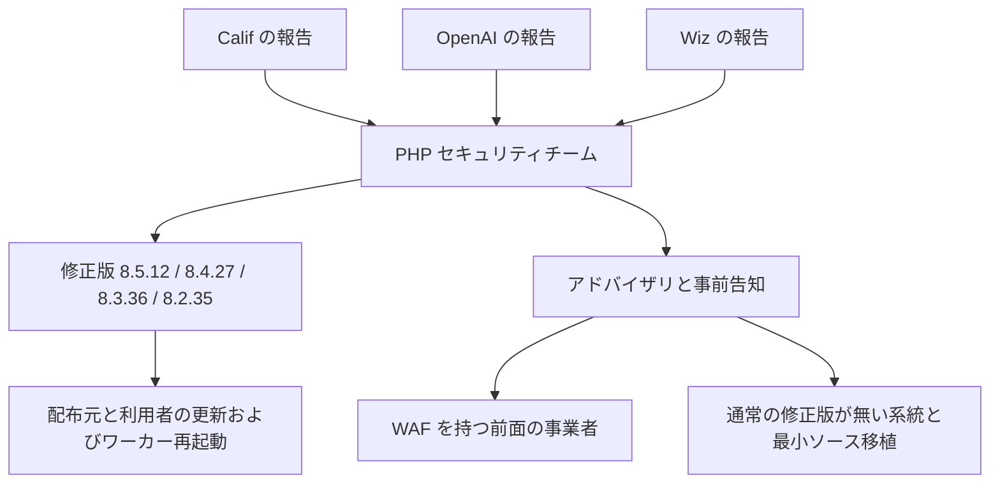

2026-10-21、OpenAI は、致命的なオープンソースの欠陥について、研究者、保守側、対応側の時刻を揃える協調開示を提案しました。題材は PHP 本体の二件です。CVE（公に追跡される脆弱性の識別子）は CVE-2026-109618 と CVE-2026-109619 です。

この記事では、二件が何であるか、誰がどの版とどの点数を公開したか、発注側がパッチ、前面の遮断、切り戻しできない系統の隔離を同じ手順の三行に書く材料を整理します。PHP をインターネットに出しているシステムの発注側と、その三行を別の担当に分けている組織が読む想定です。

*この記事の全体像。以下、順に解説します。*

## 協調開示と PHP の二件の致命的欠陥とは

### 何が提案され、何が題材か

OpenAI のページは、手順の提案と、この PHP 案件で連合が動いたという自己記述です。ページの日付は October 21, 2026 です。

協調開示とは、ここでは、欠陥を見つけた研究者、直す保守側、防ぐ対応側が、公開の時刻をばらばらにしないための枠組みを指します。影響を受ける版の範囲、深刻度の数値、公開の時刻は、発行元ごとに表記が分かれます。分けた表は次の「注意点」に置きます。

CNA（CVE Numbering Authority。識別子の割当と、レコード内容の責任主体）は php です。両件とも、未認証の遠隔コード実行を含む致命的欠陥として PUBLISHED です。PUBLISHED は、CVE レコードが公開済みであることを示す状態名です。未認証の遠隔コード実行とは、ログインしていない外部の相手が、サーバ上で命令を実行できる欠陥です。

PHP プロジェクトは、修正版 8.5.12、8.4.27、8.3.36、8.2.35 を公開しています。

### 五段階と、この案件で並ぶ関与

OpenAI が提案する五段階は、次のとおりです。

1. 上流の検証と修正
2. 影響を受ける組織が動く時間（配布物の追随、ホスティング側の緩和の試験、WAF を含む）
3. 政府パートナーとの調整
4. 下流製品の更新準備
5. 公開後のガイダンス

WAF（Web Application Firewall）とは、Web リクエストを検査して止める、前面の遮断装置です。

同じページは、この PHP 案件で、ホワイトハウスの Super Intelligence Force、ONCD、CISA、および国際パートナーに関与した、と書きます。ONCD と CISA は、OpenAI が政府パートナーとして名を挙げる機関です。この記事では、その名の範囲だけを使います。

同じページは、冒頭で連合を率いたと書き、別の段落で、修正とリリースの主導は PHP の保守側だと書きます。運用者向けに、PHP の版を調べる Codex skill の URL を示します。Codex skill とは、ここではその手順書へのリンクです。リポジトリの中身は、この記事では確認していません。関連投稿は "The defenders' window" です。

### 二件のレコード

CVE-2026-109618 の CNA タイトルは "RCE via OOM corruption" です。OOM はメモリ不足を指し、このタイトルはメモリ不足に伴う破壊、という CNA の呼び方です。クレジットの reporter は、報告者として名が並ぶ欄です。ここには Ryan at Calif.io と Wiz が並びます。finder は、発見者として名が並ぶ別の欄です。ここには OpenAI が並びます。

CVE-2026-109619 の CNA タイトルは "RCE via stale global state" です。古くなった大域状態、という CNA の呼び方です。reporter は Wiz、Ryan at Calif.io、OpenAI です。finder 欄はありません。

修正者は両件とも Arnaud Le Blanc、Ilija Tovilo、Jakub Zelenka、Nora Dossche です。

CVSS は、深刻度を数値にする採点です。版が違うと、点数も攻撃条件も違います。CNA の CVSS は両件とも v4.0 で 9.2 です。ベクトルは、その点数の内訳を一行にした文字列です。手順で読むのは、次の AC と AT です。CNA のベクトルは `CVSS:4.0/AV:N/AC:H/AT:P/PR:N/UI:N/VC:H/VI:H/VA:H/SC:N/SI:N/SA:N` です。攻撃条件は AC:H（攻撃の複雑さが高い）と AT:P（追加の攻撃要件がある）です。

NVD（National Vulnerability Database。CNA とは別の採点と、影響範囲の機械可読な表記を載せるデータベース）の Primary は、NVD が主の点数として置く採点です。両件とも CVSS v3.1 で 9.8 です。ベクトルは `CVSS:3.1/AV:N/AC:L/PR:N/UI:N/S:U/C:H/I:H/A:H` です。こちらは AC:L（攻撃の複雑さが低い）です。ベンダーの v4.0 9.2 は、NVD 上では Secondary です。Secondary は、同じレコードに併記される別の採点です。

CNA の affected は、影響ありと書いた対象の欄です。中身はパッケージ php-src です。defaultStatus は unaffected です。これは、列挙した範囲の外を、初期状態では影響なしとする書き方です。対象は次のとおりです。

- 8.2.* のうち 8.2.35 未満
- 8.3.* のうち 8.3.36 未満
- 8.4.* のうち 8.4.27 未満
- 8.5.* のうち 8.5.12 未満

CVE 識別子の予約日は 2026-10-12 です。datePublished は、109618 が 2026-10-21T13:48:34.845Z、109619 が 2026-10-21T13:54:43.866Z です。

CNA の CWE（欠陥の型を表す分類番号）は、CWE-416、755、824、1325、1419 です。NVD の weakness 一覧は CWE-1419 を含みません。この差は、NVD API の一覧と CNA の一覧を並べた結果です。

### 修正版と、Web リクエストを受ける設置

php.net は、Web リクエストを処理するインストールを対象にします。名指しするのは PHP-FPM、Apache の mod_php、php-cgi、FrankenPHP、LiteSpeed です。PHP-FPM は、PHP のプロセスを常駐させ、Web サーバから処理を渡す方式です。mod_php は、Apache のプロセスの中で PHP を動かす方式です。php-cgi、FrankenPHP、LiteSpeed も、php.net が同じ一覧に置く方式名です。棚卸しでは、実行環境が示す方式名をそのまま書きます。リスクが最も高いと名指しするのは mod_php です。

各リリース告知は、更新だけが安全な選択であり、設定変更は特定の経路の露出を下げる、と書きます。更新のあとに、ワーカーの再起動が続きます。ワーカーとは、リクエストを処理している PHP のプロセスです。

Cloudflare は、2026-10-21 03:02 UTC から、無料または有料の WAF を使う顧客を既定で保護した、と自社ブログに書きます。Google Cloud は、自社基盤そのものは対象外で、GCP 上で PHP を動かす利用者は対象になりうる、と書きます。App Engine は、Google が自動更新と再ビルドを分けて書く実行環境の名前です。スタンダードの PHP 8.2 以降は自動更新です。それ以外の多くの実行形態は、利用者の再ビルドと再デプロイです。

### 発見から公開物への分かれ方

発見の報告は、複数の系統から PHP セキュリティチームに入ります。公開物は、修正版、アドバイザリ、前面の遮断、パッチ対象外の系統の扱いに分かれます。

Calif はセキュリティ会社（calif.io）です。報告者は Ryan at Calif.io です。カリフォルニア州ではありません。OpenAI の finder 欄は CVE-2026-109618 に付きます。CVE-2026-109619 では、OpenAI は reporter 側に並びます。

## 注意点

到達の宣言、シェア、スコア、影響範囲、悪用の有無は、出典の文のまま分けて読みます。

### 「インターネットの 70%」

W3Techs のページ（バージョン図の注記は W3Techs.com, 21 October 2026）は、PHP を「サーバ側のプログラミング言語を把握しているウェブサイトの 69.3%」と書きます。PHP を使っているサイトのうち、版 8 が 65.2%、版 7 が 27.0%、版 5 が 7.7%、版 4 が 0.1% です。分母はトラフィックでも、インターネット全体でもありません。

Wiz の見出しは "affecting 70% of the Internet" です。本文は "powers 70% of all websites in the world" です。結びは "With 70% of the Internet affected" です。この三文に w3techs への参照はありません。Cloudflare は "almost 70% of websites" と書き、w3techs へリンクします。分母の限定は落ちています。

変動する統計なので、本文の数値は「約 69%（W3Techs、2026-10-21、言語が判明しているサイトに占める割合）」として扱います。

### 「攻撃者より先」は留保つきの文である

OpenAI の文は "To our knowledge" で始まります。攻撃者が持っていなかったことの調査結論ではありません。

PHP Foundation は、2024 年の外部監査の過程を書きます。資金は Sovereign Tech Agency、経路は OSTIF、実施は Quarkslab です。契約コア開発者は、CVE-2026-109618 の背後にある OOM 問題の兆候を見ました。具体的な到達経路は無く、修正は停滞した、と Foundation は書きます。到達経路の報告は 2026-08 です。

Foundation の日付は、次のとおりです。

- Calif の監査開始は 2026-07-30
- Ryan A の報告は 2026-08-11 です。Foundation は、この報告を無条件の遠隔コード実行と呼びます。この呼び方は、公開された CVSS の AC:H とは別です。
- OpenAI の独立報告は同日
- Wiz の追加経路は 2026-08-24
- OpenAI の追加経路は 2026-09-18

Wiz 自身の Responsible disclosure timeline（2026-10-22 に再取得）は、別の並びです。2026-08-19 に自チームが最初の PHP 欠陥を発見し、08-20 に Drupal への未認証の遠隔コード実行、08-21 に WordPress、08-24 に PHP セキュリティチームへ報告、09-21 に PHP が協調修正を始めた、と書きます。Wiz の "the first" は、自チームの最初です。Calif と OpenAI の 08-11 より前、という意味には読めません。開始日の記述は、Foundation と並立します。Google Cloud は、Gemini 4 Argon の寄与も定性的に書きます。Gemini 4 Argon は、その寄与の名前です。手順の条件には使いません。

### スコアは二系統

php.net の事前告知が置くのは 9.2 のみです。ベクトルは置きません。漏えい時の 10.0 は、PHP Foundation が誤りだとしています。実際の CNA 値は 9.2 です。NVD Primary の 9.8 は AC:L であり、CNA の AC:H と AT:P とは別の採点です。どちらか一方を「この欠陥の深刻度」として畳みません。

### 影響範囲は出典ごとに違う

| 出典 | 範囲の書き方 | 修正版 |
|---|---|---|
| CNA JSON | 8.2 / 8.3 / 8.4 / 8.5 の各系列でパッチ版未満。defaultStatus は unaffected | 8.2.35、8.3.36、8.4.27、8.5.12 |
| oss-security（Jakub Zelenka、2026-10-21 14:41 UTC と 14:44 UTC） | PHP 8.2 before 8.2.35 から 8.5 まで同様 | 同じ四版 |
| GHSA のサイドバー（php/php-src） | `< 8.2.35`、`< 8.3.36`、`< 8.4.27`、`< 8.5.12`。下限の印刷は無い | 同じ四版 |
| NVD の CPE | 先頭は versionEndExcluding 8.2.35 のみで下限が無い。続いて 8.3.0 以上 8.3.36 未満、8.4.0 以上 8.4.27 未満、8.5.0 以上 8.5.12 未満 | 終点は同じ四版 |
| php.net | 四つの修正版を列挙。8.1 とそれより古い版はプロジェクトの更新対象外。7.4 / 8.0 / 8.1 には最小ソース移植がある | 同じ四版 |
| CERT-EU 2026-018 | パッチ前の 8.2–8.5 に加え、End-of-life branches（"PHP 8.1 and older"） | 同じ四版 |
| Google Cloud ブログ | "All versions of PHP from 5.4 through 8.5.11"。上流は 8.1 以前へバックポートしない、とも書く | 同じ四版 |
| GCP-2026-070 | "All PHP versions between 5.4 and 8.5" | 同じ四版 |
| Cloudflare、Wiz | 約 5.4 から 8.5.11 | 同じ四版 |
| IPA の事前注意 | CERT-EU の要約として「PHP 5以降」 | 注意の時点では版不明、とページが書く |

GHSA（GitHub Security Advisory）は、GitHub 上のセキュリティ告知です。CPE は、NVD が製品と版の範囲を機械可読に書く形式です。oss-security は、公開のメーリングリストです。CERT-EU は、EU の機関が出すセキュリティアドバイザリです。IPA は、情報処理推進機構です。EOL（End of Life）は、その系列がセキュリティ修正を受けなくなる期限です。最小ソース移植は、公式の点リリースが無い 7.4 / 8.0 / 8.1 向けに php.net が示す、最小のソース修正です。通常の修正版とは別物です。

IPA の「PHP 5以降」は、IPA ページ上の CERT-EU の言い換えです。CERT-EU の Affected Products で確認した句は "PHP 8.1 and older" です。「PHP 5」という句は、CERT-EU 側では確認していません。NVD の先頭 CPE が下限なしであることは、NVD が PHP 5.4 を意図した、という文にはなっていません。スキャナは、PHP 5、7、8.0、8.1 をフラグしえます。

php.net の supported-versions（ページ上の Today は 21 Oct 2026）では、期限は次のとおりです。

- 8.2 の security support は 31 Dec 2026 までです。active は、php.net が security support と分けて書くもう一つの期限で、8.2 では 31 Dec 2024 に終了しています
- 8.3 の security は 31 Dec 2027
- 8.4 は active が 31 Dec 2026、security が 31 Dec 2028
- 8.5 は active が 31 Dec 2027、security が 31 Dec 2029

方針は、active の 2 年に critical security の 2 年を足した 4 年です。php.net の 8.2.35 公開記事は、"PHP 8.2 reaches end of life on 31 December 2026 and will receive no further security fixes after that date" と書きます。個別ページ https://www.php.net/releases/8_2_35.php には、この文はありません。eol.php の 8.1 は 31 Dec 2025、最終リリースは 8.1.34 です。

Google Cloud ブログの「上流は 8.1 以前へ出さない」と、php.net の 7.4 / 8.0 / 8.1 向け最小ソース移植は、別の文として残します。Google の文は、公式の点リリースが無いことと、Google 管理ランタイムの話が重なっています。

### 公開の時刻は一つにならない

| 表記 | 時刻 |
|---|---|
| PHP Foundation が書く当初予定 | 2026-10-22 14:00 UTC。同日に出さなかった理由は、ディストリビューションのパッケージが未準備だった、と Foundation が書く |
| 現在の php.net 事前告知（archive #2026-10-20、datetime 2026-10-20T20:32:00+00:00） | 2026-10-21 14:00 UTC。当初の 10-22 は、取得したこのページには残っていない |
| 漏えい | Foundation の記述では 2026-10-20 15:00 UTC 頃。CVE ID、誤った公開時刻、誤った CVSS 10.0。技術詳細は無かった、と Foundation が書く |
| 事前告知の前倒し | Foundation の記述では 2026-10-20 19:30 UTC |
| Calif の動画 | Foundation の記述では 2026-10-20 20:00 UTC 頃。PoC と限定的な詳細を示して削除され、複製が回った、と Foundation が書く。動画の中身は再生していない |
| 一部事業者への緩和連絡 | Foundation の記述では 2026-10-20 23:00 UTC 頃。漏れた可能性がある、と Foundation が書く |
| Chainguard の修正入りイメージ | Foundation の記述では 2026-10-21 07:41 UTC。協調公開より前。Chainguard 自身の声明は未確認 |
| Cloudflare の WAF 既定投入 | 2026-10-21 03:02 UTC。ブログの "about 9 hours" は、14:00 UTC の枠からの概算。03:02 から 14:00 は約 11 時間 |
| php.net リリース記事の time 属性 | 8.2.35 が 2026-10-21T00:05:37Z、8.3.36 が 00:14:54、8.4.27 が 00:20:54、8.5.12 が 00:24:52、アドバイザリが 00:35:26。公開の瞬間としては扱わない |
| CERT-EU 2026-018 | 修正の公開を 2026-10-21 13:30 UTC と書く |
| php.announce #510 | Wed, 21 Oct 2026 14:00:28 +0000 |
| oss-security | 2026-10-21 14:41 UTC と 14:44 UTC |
| ChangeLog-8.php の見出し | 8.5.12、8.4.27、8.3.36、8.2.35 はいずれも 22 Oct 2026 |
| IPA 事前注意（2026-10-22 に再取得） | 公開予定を 2026-10-21 23:00 JST（14:00 UTC）と書き、注意の時点ではセキュリティリリースも修正版も未公開、版の詳細は不明、「修正プログラムは公開されていません」とページに残っている |

PoC とは、動くことの見本です。この記事には、その手順もペイロードも写しません。Chainguard は、コンテナイメージを配る事業者です。ここでの時刻は Foundation の記述です。php.announce は、PHP の告知用メーリングリストです。

IPA の「発信時点では悪用を確認していない」も、同じ事前注意の文面です。ページが更新されていない場合、その文は発信時点の状態を指します。

### 実証の範囲

GHSA-w8hw-w9fx-j79w（php/php-src、published 2026-10-21T13:34:25Z）は、Apache mod_php で、アプリケーションコードの前、既定の制限のまま、未認証の遠隔コード実行を確認したと書きます。FPM については、完全な FPM の実証は無く、起動後はソース解析上は影響しうると書きます。PHP Foundation は、PHP-FPM でもアプリケーションレベルの経路で遠隔コード実行を確認した、と書きます。この二文は残します。

GHSA-6wmf-4rv5-p3rp（published 2026-10-21T13:34:13Z）は、未認証のヒープ use-after-free、メモリ開示、遠隔コード実行を確認したと書きます。use-after-free とは、解放したあとのメモリを再び使う種類の欠陥です。fatal backtrace 経路とセッションのライフサイクル経路は、この GHSA が遠隔コード実行の条件を分けた二つの呼び方です。再現の手順は、この記事には書きません。前者の遠隔コード実行は mod_php です。後者は mod_php と FPM です。後者の条件は、同じワーカー、つまりリクエストを処理している同じ PHP プロセスであることです。

oss-security は、未認証の遠隔コード実行を mod_php と PHP-FPM の両方で示したと書きます。成立は、状態、設定、アプリケーションの振る舞いに依存する、と書きます。Foundation の該当段落は、mod_php 上の実在アプリケーションへの遠隔コード実行を書き、FPM には触れていません。

設定の例として公式が挙げるのは、次のとおりです。これらは、入れることで安全になる手順ではありません。経路の露出を下げる例として公式が挙げる名前です。各項目がどの上限を変えるかの仕様は、手順の完了条件にしません。

- `memory_limit=-1`。公式は、アプリから制限を戻せない置き方、と説明します
- アップロードが不要なら `post_max_size` を 8M、必要なら 32M
- `session.upload_progress.enabled=0`
- PHP 8.5 では `fatal_error_backtraces=0`

`RLIMIT_AS` と `RLIMIT_DATA` は、上の例の代わりに使いません。公式は、脆弱な割当失敗を起こしうる、と書きます。起こし方の手順は写しません。

Wiz は、メモリ開示、アップロード進捗、fatal backtrace、OPcache の型の取り違えを、CNA の二タイトルより細かく分けます。OPcache は、その分解に出る項目名です。影響の言い方は GHSA を優先します。Wiz の表は、研究者側の分解として読みます。手順の分岐には使いません。

「どこでも容易」は、CNA の AC:H と AT:P、および SAPI と設定への依存と並びません。SAPI（Server API）とは、PHP が Web サーバからリクエストを受ける方式の総称です。php.net が挙げる PHP-FPM や mod_php が、その具体です。Google Cloud は "can easily steal" と、緩和事情の留保を一緒に書きます。Wiz は "in some cases fairly easily" と "exceptionally complex chain of steps" の両方を書きます。

### 悪用の状態は時点の記録

CISA が CVE レコードに付ける SSVC は、悪用の有無などを単純化した判断ラベルです。2026-10-21T14:34Z 頃の両件は、Exploitation none、Automatable no、Technical Impact total です。Exploitation は悪用の観測、Automatable は自動化のしやすさ、Technical Impact は技術的な影響の大きさです。

CISA KEV は、「悪用されている」として載せるカタログです。catalogVersion 2026.10.21（dateReleased 2026-10-21T14:04:39.8983Z、件数 1754）の JSON に、両 CVE はありませんでした。この JSON の再取得はしていません。掲載が無いことは、悪用が無いことの証明ではありません。

PHP セキュリティチームは、公開時点で流通していた PoC のうち、機能するものを特定できなかった、と Foundation が書きます。Cloudflare は、公開前から攻撃トラフィックとペイロードの変化を観測したと書きます。これは侵害の成立確認ではありません。ブログ本文と、埋め込みプロンプトの "Exploitation is already happening" は、強さが違います。埋め込みプロンプトは、そのブログページに埋め込まれた、本文とは別の文です。CERT-EU は、PoC の流通が悪用の見込みを上げる、と書きます。見込みであり、成立の確認ではありません。

### お金と「率いた」

"committed $1 billion in subsidized Daybreak access" は、OpenAI ページ上のコミットメントです。支出の実績ではありません。配賦先と執行額は、そのページにありません。Daybreak は、その文の中の利用枠の名前です。

"we led a coalition" と "PHP’s maintainers led the fixes and release" は、同じ OpenAI ページの別の文です。どちらかを落として、一つの「主導」にしません。

Foundation は、2026-07-01 以降に 15 件の CVE を公開し、無効、重複、再現不能の報告を 100 件超処理した、と書きます（Alexandre Daubois の記事への参照）。モデルは報告を増やし、採否は人が行う、というこの記述は、本件の協調開示が一般に成功した証明ではありません。件数は Foundation ブログの自己記述です。

国内事業者の緊急メンテナンスは、事業者の一次ページを開いていないため、事実のリストには入れません。

### 未確認のまま残すこと

次は、未確認のまま残します。

- 2026-08 より前に、攻撃者が到達経路を持っていたか
- Cloudflare が観測したトラフィックが、侵害の成立か
- php.net の time 属性（00:05–00:35 UTC）を、何の時刻と見るか
- Chainguard の一次声明
- KEV JSON の再取得
- OpenAI がリンクする CISA BOD 26-04 の本文。BOD は CISA の指令です。本文は未確認です
- php2shell-checker の判定ロジック。URL の提示までを確認し、中身は読んでいません
- 10 億ドルの執行
- Wiz が列挙する AWS、Microsoft、Automattic、Fastly、Akamai、Imperva、Vercel との準備。Wiz の自己記述です。一次ページを開いたクラウド事業者は、Cloudflare と Google Cloud です

## 今日の手順は三つの時刻を同じページに書く

発注側が今日書く手順は、次の三つを、同じランブックの三行にします。完了通知を直列に待ちません。ランブックとは、当番が順に消していく一枚の手順です。

| 時刻 | 完了条件 | この案件で揃わなかった点 |
|---|---|---|
| パッチ | サポート系列を 8.5.12 / 8.4.27 / 8.3.36 / 8.2.35 以上にし、ワーカーを再起動する。SAPI を棚卸しする | Remi のリポジトリは、php.net と CERT-EU が「公開日には更新が無い」と書く。切り替え先は、ディストリビューションのパッケージか、ソースからのビルド |
| 前面の遮断 | 実際に使っている WAF のルールが有効である。有効とは、ベンダーの一次で、自社が使うルールが投入済みだと確認できることである。遮断はパッチの完了条件にしない | Cloudflare は、WAF 利用顧客について 03:02 UTC に既定投入した。WAF を付けていない顧客はその文の外。Cloudflare 自身が、なおパッチする、と書く |
| 隔離 | パッチも切り戻しもできない、インターネット向きの PHP を外すか止める。EOL、自前イメージ、自動更新の無い実行形態を含む | 8.1 以前に通常の点リリースは無い。7.4 / 8.0 / 8.1 の最小ソース移植は別物 |

Remi のリポジトリは、PHP のパッケージを配る第三者の配布元です。公開日に更新が無かった、という記述は php.net と CERT-EU の文です。

Cloudflare のルールセット ID は、次のとおりです。いずれも Cloudflare のブログの値です。

- Managed Free は `77454fe2d30c4220b5701f6fdfb893ba`
- 有料 Managed は `efb7b8c949ac4650a09736fc376e9aee`（各 7 ルール）
- レスポンス側は `afffe22785674c80a31875c848d2242a`

Google は、Cloud Armor の管理ルール（File Upload と RFI）を、多層の防御として書きます。Cloud Armor は、Google Cloud の前面の遮断です。RFI は、そのルール名に並ぶ語です。何を止めるかの中身は、取得したページの句以上には確認していません。パッチの代わり、という句は、取得した Google のページでは確認していません。WizOS は、Google Cloud ブログが 60 日間、請求単位ゼロで出すと書く PHP イメージの名前です。

Google は、App Engine スタンダードの古い版、flexible、ベースイメージを自動更新しない Cloud Run、GKE、自前イメージは、利用者の再ビルドだと書きます。Cloud Run と GKE は、Google がそこで利用者の再ビルドだと書く実行形態の名前です。flexible は、App Engine スタンダードと対で並ぶ実行形態の名前です。サポート外ランタイムとして、PHP 5.5、7.2、7.3、7.4、8.1 を挙げます。

棚卸しのとき、使うスコアの版と、使う範囲の出典を、手順に書きます。スコアは v4.0 の 9.2 か、v3.1 の 9.8 かです。範囲は、CNA の 8.2–8.5 か、NVD の下限なし CPE か、php.net の移植か、ブログの 5.4 以降かです。

機械可読の範囲は、CNA JSON と NVD の CPE を分けて書きます。人向けの危険範囲は、php.net の修正版、EOL、最小ソース移植を併記します。発見の先後は、2024 年の兆候と 2026-08 の到達経路を分けます。「攻撃者より前」は、OpenAI の "To our knowledge" のままにします。実証が文書間で割れる点は、両方残します。FPM を「対象外」と手順から外す根拠にはなりません。

設定ノブは、完全な緩和として案内しません。`RLIMIT_AS` と `RLIMIT_DATA` も、緩和として案内しません。攻撃の再現手順、ペイロード、多段の起こし方は、手順書に写しません。影響のクラス、前提、修正版で足ります。

PHP 8.2 は 2026-12-31 に EOL を迎え、その日以降はセキュリティ修正を受けない、と php.net の 8.2.35 公開記事が書きます。8.2.35 の直後から修正が無い、という意味ではありません。

未確認の項目は、この三行を今日書くことを止めません。止めるのは、使い方だけです。Chainguard の 07:41 UTC を、自社の完了条件に使いません。使う場合は、Chainguard の一次で確認してからです。KEV の未掲載を「対応不要」の根拠に使いません。

逆転条件は、三行の隔離または遮断を、棚卸しの結果で「対象なし」や「無効」に書き換える条件です。行そのものは、棚卸しの前に消しません。条件は、次の二つです。

- 自社の全 PHP が、四つの修正版以上であり、ワーカー再起動済みであり、EOL と自前イメージがゼロである。このとき隔離の行は「対象なし」と書きます。行の削除は、棚卸しの結果のあとにします。
- 使用中の WAF ベンダーが、自社構成ではルールが無効だと一次で書いた。このとき遮断の行は「無効」と書き、パッチと隔離の行を先に閉じます。

直近の行動は、次の三つです。

1. インベントリの版、SAPI、イメージの出どころを、一行ずつ書く
2. 四版未満を、更新、最小ソース移植の検討、隔離のいずれかに割り当てる。8.2 から 8.5 で四版未満は更新です。7.4、8.0、8.1 は最小ソース移植の検討です。インターネット向きのままパッチも切り戻しもできなければ隔離です。出典が「5.4 以降」と「8.2 未満」で割れても、パッチできない公開面は隔離の行に残します。どの出典が正しい影響範囲かの確定は、この割り当てを止めません
3. WAF のルール ID と、パッチ作業の担当を、同じ手順の同じページに置く

自社の台数を数えるときは、CNA の範囲、NVD の CPE、EOL、自前イメージの四通りに分けます。使っている WAF のルール ID と投入時刻は、ベンダーの一次で取ります。

## 採らなかった四つの置き方

採用するのは、三つの時刻を一つの手順に書き、スコアと範囲は出典を分けたまま使う、という置き方です。採らなかったものは、次のとおりです。

1. OpenAI の五段階を、この案件の実施済み手順として採用する、は採りません。上流の修正、一部の WAF、政府パートナーへの連絡、修正版の公開は、各者の一次に記述があります。枠組みの全部が未実施、という読みは強すぎます。未実施として残るのは、枠組みが提案であること、緊急パッチとインターネット規模の常時スキャンが質問として置かれていること、下流のすべての配布が公開時刻に揃わなかったことです。公式の知らせを待ってから動くことは、この案件では、動くまでの時間を延ばす側に働きます。Foundation は、ID の漏えい、動画、一部への緩和連絡、Chainguard イメージの先行（相手の声明は未確認）を、公開枠の前の出来事として書きます。
2. CVSS 9.2 だけ、または 9.8 だけを深刻度の正とする、は採りません。一次が二系統あります。
3. CNA の 8.2–8.5 だけ、またはブログの「5.4 以降」だけを影響範囲とする、は採りません。一つの範囲だけを棚卸し条件にすると、スキャナの結果か、EOL か、どちらかを見落とします。
4. パッチ、WAF、隔離を、別担当の完了通知で直列に待つ、は採りません。前面と修正版は、同じ時刻に閉じていません。Cloudflare の既定投入は 2026-10-21 03:02 UTC、公式の公開枠は同日 14:00 UTC、CERT-EU の公開表記は 13:30 UTC です。

2026-08 より前に攻撃者が到達経路を持っていた記述は、公開されている一次の範囲では見つかっていません。見つかっていないことは、持っていなかった証明ではありません。Cloudflare の公開前トラフィックは、8 月の時点の保有を証明しません。CISA SSVC の Exploitation none と、KEV 2026.10.21 への未掲載は、公開直後の時点記録です。その後の悪用を否定しません。

php.net は、更新だけが安全な選択だと書き、設定変更を完全な緩和にしていません。遮断をパッチ完了の代理にする根拠は、公式の修正案内にはありません。

## まとめ

今日の手順は三行で足ります。サポート内は、8.5.12、8.4.27、8.3.36、8.2.35 以上へ更新し、ワーカーを再起動します。使っている WAF のルールを確認し、パッチの代わりにはしません。パッチできないインターネット向きの PHP は、外すか止めます。

スコアは v4.0 の 9.2 と v3.1 の 9.8 を、両方残します。範囲は、CNA、NVD の CPE、php.net の修正版と EOL と最小ソース移植、ブログの「5.4 以降」を、同じページに出典つきで残します。OpenAI の五段階は、この案件で実行済みの手順としては採用しません。実施の記述がある段と、提案のままの段を分けます。

この記事が少しでも参考になった、あるいは改善点などがあれば、ぜひリアクションやコメント、SNSでのシェアをいただけると励みになります！

## 参考リンク

- [OpenAI, "Coordinated disclosure of critical vulnerabilities"](https://openai.com/index/coordinated-disclosure-of-critical-vulnerabilities) (October 21, 2026)
- [OpenAI, "The defenders' window"](https://openai.com/index/the-defenders-window/)
- [OpenAI, php2shell-checker](https://github.com/openai/php2shell-checker)（中身は未確認）
- [CVE-2026-109618](https://cveawg.mitre.org/api/cve/CVE-2026-109618)（CNA php、CVE JSON）
- [CVE-2026-109619](https://cveawg.mitre.org/api/cve/CVE-2026-109619)（CNA php、CVE JSON）
- NVD API 2.0。109618 のスナップショットは 2026-10-22T00:02:24.489。vulnStatus は Modified、published は 2026-10-21T14:17:09.357、lastModified は 2026-10-21T17:18:24.293。109619 は published が 2026-10-21T14:17:09.823、lastModified が 2026-10-21T21:17:52.623
- [php/php-src GHSA-w8hw-w9fx-j79w](https://github.com/php/php-src/security/advisories/GHSA-w8hw-w9fx-j79w)
- [php/php-src GHSA-6wmf-4rv5-p3rp](https://github.com/php/php-src/security/advisories/GHSA-6wmf-4rv5-p3rp)
- [PHP Foundation](https://thephp.foundation/blog/2026/10/21/todays-php-security-release-and-how-were-strengthening-php-security/)
- [php.net の 8.2.35 公開記事](https://www.php.net/archive/2026.php#2026-10-21-1)（EOL は 31 December 2026 以降に修正なし）
- [php.net supported-versions](https://www.php.net/supported-versions.php)（Today: 21 Oct 2026）
- [php.net の 8.2.35 個別ページ](https://www.php.net/releases/8_2_35.php)（EOL の文は無い）
- oss-security、Jakub Zelenka、2026-10-21 14:41 UTC と 14:44 UTC（リンクは付けず、出典名のまま残す）
- [CERT-EU Security Advisory 2026-018](https://cert.europa.eu/publications/security-advisories/2026-018/)
- [IPA 事前注意](https://www.ipa.go.jp/security/security-alert/2026/pre-alert20261021.html)（2026-10-21 公開、2026-10-22 再取得）
- [Cloudflare, "PHP vulnerabilities WAF protection"](https://blog.cloudflare.com/php-vulnerabilities-waf-protection/)（datePublished 2026-10-21T13:56:45.655Z、modified 19:12:17.798Z）
- [Google Cloud](https://cloud.google.com/blog/products/identity-security/responding-to-core-php-vulnerabilities-cve-2026-109618-cve-2026-109619/)（byline October 22, 2026。編集注 Oct 21, 3:30 p.m. PDT と 4:25 p.m. PDT）
- [Google Cloud bulletin GCP-2026-070](https://docs.cloud.google.com/support/bulletins#gcp-2026-070)
- [Wiz, "PHP2Shell"](https://www.wiz.io/blog/php2shell-php-rce)
- [W3Techs](https://w3techs.com/technologies/details/pl-php)（21 October 2026）
- CISA KEV catalogVersion 2026.10.21 は再取得していない。CISA BOD 26-04 の本文は未確認。[BOD 26-04](https://www.cisa.gov/news-events/directives/bod-26-04-prioritizing-security-updates-based-risk)
- php.net 事前告知 archive #2026-10-20、php.announce #510、ChangeLog-8.php は、本文中の表記で参照する（リンクは付けない）
