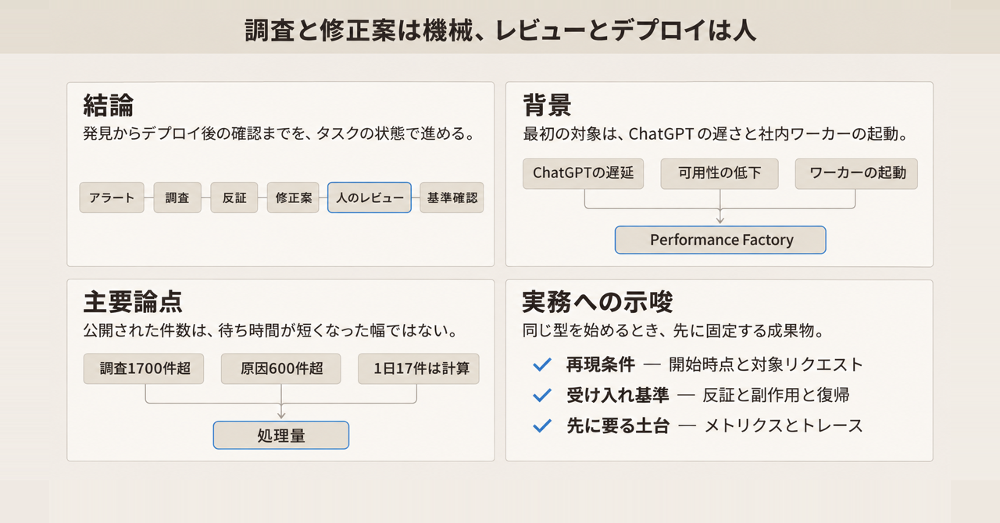
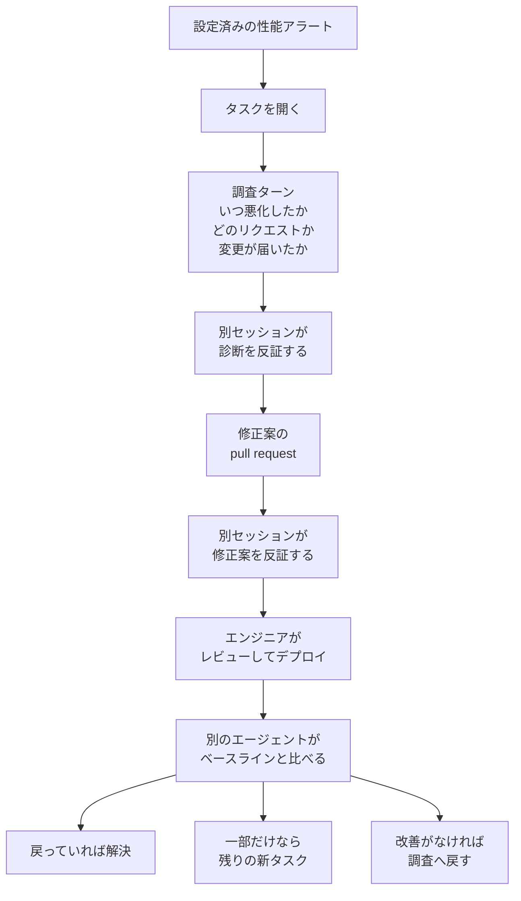

OpenAI は 2026年11月19日、ChatGPT を速く保つ社内の仕組み Performance Factory をエンジニアリング記事で公開しました。著者は Okay Zed と Cyrus Forbes です。Performance Factory は、社内のクラウド上で動く性能エンジニアリングの仕組みです。エンジニアがワークフローと Codex への指示を書き、エージェントが性能アラートの調査、修正案の pull request、デプロイ後の確認を進めます。Codex は、OpenAI のコーディングエージェントです。

この記事では、構成、タスクの進み方、人が残している検査、修正が触る範囲、自組織で同じ型を始めるときに先に要るものを整理します。公式の説明範囲は、同日のエンジニアリング記事と、その記事に埋め込まれたタスクレポートの例です。顧客向けの製品や、呼び出せる公開 API としては書かれていません。

*この記事の全体像。以下、順に解説します。*

## Performance Factoryとは

最初に稼働しているのは、性能劣化対応ワークフロー（Regression Workflow）です。記事が稼働中として名前を出しているワークフローは、これです。対象の実例は、ChatGPT の遅延、ChatGPT の可用性の低下、社内ワーカーの起動時間です。可用性とは、ここではサービスが要求に応え続けられる度合いを指します。

公式記事は、ここに至るまでを6段で書いています。手作業、Codex との協働、共有スキルへの集約、人が結果を手元へコピーして貼っていた段、クラウド上の調査、そして Performance Factory です。共有スキルとは、調査手順を一つにまとめたものです。どのファイル形式で共有するかは、公式記事は指定していません。

構成は4つです。

| 構成 | 役割 |
| --- | --- |
| タスクサービス | 状態、遷移、人が要る段を設定ファイルに持つ |
| ディスパッチループ | 準備ができたタスクへ、Codex の1ターンを割り当てる。ディスパッチループとは、待ち行列から次の仕事を取り出して実行役へ渡す繰り返しです。1ターンの中に応答が何回入るかは、公式記事は指定していません |
| クラウド実行 | 社内ネットワークの中で、コードと可観測性ツールを使える実行環境。可観測性ツールとは、メトリクス、ログ、トレース、プロファイルを見る道具です |
| サブスクリプション | GitHub のレビューコメント、CI の失敗、デプロイ完了を受けて、待っているタスクを起こす購読です。ここでいうサブスクリプションは、そのイベント購読を指します |

エージェントは、サービス用の ID で動きます。権限は絞れます。操作は、性能エージェントの操作として追跡できます。エンジニアのノート PC を開いたままにする必要はありません。

調査手順は、共有スキル `perf-forensics` にまとめてあります。見る問いは3つです。遅くなり始めた時点はいつか。影響を受けたリクエストはどれか。デプロイや設定変更で説明できるか。過去の性能劣化を評価に使い、ChatGPT の遅延増大と可用性低下については、アラートを渡すと1回の実行で診断が返るところまで試した、と記事は書いています。

タスクの状態は4つです。要調査、根本原因特定済み、修正提案済み、解決済み。画面上の担当は分かれます。検出はシステムです。原因調査、修正提案、復旧確認はエージェントです。レビューとデプロイはエンジニアです。

診断と修正案は、それぞれ別の Codex セッションが反証します。反証とは、出た説明を別の実行が突き返すことです。診断側は、変更の適用外にある同種リクエストが正常だったか、疑わしい変更のロールバックでメトリクスが戻ったか、を見ます。公式は、最初のもっともらしい説明で止まっていたため、この反証を足した、と書いています。公式はまた、修正案を作る方が、原因を特定するより難しい、と書いています。

各タスクは、劣化の内容、影響、原因、修正案の要約を持ちます。あわせて、メトリクスの時系列、CPU フレームグラフ、トレースを持ちます。CPU フレームグラフとは、どの処理が時間を使ったかを積み上げて見せる図です。トレースとは、1件のリクエストがどの処理を通ったかの記録です。エンジニアは、pull request を直すことも、診断を見て自分で修正を書くこともできます。pull request へのコメントは、エージェントを再開します。

デプロイ後の確認は3分岐です。以前のベースラインに戻れば、解決です。ベースラインとは、劣化の前に見ていた性能の基準です。一部だけ戻れば、元のタスクを解決し、残りの遅延を新しいタスクにします。改善がなければ、調査へ戻します。

エージェント自身の変更は、過去のインシデントへ同じ手順を当てて見ます。調査の質と、エンジニア向け要約の有用さは、分けて見ます。調査メモ、インシデント報告書、過去の実行結果は、このテストから外します。外すのが入力か、答え合わせ用の資料かは、公式記事は指定していません。

毎日、エージェントは直近の実行のメッセージとログから、ツール障害と権限エラーを探します。同じツールエラーが複数の調査を止めていれば、修正タスクを作ります。そのマージ判断は、エンジニアのままです。

アラートが鳴らない劣化を、CPU とメモリのプロファイル、ヒープダンプ、リリース間のトレースから見つける仕事は、記事の時点では今後の作業です。ヒープダンプとは、その時点のメモリの中身を書き出したものです。必要以上のレプリカを見つける rightsizing を、全サービスで定期実行する仕事も、同様に今後の作業として書かれています。レプリカとは、同じサービスを複数並べた複製です。rightsizing とは、その数を負荷に対して過大でないか見る仕事です。

性能劣化対応の流れは、次のとおりです。タスクに状態と所見を残すので、エージェントの文脈が切れても、次の担当は同じタスクを再開します。

タスクサービスがこの状態を持ちます。ディスパッチループが、各段の指示で Codex を起動します。サブスクリプションが、レビューやデプロイの待ちを解きます。クラウド実行は、メトリクス、ログ、トレース、CPU プロファイル、メモリスナップショット、コードリポジトリに届きます。

英語版は、3か月余りで調査が 1,700 件を超え、根本原因の特定が 600 件を超えた、と書いています。使うツールは 30 種を超えます。原因候補 100 件の人手レビューでは、OpenAI 自身が 70% を正確と採点しています。残る 30% は、さらに詰める必要があるか、因果が十分に確立されていない、としています。開始時点と、原因にしたデプロイは、別々に採点する、と公式記事の評価の節は書いています。時点が合っていても、原因にしたデプロイは誤りうる、という意味です。

## 注意点

公式が件数で示しているのは、調査の処理量です。ChatGPT の待ち時間がどれだけ短くなったかではありません。英語版は、1,700 件超の調査と 600 件超の根本原因の特定と並べて、1日あたり 17 件という数も置いています。日本語版は、その 17 件に「計算」と補足しています。日次の系列は公開されていません。17 件が調査の日割りか、根本原因の特定の日割りかは、公式記事は指定していません。英語版は more than 1,700、over 600、more than 30 tools と、境界を含みません。日本語版は「1,700 件以上」「600 件以上」「30 種類以上」と書き、境界の読みがずれます。数を引くときは、英語版を正とします。

「性能劣化を解消するプロセス全体を自動化した」と読む工程には、レビューとデプロイがエンジニアの段として入っています。エンジニアは、エージェントの pull request を採用せず、自分で修正を書いてよいです。解決済みは、完全復帰だけを指しません。一部回復でも元のタスクを閉じ、残りを別タスクにできます。

70% は、原因候補 100 件に対する OpenAI 自身の採点です。採点表、母集団、抽出方法、第三者監査は、記事にありません。この 70% を、1,700 件全体の正答率としては読めません。メトリクスとトレースには保存期限があります。復旧後に残っている証拠は、採点の答えを漏らしえます。公式記事は、保存期限があることと、答えが漏れることを、この順で同じ文に書いています。どちらがどちらを引き起こすかは、それ以上は書いていません。

公式 HTML の本文、図のキャプション、画像の alt には、次の数はありません。VentureBeat が 2026年11月19日に、性能チームの説明として伝える数です。根本原因に達した 600 件超のうち約 400 件が修正提案へ進み、出荷された修正のうち約 50 件はエージェント案の影響を受けたか案と一致し、その対として約 15 件は Codex が書いた pull request そのものだった、というものです。約 15 件が約 50 件に含まれるかは、その文は指定していません。反証レビューが診断の約 25% を差し戻す、という割合も、同じ記事の伝聞です。同記事は、結果は自動修復の野心には届いていない、ともチームの認識として書いています。これらは二次情報です。

記事に埋め込まれたタスクレポートの例は、改善の実績値ではありません。識別子は REG-482、期間は 2026年10月27日から28日、ワークフローは Regression Workflow です。画面の文面では、ワーカー登録の変更で起動時間の中央値が 20.6 秒から 45〜50 秒になり、10月28日のロールバックでベースラインに戻りました。予防の修正は草案のままです。利用者の待ち時間が増えたかは分からない、と画面に書かれています。HTML の alt は「起動時間が 2 倍以上」と、悪化の例だと述べています。キャプションは「タスクレポートの例」です。

低リスクな変更を人なしで出荷する話は、記事の語が exploring / eventually（検討、将来）です。人の承認を外した本番マージの開始日は、公式本文にも VentureBeat にもありません。全サービスへの rightsizing の定期実行も、同様に今後の記述です。

Hacker News の該当スレッドでは、著者の一人が質問を受け付けると書き、別の読者が効率の主因を尋ねています。どの効率かは、そのスレッドの紹介では特定されていません。公開日の 2026年11月19日から 2026年11月24日までの間には、導入失敗の追試は見つかっていません。同日の NVD キーワード検索では、Performance Factory と `perf-forensics` に結び付く CVE は 0 件でした。NVD は、公開された脆弱性を集めるデータベースです。CVE は、その1件ずつの識別子です。GitHub 上の OpenAI 組織（`org:openai`）のリポジトリ検索とコード検索でも、この仕組みの公開実装は該当がありませんでした。

## 人が見る検査

公式の手順が人に残している検査は、2枚に分かれます。1枚目は、タスクに残す再現条件です。2枚目は、自動修正を受け入れる基準です。受け入れる基準は、マージの前と、デプロイの後に分かれます。

| 見ること | 公式が書いている中身 |
| --- | --- |
| いつ | アラートはしきい値超過で鳴る。悪化の開始は数時間前でありうる。エージェントは最初に悪化した時点を遡る |
| どのリクエスト | 同種のリクエストが遅くなったのか、もともと遅いリクエストの割合が増えたのか。この2つは原因が違う |
| 変化が届いたか | デプロイと機能フラグを見たあと、その変更が影響リクエストに載った時刻を、ログとトレースで確かめる。機能フラグとは、リリースとは別に機能のオンオフを切り替える設定です |
| 反実仮想 | 別セッションが、適用外の同種リクエストは正常だったか、ロールバックでメトリクスは戻ったか、を試す。反実仮想とは、ここでは「その変更が無かったらどうだったか」を隣のリクエストとロールバックで見ることです |
| 採点の分離 | 開始時点と、原因にしたデプロイは別々に採点する。時点が正しくても、デプロイの特定は外れる |

| 段 | 人が見るもの |
| --- | --- |
| 診断 | 別セッションの反証を通過したか。画像ダウンロードの例では、ファイル所在のサービスが復旧したあとも画像リクエストの失敗が続いていたため、調査が再開されている |
| 修正案 | 別セッションが、原因に届いているか、バグや意図しない影響が無いかを見る。公式は、提案が必要以上に複雑だったり、新しい問題を入れたりした、と書いている |
| 副作用 | キャッシュは速くなりうる一方、古いデータを返しうる。REG-482 の草案は、起動時間が 20.6 秒付近に保たれることに加え、期待したハンドラーが登録されることと、ワーカーの総メモリが安定することを、展開前の確認に含めている |
| マージ | エンジニアが採否を決める。エージェント原稿と同一である必要は無く、人が書き直してよい。pull request のコメントはエージェントを起こす |
| デプロイ後 | 以前のベースラインに戻ったか。一部なら残りを新タスクにする。戻らなければ調査へ戻す |
| 注意の配分 | 関連インシデントをまとめ、チームが重視するメトリクスでグループし、推定影響で並べる。読む対象は、判断に必要なものに絞る |
| 仕組み自体 | 調査スキルやモデルを更新する前に、過去インシデントで調査品質と要約の有用さを分けて試す |

VentureBeat が性能チームの観察として伝える「原因が明確で修正が局所的なときに Codex は得意」は、公式の受け入れ規則としては公開されていません。局所性を、通過すれば自動マージしてよい条件としては読めません。

## 修正が届く範囲

公式本文が調査対象に挙げているのは、性能の劣化です。実例は、ChatGPT の最初のトークンまでの遅延、可用性の低下、会話失敗に見えた画像ダウンロード、社内ワーカーの起動時間です。最初のトークンまでの遅延とは、応答の最初の断片が返るまでの時間です。回答品質、幻覚、ポリシーを書き換える目標は、英語版にも日本語版にもありません。

触れるコードの副作用は、性能の外に出ます。キャッシュと古いデータが、その例として公式にあります。したがって「レイテンシの差分だけを触ってよい」とは、記事は言っていません。速度と鮮度のように、正しさへ染みる変更は、サービスを知る人の判断に残す、と書かれています。正しさとは、ここでは何が正しい応答か、という定義です。

マージとデプロイの権限は、記事の時点ではエンジニアにあります。復旧確認は、性能が以前の状態に戻ったかです。モデル応答の正しさの定義を、取り直す段ではありません。

対象の境界は、次のとおりです。

| 範囲 | 記事の位置づけ |
| --- | --- |
| ChatGPT の遅延と可用性 | `perf-forensics` の評価で焦点を当てた種類。最初のワークフローの実例 |
| 社内ワーカーの起動 | 埋め込み図の実例。利用者の待ち時間との対応は、その図では不明 |
| 調査ツール自身の故障 | すでに自己修復のタスクにしている。マージは人が行う |
| アラートが拾わない劣化、全サービスの rightsizing | 今後の記述。定期実行の完了とは書いていない |
| 公開の Performance Factory API | 呼び出し仕様、モデル ID、料金、レート制限、SLA は、公式サイト内の検索では確認できなかった |

## 機械に渡している段

いまの読みは、次のとおりです。公式記事は、エージェントを使った開発の速度に、従来の性能エンジニアリングが追いつかない、と置いています。発見から修正案、デプロイ後の確認までを、タスクの状態と遷移に載せています。レビューとデプロイは、エンジニアに残しています。人が受け取る検査は、再現条件と、副作用を含む受け入れ判断です。修正の自動マージまでは移していません。記事の結びは、いまのボトルネックは、エンジニアが修正をレビューしてマージする待ちかもしれない、とも書いています。

この読みを支える一次の記述は、6段の進み方、4つの構成、反証セッションを足した理由、修正の方が原因特定より難しいという自認です。

この読みを弱める一次の記述は、次のとおりです。人が手順と「人が要る段」を設定します。調査中に事情を補えます。修正を自分で書けます。解決済みは、部分回復でも付きえます。70% は自社採点で、母集団は非公開です。利用者向け遅延の改善幅は、記事にありません。人なしの出荷は、検討中と書かれています。調査件数を、自動修復の成功率や、利用者から見た成果としては使えません。

## 公式がまだ書いていないこと

公開された説明の範囲では、次が未記載です。

- 使用している Codex のモデル ID、モデルのスナップショット、評価に使った過去インシデントの期間。ここでいうスナップショットは、先のメモリスナップショットではなく、モデル ID と並ぶが、公式記事が説明していない項目です。
- 600 件超のうち、マージされた修正の件数と、そのうちエージェント原稿のままの件数。公式記事にはありません。VentureBeat の約 400 件、約 50 件、約 15 件は二次情報のままで、約 15 件が約 50 件に含まれるかは指定されていません。
- 利用者から見た、最初のトークンまでの時間や応答時間の、導入前後の差。
- 反証の差し戻し約 25%（二次情報）と、人手採点の 30% が、同じ集合か。
- 低リスク変更の無人出荷を、どの条件で始めるか。記事は条件の一覧を出していません。
- 社内のどのサービス群で Regression Workflow が現に動いているか。全サービス一覧はありません。

## 自組織で同じ型を始めるとき

公式が示している型は、調査からデプロイ後の確認までをタスクの状態に載せ、レビューとデプロイはエンジニアに残すことです。定例の性能予算会議の議題を入れ替えることは、公式記事の結論ではありません。性能予算が費用の枠か、遅延などの許容枠かは、公式記事は定義していません。同じ型を会議の見るものへ落とすなら、成果物は2つです。

1. 劣化したリクエストの再現条件を、タスクに固定する。開始時点、対象リクエストの切り分け（同種が遅くなったのか、遅いものの比率が増えたのか）、変更がそこに届いた時刻、適用外とロールバックで見た反実仮想。
2. 自動修正を人が受け入れる基準を、マージの前に書く。診断の反証を別セッションが通過したこと、修正案の反証を通過したこと、鮮度・ハンドラー・メモリのように性能以外へ染みる副作用を画面に書いたこと、デプロイ後にベースラインへ戻ったこと。戻らなければ閉じない。一部だけ戻ったときは、残りを別タスクにする。

調査件数と、エージェント原稿がそのままマージされた件数は、この基準に入れません。公式は前者を処理量として出し、後者を記事本文では出していません。人が診断を採用して修正を書き直す経路を、失敗として数えません。

正しさの定義（何が正しい応答か）を、このワークフローの修正対象に含めている証拠は、公式にありません。含めなくてよいです。ただし性能の差分が正しさの副作用を持つときは、その副作用の確認を受け入れ基準に残します。キャッシュと古いデータが、公式が挙げた型です。

同じ型を自組織で始めるとき、先に要るのはエージェントの性能ではありません。エンジニアが既に使っているメトリクス、トレース、プロファイルと、アラートからタスクを起こす状態の遷移です。OpenAI は、ツールが 30 種を超えてから手順をスキル化し、その後に Performance Factory へ進んだ、と書いています。公式記事、公式サイト内の検索、`org:openai` のリポジトリ検索とコード検索では、公開実装、モデル ID、料金は見つかりませんでした。手順の写しは、社内の可観測性に依存します。

## まとめ

Performance Factory は、性能アラートから修正案、デプロイ後のベースライン確認までを、タスクの状態として進める社内の仕組みです。検出はシステム、調査と修正案と復旧確認はエージェント、レビューとデプロイはエンジニア、という分担です。診断と修正案は、別セッションが反証します。

件数は調査の処理量であり、利用者の待ち時間が短くなった幅ではありません。70% は、原因候補 100 件への自社採点です。低リスク変更の無人出荷と、全サービスの rightsizing は、記事の時点では今後の記述です。

自組織で同じ型を始めるなら、先に固定するのは再現条件と、副作用を含む受け入れ基準です。先に要る土台は、既にあるメトリクス、トレース、プロファイルと、アラートからタスクを起こす遷移です。

この記事が少しでも参考になった、あるいは改善点などがあれば、ぜひリアクションやコメント、SNSでのシェアをいただけると励みになります！

## 参考リンク

- [OpenAI "How OpenAI’s Performance Factory keeps ChatGPT fast."（Okay Zed, Cyrus Forbes、2026年11月19日）](https://openai.com/index/how-openai-performance-factory-keeps-chatgpt-fast/)
- [同記事の日本語版（2026年11月19日）](https://openai.com/ja-JP/index/how-openai-performance-factory-keeps-chatgpt-fast/)
- [記事に埋め込まれたタスクレポート例の画像（REG-482、2026年10月27日〜28日）](https://images.ctfassets.net/kftzwdyauwt9/5w8KpwlFR3tNfJbAStImkG/ee5f1df65a302cb09dde0a7d52d09138/performance-factory-worker-startup-report.png)
- [VentureBeat "Exclusive: OpenAI reveals Performance Factory..."（2026年11月19日。約 400 件、約 50 件、約 15 件、約 25% の出典。公式ブログ本文にはこれらの数は無い）](https://venturebeat.com/orchestration/exclusive-openai-reveals-performance-factory-a-codex-powered-software-optimization-system-that-keeps-chatgpt-fast)
- [Hacker News, item 50563482](https://news.ycombinator.com/item?id=50563482)
- [NVD keyword search（`perf-forensics`、該当 0 件の確認、2026年11月24日）](https://services.nvd.nist.gov/rest/json/cves/2.0?keywordSearch=perf-forensics&keywordExactMatch=)
