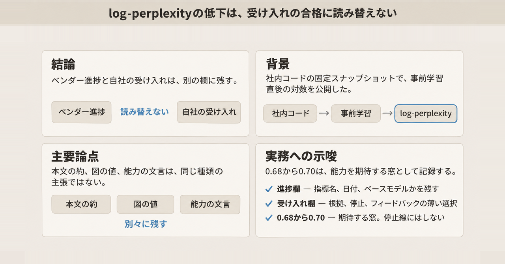
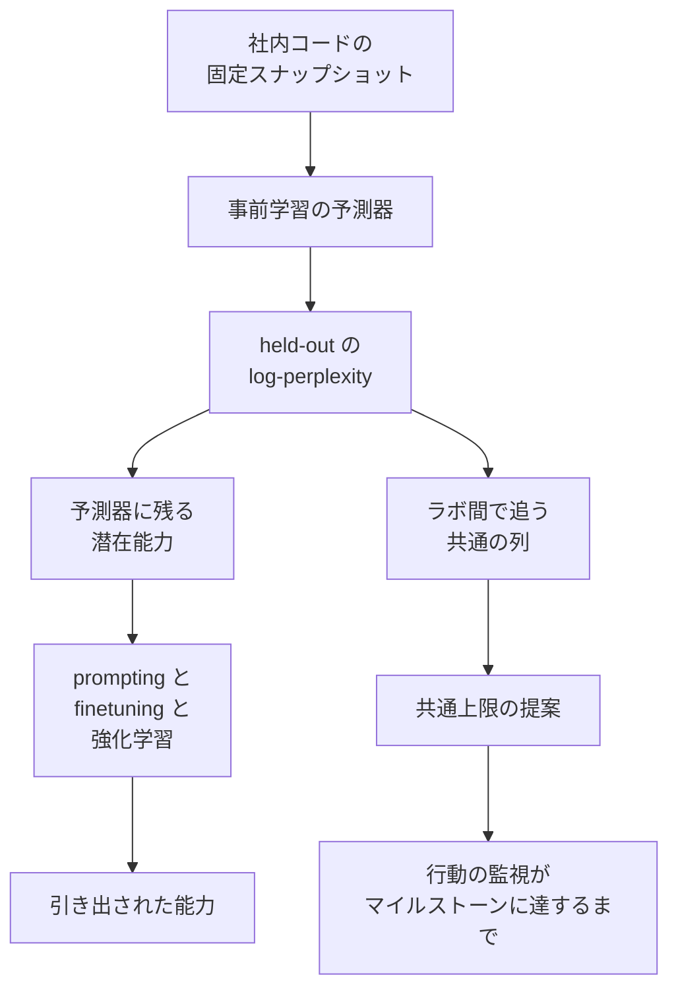

2026年11月22日、OpenAI の Chief Scientist（研究の責任者）である Jakub Pachocki は [“Perplexity and Intelligence”](https://openai.com/index/perplexity-and-intelligence) を公開しました。現代の AI 開発を、大きな計算機で非構造データに予測器を事前学習し、その後 prompting（指示の与え方）、finetuning（追加データでの再学習）、強化学習（出力の良し悪しの信号による追加訓練）で潜在能力を引き出す、という見方で書いています。追跡してきた主指標は、学習に使っていないデータ（held-out）上の perplexity です。実務ではその対数、すなわち交差エントロピー損失（log-perplexity）を使います。OpenAI の記事の数値は、GPT-3.5 以降の主評価に使ってきた社内コードベースの固定スナップショット上の値です。

この記事では、その指標が何を表すか、OpenAI の記事本文の近似と図の値がどう違うか、モデル更新を採用するときに残す欄をまとめます。

*この記事の全体像。以下、順に解説します。*

## perplexityとは

perplexity は、モデルが次のトークンを平均してどれだけうまく予測するかの指標です。トークンは、文章をモデルが読む単位に切った断片です。OpenAI は、低いほど予測が良い、と書いています。log-perplexity は perplexity の対数で、交差エントロピー損失と同じ量です。ベースモデルは、事前学習を終えた時点のモデルです。図が示すのは、このベースモデルの log-perplexity です。

Pachocki は、より良い圧縮器を訓練する進捗の速さを追うことが、AI の進展の弧を理解する鍵だ、と書いています。ここでいう圧縮器は、事前学習で作る予測のモデルです。その予測の良さは、held-out の log-perplexity です。実務で使うその対数、すなわち交差エントロピー損失（log-perplexity）を、開発者間の比較と、共有する安全の基準に使う指標にしたい、と論じています。第一歩として、OpenAI の事前学習の進捗を公開した、と書いています。公開すると競合に自社の位置がより見えるが、業界横断の安全策を急ぐ方が重い、とも書いています。

### 本文が並べる損失と能力

本文が近似記号つきで書く対応は、次のとおりです。単位はベースモデルの log-perplexity です。

GPT-3.5 は約 0.99 です。流ちょうな会話ができ、初代 ChatGPT の基盤になった、と書いています。GPT-4 は約 0.91 です。chain-of-thought（答える前に途中の考えを書かせる使い方）を、生産的に使えた、と書いています。このことが、その後その能力を狙って引き出し、考えを書かせて答えさせる推論モデルを作る動機になった、と書いています。

損失が 0.8 を下回ってから、サイバーセキュリティや数学のような分野で変容的な能力が出てきた、と書いています。その能力が、ちょうどその perplexity に達したときに出ることは、事前には明らかではなかった、とも書いています。この指標の進捗から現れた潜在能力として見られる、と書いています。

数学については、1年以上、未解決の問題をモデルに出して評価の一つにしてきた、と書いています。log-perplexity 約 0.76 のモデルに上げたところ、画期的な結果を出し始めた、と書いています。数学や隣接分野で働いてきた人にとって、長く考えてきた問いの解決が一つの Slack のスレッドに次々と出てきたことは、現実味が薄く感じられた、と書いています。その経験から、深層学習の研究でも急な変容はあり得る、と外挿しています。2027年にも、事前学習の基礎的な進展が同様に雪崩のように出ることは考え得る、と書いています。何が出るかは未知で、今日テストしていないかもしれない、とも書いています。AI は監視の進捗にも大きく寄与すると期待する一方、その進捗は事前学習の全力の加速には追いつかないだろう、と書いています。同じ文はアライメントにも触れますが、OpenAI の記事はその語を定義していません。

同じページの図は、公開モデルを折れ線で結び、別の内部モデルを四角で示します。図の説明は次の文です。

> Base model log-perplexity on the internal OpenAI codebase. The line connects released models. A square shows a separate internal model. The shaded band spans 0.68 to 0.70.

影の帯は 0.68 から 0.70 です。直近の進捗からの外挿として、この窓に入るとさらなる変容的能力を期待する、と本文は書いています。

2026年の損失の図の急な傾きについて、脚注5は、主因を長期の研究と計算投資とし、自動化の寄与はより小さい、と書いています。直近のモデルでは、AI からの意味のある設計寄与を既に見ている、として [2026年11月18日の別記事](https://openai.com/index/research-acceleration-jagged-frontier/) を参照しています。その記事は研究加速の話であり、perplexity の定義ではありません。

### OpenAIが併記している4つの課題

本文は、共有指標としての perplexity に4つの課題がある、と書いています。

1. ラボ間の比較が難しい。評価データも学習の混合物も開発者ごとに違う。OpenAI が報告するのは、自ら追ってきた主データセット上の数です。透明性を目標にすれば、別のラボでも使える形でベースモデルの質を比べる方法を見つけられる、と書いています。
2. 気にかけるタスクに直接は対応しない。気にする理由は、この指標の進歩が、まったく新しい能力の出現につながると期待できることだ、と書いています。
3. 事前学習の外の進歩を勘定に入れない。とくに chain-of-thought は、能力を大きく上げても、モデルが達成する perplexity を下げない、と書いています。
4. 底が未知である。データセットを完全に決定的に予測できる損失 0 は期待しない、と書いています。データの固有エントロピー（それ以上は減らせない不確かさ）は未知です。そこに近づくと、perplexity 上の見かけの進歩は遅くなるが、小さな改善が知能の大きな跳躍に対応し得る、と書いています。

同時に、perplexity は多くの研究チームが最適化に労力をかけてきた指標で、一般的な知能への一貫した利得を今も出している、と書いています。AI の進捗の話し方を揃える役割を果たし得る、と書いています。

### 事前学習の損失から共通上限までの関係

OpenAI の文章が置いている関係は、次の流れです。圧縮の良さは held-out の log-perplexity で見ます。使われる能力は、その後の引き出しを経て現れます。共通上限は、監視が具体的なマイルストーンに達するまで越えない、と提案している線です。

圧縮の進歩が、驚くような新しい能力の主な出方だ、という前提から、perplexity に根ざす測り方は、開発過程の自動化の程度によらず、一般知能の共有のものさしになり得る、と書いています。

提案の中身は2つです。1つは、そのモデルを初めて使う時点までに、評価と、安全の主張へのレッドチーム（壊し方を試す検査）と、透明性を揃える共通の規範です。もう1つは、perplexity とその他の測定に基づく共通上限です。開発者は、AI の行動を理解し監視する能力が具体的なマイルストーンに達するまで、その上限を越えない、という約束です。例として、chain-of-thought の監視の後継を挙げています。越える前に何が達成されている必要があるかを、ラボ横断で追える指標で測る最初の上限として、業界標準に指定したい、と書いています。続く上限と、その後の開発のペースを置く共通の枠につながってほしい、と書いています。

## 注意点

本文の近似、図の value（測定値）、図の milestone 文字列は、同じページにあっても同じ種類の主張ではありません。

### 本文の「約」と図の value

図の値は、ページ内の Vega-Lite（図を描く仕様）の `value` です。`labelValue` は注記を描く位置であり、測定値ではありません。たとえば GPT-3.5 の `value` は 0.986 で、`labelValue` は 1.003 です。本文の「約」は、この仕様の小数より粗いです。スラッシュを含むモデル名は、図が1つの点に付けたラベルです。左右を、別々の測定値としては読んでいません。

| 時点 | モデル | value | 図の milestone 文字列 |
|---|---|---|---|
| 2022-03 | GPT-3.5 | 0.986 | Fluent conversation（流ちょうな会話） |
| 2023-03 | GPT-4 | 0.913 | Benefits from thinking before answering（答える前に考えると良くなる） |
| 2023-11 | GPT-4 Turbo | 0.909 | なし |
| 2024-05 | GPT-4o / o1 | 0.904 | なし |
| 2025-02 | GPT-4.5 | 0.876 | なし |
| 2025-04 | GPT-4.1 / o3 | 0.902 | なし |
| 2025-08 | GPT-5 / 5.1 | 0.893 | なし |
| 2025-12 | GPT-5.2 | 0.888 | なし |
| 2026-02 | GPT-5.3-Codex / 5.4 | 0.871 | Useful coder（役に立つコーダー） |
| 2026-04 | GPT-5.5 | 0.848 | なし |
| 2026-07 | GPT-5.6 Sol | 0.828 | Cybersecurity expert（サイバーセキュリティの専門家） |
| 2026-09 | GPT-6 Astra | 0.783 | なし |
| 2026-11 | GPT-6.2 Astra | 0.761 | Solved a Millennium Prize math problem（ミレニアム賞の数学問題を解いた） |
| 2026-11 | Internal model | 0.732 | なし。折れ線には繋がない |

括弧内は、図の英文字列の言い換えです。図が別に主張している事実ではありません。

読み分けは次のとおりです。

本文の約 0.99、約 0.91、約 0.76 は、0.986、0.913、0.761 と対応します。約 0.76 のモデル名は本文にありません。図は GPT-6.2 Astra の点に 0.761 を置いています。

系列は、新しい世代ほど損失が低い、という並びではありません。GPT-4.5 の 0.876 の次の点、GPT-4.1 / o3 の 0.902 は損失が上がります。その後の GPT-5 / 5.1 は 0.893、GPT-5.2 は 0.888 で、どちらも GPT-4.5 より高いです。

内部モデルの 0.732 は本文の散文にありません。図の点の中では最も低いです。折れ線には繋ぎません。

「Cybersecurity expert」は GPT-5.6 Sol の 0.828 に付きます。本文が「0.8 を下回ってから」と書く変容的なサイバー能力と、このラベルの位置は一致しません。0.8 未満の公開点は、GPT-6 Astra の 0.783 からです。

「Solved a Millennium Prize math problem」は図の milestone 文字列です。本文の散文は、未解決の数学問題で画期的な結果、と書き、問題名も証明の引用も置きません。図のラベルと、OpenAI の数学記事のどの主張が対応するかは、本稿では突き合わせていません。

METR（モデルの能力評価を公開している外部の組織）の 2026年11月20日の投稿は、外部証拠の節で、2026年9月に OpenAI の内部システムが Navier-Stokes のミレニアム賞問題のある版（原文は a version）を解決する証明を出した、と [OpenAI の記事](https://openai.com/index/navier-stokes-solution/) を引いています。続けて、2026年10月に未解決の数学問題について 700 を超える AI 生成の原稿を公開したが、多くは未検証だ、と書いています。同じ節で METR は、先端のモデルを開発するラボ（この記事ではフロンティアのラボと呼びます）の内部研究を自ら監査しておらず、ここに載せたことが正式な確認を意味しない、と書いています。図の「solved」を、第三者検証済みの賞の解決として扱いません。

### 0.68から0.70は期待する窓

本文は、約 0.68 から 0.7 の log-perplexity の窓に入ると、さらなる変容的能力を期待する、と書いています。何が出るかは知らない、とも書いています。図の帯の端点は 0.68 と 0.70 です。

共通上限の文は、これとは別の文です。「perplexity とその他の測定に基づく」と書き、最初の上限をラボ横断で追える指標にしたい、と希望を述べます。窓の端点を、合意済みの禁止値としては書いていません。

2026年11月22日の二次的な見出しの一部は、この窓を「越えるな」と読んでいます。その読みは、本文の文と、図の帯の説明からは出ません。日本語の報道として [ITmedia NEWS（2026年11月23日 7:49 JST）](https://www.itmedia.co.jp/news/article/2611/23/2000003394/) があります。ITmedia の記事に出る数字は使わず、OpenAI のチャート仕様の value を使います。

### 他社の損失を同じ列に置けない

Sabrina J. Mielke（2019年4月23日）は、予測したトークンあたりの perplexity は、切り方が違うと直接比較できない、と書いています。比較できるのは、分母が切り方に依存しない量です。OpenAI が公開したのはトークンあたりの log-perplexity で、共通のトークナイザ（文章をトークンに切る規則）も、文字あたりの値も示していません。OpenAI のトークナイザが他社と一致するかは、OpenAI の記事からは分かりません。

Rylan Schaeffer と Sanmi Koyejo（arXiv:2611.04215v1、2026年11月3日）は、トークナイザだけが違う約 10 億パラメータ（モデルの大きさ）のモデルで、ベンチマーク自身のテキスト上の bits-per-byte（1バイトあたりの情報量。切り方に依存しにくい比較用の量）と、下流スコア（事前学習のあとで解かせた、そのベンチマークの得点）の相関が弱い、と報告しています。条件は、Meister（2026）の TokEval（トークナイザだけを変えて同じ文書を学習した組）で、同じ 24 層、同じ文書を同じ順に見たモデルです。パラメータ数は 0.98B から 1.60B、学習トークン数は 9.0B から 10.5B です。

Pearson 相関（2つの数が直線的に一緒に動く程度。0 に近いと対応が弱い）は、BLiMP（英語の文法のベンチマーク）が +0.02 で、95% ブートストラップ区間（同じデータを繰り返し抜いて計算した範囲）は [−0.27, +0.31] です。MBPP（短い Python の問題）は −0.22、HumanEval（関数を書かせるコードの問題）は −0.28、GSM8K（文章の算数の問題）は −0.30 です。BLiMP と MBPP の区間はゼロを含みます。最も強い GSM8K でも、スコアの分散の十分の一未満しか説明しない、と論文は書いています。

これは、フロンティアでトークナイザを固定して追う社内の時系列を否定するものではありません。他社の、別のトークナイザの損失を、知能の共通のものさしとして横に置く読みを弱めます。

OpenAI の脚注4は、GPT-2 と GPT-3 については、学習内容を考えるとコード予測が一般能力の悪い代理になり得る、と自ら書いています。今の系列全体に同じ留保を広げる根拠は、その脚注の文面にはありません。社内コードの数を出した理由は、今日の事前学習の進捗を測るのに最も頼っている数を共有したかったからだ、と書いています。

2026年11月23日時点で、Anthropic、Google DeepMind、xAI が、この社内コードの log-perplexity に同意する一次発表は確認できていません。各社のニュース索引に語が無いことは、発表が無いことの証明ではありません。

### 事前学習の損失と監視は別の数

2026年11月10日の OpenAI「[chain-of-thought monitorability](https://openai.com/safety-alignment/cot-monitorability-model-lifecycle/)」は、事前学習の内部進捗の主な測り方は、高品質な held-out 上の test loss（perplexity の対数）だ、と書いています。

no-CoT 能力は、chain-of-thought も、ツール呼び出し（外部の道具を呼び出してから答えること）も書かせず、一度の計算で答えるときの推論能力です。この能力は、ベースの perplexity の低下に対して滑らかだ、と書いています。CoT controllability は、思考の過程を外部から制御できる程度です。高いことは監視しにくさの代理で、CoT monitorability（思考の過程を外から見て監視できる程度）が下がる側に対応します。より低いベース perplexity と、より高い controllability の相関は、no-CoT 能力との対応より弱い、と書いています。controllability を上げる、と書いているのは、強化学習のスケールの側です。

結論は、perplexity の低下が no-CoT 能力を一貫して上げ、強化学習のスケールが CoT controllability を上げ、その2つが monitorability の低下の不完全な代理である、と書いています。さらなる事前学習の進歩には、監視の新しいアプローチが要る、とも書いています。

監視の記事は、強化学習が perplexity を不変にした、という数値を示していません。根拠が出力に含まれるか、失敗したときに止まれるか、も測っていません。この二つは、後で書く METR の判断の定義とは別です。データセットが 2026年11月22日の社内コードのスナップショットと同一だとも書いていません。2つの数直線は繋げません。

## 採用会議では3つの列を混ぜない

モデル更新の採用会議で見る列は、次の3行を混ぜません。時間軸（time horizon）は、人間の専門家が同じ得点に達するまでの作業時間に換算した長さです。50% 時間軸は、その長さの仕事を 50% 成功させる地点です。TH1.1 と TH2 は、METR のタスク集合の名前です。公開フロンティアは、公開されている先端のモデルです。エージェントは、タスクを実行させるモデル側です。

| 行 | 何を測っているか | 2026年11月23日時点で置けること | 同じ列に置かないこと |
|---|---|---|---|
| OpenAI 本文（2026-11-22） | 社内コードの固定スナップショット上の log-perplexity。事前学習の進捗の呼び方 | 約 0.99、約 0.91、0.8 未満、約 0.76、次の窓 約 0.68 から 0.7。共通上限は perplexity とその他の測定で、監視のマイルストーンまで越えない、という提案 | 窓の端点を禁止値にしない。約 0.76 にモデル名を足さない |
| 同じページのチャート仕様 | ベースモデルの log-perplexity。公開点は折れ線、内部モデルは四角 | 上の表の value。最新の公開点は GPT-6.2 Astra の 0.761。内部モデルは 0.732。帯は 0.68 から 0.70 | milestone 文字列を第三者の能力証明にしない。世代が新しいほど損失が低い、と読まない |
| METR（2026-11-20） | 人間の専門家の作業時間に換算したタスクの成功率と、フィードバックの薄い判断 | 検証可能な TH2 で、公開フロンティアの時間軸は最大 27 時間。TH1.1 と TH2 を合わせた 50% 時間軸の倍加は約 3.61 か月（約 110 日）です。95% 区間は 2.08 から 4.94 か月です。コーディングと最適化では熟練者に並ぶか上回ることが多い。明確で速い経験的フィードバックが無い選択では、エージェントの判断は専門家より悪く見える | perplexity の改善と読まない。付録の点推定を見出しにしない |

METR の判断の定義は、明確で速い経験的フィードバックが無いときに良い選択をすること、です。

TH2 は 36 タスク、12 ファミリーです。うち検証可能が 8 ファミリー、hard-to-verify（成否を安く確かめにくい）と判断が 4 ファミリーです。判断側の4つは、Making METR Tasks、Investigate Wiki Incident、LMCA、Judge Run です。TH1.1 は、この 11月20日の投稿では 222 タスクです。2026年1月29日の告知は 228 と書いています。ここでの比較は、11月20日の投稿の 222 を使います。

判断側の留保は、主張と一緒に置きます。この種の問題では、モデルがトークン上限や手段を十分使っておらず、underelicited（持っている手段を十分に使わせていない）である可能性がやや高い、と METR は書いています。プログラム採点のある機械学習タスクでは、一般性は不明だが良い判断も見る、と書いています。劇的な AI の研究開発の加速に判断が必要となる程度は、METR 自身が不明と書いています。同時に、判断とその周辺の弱さは、加速を最も遅らせる候補だと考えている、と書いています。

同じ投稿の採点では、人間の採点者との一致が最も高かった審判である Anthropic の Claude Opus 5.5 が、Astra のタスクを人間より平均約 0.2（1点満点）高く付けました。Astra は、前の表の GPT-6 Astra です。Making METR Tasks では、エージェントが作ったタスクで、この投稿に載せるほど有用なものはありませんでした。LMCA では、公開モデルはすべて、専門家が 15 分かけたときの推定一致を下回ります。5 分の専門家推定を上回るモデルはあります。

Figure 26 の標準推定（人間時間の見積もりを置き換える前の列）は、プールした TH1.1 と TH2 の 50% 時間軸で、GPT-6 Astra が 40 時間（13 から 2645）、Opus 5.5 が 39 時間（12 から 1253）です。区間が広いです。これは、代替の人間時間で同じ実行を当て直した節の表であり、3.A.1 が書く「検証可能な TH2 で最大 27 時間」とは別の数です。点推定だけを能力の確定値にしません。

METR は perplexity を測っていません。OpenAI の損失が下がったことと、METR の判断が専門家より悪く見えることの間に、定量的な結合はありません。

## ベンダーの列は残し、受け入れは別欄にする

いまの結論は、ベンダーの log-perplexity を進捗の列に残し、自社の受け入れ指標を別欄にすること、です。

残す側の根拠は4つです。

- OpenAI 自身が、この数を事前学習の進捗として公開し、タスク評価そのものではない、と書いています。
- 同じ文章が、chain-of-thought は能力を上げても perplexity を下げない、と書いています。
- 12日前の監視の記事は、perplexity の低下が no-CoT 能力を上げ、強化学習のスケールが controllability を上げる、と書いています。より低い perplexity と、より高い controllability の相関は、no-CoT との対応より弱い、とも書いています。
- METR は、検証可能な作業と判断のタスクを別々に測り、後者では専門家より悪く見える、と書いています。

結論を弱める範囲は次のとおりです。

トークンあたりの値は、切り方が違うラボの損失と同一の尺度ではありません（Mielke）。社内でトークナイザを固定して追うことまでは弱まりません。約 10 億パラメータでトークナイザを変えたとき、bits-per-byte は下流スコアをほとんど説明しません（Schaeffer と Koyejo）。フロンティアの、トークナイザを固定した系列の時系列までは否定しません。

図はベースモデルの損失で、事後学習のあとの損失ではありません。世代順に単調でもありません。

perplexity が同じままで業務上の判断だけ良くなった、という数値つきの一次事例は、見つかっていません。逆に、同じモデルで両方を測った悪化の事例も見つかっていません。列を分ける理由は、指標の定義が違うことであり、相関がゼロだと測ったことではありません。

## まだ決まっていないこと

次の点は、2026年11月23日時点で数値が閉じていません。

最初の共通上限の数値は何か。本文は指定していません。

他社が、同じスナップショットと同じトークナイザで数を出すか。この時点では確認できていません。

図のミレニアム賞のラベルは、どの問題のどの主張に対応するか。OpenAI の数学記事の本文とは突き合わせていません。

CoT の論文の test loss と、2026年11月22日の社内コードの value は同一系列か。どちらの記事も、同一だとは書いていません。

## 更新台帳に残す2欄

モデル更新の採用会議では、次の2欄を分けます。

1. ベンダー進捗。指標の名前、データセット、日付、ベースモデルか事後学習後か、本文の近似かチャートの value か、をセットで残します。OpenAI のこの発表なら「社内コードの固定スナップショット上のベースモデル log-perplexity」と書きます。milestone 文字列は、OpenAI の注記として別メモに置きます。
2. 自社の受け入れ。根拠が出力に含まれるか、失敗したときに止まれるか、明確なフィードバックが無い選択でどう振る舞うか。METR の判断タスクは、この欄の外部の例として置きます。perplexity が下がったことを、この欄の合格に読み替えません。

ベンダー更新を追う台帳には、価格と世代名に加えて「何が進捗と呼ばれているか」の列を置きます。0.68 から 0.7 は、OpenAI が能力を期待する窓として記録し、合意した停止線としては記録しません。停止線が後日、数値で発表されたら、その文書を別の一次として足します。

列を1本に戻す条件は、他社が同じトークナイザと比較可能な分母で同じスナップショットの数を出し、かつ自社の受け入れタスクとその数が一緒に動くと測れたとき、です。その測定が無いあいだは、列を分けたままにします。

## まとめ

OpenAI は、社内コードの固定スナップショット上の log-perplexity を、事前学習の進捗を開発者間で話す指標として公開しました。本文の「約」、図の value、図の milestone 文字列は、別々に残します。0.68 から 0.70 は、さらなる能力を期待する窓であり、合意済みの禁止値としては書かれていません。

採用会議では、ベンダーの進捗欄と、自社の受け入れ欄を分けます。METR が測っている判断は、後者の外部例です。perplexity が下がったことは、受け入れの合格には読み替えません。

この記事が少しでも参考になった、あるいは改善点などがあれば、ぜひリアクションやコメント、SNSでのシェアをいただけると励みになります！

## 参考リンク

- [Jakub Pachocki, “Perplexity and Intelligence”, OpenAI, 2026-11-22](https://openai.com/index/perplexity-and-intelligence)
- [OpenAI, “What affects chain-of-thought monitorability across the model lifecycle?”, 2026-11-10](https://openai.com/safety-alignment/cot-monitorability-model-lifecycle/)
- [OpenAI, “Research acceleration: The jagged frontier”, 2026-11-18](https://openai.com/index/research-acceleration-jagged-frontier/)
- [Megan Kinniment ほか, “AI R&D-relevant model capabilities are improving rapidly and are getting harder to measure”, METR, 2026-11-20](https://metr.org/blog/2026-11-20-q4-2026-capability-update/)
- [METR, “Measuring Time Horizon 1.1”, 2026-01-29](https://metr.org/blog/2026-01-29-time-horizon-1-1/)
- [METR がミレニアム賞の記述で引いている OpenAI の記事](https://openai.com/index/navier-stokes-solution/)
- [Sabrina J. Mielke, “Can you compare perplexity across different segmentations?”, 2019-04-23](https://sjmielke.com/comparing-perplexities.htm)
- [Rylan Schaeffer, Sanmi Koyejo, “Tokenizer Myths and Where To Find Them”, arXiv:2611.04215v1, 2026-11-03](https://arxiv.org/html/2611.04215v1)
- [ITmedia NEWS, 2026-11-23 07:49 JST（二次情報。数値は使っていません）](https://www.itmedia.co.jp/news/article/2611/23/2000003394/)
