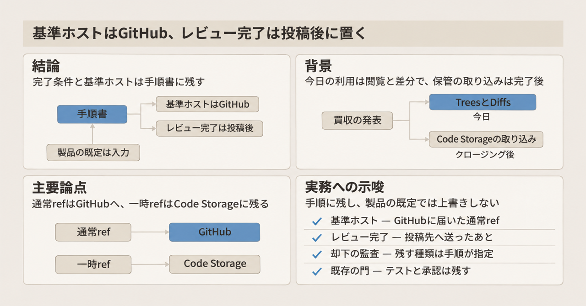
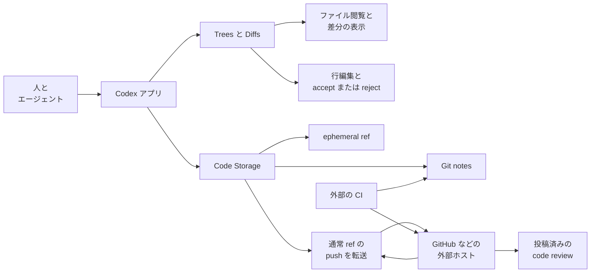

2026年11月4日、OpenAIはPierre Computer Company, Inc.（[pierre.computer](https://pierre.computer/)）を買収する合意を発表しました。Pierreは、エージェント向けのGitインフラである[Code Storage](https://code.storage/)と、差分・ファイルツリー・シンタックスハイライトのオープンソースを出している会社です。

本稿は、その発表と、Code Storage、Diffs、Codexの製品文書（2026年11月5日取得）に沿って、ファイルの閲覧、差分、Gitの保管が今どの層にあるかを追います。コーディングエージェントの手順書を持つテックリードが、レビューの完了条件と、リポジトリ操作の基準にするホストを、自社の手順と製品の既定のどちらに置くかを決める材料です。

取引は、規制当局の承認を含む、完了前の通常の条件の前にあります。それまで両社は別会社です。


*この記事の全体像。以下、順に解説します。*

## OpenAIのPierre買収とは

発表は、Codexのbuilding、understanding、reviewingを広げる取引だと副題に書いています。本文は、Codexアプリがファイル閲覧と変更のレビューにTreesとDiffsをすでに使っている、と説明します。Treesはファイルツリー、Diffsは差分を描くオープンソースです。クロージング（買収の完了）後もCode Storageの顧客は利用を続けられ、その機能をCodexへ取り込む、とも書きます。

### ファイル閲覧と差分

発表が名指しする現行の利用は、Codexアプリのファイル閲覧と変更レビュー画面における[Trees](https://github.com/pierrecomputer/pierre)と[Diffs](https://diffs.com/)です。DiffsのEdit modeは、差分の上で行を直す操作です。Highlightsは、入力中の文字、またはエージェントのストリームに追従するハイライトです。

CodexのCode ReviewとGitHub連携は、この発表とは別ページの既存機能です。チャット上のレビューは、コメント投稿、approve、mergeをしません。共有する指摘は、人が選びます。

### Gitで履歴を置く層

Code Storageは、アプリケーションがGitでコードを保存し、履歴を追うAPIです。現行のSDKは3つです。TypeScriptは`@pierre/sdk`です。Pythonの配布名は`pierre-sdk`で、import名は`pierre`です。Goは`github.com/pierrecomputer/sdk/go`です。旧パッケージ`@pierre/storage`のページも残っています。廃止日は文書にありません。

GitHub Appで同期したリポジトリでは、文書がGitHubをsource of truthと呼びます。ここでのsource of truthは、その文書が履歴の基準に置くホストです。アプリが叩くremoteはCode Storageです。`git clone`、`fetch`、`pull`はCode Storageを読みます。通常refは、このあと説明する一時的なref以外のrefです。通常refへの`git push`はGitHubへ転送し、成功後にCode Storage側へ写し戻します。分担を書く文書は、人が叩くremoteもCode Storageだと説明します。

public modeは、一回の取り込みです。継続同期も、GitHubへの自動送信も、GitHubからの自動コピーもありません。一回の取り込みの起点と先は、文書のこの説明では「取り込み」としか書いていません。generic HTTPSは、GitLab、Bitbucket、Gitea、Forgejo、Codeberg、SourceHutなどの、設定した外部ホストへpushを転送します。文書は、GitHub Appのときのような source of truth という呼び方を、その外部ホストには使いません。

ephemeral refは、文書が用途の例に挙げる、エージェントの作業スナップショット、プレビュー用ビルド、書きかけの一時コミットのためのrefです。そこへのpushはGitHubに届かず、Code Storage側に残ります。GitHubからの同期が写すのは`refs/heads/*`と`refs/tags/*`です。初回同期中のAPI呼び出しは`409 sync_in_progress`になり得ます。初回のあと、読み取りは後続の同期を待たず、古くなり得ます。

Git LFSは、GitHub Appの同期だけが対応します。通常refへのアップロードは、バイト列をGitHubへ直接送り、Code Storageは保存しません。ephemeral refへのLFSはCode Storageに残り、GitHubには届きません。publicとgeneric HTTPSはLFSに対応しません。

Git notesは、コミット履歴を書き換えずにメタデータを付ける仕組みです。文書の例refは`ci`、`reviews`、`agents/verdicts`です。createは、既存のnoteがあると失敗します。deleteは、選んだrefからnoteを外します。notes refsのlistは既定20、上限100です。

### 認証、エラー、ライセンス

認証は、登録した公開鍵に対して自分で切るJWTです。アルゴリズムはES256、ES384、ES512、RS256です。OAuth認可サーバはありません。スコープは`git:read`、`git:write`、`repo:write`、`org:read`です。

トークンの寿命は、経路で違います。文書が restricted key と呼ぶ鍵では`iat`と`exp`が必須で、`exp`は最大3600秒後です。無制限キーには、この1時間の上限はありません。文書が token helper と呼ぶ仕組みの`ttl`は1秒から1時間で、既定は15分です。秘密鍵で各リクエストに切るトークンは、SDK文書では5分です。文書は、この4つの経路の寿命を書くだけで、どれを選ぶかは書いていません。

エラーはRFC 9457の`application/problem+json`で、分岐は`code`によります。RFC 9457は、HTTP APIが機械可読な問題詳細を返す形式です。`429`は`rate_limited`です。`409`のcodeには、先に書いた`sync_in_progress`があります。

OSSは買収後もOSSのまま、と発表が書きます。`pierrecomputer/pierre`のLICENSEはApache-2.0です。`isArchived`はfalseでした（2026年11月5日の`gh`）。

### データの向き

発表が今日の製品に結び付けているのは、見る・差分を描く層と、Gitで履歴を置く層です。同期した通常のrefは外部ホストへ転送されます。ephemeralなrefはCode Storageに残ります。レビューの指摘を載せる専用の製品オブジェクトは、発表もCodexの二ページも定義していません。実装する側が、描画ライブラリの状態、任意のGit note、source providerへの投稿のどれかを選びます。source providerは、Codexの文書がレビューの送信先として書くホストです。Comment、Approve、Request changesを送ると、そのホスト側のreviewオブジェクトになります。CIは、webhookやnoteを受け取る外部の消費者です。Code Storageの文書は、CIを自前のランナーとしては書いていません。



矢印は、2026年11月5日時点の文書が説明する範囲で読んでください。CodexからTreesとDiffsへの矢印は、発表が今日のCodexアプリの利用として名指しする、ファイル閲覧と差分です。Code StorageからGit notes、ephemeral ref、通常refの転送への矢印は、Code Storageの文書が説明するデータの向きです。CodexからCode Storageへの線は、発表がこの二つの層を同じ取引に置いていることを示します。Code Storageの機能がすでにCodexへ入ったことは意味しません。その取り込みは、クロージング後の予告です。CIから外部ホストとGit notesへ向かう矢印は、図の向きのままです。本文はCIを、webhookやnoteを受け取る側と書きます。書き手か受け手かは、図と本文では揃っていません。レビュー完了の置き場は、この矢印の向きでは決まりません。

## 注意点

発表の副題はunderstandingとreviewingを掲げます。本文が今日の利用として具体化しているのは、ナビゲーション、差分、差分上の編集、ハイライトです。同じ発表は、クロージング後の範囲として、source controlを業界の標準へ進めること、会社が出荷するコードとその人たちの判断をCodexがつなぐこと、Code Storageの機能をCodexへ取り込むことを書きます。この範囲は、発表が今日の利用として名指ししたTreesとDiffsより広いです。保存先のref、却下した指摘の永続化、CIの置換は、発表にありません。

### 2日前のPandoの数値

2日前の[Scaling Git at OpenAI](https://openai.com/index/scaling-git-at-openai/)（2026年11月2日、Aaron Friel、Taylor Blau、Ted Nyman）は、社内モノレポのGit backendであるPandoを説明します。Pandoは、OpenAIのmonorepoを載せている社内のGit backendです。Pierreの名はありません。数値はすべてOpenAI本文の自己申告であり、第三者の再計測は公開されていません。

| 本文の表現 | 置き場所 | 読み方 |
|---|---|---|
| median push latencyをnearly 5x短縮 | 冒頭 | 前後の絶対値と標本は無い |
| median pushの遅延をnearly 80%削減 | 後方。merge reliabilityの改善と同じ文 | 5xと同一測定だとは書いていない。換算して足さない |
| nearly a petabyte of Git data per day | 冒頭と、少数コアで届けられるという文 | 1時間の57 TB超とは別の文。24倍して同一視しない |
| 1時間に57 TB超、そのバイトの99%超がローカルディスクキャッシュ | 後方 | 測定窓の定義は本文だけでは不足する |
| 移行前のreliabilityが時として90%未満 | 移行の節 | 分母（push、fetch、mergeのどれか）は無い。改善後のパーセントはこの文に無い |
| Synthetic teaching models, not production benchmarks | シミュレーションの注記 | 図の勝敗は本番ベンチマークではない |

Pandoは、monorepoの外での利用と、利用者への技術共有を探索中だと書きます。Pierreの発表は、Pandoをin-house source control backendと呼んだうえで、source controlの将来を進めると書きます。今日の役割、つまり社内backendと、アプリに埋め込むUIが同じだ、と示す文はありません。その不在は、層が衝突しないことの根拠にはなりません。Pando本文は、移行時にchange requestsとcode reviewの道具を別に作った、とも書きます。レビュー手段がDiffsだけ、とは読みません。

顧客向けのgit層を、Pandoの技術共有が担うのか、Code Storageの取り込みが担うのかは、両ページとも書いていません。

### 上限、料金、SLA

Code Storageのホームページが掲げる上限も、製品の自己申告です。リポジトリ32TB、concurrent writes 30+、リポジトリ数Unlimited、Zero downtime migrations、Guaranteed consistency、です。GitのSeen 500+/s/repoと、APIのSeen 15k+/sは、上限ではなく、Unlimitedの横に置いた観測値です。測定条件はページにありません。

導入文の「No rate limits」と、OpenAPIが定義する`429`、動的な`RateLimit`、`Retry-After`は、別レイヤです。固定の`RateLimit-Policy`は出しません。固定RPMは文書にありません。

価格は[pricing](https://code.storage/pricing)を正とします（2026年11月5日取得）。Hotは$0.005/GB/hrです。Coldは、未接触が7日を超えた保管で、$0.0002/GB/hrです。Inboundは$0.06/GB/moです。Outboundは$0.15/GB/moです。Starterは月$20から、Scaleは月$200からで、表示はminimum monthly usageであり、追加料金ではありません。ホームページの帯域表が単位期間を欠くときは、このページの/moを使います。シミュレータの既定額は価格ではありません。発表ページに買収の対価はありません。

SLA（Last Updated: Oct 27, 2025）の99.99%は、暦月の契約値であり、稼働実績ではありません。Availabilityの定義文は "available to assist Customer in the labeling of Customer Data" です。git fetchの月間到達率とも、移行の無停止とも読めません。この文言がテンプレートの残しか、意図した定義かは、文書だけでは決まりません。除外には、可能な範囲で17:00から24:00 Pacificのアップグレード、事前通知つきの計画保守（月2時間まで）、緊急保守、契約違反、force majeureがあります。クレジットが唯一の救済です。

### リポジトリの状態

`pierrecomputer/pierre`のstarは約6.4kです（2026年11月5日、`gh`の6446を概数化）。`pushedAt`は2026-11-04T12:52:18Zです。default branch `main`の最新コミットは2026-11-03T23:42:26Zです。メッセージは次のとおりで、版の前後にバッククォートがあります。

```
chore: bump @pierre/diffs to `1.6.4`
```

shaは`75e00805b44e193c0fb235c1bd9d7fadfa06acf6`です。`pushedAt`は任意ブランチへのpushを含むため、defaultの最新コミット日とは1日ずれます。diffs.comの版表示もv1.6.4です。

2026年11月5日時点で、Pierre Computer、`@pierre/diffs`、code.storageを製品とするCVE番号は、NVDまたはGitHub Advisoryの一次情報では確認できませんでした。番号は書きません。

2026年11月5日に取得したPierre自身のサイト本文には、買収を知らせる文はありませんでした。Pierre側の確認文が別に存在するかは、その取得では分かっていません。

### 継続利用の文が含まないこと

Terms（2025年10月27日）は、契約終了でアクセス権が直ちに終わると書きます。取得したTermsには、gitリポジトリの書き出しを会社に義務づける文は見当たりませんでした。Code Storage DPA（参考リンクにある契約文書）のAnnex Iのsubject matterには "host, review, and collaborate on code" とありますが、レビュー製品の仕様ではありません。同じページの終了時の条項は、Personal Dataの削除またはコピーであり、gitリポジトリの書き出し義務ではありません。Terms 9.6は、合併や資産譲受で相手の同意なく契約を譲渡できる、と書きます。これは主体が移り得る、という意味であり、クロージング前の移行強制ではありません。

継続利用の文は、終了時の書き出し義務や、契約が改定されないことを意味しません。

### 一次文書がまだ書いていないこと

次は、2026年11月5日の取得範囲では未記載です。

- クロージング後、Codexに入るCode Storageの機能が、同期時のsource of truthを変えるか。発表は、変えないとも、変えるとも書いていません。
- 削除したGit noteの過去が、却下の監査として残るか。文書は保持方針を書きません。
- Codexの未投稿指摘が、Code reviewとReview GitHub pull requestsの二ページ以外に残るか。ここで見た範囲は、発表、Git notes、Diffs、Code review、Review GitHub pull requestsまでです。Codex Securityは別ページなので、PRレビューの却下の根拠には使いません。
- Pandoのnearly 5xとnearly 80%が、同じ測定か。本文は対応づけません。

## コードの正本とレビュー結果の置き場

発表に、既存のコードホストやCIとの役割分担表はありません。現行の分担はGitHub Syncの文書にあります。

| 層 | 2026年11月5日の文書が置く場所 | 文書が置いていないこと |
|---|---|---|
| GitHub Appの通常ref | GitHubがsource of truth。人が叩くremoteはCode Storage。pushはGitHubへ転送し、変更を写し戻す | クロージング後もこの正本が続く、とは発表は書いていない |
| public mode | 一回の取り込み。webhookも、GitHubへの自動送信も、GitHubからの自動コピーも無い | public modeに継続的な双方向同期は書いていない。双方向同期はGitHub App側である |
| generic HTTPS | 設定した外部ホストへpushを転送する | 文書は、そのホストをGitHubのsource of truthとは呼ばない |
| LFS | GitHub Appだけ。通常refのアップロードはGitHubへ直接送る | publicとgeneric HTTPSは非対応と、同じ文書が書く |
| ephemeral ref | Code Storageに残る。GitHubには届かない | エージェントの作業スナップショットをホストの正本にする、とは書いていない |
| CI | Pull Requestのwebhookは任意。本文はCIを外部の消費者と書く。図の矢印の向きとは揃っていない | Code StorageがCIランナーである、とは書いていない |
| 社内の巨大モノレポ | PandoがOpenAIのmonorepoを載せている（2026年11月2日） | PandoとCode Storageのどちらが顧客向けgit層かは、両ページとも書いていない |
| レビューUI | CodexアプリがTreesとDiffsを使う | レビュー手段がDiffsだけ、とは読まない |

「人が却下した指摘がどこに残るか」は、発表も、取得したCodexの二ページも、専用の製品オブジェクトとしては定義していません。実装する側が選ぶ置き場は、描画ライブラリの状態、Git note、source providerへの投稿の3つです。この3つは別の操作です。下の表は、その周辺にある操作の一覧です。

| 操作 | 文書が言うこと | 却下したあとに残るもの |
|---|---|---|
| Diffsのaccept / reject | 呼び出し側のUI。`onEditComplete`が`'accept'`または`'reject'`。コールバックが欠けるとreject。コメントはannotationで、永続化はアプリの状態 | ライブラリ自身の監査ログは、開いた文書には無い |
| Code StorageのGit notes | 呼び出し側がrefを選ぶ。`reviews`と`agents/verdicts`は例。deleteはそのrefからnoteを外す | 却下済み指摘のスキーマは無い。消したnoteの過去commitが監査として残るかは、文書が保持方針を書かない |
| Codexのチャット上のレビュー | コメント投稿、approve、mergeをしない。共有する指摘は人が選ぶ | 未投稿の指摘の監査ログは、このページには無い |
| SummaryまたはChangesへの投稿 | CodexのCode review文書が、SummaryまたはChangesへの投稿として書く操作。コメントをsource providerへ直ちに送る。二つの名が一つのボタンかは、その文には無い | 投稿者のコメントがCode Review画面にも残る、とはこの操作の説明は書いていない |
| 自動のクラウドレビューのコメント | GitHubとCode Reviewの両方に出る、とCodex文書が書く。何が起動するかは、この行には無い | 保存先をCodexだけにはしていない |
| Submit review | Comment、Approve、Request changesをsource providerへ送る | ホスト側のreviewオブジェクトになる |
| `/review` | 作業ツリーを変えずに指摘を出す。ローカルのinline commentはreview guidance（レビューの進め方の案内）です。stageは採用、revertは破棄。単位はdiff、ファイル、hunk（差分の一塊） | 捨てた指摘を別ストアへ残す、とは書いていない |
| GitHub上の`@codex review` | 標準のGitHub code reviewを投稿する。GitHub上ではP0とP1だけをflagする。flagする対象の定義は、この文には無い | Code review rulesはCodexを導く。tests、branch protections、required approvalsは置き換えない、と書く |
| Mark as viewed | 表示中のrevisionに付く | 指摘の採否とは別である |

この表の「無い」は、発表、Git notes、Diffsの説明、[Code review](https://learn.chatgpt.com/docs/code-review.md)、[Review GitHub pull requests with Codex](https://learn.chatgpt.com/docs/third-party/github.md)の範囲です。

## 手順書に残す完了条件

ここでの正本は、完了とみなす履歴が載るホスト、または完了とみなすレビュー状態です。注意点に挙げた未記載があっても、正本を自社の手順書に残す判断はできます。先取りしないのは、クロージング後の正本変更を、今日の仕様として書くことだけです。

発表は、描画ライブラリの取り込みと、顧客向けGit保管の取り込み予告です。GitHub Appで同期した通常refの正本は、今日の文書ではGitHubです。publicは一回の取り込みです。generic HTTPSの転送先は、設定した外部ホストです。完了条件とホストの正本は自社の手順書に残し、製品の既定は、その手順を上書きしない入力として置きます。今すぐ製品へ正本を移しません。

手順書に残すのは、次の4点です。製品の画面や既定値は、その文を上書きしない入力として置きます。

1. GitHub Appで双方向同期している通常refの正本は、今日のCode Storage文書に従いGitHubに置きます。clone先がCode Storageでも、完了とみなす履歴はGitHubに届いた通常refです。public modeは一回の取り込みで、ホストへ自動では戻しません。一回の取り込みの起点と先は、文書では「取り込み」としか書いていません。generic HTTPSの転送先は、設定した外部ホストです。GitHub Appのように、完了とみなす履歴がそのホストに届いた通常refだと書く文は、この文書にはありません。ephemeral refと、そこだけにあるLFSオブジェクトは、ホストの正本にしません。
2. レビューの完了は、source providerへ投稿したあとの状態で定義します。チャット上に出ただけの指摘、Diffs上のreject、Git noteの有無は、完了の状態に入れません。
3. 却下は3種類に分けます。投稿しない、hunkをrevertする、noteをdeleteする、です。どれを監査に残すかは手順が指定します。製品は、消したあとの残り方を保証していません。Diffs上のrejectは完了に入れません。Diffsのrejectを、この3種類のどれか一つだと文書は書いていません。
4. テスト、branch protection、required approvalsは残します。CodexのCode Review Rulesは案内であり、これらの代替ではありません。

この置き方を支えているのは、次の文書の書き方です。

- 発表が今日の利用として名指しするのはTreesとDiffsであり、保存先のrefと却下の永続化は書いていません。
- GitHub Syncは、GitHub Appの同期についてGitHubをsource of truthと書き、通常refのpushの転送と写し戻しを説明します。
- Diffs、Git notes、Codex Code Reviewは、未投稿の指摘、noteの削除、hunkのreject、source providerへの投稿を別操作として説明します。
- GitHub連携は、レビュー規則がテスト、branch protection、required approvalsを置き換えないと書きます。これは買収発表より前からある製品面です。
- クロージングまでは別会社であり、発表は、今すぐ正本を移せ、とは書いていません。OSSはOSSのままです。顧客はクロージング後もCode Storageを使い続けられる、と書きます。

読み方の幅として残るのは、操作の選び方そのものではありません。「判断をつなぐ」「source controlの標準」「Code Storageの機能をCodexへ取り込む」は、UI利用より広い、クロージング後の範囲です。現行仕様ではありません。クロージング後に正本が変わり得る余地として残します。Pandoの利用者向け共有と、Code StorageのCodex取り込みは、顧客向けgit層の担当を互いに固定していません。

クロージングまで、レビューの完了条件とホストの正本を、CodexやCode Storageの既定へ移しません。OSSのTreesとDiffsを、閲覧と差分の部品として使うこと自体は、この判断と両立します。

逆転条件は次です。クロージング後の一次文書が、同期リポジトリのsource of truthをCode StorageまたはCodexに変えること。または、却下した指摘の保存先と保持期間を、製品が仕様として書くこと。そのどちらかが公開されたとき、手順の正本を読み直します。

## まとめ

OpenAIのPierre買収は、Codexアプリがすでに使うTreesとDiffsの取り込みと、クロージング後にCode Storageの機能をCodexへ入れる予告です。今日のGitHub App同期では、通常refの基準ホストはGitHubのままです。publicは一回の取り込みで、generic HTTPSは設定した外部ホストへ転送し、ephemeral refはCode Storageに残ります。

レビューの完了は、source providerへ投稿したあとの状態で手順書に書きます。チャット上の指摘、Diffs上のreject、Git noteの有無は、その完了に入れません。テスト、branch protection、required approvalsは残します。クロージング後の一次文書が基準ホストか、却下の保存先と保持期間を仕様として書くまで、この正本は製品の既定へ移しません。

この記事が少しでも参考になった、あるいは改善点などがあれば、ぜひリアクションやコメント、SNSでのシェアをいただけると励みになります！

## 参考リンク

- OpenAI, "OpenAI to acquire Pierre", 2026-11-04. <https://openai.com/index/openai-to-acquire-pierre>
- OpenAI, "Scaling Git at OpenAI", 2026-11-02. <https://openai.com/index/scaling-git-at-openai/>
- Pierre. <https://pierre.computer/>
- Code Storage. <https://code.storage/>
- Code Storage pricing. <https://code.storage/pricing>
- Code Storage SLA, Last Updated Oct 27, 2025. <https://code.storage/legal/sla>
- Code Storage Terms, 2025-10-27. <https://code.storage/legal/terms>
- Code Storage DPA. <https://code.storage/legal/dpa>
- GitHub Sync. <https://code.storage/docs/repos/github-sync.md>
- Git Notes. <https://code.storage/docs/repos/git-notes.md>
- Introduction（No rate limits）. <https://code.storage/docs/getting-started/introduction>
- API overview. <https://code.storage/docs/api/overview.md>
- API meta（OpenAPIの429）. <https://code.storage/docs/api/meta.md>
- Authentication. <https://code.storage/docs/getting-started/authentication>
- SDKs. <https://code.storage/docs/sdks.md>
- Diffs. <https://diffs.com/> および <https://diffs.com/docs>
- Codex, Code review. <https://learn.chatgpt.com/docs/code-review.md>
- Codex, Review GitHub pull requests. <https://learn.chatgpt.com/docs/third-party/github.md>
- pierrecomputer/pierre（Apache-2.0、メタデータ取得 2026-11-05）. <https://github.com/pierrecomputer/pierre>
