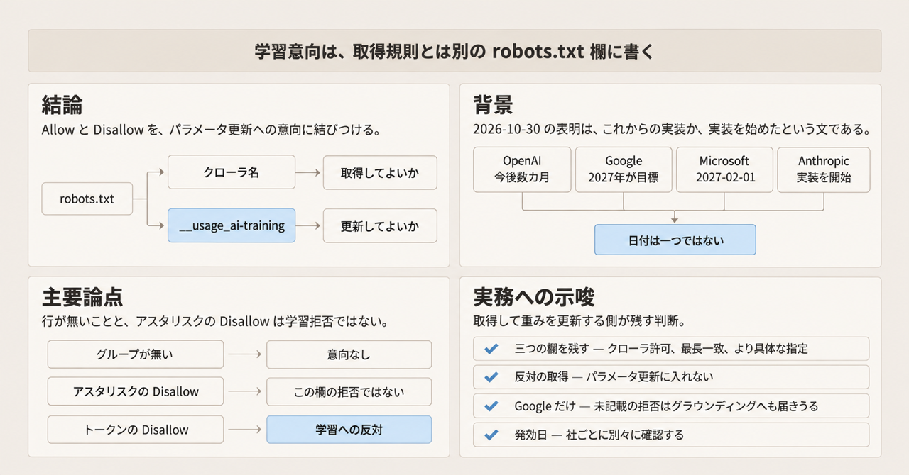
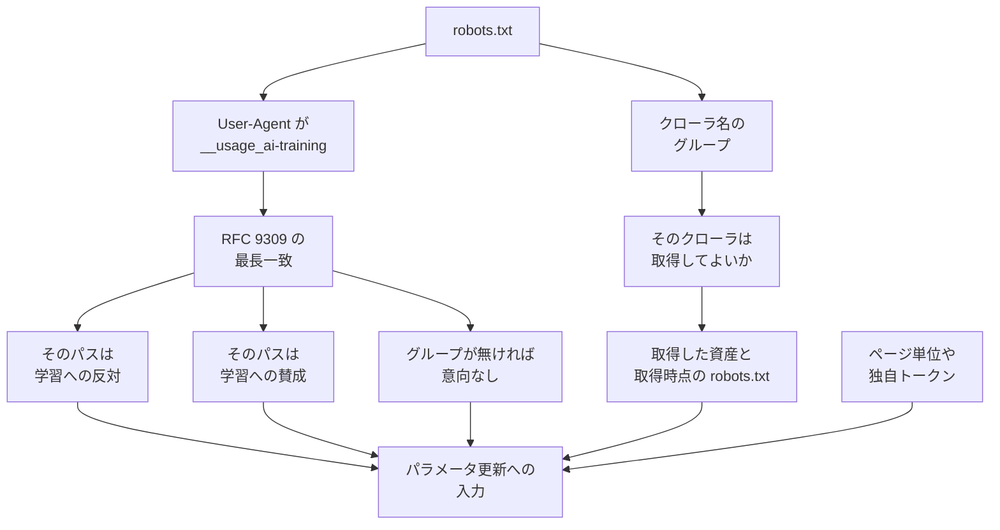

2026-10-30、OpenAI、Google、Microsoft は、ウェブサイト運営者が生成AIの学習に関する意向を、複数の事業者へまとめて伝えられる共通の robots.txt シグナルを尊重する、とそれぞれ発表しました。2026-11-02 に確認できた一次は、対応済みの完了報告ではなく、これからの実装か、実装を始めたという本人の文です。一次とは、発表本文、草案、各社の製品文書そのものを指します。この記事では、その信号の書き方、指す範囲、各社が書いた時期、既存のクローラー制御との関係、公開ウェブを取得して生成モデルの学習済みパラメータを更新する側が残す欄を整理します。


*この記事の全体像。以下、順に解説します。*

## `__usage_ai-training` とは

robots.txt は、クローラにパスごとの取得可否を伝えるテキストファイルです。文法は RFC 9309（Robots Exclusion Protocol）に従います。今回の信号は、そのファイルの中に、取得の規則とは別の User-Agent グループを足す書き方です。User-Agent グループとは、`User-Agent` 行で始まり、その相手に対する `Allow` と `Disallow` が続くまとまりです。

2026-10-30 の定義文は、Anthropic の Kevin Kelley が同日付で IETF の AI Preferences 作業部会へ出した個人の Internet-Draft「Machine-Readable Training Preference Signal」（draft-kelley-aipref-training-preference-signal-00）にあります。Internet-Draft は IETF の作業文書です。この草案は、新しいディレクティブ名も新しい文法も導入しない、と Abstract に書きます。ディレクティブとは、`Allow` や `Disallow` のように、robots.txt の行の種類の名前です。パスの書き方、最長一致、グループの構造は RFC 9309 のままです。最長一致とは、複数の `Allow` と `Disallow` が同じパスに当たるとき、より長いパス指定を採用する規則です。

書き方は、User-Agent 行のポリシートークン `__usage_ai-training` に、既存の `Allow` と `Disallow` を結びつけることです。ポリシートークンとは、クローラの名前ではなく、利用目的を表すために User-Agent 行へ書く名前です。草案図1の例は次の3行です。

```text
User-Agent: __usage_ai-training
Disallow: /
Allow: /press-kit/
```

草案 §1 は、この例を、サイト全体は学習への反対、`/press-kit/` 以下は学習への賛成、と読みます。`/blog/post` に当たる最長の指定は `Disallow: /` です。`/press-kit/logo.png` に当たる最長の指定は `Allow: /press-kit/` です。

`User-Agent: *` は、このトークンに一致させてはならない、と草案 §4.2 が MUST NOT で書きます。`__usage_ai-training` の行が無いファイルは、この機構の上では意向を表明していません。クローラー自身の User-Agent に対する `Allow` と `Disallow` は、取得の意向として今までどおり残ります（§4.3）。このトークンの役割は、取得した内容を生成モデルのパラメータ更新に使ってよいかを示すことです（§4.4）。消費者は、このトークンを読む側です。サイトの利用者ではありません。パラメータ更新の意向を読むためだけに巡回する消費者は、反対表明のある資源を取らないことが MAY、つまりしてよい、と草案は書きます。取得を必ず止める規則ではありません。

トークンが指す「AI学習」は、語彙草案 draft-ietf-aipref-vocab-08 §4.1 の AI Training です。引用された定義は次のとおりです。

> Using an asset to modify the learned parameters of a generative AI model.

生成AIモデルの学習済みパラメータを変えるために、取得した内容を使うことです。生成以外のタスクだけに使うモデルの学習は、そのモデルが生成もできても、この区分に入りません。参照や引用のように、パラメータを更新せず本文を渡す経路は、このトークンの定義の外にあります。草案はこの種の経路を技能プロンプトとも呼びます。技能プロンプトは製品の画面名ではなく、パラメータ更新と分けた使い方の名前です。このトークンの Allow と Disallow は、その経路の可否までは示しません。

資産とは、取得したページなどの内容です。資産に付く意向は、その資産を取得した時点で有効だった robots.txt のものです（草案 §3、RFC 9309 §2.4）。attach 草案 draft-ietf-aipref-attach-05 §3.3 は、robots.txt の更新は取得済みの資源へ遡らない、と書きます。attach 草案は、意向を資産へどう結びつけるかを扱う作業文書です。

独自のポリシートークンは、この文書が無いときと同じ意味で解釈します。この文書の意向としては扱いません（§4.2）。消費者は、独自トークンをより具体だと文書化してよい、と §4.5 が MAY で書きます。私的合意は、この機構の意向を上書きしてよい、と同じく MAY です。

草案の datatracker（IETF の草案掲載ページ）は、この Internet-Draft を IETF が承認しておらず、標準手続き上の正式な地位は無い、と表示します。公開は 2026-10-30、失効は 2027-05-03 です。失効日は文書の期限であり、各社の提供終了日ではありません。

各社の表明は次のとおりです。OpenAI は「coming months」に実装し、実装時に詳細を出す、と書きます。既存のクローラー制御は置換しません。参照先は GPTBot、OAI-SearchBot、ChatGPT-User、OAI-AdsBot の説明ページです。Google の Search Central Blog は、他の提供者とともに 2027 年の対応を目指す、と書きます。共通クローラーページの Google-Extended 節（最終更新 2026-10-30 UTC）は、同じ共有シグナルを 2027 年初めにサポートする意向だと注記します。どちらも実装完了日ではありません。Microsoft は 2027-02-01 から、クロールに合わせて新しい学習意向とグラウンディング意向を尊重し始める、と書きます。グラウンディングとは、取得した内容を、応答を生成するときの材料にすることです。パラメータの更新とは別です。Kelley は同日、作業部会メーリングリストで、Anthropic がこの草案への対応実装を始めたと書きました。全サービスには時間がかかる、とも書いています。

謝辞に並ぶ氏名と所属（OpenAI、Google、Microsoft、Anthropic、Meta、AWS など）は、IETF 参加者の識別です。各社がトークンを尊重する発表そのものではありません。尊重を自社の文で書いたのは、2026-11-02 に開いた範囲では OpenAI、Google、Microsoft の3本です。Anthropic については、著者のメールが実装開始を述べています。

1つの robots.txt は、取得の規則と、学習への意向を、別の User-Agent グループとして持ちます。学習グループの結果は、生成モデルのパラメータを更新する経路へ渡します。



上の段がファイルの中のグループ、中の段が一致の結果、下の段がパラメータ更新してよいかの入力です。ページ単位は、robots.txt ではなく各ページに付ける指定です。反対の矢印は、その判定へ反対という結果を渡します。グラウンディングや技能プロンプトへの投入は、この図の下段には置いていません。

## 注意点

発表文と見出しは、すでに共通の発効日があるように読めます。2026-11-02 に開いた一次は、どれも将来形か、実装を始めたという本人の文です。

| 主体 | 一次が書く時期 | 出典 |
|---|---|---|
| OpenAI | coming months。日付は無い。既存制御は残る | [OpenAI](https://openai.com/index/helping-websites-express-ai-training-preferences)、2026-10-30 |
| Google | ブログは 2027 年の対応を目指す。共通クローラーページは 2027 年初めにサポートする意向と注記する。どちらも完了日ではない | [Search Central Blog](https://developers.google.com/search/blog/2026/10/ai-training-control) と [共通クローラーページ](https://developers.google.com/crawling/docs/crawlers-fetchers/google-common-crawlers)、2026-10-30 |
| Microsoft | 2027-02-01 からクロール分を尊重。NoArchive と NoCache は 2027-03-01 以降、学習にもグラウンディングにも読まない | [Bing ブログ](https://blogs.bing.com/search/2026/10/your-content-your-choice-clearer-preferences-for-training-and-grounding/)、2026-10-30 |
| Anthropic | 2026-10-30 のメールで実装を開始。全サービスには時間がかかる。製品文書の発効日は確認できなかった | [ai-control メーリングリスト](https://mailarchive.ietf.org/arch/msg/ai-control/mddjatOxSR0h6GmLRBWlc839c7w/) |

NoArchive と NoCache は、ページに付いている既存の指定の名前です。Microsoft の行の日付は、同社がその名前を学習にもグラウンディングにも読まなくなる時期です。

共通クローラーページの注記は、Google-Extended の節にあります。原文は、AIPREF（AI Preferences。前に書いた作業部会の短い呼び方）の共有シグナル（`user-agent: __usage_ai-training`）を 2027 年初めにサポートする意向である、と書きます。ページの最終更新は 2026-10-30 UTC です。2026-11-02 の再取得でこの注記を確認しています。ブログ本文の "in 2027" には "early" がありません。日本語では [ITmedia](https://www.itmedia.co.jp/news/article/2611/01/2000002776/)（2026-11-01）が同じ発表を報じています。

[Impress Watch](https://www.watch.impress.co.jp/docs/news/2152852.html)（2026-11-01 09:00）の見出しは「Google、MS、OpenAIらが共通仕様を27年導入」、リードは Anthropic を含めて「2027年の導入を目指す」と畳みます。同じ記事の後段は、Google は2027年、OpenAI は今後数カ月、Microsoft は2027年2月、と書き分けます。[Search Engine Journal](https://www.searchenginejournal.com/google-microsoft-openai-shared-ai-training-opt-out/595387/)（2026-11-01）は、Google、Microsoft、OpenAI の公表が将来形であることから、3社はこの行を現時点ではサポートしていない、と書きます。2026-11-02 付で各社が「未対応」と更新したページは、見つかっていません。

このトークンの `Disallow` を、次のものと同じ欄に入れません。

- クロール拒否。取得を止めるのは、自社クローラ名のグループです。
- 参照、引用、技能プロンプトへの投入。語彙草案 §4.2 は、利用者から直接渡されていない資産を生成モデルの入力にすることを AI Use として分け、AI Training に含まれる利用はそこから除きます。§4 冒頭には、コンセンサス未了の注記があります。
- Microsoft のグラウンディング。同社は、学習を Disallow しグラウンディングを Allow にすれば、生成応答の材料にはでき、モデル学習には使わせない、と例示します。未設定の既定は Allow です。
- 既存モデルや既取得コーパスからの削除。開いた草案と各社発表に、削除を命じる文はありません。効くのは、取得時点の robots.txt で反対だった、これからのパラメータ更新です。
- 法的な履行。語彙草案 §3.2 は、選好が守られることを保証せず、いつ守るかは仕様の外だと書きます。OpenAI は同シグナルを voluntary effort、つまり任意の取り組みと呼びます。草案に監査と救済はありません。
- 同日の OpenAI 記事「[Fair use benefits everyone](https://openai.com/index/fair-use-benefits-everyone/)」（2026-10-30）は、NYT 訴訟で fair use を支持する提出の抜粋であり、robots.txt には触れていません。明示の Disallow を無視する、とは読めません。許諾という意思表示が無くても学習は fair use でありうる、という訴訟上の立場を示しています。

Google だけ、共通トークンの学習拒否が届く先が広いです。Google-Extended を書いていないサイトの学習拒否を、Google は Google-Extended の Disallow と同じに読む計画です。Google-Extended は、Google の製品トークンです。HTTP の User-Agent 文字列は別途持ちません。製品定義は、将来世代の Gemini（Google の生成モデル）の学習と、プロンプト時に検索インデックスの内容を渡すグラウンディングの両方です（共通クローラーページ、2026-11-02 に確認）。そのため、この読みはグラウンディング側へも届きえます。他社の「学習だけ」と同じ規則にはなりません。

グループが無いこと、`User-Agent: *` の Disallow、ファイルのどこかに Disallow 行があること、は学習拒否ではありません。Microsoft は、適用される学習意向が無ければ既定を Allow とします。

RFC 9309 §2.5 は、クローラが課す解析上限を少なくとも 500 kibibytes にせよ、と書きます。ファイルを 500 KiB 以下に限る条文ではありません。kibibyte は 1024 バイトです。サイト側がファイルを 500 KiB に収める根拠にはなりません。

Cloudflare の Content Signals は別の行です。同ブログは、`User-Agent: *` の下に `Content-Signal: search=yes, ai-train=no` と書き、`ai-input` を RAG やグラウンディング、`ai-train` を学習やファインチューンと定義します。ファインチューンは、ここでもパラメータの更新に含まれる呼び方です。RAG とは、検索した本文を応答の材料に足す使い方です。管理 robots.txt は、顧客が有効にすると Cloudflare 側のファイルへ信号が足される設定です。有効にした顧客は 380 万超のドメインで、そのファイルに例と同じ `search` と `ai-train` を足す、とページ自身が書きます。同ページの schema.org は datePublished を 2025-09-24、dateModified を 2026-07-15 とします（2026-11-02 に本文を確認）。Kelley 草案では、この `*` グループは `__usage_ai-training` に一致しません。

## 既存の社別制御と並べて読む

共通トークンは、各社が今も書いている独自の欄を消しません。OpenAI、Google、Microsoft は、既存の社別制御を残すと書いています。

OpenAI の [bots 文書](https://developers.openai.com/api/docs/bots)（2026-11-02 に確認）は、設定が互いに独立だと書きます。GPTBot は、基盤となる生成AIモデルの学習に使う収集を担うクローラです。GPTBot の Disallow は、その学習に使わない、という意思です。OAI-SearchBot の Disallow は、ChatGPT の検索回答に出さない、という意思です。両方を許すと、重複クロールを避けるため片方の取得結果を両方に使うことがあります。ChatGPT-User はユーザー操作であり、robots.txt が適用されないことがあります。OAI-AdsBot の収集は、基盤モデルの学習に使わない、と書きます。このページに `__usage_ai-training` はありません。GPTBot と共通トークンが衝突したときの優先も、表明とこのページでは確認できていません。OpenAI は、詳細は実装時、としています。

Google-Extended は独立した製品トークンです。クロールは既存の Google のユーザーエージェントが行い、robots.txt のトークンは利用の制御に使います。検索への収録とランキングには影響しない、と共通クローラーページが書きます。Google-Extended を明示的に許可したサイトは、Gemini Apps のグラウンディングで回答に出る資格がある、とブログが続けます。共通トークンで学習を拒否し、かつ Google-Extended を明示していないとき、Google は Google-Extended を Disallow したのと同じに読む計画です。

Microsoft の学習は、共有トークン（サイトまたはパス）に加え、ページ単位の meta または `X-Robots-Tag` でも指定できます。ページ単位が robots.txt より優先します。グラウンディングはページ単位だけです。ページ単位の例は次のとおりです。

```text
meta name="Bingbot" content="ai-training:disallow"
X-Robots-Tag: Bingbot: ai-training:disallow
```

グラウンディングは `ai-grounding:disallow` と `ai-grounding:disallowextended` です。`DisallowExtended` は、Microsoft が運用する体験（AI Mode、AI Overview、Copilot、Microsoft 365）には使ってよく、Web IQ や Foundry の grounding API のような第三者向けには使わない、という設定です。従来の検索結果の適格性は変えない、と書きます。2026-12-15 時点で NoArchive または NoCache を使っているサイトだけ、グラウンディングの暫定設定を Bing Webmaster Tools に残せます。記録せず 2027-03-01 を過ぎると、再クロールまでグラウンディングは Allow になります。暫定設定は 2027-09-30 か、再クロールで新しいページ設定を見つけるときまでです。学習側の暫定設定は Webmaster Tools にありません。

Anthropic のクローラー案内は、2026-11-02 に開いた範囲では、ClaudeBot、Claude-User、Claude-SearchBot の3つです。ClaudeBot は学習に寄与しうる収集、Claude-User はユーザー起点の取得、Claude-SearchBot は検索向けの巡回です。いずれも robots.txt のクロール拒否を尊重する、と書いています。`__usage_ai-training` の製品説明は、その範囲では見つかっていません。

## 取得して重みを更新する側の判断

公開ウェブを取得し、その結果で生成モデルの重みを更新する経路があるなら、取得時に次の3つを資産へ残します。重みとは、生成モデルの学習済みパラメータです。

1. 自社の取得主体について、クローラ名のグループが許したか。
2. `__usage_ai-training` グループの有無と、そのパスの最長一致が allow か disallow か、グループが無いこと。不在は拒否にしません。グループはあるが、そのパスに当たる行が無いときも、disallow としては残しません。`User-Agent: *` の Disallow も、この欄の拒否にしません。
3. すでに自社が尊重すると決めた社別トークンと、ページ単位の学習指定。こちらが具体なら、共通トークンより先に適用します。契約で上書きする取得は、その印を残します。

草案 §4.3 は、利用意向と取得規則を直交だと書きます。直交とは、別々だ、ということです。別欄にする根拠はここです。草案 §4.2 は、不在を「意向なし」、`*` を非一致、disallow を反対、allow を賛成、と分けます。停止条件の対象は、「そのグループがそのパスを disallow した」に限れます。語彙の AI Training がパラメータ更新に限られるので、このトークンで止めるのはパラメータ更新です。

重みを更新する経路は、2と3を、具体な指定を先に解きます。その結果が反対だった取得は、更新に入れません。ページ単位や社別トークンの明示的な Allow が、共通トークンの Disallow より具体なら、その Allow が勝ります。共通トークンの Disallow では、パラメータ更新を止めません。すでに手元にあるコーパスからの削除条件には、この発表を使いません。

共通トークンを他の信号より先に置くと、草案 §4.5 の SHOULD と逆になります。この SHOULD は、より具体な信号を先に置く、という強さです。先に書いた §4.5 の MAY は、独自トークンをより具体だと文書化してよい、という別の文です。Google は Google-Extended の明示を優先する計画です。Microsoft はページ単位を robots.txt より優先します。たとえば Microsoft の `ai-training:disallow` がページにあり、robots.txt の共通トークンが Allow でも、同社の書き方ではページ単位が先です。Google-Extended を明示的に Allow しているサイトでは、共通トークンの Disallow があっても、Google の計画ではその明示が優先します。

2026-11-02 時点の一次は、相手方がすでにこの行を本番で読んでいる、とは書いていません。社内で先に守るのは任意の規則であり、相手方の実装状況の写しではありません。削除義務、監査、救済は、開いた仕様にありません。OpenAI は voluntary と呼びます。

語彙草案 §4.3 は、条件を満たす Search が AI Training と AI Use を上書きしうると書きます。検索許可が学習許可まで開く読みは、まだコンセンサス未了の節にあります。社内規則へ自動では落としません。

参照、引用、技能プロンプトへ本文を載せる経路は、別欄にします。止めるなら、少なくとも Microsoft のページ単位グラウンディング、語彙の AI Use、Cloudflare の `ai-input` を見ます。`__usage_ai-training` の Disallow で代用する一次根拠はありません。Google だけは、Google-Extended 未記載の学習オプトアウトが、同社定義のグラウンディングへも写りえます。Google 由来の取得を、パラメータ更新以外（参照、引用、技能プロンプト）へ使う経路では、Google-Extended の明示の有無を別途残します。

発効日で社内規則の開始を待ちません。待つなら、相手方が読む日は1つではありません。OpenAI の続報、Microsoft の 2027-02-01、Google の 2027 年目標、Anthropic の製品文書を、別々に確認します。

## 一次がまだ書いていないこと

次の点は、2026-11-02 に開いた一次だけでは閉じていません。

- OpenAI が、共通トークンと GPTBot の衝突をどちら優先で実装するか。表明は「詳細は実装時」としています。
- ブログの "in 2027" と、共通クローラーページの「2027 年初め」が、同じ実装計画のどこを指すか。どちらも完了日としては書かれていません。
- Anthropic の製品文書が、いつトークンを掲載し、ClaudeBot とどう優先するか。
- 語彙草案 §4 のコンセンサス後に、Search の上書きと AI Use の境界が残るか。Issue 249 は、URL 参照が「direct」に入るかを未決としています。direct は、前に書いた、利用者が資産を直接渡したか、という語です。
- EU の汎用AI行動規範が robots.txt を主要な手段として認める、という Google ブログの文。規範本文は未照合です。

## まとめ

`__usage_ai-training` は、既存の `Allow` と `Disallow` を、生成モデルのパラメータ更新への意向に結びつける User-Agent トークンです。一致は RFC 9309 の最長一致です。取得してよいかは、クローラ名のグループが別欄で示します。グループが無いことと、`User-Agent: *` の Disallow は、学習拒否ではありません。

OpenAI は今後数カ月、Google は 2027 年の対応を目標にし、Microsoft は 2027-02-01 からクロール分を尊重し始める、と書いています。Anthropic は著者のメールが実装開始を述べています。2026-11-02 の一次は、この行をすでに本番で読んでいるとは書いていません。

取得して重みを更新する側は、クローラ許可、共通トークンの最長一致、より具体な社別トークンとページ単位を残し、反対の取得分を更新経路へ入れません。参照、引用、技能の本文は別欄です。Google だけは、Google-Extended 未記載の学習拒否が、同社のグラウンディングへも写りえます。

この記事が少しでも参考になった、あるいは改善点などがあれば、ぜひリアクションやコメント、SNSでのシェアをいただけると励みになります！

## 参考リンク

- OpenAI（2026-10-30）[Making it easier for websites to express AI training preferences](https://openai.com/index/helping-websites-express-ai-training-preferences)
- OpenAI（2026-10-30）[Fair use benefits everyone](https://openai.com/index/fair-use-benefits-everyone/)
- OpenAI [Overview of OpenAI Crawlers](https://developers.openai.com/api/docs/bots)（2026-11-02 確認）
- Google Search Central Blog（2026-10-30）[Supporting a shared AI training control for websites](https://developers.google.com/search/blog/2026/10/ai-training-control)
- Google [Google's common crawlers（Google-Extended）](https://developers.google.com/crawling/docs/crawlers-fetchers/google-common-crawlers)（2026-11-02 確認）
- Microsoft Bing（2026-10-30）[Your content, your choice](https://blogs.bing.com/search/2026/10/your-content-your-choice-clearer-preferences-for-training-and-grounding/)
- Kelley, K.（2026-10-30）[draft-kelley-aipref-training-preference-signal-00](https://www.ietf.org/archive/id/draft-kelley-aipref-training-preference-signal-00.html)
- IETF Datatracker [同ドラフトの地位](https://datatracker.ietf.org/doc/draft-kelley-aipref-training-preference-signal/)
- Kelley, K.（2026-10-30）[ai-control 投稿](https://mailarchive.ietf.org/arch/msg/ai-control/mddjatOxSR0h6GmLRBWlc839c7w/)
- Keller, P. and Thomson, M. [draft-ietf-aipref-vocab-08](https://www.ietf.org/archive/id/draft-ietf-aipref-vocab-08.html)
- Illyes, G. and Thomson, M. [draft-ietf-aipref-attach-05](https://www.ietf.org/archive/id/draft-ietf-aipref-attach-05.html)
- [RFC 9309 Robots Exclusion Protocol](https://www.rfc-editor.org/rfc/rfc9309)
- ITmedia NEWS（2026-11-01）[AI学習への利用拒否をrobots.txtで一括指定へ](https://www.itmedia.co.jp/news/article/2611/01/2000002776/)
- Cloudflare [Giving users choice with Cloudflare’s new Content Signals Policy](https://blog.cloudflare.com/content-signals-policy/)（2026-11-02 に本文を確認）
- Impress Watch（2026-11-01）[Google、MS、OpenAIらが共通仕様を27年導入](https://www.watch.impress.co.jp/docs/news/2152852.html)
- Search Engine Journal（2026-11-01）[Google, Microsoft, OpenAI shared AI training opt-out](https://www.searchenginejournal.com/google-microsoft-openai-shared-ai-training-opt-out/595387/)
