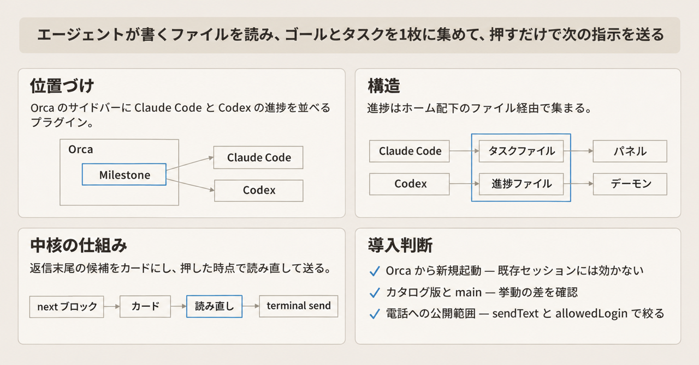
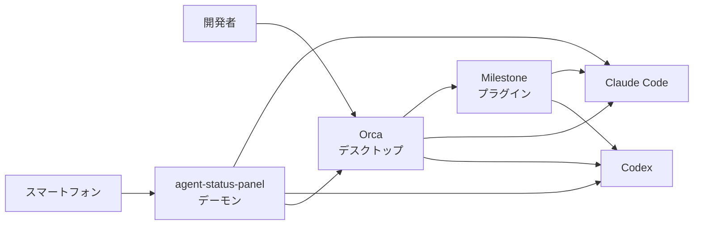
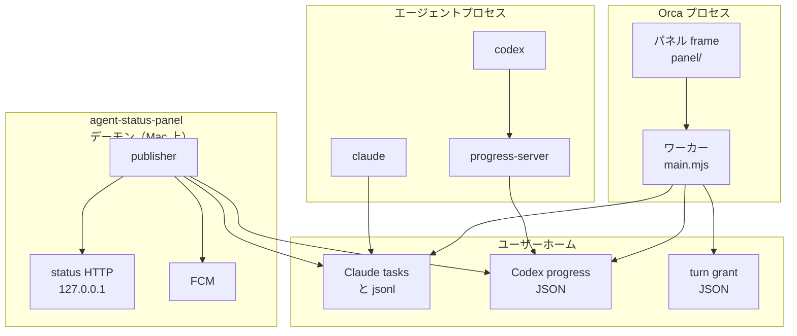
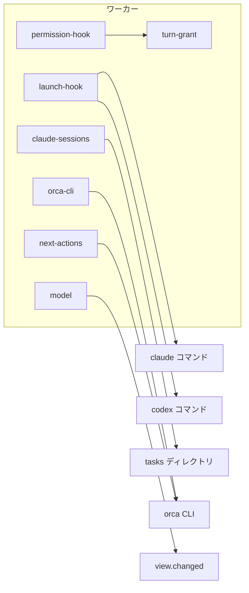
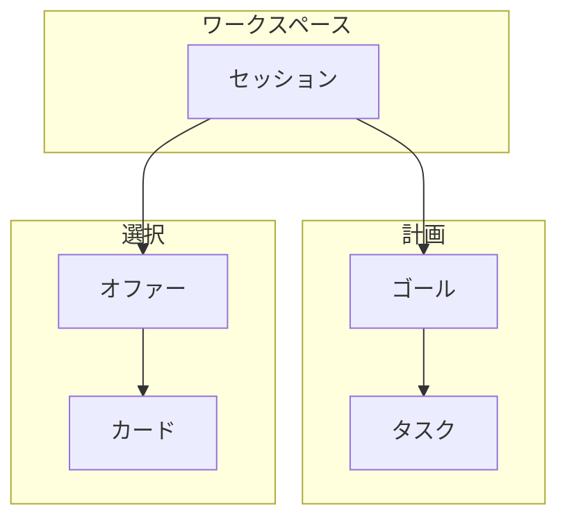
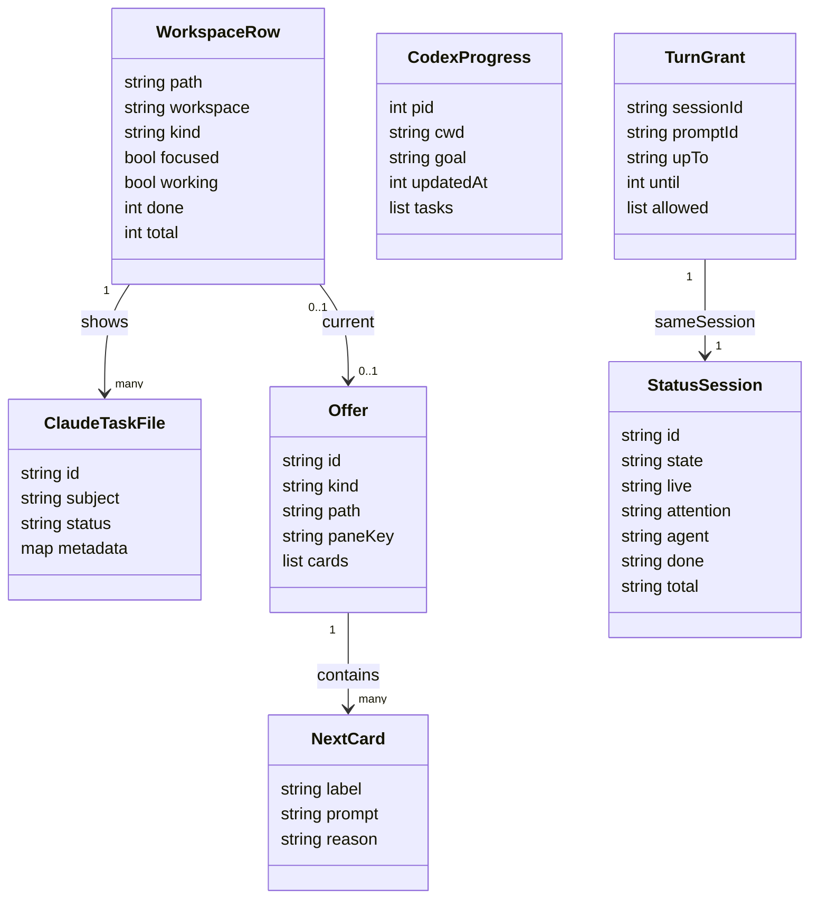
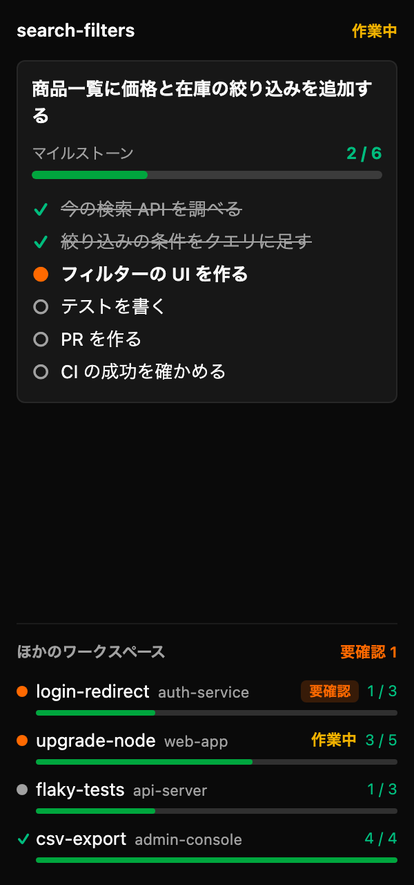
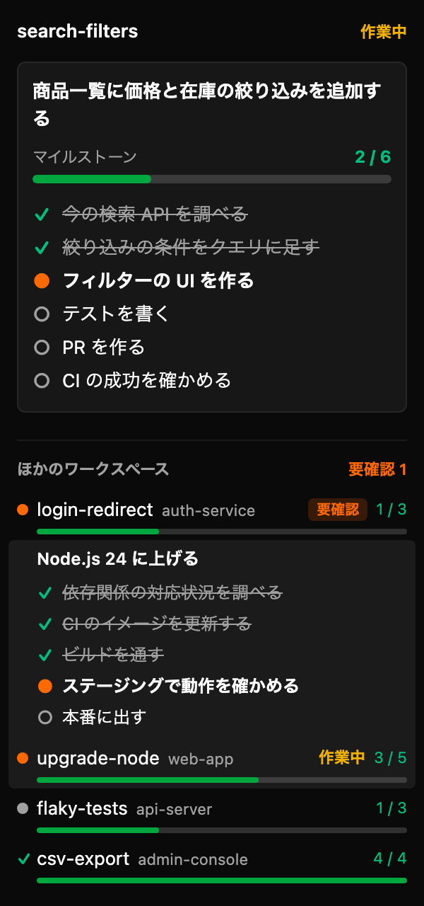
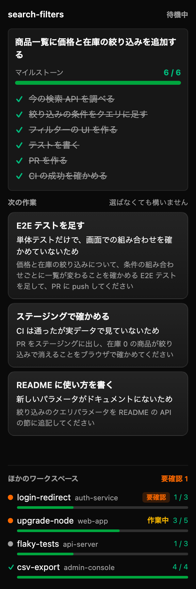

Orca Milestone（以下 Milestone）は、git worktree ごとにコーディングエージェントを並べるデスクトップアプリ Orca に、Claude Code と Codex の「ゴール」と「タスク」を一覧させるプラグインです。この記事では、Milestone と、同じ作者がスマートフォン向けに出しているデーモン agent-status-panel の構造、扱うデータ、導入から運用までを、公開ソースに沿って説明します。

読み終えると、次のことがわかります。

- Milestone がどこから進捗を読み、どの経路でエージェントへ次の指示を送るか
- インストール手順と、起動時にエージェントへ何が足されるか
- カードを押しても送られないときに、どこを見ればよいか

記事内のコードとファイル名は、2026-11-18 時点の `andoshin11/orca-milestone` main `637620c` と `andoshin11/agent-status-panel` main `8262c92` に基づきます。


*この記事の全体像。以下、順に解説します。*

## Orca Milestoneとは

Milestone は、Orca の右サイドバーに、Claude Code と Codex の作業を「ゴール」と「タスク」として表示するプラグインです。ここでのゴールは作業全体の目的を表す見出しで、タスクはそのゴールに向けた状態つきの 1 ステップです。

| 項目 | 値 |
|---|---|
| 公開名 / manifest id | Milestone / `milestone` |
| publisher | `andoshin11` |
| 版 | 0.9.0 |
| ライセンス | MIT（Orca 本体 `stablyai/orca` も MIT） |
| 実行形態 | `trusted-worker`（フルアクセスのワーカー） |
| `manifestVersion` / `pluginApi` | 2 / 1 |

Orca は、git worktree ごとにターミナルとエージェントを並べるアプリです。Milestone はその上で、次の 3 つの経路を使います。

- **ワークスペース一覧の取得**: Host API の `workspace.readContext` ではなく、同梱 CLI の `orca worktree ps --limit 1000 --json` を使います
- **行を開く**: `workspace.list` で path から id を探し、その id で `orca.host.call` の `workspace.open` を呼びます
- **カード送信と再開**: CLI の `terminal send`、`terminal read`、`terminal list`、`terminal create` を使います。`orca orchestration send` は呼びません

タスクの本文は、Claude Code ならローカルのタスクファイル、Codex なら Milestone が用意する MCP サーバーが書く進捗ファイルから読みます。

同じ作者の `agent-status-panel` は、Mac 上で常駐するデーモンです。同じファイルを読んでタスクの要約を FCM（Firebase Cloud Messaging）で Android ウィジェットへ送り、`httpPort` を設定すると `GET /status.json` を返します。電話からのボタン操作は `POST /next` で受けます。設定すれば、APNs（Apple の iPhone 向け通知サービス）でも通知します。

作者は Zenn の記事で、worktree と Orca のワークスペースへ移行してから、月に約 6,000 セッション、1 日 200 セッション前後を回していると書いています（筆者自身の画面による計測です）。

似た手段との違いは次のとおりです。

| 手段 | 進捗の置き場 | 人が次の指示を出す経路 | 電話への配信 |
|---|---|---|---|
| Milestone パネル | Claude は `~/.claude/tasks`、Codex は `~/.orca-milestone/progress` | カード押下で `orca terminal send` | なし |
| agent-status-panel | 同じファイルを読む | `POST /next` が同じ送信規則を呼ぶ | FCM と、任意の APNs |
| Orca 同梱のモバイル | Orca が持つ worktree とエージェント状態 | 短い返信、音声、Quick Commands | Orca 自身のペアリング |
| Orca orchestration | Run / Task / Dispatch | `orca orchestration send` | なし |

向く場面は次のとおりです。

| 場面 | 向くもの |
|---|---|
| 手元の Orca で、複数 worktree のゴールと未完了タスクを 1 枚のパネルで見る | Milestone |
| 作業が終わったセッションに、返信末尾の候補から 1 つ送る | Milestone の next カード、またはデーモンの `POST /next` |
| 外出先のウィジェットに件数と状態だけ欲しい | agent-status-panel の FCM。`sendText: false` にすると goal とタスク本文も HTTP の候補も落ちる |
| タスクの所有と依存関係（DAG）を Orca に持たせたい | Orca orchestration。Milestone はそれを置き換えない |

## 特徴

- **表示の範囲**: フォーカス中のワークスペースは、新しい順に最大 3 セッションのゴールとタスクを出します。ほかのワークスペースは最大 8 行です
- **2 種類のエージェントへの対応**: Claude Code は、組み込みのタスクツール（TaskCreate / TaskUpdate。作業を手順に分けて状態を記録するツール）が書くタスクファイルを読みます。Codex にはタスク一覧の機能が無いため、起動時に MCP ツール `update_progress` を足します
- **設定ファイルを書き換えない**: 起動フックは、そのセッションのコマンドラインと環境変数だけを変えます。`~/.claude/settings.json` と `~/.codex/config.toml` は書き換えません
- **次の作業カード**: 返信の最後にある `next` コードブロックをカードにします。押したときに送るのは「オファー」（そのターンに出た選択肢の束）の ID と番号で、依頼文はその場で回答から読み直します
- **質問と許可のカード**: Claude の AskUserQuestion（利用者に選択式で質問するツール）と、Claude / Codex の許可メニューをカードにします。許可は画面を読んでから `1` か Esc だけを送ります
- **ターン残り許可**: 「このターンの残りも許可」を選ぶと、PermissionRequest フック（Claude Code が許可ダイアログを出す前に呼ぶフック）が `~/.local/state/orca-milestone/grants/<session>.json` を読み、同じターンの読み取りと書き換えを自動で許可します。危険なコマンドと外部へ出るコマンドは対象外です
- **誤操作の防止**: 新しく出たカードは 1.5 秒（`SETTLE_MS`）のあいだ押せません
- **更新の仕方**: パネルの HTML は差分だけを DOM に反映します。パネルは開いているあいだ 60 秒ごと（`panel/main.mjs` の `KEEP_ALIVE_MS`）に本文を取りにいきます。README はその理由を「Orca が 5 分無通信のワーカーを止めるため」と書いています。ワーカーは `agent.status.changed` と `workspace.changed` のあと、および 30 秒ごとに `orca worktree ps` を取り直します
- **権限**: フルアクセスの trusted-worker で、宣言している capability は `workspace:read`、`agent:read`、`workspace:write` です。カード送信は capability ではなく、ワーカーが同梱 CLI を実行して行います

## 構造

### システムコンテキスト図

Milestone とデーモンは、どちらもエージェントが書くファイルを読み、Orca の CLI でターミナルへ入力を送ります。



| 要素名 | 説明 |
|---|---|
| 開発者 | パネルの行とカード、または電話のボタンを選ぶ人 |
| Orca | worktree、ターミナル、プラグインホスト、同梱 CLI を持つアプリ |
| Milestone | サイドバーと起動フックを提供する trusted-worker |
| Claude Code | タスク JSON と jsonl 形式の会話記録（トランスクリプト）をホーム配下に書く |
| Codex | MCP の `update_progress` で進捗ファイルを書く |
| agent-status-panel | 同じファイルを読み、FCM とローカル HTTP を出す |
| スマートフォン | FCM ウィジェット、または tailnet（Tailscale の私設ネットワーク）経由で `status.json` を読むクライアント |

### コンテナ図

Orca プロセスの中にパネルとワーカーがあり、ユーザーホームのファイルを介してエージェントとデーモンにつながります。



| 要素名 | 説明 |
|---|---|
| パネル frame | `panel/index.html` と `panel/main.mjs`。本文はワーカーが作る |
| ワーカー | `activate` でフック、イベント、パネル要求を登録する |
| Claude tasks と jsonl | タスク一覧と、質問・許可・ゴール補完の元 |
| Codex progress JSON | セッションの親 PID ごとに 1 ファイル |
| turn grant JSON | ターン残り許可の範囲。フックは常に読む。デーモンが同じファイルを使うのは `launchHookFile` を設定したとき（デーモンはそのファイルと同じフォルダにある `turn-grant.mjs` を使う） |
| progress-server | Codex の子プロセスとして stdio で MCP を話す |
| publisher | タスクと進捗からスナップショットを作り、FCM を送る |
| status HTTP | `httpPort` があるときだけ `127.0.0.1` で publisher のスナップショットを返す。FCM は送らない |
| FCM | publisher がデータメッセージを Android へ送る経路。本文の上限は 4 KB |

publisher、status HTTP、FCM 送信は、いずれも Mac 上のデーモンの中で動きます。電話はその出力を受け取る側です。

### コンポーネント図

ワーカーの中は、起動フック、読み取り、表示モデル、カード、CLI 呼び出し、許可（フックと grant の 2 つ）の 7 つのモジュールに分かれます。



| 要素名 | 説明 |
|---|---|
| launch-hook | `agent.launch.before` で Claude と Codex の起動コマンドを組み立てる |
| claude-sessions | タスク一覧、走行中 PID、トランスクリプトの先頭と末尾を読む |
| model | フォーカス中 3 件、他ワークスペース 8 行の表示と並びを決める |
| next-actions | `next` ブロック、質問、許可、再開のカードを作り、キーと依頼文を送る |
| orca-cli | 同梱の `orca` を優先し、無ければ PATH の `orca` を使う |
| permission-hook | grant に合う呼び出しだけ `behavior: allow` を返す |
| turn-grant | プロンプト UUID と、1 時間で失効する許可範囲をファイルに書く |
| view.changed | パネルへ HTML を送るプラグインイベント |

## データ

### 概念モデル

ワークスペースの中にセッションがあり、セッションはゴールとタスクの「計画」と、カードの束である「オファー」を持ちます。



| 要素名 | 説明 |
|---|---|
| ワークスペース | Orca の worktree パス。パネルの移動先もこのパス |
| セッション | Claude の session id、または Codex の親 PID |
| ゴール | サイドバーの見出し。Claude は `metadata.goal`、Codex は MCP の `goal` |
| タスク | 状態つきの 1 ステップ。削除状態は件数から外す |
| オファー | 今のペインとターンに紐づく選択の束。ターンが変わると ID も変わる |
| カード | 提案、質問の選択肢、許可、拒否、ターン残り許可、再開のいずれか |

### 情報モデル

ファイルと API に現れる主な型は次のとおりです。



| 要素名 | 説明 |
|---|---|
| WorkspaceRow | `buildModel` が作る他ワークスペースの行。`kind` は attention（要確認。エージェントが質問・許可・次の指示など利用者の操作を待っている状態）か idle |
| ClaudeTaskFile | `~/.claude/tasks/<list-id>/<n>.json`。一覧 ID は session UUID か、`session-` と先頭 8 桁（後者は Agent Teams のリーダーが書く一覧。Agent Teams は、Claude Code の 1 つのリーダーが複数の teammate に作業を分担させる機能） |
| CodexProgress | `~/.orca-milestone/progress/codex-<pid>.json`。`<pid>` は progress-server の親、つまり Codex プロセスの PID。`tasks` は Claude のタスクファイルとは別の配列で、`status` は pending、in_progress、completed |
| NextCard | 上限は `label` 30 文字、`prompt` 300 文字、`reason` 80 文字。prompt はハイフンで始められない |
| Offer | ID は `paneKey`、`stateStartedAt`、追加文字列の SHA-256 の先頭 16 桁 |
| TurnGrant | `~/.local/state/orca-milestone/grants/<session uuid>.json`。`upTo` は常に `write`、`until` は書いた時刻から 1 時間、`allowed` は自動許可した呼び出しの要約で最大 50 件。`expiresAt` というフィールドは無い |
| StatusSession | `GET /status.json` の要素。値は文字列で、`v` は `1` |

**ゴール見出しの決め方**: パネルとデーモンは、ゴールが書いてある最後のタスクの `metadata.goal` を見出しにします。最新のタスクに goal が無くても、それより前の goal を使います。その goal の最初のタスクより後にある goal の無いタスクも、同じ見出しの下に表示します。

goal が一つも無いときの扱いは、パネルとデーモンで違います。

- パネルの `goalOf` は、一覧の最初のタスクの直前の依頼文を見出しにします。直前の依頼文はトランスクリプトの末尾からファイル全体を探し、見つからないときだけ先頭 512 KB の最初の依頼文を使います
- デーモンは依頼文を使わず、goal を空のまま送ります
- Codex は記録された `goal` を使います

**Codex の進捗の制約**: `goal` と各 subject は 500 文字で切ります。タスクが 200 件を超える呼び出しは検証でエラーになり、ファイルを書きません。進捗ファイルを消すのは、プラグインの `readCodexProgress` が親 PID の生存確認に失敗したときだけです。EPERM のときは残します。デーモンの同名関数はファイルを消しません。

**FCM のペイロード**: `tasks` は `[状態, 件名]` の JSON 文字列で、状態は `c`（完了）、`i`（実行中）、`p`（未着手）です。

- 件名は 60 文字まで。実行中で `activeForm` があるタスクは、subject の代わりにその文字列を使う
- 全体が 2400 バイト以内なら全件を送る。超えるときは、最初の未完了の 1 つ前から、入るところまで前から詰める
- 全部完了なら末尾だけを送る
- `state` が `ended` のメッセージは `v`、`id`、`state`、`at` だけ

## 構築方法

### 前提

- Milestone は Orca のデスクトップアプリ上で動きます。ワーカーは Orca のバイナリを Node として動かすため、利用者が Node を入れなくてもパネルは動きます。開発とテストには Node.js 24 以上が必要です
- デーモン `agent-status-panel` は macOS と Node.js 24 以上で動きます。実行時の npm 依存はありません
- manifest の `engines.orca` は `>=1.4.248` です（README の記載との違いは「注意点」で説明します）
- 対応エージェントは Claude Code と Codex です。追跡するのは `agentType` が `claude` か `codex` で、`parentPaneKey` が無いメインのエージェントです

### カタログからインストールする

カタログは `andoshin11/orca-plugins` の `orca-catalog.json` です。2026-11-18 時点の Milestone リリースは version `0.9.0`、commit `adc8fa8` で、main の `637620c` はこれより 8 commit 先です。

1. Orca の設定 → プラグイン → カタログのソースに、次の URL を追加します。Ref は `main` です
2. 一覧の Milestone を確認してインストールします
3. フルアクセスと公開元を承認し、有効化します
4. 右サイドバーの旗アイコンを開きます
5. ターミナルで Claude Code か Codex を新しく起動します。すでに動いているセッションには起動フックが掛かりません

```text
https://github.com/andoshin11/orca-plugins
```

Git URL `https://github.com/andoshin11/orca-milestone` から入れる方法もありますが、この経路ではアップデート機能が使えません。

### 開発フォルダとして読む

```sh
git clone https://github.com/andoshin11/orca-milestone.git
orca plugin dev load /path/to/orca-milestone
npm ci
npm test
```

承認を求められたら、表示された fingerprint を確かめて `orca plugin dev load /path/to/orca-milestone --approve <fingerprint>` を実行します。外すときは `orca plugin dev unload /path/to/orca-milestone` です。開発フォルダは、同じ id のインストール済みプラグインより優先されます。

manifest を Orca 本体のパーサーで検証するときは、Orca の checkout を指定します。

```sh
ORCA_SOURCE_DIR=/path/to/orca npm run check:manifest
```

### デーモンの設定

鍵ファイルと `config.json` は、所有者だけが読める権限にします。権限が広いとデーモンは起動しません。

```json
{
  "serviceAccountFile": "/Users/me/.config/agent-status-panel/service-account.json",
  "deviceTokens": ["<FCM 登録トークン>"],
  "httpPort": 8787,
  "allowedLogin": "me@example.com",
  "sendText": true,
  "staleMinutes": 120
}
```

| 項目 | 必須 | 既定 | 内容 |
|---|---|---|---|
| serviceAccountFile | はい | なし | Firebase サービスアカウント鍵の絶対パス |
| deviceTokens | はい | なし | FCM 登録トークンの配列 |
| httpPort | いいえ | なし | 指定したときだけ `127.0.0.1` で待ち受ける |
| allowedLogin | いいえ | なし | `POST /next` を許す Tailscale のログイン名 |
| sendText | いいえ | true | false なら goal、step、tasks、workspace 名を空にし、HTTP の offer と suggestions も出さない |
| staleMinutes | いいえ | 120 | この時間更新の無いセッションは live を 0 にする |
| apns | いいえ | なし | 待ち始めたときの iPhone 通知 |
| launchHookFile | いいえ | なし | Milestone の `src/launch-hook.mjs` の絶対パス |

常駐には launchd を使います。`dry-run` は送信せずに、今送る内容を表示します。

```sh
node bin/agent-status-panel.mjs dry-run
node bin/agent-status-panel.mjs install
```

ログは `~/Library/Logs/agent-status-panel.log` に出ます。launchd には Node の絶対パスを登録するので、Node を入れ替えたら `install` をやり直します。

tailnet へ出すときは `tailscale serve` を使います。`tailscale funnel` はインターネットへの公開になるため、README は使わないよう書いています。

```sh
tailscale serve --bg 8787
tailscale serve status
```

電話アプリに入れる URL は `https://<マシン名>.<tailnet>.ts.net/status.json` です。

再開したセッションや Orca の外で起動した Claude にもタスクを書かせるときは、利用者自身が設定を足します。プラグインはこれらのファイルを自動では書きません。`~/.claude/settings.json` には次を足します。

```json
{ "env": { "CLAUDE_CODE_ENABLE_TODO_TOOLS": "1" } }
```

`CLAUDE.md` には次のような指示を足します。

```markdown
- 作業を始めるときは TaskCreate で手順をタスクにし、どのタスクにも metadata の goal を付ける。
- ゴールが変わったら、前のゴールの未完了タスクを completed か deleted にしてから、新しいゴールのタスクを作る。
```

## 利用方法

### 起動時に足されるもの

Orca のターミナルで対象エージェントを起動すると、起動フック（`agent.launch.before`）がコマンドと環境変数を書き足します。

**Claude Code の場合**

- 対象エージェントが `claude` か `claude-agent-teams` のとき、環境変数 `CLAUDE_CODE_ENABLE_TODO_TOOLS=1` を常に足します
- コマンド行への指示は、先頭が `claude`、または `orca` / `orca-dev` / `orca-ide` に続く `claude-teams` のときだけ足します
- すでに `--append-system-prompt` か `--append-system-prompt-file` があるときは、指示も settings も足しません。`--settings` が既にあるときは、指示だけ足します
- 実行ファイルか permission-hook のパスに `'` が含まれると、settings を作りません

足す中身は次の 3 つです。

- `--append-system-prompt` に、ツール呼び出しが 3 回以上になる作業なら先に TaskCreate で 3〜7 ステップへ分け、各タスクの `metadata.goal` を約 40 文字で書く、という指示
- 同じ文字列の続きに、返信の最後を `next` フェンスにする指示
- `--settings` に、PermissionRequest フックのコマンド（`ELECTRON_RUN_AS_NODE=1`、Orca のバイナリ、`permission-hook.mjs`。timeout は 10 秒）

**Codex の場合**

Codex で始まるコマンドには、`-c` で次を足します。実行ファイルか progress-server のパスに `'` があるときは足しません。

```text
mcp_servers.milestone.command=<Orca のバイナリ>
mcp_servers.milestone.args=["<progress-server.mjs>"]
mcp_servers.milestone.env={ELECTRON_RUN_AS_NODE="1"}
mcp_servers.milestone.default_tools_approval_mode="approve"
developer_instructions=<進捗ツールと next ブロックの指示>
```

`update_progress` の入力は `goal` と `tasks` です。各タスクは `subject` と `status` が必須で、status は `pending`、`in_progress`、`completed` のいずれかです。承認モードが approve なので、このツールは承認ダイアログを出しません。書き込み先は進捗ファイルだけです。

### パネルで見ること



旗アイコンのパネルは、フォーカス中ワークスペースのゴール、タスク、完了数を表示します。下端のほかのワークスペースの行は、要確認、未完了、完了の順に並びます。要確認の中は待ち時間が長い順、それ以外はタスクが新しく動いた順です。作業中かどうかは行の印に出ますが、並び順には使いません。

行を押すと、`workspace.list` で path から workspaceId を探し、その id で `workspace.open` を呼びます。キーボードでは Enter か Space で移れます。行にホバーすると、その行のゴールとタスクが広がります。



Claude が裏でシェルを動かしたままターンを終えると、Orca は「作業中」と返すことがあります。Milestone は、生きているメインが 1 つだけのとき、次の順で判定します。

1. `mainAgent.state` が `done` で `stateStartedAt` があるかを見る（`orca-cli.mjs` は、この項目を Orca 1.4.257 で確認したと書いています）
2. 無いときだけ、トランスクリプト末尾 1 MB の `turn_duration`（ターンの終わりに記録される行）を見る
3. 最後のターンの後に `turn_duration` があり、その後にプロンプトやツール結果が無ければ「待機中（裏で実行中）」として扱い、提案カードも出す

### カードの種類と送るもの



**次の作業カード**は、ワークスペースの生きているメインエージェントが 1 つだけで、状態が `done` で、アーカイブされていないときに出ます。回答末尾の `next` ブロックから取る候補は 1〜3 件です。

エージェントの返信の末尾に、言語名 `next` のフェンスで JSON 配列を置きます。

````markdown
```next
[{"label":"PR を作る","prompt":"この変更で PR を作ってください","reason":"テストが通っている"}]
```
````

- 上限は label 30 文字、prompt 300 文字、reason 80 文字。prompt はハイフンで始められない
- 起動引数が古く、裏シェルが動いていなければ、`next` が空でも「最新の指示で再開」を足す。プラグインのボタンは最大 4 枚
- デーモンの `offersFrom` は、入力欄に出る灰色の候補文が 300 文字以内でハイフン始まりでないときだけ、もう 1 枚足す。プラグインの `nextOffer` は灰色の候補を足さない

押すと、パネルは `next.send` で ID と番号を送ります。ワーカーはその時点の回答を読み直し、次を実行します。

```sh
orca terminal send --terminal <handle> --text <prompt> --enter --wait-submit 8 --json
```

`result.send.accepted` が真でなければ失敗です。古い ID や 2 度目の押下では `terminal send` を呼ばず、パネルはカードの下に「この選択肢はもう使えません。エージェントが先に進んだか、すでに押されています。」を出します。デーモンは 409 を返します。

**送信前の退避**: Claude への提案は、送る直前に必ず Ctrl+S（文字 `\u0013`）を送って入力欄の下書きを退避させ、400 ミリ秒待ちます。入力欄が空でも送ります。プラグインは退避キーが受理されなければ例外にし、パネルに「送信に失敗しました。」を出します。デーモンは退避キーの受理を確認しません。Codex への提案は、画面に `? for shortcuts` が無いとき（入力欄に文字があるとき）は送らず、デーモンは 423 を返します。許可のキー操作は、Codex でも下書きがあっても送ります。

**質問カード**は、トランスクリプトの未回答の AskUserQuestion から作ります。選択肢は 9 個、質問は 4 問までです。

- 1 問の単一選択は、番号キーをすぐ送る
- 複数の質問は、各問の選択番号を送る。その問が複数選択のときだけ、番号のあとに Tab を足す
- 最後に画面へ `Submit answers` が出たことを確かめてから Enter を送る

**許可カード**は、押す直前の画面に該当メニューがあるときだけ、許可なら `1`、拒否なら Esc を送ります。「今後は聞かない」は押しません。Codex の Esc はターン全体を止めるため、カード名は「中止」です。Codex で対象になるのはシェルコマンドとファイル編集です。

危険なコマンドは、1 度目の押下で確認を表示し、2 度目で送ります。デーモンでは `POST /next` に `confirmed: true` が無いと 428 を返します。

### 電話の API

`GET /status.json` は、デーモンの初回の読み取りが終わるまで 503 を返します。本体は `v`、`at`、`sessions` です。各セッションには FCM と同じ項目に加え、オファー（提案・質問・許可などの選択肢の束）があるときは `offer`、`suggestions`、`details` が付き、内容に応じて `reasons`、`question`、`questions`、`dangerous` が付きます。`links` はオファーとは別に付くことがあります。

通知には、要確認を知らせる attention と、ターン終了後の次の作業の提案を知らせる proposal の 2 種類があります。FCM と APNs に乗る内容は次のとおりです。

- 同じ path に offer があるときだけ、attention の FCM と APNs にその ID が付く
- id が `proposal-` で始まるメッセージは FCM に渡さない。APNs を設定していれば attention と proposal の両方を APNs に送る
- 選択肢の本文、質問文、`links`、`dangerous` は FCM にも APNs にも乗らない

ボタンは次の JSON を `POST /next` へ送ります。ボディの上限は 1024 文字です。

```json
{"offer":"<16桁>","index":0}
```

複数の質問には `answers` を使います。

```json
{"offer":"<16桁>","answers":[[0],[1,2]]}
```

| 状態 | 意味 |
|---|---|
| 204 | 送った |
| 409 | そのオファーはもう押せない |
| 403 | `Tailscale-User-Login` が `allowedLogin` と違う |
| 428 | 危険コマンドで `confirmed` が無い |
| 423 | Codex の提案で画面に `? for shortcuts` が無い、または再開のとき入力欄に利用者の文字が残っている（空でも、灰色の候補だけでもない） |
| 413 | ボディが上限を超えた |
| 502 | デーモンの `next` が例外を投げた（依頼文やキーの不受理、`Submit answers` に届かない、grant 失敗、再開でプロセスが終わらない）。退避キーの不受理は含まない |
| 400 | JSON がボタンの形ではない |

`POST /next` は `allowedLogin` を設定したときだけ有効です。接続者のログイン名を `Tailscale-User-Login` ヘッダーに付け、クライアントが付けた値を取り除くのは `tailscale serve` で、デーモン自身は取り除きません。`127.0.0.1` へ直接送った場合は、リクエストに付いたヘッダーの値をそのまま `allowedLogin` と比べます。読み取りの `GET /status.json` には、この照合がありません。

iOS アプリは `POST /apns/devices` にトークンを登録します（iOS アプリのソースは公開されていません。「注意点」を参照）。

```json
{ "token": "<16進>", "environment": "development" }
```

`environment` は、Xcode から入れたアプリなら `development`、TestFlight か App Store なら `production` です。登録先は `~/.local/state/agent-status-panel/apns-devices.json` です。

## 運用

### 状態の取り直し

| 契機 | Milestone の動き |
|---|---|
| パネルを開いたとき、タブを戻したとき | `view.get` でその時点の HTML を取る |
| 内容が変わったとき | `view.changed` を送る（変わらなければ送らない） |
| エージェント状態やフォーカスのイベント | 直後に CLI を叩く。1 回は README の実測で 0.1〜0.2 秒 |
| 30 秒ごと | イベントの来ない終了に備えて同じ取得をする。CLI の timeout は 10 秒、stdout の maxBuffer は 16 MB |
| 60 秒ごと | パネルが `view.get` してワーカーを起こす |

デーモンは、`.lock` 以外のファイル変化を 2 秒まとめてから `publish` します。ファイルが変わらない終了や待ちに備え、15 秒ごとにも `publish` を呼び、その中でタスクと `orca worktree ps` を読みます。送信に失敗したら次の `publish` まで待ち、同じエラー文は 1 回だけログに出します。

### セッションの寿命とファイル

- タスク一覧は、そのセッションが動いているあいだだけ表示します。ディレクトリの mtime が 7 日より古い一覧は、PID が生きていても出しません。Claude は `~/.claude/sessions/<pid>.json` の sessionId と、PID が生きていることで判断します
- Codex の進捗ファイルを消すのはプラグインの `readCodexProgress` だけで、`process.kill(pid, 0)` が EPERM 以外で失敗したときに消します。デーモンは同じ確認をしますが、ファイルは残します
- Claude が全タスクを完了してタスクファイルを消しても、セッションが生きていれば完了表示を残します。プラグインを再起動したあとは、トランスクリプトに残る TaskCreate と TaskUpdate から組み立て直します
- Agent Teams のリーダー（リード）は、タスクを `session-<session id 先頭 8 桁>` に書きます。対応するセッションは `~/.claude/teams/<チーム>/config.json` のリーダー session id、無ければ先頭 8 桁が一致するトランスクリプトです。main ブランチの版では、リードのターミナルの `agentIdentity` が `claude-agent-teams` のとき、同じタブのほかの Claude をリードの teammate としてまとめ、カードはリードだけに出します
- 質問と許可のために読むトランスクリプトは末尾 1 MB です
- 送信済み FCM の控えは `~/.local/state/agent-status-panel/state.json` です。デーモンを再起動しても同じ内容は再送せず、停止中に終わったセッションには `ended` を送ります
- アンインストールしても `~/.orca-milestone/` は残ります。不要なら利用者が消します

### ターン残り許可

「このターンの残りも許可」を押すと、今のプロンプト UUID に結び付く grant を書いてから、今回のメニューに `1` を送ります。フックは stdin の JSON を読み、grant に合う呼び出しにだけ次を stdout へ出します。合わないときや入力が壊れているときは何も出さず、Claude Code が通常どおり尋ねます。

```json
{"hookSpecificOutput":{"hookEventName":"PermissionRequest","decision":{"behavior":"allow"}}}
```

- 自動許可の範囲は read と write です。外へ出るコマンドと危険なコマンドはカードのまま残ります
- grant は次のプロンプトか 1 時間で消えます
- 自動許可した呼び出しは、カードの下に「このターンでまとめて許可したもの」として出ます
- フック無しで起動したセッションには、このカードは出ません

### 最新の指示で再開する

ワークスペースの Claude の起動引数に、今の指示文字列とフックスクリプトのパスが無いとき、next カードの最後に「最新の指示で再開」が出ます。押すと、入力欄が空であることを画面と端末ログで確かめてから `/exit` を送り、同じ会話を `--resume` で起動し直します。

引き継ぐフラグは次のとおりです。

- `--dangerously-skip-permissions`
- 値が `^[\w.:/@=-]+$` に合う `--permission-mode` と `--model`
- `--plugin-dir`（起動引数に `--teammate-mode` が無いときだけ。パスに `'` があれば付けない）

`--teammate-mode` があるときはコマンド名が `orca claude-teams` になり、無いときは `claude` です。シェルから起動したセッションは同じターミナルで、Orca が起動したセッションは同じタイトルの新しいターミナルで再開します。新しいターミナルは次のコマンドで作ります。

```sh
orca terminal create --worktree path:<path> --title <title> --command <command> --json
```

裏でシェルが動いているセッションには、このカードを出しません。デーモンは起動コマンドを送った時点で 204 を返し、起動完了はログに残します。

### 更新

- カタログから入れた場合は、Orca の「プラグインを自動でアップデート」（既定オン）に従います。権限が増えるときは確認が出ます。手動ではプラグイン一覧からアップデートします
- Git URL から入れた場合は、同じ URL で入れ直し、もう一度有効化します
- 起動時に足す内容の変更は、動いているセッションには効きません

## ベストプラクティス

- 新しいセッションは Orca のターミナルから起動し、起動フックの注入を 1 経路に揃える
- 依頼文はパネルか `POST /next` だけで送り、FCM と APNs には本文を載せない
- ターン残り許可は read と write までに留め、外へ出る操作は毎回カードで答える
- 手順を書くときは、カタログの pin の commit と main の commit を分ける

### 起動経路を 1 つに揃える

タスクツール、next の指示、PermissionRequest フックをまとめて受けるのは、Orca のターミナルから新しく起動したセッションだけです。再開したセッションや Orca の外で起動したセッションでは、「デーモンの設定」の末尾で示した `settings.json` と `CLAUDE.md` の設定を利用者側で揃えます。Codex は設定ファイルを直さず、Orca から起動し直します。

### 送る面を分ける

パネルと `POST /next` は、送る直前に依頼文を読み直します。デーモンの README は、FCM と APNs にプロンプト本文、質問文、作業ディレクトリのフルパス、生の session id を載せない、と約束しています。

- 社内の名称がゴールに混ざるときは `sendText` を false にする
- tailnet への公開は `tailscale serve` に留め、共有 tailnet では `status.json` を出さない
- ボタンを許すログインは `allowedLogin` で 1 人に絞る

### 許可の自動適用を狭く保つ

ターン残り許可で自動許可されるのは read と write に分類されたものだけです。

| 分類 | 例 | 扱い |
|---|---|---|
| read | `kubectl get` / `describe` / `logs`、`aws` の `describe-` / `list-` / `get-` / `ls`、`aws sts get-caller-identity`、データを送らずファイルへ保存しない `curl` と `wget` | 自動許可に入る |
| 外へ出る | 通常の `git push`、PR 作成、送信する MCP | 毎回カード |
| 危険（Bash で二度押し） | `rm`、`sudo`、force 付きの `git push`、`git reset --hard`、`git clean`、`dd if=`、`mkfs`、`chmod -R`、`kubectl delete`、`terraform destroy` / `apply`、`drop table`、`drop database`、`truncate table` | 自動許可の対象外 |
| 対象外 | `AskUserQuestion`、`ExitPlanMode` | 許可の対象にしない |

未知のコマンドは write に分類されることがあります。フルアクセスのプラグインであることは、インストール時の承認画面で確かめます。

### カタログ pin と main を混ぜない

2026-11-18 時点で、カタログの 0.9.0 は `adc8fa8` を指し、README と Agent Teams のリードまとめは main `637620c` にあります。カタログから入れる利用者向けの手順に、Agent Teams の挙動を前提として書かないでください。開発フォルダとして `orca plugin dev load` で読めば、main をそのまま試せます。

## 注意点

| 対象 | 資料の記載 | 実際に確認できた内容 | 読者への影響 |
|---|---|---|---|
| 必要な Orca の版 | README は「1.4.247 以上、1.4.246 以前は読めない」。CI はタグ v1.4.247 のパーサーで検証する | `orca-plugin.json` の `engines.orca` は `>=1.4.248`。CI のコメントは、1.4.247 が `workspace:write` にこの値を要求し、その版のスキーマでプラグインをゲートするため、と書く | 1.4.247 を入れれば manifest の範囲に入る、とは読めない。範囲は 1.4.248 以上 |
| 状態取得コマンド | 作者の記事は `orca workspace ps --json` と書く | ワーカーと README の図は `orca worktree ps`。Orca 公式 CLI 概要の例も `orca worktree ps --json` | 記事のコマンドをそのまま打つと別のサブコマンドになる |
| tailnet 公開 | 作者の記事は `tailnet serve` と書く | デーモン README のコマンドは `tailscale serve --bg <port>` | 記事のコマンド名は製品のサブコマンドと一致しない |
| 電話アプリのソース | 作者の記事は自作の iOS と Apple Watch アプリ、TestFlight を紹介する。デーモン README は `agent-status-panel-ios` へリンクする | 2026-11-18 時点で `andoshin11/agent-status-panel-ios` は GitHub API で 404。公開されている受け側は `agent-status-panel-android`（FCM ウィジェット） | iPhone と Watch の実装詳細は確かめられない。ボタン API の正本はデーモンの `server.mjs` |
| カタログと main | どちらも版 0.9.0 に見える | カタログ pin は `adc8fa8`。main `637620c` は 8 commit 先で、裏シェル中のカード更新、compact（Claude Code の会話圧縮）後のターン終了、Agent Teams のリード代表を含む | カタログ版だけでは README の後半がすべて動くとは限らない |
| Codex の指示 | README は `~/.codex` を変更しないと書く | 起動コマンドに `developer_instructions=` を付ける。利用者の config.toml に同じキーがあると、その起動ではプラグインの文字列が置き換える、と README の制約節が書く | 普段の Codex 指示が、Orca から起動したセッションでは効かないことがある |
| 確認済みの起動形態 | 作者の記事は Mac mini 上の運用も含む | README は、確認したのはローカル macOS のターミナル起動で、チャット表示と SSH ワークスペースは未確認と書く | Chat UI と SSH では起動フックと画面読みが同じとは限らない |
| 生産性の数値 | 作者の記事は月 6,000 セッション、日 200 前後、多い日 500〜600 commit、Mac mini 上の worktree 68 個と書く | これらは記事と掲載画像による筆者の計測。リポジトリのテストや Orca の公開指標には無い | プラグインの性能上限としては使えない |
| デーモンの取り直し間隔 | デーモン README の図は fs.watch と 30 秒、本文は失敗したら 30 秒後に再試行と書く | `src/daemon.mjs` は変化を 2 秒でまとめ、タイマーは 15 秒。失敗は次の `publish` まで待つ | 待ちの検出や再送の間隔は README の 30 秒ではなく 15 秒 |
| Claude のタスク形式 | `~/.claude/tasks` を読む | パスはソースの `claudePaths` と一致する。デーモン README は、この形式は Claude Code の内部仕様で変わり得ると警告する | 公式の安定した API ではない |
| ワーカー停止の 5 分 | README は Orca が 5 分無通信のワーカーを止めると書く | Orca 本体のソースでは確認できていない | 60 秒の keep-alive の根拠は README の記述に留まる |

## トラブルシューティング

### パネルにタスクが出ない

| 症状 | 原因 | 対処 |
|---|---|---|
| 「このワークスペースのエージェントはまだタスクを作っていません」 | エージェントがタスクを書いていない。短い作業は記録しない指示になっている | 「タスクに分けて進めて」と頼む。Claude なら Task ツールが有効な起動か確かめる |
| プラグイン導入前から動いているセッションだけ空 | 起動フックは新規起動にだけ効く | セッションを起動し直す。Claude で常に有効にするなら settings と CLAUDE.md を自分で足す |
| Codex だけ空 | `~/.orca-milestone/progress/` に `codex-<pid>.json` が無い | Codex に `update_progress` があるか尋ねる。Orca から起動し直す |
| ほかのワークスペースが 8 行で切れる | `MAX_ROWS` が 8、フォーカス中は `MAX_SESSIONS` が 3 | 仕様。要確認の行が先に残る |
| カタログ版で Agent Teams のリードにまとまらない | その挙動は main の PR 65 で入り、カタログ pin `adc8fa8` より後 | 開発ロードで main を読むか、新しいリリースを待つ |

- タスクファイルのディレクトリ mtime が更新の合図です。Claude はファイルを rename で置き換えるため、書きかけの JSON は読みません。Codex 側も `.tmp` に書いてから rename します
- クラッシュで PID ファイルが残っても、`process.kill(pid, 0)` で生存を確かめてから表示します

### カードを押しても送られない

| 症状 | 原因 | 対処 |
|---|---|---|
| カードの下に「この選択肢はもう使えません」 | offer ID が古い、または 2 度目の押下 | 新しい回答のカードを押す。電話側は 409 なので `status.json` を読み直す |
| Codex でカードの下に理由が出る | 入力欄に文字がある。Codex は下書きを退避できない | 入力欄を空にしてから押す |
| 409 | ターンが進んだ | `status.json` を読み直し、新しい `offer` を使う |
| 403 | `Tailscale-User-Login` が `allowedLogin` と違う | `tailscale status --json` の User と config を揃える |
| 428 | 危険コマンドの確認が無い | `{"offer":"<オファー ID>","index":0,"confirmed":true}` で再送する |
| 423 | Codex の提案で画面に `? for shortcuts` が無い、または再開のとき入力欄に利用者の文字が残っている（空でも、灰色の候補だけでもない） | 入力欄を空にする。Claude の提案はこの理由では 423 にならない |
| 502 | デーモンの `next` が例外を投げた | 対象ペインが書き込み可能か、`orca terminal list --json` で handle を確かめる |
| カードが 1.5 秒薄い | `SETTLE_MS` | 点灯してから押す |
| 再開カードが無い | 起動引数に今の指示が既にある、または裏シェルが動いている | 期待どおり。裏シェル中は `/exit` で止まらないようカードを出さない |

- 送る直前に `terminal read --screen --limit 60` でメニュー行を確かめます。Claude の許可は行 `1. Yes` とフッター `Esc to cancel`、Codex は `1. Yes, proceed (y)` です。画面が違うとカードは送れません
- `accepted: true` は入力の受理であり、ターン開始の証明ではない、と Orca がエージェント向けに配る CLI の手引き（skill guide）は書いています。Milestone の提案送信が `--wait-submit 8` を付けるのはこのためです

### 許可とフック

| 症状 | 原因 | 対処 |
|---|---|---|
| 「このターンの残りも許可」が無い | フック無しで起動した、または危険コマンド | 「最新の指示で再開」でフック付きに起動し直す。危険コマンドは対象外 |
| 自動許可されない外部コマンド | リスク分類が「外へ出る」（external） | 毎回カードで答える仕様 |
| 危険そうなコマンドが 1 度で通った | 既知のパターンに無い | 二度押しは既知のパターンだけ。コマンドを読んでから押す |
| フックのエラーでセッションが止まったように見える | フックは失敗時に何も返さない | Claude は通常の質問に戻る。grant ファイルの session id は UUID 36 文字 |

- grant のディレクトリは `0700`、ファイルは `0600` で書かれます
- デーモンに `launchHookFile` が無いと、電話側の再開ボタンと、同じフォルダの `turn-grant.mjs` を使う残り許可が揃いません

### デーモンと通知

- 待ちの通知は、見つけた提案がターン終了から 10 分以内のものだけです。デーモンを再起動しても過去の提案をまとめて通知しません
- publisher のコメントによれば、FCM は順序を保証しないため、電話側は `at` より古いメッセージを捨てます
- APNs が拒否したデバイストークンは、登録ファイルから外れます
- `GET /status.json` には本人確認がなく、tailnet の参加者なら読めます。`allowedLogin` で守られるのはボタンだけです
- Node を更新したあとに launchd が古いバイナリを掴むときは、`uninstall` してから `install` をやり直します

## まとめ

- Milestone は、Claude Code のタスクファイルと Codex 向け MCP の進捗ファイルを読み、Orca のサイドバーにゴールとタスクを並べるプラグインです
- 次の指示は、返信末尾の `next` ブロックから作るカードを押して、`orca terminal send` で送ります。押した時点で回答を読み直し、古いカードは送りません
- 起動フックは設定ファイルを書き換えず、Orca から新しく起動したセッションにだけ効きます。それ以外のセッションでは利用者が設定を足します
- 電話向けには agent-status-panel が同じファイルを読み、FCM と `status.json`、`POST /next` を提供します。本文を通知に載せない設計なので、`sendText` と `allowedLogin` で公開範囲を絞って使います
- カタログ版（`adc8fa8`）と main（`637620c`）では挙動が違う部分があり、必要な Orca の版も README と manifest で表記が揃っていません

この記事が少しでも参考になった、あるいは改善点などがあれば、ぜひリアクションやコメント、SNSでのシェアをいただけると励みになります！

## 参考リンク

### 作者の記事と公開実装

- [毎月6,000 AI Agentsを捌くためにキーボードを捨てた話](https://zenn.dev/andoshin11/articles/ba68b39ef9a8ce)
- [andoshin11/orca-milestone](https://github.com/andoshin11/orca-milestone)
- [orca-milestone README（main）](https://github.com/andoshin11/orca-milestone/blob/main/README.md)
- [orca-plugin.json](https://github.com/andoshin11/orca-milestone/blob/main/orca-plugin.json)
- [launch-hook.mjs](https://github.com/andoshin11/orca-milestone/blob/main/src/launch-hook.mjs)
- [progress-server.mjs](https://github.com/andoshin11/orca-milestone/blob/main/src/progress-server.mjs)
- [next-actions.mjs](https://github.com/andoshin11/orca-milestone/blob/main/src/next-actions.mjs)
- [permission-hook.mjs](https://github.com/andoshin11/orca-milestone/blob/main/src/permission-hook.mjs)
- [andoshin11/agent-status-panel](https://github.com/andoshin11/agent-status-panel)
- [agent-status-panel README](https://github.com/andoshin11/agent-status-panel/blob/main/README.md)
- [server.mjs](https://github.com/andoshin11/agent-status-panel/blob/main/src/server.mjs)
- [andoshin11/orca-plugins カタログ](https://github.com/andoshin11/orca-plugins)
- [agent-status-panel-android](https://github.com/andoshin11/agent-status-panel-android)

### Orca 公式

- [stablyai/orca](https://github.com/stablyai/orca)
- [Plugin authoring](https://github.com/stablyai/orca/blob/main/docs/reference/plugin-authoring.md)
- [Plugin host API](https://github.com/stablyai/orca/blob/main/docs/reference/plugin-host-api.md)
- [CLI overview のソース](https://github.com/stablyai/orca/blob/main/docs/site/content/docs/cli/overview.mdx)
- [Orca](https://orca.dev/)
- [Mobile companion](https://www.onorca.dev/docs/mobile)

### Claude Code のタスクツール

- [Tools reference の Task ツール](https://code.claude.com/docs/en/tools-reference)
- [Todo tracking（Agent SDK）](https://code.claude.com/docs/en/agent-sdk/todo-tracking)
