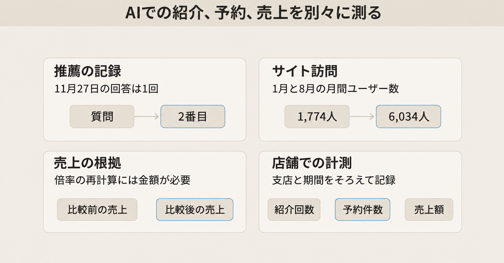

岡崎で回転寿司を探す人に、ChatGPT はどの店を紹介するでしょうか。2026年11月27日、柳岡亮氏が会話を履歴に残さないChatGPTの「一時チャット」機能で尋ねたところ、おしどり寿司 岡崎竜美丘店が2番目に挙がったといいます。参照元として回答に並んだのは、店舗の公式サイト、食べログ、Yahoo!マップでした。

柳岡氏は、この事例を「売上を1.4倍にした」と題して紹介しています。店舗のウェブ担当者が同じ施策を試すときに使えるように、回答での紹介、サイト上の行動、店頭での売上をそれぞれ何で確かめられるか整理します。[柳岡氏による事例紹介](https://x.com/yanagiokaryo/status/2126143622894715230)

## 店舗のLLMOとは

LLMO は Large Language Model Optimization の略です。この事例では、地域の店を尋ねる人に向けて、生成AIの回答で自店が紹介されることを目指し、地図や飲食店情報サイト、自社サイトの掲載内容を整える取り組みを指します。

柳岡氏が挙げた6つの施策は、来店客の行動に沿って読むと、次の3か所に分けられます。

| 客が店を探す場面 | 店側が行ったと報告していること |
| --- | --- |
| 地図や店舗一覧で候補を探す | ① 約30のサービスに店舗情報を配信する。② 掲載先には優先順位を付け、影響力が大きいと判断したサイトから整える |
| 写真や読み物で店を知る | ③ Instagramの投稿をGoogle マップでも生かす。④ 自社サイトに毎日コラムを書くことを掲げる |
| 行ける店か確かめる | ⑤ 車で約30分の商圏にある地域名を記事で扱う。⑥ 店名で検索した人が店舗情報や予約先を見つけられるページを用意する |

たとえば公式の店舗一覧には、同じ「おしどり寿司」でも店舗ごとに異なる住所と電話番号が載っています。岡崎竜美丘店が回答に出たら、クリックした人がその店舗に電話できるかまで確かめられます。[おしどり寿司の店舗一覧](https://osidori.co.jp/access/)

## 注意点

**「2位」「約3.4倍」「1.4倍」は、それぞれ別のものを測った数字です。** サイト指標は、おしどり寿司を運営するグループに属し、AI推薦の診断サービスを案内するジーアイシーの柳岡氏が、店舗サイトのGoogle計測レポートをもとに公表した値です。集計の原票は公開されていません。[事例の計測条件と掲載値](https://x.com/yanagiokaryo/status/2126143622894715230)

| 観測対象 | 期間と公表値 | 判断できる範囲 |
| --- | --- | --- |
| ChatGPTの回答 | 11月27日の一時チャット1回で2番目 | その質問に対する、その回の掲載順 |
| 公式サイトの月間ユーザー数 | 1月の1,774人から8月の6,034人へ、約3.4倍 | サイト全体を訪れた人数の変化。ChatGPT経由の内訳は未公表 |
| 予約リンクのクリック | 7月の977回から8月の1,573回へ | 予約先へ進もうとした操作の回数。予約の成立件数や来店人数は不明 |
| サイトからの電話問い合わせ | 7月の71件から8月の124件へ | サイト上のクリックなどの操作回数。通話成立件数は不明。[同社の計測注記](https://just-web-ai.gi-c.biz/test_3/?v=3) |
| 売上 | 見出しで1.4倍と報告 | 比較期間と前後の売上額が示されず、読者は倍率を再計算できない |

時間の順序も大切です。サイト指標の終点は8月で、ChatGPTの回答を確かめたのは11月です。8月に表示回数が多かった検索語には、すし酢の配合や寿司のカロリーを知りたい人の質問も含まれます。サイトを訪れた人が増えた理由のうち、AIによる店舗紹介がどれだけを占めたかは分かりません。著者も6施策それぞれの寄与は分けて測れていないと説明しています。

## 自店では、どの掲載情報から直すか

まず、客がその日の来店を決めるための情報を1店舗分だけ照合します。店名は看板と同じか、住所は正しい支店を指すか、営業時間は当日の営業と合うか、予約リンクはその支店の予約画面に着くか。この確認は、次のAI回答を待たずにできます。

Googleは、地域の検索結果を決める主な要素に、検索内容との関連性、検索者からの距離、店の知名度を挙げています。営業時間などを正確に保つことも案内しています。この説明の適用先はGoogleの検索とマップです。ChatGPTの回答については、実際に示された参照元を開いて、どの支店のどんな情報が載っているか確かめます。[Googleのローカル検索結果に関する案内](https://support.google.com/business/answer/7091)

## 次の1か月で何を記録するか

1. **同じ条件で店名が出るか記録します。** 地域、業態、質問文を決め、毎回新しい一時チャットで尋ねます。個人向けの調整を使わない設定（Unpersonalized）を選び、その設定も記録します。柳岡氏が使った設定は公表されていません。[OpenAIの一時チャットの説明](https://help.openai.com/en/articles/8914046-temporary-chat-in-chatgpt)たとえば「岡崎でおすすめの回転寿司を教えてください。参考にしたページも教えてください」と尋ね、日付、検索時の位置設定、店名の有無、掲載順、参照URLを残します。日を変えて同じ質問をすると、「何回中何回紹介されたか」を比較できます。ChatGPTの検索は位置情報をもとに検索語を調整することがあります。[OpenAIの検索ヘルプ](https://help.openai.com/en/articles/9237897-searching-the-web-with-chatgpt)
2. **変更した店舗情報と日付を残します。** 間違った営業時間を直した場合、対象の支店と掲載先を記録します。次に回答でそのページが示されたら、修正後の営業時間を案内しているか照合できます。
3. **売上を問うなら、店舗の会計記録も見ます。** 予約リンクのクリック、成立した予約、実際の来店、売上額を、同じ店舗・同じ期間で別々に集計します。比較期間や対象店舗をそろえれば売上倍率を計算できます。そこから施策の寄与まで知りたいときは、施策を実施した店舗と、施策前の売上の動きが似ていて、同じ期間に施策を実施していない店舗の変化も調べます。

## まとめ

おしどり寿司の事例から自店に持ち帰れるのは、AIが挙げた参照先を一つずつ開き、客が正しい支店を見つけて予約できるか確かめる方法です。効果の記録は「回答に出た回数」「予約が成立した件数」「会計上の売上額」に分けると、どこまで改善したかを説明できます。

この記事が少しでも参考になった、あるいは改善点などがあれば、ぜひリアクションやコメント、SNSでのシェアをいただけると励みになります！

## 参考リンク

- [柳岡亮氏によるおしどり寿司のLLMO施策と計測結果](https://x.com/yanagiokaryo/status/2126143622894715230)
- [おしどり寿司の店舗別アクセス情報](https://osidori.co.jp/access/)
- [Google ビジネス プロフィールのローカル検索結果について](https://support.google.com/business/answer/7091)
- [OpenAIによるChatGPT検索の説明](https://help.openai.com/en/articles/9237897-searching-the-web-with-chatgpt)
