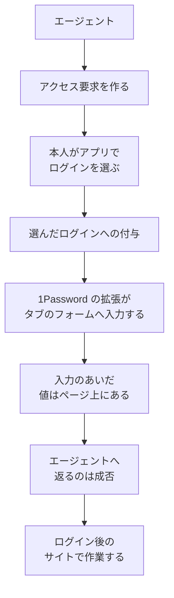

1Password は2026年10月22日に、個人向けのエージェント連携「1Password for Agents」を発表しました。ITmedia AI+ は翌23日に「エージェントにパスワードを渡さずアクセス権限を付与するサービス」として報じています。人が自分の 1Password アプリでログインを選んで承認すると、1Password が保存済みのパスワードやワンタイムパスワードをサイトのサインインフォームへ入力し、エージェントには入力の成否だけを返す、という仕組みです。

この記事でいうパートナーは、この連携を自社のエージェント製品に組み込む提供会社を指します。この記事では、まず公式の告知、製品ページ、パートナー向け文書から、この連携が何をするかと、承認・期限・切断の仕様を整理します。続けて、見出しの「アクセス権限を付与」をどこまで信じてよいかを示し、最後に、エージェントに渡す権限を設計するときに、この連携が何を閉じて何を閉じないかの判断材料を示します。パートナー向け文書は「Partner preview only」と明記された開発者向けプレビューであり、エンドポイントや日付は変わり得ます。数値は2026年10月24日時点の公開資料に基づきます。

*この記事の全体像。以下、順に解説します。*

## 1Password for Agentsとは

1Password for Agents は、1Password（本社はトロント）が2026年10月22日に発表した、個人向けのエージェント連携です。告知ブログの著者は John Torrey、プレスの日時は Thursday, October 22, 2026 9:00am EDT です。

### 何をする連携か

エージェントがどこかのサイトにログインする必要があるとき、エージェントは 1Password にアクセス要求を出します。本人は自分の端末の 1Password アプリで、どのログインを使うかを選んで承認します。その後、ログイン画面を開いているブラウザのタブで、1Password のブラウザ拡張機能がサインインフォームへ値を入力します。1Password のサーバがエージェントの代わりにログインするのではありません。エージェント側のコードが受け取るのは、入力の成否です。パートナー向けの入力手順の文書は「Your code receives a status, never the values」と書いています。

接続は本人のオプトインです。同じサイトに複数のログインがあるときは、本人がどれを使うかを選びます。プレスとブログは、エージェントは固有のデジタル鍵で身元を示し、承認は本人の端末上の 1Password アプリで行う、と説明しています。

実装の細部、承認の期間、切断の範囲は、パートナー向けの「Agentic Autofill」文書に書かれています。Agentic Autofill は、エージェントの代わりに 1Password がフォームへ自動入力する仕組みの、開発者向けの名前です。

### 全体の流れ

保管庫（vault）は、1Password がログイン情報などのアイテムを保存する単位です。人が選んだ保管庫のログインを、1Password がフォームへ入れ、エージェントは成否だけを受け取ります。ログイン後のサイト上の作業は、その先のセッションで続きます。

付与の単位は、本人の保管庫にあるログイン項目です。パートナー文書が対象とするのは、username、password、OTP（ワンタイムパスワード）を持つログイン項目です。この記事でいう grant は、本人が承認したログイン項目を、そのエージェントが入力に使ってよいという許可を指します。

### 使えるアカウントと対応エージェント

対象アカウントは 1Password.com の Individual と Family です。告知ブログと製品ページは、発表時点では追加料金なしで含まれると書いています。

対応エージェントは、公開の時期で分かれています。

| 区分 | エージェント |
|---|---|
| 製品ページが「Rolling out over the coming days across all platforms」とするもの | Meta Muse、SpaceXSI Grok Bot |
| ブログが coming soon とするもの | Anthropic Claude Duet、OpenAI ChatGPT Work と dots、Town Townie（web と iOS） |
| ブログが予定に挙げるもの | Instinct、Browserbase、Browser Use、Dana、KERNEL、Perplexity、Ramp、Tomo、Wajo |

### 承認と期限

パートナー向け文書では、承認はログインごとで、入力のたびではありません。承認後、そのログインは grant のあいだ再プロンプトなしで入力できます。開始時点の grant は30日で、チャットのセッションには結びつきません。期間を設定で変えられるようにするのは予定と書かれています。文書は、パートナーがこれより短く運用することも許しています。

grant とは別に、エージェント製品と 1Password のあいだの接続があり、こちらは OAuth で管理されます。grant はログインごとの許可、接続はエージェント製品との結びつきで、期限はそれぞれにあります。

- OAuth の access token は15分で失効します。
- refresh token は使うたびに回転します。
- 接続そのものは最大で約90日です。refresh を止めると、それより早く終わります。

本人の端末に出る承認画面と、1Password アプリのロック解除の各プロンプトは、2分で閉じます。閉じたあとも、未決の要求は pending のまま残ります。

### アクセス要求の中身

エージェントが出すアクセス要求には、次の項目があります。

| 項目 | 制約 |
|---|---|
| entries（要求するログイン） | 1〜5件 |
| goal（何のために使うか） | 最大140文字 |
| reason（理由） | 最大100文字 |
| keywords | 省略できる。付けるときは1〜5個、各1〜50文字 |
| website | 最大2,083文字。文書は完全な HTTPS URL を送るよう指示している |

要求を出したあと、パートナーのエージェント製品は承認待ちの状態を定期的に確認します。その確認には、推奨の間隔があります。承認リンクを開いてから最初の5秒は確認しません。5〜30秒は2秒ごと、30〜60秒は5秒ごと、1〜2分は10秒ごと、2〜3分は任意で20秒ごとに確認し、3分で止めます。1要求あたり約25回（2分）または約29回（3分）です。`rateLimitExceeded` が返ったあとは、少なくとも1分待ちます。

### 入力の結果と切断

拡張機能が返すのは成否です。`fill_submitted` は、値を入力して送信し、呼び出しが戻る前にページ上の値を消した、という意味です。サイトがログインを受け付けた、という意味ではありません。

切断は、パートナー製品の側から `POST {api origin}/v1alpha1/oauth-integrations/self:revoke` を呼んで行います。成功すると、同意、access token、refresh token、integration key が無効になり、以後の入力は失敗します。integration key は、ブラウザが生成する連携ごとの鍵で、access token と組み合わせて入力に使われます。切断の単位は接続全体です。

保管庫でパスワードを更新すれば、接続中のエージェントは次の入力で現在のログインを使う、とブログは書いています。

### 対応ビルド

| 部品 | 最低バージョン |
|---|---|
| ブラウザ拡張 | Nightly 8.12.46.6 |
| iOS と Android の承認側 | Stable 8.12.42 以降 |
| デスクトップの承認アプリ | Nightly |
| SDK | developer preview `0.0.0-credential-broker-dev-preview.2` |

## 注意点

報道の見出しと、一次資料が実際に約束している範囲には差があります。ここでは、読み違えると権限の設計を誤る点を順に挙げます。

### 「アクセス権限の付与」はフォーム入力の資格を指す

ITmedia の見出しは「パスワードを渡さず、アクセス権限を付与する」です。一次資料が付与すると書いているのは、本人が選んだログインをフォームへ入力する資格です。銀行などの宛先サービスが、エージェントに狭い操作権限を発行する話とは層が違います。

宛先サイトの認定一覧は、製品ページ、パートナー向け文書のアクセス要求と入力手順、Browserbase の手順、Marketplace のいずれにも見つかりませんでした。ブログが挙げる RSVPify、Oriental Trading、Instacart は利用例であり、許可リストではありません。

### 発表日にすべてのエージェントが使えるわけではない

ITmedia は ChatGPT Work、dots、Claude Duet、Muse、Grok Bot を「数日または近日中」とまとめ、Perplexity と Ramp を展開予定と書いています。公式は、Muse と SpaceXSI Grok Bot だけを数日以内のロールアウトとし、残りを coming soon または in the works と分けています。発表日に一覧の全パートナーが使える、とは書いていません。

### 承認は毎回とは限らない

「人が毎回承認する」は、全連携に共通の仕様ではありません。製品 FAQ は、承認を求められる頻度は連携によって変わり得ると書いています。パートナー向け文書は、ログインごとに1回承認し、以後は grant のあいだ再プロンプトなしで再入力できると書いています。

有効な access token と integration key を持つ側は、本人がその場にいなくても、grant が終わるまで付与済みのログインを入力できます。複数のエージェントが同じ token と key を共有すると、1Password はエージェント同士を区別できない、とパートナー向けのセキュリティ文書（security.md）が書いています。

2026年7月から提供されている 1Password for Claude は、Claude 向けの 1Password の連携です。今回の for Agents とは別系統で、新しいエージェントセッションには新しいプロンプトが要ります。そのサポート記事の公開日は August 17, 2026 です。2026年10月22日の Claude Duet は coming soon であり、この既存の Claude 連携と同一とは書かれていません。両者を束ねると、承認の頻度を読み誤ります。

### 秘密の値は入力中にページ上にある

秘密の値は、入力から送信までのあいだページ上にあります。拡張は、入力の呼び出し（`fillCredential`）が戻る前に値を消します。そのあいだに、モデルとエージェントが DOM、スクリーンショット、そのタブの操作で値を読まないように止めるのは、パートナー側の責務です。

security.md は、利用者向けの説明に「your platform and the model don't handle the values」と書くよう指示し、「credentials can never reach the agent's environment」とは書くな、と明示しています。OAuth token、integration key、承認リンク、資格情報の値をモデルへ送ることも禁止しています。秘密が常にモデルの届く範囲の外にある、という言い方は、一次資料自身が禁じています。

入力先の照合にも、パートナー側の実装で守る条件があります。送る側への指示として、文書は website に完全な HTTPS URL を入れるよう求めています。検証の前にスキームの無い値は HTTPS として扱われ、ほかのスキームが検証を通ることもあるため、検証だけに頼らず送る側で URL を揃えます。なお、ブラウザ側のログイン照合の仕様としては、完全な HTTP または HTTPS の URL が必要です。

### 切断が止めるのは以後の入力

切断が止めるのは、以後の入力と、token および integration key です。単一のログインだけを取り消す操作と、1Password アプリの中からの切断は、パートナー文書が未提供と書いています。すでにできたサイト側の cookie やセッションを切る、という記述は確認できませんでした。

### 個人向けの監査画面は確認できない

個人の Individual / Family 向けに、入力の一覧を後から見る画面があることは、公開ヘルプで確認できませんでした。2026年7月以前の Agentic Autofill の旧ページは、詳細な監査ログを将来形で書いています。

Events API の beta カタログ（2026-10-19）には「Vault item agentic autofill」という見出しがありますが、action 名の列挙はありません。カタログは網羅的なものではありません。Events API、監査ログ、レポートは Business 向けの機能です。1Password for Claude だけは、各 grant をアイテムの利用履歴（item usage history）に記録するとサポート記事が書いています。

### 料金と地域の条件

「追加料金なし」は、告知ブログと製品ページの記述です。個人向け料金ページに、for Agents の追加料金ゼロを示す個別の欄は確認できませんでした。

1Password.eu と 1Password.ca のアカウントは、告知ブログとコミュニティ告知が現時点で未対応と書いています。サポートの地域説明では、.com が United States、.ca が Canada、.eu が European Union の保存先です。パートナーガイドの「Supported today」は、さらに次の範囲に限っています。

- 米国の 1password.com の Individual と Family
- 本人だけが使う保管庫（Personal または Private）
- Chromium 系のブラウザ
- username / password / OTP

ほかの人と共有する保管庫、passkey、ソーシャルログイン、支払いカード、住所は未対応と書かれています。製品ページは、地域、端末、サインイン方式で条件が変わり得る、とも書いています。パートナーガイドの範囲は米国に限られますが、告知に並ぶほかの連携が同じ制約かどうかは、公開資料からは分かりません。

OAuth client を登録するのは、パートナー会社の別の Business アカウントです。秘密を預ける利用者の Individual / Family とは別のアカウントです。コンソール上の scope の表示名は Read credentials です。

この製品固有の可用性 SLA、一般提供日、安定版拡張の最低バージョンは、告知、製品ページ、パートナー概要、パートナー向けの本番運用の文書では確認できませんでした。

### ほかの資料と混ぜない記述

次の記述は、この製品の仕様の根拠にはしません。

- ITmedia は運営会社を AgileBits（事業名 1Password、カナダ）と書いています。プレス本文の会社名は 1Password、所在地は Toronto で、法的名称 AgileBits は一次資料では確認できませんでした。
- 2026年10月22日の別のプレス（年間経常収益の発表）にある「each task」「タスク完了で失効」という広報文は、Unified Access や Credential Broker を説明する段落にあります。どの仕組みの期限を指すのかが特定できず、Agentic Autofill の30日 grant とは突き合わせができません。SDK の名前にも credential-broker が入っていますが、その段落の Credential Broker と今回の仕組みの関係は、公開資料からは確定できません。
- 2026年1月の公式アドバイザリは、信頼できないウェブを読む AI と、ロック解除済み拡張への prompt injection を扱っています。今回の製品の不具合を再現した証拠ではありません。2026年10月22日以降のこの製品に紐づく CVE で、NVD、MITRE、ベンダー公式アドバイザリのいずれかで実在を確認できたものは見つかりませんでした。
- プレスの「unique digital key」と、パートナー文書の integration unlock key は、公開資料の上では別々に説明されています。後者は AES-256 の32バイトの鍵で、ブラウザが生成し、1Password のサーバへは送りません。初回同意の URL fragment で一度だけ渡ります。両者が同一とは断定できません。

## ほかの秘密の渡し方と比べる

エージェントに秘密を扱わせる方法は、この連携のほかにもあります。この記事でいう権限表は、発注側がエージェントごとに、何を渡し何を許すかを列に分けて整理する設計表です。権限表では、「秘密の値を見せる列」と「ログイン後に何をしてよいかを許す列」を分けて考えます。この発表が触るのは前者です。

比べる相手は次の三つです。

- Environments は、1Password が開発者向けに提供する、実行環境の変数を管理する機能です。その MCP サーバは、エージェントに変数名だけを返します。
- NVIDIA OpenShell は、Environments の文書が連携先として説明している NVIDIA の製品です。値の置き換えを、承認した宛先へ通信が出るときだけ、エージェントの外で行います。人の承認は、時間を区切った窓の単位です。
- Privileged Access は、1Password が2026年3月17日に発表した企業向けの製品で、一時的な付与と自動はく奪を持ちます。個人向けの for Agents とは別製品です。

| 基準 | プロンプトやログに秘密を載せる | 短命で範囲を切った資格 | 1Password for Agents |
|---|---|---|---|
| 秘密の値がモデルに届くか | 届く | 設計次第。Environments の MCP は変数名だけを返し、値は返さない。NVIDIA OpenShell は、承認した宛先へ出るときだけエージェントの外で値に置き換える | 応答は成否。入力中はページ上に値がある。読取を止めるのはパートナー側 |
| 付与されるもの | 秘密そのもの | 実行環境の変数、または企業向けの一時資格 | 本人が選んだログインのフォーム入力 |
| 人の承認 | なし | 製品による。OpenShell は時間窓。Privileged Access は企業向けの一時付与と自動はく奪 | 連携による。パートナー文書はログインごと、開始時30日。Claude の既存連携はセッションごと |
| 失効が止めるもの | すでにコピーされた値は残る | 時間窓または資格の失効 | 以後の入力。サイトのセッションを切る記述は未確認 |
| 向く仕事 | 採用しない | 実行環境の秘密、企業の一時アクセス | 既存の個人ログインを、対応エージェントのフォーム入力に使う |

プロンプトやログに秘密を載せる列は、比較の対照としてだけ置いています。値をモデルの文脈に置く設計は、この発表が閉じようとしている経路そのものです。

### 短命で範囲を切った資格の方がよい場合

- 渡したいのが、サイトのパスワードではなく、実行環境の変数や、期限と宛先を切った資格である。
- 企業の管理者が、付与と自動はく奪と監査をポリシーで持ちたい。この場合は企業向けの Privileged Access が候補で、個人向けの for Agents ではありません。

サービスアカウントで秘密を実行時に解決し、その値をモデルのツール引数へ返す方式は、秘密がモデルに入ります。この発表の置き換えにはなりません。

### 1Password for Agents の方がよい場合

- すでに 1Password.com の Individual または Family に個人のログインがあり、対応するエージェントに、そのフォーム入力だけを任せたい。
- エージェントが動くときに持つ権限（この記事では実行ロールと呼びます）から、権限表の「秘密を見せる列」を外したい。

## 権限表のどの列に置くか

この発表が閉じるのは、秘密の値をエージェントのモデルと、エージェント製品のコードへ返す経路です。開いたままなのは、ログインが済んだサイトの中で、エージェントが何を見て、何をするかです。製品 FAQ も、サインイン後にエージェントがログイン済みアカウントの中を見たり操作したりできることがあり、その範囲はエージェントとサイトによる、と書いています。

そのため、発注側は 1Password for Agents を、エージェントの実行ロールから「秘密を見せる列」を外す境界として扱えます。銀行などの宛先で何をしてよいかは、ログイン後のサイトセッションと、エージェント製品側の設定に残ります。権限表では、それを「ログイン後の操作を許す列」で別に決めます。Environments、OpenShell、Privileged Access の置き換えとしては使いません。

### 採用してよい読み

- 対応するエージェントに、パスワードの文字列をツール引数、プロンプト、ログへ渡さない。
- 人が選んだログインだけを、1Password がフォームへ入れる。

### 採用しない読み

- 宛先サービスが、エージェントに狭い操作権限を発行した。
- すべての連携で、入力のたびに人が承認する。
- 発表日に、一覧のエージェントがすべて使える。
- パートナー製品で切断すると、すでに開いたサイトのセッションも消える。
- 個人アカウントに、入力の監査画面がある。

### 判断し直す条件

次のどれかに当てはまるなら、この記事の判断をそのまま当てはめず、その連携や別製品の説明に沿って判断し直します。

- 使いたい連携の一次説明が、セッションごとに新しい承認を要求している。既存の 1Password for Claude がこの型です。この場合も、秘密を見せる列とログイン後の操作を許す列を分ける判断はそのままです。ただし承認の頻度と期限の前提が30日 grant と違うため、30日間承認し直さずに入力させてよいかの判断は流用できず、その連携の説明で決め直します。
- 渡したい資格がパスワードではなく、実行環境の変数や、宛先を切った一時鍵である。
- 個人の監査画面と、単一ログインの即時取消が、採用の必須条件である。

### 先にやっておく確認

1. 権限表に「秘密を見せる列」と「ログイン後の操作を許す列」を分けます。エージェントの実行ロールには、秘密の値を見せず、ログイン後の操作だけを、範囲を決めて許します。for Agents は前者を閉じる部品として置きます。
2. 採用するエージェントが、Muse または SpaceXSI Grok Bot のロールアウト対象か、coming soon のままかを、製品ページの文言で確認してから利用者へ案内します。
3. 30日の再利用を許すかどうかは、パートナー文書の既定と、そのエージェントが新しいアクセス要求をセッションごとに作るかの両方を見て決めます。

## 公開資料でまだ確認できないこと

次の点は、2026年10月24日時点の公開資料では確認できていません。

| 項目 | 状態 |
|---|---|
| 個人の Individual / Family で、エージェントによる入力を後から一覧する画面があるか | 未確認 |
| Events API の「Vault item agentic autofill」に定義される action 名 | 見出しのみ確認 |
| 各パートナーが30日 grant をそのまま使うか | 製品ごとの実設定は未確認。文書は短い運用も許す |
| この製品の可用性 SLA | 未確認 |
| 一般提供日と、安定版拡張の最低バージョン | 未確認 |

本番で「誰がいつパスワードを使ったか」を追えることや、「承認は毎回」であることを前提にする判断は、上の1行目と3行目が分かるまで止めます。期限を決めて本番で使い始める判断は、SLA と一般提供日が分かるまで止めます。一方で、秘密の値をモデルへ返さないことと、操作範囲はサイトセッションに残ることは、これらが分からなくても判断できます。

確認の手順は次のとおりです。

1. 使いたいエージェントの接続画面で、承認がログインごと30日か、セッションごとか、入力のたびかを、その製品の説明で確認します。
2. 個人アカウントで、入力履歴の画面があるかを実機で確認します。
3. 一般提供と安定版の最低バージョンが文書に載った時点で、preview を前提にした判断を更新します。

## まとめ

1Password for Agents は、本人が 1Password アプリで選んだログインを 1Password がサインインフォームへ入力し、エージェントには成否だけを返す、個人向けの連携です。閉じるのは、秘密の値がエージェントのモデルとコードへ返る経路です。

ただし、入力中は値がページ上にあり、そのあいだの読取を止めるのはエージェント製品の側です。承認はパートナー向け仕様ではログインごとで、開始時点では30日のあいだ再入力できます。切断は以後の入力を止めますが、開いたサイトセッションを消す記述は見つかっていません。個人向けの監査画面も確認できていません。

権限表では、この連携を「秘密を見せる列」を閉じる部品として置き、ログイン後に何をしてよいかは別の列で決めます。

この記事が少しでも参考になった、あるいは改善点などがあれば、ぜひリアクションやコメント、SNSでのシェアをいただけると励みになります！

## 参考リンク

- [ITmedia AI+「1Password、エージェントにパスワードを渡さずアクセス権限を付与するサービスを発表」2026年10月23日](https://www.itmedia.co.jp/aiplus/article/2610/23/2000002545/)
- [1Password ブログ（John Torrey、October 22, 2026）](https://1password.com/blog/1password-for-ai-agents)
- [1Password プレス（October 22, 2026）](https://1password.com/press/2026/october/1password-for-agents-trust-layer-personal-ai-agents)
- [1Password 製品ページ（個人向けエージェント連携）](https://1password.com/personal-ai-agent-integrations)
- [Agentic Autofill パートナー概要](https://www.1password.dev/agentic-autofill/partners.md)
- [Agentic Autofill 承認](https://www.1password.dev/agentic-autofill/partners/approval.md)
- [Agentic Autofill アクセス要求](https://www.1password.dev/agentic-autofill/partners/access-requests.md)
- [Agentic Autofill 鍵とトークン](https://www.1password.dev/agentic-autofill/partners/keys-and-tokens.md)
- [Agentic Autofill 切断](https://www.1password.dev/agentic-autofill/partners/disconnect.md)
- [Agentic Autofill 入力](https://www.1password.dev/agentic-autofill/partners/fill.md)
- [Agentic Autofill セキュリティ](https://www.1password.dev/agentic-autofill/partners/security.md)
- [Agentic Autofill 対応ビルド](https://www.1password.dev/agentic-autofill/partners/supported-builds.md)
- [1Password for Claude のセキュリティ（Published: August 17, 2026）](https://support.1password.com/1password-claude-security/)
- [1Password for Claude のプレス（2026年7月）](https://1password.com/press/2026/july/1password-for-claude)
- [1Password アカウントの保存地域](https://support.1password.com/regions/)
- [1Password Environments MCP サーバ](https://www.1password.dev/environments/mcp-server)
- [1Password と NVIDIA OpenShell](https://www.1password.dev/environments/nvidia-openshell)
- [1Password 個人向け料金](https://1password.com/pricing/personal)
