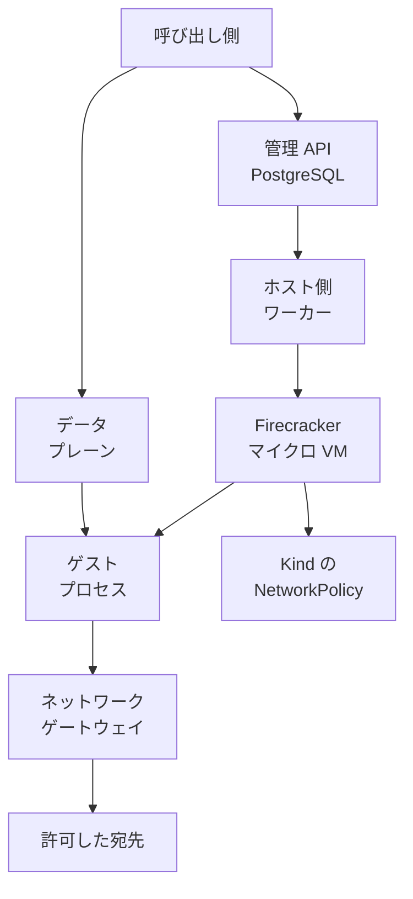

SPACE（Sandboxed Platform for Agentic Code Execution）は、エージェントや利用者のコードを、呼び出し元のホストから分けた環境で動かす実行基盤です。Perplexity が Apache License 2.0 で公開しています。日本語の紹介は [Gigazine（2026年10月16日）](https://gigazine.net/news/20261016-perplexity-space/) です。

この記事では、公開リポジトリと公式文書から、実行の流れ、サンドボックスの状態、ネットワークの既定、採用前に自分の環境で見る項目を整理します。数値の多くは Perplexity 自身の計測です。

読み手は、エージェントにコード実行を渡す前に、実行場所と到達範囲をどの部品で切るかを決める人です。

*この記事の全体像。以下、順に解説します。*

## SPACEとは

SPACE は、各サンドボックスをマイクロ VM として起動します。管理の依頼と、コマンドの入出力は、別の経路を通ります。公式ブログは、自社製品 Computer のコード実行、一時停止と再開、復旧、セッションの分岐に SPACE を使っていると説明しています。

公開されているのは、実行基盤とその公式説明です。Computer 本番の設定ファイルは、この公開範囲の外にあります。文書上の公開ベースラインは SPACE 0.8.0 です。

### 公開リポジトリ

公開リポジトリは [perplexityai/SPACE](https://github.com/perplexityai/SPACE) です。2026年10月18日時点の star は約1.4k、fork は約110で、アーカイブはされていません。作成日は 2026年10月1日です。

default branch `main` の先端は、2026年10月18日 01:48:57 UTC の `09e922efd23b3c0d109ab64de7e567a901bcc61e` です。`pushedAt` の 2026年10月18日 01:54:11 UTC は、任意ブランチへの push 時刻です。同日の GitHub Releases と tags は空でした。

言語は Rust です。呼び出し口は、HTTP の管理 API と、コマンド用のデータプレーンです。README は、埋め込みライブラリとしての使い方を案内していません。公式の最小例は `examples/first_sandbox.py` で、テンプレート名の例は `seed:latest` です。2026年10月18日の公式検索では `.ipynb` は 0 件でした。料金表と可用性 SLA の数値は、確認した公式ブログと docs にはありません。

セキュリティ修正の対象は、[SECURITY.md](https://github.com/perplexityai/SPACE/blob/main/SECURITY.md) にある直近のマイナーリリースです。連絡先は、GitHub の非公開アドバイザリか `space-team@perplexity.ai` です。

### マイクロ VM と二つの経路

各サンドボックスは、自分の書き込み可能なファイルシステムを持つマイクロ VM です。テンプレートは開始時の環境です。サンドボックスはそのインスタンスです。同じサンドボックス内のプロセスは、ファイルシステムを共有します。

呼び出し側は、管理 API に望む状態を渡します。API は PostgreSQL に記録します。ワーカーが Firecracker のマイクロ VM を用意します。ゲストプロセスは、データプレーン経由で入出力します。ゲストから外への通信は、ネットワークゲートウェイが、テナントポリシーとプラットフォーム拒否で扱います。

管理用の bearer と、データプレーンのセッション添付トークンは、交換できません。

### 実行契約 E0

ローカル手順の実行契約 E0 は、次の組み合わせです。参照ダイジェストは `sha256:3168c96b5719ce62543ae53e6641a4eb80416a9f01e5585f6f76c3c70111fa0b` です。詳細は [execution-environments.md](https://github.com/perplexityai/SPACE/blob/main/docs/execution-environments.md) にあります。

| 項目 | E0 |
|---|---|
| ホスト | Linux x86_64、KVM |
| VMM | Firecracker 1.15.1 |
| ゲストカーネル | 6.1.155 |
| スナップショット形式 | 9.0.0 |

Firecracker 1.17.0 を置いても、本番と、未認識の `SPACE_ENV` では、実行契約は E0 のままです。

### ライフサイクル

状態は Running、Paused、Suspended、Deleted です。説明は [architecture.md](https://github.com/perplexityai/SPACE/blob/main/docs/architecture.md) にあります。

| 状態 | 文書上の中身 |
|---|---|
| Running | VM が動いている |
| Paused | メモリをワーカー上に残す。永続スナップショットは取らない |
| Suspended | メモリ、ランタイム、ルートファイルシステムのスナップショットを取り、VM を解放する |
| Deleted | ライフサイクルの状態として列挙されている |

API で作ったサンドボックスは、アクセスもコマンドも無い状態が 6 時間続くと suspend します。文書がこの 6 時間に与えている名前は、アイドル上限です。

承認済みのファイル書き込みは、ライフサイクルの境界で永続化します。

E2B 互換のラッパでは、pause が SPACE の suspend に、resume が restore に対応します。

### ネットワークの既定

新規テンプレート登録の INSERT は、`NetworkPolicyV1::deny_all()` を書きます。型の `default()` も `deny_all()` です。中身は `default_action: deny`、allow と deny は空、TLS interception は off です。

プラットフォームが、テナントポリシーより先に拒否する宛先は次です。

| 宛先 | 範囲 |
|---|---|
| EC2 メタデータ | `169.254.169.254/32` |
| link-local | `169.254.0.0/16`。ただし `169.254.0.20/30` は例外 |
| 内部レンジ | `10.11.0.0/16`、`10.12.0.0/16` |
| ループバック | `127.0.0.0/8`、`::1/128` |
| IPv6 link-local | `fe80::/10` |

TLS interception の exemption は、一致した SNI または宛先 IP を、TLS 終端せず中継します。HTTP 検査と資格情報注入は通りません。exemption 自体は、出口の許可を増やしません。

オペレータの egress profile は、federated create でヘッダが無いときだけ、既定プロファイルを選びます。federated でない create は、ヘッダを無視し、プロファイルを適用しません。

### ローカル Kind の待受

Kind で入れる場合は、マイクロ VM の外側に Kubernetes の NetworkPolicy があります。待受は次です。手順は [installation.md](https://github.com/perplexityai/SPACE/blob/main/docs/installation.md) と [Kind README](https://github.com/perplexityai/SPACE/blob/main/infra/space/kind/README.md) にあります。

| 面 | 待受 |
|---|---|
| 管理 API | `127.0.0.1:8080` |
| データプレーン | `8090` |
| UI | `3000` |
| オブジェクトストレージ | `8333` |

初期の `root@local` は、環境変数が無いときパスワード `password` で、ロールは `organization_admin` です。リリースバイナリのディスク予約は 8GiB で、Kind は 1GiB です。Kind は、リリースバイナリには無い test-hooks で組みます。開発用のパスワードと署名鍵を含みます。

Kind README は、`sandboxes` 名前空間について、API と cluster controller からの入口と、公開 IPv4（プライベート範囲と link-local を除く）およびクラスタ DNS への出口を書いています。IPv6 の出口は無い、とも書いています。

ホスト側では、Firecracker がゲスト実行を分けます。VM、ストレージ、ネットワークを扱うホスト側サービスは、特権を要します。Kind の node-manager は root、privileged、hostNetwork、hostPID、`/dev/kvm` です。

### 呼び出しから宛先までの流れ

`vm` から `kind` への矢印は、Kind 配備ではマイクロ VM を載せる Pod に NetworkPolicy が付く、という意味です。ゲストポリシーの次の処理段、という意味ではありません。直接アダプタは、サンドボックス用の Pod を作らずにワーカーを呼びます。architecture.md がそう書いています。

## 注意点

公開ブログと Gigazine（2026年10月16日 21:30）は、同じ数字を「耐性が示された」に近い調子で要約しています。一次の内訳は下表です。いずれも Perplexity の自己申告です。公開された一次資料の範囲では、独立した再現は見つかっていません。

### 自己申告の数字が届く範囲

| 主張の届く範囲 | 一次の数字と条件 | 読めること |
|---|---|---|
| ゲストからホストへの脱出 | 9 モデル、2 課題、4 条件、各 3 回。脱出課題は 0/108。ゲスト内 root、ホスト上の足場なし。ソースコードの有無と、ネットワーク無しまたは部分ネットワーク。時間は 1 時間または 2 時間 | その条件で観察されなかった、という記録。脱出が起きないことの証明ではない |
| ネットワーク遮断の迂回 | ネットワーク無しは 0/54。部分ネットワークは修正前 11/54。ソースコードありでは一部モデルが 3/3 または 2/3 | 遮断の課題と、VM 脱出は別の結果である |
| 修正後 | 2026年8月26日に再現した 2 経路を、ソースコードあり、部分ネットワーク、検索ありで再試験。検証できた実行ではフラグ取得なし。2 回は provider または transport のエラーで終了 | その 2 経路についての再試験である。他の経路が残っていないことは書いていない |
| 作成の速さ | 2026年7月15日の記事。同じ本番トラフィックで、中央値 185ms から 60ms（3.1 倍）、p90 は 447ms から 89ms（5.0 倍）。比較相手の製品名は本文に無い | 10 月の「3〜5 倍」はこの対に対応する。自社計測である |
| 第三者製品 | 2026年8月31日から 9月1日、LLM なし、10 環境中 1 社は非公表。導入文は 10 のうち 8 が何らかの迂回。公開表は 9 のうち 7 が HTTPS で迂回 | SPACE 修正後ビルドの第三者監査ではない。Cloudflare Sandbox と NVIDIA OpenShell は、その 2 経路では迂回が報告されていない |

モデル名はブログの表記どおり、Claude Opus 5.0、DeepSeek V4 Pro 0813、Gemini 3.1 Pro、GLM 5.2、GPT-5.6 Cyber、GPT-5.6 Sol、Grok 4.20、Kimi K3、Qwen 3.8 27B です。Fable と GPT-6 Astra は、実行前に拒否しています。引用日は 2026年9月23日です。一次は [Escaping SPACE Part I](https://www.perplexity.ai/hub/blog/escaping-space-part-i) です。作成時間の一次は [Making SPACE（引用日 2026年7月15日）](https://www.perplexity.ai/hub/blog/making-space-secure-and-efficient-runtimes-for-long-running-agents) です。

10 月のブログは、ネットワーク迂回への耐性を、別件のインシデントと同種の手法にまで広げて書いています。Part I が再試験したのは、自社が特定した 2 経路です。Gigazine の要約も、この広い文に寄っています。SiliconANGLE などの「118」は一次の 108 と一致しないため、この記事では使いません。

承認済みファイルの永続化について、クラッシュ、強制停止、ホスト障害を必ず生き延びる、とは文書は書いていません。

### 時期の記述と実行できる環境

「Computer の全セッションが SPACE」の時期は、一次同士で月がずれています。2026年7月15日の記事は、その日時点で 100% であり、ロールアウト開始を「先月」と書きます。10 月のブログは、7 月に商用サンドボックスを置き換え、7 月以降すべての Computer セッションだと書きます。片方に揃えないでください。公開告知は [Open-sourcing SPACE](https://www.perplexity.ai/hub/blog/open-sourcing-space) です。

Windows ゲストと、利用者自身の手元マシンは、7 月記事が今後の作業として書いています。現行の本番向け実行契約は、Linux x86_64 の E0 です。

NVIDIA 公式アカウント @NVIDIAAI は、2026年10月17日 16:04 GMT に @perplexity_ai を引用しています。SPACE を NVIDIA が公開した記録ではありません。Gigazine の日付（日本時間 10月16日）の翌日です。

### 層を取り違えやすい点

到達範囲の既定は、1 枚のポリシーではありません。次は、文書上の既定と、混同しやすい読みです。

| 層 | 一次にある既定 | 混同しやすい読み |
|---|---|---|
| ゲストのテナントポリシー | 新規テンプレート登録は deny。allow は空 | ECW 文書の `default_action: allow` は、完全な置換ポリシーの例である。shim は空の default_action を allow として受け取らない |
| プラットフォーム拒否 | 上の CIDR。link-local の `/30` は例外 | コメントは RFC1918 に触れる。定数配列そのものは `10.0.0.0/8` 全体ではない |
| Kind の Pod | `sandboxes` 名前空間の入口と、公開 IPv4 およびクラスタ DNS への出口。IPv6 の出口は無い | ゲストの `default_action` ではない。VM の外から Pod のネットワーク名前空間へ届く通信にもかかる |
| ホスト | Firecracker がゲスト実行を分ける。ホスト側サービスは特権を要する | ゲストがホスト資格情報に触れない、とはこの文からは言えない。資格情報の注入位置は製品ブログの記述である |
| ローカル Kind | 開発用のパスワードと署名鍵。ディスク予約はリリース 8GiB に対し Kind は 1GiB | Computer の本番ゲートウェイと同じ設定だとは、文書は書いていない |

ネットワーク指定を省略したときにテンプレートポリシーを継承するかは、公開文書の確認範囲では閉じていません。

セキュリティ修正の対象は直近のマイナーリリースです。0.9 が出たあとの 0.8 は、その文面からは修正対象の外に出ます。バージョンの文書は [versioning.md](https://github.com/perplexityai/SPACE/blob/main/docs/versioning.md) です。

ローカル手順の初期パスワードは、本番の秘密に使わない、と installation.md が書いています。

### 公開文書が閉じていない点

次は、確認した公開文書の範囲では閉じていません。断定しません。

- `seed:latest` を Kind が登録する経路が、必ずテンプレート登録の INSERT を通るか。ビルド用 VM が許可全開を上書きする、という読みは未確認です。
- コマンド実行が、6 時間アイドルの「アクセス」を更新するか。文書は access または command と書きます。挿入される条件名を access idle と読む側も残っています。両方とも残っています。
- ディスク容量を省略したときの実行時サイズ。API 応答は、未指定の資源を null のまま返す、と first-sandbox.md にあります。
- セッション分岐、ブラウザへの資格情報の自動入力、BYOK が、公開 OSS のどのモジュールまで入っているか。
- Akamai、Crusoe、CoreWeave の価格と可用性契約。公式ブログは提供形態だけを書き、価格はありません。
- 公開 API の RPM。SaaS の RPM としては見つかっていません。容量不足と shutdown の 429 と 503 が troubleshooting にある、という読みは未確認です。

## 採用前に確認すること

SPACE は、コードをどこで動かし、どの宛先へ届けるかを、モデルの禁止文やホスト OS の権限とは別の部品として置く候補になります。配ってよいのは、次を自分の環境で確認できたときです。

公開リポジトリ、Apache-2.0、docs、実行契約 E0 が揃っていること自体は、到達範囲をコードと文書で指させる材料です。新規テンプレートのネットワーク既定が拒否であることと、Kind の公開 IPv4 が別層であることも、文書が分けています。脱出の記録と迂回の記録を、公式が別の分数で出していること、アイドル 6 時間、pause と suspend の違い、書き込みの生存条件が architecture.md にあることも、同じ側の材料です。

これらは、自分の環境で配るポリシーが権限表と一致していることの代わりにはなりません。

### 確認してから配る条件

1. 配るテナントポリシーが拒否既定で、allow が自社の権限表と一致し、TLS exemption が空か、空でない理由が残っている。
2. Kind の公開 IPv4 を、ゲストポリシーの代わりに使っていない。Pod の外側の上限として試験している。
3. VM の分離と、出口の迂回を、別の試験にする。108 回と 11/54 と再試験は、その試験の代わりにしない。
4. デプロイする commit を記録する。公開リポジトリの先端を、Computer 本番と同一視しない。
5. Linux x86_64 と KVM、およびホスト特権のワーカーを、運用の前提として受け入れる。

修正前の部分ネットワークでは、許可したパッケージ取得の範囲からフラグに届いた実行があります。拒否既定を配っても、allow の中身と exemption が権限表とずれると、同じ種類の隙間になります。

直近の確認は、デプロイする commit でテンプレート行の `network_policy_json` を読み、deny と空の allow と空の exemption であることを見ることです。ローカル Kind の `password` と開発用鍵のまま、本番の資格情報を入れないでください。

### 見送りが合うとき

見送りが合うのは、次のときです。

- 実行場所が macOS や、KVM の無いホストだけである。
- ホストを自前で持たずに済むサンドボックスだけが要る。
- 公開リポジトリを、Computer 本番の設定だと扱う。
- Gigazine の「迂回耐性が示された」を、採用理由にする。

### 隣接する 2 製品の読み方

ホスト名の許可が、共有 CDN の IP に広がることを避けたい、という一点だけなら、Perplexity の 2026年9月の表は、Cloudflare Sandbox と NVIDIA OpenShell を、その 2 経路で迂回無しと書いています。これは 1 回の自社試験です。その 2 製品を一般に優先する理由にはしません。

入口の文書は [space.docs.perplexity.ai](https://space.docs.perplexity.ai/guide/index.html) です。

## まとめ

SPACE は、エージェントのコードをどの環境で動かし、どの宛先へ届けるかを、モデルの禁止文とは別の部品として公開した実行基盤です。配る前に見るのは、拒否既定のテナントポリシーが自社の権限表と一致しているか、Kind の公開 IPv4 をゲストポリシーと取り違えていないか、デプロイする commit を本番と分けて記録しているか、です。脱出の 0/108 と、修正前の迂回 11/54 と、2 経路の再試験は、自社計測であり、自分の環境の試験の代わりにはなりません。

この記事が少しでも参考になった、あるいは改善点などがあれば、ぜひリアクションやコメント、SNSでのシェアをいただけると励みになります！

## 参考リンク

- [Gigazine（2026年10月16日）](https://gigazine.net/news/20261016-perplexity-space/)
- [Perplexity, Open-sourcing SPACE](https://www.perplexity.ai/hub/blog/open-sourcing-space)
- [Perplexity, Making SPACE（引用日 2026年7月15日）](https://www.perplexity.ai/hub/blog/making-space-secure-and-efficient-runtimes-for-long-running-agents)
- [Perplexity, Escaping SPACE Part I（引用日 2026年9月23日）](https://www.perplexity.ai/hub/blog/escaping-space-part-i)
- [GitHub, perplexityai/SPACE](https://github.com/perplexityai/SPACE)
- [architecture.md](https://github.com/perplexityai/SPACE/blob/main/docs/architecture.md)
- [execution-environments.md](https://github.com/perplexityai/SPACE/blob/main/docs/execution-environments.md)
- [versioning.md](https://github.com/perplexityai/SPACE/blob/main/docs/versioning.md)
- [installation.md](https://github.com/perplexityai/SPACE/blob/main/docs/installation.md)
- [Kind README](https://github.com/perplexityai/SPACE/blob/main/infra/space/kind/README.md)
- [SECURITY.md](https://github.com/perplexityai/SPACE/blob/main/SECURITY.md)
- [Docs](https://space.docs.perplexity.ai/guide/index.html)
