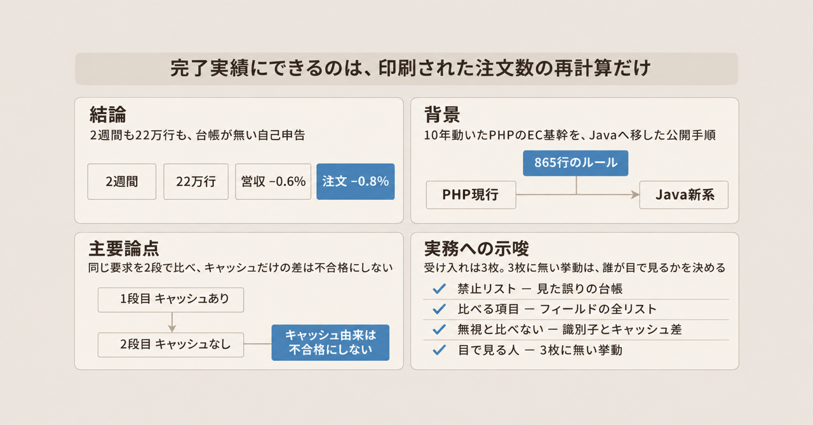
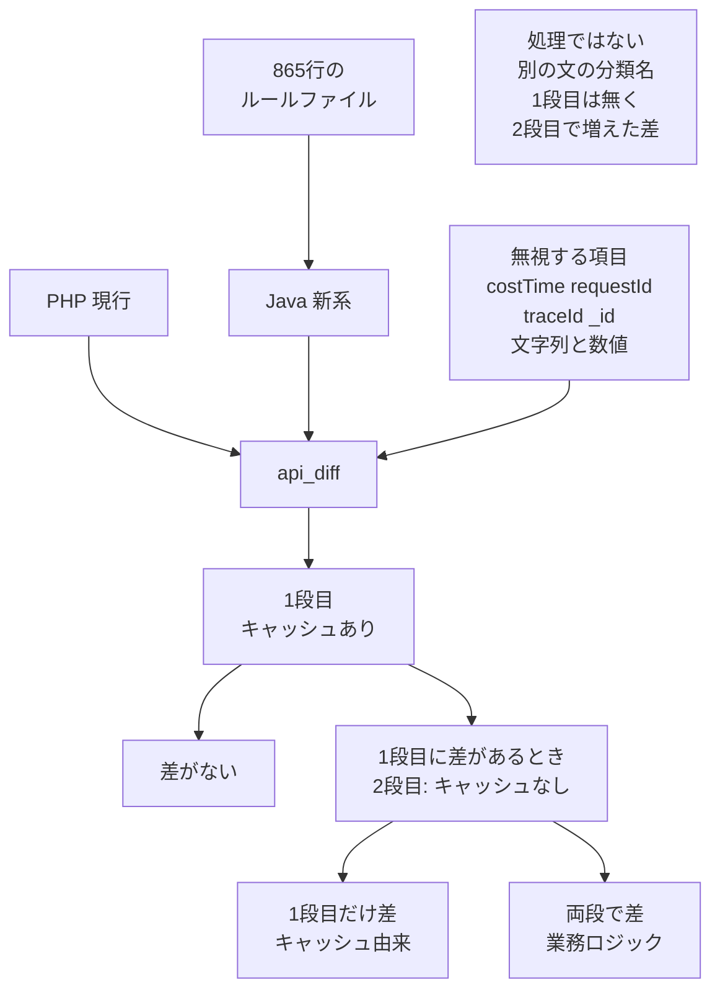

2026年3月、叶小钗氏が、稼働10年の PHP 製 EC 基幹を Java へ移した手順を、2本の記事で公開しています。前編は、URL ごとの観測できる挙動を揃える方針と、人が計画を承認してから AI に実装させる切り方を書いています。続編は、同じ誤りをルールファイルへ足して865行にしたこと、PHP と Java に同じリクエストを送ってレスポンスを比べるコマンド、カナリア後の注文数を書いています。カナリアは、続編が注文数を置いている時点の呼び方です。後述の小流量や灰度と同一かは、公開文に書かれていません。[soliperse 氏の Zenn 記事](https://zenn.dev/soliperse/articles/8f3e21e9d26f92)は、この続編の数字を日本語で要約しています。

数字は続編の著者による自己申告で、リポジトリ、差分レポート、インシデント台帳は2026年11月13日の検索では見つかっていません。

この記事は、レガシー移行を発注し、管理する人が、公開された手順のどこを受け入れ条件に書けるかを分けます。

*この記事の全体像。以下、順に解説します。*

## 865行のルールと差分比較でPHPをJavaへ移す手順とは

対象はコア EC です。言語は PHP から Java です。続編は、中核の4人が多年の経験を持ち、Java に習熟していた、と書いています。

前編は、[博客园](https://www.cnblogs.com/yexiaochai/p/19772177)に2026年3月25日 19:13として公開されています。続編として本文を読めるのは、[AtomGit / CSDN の転載](https://gitcode.csdn.net/69ca720554b52172bc658bd0.html)です。表示は2026年3月30日 20:51、転載者は程序猿李巡天です。

### 作業の単位は URL

作業の単位は URL です。前編が挙げる確認項目は、実パラメータ、分岐、戻り値、DB アクセス、副作用、異常時の挙動です。実パラメータは、その URL に実際に渡す値です。分岐は、条件によって処理が分かれる地点です。戻り値は、処理が返す値です。副作用は、返す値以外に起きる変化です。DB アクセスは、データベースの読み書きです。

リスクは3層です。P0 は、人が主導し、AI は補助する層です。P1 は、AI が実装し、人が厳しく見る層です。P2 は、AI の裁量を広げる層です。実装の前に計画を出させ、人が承認します。

### 865行のルールファイル

ルールファイルは、繰り返した誤りを1件ずつ足したものです。続編時点の行数は865行です。次の表は、続編が公開した分類名の引用です。行の文言を、禁止の全文として写すことはできません。禁止の中身の全リストは、公開されていません。反射、シリアライズ、強型化、Redis、catch、import は、その分類が挙げている語で、この文章だけでは各語の中身は決まりません。翻訳は、言語の訳ではなく、PHP の処理を Java へ移すときの分類名です。

| 分類 | 続編が挙げている内容 |
|---|---|
| 翻訳 | 反射を使わない。簡略化しない。API は Feign |
| シリアライズ | JsonUtil を使う。Redis は toJson |
| 性能 | 強型化のあと、toMap と fromMap をやめる |
| 工程 | catch は error。import は統一 |
| 操作 | 確認なしの破壊的操作を禁止する |
| 追跡 | 値を、代入した行まで追う |

Feign は、翻訳の分類が API の呼び方に付けている名前です。どのライブラリのどの版かは、この分類の文には書かれていません。JsonUtil と toJson は、シリアライズの分類が指定している呼び方の名前です。toMap と fromMap は、強型化したあとに往復させる変換の名前です。

### 同じリクエストを両系へ送る

差分コマンド `/api_diff` は、著者の skill です。skill は、ここでは繰り返す作業をコマンドにしたものです。同じリクエストを PHP と Java の両方へ送り、商品の主キー `goodsId` でフィールドを比べます。主キーは、その商品を一つに定める項目です。フィールドは、レスポンスの中の一つの項目です。

公開例のフィールドは、goodsId、title、url、color、price、originalPrice、shipsNow、stickers です。差の型は3つです。value_mismatch は値の不一致です。missing_field は項目の欠落です。type_mismatch は型の不一致です。

比較は2段です。1段目はキャッシュありです。2段目は、1段目に差があったときだけ、キャッシュを外して行います。キャッシュは、続編が1段目で残し、2段目で外す、応答の一時的な保持です。

同じ節が挙げる分類名は3つあります。1段目だけの差は、キャッシュ由来です。両段の差は、業務ロジックです。1段目には無く、2段目で増えた差は、キャッシュが下層を隠していた、という分類名です。下層は、続編が、その一時的な保持の奥で動く処理に付けている言い方です。

無視する項目の公開例は、costTime、requestId、traceId、`_id`、文字列と数値の差です。costTime は、処理にかかった時間の公開例です。requestId、traceId、`_id` は、リクエストごとに変わる識別子の公開例です。文字列と数値の差の例は、`"1"` と `1`、`"59.00"` と `59.00` です。この差は型の不一致に見えますが、無視する項目の例に入っています。それ以外の型の差を不合格にするかは、公開文にありません。

### ほかの skill と、公開の段取り

ほかの skill は2つです。`/log_investigate` は、ログ1行から追跡します。`php_sync_check` は、移行中も変わる PHP を毎日取り込んで比べます。

公開の段取りは、影子検証、小流量、分批切替、全量、観察の順です。影子検証は、この段取りの最初の段の名前です。何を検証するかは、公開文にありません。小流量は、全量の前に利用の一部を新系へ出す段です。流量は、新系へ向ける利用の量です。分批切替は、その次の段の名前です。一度にどれだけ切り替えるかは、公開文にありません。全量は、利用の全部を新系へ出す段です。観察は、そのあとに様子を見る段です。ロールバックは、不具合のときに前の状態へ戻すことです。分単位で準備する、と前編は書いています。

### ルールと差分の2本

続編が書いている仕組みは2本です。ルールファイルで生成を縛ります。差分コマンドで、両系のレスポンスを分類します。

矢印は、2段目を起動する条件として続編が書いた文です。3つ目の分類名は、同じ節の別の文です。図では、矢印の外にある箱です。

## 注意点

前編の冒頭には「AI训练营 8期、3月17日开班」とあります。手順の公開と、訓練営の告知が、同じ記事にあります。これは、手順が偽である証明にはなりません。監査できる台帳が無い、という制限にはなります。

前編には、検索上の日付が2026年3月18日の微信版もあります。そちらの本文は、確認できていません。続編の微信原文候補は、2026年11月13日に開いたとき、本文が空でした。54万行と57万行のどちらが著者の文かは、原文が読めるまで閉じません。

灰度は、続編が、全量の前に利用の一部を新系へ出す段階へ付けている名前です。説明が似ていても、公開文はカナリア、小流量、灰度を同じ段だと結んでいません。続編は、5%や80%という割合で書いています。US と CA は、続編が全量と80%を分けて書いた単位の名前です。国か店舗かは、公開文にありません。Cursor は、続編が実装に使った製品の名前です。Ultra は、その有料枠です。cloc は、ソースコードの行数を数える道具の名前です。続編は、どの定義で数えたかを書いていません。脱敏は、表の値をそのまま出さない処理です。信噪比は、続編が「直すべき差分の割合」に付けている名前です。分子と分母は書かれていません。母数は、その割合の分母になる件数です。窓は、数字を数えた期間です。続編は、その期間を公開していません。

### 見出しで通りやすい読み

| 見出しで通りやすい読み | 記事が実際に置いている範囲 | 扱い |
|---|---|---|
| 2週間で移し終えた | 続編は2週間を「核心迁移 + 关键行为对齐 + 基础验证」（中核の移行、重要な挙動の揃え、基礎的な検証）と定義する。灰度、観察、散発の修復はさらに1週間強。執筆時点で US は全量、CA は80%の灰度。PHP 側の改修も続く | 自己申告 |
| PHP 54万行が Java 22万行 | 本文と見出しは54万行。結語の1文だけ「57万行 PHP を22万行 Java」。1週目は大概10万行、2週目は20万行以上。cloc の定義は無い | 本文と結語で行数が食い違う |
| 直すべき差分が10%から80%超 | 著者は信噪比が大概10%から80%超、と書く。レポート件数もフィールドの母数も無い | 分母が無く、再検証が必要 |
| 一発で使える率が50%から60%、その後90%超 | 続編にその幅の文がある。分母は、行か、差分か、会話か、書かれていない | 分母が無く、再検証が必要 |
| 注文が約 −0.8%、営収が約 −0.6%で、事業影響なし | 注文は Java 7,418、PHP 7,475。差は −57/7,475 で −0.7626%。−0.8% への丸めと合う。客単価は157ドル対149ドル。営収が同じ窓の注文かける客単価なら、Java は約 +4.6% になり、−0.6% と符号が逆になる。表は脱敏。窓、配分、営収の式は公開されていない | 営収の −0.6% は再検証が必要 |
| ツール費約1,800ドル、Cursor Ultra が9アカウント | 続編は「两周大概消耗了 1800 美元，9 个 Cursor Ultra 账号」と書く。内訳は無い。2026年11月13日の公式価格では Ultra は月200ドル（税別）で、9シートの1か月分が1,800ドルになる。2026年3月の単価は未確認 | 金額の内訳は未確認 |
| ルール865行で AI を縛った | 行数の宣言と、分類の例がある。禁止 API の全リスト、命名規則、例外の種類、データ互換の対照表は、台帳としては公開されていない | ファイルの所在は未確認 |
| 2段目が、キャッシュの陰に隠れた差を必ず拾う | 起動条件は「1段目に差があるときだけ」。同じ節は「1段目には無く、2段目で増えた差」も分類名に挙げる。1段目が全部一致したときは2段目が走らない、と読める。別の項目の差で2段目が走れば、そこで初めて出る項目差はあり得る | 2文の並記。どちらを実装したかは未確認 |

Zenn の要約は、54万行から22万行へ、と書き、結語の57万行には触れていません。

コミット回数は、変更を記録した回数です。続編は、何を1回と数えたかを書いていません。1週目が大概300回超で1日約45、2週目が大概500回超で1日70以上です。300を7で割ると約43、500を7で割ると約71で、「大概」の幅には入ります。台帳は公開されていません。1日約15時間も、自己申告です。

旧系の単体テスト、結合テスト、回帰テストがほぼゼロ、は続編の文です。三つともテストの種類です。続編は、それぞれの中身を書いていません。前編は、新しい側でテストケースを生成した、と書いています。旧系にテストが無かった、とは書いていません。二つは矛盾しません。

### 比較が落としているもの

ルールに書かれていない挙動を、差分が自動で落とすとは、公開された仕様だけでは言えません。無視項目と、キャッシュだけに出る差をバグとしない分類は、落とすものを明示しています。比べる範囲は、「返回値をフィールドごとに比べる」と、重要なフィールドの例の両方があります。返回値は、API が返すレスポンス本文です。続編はこれを「返回值」、フィールドを「字段」と書いています。前編の確認項目の「戻り値」と、この返回値が同じ範囲かは、公開文では決まっていません。例の末尾は「...」です。例に無い項目を見ていなかった、とまでは言えません。

前編が確認項目に入れた DB と副作用は、公開された `/api_diff` の文面では、返回値の比較です。在庫、決済、下流ジョブが返回値に出ていなければ、この比較の外に置けます。下流ジョブは、この応答のあとに動く別の処理です。商品件数そのものの欠落を、差の型が含むかは、公開例からは決まりません。

キャッシュありのときだけ出る差は、続編の分類ではバグではありません。利用者に見える差を、意図して完了条件から外しています。

message と msg の取り違えは、続編では灰度5%で見つかり、10分で直した、とあります。前編の例は、`Result<T>` の `message` が `BaseResponseDTO<T>` の `msg` になり、`costTime` が落ちた、という別の主語です。商品フィールドの比較リストには、エラーの項目名は入っていません。

2週目には、スレッド、多段キャッシュ、ホットパスの性能作業があります。三つは、続編が性能作業として並べている語です。それぞれの中身は、公開文にありません。ここでのスレッドは、後の「疑いのスレッド」とは別の語です。costTime は無視項目なので、遅延の数値はこの差分の外に置けます。返回値そのものが古いことは、1段目の差として出得ます。

### 再現と、ルールファイルの所在

第三者の再現や、話を盛っているという疑いのスレッドは、2026年11月13日に博客园のコメント本文、知乎、V2EX、GitHub を探した範囲では見つかっていません。コメント3件の本文は、ログイン壁の向こうで未読です。続編の周辺では、この疑いを「吹水」と呼びます。

GitHub 利用者 `yexiaochai` の表示名は叶小钗で、blog は当該の博客园です。公開リポジトリは18件です。最終更新が新しい順の最新は `blade` の2019年1月21日です。`php_sync_check` を公開コードから検索すると、該当0件です。非公開のリポジトリは見えないので、ファイルが世の中に無い、とは言えません。

865行のうち、禁止 API、命名、例外、データ互換が何行かは、公開された分類からは数えられません。例外は、その内訳に挙がっている語です。エラーの種類か、規則の特例かは、公開文では決まりません。865行のファイルが、Cursor で常時適用されるルールだったかは、記事にありません。2026年11月13日の [Cursor Rules](https://cursor.com/docs/rules) では、プロジェクトルールは `.cursor/rules` にある `.mdc` という拡張子のファイルです。平文の `.md` は、ルールシステムに載りません。当時の skill の画面が、今日の [Cursor Skills](https://cursor.com/docs/skills) と同じかは、確認できていません。

営収 −0.6% の式、観測窓、流量配分、客単価の定義は、公開されていません。信噪比と、一発で使える率の分母も、公開されていません。

注文の再計算は、次のとおりです。7,475 から 7,418 を引くと 57 です。57 を 7,475 で割ると 0.7626% で、表示の −0.8% への丸めと合います。客単価まで掛けると、Java は 7,418 かける 157 で 1,164,626、PHP は 7,475 かける 149 で 1,113,775 です。差の 50,851 を 1,113,775 で割ると約 4.6% で、符号は −0.6% と逆です。この掛け算が営収の式だとは、記事は書いていません。

## 発注側が完了条件に書ける範囲

発注側が採れるのは、禁則を検査できるリストにし、差分コマンドが見る項目と落とす項目を完了条件に書く、という型です。865行の実ファイルと、2週間、22万行、営収 −0.6% を、再現された完了実績として扱うことはできません。

公開された仕様が支えているのは、次の4点です。

- 前編は、挙動の単位を URL に置き、確認項目をパラメータ、分岐、戻り値、DB、副作用、異常時と列挙しています。
- 続編は、差分の無視項目と、キャッシュ差をバグとしない分類を、コマンドの仕様として書いています。見ないものを先に書いている点は、AI への指示文の外に完了条件を置く型と一致します。プロンプトは、その指示文です。
- 注文数の −0.8% は、印刷された 7,418 と 7,475 から再計算できます。
- Zenn の主要な数字は、57万行を除き、続編の自己申告と対応します。

上の注意点で外に置いたもの、つまり返回値に出ない在庫と決済と下流ジョブ、キャッシュだけに出る差、商品フィールドのリストに無いエラー項目名、costTime を無視した遅延は、この型の完了条件には入りません。ルールに無い挙動を差分が自動で落とす、とも、例に無い項目を比べていなかった、とも、公開された仕様だけでは言えません。

## 受け入れを3枚に分ける

完了条件は、生成の速さや、ルールの行数ではなく、検査コマンドの仕様に書きます。

1. 比べるフィールドの全リストを、完了条件として別に書きます。続編の例は goodsId から stickers までで、末尾が「...」です。同じ節は、返回値をフィールドごとに比べる、とも書いています。例に無い項目を比べていなかった、とは、この文章だけでは言えません。
2. 落とす不一致を列挙します。文字列と数値、リクエストごとの ID、キャッシュだけに出る差は、この事例では意図して落とします。
3. 比べないものを、完了の宣言の前に書きます。公開された文面の比較対象は、返回値です。在庫、金額の台帳、下流ジョブは、返回値に出ていなければ、この比較の外に置けます。商品件数は、公開例からは決まりません。遅延は、costTime が無視項目の例に入っています。
4. ルールは、すでに見た誤りの禁止台帳として扱います。台帳に無い挙動は、差分の外なら通ります。その穴を、完了の定義に1行足します。番号の1は2枚目、番号の2と3は3枚目、番号の4は1枚目です。3枚に無い挙動を誰が目で見るかは、この4項目の外です。

2週間、22万行、営収 −0.6%、一発で使える率の90%超は、台帳が公開されるまで採用しません。注文の −0.8% だけは、印刷された2つの件数と、表示が一致する自己申告として引用できます。表は値をそのまま出さない処理がしてあります。この2件数が、加工前の数かどうかは、公開文では決まりません。ツール費の約1,800ドルは、9アカウントという文と、2026年11月13日の月200ドルが掛け算で合う自己申告です。2026年3月の単価と、内訳は、未確認のまま残します。

| 数字 | 受け入れでの扱い |
|---|---|
| 注文 −0.8%（7,418 と 7,475） | 印刷された2件数と表示が一致する自己申告として引用できる |
| 2週間、Java 22万行、営収 −0.6%、一発で使える率90%超 | 台帳が公開されるまで採用しない |
| ツール費約1,800ドル | 内訳と、2026年3月の単価が無いので、実績の内訳としては採用しない |

発注側の次の一手は、移行の受け入れ条件を3枚に分けることです。1枚目は禁止リストです。2枚目は、差分コマンドが比べる項目です。3枚目は、無視する項目と、比べない対象です。この3枚に無い挙動を、誰が目で見るかを決めます。

## まとめ

叶小钗氏の手順は、URL ごとの挙動を確認項目にし、人が計画を承認してから AI に実装させ、見た誤りを865行のルールへ足し、同じリクエストの返回値を PHP と Java で2段に比べる、というものです。2段目は、1段目に差があるときだけ動きます。キャッシュだけに出る差と、リクエストごとの ID、文字列と数値の差は、無視する側に置いています。

発注側が持ち帰れるのは、この型です。行数、日数、営収の自己申告を、再現された完了実績として扱うことはできません。注文の −0.8% だけは、印刷された件数から再計算できます。

受け入れは、禁止リスト、差分コマンドが見る項目、無視する項目と比べない対象、の3枚に分けます。3枚に無い挙動は、誰が目で見るかを別に決めます。

この記事が少しでも参考になった、あるいは改善点などがあれば、ぜひリアクションやコメント、SNSでのシェアをいただけると励みになります！

## 参考リンク

- 叶小钗、前編「AI Coding 实战：10年祖传系统，54万行代码，2周重构结束」。博客园、2026年3月25日 19:13。[https://www.cnblogs.com/yexiaochai/p/19772177](https://www.cnblogs.com/yexiaochai/p/19772177)
- 前編の微信版と思われる同題。検索上の日付は2026年3月18日。本文は未確認。[https://mp.weixin.qq.com/s/ox93-CKZLEuBMdV591STAg](https://mp.weixin.qq.com/s/ox93-CKZLEuBMdV591STAg)
- 続編の転載「AI Coding 实战：2周重构54万行代码，真的吗？」。AtomGit / CSDN、表示2026年3月30日 20:51、転載者 程序猿李巡天。[https://gitcode.csdn.net/69ca720554b52172bc658bd0.html](https://gitcode.csdn.net/69ca720554b52172bc658bd0.html)
- 続編の微信原文候補。2026年11月13日は本文が空だった。[https://mp.weixin.qq.com/s?__biz=Mzg2MzcyODQ5MQ==&mid=2247500076&idx=1&sn=f95caf1f2f5dbe5c6cddfdd58a95a5e2](https://mp.weixin.qq.com/s?__biz=Mzg2MzcyODQ5MQ==&mid=2247500076&idx=1&sn=f95caf1f2f5dbe5c6cddfdd58a95a5e2)
- 虎嗅の続編要約。[https://www.huxiu.com/article/4846437.html](https://www.huxiu.com/article/4846437.html)
- soliperse、Zenn の要約。[https://zenn.dev/soliperse/articles/8f3e21e9d26f92](https://zenn.dev/soliperse/articles/8f3e21e9d26f92)
- Cursor Rules。2026年11月13日に閲覧。[https://cursor.com/docs/rules](https://cursor.com/docs/rules)
- Cursor Skills。2026年11月13日に閲覧。[https://cursor.com/docs/skills](https://cursor.com/docs/skills)
- Cursor の価格。2026年11月13日に閲覧。Ultra は月200ドル（税別）。[https://cursor.com/docs/models-and-pricing](https://cursor.com/docs/models-and-pricing)
- GitHub 利用者 yexiaochai。2026年11月13日時点で公開リポジトリ18、公開リポジトリの最新 push は blade の2019年1月21日。[https://github.com/yexiaochai](https://github.com/yexiaochai)
