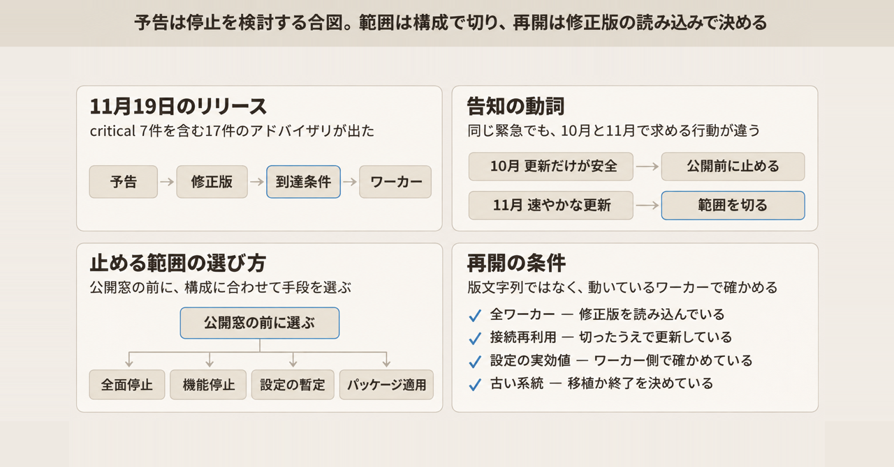
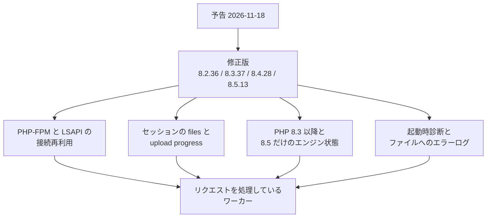
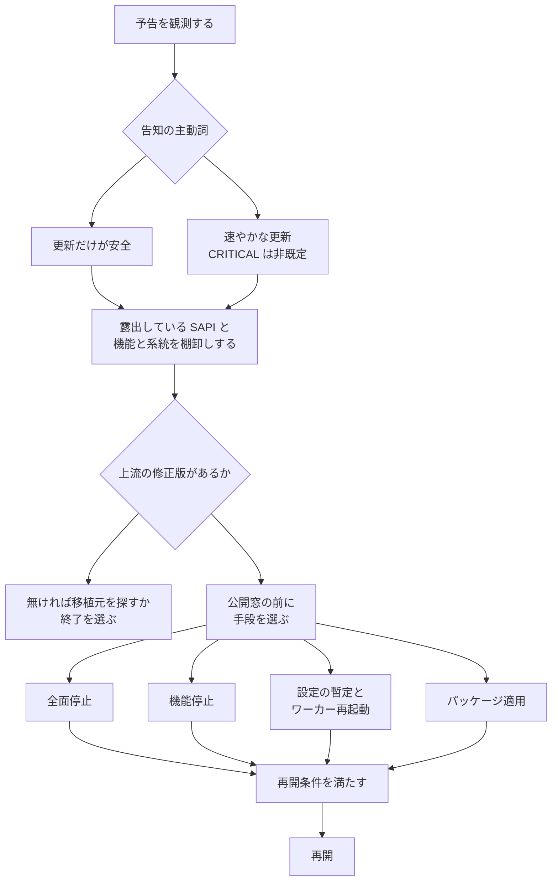

2026年11月19日、The PHP Group はサポート中の PHP 8.2 から 8.5 にセキュリティ修正版を公開しました。前日の予告を受けて、国内のゲーム、チケット販売、官庁サイトが公開時刻の前にメンテナンスへ入りました。10月の修正公開に続いて2回目です。

この記事は、サービスを止めることを承認する事業責任者と、その手順を回す運用担当に向けて、言語ランタイムの予告と修正公開を「どこまで止めるか」と「何を満たしたら再開するか」に落とす手順を整理します。事実関係は 2026-11-22 時点で確認できた php.net の告知、GitHub Security Advisory、各社の公式告知に基づきます。

*この記事の全体像。以下、順に解説します。*

## 2026年11月19日の PHP セキュリティリリースとは

PHP は4週ごとに定例のセキュリティリリースを出しています。11月の回は次のとおりです。[php.net News Archive](https://www.php.net/archive/2026.php)

- **予告**: 2026-11-18。公開予定は 2026-11-19 14:00〜14:30 UTC（日本時間 23:00〜23:30）。求めている行動は、公開後に速やかに更新することです。
- **深刻度**: 最高は CRITICAL。予告は、リリースがサポート中の全バージョンの脆弱性に対処すること、そのうち CRITICAL に該当する問題は既定でない設定か一般的でない構成を要すること、の両方を書いています。
- **修正版**: 8.2.36、8.3.37、8.4.28、8.5.13。PHP 8.1 以前のパッケージはこの告知に含まれません。
- **件数**: 同日に php/php-src で公開されたセキュリティアドバイザリは17件です。内訳は critical 7、high 4、medium 6 で、critical 7件のベンダー評価（CVSS v4.0）はいずれも 9.2 です。[php/php-src security advisories](https://github.com/php/php-src/security/advisories)
- **同日の別リリース**: PHP 8.6.0 も公開されました。8.6.0 の告知本文は機能リリースの説明で、上記のセキュリティ修正を含むとは書いていません。

直前の先例は 2026-10-21 のセキュリティリリースです。修正版は 8.5.12、8.4.27、8.3.36、8.2.35 で、対象は CVE-2026-109618 と CVE-2026-109619 でした。告知は「There are no complete mitigations, updating is the only safe choice.」（完全な緩和策は無く、更新だけが安全な選択）と書いています。この10月の2件を指して報道で使われた「PHP2Shell」は報道側の呼び名で、php.net の標題にはありません。

### 4つの層で見る

11月19日のリリースは、予告文、4つの修正パッケージ、脆弱性ごとの到達条件、実際にリクエストを処理しているワーカー、の4層に分けて見ると、判断すべき箇所が分かれます。PHP-FPM は、PHP を常駐プロセスとして動かし、Web サーバーから受け取ったリクエストを処理させる仕組みです。ここでいうワーカーは、PHP-FPM などでリクエストを処理している常駐プロセスのことで、ワーカーを起動・管理する親プロセスをマスターと呼びます。

図の中段の4つは、到達条件のまとまりです。接続再利用には CVE-2026-129289、セッションには CVE-2026-115560 と CVE-2026-126714、エンジン状態には CVE-2026-129481、CVE-2026-129182、CVE-2026-129474、起動時診断には CVE-2026-129496 が入ります。

- **セッションの `files`** は、セッションのデータをサーバー上のファイルに保存する既定の方式です。
- **upload progress** は、ファイルアップロードの進み具合をセッションに記録する機能で、`session.upload_progress.enabled` で有効・無効を切り替えます。
- **エンジン状態**は、PHP 本体の実行エンジンが処理の途中で持つ内部の状態です。
- **起動時診断**は、ワーカーの起動時に PHP が出す警告などの診断メッセージです。

4つの層は次のように分かれます。

- **予告文**は「全サポート版に脆弱性がある」と「CRITICAL は非既定か非一般的」を同時に含みます。
- **パッケージ**は系統番号（8.2、8.3、8.4、8.5）で分かれます。
- **到達条件**は、SAPI（Web サーバーと PHP をつなぐ方式。PHP-FPM、mod_php、CGI、LSAPI など）、ini 設定（PHP の設定ファイル php.ini の項目）、セッションの保存先で分かれます。
- **ワーカー**は、ディスク上のファイルとは別に、読み込まれた世代として残ります。パッケージを入れ替えても、再起動していないワーカーは古いバイナリと古い設定のまま動きます。

### critical 7件の到達条件

critical の7件は、届く条件と更新までの暫定策が件ごとに違います。各アドバイザリの記載を要約すると次のとおりです。

| CVE | 届く条件の要点 | 更新までの暫定策 | 影響する系統 |
|---|---|---|---|
| [CVE-2026-129289](https://github.com/php/php-src/security/advisories/GHSA-qc49-hpvq-g2w6) | フロントエンドがバックエンドとの接続を再利用し、アプリがリクエスト本文（`php://input`）を最後まで読まない。毎回接続を閉じる標準構成の nginx / Apache は、実証された PHP-FPM 経路の対象外。LSAPI ではリクエストの区切りがずれる脱同期と妨害までで、任意コード実行は確立していない | 接続の再利用を止める | コード上は 5.6.0 以降 |
| [CVE-2026-115560](https://github.com/php/php-src/security/advisories/GHSA-658j-r8rw-q6mx) | セッションの upload progress を、ある保存形式（シリアライザ）で書き、別の形式で読む。実行時の設定変更に限らず、保存先を共有する別プロセスでも起きる。コード実行にはガジェット（悪用に使える既存クラス）が要る | 機能を無効のままにする。明示的に有効にしているなら、読み書きでセッションの保存形式（`session.serialize_handler`）を揃える。修正版は機能の既定を無効にし、有効中の実行時変更を拒否するが、別々の設定同士の一致は強制しない | upload progress は 5.4.0 以降 |
| [CVE-2026-126714](https://github.com/php/php-src/security/advisories/GHSA-fm2m-fjf5-v3cp) | 既定の `files` ハンドラで、中断された書き込みが2つのセッションを混ぜ、次のオープンで攻撃者が制御するオブジェクトを復元しうる。ガジェットと中断が要る。他の保存実装はこのファイル欠陥の対象外 | upload progress の無効化はその入力経路だけを消す。書き込み途中の状態を残さないアトミックな保存に替えると、このファイル欠陥を避けられる | コード上は 4.1.0 以降 |
| [CVE-2026-129496](https://github.com/php/php-src/security/advisories/GHSA-gr4f-wgx5-jpfv) | 起動時診断が出る設定で、PHP のエラーログをファイルに書いているとき、新しいワーカーの起動時の診断を通じて届く。未認証の遠隔からワーカーを停止でき、条件が揃えばコード実行 | 起動時に診断が出る原因を直し、マスターと全ワーカーを再起動する。エラーログの出力先を syslog にすると、ファイルへのログ書き込みに関わるこの経路を避けられる | 5.3.18 / 5.4.8 以降 |
| [CVE-2026-129481](https://github.com/php/php-src/security/advisories/GHSA-g3vh-838c-65v7) | 10月の CVE-2026-109619 の不完全な修正。セッション終了処理の中断後にワーカーを再利用する。この不具合経由のコード実行は未実証。PHP 8.2 は対象外 | upload progress の無効化では塞がらない。1ワーカーが処理するリクエスト数の上限を1にする `pm.max_requests=1` と再起動で2回目のリクエストを防げるが、性能コストがある | 8.3.0 以降 |
| [CVE-2026-129182](https://github.com/php/php-src/security/advisories/GHSA-2fjv-p558-g82m) | 8.5.12 がシャットダウン時に消した fatal backtrace（致命的エラー時に組み立てる呼び出し履歴）のグローバル状態を、その後の処理が再び埋める。この入口での遠隔コード実行は未実証で、ワーカーのクラッシュは示されている | `fatal_error_backtraces=0` にして全ワーカーを再起動する。リクエスト単位の設定で戻さない | 8.5.0 以降。8.4 以前は対象外 |
| [CVE-2026-129474](https://github.com/php/php-src/security/advisories/GHSA-8mjj-2r7p-4hg2) | PHP 8.5 以降で遠隔コード実行が確認されている。実証経路は `fatal_error_backtraces=1`（8.5 の既定は有効）かつ、例外の呼び出し履歴に関数の引数を含める `zend.exception_ignore_args=0`。PHP に同梱される本番向けの設定雛形 `php.ini-production` は `zend.exception_ignore_args=1` なのでこの経路を止める。8.2〜8.4 は基底の不具合を持つが、既知の遠隔トリガーは無い | 実際に使うワーカーで `zend.exception_ignore_args=1` にして再起動する。コマンドライン用の PHP は Web 用のワーカーと別の php.ini を読むことがあり、CLI 側の設定だけ変えても足りない。8.5 以降は `fatal_error_backtraces=0` もこの経路を止める。エラーを画面に出さない `display_errors=0` は、呼び出し履歴の構築を止めない | 攻撃経路は 8.5.0 で導入 |

high の4件のうち、[CVE-2026-129291](https://github.com/php/php-src/security/advisories/GHSA-jm4m-qfqx-967m)（CVSS 8.8）は、権限の低い FPM ワーカーでコードを実行できる攻撃者が、ワーカーの出力をマスター経由でログに取り込む `catch_workers_output` が有効で、かつ Linux のイベント通知方式 epoll を使っているときに、マスターの権限へ上がるローカル権限昇格です。公式 PHP-FPM の Docker イメージはこの設定を有効にしており、それ以外の既定は無効です。暫定策は `catch_workers_output` を切ることです。残りの high は、複数行に折り返した HTTP ヘッダによるサービス妨害（CVE-2026-127960）、大文字小文字が混在した HTTPS / FTPS 指定が平文通信になりうる問題（CVE-2026-128064）、PHP のアーカイブ形式である PHAR の OpenSSL 署名のアルゴリズムダウングレード（CVE-2026-128090）です。

ここでの「既定でない」は PHP の ini 設定だけを指していません。CVE-2026-129289 の非既定はフロントエンドの接続再利用です。CVE-2026-126714 は既定の `files` ハンドラに届きますが、書き込みの中断とガジェットが要ります。CVE-2026-129474 は、8.5 の fatal backtrace が既定で有効でも、`php.ini-production` の `zend.exception_ignore_args=1` が実証経路を止めます。

NVD では、CVE-2026-129289 と CVE-2026-115560 が 2026-11-22 時点で Awaiting Analysis（分析待ち）です。点数は、NVD 自身の評価ではなくベンダー（security@php.net）が付けた CVSS 4.0 / 9.2 が、Secondary 欄に載っています。[NVD CVE-2026-129289](https://nvd.nist.gov/vuln/detail/CVE-2026-129289) / [NVD CVE-2026-115560](https://nvd.nist.gov/vuln/detail/CVE-2026-115560)

## 注意点

### 報道の見出しと、ベンダーの文面のずれ

ITmedia NEWS（2026-11-20）は、11月19日夜の修正公開を受けて各社がサービスを一時停止したと報じ、プリンセスコネクト!Re:Dive、ウマ娘、グランブルーファンタジー、イープラスを例に挙げています。財務省は 19日 22:30 からサイトの一部機能を止めました。[ITmedia NEWS](https://www.itmedia.co.jp/news/article/2611/20/2000003357/)

同じ記事の中で、本文は「各社とも20日朝までにサービスを再開している」と書き、画像説明は「グラブルのメンテは21日午前3時50分に終了した」と書いており、両立しません。グランブルーファンタジー公式の終了告知は、11月19日 22:00 開始のメンテナンスが 11月20日 2:45 に終了したと書いています。時刻は公式投稿を採ります。[グランブルーファンタジー公式](https://x.com/granbluefantasy/status/2123472781124022651)

一方で「緊急の脆弱性はサポート中の全バージョンに影響するが、悪用には既定でない設定か一般的でない構成が必要」という ITmedia の1文は、php.net の予告と差がほとんどありません。どちらの文も「全件が全構成に届く」とは読めません。

10月について ITmedia は、修正公開前に攻撃コードが出回ったと書いています。php.net の 10月20日予告が一次情報として言っているのは、詳細が公になるか悪用の証拠が出たら予定より早く公開する権利を留保する、というところまでです。

### 「CRITICAL なら全面停止」は、11月のベンダー文より広い

11月18日の予告が求めているのは、公開されたら速やかに更新できるよう準備することで、停止とは書いていません。10月21日の告知は「更新だけが安全」でした。同じ CRITICAL でも、告知の動詞が違います。

critical 7件の表のとおり、11月の critical は到達条件が一様ではありません。

- CVE-2026-129289 は、接続を毎回閉じる標準構成の nginx / Apache では実証経路に乗りません。暫定策は接続の再利用を止めることで、サイト全体を止めることではありません。
- CVE-2026-115560 は、upload progress を無効にしていれば当該経路は消えるとアドバイザリが書いています。この1件のためだけに全面停止する根拠にはなりません。ただし他の critical は残ります。

逆に、php.net が11月の一式について「止めなくてよい」と書いた一次情報もありません。WAF だけで11月の一式を塞げるとPHP側が書いた記述も無く、AWS の 2026-11-19 の告知は、完全な修正はパッチで、WAF は CVE-2026-115560 の補助という立場です。

### 「修正版を入れた」も「予告の攻撃面を塞いだ」も、再開の十分条件ではない

php.net の10月21日告知は、`session.upload_progress.enabled=0` と PHP 8.5 の `fatal_error_backtraces=0` について全ワーカーの再起動を求め、スクリプトの実行中に設定を変える `ini_set()` や、ディレクトリ単位の設定ファイルである FPM の `.user.ini` では反映が遅いとしています。11月の CVE-2026-129474 のアドバイザリも、回避設定のあとでワーカーの再起動を求めています。ディスク上のバージョン文字列と、リクエストを処理しているプロセスは別物です。

予告の時点の説明だけで再開を判断する危うさも、実例があります。php.net は10月23日に CVE-2026-115560 を「セッションの保存形式を設定で `php_binary` か `php_serialize` にし、実行時に `ini_set()` で `php` 形式に戻す」という狭い条件で予告し、`session.upload_progress.enabled=0` を次回の定例まで維持するよう求めたうえで、実行時にシリアライザを変えないアプリは機能を有効のままでよいと書きました。11月19日のアドバイザリは、それに加えて、同じ保存先を別シリアライザのプロセスが読む場合も含めています。10月23日の文面だけを確認して再開すると、共有ストアの経路が残ります。

また CVE-2026-129481 と CVE-2026-129182 は、10月の CVE-2026-109619 の修正が閉じ切らなかった系統です。前回の告知範囲を確認したことは、翌月に critical が無いことの証明になりません。

### 2回の停止で「定型」とは言えない

10月と11月で、ゲームなどの計画停止は繰り返されました。同時に、止めなかった例や、停止を告知していない例も一次情報として残っています。

- **メルカリ**（2026-10-22）は、外部ソフトウェアの脆弱性に備えた臨時メンテナンスを、安全性を確認したとして見送りました。[メルカリ](https://jp-news.mercari.com/info/55765)
- **エックスサーバー**（2026-11-20）は、利用者サーバーの PHP 8.2〜8.5 へ公式修正を、5.6〜8.1 へ独自修正を適用したと告知しています。利用者サイトを止めずに直したとは書いていません。[第3報](https://x.com/xserverjp/status/2123495082775257358) / [第4報](https://x.com/xserverjp/status/2123573437646205414)
- **ワールドクエスト**（2026-10-21）は、古い仕組みのため十分な対策がとれないとして、同日でサービスを終了しました。修正を当てられない系統では、出口が再開ではなく終了になりえます。[ワールドクエスト公式](https://x.com/w_quest_com/status/2112912257256722693)
- **財務省**（2026-11-19）が止めたのは、全サイトではなく列挙したページの機能です。告知時点で再開時期は未定でした。[財務省](https://www.mof.go.jp/public_relations/ohter/2026111901.html)

ITmedia 自身も、今回は10月より影響範囲が小さいと書いたうえで、緊急メンテナンスは多かったとしています。11月の critical について、実際に悪用が成功した一次記録は 2026-11-22 時点で確認できていません。米国 CISA が悪用状況などから対応の優先度を判断する SSVC 評価で、exploitation none（悪用の確認なし）とされているのは CVE-2026-129289 と CVE-2026-115560 の2件のレコードに限られます。実際に悪用された脆弱性を CISA が載せる KEV カタログへの掲載有無も確認できていません。「悪用されていない」とまでは言えない状態です。

各社の停止と再開の時刻にも、公式に確認できていないものがあります。プリンセスコネクト!Re:Dive の開始・終了時刻、ウマ娘の再開時刻（開始は公式 X で 11月19日 23:00 ごろと告知）、財務省の再開告知、日経クロステックが報じた国税庁・肥後銀行の停止と、国家サイバー統括室（NCO）による対策の呼びかけについても、一次告知は未確認です。PHP 8.6.0 がセキュリティ修正を含むかも、告知本文からは確認できません。

## 10月と11月で、何が違ったか

2回の告知を並べると、同じ「緊急」でも判断に使える情報の形が違います。

| 観測項目 | 2026-10-21 | 2026-11-19 |
|---|---|---|
| 予告 | 10月20日。10月21日 14:00 UTC 公開。詳細公開か悪用証拠で前倒しの権利を留保 | 11月18日。11月19日 14:00〜14:30 UTC 公開。4週サイクル |
| ベンダーの動詞 | 直ちに更新。完全な緩和は更新のみ | 公開後に速やかに更新。CRITICAL は非既定か非一般的 |
| 修正版 | 8.5.12 / 8.4.27 / 8.3.36 / 8.2.35 | 8.5.13 / 8.4.28 / 8.3.37 / 8.2.36 |
| 件数 | critical 2（いずれも CVSS v4.0 9.2）。のちに CVE-2026-115560 を次回へ繰り延べ | 公開アドバイザリ17（critical 7、high 4、medium 6） |
| 届く範囲の書き方 | Web リクエストを受ける全 SAPI。リスクが最も高いのは mod_php。アプリのコードが動く前の段階で届く実証がある | 件ごとに SAPI、ini、保存先、系統番号が違う |
| 暫定策 | 特定経路を減らすだけで、導入を安全にはしない | 件ごとに「更新まで」の設定がある。設定で全件が塞がるとは書いていない |
| 古い系統 | 8.1 以前は更新を受け取らない。10月の2件に限り、php.net が 7.4 / 8.0 / 8.1 向けの最小限のソース移植を置いた | 告知されたパッケージは 8.2〜8.5。11月一式の公式移植は見つかっていない |
| 国内の動きの例 | グランブルーファンタジーは開始を 22:00 ごろへ前倒し。ウマ娘も 23:00 ごろの予定を 22:00 ごろへ変更。メルカリは見送り。ワールドクエストは終了 | グランブルーファンタジーは 19日 22:00 開始、20日 2:45 終了。ウマ娘は 23:00 ごろ開始を告知。財務省は一部機能を 22:30 から停止 |

PHP 8.2 のサポート期限にも注意が要ります。php.net の Supported Versions では、8.2 のセキュリティサポートは 2026-12-31 までです。11月19日時点では 8.2.36 が出ていますが、期限後の予告では、8.2 も上流の修正パッケージが無い側に入ります。[PHP Supported Versions](https://www.php.net/supported-versions.php)

## 公開窓の前に、止める範囲をどう切るか

ここまでの事実から言えるのは、PHP のセキュリティ予告は「停止を検討し始める合図」として監視すべきものだが、「毎回、全面停止を始めるスイッチ」にはならない、ということです。予告から公開までの時間を、範囲を切った停止、機能単位の停止、設定による暫定、パッケージの適用のどれを選ぶかに使います。

以下では、予告が示す公開予定の時間帯を「公開窓」と呼びます。11月の予告は、公開窓を日本時間 23:00〜23:30 と特定しています。財務省は 22:30、グランブルーファンタジーは 22:00 に停止を始めており、公開窓より前に動けることは実例が示しています。財務大臣の 2026-10-23 の会見も、10月の対応で多くの金融機関が予防的に停止したこと、5月の時点でパッチ適用時の能動的な停止を選択肢に入れていたことに触れています。これは金融分野の10月の記録であり、全産業の定型を示すものではありません。[財務大臣会見の概要](https://www.mof.go.jp/public_relations/conference/my20261023.html)

手段は次の基準で選べます。

1. **告知が10月型のとき**（完全な緩和は更新のみ、未認証の遠隔コード実行、アプリのコードが動く前の段階で届く）は、露出している Web SAPI を公開窓の前に止める理由になります。暫定設定は経路を減らすだけで、安全な導入にはなりません。
2. **告知が11月型のとき**（CRITICAL はあるが非既定か非一般的、動詞は更新）は、棚卸しの結果で範囲を切ります。フロントエンドの接続再利用が無く、critical 7件の表で暫定策に挙がった ini 設定（upload progress の無効化、8.5 では `fatal_error_backtraces=0` か `zend.exception_ignore_args=1`）が実際に動いているワーカーの設定値で閉じており、系統が 8.2〜8.5 で、修正版の公開直後に適用とワーカーの再起動まで終えられる（未修正のまま公開後の時間を長く残さない）なら、利用者から見える全面停止を必須にしなくてよいと判断できます。`php.ini-production` が閉じるのはこのうち `zend.exception_ignore_args=1` だけで、upload progress の無効化は含まないため、雛形を使っていることだけでは条件を満たしません。この条件は全面停止の要否を決めるもので、7件すべてを設定で閉じることを意味しません。設定で閉じない部分は、公開直後の修正版の適用で閉じる前提です。
3. **一部の機能だけが PHP に乗っているとき**は、財務省のように、その機能だけを止める選択があります。
4. **設定で「更新まで」閉じるとアドバイザリが書いている経路**は、その設定とワーカーの再起動を暫定策にします。1件の暫定策が、同じ日の他の critical まで塞ぐとは扱いません。
5. **PHP 8.1 以前**には、11月の上流パッケージがありません。10月の2件には php.net が置いた最小限のソース移植があり、エックスサーバーのようにホスティング事業者が古い系統へ独自修正を当てた例もあります。塞げないまま公開窓を越えるなら再開条件は作れず、停止の継続かサービス終了が出口になります。

次の変化が起きたら、この判断を見直します。

- ベンダーが再び「完全な緩和は更新のみ」と書いたら、11月型の範囲切りは使わず、10月型に戻します。
- 公開後のアドバイザリが予告の「非既定」より広い到達条件を書いたら、予告時点の棚卸しだけでは再開しません。CVE-2026-115560 の10月23日から11月19日への変化がこの実例です。

## 再開してよいと言える条件は何か

再開は、「修正ビルドを全ワーカーが読み込んでいること」と「公開後のアドバイザリから作った確認リストを満たすこと」の両方で判定します。予告の箇条書きだけでは足りないので、公開後のアドバイザリからリストを作り直します。

critical 7件の表の暫定策は、修正版を入れるまで止めずに動かすときの手段です。止めたサービスを再開する条件は、あくまで修正版の読み込みです。リストの各項目は、修正版を読み込んだうえで、自分の構成がその CVE の到達条件に当たるかを確かめ、構成側に残る経路（接続再利用など）を外したことを確かめるものです。修正版を入れても構成側の条件は残るため、全項目を見ます。なお、プールは PHP-FPM でワーカーをまとめて設定する単位です。11月19日分なら次のとおりです。

- **全ワーカー**: 動いている全ワーカーのバイナリが、その系統の修正版である。マスタープロセスが古いワーカーを残していない。
- **CVE-2026-129289**: フロントエンドが接続を再利用していない。再利用しているなら、切ったうえで更新している。PHP-FPM / LSAPI を外部へ直接公開していない。
- **CVE-2026-115560**: ワーカーでの upload progress の実効値を確かめる。明示的に有効なプールがあるなら、共有しうる保存先の読み書きで `session.serialize_handler` が同じである。
- **CVE-2026-126714**: 既定の `files` ハンドラを使っているなら、修正版を全ワーカーが読み込んでいる。upload progress の無効化は入力経路の一部を消すだけで、これだけでは合格にしない。
- **CVE-2026-129496**: 起動時に診断メッセージが出ていない。出るなら原因を直してマスターと全ワーカーを再起動したか、エラーログの出力先を syslog にしている。
- **CVE-2026-129481**: 8.3 以降だけが対象。upload progress の無効化では閉じないので、修正版の読み込みを確かめる。
- **CVE-2026-129182 と CVE-2026-129474**: 8.5 のワーカーが修正版を読み込んでいる。あわせて、ワーカーでの `fatal_error_backtraces` と `zend.exception_ignore_args` の実効値を確かめる。CLI 用の php.ini だけを見て判断しない。
- **CVE-2026-129291**: 攻撃者がワーカー上でコードを動かせる可能性のあるプールでは、`catch_workers_output` が無効である。

PHP 8.6.0 を動かしている場合は、セキュリティ修正を含むと確認できるまで、8.5.13 までを前提にしたこのリストを流用せず、8.6 系の再開判定を保留にします。止めているなら、確認できるまで再開しません。

次の予告の前にやっておけることは4つです。

1. 稼働中の系統（8.2 / 8.3 / 8.4 / 8.5 / 8.6 / それ以外）と、PHP-FPM・mod_php・CGI・LSAPI のどれを外へ出しているかを、1枚の一覧にしておく。
2. 11月19日分をまだ閉じていないなら、上の再開リストを公開アドバイザリに対して埋め、ワーカーを再起動した世代の記録を残す。
3. PHP 8.2 の期限を 2026-12-31 として、次のセキュリティ予告の前に移行先を決める。8.1 以前は、上流パッケージが無い前提で、出口（移植元、停止、終了）を先に書いておく。
4. 停止の承認文面で「修正版を入れたので再開」を使わず、「修正ビルドを全ワーカーが読み込み、当該アドバイザリの確認リストを満たした」を再開の文言にする。

## まとめ

- 2026年11月19日の PHP セキュリティリリースは、critical 7件を含む17件のアドバイザリを伴い、国内でも複数のサービスが公開窓の前に停止しました。
- ただし11月の予告は「速やかな更新」を求めたもので、CRITICAL は非既定か非一般的な構成に限られると書いています。10月の「更新だけが安全」とは告知の動詞が違います。
- 予告は停止を検討する合図として監視し、告知の動詞、露出している SAPI と機能、系統に上流の修正があるか、暫定策で経路が閉じるか、の4点で止める範囲を切ります。
- 再開は、修正ビルドを全ワーカーが読み込み、公開後のアドバイザリから作った確認リストを満たしたときに判定します。バージョン文字列と予告の文面だけでは判定しません。
- 2回の停止は「毎回全面停止する定型」の根拠になりません。見送りや機能単位の停止の実例もあり、8.1 以前のように塞げない系統では出口が終了になりえます。

この記事が少しでも参考になった、あるいは改善点などがあれば、ぜひリアクションやコメント、SNSでのシェアをいただけると励みになります！

## 参考リンク

- [The PHP Group: News Archive - 2026](https://www.php.net/archive/2026.php)
- [The PHP Group: Supported Versions](https://www.php.net/supported-versions.php)
- [php/php-src security advisories](https://github.com/php/php-src/security/advisories)
- [GHSA-qc49-hpvq-g2w6（CVE-2026-129289）](https://github.com/php/php-src/security/advisories/GHSA-qc49-hpvq-g2w6)
- [GHSA-658j-r8rw-q6mx（CVE-2026-115560）](https://github.com/php/php-src/security/advisories/GHSA-658j-r8rw-q6mx)
- [GHSA-fm2m-fjf5-v3cp（CVE-2026-126714）](https://github.com/php/php-src/security/advisories/GHSA-fm2m-fjf5-v3cp)
- [GHSA-gr4f-wgx5-jpfv（CVE-2026-129496）](https://github.com/php/php-src/security/advisories/GHSA-gr4f-wgx5-jpfv)
- [GHSA-g3vh-838c-65v7（CVE-2026-129481）](https://github.com/php/php-src/security/advisories/GHSA-g3vh-838c-65v7)
- [GHSA-2fjv-p558-g82m（CVE-2026-129182）](https://github.com/php/php-src/security/advisories/GHSA-2fjv-p558-g82m)
- [GHSA-8mjj-2r7p-4hg2（CVE-2026-129474）](https://github.com/php/php-src/security/advisories/GHSA-8mjj-2r7p-4hg2)
- [GHSA-jm4m-qfqx-967m（CVE-2026-129291）](https://github.com/php/php-src/security/advisories/GHSA-jm4m-qfqx-967m)
- [NVD: CVE-2026-129289](https://nvd.nist.gov/vuln/detail/CVE-2026-129289)
- [NVD: CVE-2026-115560](https://nvd.nist.gov/vuln/detail/CVE-2026-115560)
- [財務省: 財務省ホームページのメンテナンスによる一部機能停止について](https://www.mof.go.jp/public_relations/ohter/2026111901.html)
- [財務省: 片山財務大臣閣議後記者会見の概要（令和8年10月23日）](https://www.mof.go.jp/public_relations/conference/my20261023.html)
- [グランブルーファンタジー公式: メンテナンス終了告知](https://x.com/granbluefantasy/status/2123472781124022651)
- [ウマ娘公式: メンテナンス開始告知](https://x.com/uma_musu/status/2123341070411145566)
- [イープラス: 臨時システムメンテナンスのお知らせ](https://support-qa.eplus.jp/hc/ja/articles/64500175402777)
- [メルカリ: お知らせ（2026-10-22）](https://jp-news.mercari.com/info/55765)
- [エックスサーバー公式: 第3報](https://x.com/xserverjp/status/2123495082775257358)
- [エックスサーバー公式: 第4報](https://x.com/xserverjp/status/2123573437646205414)
- [ワールドクエスト公式: サービス終了告知](https://x.com/w_quest_com/status/2112912257256722693)
- [ITmedia NEWS: PHP「緊急」脆弱性、サービス一時停止の動き再び](https://www.itmedia.co.jp/news/article/2611/20/2000003357/)
