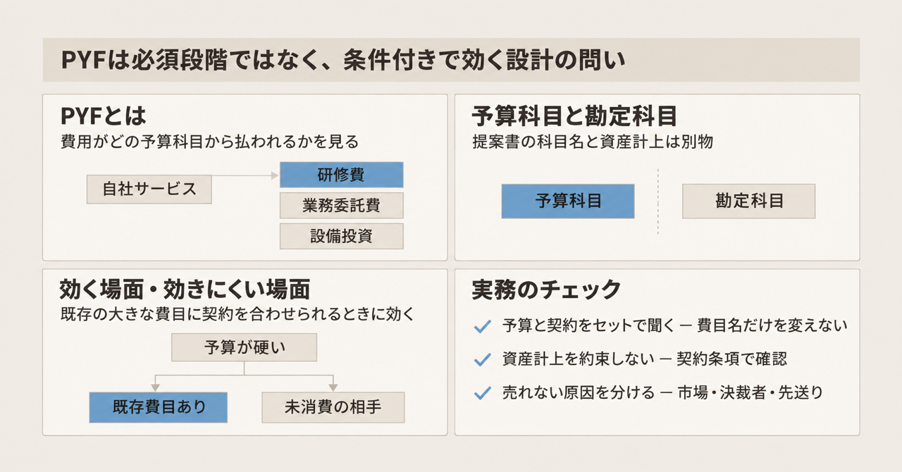
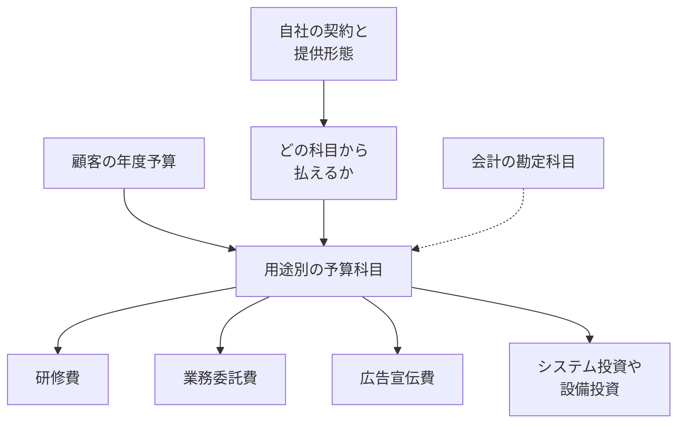

BtoB の新規サービスで「評価は高いのに、なかなか受注にならない」という状況に出会うことがあります。BtoB マーケティング支援を手がける株式会社才流の栗原康太氏は、2026年11月10日のメソッド記事（以下、才流の記事）で、この状況を点検する視点として **PYF（Product Yosan-kamoku Fit：プロダクト予算科目フィット）** を提示しました。

この記事では、まず PYF が何を見る考え方なのかを整理します。そのうえで、読むときに注意したい点、既存の営業・事業開発の枠組みとの違い、会計上の扱い、実務で使うときの判断基準を順に説明します。

想定読者は、新規の BtoB サービスを設計・提案する事業開発やマーケティングの担当者です。

*この記事の全体像。以下、順に解説します。*

## PYF（プロダクト予算科目フィット）とは

### 概要

PYF は、**自社サービスを使う費用が、顧客のどの予算科目から支払われるか**を見る視点です。

ここでいう**予算科目**は、会計の勘定科目ではありません。企業が年度予算などで支出を計画するときの用途別の項目を指します。才流の記事が挙げる例は、研修費、業務委託費、広告宣伝費、システム投資費です。

才流は新規事業の進み方を、顧客と課題のフィット（CPF）、課題と解決策のフィット（PSF）といった段階で整理し、これをフィットジャーニーと呼んでいます。ここでいうフィットは、2つの要素がかみ合っている状態を指します。才流の記事は、これらに加えて予算科目とのフィットが必要だ、と位置づけています。

### 特徴

PYF の要点は次のとおりです。

- **見る対象は支払いの出どころ**です。課題があるか、解決策が良いかではなく、支払いがどの用途別予算から出るかを見ます
- **既存予算の再配分を重視**します。才流の記事は、新規に予算を取るより、既存予算の再配分に乗せた方が稟議の説明がしやすい、と書きます。例として、営業力強化を新規のコンサルティング費で依頼してもらうより、既存の教育研修費から「研修」として発注してもらう、という対比を挙げています
- **費目と提案先を変えた例が3つ**あります

| 事例 | 変えたこと |
| --- | --- |
| 製造業向け SaaS | ソフトウェア利用料から設備投資へ。提案先も情報システム部門から生産技術部門や工場長へ |
| 才流の研究会 | 研修動画を加え、教育研修費から支払えるようにする |
| AI 関連の提案 | 業務改善ではなく、AI 活用プロジェクトとして提案する |

- **「財布ベースの事業開発」という呼び方**を、知人の言葉として紹介しています。顧客の支出を見て、すでに支払っている用途の類似サービスを作り、乗り換えを提案するやり方です。才流の記事は、この進め方では顧客ヒアリングを一切していなかった、と書いています。起点は顧客の声ではなく、実際の支出行動だという位置づけです

才流の記事の対応表は、予算科目とサービス種別を次のように対応させています。

| 予算科目 | 対応するサービスの例 |
| --- | --- |
| IT 予算 | IT コンサルティング、システム開発、SaaS |
| 広告宣伝費 | メディア |
| 教育研修費 | 研修 |
| 採用費 | 人材 |
| 業務委託・外注費 | BPO |
| オフィス関連費 | オフィス |
| 福利厚生費 | 福利厚生代行（例: ベネフィット・ワン） |

新規サービスで確認する項目として、才流の記事は次の5つを挙げています。

1. 顧客は、どの科目にどれだけの予算を計画しているか
2. 自社サービスは、どの科目から支払ってもらえるか
3. 既存予算の再配分か、新規予算の獲得か
4. 価格は、その予算規模に対して妥当か
5. 提供形態を変えると、別の科目から支払えるか

### 概念構造

PYF が区別しているのは、**顧客の年度計画のラベル（予算科目）**と、**財務会計の記録（勘定科目）**です。プロダクト側が変えられるのは、そのラベルに載せる契約と提供の形です。

点線は、才流の記事が「予算科目は勘定科目ではない」と書いている境界です。たとえば「設備投資」という予算名と、貸借対照表に載る資産は、別のものとして扱います。

なお、このフィットジャーニーは、顧客と課題、課題と解決策、解決策とプロダクト、プロダクトと市場、市場投入、成長の6段階で構成されています。PYF をこのどの段階に入れるかは、才流の記事では指定されていません。

## 注意点

PYF の骨格は上記のとおりです。ただし、次の点は才流の記事の文言より強く読まないようにします。

### 効果はすべて定性的な記述

才流の記事は「受注率が上がった」「受注までの時間や確率が変わる」「予算の大きさはそのまま市場の大きさである」と書いています。しかし、前後の受注率、期間、金額、市場規模といった数値は示されていません。

### 事例には検証できない部分がある

- 製造業向け SaaS と AI 活用の事例は匿名です。社名、時期、件数、予算額は書かれておらず、外部からは検証できません
- 製造業向け SaaS の事例について、才流の記事自身が「資産計上できるかは契約形態や会計基準による」と留保しています
- 研究会の事例は才流自身のサービスです。研修動画そのものの付加価値も効いている、と著者は認めています
- AI 活用の事例は、予算科目だけでなく経営の投資優先度も効いている、と著者は限定しています

研究会の公開ページ（2026年11月12日時点）が示す提供物は、調査結果のレポート、クローズドイベント、個別相談です。才流の記事にある「研修動画」と「教育研修費で発注できる」という案内は、このページには見当たりません。ただし、ページに無いことから、動画を加えたこと自体を否定はできません。

### 才流の既存体系にはまだ組み込まれていない

才流の新規事業用語集とフィットジャーニーの説明ページは、2026年11月12日時点で6段階のままで、PYF も予算科目も出てきません。PMF（プロダクトマーケットフィット。製品が市場に適合している状態）の定義ページも、条件に予算科目を含めていません。公開ウェブと才流サイトの確認範囲では、この意味での PYF は2026年11月10日の才流の記事より前に見つかりませんでした。新しく提示された考え方として読むのが適切です。

### 略称が別の用語と重なる

英語の PYF には、給料から先に貯蓄へ回す **Pay Yourself First** という別の用法があります。社内で使うときは、初出で「プロダクト予算科目フィット」と展開しておくと混乱を避けられます。

## 既存の営業・事業開発の枠組みとどう違うか

予算は、既存の枠組みでも扱われてきました。PYF との違いは「予算を何として見るか」にあります。

表に出てくる営業の枠組みを先に説明します。BANT は Budget（予算）、Authority（決裁権）、Need（必要性）、Timeline（導入時期）の頭文字で、商談の見込みを判定する枠組みです。MEDDICC は、決裁者（Economic Buyer）や意思決定の基準などを確認していく営業手法です。Force Management は、MEDDICC の公式トレーニングを提供する会社です。

| 枠組み | 予算を何として見るか | PYF との違い |
| --- | --- | --- |
| 才流の PSF（課題と解決策のフィット） | 解決策に対価を払うか | 支払う意思を見ており、研修費か設備投資かは見ない |
| 才流の SPF（解決策とプロダクトのフィット） | プロダクトとして実現でき、価格とコストが妥当か | 作り手の採算を見ており、買い手の費目名は見ない |
| BANT | 予算がどう特定され、いつ承認されるか | 承認の有無と時期を聞くが、費目は聞かない |
| MEDDICC の Economic Buyer | 最終的な可否を決める人 | 人の権限を見ており、費目は見ない。予算化されていない裁量資金に手が届き得る、と書く |
| Force Management の Economic Buyer | 支出を動かして、その解決のための予算を作れる人 | 再配分に最も近いが、科目の名前を変える操作には触れない |

フィットの考え方そのものと比べると、違いがもう少しはっきりします。

- Marc Andreessen はプロダクトマーケットフィットを「良い市場に、その市場を満たせる製品があること」と定義しました。フィットしていないときは販売サイクルが長く、多くの案件が成約しない、と書いています。PYF は「評価は高いのに受注しない」原因を予算科目のずれに求めるのに対し、Andreessen は同じ症状を市場適合の未達として描いています
- 東京大学 FoundX のスタートアップ・フィットジャーニー（2025年5月にバージョン2公開）も、顧客と課題、課題と解決策、解決策とプロダクト、プロダクトと市場の順で、予算科目の段階はありません。課題と解決策の段階で見るのは「お金を払うか」であり、費目ではありません

つまり PYF は、既存の枠組みが「払う意思」「承認」「決裁者」で止めていた予算の話を、**どの費目の名前で払うか**まで一段具体化したものと位置づけられます。

## 「設備投資として提案する」と資産計上は別の話

製造業向け SaaS の事例は、次の3つを変えたと書かれています。

- 費用処理から設備投資・資産計上へ
- 提案先を情報システム部門から生産技術部門や工場長へ
- 小さいソフトウェア予算から大きい設備投資予算へ

このうち、提案先と社内の予算枠は会計基準の外で変えられます。一方、**資産になるかどうかは別の問題**です。

### 会計基準の扱い

ソフトウェアの会計処理を定める移管指針第8号（企業会計基準委員会）は、次のように定めています。

- **第11項**: 自社利用のソフトウェアは、将来の収益獲得または費用削減が確実と認められるときだけ無形固定資産とする。確実でないか不明なときは費用とする
- **第14項**: 購入ソフトウェアの導入設定と付随する修正は、原則として取得価額に含める
- **第16項**: データ変換とトレーニングの費用は、発生した事業年度の費用とする
- **第17項（研究開発費等に係る会計基準 四3）**: 機械装置などに組み込まれ、機械と一体でなければ機能しないソフトウェアは、独立のソフトウェアではなく機械などの取得原価に含める。工場で SaaS の画面を使うだけでは、これに当たらない

資産にするのは制作費や取得に要した費用であり、稟議書の科目名が「設備投資」であることではありません。また、月額の利用料を資産にするという記述は第11項にありません。

### 税務の扱い

国税庁の No.5461 は、ソフトウェアを減価償却資産とします。耐用年数は、複写して販売するための原本または研究開発用が3年、その他が5年です。会計の「不明なら費用」と、税務の「将来の収益獲得または費用削減にならないことが明らかな場合に限って取得価額から除外」は、条件が異なります。税務では、収益獲得や費用削減にならないことが明らかな場合を除いて資産として扱うため、会計より資産寄りの条件です。このページにも、クラウドの月額利用料という語はありません。会計と税務で判断の条件がずれるため、提案側が「資産になります」と一律に言い切ることはできません。

### リース基準の扱い

リースに当たる契約では、借り手が「使用権資産」を計上します。そのため、契約がリースに当たるかどうかも資産計上の経路の1つになります。リースに当たるのは、特定された資産（特定の機器など）の使用を顧客が支配する契約です。

リース会計の企業会計基準適用指針第33号の第7項は、顧客が使うのが稼働能力の一部分であるときは、その部分を特定された資産にしない、と書いています。ほとんどすべてを使える場合は該当し得ます。つまり、共有基盤の一部を使うだけの契約は、原則としてリースに当たりにくいと読めます。ただし本文に「クラウド」「SaaS」の語は無く、共有型の利用が常にリースにならないと明文化しているわけでもありません。

### 実務上の結論

提案書の費目だけを「設備投資」と書いても、資産計上にはなりません。資産になる経路があるのは、次のように**契約の中身を変えた場合**です。

- 顧客がソフトウェアを取得する契約にする
- 機械に組み込まれたソフトウェアとして、機械の取得原価に含める
- 特定された資産の使用を支配するリース契約にする

才流の記事は契約の中身を公開していないため、この事例がどの経路だったかは判断できません。

## PYF はどんな場面で効くのか

PYF は、新規事業の**必須段階**としてではなく、**条件付きの設計の問い**として使うのが妥当です。

### 効きやすい場面

顧客の年度予算が硬く、すでに大きな費目があり、その費目に契約の実態を合わせられるときです。このときは、費目と提案先を先に決めることに意味があります。

PYF を支える材料は次のとおりです。

- 才流の記事自身が、予算科目と勘定科目を区別し、確認項目を5つに絞っている
- PSF は支払う意思までを見ており、費目名を検証項目にしていない
- BANT も、費目ではなく承認の有無と時期を見ている
- 予算科目と勘定科目を分ける PYF の前提は、呼び方と資産計上を分けている会計基準とも整合する。才流の記事の「契約形態や会計基準による」という留保とも矛盾しない

### 効きにくい場面

一方で、次の場面では PYF の効き目は限られます。

- **決裁者が支出を動かせる場合**: MEDDICC は、Economic Buyer が予算化されていない裁量資金に手が届きやすいと書きます。Force Management も、Economic Buyer を「支出を動かして、その解決のための予算を作れる人」と定義します。既存費目への載せ替えだけが道ではありません
- **顧客がまだその用途に支払っていない場合**: Clayton Christensen Institute の解説（2023年10月5日）は、新しい市場を作るときの競争相手は既存事業者ではなく「非消費」（まだその用途にお金を使っていない状態）であり、障壁は時間、アクセス、技能、お金だと書きます。既存の予算科目に合わせてサービスを設計するやり方は、すでに支払っている相手向けです
- **呼び出せる供給者が限られる場合**: 英国国防省の調達案内は、フレームワーク契約を「買い手と資格のある供給者グループとの契約」と説明します。費目に予算があっても、枠外の供給者は使えません。これは英国の公的調達の例で、日本の民間企業の予算規則ではありません
- **失注理由が予算以外にある場合**: Challenger 社の営業研修の案内は、失注の多くを現状維持や決断回避による「no decision（決まらない）」として扱っています。数値の調査設計は公開されていないため割合は根拠にできませんが、失注理由を予算科目以外に置く見方があることは押さえておきます

なお、「再配分の方が新規予算より稟議を通りやすい」ことを通過率で示した公開データは、その逆を示すものも含めて見つかりませんでした。

## PYF を使うときのチェックリスト

ここまでを踏まえ、PYF を実務で使うときの判断基準をまとめます。

1. **予算と契約の中身をセットで聞く**: 提案の前に、顧客が今期すでに持っている用途別予算と、その予算から支払える契約の中身を一緒に確認する。提案書の費目名だけを変えない
2. **資産計上を約束しない**: ソフトウェアの月額利用を設備投資として資産計上できる、と顧客に約束しない。取得、制作、機械への組み込み、特定された資産のリースのどれに当たるかを、契約条項で確認する。トレーニング費用は、移管指針第8号では発生年度の費用になる
3. **決裁者が支出を動かせるなら、小さい費目に寄せない**: 小さい既存費目に価格を合わせると、単価がその費目の規模に縛られ、その費目に並ぶ既存サービスとの比較にもさらされる（筆者の判断）
4. **まだ支払っていない相手には科目合わせを中心にしない**: 顧客がその用途にまだ支払っていないときは、既存の予算科目に合わせた設計を中心にせず、新規予算の獲得にリードタイムがかかる前提で計画する（新規予算は時間がかかる、という才流の記事の注意に沿う）
5. **「評価は高いのに売れない」の原因を分ける**: 予算科目の不一致に加え、市場適合の未達、決裁者の不在、決断の先送りを切り分ける
6. **略称を展開する**: 社内で PYF と書くときは、初出で「プロダクト予算科目フィット」と展開する

## まとめ

- PYF は、自社サービスの費用が**顧客のどの予算科目から支払われるか**を見る視点で、才流が2026年11月10日に提示しました
- 予算科目は会計の勘定科目とは別物です。提案書で費目名を「設備投資」に変えても、資産計上になるかは契約の中身と会計基準で決まります
- 才流の記事が示す効果は定性的な記述で、事例の一部は匿名です。既存の枠組みと比べると、PYF は予算の話を「どの費目の名前で払うか」まで具体化した考え方といえます
- 顧客の予算が硬く、既存の大きな費目に契約の実態を合わせられる場面では有効です。決裁者が支出を動かせる場合や、顧客がまだその用途に支払っていない場合は、設計の中心に置かない方が安全です

この記事が少しでも参考になった、あるいは改善点などがあれば、ぜひリアクションやコメント、SNSでのシェアをいただけると励みになります！

## 参考リンク

- [栗原康太「PYF（Product Yosan-kamoku Fit：プロダクト予算科目フィット）という考え方」株式会社才流](https://sairu.co.jp/method/110306/)
- [才流 CPF（Customer Problem Fit）](https://sairu.co.jp/method/13726/)
- [才流 PSF（Problem Solution Fit）](https://sairu.co.jp/method/13741/)
- [才流 SPF（Solution Product Fit）](https://sairu.co.jp/method/13756/)
- [才流 PMF（Product Market Fit）](https://sairu.co.jp/method/14348/)
- [才流 フィットジャーニー](https://sairu.co.jp/method/11752/)
- [才流 新規事業用語集](https://sairu.co.jp/method/89481/)
- [才流 研究会](https://sairu.co.jp/service/research/)
- [東京大学 FoundX スタートアップ・フィットジャーニー](https://foundx.jp/review/startup-fit-journey)
- [Marc Andreessen, The only thing that matters](https://pmarchive.com/guide_to_startups_part4.html)
- [IBM, BANT Criteria Template v3.3](https://public.dhe.ibm.com/software/pdf/tr/SAMPLE-BANT_for_XYZ_Company_1JF-XXXXXX.pdf)
- [MEDDICC, Economic Buyer](https://meddicc.com/what-is-meddpicc/economic-buyer)
- [MEDDICC, MEDDPICC Sales Methodology and Process](https://meddicc.com/meddpicc-sales-methodology-and-process)
- [Force Management, How MEDDICC helps win with decision makers](https://www.forcemanagement.com/blog/how-meddicc-helps-win-with-decision-makers)
- [企業会計基準委員会 移管指針第8号](https://www.asb-j.jp/jp/wp-content/uploads/sites/4/kichu_20251016_35.pdf)
- [企業会計基準委員会 企業会計基準適用指針第33号](https://www.asb-j.jp/jp/wp-content/uploads/sites/4/ecl20261016_23.pdf)
- [国税庁 No.5461 ソフトウェアの取得価額と耐用年数](https://www.nta.go.jp/taxes/shiraberu/taxanswer/hojin/5461.htm)
- [Clayton Christensen Institute, Thursday Theory Tips – On Creating New Markets](https://www.christenseninstitute.org/blog/thursday-theory-tips-on-creating-new-markets/)
- [GOV.UK, Procurement at MOD](https://www.gov.uk/government/organisations/ministry-of-defence/about/procurement)
- [Challenger, Overcome Customer Indecision: JOLT Effect Workshop](https://go.challengerinc.com/overcome-customer-indecision-challenger-jolt-effect-workshop)
