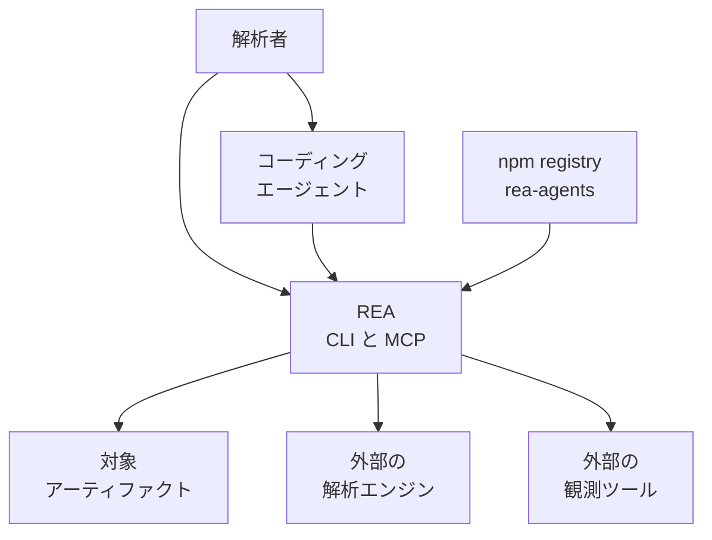
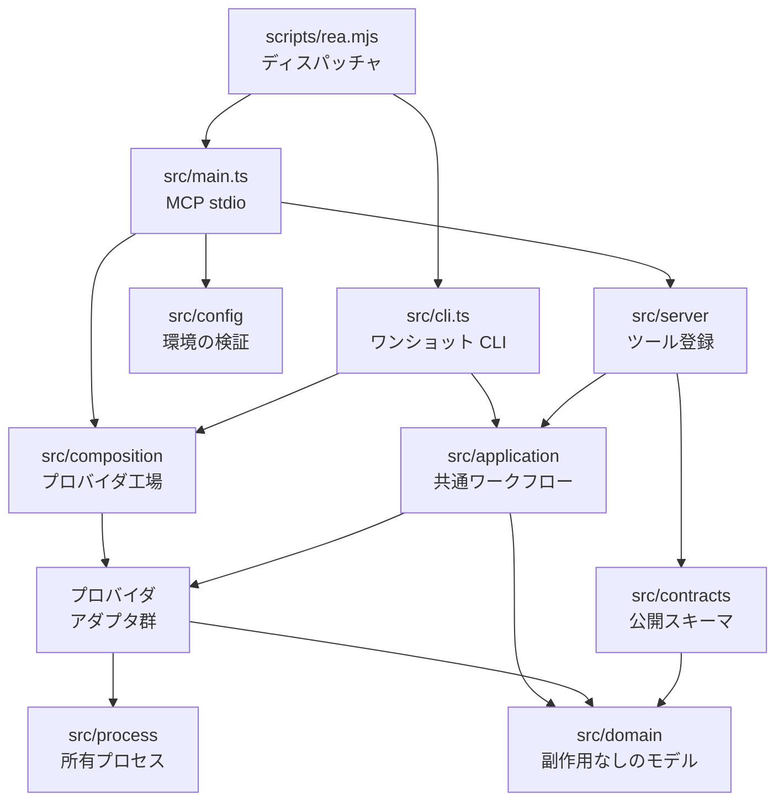
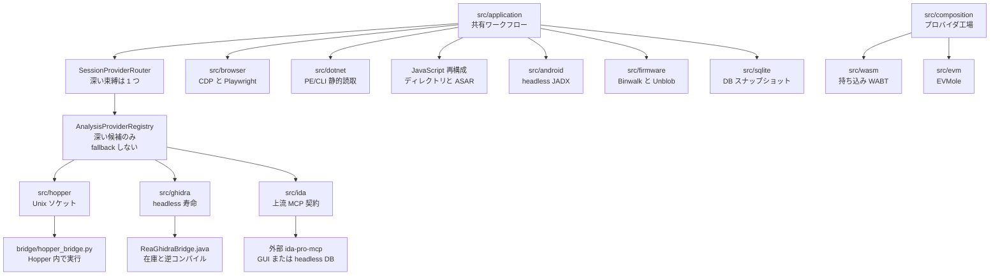
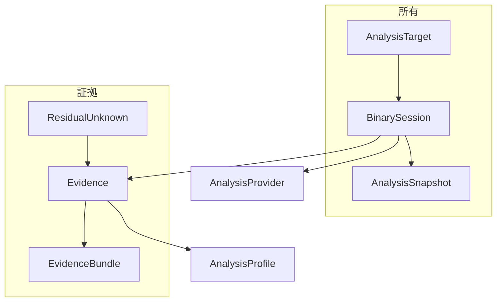
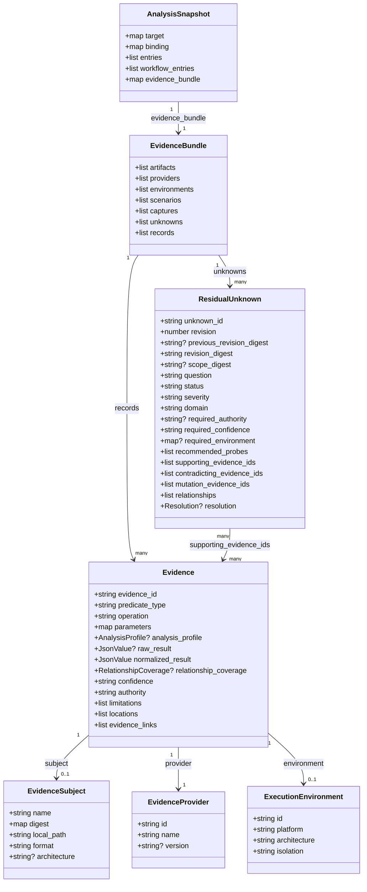

ソースコードが手元にないソフトウェアの振る舞いを、コーディングエージェントにも端末にも同じ手順で調べさせたい場面があります。REA（[morluto/rea](https://github.com/morluto/rea)、npm パッケージ `rea-agents`）は、そのための 1 つの MCP サーバと 1 つの CLI を提供するローカル解析基盤です。

この記事では、REA の全体像、内部構造、証拠データのモデル、導入から運用までを、2026-10-18 時点の `rea-agents@6.5.0` に基づいて整理します。読み終えると、REA を自分のエージェントに登録し、ネイティブバイナリや Electron アプリを解析させ、その結果を証拠として残すまでの流れがわかります。


*この記事の全体像。以下、順に解説します。*

## 概要

REA は、ソースが手元にないソフトウェアの振る舞いを、エージェントと端末の両方から調べるためのローカル解析基盤です。README の見出し文は "One MCP for reverse engineering across binaries, applications, and runtime behavior." です。パッケージ説明は "Reverse engineer anything from your terminal or agent with one CLI and MCP server." です。

- エージェントは MCP の stdio サーバを呼び、同じワークフローを CLI からも実行できます。
- 解析対象のバイトは、利用者が持つファイルや利用者が起動した観測先に留まります。
- モデル提供者への送信方針は、接続したエージェント側の契約に従います。


### 名前と配布の対応

配布の名前は三層に分かれます。

| 層 | 名前 |
|---|---|
| GitHub リポジトリ | `morluto/rea` |
| npm パッケージ | `rea-agents` |
| 実行ファイル | `rea` と `rea-agents`（実体はどちらも `scripts/rea.mjs`） |
| MCP レジストリのサーバ名 | `io.github.morluto/rea`（起動引数は `mcp`） |
| 製品サイト | [rea.tools](https://rea.tools/) |

リポジトリは 2026-04-14 に作成され、ライセンスは MIT、主言語は TypeScript です。2026-10-18 時点で GitHub の star は約 30 万です。公開パッケージは npm の `dist-tags.latest` である `rea-agents@6.5.0` と、GitHub Release [rea-agents-6.5.0](https://github.com/morluto/rea/releases/tag/rea-agents-6.5.0)（2026-10-14 公開）です。Node.js の engines は `^22.19.0 || ^24.11.0 || >=26.0.0` です。

### 何を自前で持ち、何を持ち込むか

ネイティブの深い逆アセンブルは、利用者が用意した Hopper、Ghidra、IDA のいずれかに束縛します。JavaScript / Electron の静的解析と .NET の PE/CLI メタデータ読み取りは、そのエンジンなしでファイルを読むだけで完結します。商用デコンパイラのライセンスは REA の MIT 条項の外にあり、REA は Hopper、IDA、JEB のライセンスやアクティベーションを付与しません。

| 要素名 | 説明 |
|---|---|
| REA | 証拠付きの観測を CLI と MCP で返すローカルのオーケストレータ |
| コーディングエージェント | MCP クライアント。Claude Code、Codex、Cursor、Gemini CLI、Grok Build ほか |
| 外部解析エンジン | Hopper、Ghidra、IDA、呼び出し元が起動した JEB MCP など |
| 対象アーティファクト | バイナリ、ASAR、アセンブリ、APK、キャプチャ、ローカル DB など |

### 類似手段との位置づけ

比較は「誰が操作し、何を返すか」に限っています。

| 手段 | 実行の主体 | 主な出力 | 対象の広さ |
|---|---|---|---|
| Ghidra 単体 | 解析者が GUI または headless を操作する | プロジェクト内の逆コンパイルと参照 | ネイティブ中心 |
| Hopper 単体 | 解析者が GUI を操作する | 疑似コード、アセンブリ、参照 | ネイティブ中心。商用ライセンス |
| IDA 単体 | 解析者が GUI または IDA 側 MCP を操作する | データベース上の解析結果 | ネイティブ中心。商用ライセンス |
| rizin 単体 | 解析者がコマンドを打つ | 静的コマンドとデバッガセッション | ネイティブ中心 |
| REA | エージェントまたは `rea` CLI が同じワークフローを呼ぶ | 証拠 ID、制限、未解決の問いを含む結果 | ネイティブに加え JS、.NET、Web、Android、ファームウェア、キャプチャなど |

### 場面ごとの入り口

| 場面 | 向く入り口 |
|---|---|
| アプリの機能をソースなしで説明し、自プロジェクト向けの実装案までエージェントに書かせる | `npx rea-agents setup` のあと、エージェントへ質問する |
| 抽出済みの Electron / JS を一度だけ機械可読にする | `analyze-javascript-application` |
| 既存の Ghidra で関数を疑似コードにする | `rea decompile` に `--provider ghidra` |
| 技能ファイルだけ先に置き、MCP 登録は後で見る | `npx skills add morluto/rea --skill reverse-engineer-anything` |

## 特徴

- 1 つの MCP サーバと 1 つの CLI が、バイナリ、アプリケーション、実行時観測を横断します。
- 結果は観測、導出、推論を区別し、制限と未解決の問いを残します。
- ネイティブの深掘りは、対象をサポートするプロバイダが 1 つだけのとき自動選択し、複数あるときは明示選択にします。失敗理由は置き換えずに返します。
- JavaScript / Electron はモジュール、import、source map、ルート、IPC、ネイティブアドオンの関係を返します。
- .NET は PE/CLI のメタデータと CIL を、アセンブリをロードせずに読みます。単一ファイルホストの展開と IL2CPP のデコードは対象外で、NativeAOT のメソッド本体はネイティブ解析へ回します。
- Web は Chrome 系の CDP、HAR / Fiddler SAZ、Linux では mitmdump を使えます。
- Android は headless JADX と JDK、呼び出し元の adb、Apktool、Flutter の静的 APK 解析、呼び出し元が起動した JEB MCP を別レーンに分けています。
- ファームウェアは Linux 上の Binwalk / Unblob、パケットは TShark 4.x、信号は sigrok-cli 0.7.2 など、呼び出し元が入れるツールに依存します。
- Go と Rust の埋め込みメタデータ、WASM（WABT 1.0.42）、EVM バイトコード（EVMole）、SQLite スナップショットは、ディスアセンブラなしの専用コマンドがあります。
- スナップショットは、対象バイト、操作、パラメータ、プロバイダ、設定が一致する成功結果を再利用します。証拠バンドルは import、export、compare できます。
- セットアップは既存設定をバックアップし、対応エージェントへ MCP とワークフロー指示を登録します。
- 2026-10-18 時点の `src/cliCommandNames.ts` では、一次 CLI コマンドが 153 個、別名 `compare-bundles` が 1 個です。MCP 専用で CLI コマンドを持たない操作（`open_binary`、`list_unknowns` など）が別にあります。
- 既定の端末表現は TOON です。JSON 消費者は `--json` を付けます。

README「What you can analyze」のうち、前提ツールとホストの制約が大きい対象を補足します。

| 対象 | 返すもの | 必須ツールとホスト |
|---|---|---|
| Offline ELF | セクション、セグメント、元のシンボルと再配置、静的な緩和候補 | 呼び出し元の pwntools。Linux x64 |
| 記録済み Linux クラッシュ | 生ノート、記録された全スレッドのレジスタとシグナル、任意のマッピング候補 | 呼び出し元の pwntools。任意で GDB / pwndbg。Linux x64 |
| 記録パケット | 選択フィールド、繰り返し値、フィルタ、decode-as | Linux の TShark 4.x と prlimit |
| パケット要約 | エンドポイント、DNS、TLS SNI、プロトコル分布、HTTP リクエスト | 呼び出し元の tshark と capinfos |
| 記録信号 | デコーダ注釈、サンプル範囲、診断 | Linux の sigrok-cli 0.7.2 と prlimit |
| プロセス挙動 | 端末出力、対話、終了、ファイルシステム観測、実行比較 | Linux または macOS のネイティブ PTY |
| EVM バイトコード | ディスパッチセレクタ、バイトオフセット、推定引数、可変性 | Linux x64 の raw / hex。EVMole |
| Android APK | マニフェスト宣言、クラス、逆コンパイルしたメソッド、参照 | headless JADX と完全な JDK。Linux / macOS / Windows の x64 |

オフラインのネイティブ検査として、GNU objdump と Rizin も案内されています。どちらも呼び出し元が用意し、REA は導入も更新もしません。README の事例には、DX-Ball のパン計算を 3205 件の x86 ケースと 63 バイトの関数で照合した再構成、Notion のクリップボード橋、TH04 の 16-bit 弾幕計算があります。

## 構造

### システムコンテキスト図

REA は、解析者とエージェントの間に立ち、対象アーティファクトと外部のエンジン・観測ツールをつなぎます。



| 要素名 | 説明 |
|---|---|
| 解析者 | セットアップを承認し、商用ツールのライセンスを満たし、対象を調べる権限を持つ人 |
| コーディングエージェント | ローカル MCP のクライアント。質問、追質問、実装とテストを担当する |
| REA | `scripts/rea.mjs` が `mcp` とワンショットコマンドを振り分けるプロセス |
| 対象アーティファクト | 解析者がパスで渡すファイル、ディレクトリ、または接続先 |
| 外部の解析エンジン | Hopper、Ghidra、IDA、JEB など、解析そのものを実行する既存ソフトウェア |
| 外部の観測ツール | ブラウザ、adb、tshark、WABT、JADX など、レーンごとの持ち込みツール |
| npm registry | `npx` と `rea update` が読む公開パッケージ |

### コンテナ図

公式の [docs/architecture.mermaid](https://github.com/morluto/rea/blob/main/docs/architecture.mermaid) を、入口、合成、アプリケーション、契約、ドメイン、プロセス基盤に読み替えた図です。CLI と MCP は入口だけが異なり、`src/application` のワークフローを共有します。



| 要素名 | 説明 |
|---|---|
| scripts/rea.mjs | `mcp` とワンショットを振り分ける実行ファイル |
| src/cli.ts | セットアップ、診断、解析、逆コンパイルの CLI アダプタ |
| src/main.ts | MCP stdio サーバ。設定、セッション、プロセス寿命を持つ |
| src/config | Zod で環境変数を検証する |
| src/server | `createServer`、ツール登録、`toolResult` |
| src/composition | 型付きのプロバイダ工場とセッション工場。WASM と EVM の記述子も含む |
| src/application | CLI と MCP が共有するワークフロー。調査記録と証拠台帳を組む |
| src/contracts | 解析、逆コンパイル、ブラウザ、セッションなどの呼び出し側スキーマ |
| src/domain | 証拠、比較、アプリグラフなどの純関数モジュール |
| src/process | 所有プロセスグループ、私有ルート、期限、後始末 |
| プロバイダアダプタ群 | Hopper、Ghidra、IDA、ブラウザ、dotnet、ファームウェアなどの実装 |

### コンポーネント図

プロバイダ層のドリルダウンです。名前は `docs/architecture.mermaid` と `src/` のディレクトリに対応します。



| 要素名 | 説明 |
|---|---|
| SessionProviderRouter | 1 対象につき不変の深い束縛を 1 つ持つ。補助経路は分離する |
| AnalysisProviderRegistry | 深い候補をソートして決定的に選ぶ。fallback しない |
| src/hopper | Hopper の起動と Unix ソケット。ブリッジは Hopper プロセス内の Python |
| src/ghidra | 発見、プロファイル、関数解析、スナップショット、Unix と Windows の輸送 |
| src/ida | 上流の IDA MCP 契約へ合わせる。GUI 束縛または所有する headless データベース |
| src/browser | CDP / Playwright。実行観測はカバレッジ、リスナー、ソース帰属 |
| src/dotnet | マネージド静的メタデータ。メンバーと IL |
| JavaScript 再構成 | ディレクトリと ASAR を読み、AST だけでバンドルを投影する |
| src/android | 所有する stdio とピンした headless JADX |
| src/firmware | Binwalk / Unblob の所有プロセスと私有な展開 |
| src/wasm | 呼び出し元の WABT。不変アーティファクトの検査 |
| src/evm | 境界付きワーカー内の EVMole。インターフェース推定 |
| src/sqlite | ローカル DB と WAL のスナップショット |

設計の要点は、深いネイティブ解析と補助経路を分けていることです。

- `docs/architecture.mermaid` が Registry に描く深いノードは Hopper、Ghidra、IDA です。6.5.0 の `src/composition/binary.ts` の本番登録もこの 3 つです。その後の `main` では Kuna が加わり 4 つになっています。
- ソートした深い候補から決定的に 1 つを選び、失敗しても別のエンジンへ fallback しません。objdump、Rizin、pwntools、JADX も自動代替にはなりません。
- browser、dotnet、firmware、android、JavaScript 再構成は `src/application` から出る補助経路です。wasm は composition から出ます。evm は composition に加え、application の EVM interface port もあります。
- 2026-10-18 時点の `main` の `src/` にはほかにも `frida`、`gdb`、`rizin`、`objdump`、`jeb`、`kuna`、`cutter`、`adb`、`apktool`、`flutter`、`go`、`rust`、`pcap`、`signals`、`inspector` があります。

## データ

### 概念モデル

REA の結果は、所有するセッションと、そこから生まれる証拠の 2 つの塊で構成されます。



| 要素名 | 説明 |
|---|---|
| AnalysisTarget | パス、SHA-256、フォーマット、アーキテクチャで識別する対象 |
| BinarySession | MCP の `binary_session`。`open`、`cleanup_pending`、`tool_availability`、`analysis_provider_candidates`、`analysis_provider_binding`、`analysis_run.run_id`、`process_lineage` を返す。選択済み束縛は入れ替えできない |
| AnalysisProvider | `id`、`name`、nullable な `version` |
| AnalysisSnapshot | ファイル上のフィールドは `target`、`binding`、`entries`、`workflow_entries`、`evidence_bundle`。所有者だけが読める権限 |
| AnalysisProfile | 観測を生んだプロファイル。証拠の provider と一致しないと拒否する |
| Evidence | 1 回の成功した公開観測。`ev_` で始まる意味 ID を持つ |
| EvidenceBundle | `artifacts`、`providers`、`environments`、`scenarios`、`captures`、`unknowns`、`records` を持つ可搬な記録 |
| ResidualUnknown | 未解決または証拠で限定した問い。`unk_` で始まる ID を持つ |

### 情報モデル

フィールド名は [src/domain/evidence.ts](https://github.com/morluto/rea/blob/main/src/domain/evidence.ts) と [src/domain/residualUnknown.ts](https://github.com/morluto/rea/blob/main/src/domain/residualUnknown.ts) の Zod オブジェクトに合わせています。



主要フィールドの取り得る値は次のとおりです。

| 要素名 | 説明 |
|---|---|
| evidence_id | 意味内容の正規ダイジェスト。接頭辞は `ev_`。表示用の `name` と `local_path` はハッシュ対象から外れる |
| 型の `?` | nullable を表す。`JsonValue` はオブジェクトに限らず、配列、文字列、数値、真偽値、`null` も取り得る |
| confidence | `observed`、`derived`、`inferred` |
| authority | `shipped-artifact`、`controlled-replay`、`historical-reference`、`external-service`、`analyst-inference` |
| locations | `address`、`address-range`、`artifact-path`、`file-offset`、`file-offset-range` |
| subject.digest.sha256 | 対象バイトの SHA-256。`EvidenceSubject` 直下ではなく `digest.sha256` にある |
| format | `subjectFormatSchema` は 28 値。`raw-binary` だけアーキテクチャの許容が広い |
| isolation | `none`、`process`、`container`、`virtual-machine` |
| unknown_id | 接頭辞 `unk_` |
| status | `open`、`investigating`、`blocked`、`contradicted`、`resolved`。`resolved` は resolution が非 null、`contradicted` は反証の証拠が必要 |
| severity | `low`、`medium`、`high`、`critical` |
| resolution.disposition | `verified` は証拠 ID が 1 件以上。`withdrawn` と `out-of-scope` は空でもよい |
| relationships.type | `depends-on`、`related-to`、`contradicts` |
| AnalysisSnapshot.target | `sha256`、`kind`、`format`、`architecture`。`kind` は `executable`、`database`、`archive`、`artifact`。`entry_point` は `raw-binary` のときだけ |
| AnalysisSnapshot.binding | `provider` と `analysis_profile`。両者の provider 識別が一致しないと拒否する |
| entries | `query_id`（接頭辞 `query_`）、`operation`、`parameters`、`execution` |

スナップショットまわりの補足です。

- MCP のスナップショット保存レシートは `primitive_entries`、`workflow_entries`、`evidence_records` を分けて報告します。ファイルスキーマの配列名は `entries` と `evidence_bundle` です。
- プリミティブ束縛が 0 でも、ワークフロー結果と証拠は残り得ます。スナップショットはプロバイダのデータベースそのものではありません。
- `binary_session.cleanup_pending` は、後始末が成功していないことを示し、`open: false` と同時に true になり得ます。
- 選択済みプロバイダは、実行時失敗のあとも自動では置き換わりません。

## 構築方法

### 前提ランタイム

- Node.js は 22.19 以上の 22 系、24.11 以上の 24 系、または 26 以上です。
- Linux で Ghidra、JADX、ファームウェアツール、静的 JavaScript / Electron を使う前に、procps 互換の `ps` を REA の `PATH` に置きます。無い場合、子プロセスを起動する前に `capability_unavailable`、`provider_unavailable`、`execution_failure` のいずれかで拒否されます。
- ネイティブ深掘りには Hopper、Ghidra、IDA のいずれかが必要です。JEB は REA がインストールも起動もせず、呼び出し元が MCP を開きます。

```bash
node -v
npm view rea-agents dist-tags.latest
```

### npm からの導入

グローバル導入は `rea` コマンドを繰り返し使うときに向きます。ワンショットなら `npx` で足ります。

```bash
npm install --global rea-agents
rea --help
```

```bash
npx -y rea-agents@latest analyze-javascript-application /absolute/path/to/app --json
```

Bun でグローバル導入した場合、`rea update` は Bun 1.2.17 以上を要求します。古い Bun は先に手動で上げます。

### エージェントへの登録

`setup` は対応クライアントを複数選択し、変更案を見せてから書き込みます。既存設定はバックアップされます。登録後はエージェントを再起動します。

```bash
npx rea-agents setup
```

MCP サーバとして手動登録する場合の起動コマンドは次です。[server.json](https://github.com/morluto/rea/blob/main/server.json) の `transport.type` は `stdio`、`packageArguments` は `mcp` です。

```bash
npx -y rea-agents@latest mcp
```

技能ファイルだけ置く経路もあります。この経路は MCP 登録と解析エンジンを入れません。

```bash
npx skills add morluto/rea --skill reverse-engineer-anything
```

`setup` の `--client` 値には、`claude_code`、`claude_desktop`、`codex`、`cursor`、`gemini_cli`、`windsurf`、`devin`、`opencode`、`antigravity`、`copilot_cli`、`commandcode`、`qwen_code`、`kimi`、`vscode`、`grok_build`、`omp`、`pi`、`hermes`、`qoder`、`droid`、`trae`、`workbuddy`、`zcode`、`dsh` があります。`droid`、`dsh`、`kimi`、`qoder`、`trae`、`workbuddy`、`zcode` は 6.5.0 以降です。Codex と Grok Build の登録には `startup_timeout_sec = 30` が入ります。

### ネイティブエンジン

- Hopper の自動インストーラは macOS 12+、Ubuntu 24.04+、Fedora 41+、Nobara 44+、64-bit Arch、CachyOS、Omarchy を案内しています。それ以外の Linux では、既存ランチャを `HOPPER_LAUNCHER_PATH` で指します。
- 大きなバイナリでは `REA_GHIDRA_STARTUP_TIMEOUT_MS` または `REA_HOPPER_STARTUP_TIMEOUT_MS` を上げます。既定は Ghidra が 330000 ミリ秒、Hopper が 120000 ミリ秒です。
- Ghidra のインストール位置は絶対パスの `GHIDRA_INSTALL_DIR`、Java は絶対パスの `JAVA_HOME` で指定します。`REA_GHIDRA_COMPILER_SPEC_ID` を置くときだけ `REA_GHIDRA_LANGUAGE_ID` も必要です。

## 利用方法

### 入出力と必須のパス

6.0.0（2026-10-08）以降、MCP のファイルシステム入力は絶対パスです。対象、スナップショット、証拠バンドル、ブラウザと Electron の起動パスなどが含まれます。CLI では相対パスを引き続き使えます。

| 面 | パス | 起動 |
|---|---|---|
| MCP | 絶対パス。例は `/home/analyst/app` または `C:\analysis\app` | 引数 `mcp` の stdio |
| CLI | 相対パスも可。例は `rea inspect-artifact ./app.asar` | `rea` または `npx -y rea-agents@latest` |
| プロバイダ | 複数候補では `--provider` または `provider_id` | 既定は環境変数 `REA_ANALYSIS_PROVIDER=auto` |

既定の端末形式は TOON です。`--json` は端末ではインデントし、パイプとリダイレクトではコンパクトに出ます。

### JavaScript と .NET

静的 JavaScript はディレクトリまたは ASAR を読み、アプリケーショングラフと証拠を返します。`--provider` も `--snapshot` も無い `rea analyze PATH` は、ディレクトリと `.asar` ならこのレーンを選びます。完全な証拠は実アプリで数百 MB になり得ます。[CLI ガイド](https://github.com/morluto/rea/blob/main/docs/cli.md)は、Obsidian の 334 MB の証拠から約 10 KB の summary view を作る例を挙げています。

```bash
rea analyze-javascript-application /absolute/path/to/app --json > app-evidence.json
jq -c '{source: {kind: "inline", evidence: .}, view: {kind: "summary"}}' app-evidence.json > app-view.json
rea inspect-analysis-view app-view.json
```

.NET は拡張子ではなく中身で判定します。

```bash
rea inspect-managed-artifact /absolute/path/Assembly.dll --json
rea inspect-managed-members /absolute/path/Assembly.dll --type Example.Parser --json
```

`--type` を省くと全メンバーを見ます。メンバー参照の在庫はアセンブリ全体のままなので、型を絞っても出力は大きくなり得ます。

### ネイティブセッション

Go と Rust の埋め込みメタデータは、ディスアセンブラなしで読めます。Rust に `.dep-v0` が無いことは、依存が無いことの証明ではありません。

```bash
rea inspect-go-binary /absolute/path/to/program --json
rea inspect-rust-binary /absolute/path/to/program --json
```

Ghidra を明示する基本操作は次です。関数名とアドレスは対象に合わせて置き換えます。

```bash
rea providers --json
rea analyze /absolute/path/to/program --provider ghidra --json
rea function /absolute/path/to/program main --provider ghidra --json
rea decompile /absolute/path/to/program 0x1000 --provider ghidra --json
rea xrefs /absolute/path/to/program 0x1000 --provider ghidra --json
```

`analyze` と `inspect` はネイティブの概観を共有します。`function` は関数ドーシエ、`decompile` は疑似コード、命令だけなら `rea instructions` です。macOS の `.app` バンドルは直接渡せます。

MCP でバイナリを開くときのプロバイダ指定は次の形です。

```json
{
  "path": "/absolute/path/to/program",
  "provider_id": "hopper"
}
```

自動選択は、対象をサポートする利用可能なプロバイダが 1 つのときだけ働きます。

- 複数候補のときは選択エラーになり、`details.candidate_ids` から選びます。CLI ガイドはこれを `ambiguous` と書き、インストール文書は `capability_unavailable` の `details.selection_reason` が `ambiguous` になると書いています。
- `provider_unavailable` では `message`、`remediation.action`、`details.rejections` を見ます。
- Hopper、Ghidra、IDA、JADX は `rea doctor --provider ID --json` の対象です。`pwntools-elf` のようなアダプタは doctor には載らず、設定要件を直接返します。

### 証拠とスナップショット

スナップショットは同一条件の成功結果を再利用します。変更操作とカーソル依存の呼び出しはキャッシュから外れます。メタデータ書き込みを送ると、応答が失敗しても当該セッションのキャッシュは無効になります。

```bash
rea analyze /absolute/path/to/program --provider ghidra --snapshot /absolute/path/to/analysis/program.json
```

証拠バンドルの検証、正規形の書き出し、比較は次です。export は `--overwrite` を付けない限り既存の出力先を上書きしません。

```bash
rea evidence-import /absolute/path/to/evidence/bundle.json
rea evidence-export /absolute/path/to/evidence/bundle.json /absolute/path/to/evidence/canonical.json
rea compare /absolute/path/to/evidence/left.json /absolute/path/to/evidence/right.json
```

履歴ソースの取り込みは、Linux と macOS の no-follow open を要求します。ネイティブ Windows は `unsupported_host` を返します。

```bash
rea import-reference-source /absolute/path/to/source --detail summary --outline-depth 2 --json
```

### Web と JEB と SQLite

Web の実行観測は、既存のループバック CDP と `list_browser_targets` のターゲット ID を渡します。REA はページをナビゲートせず、クリックせず、選択したアプリケーションコードを評価せず、ページを閉じません。精密カバレッジの開始はカウンタをリセットし、停止まで最適化実行を止めます。

```bash
rea observe-web-execution http://127.0.0.1:9222 TARGET_ID --observation-ms 10000 --json
```

SQLite はネイティブプロバイダなしで読めます。Node.js 24.15 以上の 24 系、または 26 以上が必要です。

```bash
rea inspect-sqlite-database /absolute/path/to/app.db --table notes --row-limit 20 --json
```

JEB の既定エンドポイントは `http://127.0.0.1:8425/mcp` です。

- 上書きは `REA_JEB_MCP_URL` で、ホストは `127.0.0.1` または `[::1]` の絶対 http(s) URL に限ります。
- リダイレクト、遠隔ホスト、認証情報、クエリ、フラグメントは拒否されます。
- 1 呼び出しの既定期限は 60 秒で、`REA_JEB_MCP_TIMEOUT_MS` で変更します。カタログ発見の 60 秒とは別予算です。

```bash
rea inspect-jeb-client --json
```

## 運用

### 準備状態の確認

`rea doctor` はホスト前提とエージェント設定を読むだけで、変更しません。オプションなしの全体 `healthy` は、任意エンジンの不在も含めて判定します。スコープを付けると、その `scope_checks` が `healthy` と終了ステータスを決め、他は `informational_checks` に残ります。

```bash
rea doctor --json
rea doctor --provider ghidra --json
rea doctor --client grok_build --json
rea doctor --skill --json
```

MCP の完全なカタログは `tools/list` で確認します。対象を開く前でも `binary_session` に `{}` を渡すと、現在のセッション状態での操作可否が `result.tool_availability` に出ます。入力値の妥当性までは保証しません。

本番 MCP の起動確認は、子プロセスのログを `diagnostics` に残します。stderr は先頭 64 KiB を保持し、`stderr_bytes` と `stderr_truncated` を分けて返します。

```bash
rea mcp doctor --json
```

`binary_session.process_lineage` は、動的プロバイダの起動前は `not_observed`、起動後は `snapshots` です。各観測は `observed_at` を持ち、`verified` は launcher PID、parent PID、process group、descendants を表します。これは履歴であり、短命な子プロセスが無かったことの証明ではありません。

### 更新

`rea update` は、実行中 CLI を所有する npm prefix または Bun のグローバルディレクトリだけを更新し、新しい実行ファイルのバージョンを確認してから成功を報告します。ソースチェックアウトと `npx` のコピーは、それぞれの仕組みで更新します。更新はオンボーディングを再開しないので、setup を承認し直してエージェントを再起動します。

```bash
rea update
npx rea-agents@latest setup
```

### アンインストール

`rea uninstall` は REA が所有するエージェント登録と技能ファイルだけを外します。Hopper、Node.js、証拠ファイル、キャプチャ、無関係な技能、他の MCP サーバは残ります。`--purge-data` は `~/.rea` 配下のキャッシュと状態も外します。シンボリックリンクは辿らず、残して報告します。

```bash
rea uninstall
rea uninstall --purge-data
```

### プロバイダの期限

| 対象 | 既定 | 範囲 |
|---|---|---|
| Ghidra | 330000 ミリ秒 | インポート、解析、ブリッジ、準備の絶対期限 |
| Hopper | 120000 ミリ秒 | 起動、解析、ブリッジ、準備 |
| Darwin の `swiftc` | 120000 ミリ秒 | 所有ヘルパーのビルド |

値は先頭ゼロのない正の十進整数で、上限は Node のタイマ上限の 2147483647 ミリ秒です。

```bash
export REA_GHIDRA_STARTUP_TIMEOUT_MS=600000
export REA_HOPPER_STARTUP_TIMEOUT_MS=180000
rea doctor --provider ghidra --json
```

クライアントのタイムアウトで待ちが終わっても、プロバイダ側の解析は続くことがあります。`cleanup_incomplete` は、停止または削除を確認できなかった資源を示します。ワンショットの解析失敗のあと close も失敗すると、`details.cleanup_error` が後段の close 失敗を表します。

### ログと終了ステータス

`REA_LOG_LEVEL` の既定は `info` です。取り得る値は `trace`、`debug`、`info`、`warn`、`error`、`fatal`、`silent` です。

| ステータス | 意味 |
|---|---|
| 0 | 操作は完了した。部分的な証拠、警告、未解決の問いを含み得る |
| 1 | 操作は完了できなかった。不正入力、権限、キャンセル、タイムアウトなどを構造化出力が示すことがある |
| 128+N | シグナル由来。SIGINT は 130、SIGTERM は 143 になり得る |
| 141 | パイプの読み手が早く閉じたときの SIGPIPE。操作自体は完了していることがある |
| setup の 0 | `--dry-run` の `planned` と、キャンセルした setup。`needs_confirmation` と `needs_human` は 1 |
| doctor の 1 | 選んだ準備スコープの必須チェックが失敗 |

`inspect-artifact` は構造化の cancelled を返しても、終了コードは 1 です。パイプの後段にフォーマッタを置くときは `pipefail` を有効にします。

```bash
set -o pipefail
rea inspect-artifact ./app.asar --json | jq . > inspection.json
```

### リリース境界

永続的な MCP 登録は、setup を実行した版にピンされます。新しい技能ファイルを入れても、動いているサーバと登録は自動では更新されません。使える機能は、接続中サーバの tool list と公開入力スキーマで判断します。開発チェックアウトの version 文字列が npm の tarball と一致するとは限りません。

## ベストプラクティス

### 絶対パスを MCP に渡す

- エージェントが `open_binary` に `./app` を渡す呼び出しは、絶対パスへ直します。
- CLI で相対パスが通っても、MCP の入力には流用しません。
- スナップショットパスと証拠パスも同じ絶対パス契約に含めます。

### 大きい結果はファイルに残してからビューを切る

- JavaScript の完全証拠は、エージェントのコンテキストへ直接流し込みません。
- summary、module page、1 モジュールのビューを保存済み証拠から作ります。
- `--json` のコンパクト出力をファイルに残し、人が読むときだけ `jq` で整形します。

### プロバイダは 1 つに固定してから深掘りする

- `rea providers --json` と `rea capabilities --json` で、候補を先に確認します。
- 複数候補では `REA_ANALYSIS_PROVIDER` か `--provider` を固定します。明示フラグが環境変数より優先されます。
- 失敗したプロバイダから自動で切り替わらない前提で、`details.rejections` を読みます。

### 証拠と未解決の問いをセットで残す

- 再構成の主張は、証拠 ID と `ResidualUnknown` の status に結び付けます。
- `resolved` には resolution が必要です。反証がある問いは `contradicted` と contradicting evidence で残します。
- 履歴ソースの summary は表示用です。ソース対バンドルの比較には full 出力を残します。

### 静的読取と実行時観測を分ける

- 静的な JavaScript と .NET は、対象プロセスを起動しません。
- ブラウザシナリオ、Electron シナリオ、プロセスキャプチャ、Frida、adb の起動系は、利用者の権限で対象を動かします。
- 精密カバレッジは JIT のタイミングを変えるので、性能の結論にはその制限を添えます。

### 商用エンジンは持ち込みのまま使う

- Hopper、IDA、JEB はそれぞれのライセンスで入手します。
- アンインストールしても Hopper のインストールは消えません。
- JEB の URL はセットアップ前の環境に置き、到達確認は `inspect-jeb-client` で別途行います。セットアップ時の URL 構文検証は、サービスが生きていることの証明ではありません。

## 注意点

ドキュメント同士、またはドキュメントと実装の間にずれがある箇所です。

| 対象 | 資料の記載 | 実態 | 読者への影響 |
|---|---|---|---|
| 公開版の確認日 | [docs/installation.md](https://github.com/morluto/rea/blob/main/docs/installation.md) は 2026-10-11 に npm を 6.4.0 と確認したと書く | GitHub Release `rea-agents-6.5.0` は 2026-10-14 公開。2026-10-18 の registry `latest` も 6.5.0 | 文書の確認日付だけで「6.5.0 は未公開」と読まない。`npm view rea-agents dist-tags.latest` を正にする |
| GitHub の件数 | API の `open_issues` は 1195（2026-10-18） | このフィールドは pull request を含む | issue 件数として 1195 を使わない |
| star 数 | README は 300000 star を祝っている | 2026-10-18 時点で約 30.3 万。取得のたびに増える | 数値は取得日と組で読む |
| スナップショットのフィールド名 | CLI ガイドの保存レシートは `primitive_entries` と `evidence_records` | [src/domain/analysisSnapshot.ts](https://github.com/morluto/rea/blob/main/src/domain/analysisSnapshot.ts) のファイルは `entries` と `evidence_bundle` | レシートの語をファイル JSON のキーとして書かない |
| ホームページ | 製品サイトは rea.tools | npm / package.json の homepage は GitHub README | ドキュメントの入口を npm の homepage だけにしない |
| JEB の URL | README と [JEB ガイド](https://github.com/morluto/rea/blob/main/docs/jeb-analysis.md) は `REA_JEB_MCP_URL` を定義する | [src/config/environment.ts](https://github.com/morluto/rea/blob/main/src/config/environment.ts) の `environmentSchema` にはそのキーが無く、`REA_JEB_MCP_TIMEOUT_MS` は別関数で解析する | URL の制約は JEB ガイドを正とし、環境スキーマのキー一覧だけで「URL は未対応」と判断しない |
| アーキテクチャ図とソース | `docs/architecture.mermaid` は主要プロバイダを描く | `main` の `src/frida`、`src/kuna`、`src/cutter`、`src/adb` などは図に出てこない | 図に無いレーンを未実装とみなさない。`src/` とツールカタログを見る |
| CLI 本数 | 生成カタログが正本 | 2026-10-18 時点の `CLI_COMMANDS` は 153 キーと別名 1 | 増え続けるので、接続中サーバの tool list を実行時の正にする |
| doctor の対象 | エンジン診断の例は Hopper、Ghidra、IDA | CLI ガイドは JADX も `doctor --provider` に含め、`pwntools-elf` は含めない | 補助アダプタの不在を doctor の失敗と混同しない |
| 相対パス | CLI ガイドの `pipefail` 例は `./app.asar` | MCP の 6.0.0 契約は絶対パス | 同じ文字列を MCP の `path` に流用しない |
| 技能とサーバ | skills.sh はリポジトリの新しい指示を選べる | 永続 MCP 登録は setup 時の版にピンされる | 技能だけ新しいとき、サーバの登録更新を別作業にする |

## トラブルシューティング

| 症状 | 原因 | 対処 |
|---|---|---|
| MCP の `open_binary` が相対パスで失敗する | 6.0.0 以降、MCP のファイル入力は絶対パス | `/home/analyst/app` のような絶対パスを渡す |
| Linux で Ghidra や JS 解析が子プロセスの前に拒否される | procps 互換の `ps` が REA の PATH に無い | 配布版の `procps` または `procps-ng` を入れる |
| Node の起動が engines で止まる | 22.19 未満、24.11 未満の 24 系、または 26 未満 | `node -v` を engines に合わせる |
| `rea doctor` の全体 `healthy` が false でも目的の作業はできる | オプションなしは全登録と任意エンジンを監査する | `--provider`、`--client`、`--skill` でスコープを切る |
| プロバイダ選択が複数候補で止まる | 選択理由が `ambiguous` | `details.candidate_ids` から `--provider` または `provider_id` を選ぶ |
| Ghidra や Hopper の初回クエリが期限切れ | 既定は 330000 ミリ秒と 120000 ミリ秒 | 対応する `REA_*_STARTUP_TIMEOUT_MS` を上げる |
| macOS の初回 Hopper がダイアログで止まる | デモモードかライセンスの選択が必要 | Hopper を手動で開き、ダイアログを終えてから無人ジョブを流す |
| `npx rea-agents` が期待より古い挙動 | 登録が setup 時の版にピンされ、npx のキャッシュが残る | `npx -y rea-agents@latest` で setup を再実行し、エージェントを再起動する |
| Bun の `rea update` が止まる | Bun 1.2.17 未満では `bun info` が無い | Bun を手動で上げてから再実行する |
| JEB の decompile が 60 秒でタイムアウトする | 呼び出しごとの既定予算 | `REA_JEB_MCP_TIMEOUT_MS=300000` のように予算を変える |
| パイプの `head` で終了コード 141 | 読み手の早期 close が SIGPIPE になる | 操作失敗と決めつけず、必要ならファイルへリダイレクトする |
| `needs_confirmation` で setup が 1 | 変更の承認待ち | 計画を見て承認する |

- 構造化結果が `cancelled` でも、終了コードはコマンドによって異なります。`inspect-artifact` は 1、setup のキャンセルは 0 です。
- `cleanup_incomplete` と `details.cleanup_error` は、資源の解放を未確認のまま残します。成功した close と読み替えません。
- Windows の Ghidra は実験的な扱いです。履歴ソースの import はネイティブ Windows で `unsupported_host` です。
- 脆弱性の報告先は [SECURITY.md](https://github.com/morluto/rea/blob/main/SECURITY.md) です。一般の不具合は、バージョン、対象種別、再現手順、エラー出力を添えて GitHub Issue に出します。

### 準備チェックが目的の作業とずれる

- 全体監査の false は、任意プロバイダの未導入を含みます。
- JavaScript 静的解析の準備は、doctor の代わりに `analyze-javascript-application` を直接実行して確認できます。
- doctor はファイルと前提を見ます。ライブのエージェント接続がツールを持っているかは、再起動後のセッションで確認します。

### スナップショットが再利用されない

- 対象バイト、操作、パラメータ、プロバイダ、設定のどれかが違うと、キャッシュには乗りません。
- 変更系とカーソル依存の呼び出しはキャッシュ対象外です。
- メタデータ書き込みのあとは、同じセッションのキャッシュが無効です。close して開き直します。
- Windows の Ghidra は、キャッシュヒットでもプロバイダが起動することがあります。

### 証拠の ID が期待と一致しない

- `evidence_id` は表示名と `local_path` を除いた意味内容のダイジェストです。同じバイトでパスだけ違う場合、ID は変わりません。
- 解析プロファイルの provider が証拠の provider と一致しないレコードは拒否されます。
- 古い履歴ソースで、パターン除外に `pattern` が無いものは、比較の前に再 import します。

### 出力が巨大でエージェントが止まる

- 完全な JavaScript 証拠はファイルへ保存し、summary または page ビューだけを渡します。
- .NET の `--type` はデコード範囲を絞りますが、メンバー参照の在庫はアセンブリ全体のままです。
- `--token-limit` と `--token-offset` は値を省くと、実行前に `MISSING_OUTPUT_VALUE` になります。

## まとめ

- REA は、ネイティブバイナリから Electron、.NET、Web、Android、ファームウェアまでを、1 つの MCP サーバと 1 つの CLI で横断するローカル逆解析基盤です。
- 深いネイティブ解析は、持ち込みの Hopper、Ghidra、IDA のどれか 1 つに固定し、失敗しても自動で別エンジンへ切り替えません。
- 結果は `Evidence` と `ResidualUnknown` として残り、観測・導出・推論の区別と、未解決の問いを追えます。
- 導入は `npx rea-agents setup` で始め、MCP には絶対パスを渡し、大きな証拠はファイルに保存してからビューを切るのが基本です。
- 版の確認は `npm view rea-agents dist-tags.latest` と接続中サーバの tool list を正にします。

この記事が少しでも参考になった、あるいは改善点などがあれば、ぜひリアクションやコメント、SNSでのシェアをいただけると励みになります！

## 参考リンク

### 公式ドキュメント

- [REA 製品サイト](https://rea.tools/)
- [REA Guides](https://rea.tools/guides/)
- [REA Showcases](https://rea.tools/showcase/)
- [README](https://github.com/morluto/rea/blob/main/README.md)
- [Installation and setup](https://github.com/morluto/rea/blob/main/docs/installation.md)
- [CLI and Evidence](https://github.com/morluto/rea/blob/main/docs/cli.md)
- [アーキテクチャ図](https://github.com/morluto/rea/blob/main/docs/architecture.mermaid)
- [MCP contracts](https://github.com/morluto/rea/blob/main/docs/mcp-contracts.md)
- [Website runtime](https://github.com/morluto/rea/blob/main/docs/web-runtime.md)
- [JEB guide](https://github.com/morluto/rea/blob/main/docs/jeb-analysis.md)
- [DISCLAIMER](https://github.com/morluto/rea/blob/main/DISCLAIMER.md)
- [SECURITY.md](https://github.com/morluto/rea/blob/main/SECURITY.md)

### パッケージとリリース

- [npm rea-agents](https://www.npmjs.com/package/rea-agents)
- [server.json](https://github.com/morluto/rea/blob/main/server.json)
- [Release rea-agents-6.5.0](https://github.com/morluto/rea/releases/tag/rea-agents-6.5.0)
- [Release rea-agents-6.0.0](https://github.com/morluto/rea/releases/tag/rea-agents-6.0.0)
- [skills.sh の reverse-engineer-anything](https://skills.sh/morluto/rea/reverse-engineer-anything)

### ソース

- [src/config/environment.ts](https://github.com/morluto/rea/blob/main/src/config/environment.ts)
- [src/config/providerStartupTimeout.ts](https://github.com/morluto/rea/blob/main/src/config/providerStartupTimeout.ts)
- [src/domain/evidence.ts](https://github.com/morluto/rea/blob/main/src/domain/evidence.ts)
- [src/domain/residualUnknown.ts](https://github.com/morluto/rea/blob/main/src/domain/residualUnknown.ts)
- [src/domain/analysisSnapshot.ts](https://github.com/morluto/rea/blob/main/src/domain/analysisSnapshot.ts)
- [src/domain/evidenceBundle.ts](https://github.com/morluto/rea/blob/main/src/domain/evidenceBundle.ts)
- [Binary diagnostics](https://github.com/morluto/rea/blob/main/docs/binary-diagnostics.md)
- [Packet captures](https://github.com/morluto/rea/blob/main/docs/packet-captures.md)
- [Reverse-engineering tools](https://github.com/morluto/rea/blob/main/docs/reverse-engineering-tools.md)
- [src/cliCommandNames.ts](https://github.com/morluto/rea/blob/main/src/cliCommandNames.ts)
- [package.json](https://github.com/morluto/rea/blob/main/package.json)
