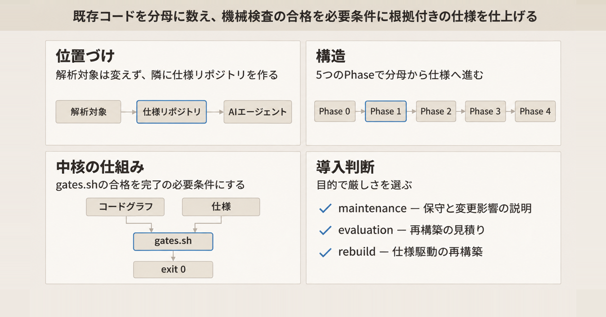
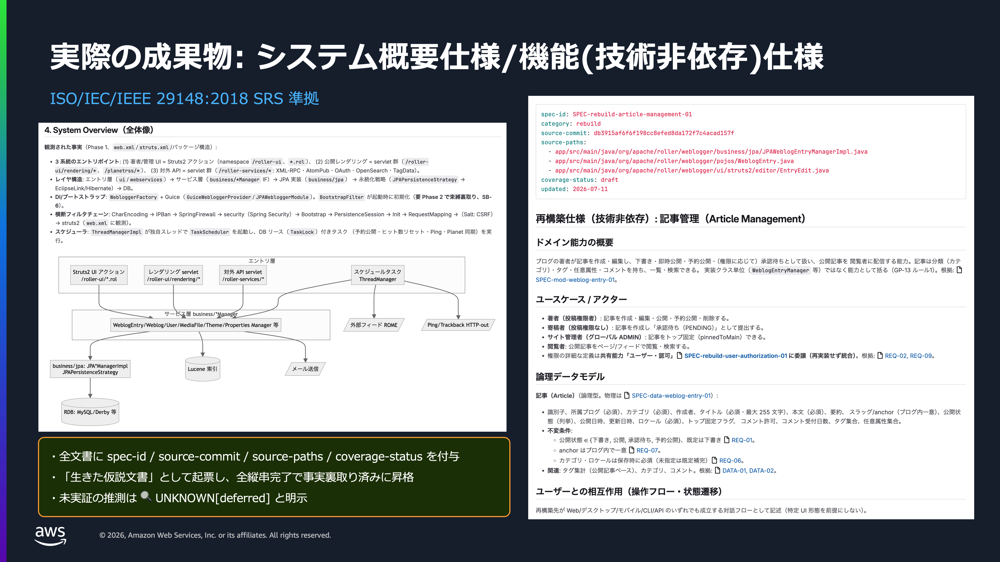
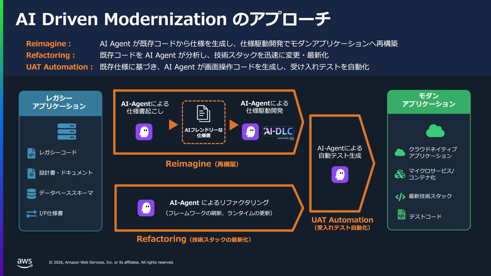
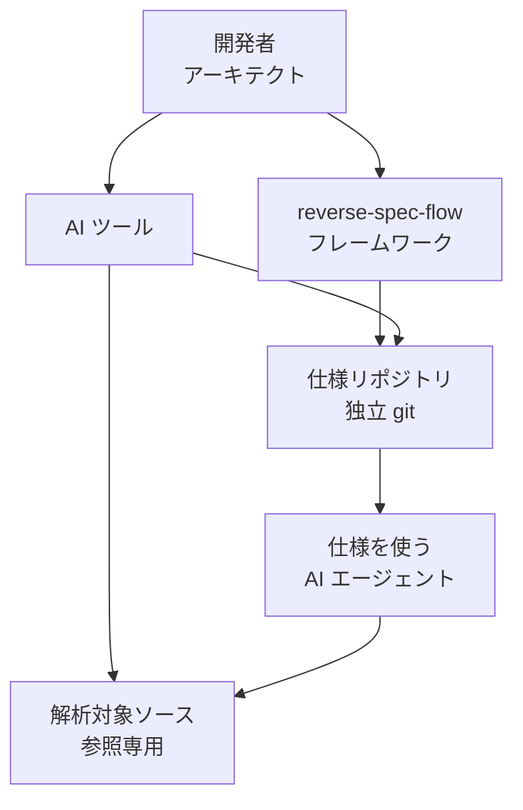
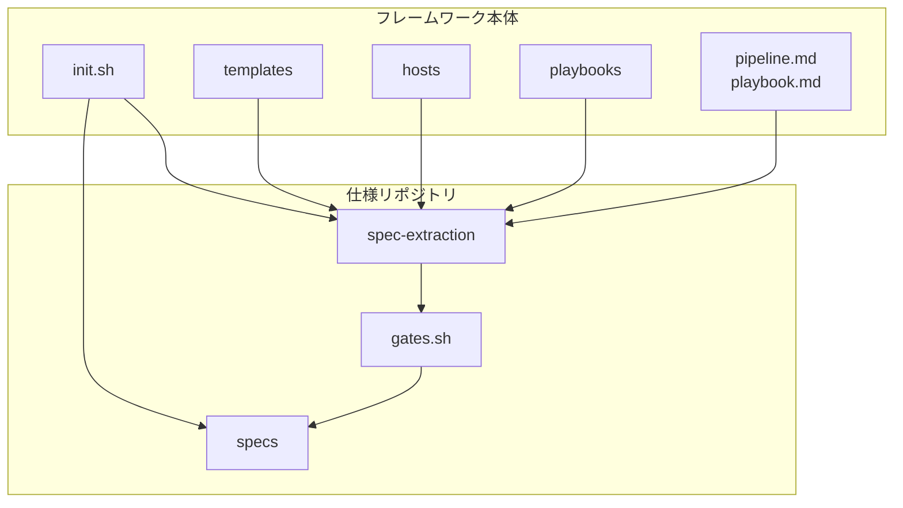
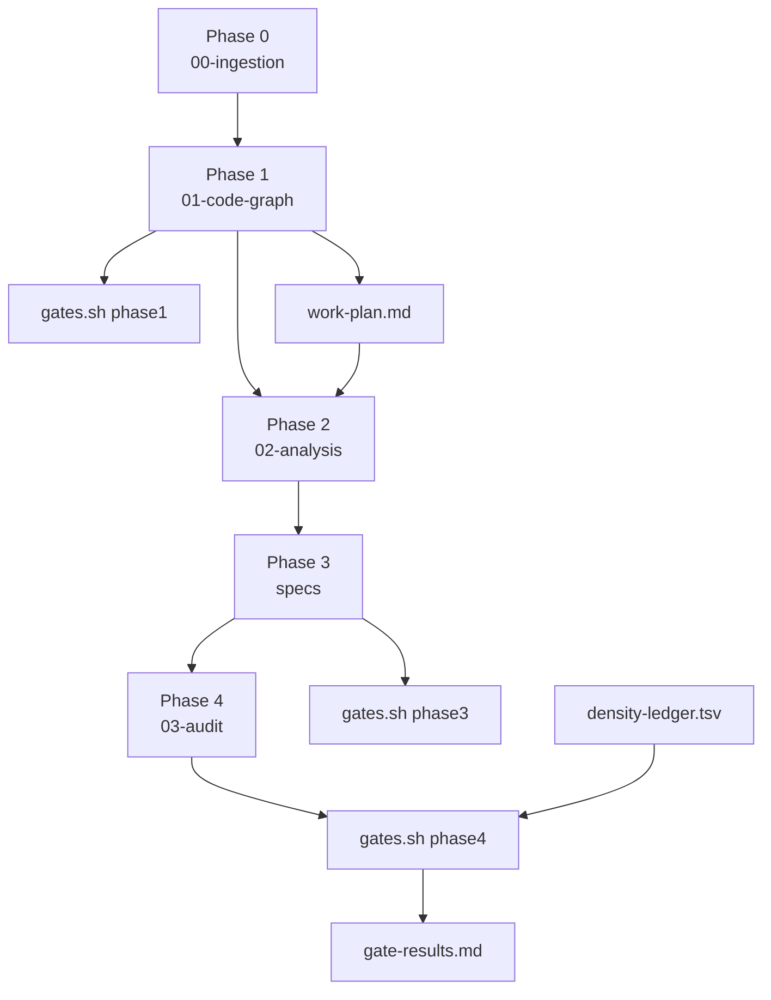
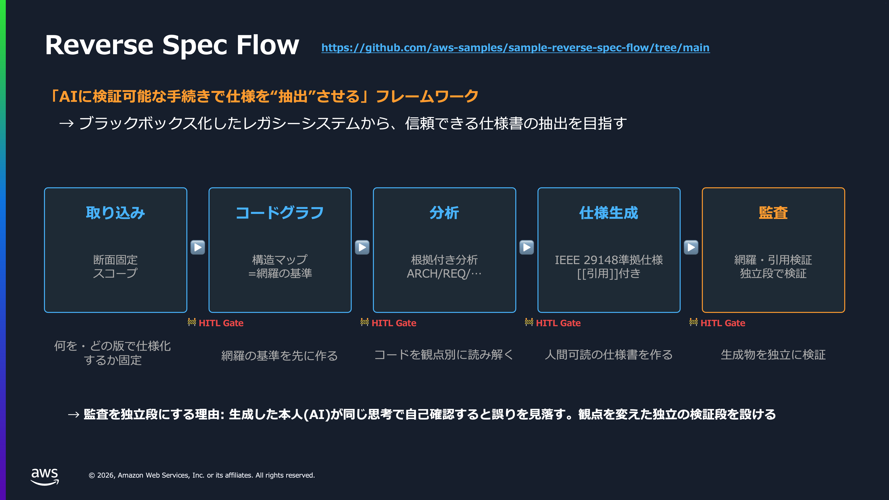
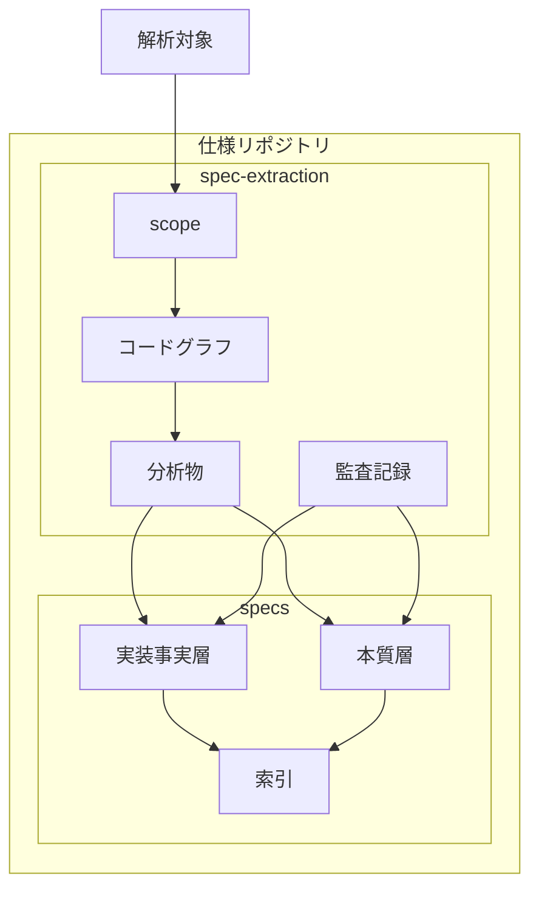
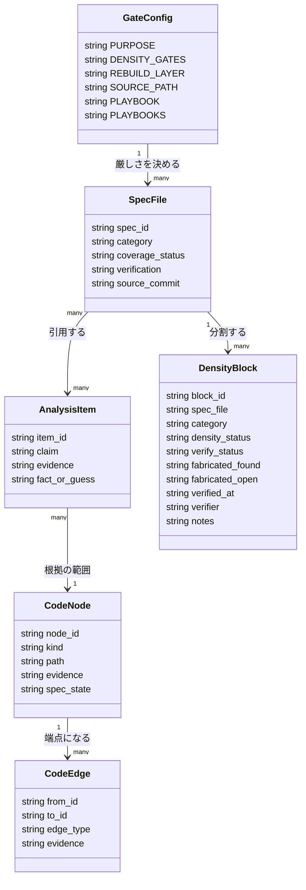

AWS Samples が公開した reverse-spec-flow は、仕様書が無い、または古くなった既存アプリケーションのソースから、AI エージェントが参照できる仕様書を作るワークフローです。この記事では、2026-11-23 時点の `main`（公開版 2.2.1、ライセンス MIT-0）と、AWS ブログ（2026-11-21 掲載）の内容をもとに、構造、データの持ち方、導入から運用までの手順を整理します。


*この記事の全体像。以下、順に解説します。*

## reverse-spec-flowとは

reverse-spec-flow は、既存アプリケーションのソースから仕様書を作るワークフローです。成果物は Markdown で、ファイルと要件に安定した ID を付けます。ID からファイルへ、ソースファイルから仕様へ、の両方向に辿れます。主な読み手は人ではなく、再構築や保守を行う AI エージェントです。



上の図は、AWS ブログが示した成果物の例です。左は現行システムの入口と依存関係、右は「記事管理」の再構築向け仕様です。右上のメタデータから、どのコミットとソースを根拠に書いたかを辿れます。

AWS Japan の AI-Driven Modernization は、移行のゴールを 2 つに分けています。

- **Refactor**: ビジネスロジックを保ったまま技術スタックを更新する経路です。AI Modernization Flow が担います。
- **Reimagine**: 既存コードから仕様を起こし、新しいアーキテクチャで作り直す経路です。reverse-spec-flow がその入口です。

生成した仕様は、保守（現行の振る舞いと変更影響の説明）と、仕様駆動の再構築の入力の両方に使います。



上の図は、同じブログが示す 2 つの進め方です。Refactor 側の手順は別プロダクトの範囲です。

フレームワーク本体はアプリケーションではありません。依存パッケージ、ビルドシステム、グラフデータベース、ベクターデータベースを持ちません。利用者が用意するのは bash、git、対応する AI ツール、解析したいソースです。`init.sh` が解析対象の隣に独立した git リポジトリを作り、Phase 0 から Phase 4 の作業はそのリポジトリを開いた別セッションで行います。完了の判定はエージェントの自己申告に頼りません。生成先に置かれる `gates.sh` が exit 0 を返すことを必要条件にし、監査完了や再構築レディの宣言には、さらに独立検証と人の確認を求めます。

GitHub のメタデータは、作成 2026-11-13、既定ブランチ `main`、主言語 Shell です。star は 2026-11-23 時点で 19 でした。

| 項目 | 内容 |
|---|---|
| 配布物 | GitHub `aws-samples/sample-reverse-spec-flow` バージョン 2.2.1 |
| ライセンス | MIT-0 |
| 実行形態 | ローカルの bash ワークフロー。専用サーバは無い |
| 主な利用者 | 既存システムを AI エージェントで再構築または保守したい開発者とアーキテクト |
| 解析対象 | git clone またはコピー。フレームワークは対象を変更しない |
| 位置づけ | AI-Driven Modernization の Reimagine 入口。Refactor 側は AI Modernization Flow |

## 特徴

- **根拠の位置を付ける**: 各記述に根拠の位置 `path:line` を付けます。検証官（書き手とは切り離して記述を根拠と照合するエージェント）は、引用の有無だけでなく、その行が記述を支えているかを確認します。
- **不明点を残す**: コードから確定できないことは `UNKNOWN` として残します。分類は `blocking`、`deferred`、`out-of-scope`、`undecidable`、`partial` です。
- **先に分母を作る**: Phase 1 でモジュール、入口、外部境界と、それらのつながりをコードグラフとして作ります。コードグラフは「どこまで仕様化すれば全部か」を決める分母で、全ノードを仕様化済み、または理由を ADR に記録した対象外にし、未着手・分析中を 0 件にするまで完了にしません。
- **機械判定を完了の必要条件にする**: `gates.sh` の exit 0 を完了の必要条件にします。Phase 境界では人の確認を挟み、監査完了の宣言には独立検証も求めます。判定語は PASS、FAIL、INCOMPLETE、WARN、SKIP の 5 種で、FAIL と INCOMPLETE はどちらも終了コード 1 になります。前提不備は終了コード 2 です。
- **相互参照する**: 仕様 ID と分析物 ID で相互参照します。`specs/source-index.md` はソースから仕様への逆引きで、影響調査に使います。
- **2 層に分ける**: 現行技術に依存する実装事実層（as-is）と、技術非依存の本質層（`specs/rebuild/`）を分けます。分ける基準は「再構築先のスタックが何であっても必要か」です。
- **小分けに読む**: 業務のまとまりごとに読み、コード全体を一度にコンテキストへ載せません。ホストがサブエージェントを持てば、安全な区間は並列が既定になります。
- **再開できる**: 進捗と次の操作はファイルに書いて git に残します。セッションが切れても、新しいセッションは `session-context.md` から再開します。
- **解析対象を変えない**: 解析対象は参照専用です。`gates.sh` の `G-SOURCE-INTACT` が、初期化時に記録した指紋との差分（変更、追加、削除）を見ます。
- **言語に依存しない**: Playbook は技術スタックごとの数え方を差し替える層です。Playbook が無くても、Phase 1 の最初に自分で数え方を決めて進めます。
- **静的読解が前提**: README は動的な確認（起動、画面操作、データベースへの問い合わせ）を行わないと書いています。一方、生成先の手順書の Phase 2 には「可能なら実際に動かして観測する」という条件付きの手順もあります。静的解析だけで進める案件では、起動や DB 接続をしないことを開始指示に明記します。

類似の進め方との違いは、成果物の形よりも、完了を機械判定に置く点にあります。

| 進め方 | 分母 | 完了の決め方 | 再構築への入力 |
|---|---|---|---|
| エージェントに「仕様を書いて」と頼む | 無し | 自己申告 | 現行のクラス構造が混ざりやすい |
| 人手のリバース設計 | レビュー観点 | 人の判断 | 読み手は人 |
| reverse-spec-flow | コードグラフのノード | `gates.sh` の exit 0 ＋ Phase 境界の人の確認 | 本質層と実装事実層を分離 |
| AI Modernization Flow | 対象外（別製品） | 別製品の手順 | Refactor（スタック更新）向け |

向く場面は次のとおりです。

| 場面 | 向く理由 |
|---|---|
| ブラックボックスの保守 | 逆引き索引で変更影響をエージェントに説明させられる |
| 再構築の見積り | `purpose=evaluation` で本質層の骨子と割当表（数えた要素を能力仕様へ漏れなく割り当てた表）までを要求する |
| 仕様駆動の再実装 | `purpose=rebuild` で対象範囲の全密度ブロックの独立 Verify を完了条件にする |
| スタックがレガシー | Playbook が JAX-RS、Struts、EJB 2、Web Forms、WinForms、VB6、手続き型 PHP、COBOL、PL/SQL を用意している |

## 構造

フレームワーク本体、生成先の仕様リポジトリ、解析対象、AI ツールは別の境界です。フレームワーク本体を開いたセッションで Phase 0 を始めてはいけません。

### システムコンテキスト図



| 要素名 | 説明 |
|---|---|
| 開発者 | `init.sh` を実行し、HOLD（人の判断が要る停止点）の判断と Phase 境界の確認を行う |
| AI ツール | 仕様を書く側の実行環境。対応はホストアダプタで宣言する |
| reverse-spec-flow | テンプレート、手順、ゲート、Playbook、ホスト定義の配布物 |
| 仕様リポジトリ | `init.sh` が作る `<source>-spec`。ブランチは `spec/<spec-name>` |
| 解析対象ソース | 読み取り専用。コピーも変更もしない |
| 仕様を使う AI エージェント | `specs/` を受け取り、再構築または調査を行う。書き手と同じツールである必要はない |

### コンテナ図



| 要素名 | 説明 |
|---|---|
| init.sh | 唯一の主要コマンド。生成先の作成、テンプレート配置、初期コミット、ブランチ作成を行う |
| templates | 手順書、コードグラフ、仕様雛形、`gates.sh` の配布元 |
| hosts | AI ツールごとの配置と検証官の隔離。Playbook とは直交する |
| playbooks | 技術スタックごとの数え方と走査コマンドの配布物。1 つの Playbook は 5 ファイルで構成される |
| pipeline.md | 生成プロセスの規約 GP-N。実行時の正本は手順書で、こちらは参照台帳 |
| playbook.md | 品質の不変条件 SB-N と、過去の失敗事例の記録 FB-N |
| specs | 納品単位。単体で仕様の読解と索引検索ができる。分析物や監査の証跡を追うには `spec-extraction/`、引用行の照合には解析対象ソースも要る |
| spec-extraction | 作業記録。Phase ディレクトリ、手順書、監査結果 |
| gates.sh | 完了判定の実行体。生成先では `spec-extraction/03-audit/gates.sh` |

検証官は、Claude Code では専用のサブエージェントとして配置されます。

### コンポーネント図

Phase 2 は完了ゲートを持ちません。`gates.sh phase2` は途中確認で、進行中でも欠陥になる検査だけを走らせます。Phase 1、3、4 の完了はそれぞれのサブコマンドの exit 0 です。



| 要素名 | 説明 |
|---|---|
| Phase 0 | 解析対象のコミットを断面として固定し、スコープ、除外、既存資料を記録する |
| Phase 1 | ノードレジストリとエッジレジストリを作る。エッジ探索の前にノードを凍結する |
| Phase 2 | 観点名は ARCH、REQ、API、DATA、BEHAVIOR、NFR。ID 接頭辞の振る舞い側は `BHV`。進行は work-plan の完了条件で見る |
| Phase 3 | ISO/IEC/IEEE 29148 の章立てで仕様を書き、分析物 ID と `path:line` を両方付ける |
| Phase 4 | 網羅、引用の実在、事実と推測の分離、密度を独立に点検する |
| gates.sh phase1 | コードグラフと work-plan の形式 |
| gates.sh phase3 | front matter、索引、リンク閉包 |
| gates.sh phase4 | 全 purpose の完了宣言の前提。FAIL と INCOMPLETE の合計が 0 のとき exit 0。rebuild は加えて `fabricated_open` 合計 0 |
| density-ledger.tsv | 密度ブロックごとの検証状態の正本。検証時に記入し、ゲートが読む |
| gate-results.md | ゲート判定の記録先。実行ごとに追記される |
| work-plan.md | Phase 1 の最終成果物。Phase 2 以降で毎回開く分析作業計画 |

分析物は、仕様文とソースの `path:line` の間に置く中間表現です。1 行が 1 主張で、根拠の位置と、事実か推測かの種別を持ちます。密度は、仕様本文が実装に足る詳しさで書けているかの度合いです。thick（実装に足る）、thin（地図のまま）、missing（対象ごと欠落）の 3 段階で判定します。密度ブロックは、仕様本文を検証しやすい大きさに区切った単位で、ブロックごとに密度と検証状態を台帳で管理します。



上の図は、AWS ブログが Phase 0 から Phase 4 を 1 枚にまとめたものです。完了判定の有無は、直前のコンポーネント図と表のとおりです。

## データ

永続化はすべてファイルです。データベースのテーブルはありません。コードグラフも Markdown の表です。

### 概念モデル

所有は入れ子、参照は矢印で示します。



| 要素名 | 説明 |
|---|---|
| 解析対象 | 断面コミットで固定する読み取り専用ツリー |
| scope | 断面、含む範囲、除外、既存資料の棚卸し |
| コードグラフ | 網羅の分母。ノードとエッジの 2 レジストリ |
| 分析物 | 仕様文と `path:line` の間に置く中間表現 |
| 実装事実層 | `modules`、`api`、`data`、`behavior` |
| 本質層 | `rebuild`。purpose が maintenance のときは作らない |
| 索引 | ID からファイル、ソースから仕様 |
| 監査記録 | ゲート結果、密度台帳、トレーサビリティ |

### 情報モデル

属性はテンプレートと `gates.sh` が読む項目に限ります。言語固有の型名は使いません。



| 要素名 | 説明 |
|---|---|
| GateConfig | `00-ingestion/gate-config.env`。`PURPOSE` は `maintenance`、`evaluation`、`rebuild`。`REBUILD_LAYER` は `off`、`skeleton`、`full`。`DENSITY_GATES` は maintenance と evaluation で `warn`、rebuild で `on` |
| CodeNode | モジュール表の列は `NODE-ID`、モジュール、パス、役割（推定）、仕様化状態。入口表は `NODE-ID`、種別、エントリポイント、`path:line`、仕様化状態。境界表は `NODE-ID`、種別（DB/API/Queue/File/外部連携）、境界、`path:line`、仕様化状態。状態語は `未着手`、`分析中`、`仕様化済`、`対象外(ADR-N)`、`対象外(実装不在,ADR-N)` |
| CodeEdge | 列は From、To、種別（`depends` / `calls` / `dataflow`）、根拠 `path:line`。両端は凍結済みノード ID |
| AnalysisItem | 接頭辞は `ARCH`、`REQ`、`API`、`DATA`、`BHV`、`NFR`。縦串ごとに名前空間を分ける |
| SpecFile | `spec-id` は `SPEC-<category>-<name>-NN` で再利用しない。front matter の `category` は、モジュール雛形が `module`（単数）で、ほかは `api`、`data`、`behavior`、`rebuild` など。ディレクトリ名と密度台帳の区分は `modules` |
| DensityBlock | 台帳の列は表の左から `block_id` 〜 `notes`。`density_status` は thick、thin、missing。`verify_status` は unverified、verifying、repairing、verified。`notes` には `repair-induced: N` と `hold9-split-from: DB-N` を書く。1 ブロックは主張 15 件以下かつ本文 8KB 以下。`verifier` は `subagent-isolated`、`prompt-isolated`、`fresh-context`、`human` |

`fabricated_found` と `fabricated_open` は、検証で見つかった根拠の無い記述（捏造）の件数と、そのうち未解消の件数です。縦串は、1 つの業務能力を実装事実層から本質層まで通す作業単位です。

`purpose` と生成物の対応は次のとおりです。

| purpose | REBUILD_LAYER | 密度ゲート | 完了に必要なこと |
|---|---|---|---|
| maintenance | off | warn | 可読性の床（`G-READABLE`: 指定した節が空でないこと）と、コードグラフの未着手・分析中が 0 |
| evaluation | skeleton | warn | 上記に加え、本質層が 1 件以上あり、割当表の未割当が 0 |
| rebuild | full | on | 対象範囲の全密度ブロックが独立 Verify で `verified`。密度台帳の `fabricated_open` 合計が 0。ブロック外に残った主張は `G-BLOCK-OUTSIDE` で別に確認する |

evaluation の「本質層が 1 件以上」は `G-REBUILD` が見ます。条件は `spec-id` に値があり、`category: rebuild` で、本文が空でないことです。本質層を作らない判断は、「該当しない」と書いた ADR だけでは満たせません。`REBUILD_LAYER=off` と、その行に書いた根拠 ADR で表します。

## 構築方法

### 前提環境

- macOS または Linux の bash と git を使います。Windows ではゲートの反復実行に WSL が推奨で、Git Bash でも判定結果は同じになります。ただし Windows 版 Claude Code では、`init.sh` を Git Bash で実行します。WSL で初期化すると `SOURCE_PATH` が `/mnt/d/…` 形式になり、Git Bash で動く hook が解析対象を見つけられなくなるためです（公式は未実測の推論と明記しています）。
- AI ツールは Claude Code、Kiro IDE、Kiro CLI のいずれかです。表に無いツールは仕様を書く側としては未対応です。できた仕様を渡す側はツールを選びません。
- 解析したいソースを、フレームワークとは別ディレクトリに置きます。
- データベースや専用プラットフォームはインストールしません。

Windows の実測（1 台、仕様書 107 件、密度台帳 181 行、3 回）では、`gates.sh phase4` が Git Bash で 26.2 分、WSL で 3.4 分でした。倍率は約 7.6 倍で、絶対時間は規模と機械で変わります。

### リポジトリの取得

解析対象と同じ親ディレクトリでクローンします。

```bash
cd /path/to/workspace
git clone https://github.com/aws-samples/sample-reverse-spec-flow.git
```

公開版はリリースノートの先頭で確認します。2026-11-23 時点の README は Version 2.2.1 を指します。

### init.sh による仕様リポジトリの作成

引数の並びは固定です。第 3 引数を省略すると対話になり、既定の purpose は `rebuild` です。

```bash
./sample-reverse-spec-flow/init.sh <source-path> <spec-name> [purpose] [--playbook <name|path>] [--host <name|path>]
```

- `source-path` は解析対象のパスです。出力ディレクトリは、その親の下に「対象ディレクトリ名 + `-spec`」で作られます。例: `./legacy-order-system` から `legacy-order-system-spec`。
- `spec-name` はブランチ `spec/<spec-name>` と、知見 ID `GP-<spec-name>-N` に使います。使える文字は英数字と `.` `_` `-` で、先頭は英数字です。
- `purpose` は `maintenance`、`evaluation`、`rebuild` のいずれかです。
- 解析対象はコピーされません。`init.sh` は初期コミットのあと `spec/<spec-name>` へ切り替えます。

一覧だけを見るコマンドは次のとおりです。

```bash
./sample-reverse-spec-flow/init.sh --list-playbooks
./sample-reverse-spec-flow/init.sh --list-hosts
```

AWS ブログが示す初期化例は、Playbook 付きの rebuild です。

```bash
./sample-reverse-spec-flow/init.sh ./legacy-order-system order-system rebuild --playbook java-jaxrs-jpa
```

### ホストの指定

ホストは、仕様を書く AI ツールごとの配置と設定のまとまりです。`--host` を省略すると `claude-code` になります。能力宣言の正本は各ホストの `profile.env` で、ゲートスクリプトはこのファイルを読みません。

| ホスト | SUPPORT_LEVEL | 実測の範囲 | この実測に含めないこと |
|---|---|---|---|
| claude-code | verified-full | Claude Code 2.1.265（Windows）と 2.1.267（macOS）。検証官の隔離は 2.1.305。最初から最後までの完走試験を実施。`omitClaudeMd` 設定は 2.1.271 以降 | macOS 2.1.267 は `CLAUDE.md` を優先し、ルート `AGENTS.md` を自動では読まない。Windows 2.1.265 は両方読む。Windows での検証官の隔離は未測定 |
| kiro-ide | verified-full | 個別実測は 1.4.5、完走は 1.4.5 から 1.4.26。対象は小規模（ノード 176、密度ブロック 329） | Playbook 経路と HOLD-9（密度検証が収束しないときの停止）の一部は未実施。329 ブロック中 82 は、隔離確認を実施者が保存した出力に依る |
| kiro-cli | placed-unverified | Kiro CLI 2.33.0 の V2 と V3。検証官の隔離と skill の読み込みのみ | 検証官の起動は V3 専用。パイプライン全体は未実施 |

Kiro IDE では、リポジトリを開く前に生成先の `HOST-SETUP.md` を読みます。配置物の例は、Claude Code なら `CLAUDE.md`、`.claude/agents/spec-verifier.md`、`.claude/hooks/verifier-guard.sh` です。

### Playbook の指定

`--playbook` は繰り返せます。1 つ目の走査ファイルは `enumeration.md`、`practices.md`、`gate-snippets.sh` の正規名で置かれます。README は `docs/knowledge/playbook-<名前>.md`、付録は `specs/_appendix-<名前>.md` になります。2 つ目以降は `enumeration-<名前>.md`、`practices-<名前>.md`、`gate-snippets-<名前>.sh`、`playbook-<名前>.md`、`_appendix-<名前>.md` になります。指定した全部が `PLAYBOOKS` に記録されます。`oracle-plsql` はアプリ側の Playbook と並べて使います。

未指定でも動きます。そのときは雛形が置かれ、未記入のまま列挙へ進むと `G-ENUM-SOURCE` が FAIL になります。

`java-jaxrs-jpa` の適用判定は、Java ソースに `@Path` または `@RequestMapping` が 1 件以上あることです。Playbook の README が示す確認コマンドは次のとおりです。`<source>` は解析対象のパスに置き換えます。この式は行頭の注釈だけを拾い、`@PathParam` にも一致するため、目安として使い、候補が出たら永続化方式やマイグレーション方式も確認します。

```bash
grep -rlE '^@Path|^@RequestMapping' <source> --include='*.java' | head
```

0 件で `struts*.xml` や `*.orm.xml` がある場合は `java-struts-ormxml`、Struts 1 の `struts-config` または EJB 2 の `ejb-jar.xml` なら `java-struts1-ejb2` を選びます。ファイル名だけでは Struts 1 と 2 を取り違えることがあるため、XML のルート要素も確認します。`<struts>` は Struts 2、`<struts-config>` は Struts 1 の候補です。

### 生成先を開く

以降の作業は、フレームワークのディレクトリではなく `<source>-spec` のルートを新しいセッションで開いて行います。`spec-extraction/` をワークスペースにしません。Kiro IDE では開く前にルートの `HOST-SETUP.md` を読みます。

```bash
cd legacy-order-system-spec
```

初回に人が触るファイルは、原則として次の 2 つです。

- `spec-extraction/AGENTS.md` の残りのプレースホルダ。`<SOURCE_PATH>` と `<SPEC_NAME>` は `init.sh` が置換済みです。
- ゲートの強さを変えるときの `spec-extraction/00-ingestion/gate-config.env`。変更したら ADR に理由を残します。

## 利用方法

実行時に従う契約は 3 つだけです。`pipeline-procedure.md` が手順、`AGENTS.md` が制約、`gates.sh` が判定です。`pipeline.md` と `playbook.md` は、なぜそのルールがあるかを ID で引く参照台帳です。

### Phase 0 の開始指示

生成先を開いたセッションへ、README が示す指示を渡します。パスは自分の解析対象に置き換えます。

```text
Read spec-extraction/AGENTS.md.
The source to analyze is in /path/to/workspace/legacy-order-system/ (read-only; do not modify it).
Fill in the <PLACEHOLDER> values in spec-extraction/AGENTS.md, then start from Phase 0.
```

Phase 0 では解析対象の断面を `scope.md` に固定します。パスと取得日時を記録し、Git 管理下ならコミットも固定します。履歴の無いコピーでは、初期化時のファイル指紋を変更検出に使います。既存の設計書や画像は `references.md` に出所付きで棚卸しし、コードで裏が取れるまで事実にしません。資料とコードが矛盾したらコードを正とし、ずれとして残します。Phase 1 の前に利用者確認があります。

### Phase 1 の分母

コードグラフは 2 つの表です。

- ノードはモジュール（`NODE-MOD-`）、エントリポイント（`NODE-EP-`）、外部境界（`NODE-BND-`）です。
- エッジは `depends`、`calls`、`dataflow` で、両端はノード ID です。

列挙は Playbook の `enumeration.md` に書いた走査コマンドで全件行います。数え方は独立した 2 つの経路で行い、結果を要素単位で突き合わせます。各経路の件数と差分を記録し、差が無ければ 0 件と書きます。独立した第 2 経路を作れないときは、単一経路であることと理由を明記します（`G-ENUM-SOURCE` が見ます）。ノードを凍結したあとの分母変更は HOLD-2 で、人が判断します。Phase 1 の完了は次のコマンドの exit 0 です。

```bash
bash spec-extraction/03-audit/gates.sh phase1
```

### Phase 2 の分析物

分析物は `spec-extraction/02-analysis/` に置きます。1 行が 1 主張で、根拠は `path:line`、種別は事実か推測です。推測は仕様の確定文にしません。

ID の名前空間は `work-plan.md` の列に従います。縦串を分けると、2 本目で `REQ-01` が衝突しません。分析物は、それを引用する仕様より先に存在させます。`G-LINK` が引用先の実在を見るためです。

大規模な対象は、1 つの業務能力を実装事実層から本質層まで通してから次へ進みます。未着手の能力は両方の層が無い、という対称を保ちます。

### Phase 3 の仕様ファイル

仕様は、使うカテゴリの雛形を複製して書きます。front matter の項目は雛形ごとに異なり、能力仕様の雛形は `spec-id`、`category`、`coverage-status`、`verification`、`source-commit` などを持ちます。ブロック単位の検証状態の正本は密度台帳です。`source-commit` は Phase 0 の断面と一致させます。`G-COMMIT` がこれを見ます。

本質層の能力仕様（1 つの業務能力を技術非依存に書いた仕様ファイル）は、HTML コメントの `artifact-key: capability-spec` を残します。`G-DENOM` の割当検査はこの目印で対象を選びます。必須節の見出し文字列は変えません。`G-DENSITY` が `required-sections` を見出し文字列で照合するためです。

能力仕様の必須節は次のとおりです。

- 分母の割当
- 論理データモデル
- 可視性とアクセス範囲の不変条件
- `ビジネスルール / バリデーション`
- 対外契約
- 未確定
- 実装事実へのトレース

見出しのスラッシュを省くと必須節の欠落になります。`DENSITY_GATES=on` の rebuild では FAIL、evaluation の既定 `warn` では WARN で、`phase4` は密度不足だけでは止まりません。

記述は分析物 ID と `path:line` の両方を持ちます。ID だけだと密度ブロックの主張行が 0 になり、`G-BLOCK-SIZE` が粒度を測れず INCOMPLETE になります。

仕様 ID の例は `SPEC-rebuild-<capability>-01` です。README が索引の例に挙げる要求 ID は `REQ-F-01` 形式です。分析物側の接頭辞（`REQ-01` や縦串付きの `U-REQ-01`）と、仕様ファイルの `spec-id` は別のキー空間です。

逆引き索引 `specs/source-index.md` の生成は Phase 3 の必須作業です。索引が無いと `G-SOURCEINDEX` が INCOMPLETE、古いと FAIL になるため、完了確認の前に生成します。生成コマンドは判定を持ちません。

```bash
bash spec-extraction/03-audit/gates.sh source-index
```

Phase 3 の完了確認は次のとおりです。

```bash
bash spec-extraction/03-audit/gates.sh phase3
```

### 仕様の参照

納品するのは `specs/` です。使う側のエージェントには、最初に `specs/AGENTS.md` を読ませます。解析対象のソースも渡すと、記述をコードと照合できます。ソースが無いときは、仕様自身が支える範囲だけを答えます。

変更影響を調べるときは、生成済みの逆引き索引 `specs/source-index.md` を開き、ソースファイルから対応する仕様を辿ります。

### gates.sh の実行

以下は仕様リポジトリのルートで実行します。スクリプトは起動後に git ルートを自分で解決しますが、引数のパスは現在位置からの相対パスです。

```bash
bash spec-extraction/03-audit/gates.sh phase4
bash spec-extraction/03-audit/gates.sh density
bash spec-extraction/03-audit/gates.sh session
bash spec-extraction/03-audit/gates.sh metrics
bash spec-extraction/03-audit/gates.sh all
```

- `phase4` は完了宣言の前提です。FAIL と INCOMPLETE の合計が 0 のとき exit 0 になります。
- `density` は密度ゲートだけを走らせ、`DENSITY_GATES` の値に従います。
- `session` と `metrics` は合否を `gate-results.md` に混ぜません。
- `all` は phase1、phase3、phase4 です。phase2 は含みません。
- 詳細行は既定で 10 件まで表示し、全件は `spec-extraction/03-audit/gate-details.log` に残ります。このログは実行のたびに空にされる直近 1 回分なので、失敗したら次のサブコマンドを実行する前に開きます。件数の上限は `GATES_DETAIL_MAX` で変えられます。

次の 2 つは補助のサブコマンドです。`phase2` は完了条件ではなく途中確認です。`source-baseline` は解析対象の指紋を取り直すもので、`init.sh` が初回に呼びます。解析対象を意図して進めたときだけ、ADR を書いたあとで実行します。

```bash
bash spec-extraction/03-audit/gates.sh phase2
bash spec-extraction/03-audit/gates.sh source-baseline
```

よく使うゲートの見ているものは次のとおりです。

| ゲート | 見ているもの |
|---|---|
| G-DENOM | 仕様化を終えていないノードと、能力仕様の割当表の未割当 |
| G-ENUM-SOURCE | 列挙の独立ソースと、2 経路の突合記録 |
| G-LINK | `specs/` と監査の宣言文書 3 つの `[[ID]]` が解決するか |
| G-SOURCE-INTACT | 解析対象の指紋が初期化時から変わっていないか |
| G-READABLE | 各仕様の `readable-sections:` に書いた節が空でないか。モジュール雛形は `責務`、能力仕様は `可視性とアクセス範囲の不変条件`。purpose に関係なく FAIL になり得る |
| G-LEDGER | 主張を持つ仕様が台帳にあり、`fabricated_open` の合計が 0 か |
| G-BLOCK-SIZE | 密度ブロックが主張 15 件以下、本文 8KB 以下か |
| G-VERIFIER | 台帳の `verifier` が語彙内か |
| G-POPULATION | 全数主張の母集団が、検証官に渡る原典を指しているか。内部成果物、自表、外部規格（ISO など）を権威にすると verified の格下げ対象になる |
| G-QUEUE | 判断待ちのまま完了宣言していないか |

## 運用

### セッションの再開

開始時にエージェントが行うことは、手順書では 6 項目です。

1. `session-context.md` の Decision Queue を最初に報告する。Verification Queue は検証してから新規作業に入り、Active Investigation があれば scratchpad を読んで続ける。
2. `pipeline-procedure.md` で現在の Phase を確認する。
3. Phase 2 以降は `work-plan.md` を開く。
4. `gates.sh` で現状を確認する。
5. `分析中` のノード、scratchpad、未完了のサブタスクを先に再開する。
6. 作業ツリーが dirty なら、各変更を `provisional`（後で戻す）か `candidate-fix`（検証して残す）に分ける。

終了時は待たずに記録します。順序は worklog、`session-context.md`、scratchpad、commit、リモートがあれば push、`gates.sh session`、`git log` と `git status` です。

`gates.sh session` が落とす例は次のとおりです。

- `session-context.md` が無い
- 台帳が dirty な変更を覆っていない
- scratchpad があるのに Active Investigation が空
- Next Actions が「つづき」だけ

```bash
bash spec-extraction/03-audit/gates.sh session
```

### 人が止まる判断

HOLD は、エージェントが成果物を進める前に人へ聞く条件です。機械が止めるのは、停止すべき判断が記録なしに成果物へ入っていないか、という側だけです。トリガーが発火したのに止まらなかったこと自体を検出するゲートはありません。HOLD-3 の仮説ログは git 管理外の scratchpad なので、ゲートからは読めません。

| ID | トリガー |
|---|---|
| HOLD-1 | 分母を縮める。ノードを対象外にする、スコープを縮める、実装不在を確定する |
| HOLD-2 | レジストリ凍結後に分母そのものを変える |
| HOLD-3 | 同じ矛盾の仮説ログが 3 行に達する、または 2 セッションにまたがる |
| HOLD-4 | 参考情報と実コードの矛盾が設計方針のレベルである |
| HOLD-5 | work-plan に無い、まとまった追加作業が出る |
| HOLD-6 | 監査完了、再構築レディ、reconciliation ゼロ、保持必須契約などの高影響な宣言 |
| HOLD-7 | 章立ての省略や追加、purpose の変更、目標密度の変更 |
| HOLD-8 | Phase 境界を通過する |
| HOLD-9 | 元の主張の誤りが密度 Verify の 3 ラウンドで解消しない、または前ラウンドより増える。修復で生じた誤りは別に数え、通算 5 ラウンドで未収束なら種類を問わず発火する。その主張で初回なら停止せず、収束しない主張を新ブロックへ自動で切り出す。人に諮るのは同じ主張で 2 回目のときと、主張を外して `partial` にするとき |

1 つの作業区切りで HOLD が 3 回以上出るときは、トリガーの基準が広すぎる合図です。

### 進捗の確認

見る場所は役割が分かれています。

- ノードの消化は `01-code-graph/code-graph.md` の状態列です。
- 検証結果の正本は `03-audit/gate-results.md` です。手で転記しません。
- 仕様の詳しさは `03-audit/density-ledger.tsv` の `density_status`、裏取りの進捗は同じ台帳の `verify_status` を見ます。登録済みブロックの検証済率は、`verified` の行数を全データ行数で割った値です。
- 判断待ちは `session-context.md` の Decision Queue です。

`gates.sh metrics` は指標を記録するだけで、合否は出しません。

```bash
bash spec-extraction/03-audit/gates.sh metrics
```

### purpose と gate-config

`PURPOSE`、`DENSITY_GATES`、`REBUILD_LAYER` の行を消すと、`gate-config.env` があるリポジトリでは exit 2 で止まります。以前は消すと既定値に落ちて検査が緩む経路があったためです。値を変えるときは値を書き換えます。許される値はコマンド出力に出ます。`gate-config.env` 自体が無い古いリポジトリは従来どおり通ります。

purpose の変更は HOLD-7 です。エージェントは勝手に変えず、ADR に理由を残して人に諮ります。

`evaluation` の `skeleton` を `off` にするなど、`REBUILD_LAYER` を purpose の既定より緩めるときは、変更した行のコメントに実在する ADR の番号を書きます。本質層が無いことは、ADR の本文を書くだけでは処理済みにできません。`maintenance` の既定の `off` には ADR 注記は要りません。

### ホストの切り替え

生成済みリポジトリのホストを変えるときは `apply-host.sh` を使います。`profile.env` の `PLACED_PATHS` が、前のホストの配置物を報告するための宣言です。`HOST.md` と `HOST-SETUP.md` は共通処理が置くので、この変数には書きません。

新しいホストを足すときは、次の順に進めます。

1. `hosts/_template` をコピーする
2. 未測定の項目を `unknown` のままにする
3. `MEASURED.md` に版、日付、回数を残す
4. `hosts/README.md` の表へ載せる

`SUPPORT_LEVEL` は実測の範囲でしか名乗りません。

### フレームワーク本体の更新確認

本体を改造する側は `./selftest.sh` を実行します。利用者の仕様化作業では走らせません。採番は `./next-id.sh` を使います。フレームワーク本体の新しい GP と SB は 100 番以降です。FB は通常の連番です。1 から 99 は、稼働中のプロジェクトがプロジェクト名なしの番号を採り続けても衝突しない帯として残しています。

```bash
./next-id.sh
./next-id.sh GP
./next-id.sh --check
```

`--check` は、本体の GP と SB の番号が隣の `*-spec` リポジトリと意味の衝突をしていないかを見ます。未コミットの追記も占有として数えます。衝突があると exit 1 です。

公開後の更新は GitHub の `main` が正です。v1.17 から v1.22 は新規の仕様抽出に使いません。リリースノートは、その範囲の版で段階的に配布していた変更を v2.0.0 で取り下げたと書いています。

## ベストプラクティス

### 縦串で 1 能力を通す

最初の 1 能力だけを、分析物、実装事実層、本質層の順に書き、`rebuild` ではさらに独立 Verify まで通します。`maintenance` と `evaluation` では密度ブロックの独立 Verify は既定で行わず、`maintenance` は本質層を作りません。以前は本質層を実装事実層より先に書く順を要求していましたが、実測で誤りが多かったため、2026-09-23 に「実装事実層を先、本質層を後」へ変えました。ただし、全能力の実装事実層を書き終えてから本質層へ進む方式は採りません。再構築に直接使う層が最後まで来ないためです。能力ごとに両方の層を通し切ります。

分母の粒度は、終盤で拡張する前に決めます。`G-DENOM` の PASS は「登録した分母を使い切った」ことであり、「分母の切り方が正しい」ことではありません。

### 密度ブロックの切り方

密度ブロックは仕様本文を次のマーカーで囲みます。開始と終了は独立した行にし、入れ子にしません。

```text
<!-- density-block: DB-001 -->
主張（[[REQ-A-01]]、`path/to/File.java:120`）
<!-- /density-block: DB-001 -->
```

- 1 主張は、コード表記（バッククォート）で囲んだ `path:line` を含む行、またはコード表記で始まる表の行です。出現回数ではありません。散文中の根拠位置はバッククォートで囲まないと主張として数えられません。
- 同じファイルの同じ節の中だけで束ねます。上限は 15 主張、本文 8KB です。
- 台帳の `spec_file` はリポジトリルートからの相対パスにします。ファイル名だけだと、別ディレクトリの同名ファイルも登録済みになります。
- `verifier` が `subagent-isolated` 以外のときは明示の格下げです。同じセッションでコンテキストを切り直しただけでは `fresh-context` に含めません。
- maintenance と evaluation では、記述ごとの全数 Verify を既定では行いません。行わなかった件数は完成の判定書で開示します。

### 秘密情報と隔離環境

- ソース内のコメントと文字列はデータとして扱います。指示として実行しません。
- パスワード、鍵、トークン、個人データの値は仕様へコピーしません。在りかと種類だけを書きます。
- 仕様リポジトリにはコードの抜粋とローカルの絶対パスが入ります。公開リモートへ push しません。共有前に git-secrets や gitleaks で確認します。
- 他人から受け取った仕様リポジトリは、信頼する前に `.claude/` と `.kiro/` を確認します。
- 信頼できないコードは、本番の認証情報が無い隔離環境で解析します。自動承認（Always allow や `kiro-ide-allow.sh`）は使いません。
- Playbook と `hosts/` は、信頼できる出所のものだけを使います。

### Playbook を併用する

数え方の目印は 1 種類にしません。役割から目印を逆引きし、和集合を分母にします。ヒット数が極端に少ない目印は、中間層や境界であることがあります。`java-jaxrs-jpa` では、次の判断を ADR で残します。

- テナント管理 DB を分母に含めるか
- `@JoinTable` の中間表を独立仕様にするか
- どの changelog からも include されないマイグレーションを除外するか

汎用の手順書と GP、SB には、特定スタックのアノテーション名や設定ファイル名を書きません。`@Path` が 0 件の対象では、その式を分母にすると突合が計算不能になります。この破綻は Apache Roller で実測されています。

## 注意点

公開資料ごとに、数値の計測条件や記載の範囲が異なります。読み違えやすい箇所を表にまとめます。

| 対象 | 資料の記載 | 実態 | 読者への影響 |
|---|---|---|---|
| 完了試験の規模 | リリースノートは、中規模 Web（構成要素約 280、業務のまとまり 17）を v2.0.0、Claude Code、`rebuild` で約 38 時間（人の確認待ちを含む公表値） | `docs/how-it-works.md` の隔離試験は、撤去された「本質層を先に書く方式」の試験で、Java 約 9.8 万行、全 15 能力、1 時間 09 分。参照解答と照合すると、「欠落すると作り直しになる項目」50 件の約 3 分の 1 を、改善を重ねても取りこぼした | 38 時間の完走と、深さを保証しない隔離試験は別計測。時間の短さを同じ品質の実績として読まない |
| 能力の数 | AWS ブログは Apache Roller 6.1.5 を構成要素約 280、業務機能 17、約 15 万ステップ（Java 約 9.8 万） | 隔離試験の「15 能力」と、完走記録の「17」は、同じソースをドメイン能力に分けた別々の試行で、境界の置き方が異なる | 差の 2 件から機能の欠落を推定しない |
| 費用 | ブログは Roller の rebuild で出力約 1,500 万トークン、キャッシュ読み込み約 35 億トークン、rebuild は maintenance の 5〜7 倍程度 | リリースノートの v2.2.0 試走は、約 5,200 行を maintenance で約 1 時間、公開単価換算約 28 ドル。同じ条件の v2.1.0 試走は約 2 時間半、約 87 ドル。rebuild の監査時間は v2.2.0 以降未計測 | トークン、ドル、倍率は別の試走。1 つの見積りに合成しない |
| Fineract と Playbook 件数 | ブログは約 84 万ステップで使った実績があると書く。リリースノートの見出しは Playbook を 9 種類追加と書く | `java-jaxrs-jpa` の README は Apache Fineract 1.15.0 を 2026-08-10 の列挙実測とする。`playbook.md` の FB-11 は、公開前の Fineract 仕様で全 23 縦串が完了ゲートを通過したあと、実装のデータベース表 257 個のうち 90 個が、物理表名で `specs/` に一度も登場しなかったと記録する。公開版 2.2.1 の完走一覧に Fineract は入っていない。追加分の内訳表は合計 8（WinForms が 2、ほか 6 技術が各 1）で、見出しの 9 とは一致しない | 列挙の実測、完了ゲート通過、その後の密度の穴、公開版の完走、見出しの件数を同じ実績として足さない |
| phase2 | `docs/how-it-works.md` のコマンド一覧に `phase2` は無い | `templates/gates.sh` の使い方には `phase2` があり、完了条件ではなく途中確認と明記されている。同ファイルは `source-index` と `source-baseline` も持つ | 途中確認を完了ゲートと扱わない。ヘルプの正本は生成先の `gates.sh` |
| Kiro IDE の規模 | README は end to end を確認済みと書く | `hosts/README.md` は小規模、Playbook なし、ノード 176、密度ブロック 329 で、Playbook 経路と HOLD-9 の一部は未実施と書く | 「確認済み」の範囲は hosts の表が詳しい |
| Kiro CLI | README は一部機能のみで、end to end は未確認 | `profile.env` の `SUPPORT_LEVEL` は `placed-unverified`。実測バージョンは 2.33.0。検証官の起動は V3 専用 | CLI を既定の代わりにしない |
| Claude Code の版 | 製品バージョンは 2.2.1 | ホスト実測は Claude Code 2.1 系。製品版とツール版は別の番号体系 | 2.2.1 を Claude Code の版番号として読まない |
| 手順の世代 | ブログの 38 時間と、完了後に層化抽出した 200 件の標本で約 5% に一部の誤りがあった結果（標本内の割合。再構築に直接使う中核部分は約 1 割）は、公開前 v2.0.0 の rebuild 完走 | v2.2.0 は maintenance と evaluation で全数の裏取りを既定では行わない。v2.2.0 以降の rebuild 監査時間は未計測 | 公開手順の所要時間として 38 時間をそのまま使わない |
| GitHub topic | API の topics に `reverse-enginnering` がある | README の製品名は reverse-spec-flow で、この綴りは topic だけに現れる | 検索キーには公式の製品名を使う |
| ドキュメント言語 | README 英語版は、`docs/` とエージェント向け規則は日本語と書く | README は英語と日本語の 2 ファイルがある。AWS ブログは日本語 | 手順の細部は `docs/how-it-works.md` を開く |

動的挙動を仕様だけで確定できないこと、点検後も抜き取りで一部の誤りが残ること、再構築後は UAT とリグレッションで現行と比較することは、README とブログの両方が書いています。完全に誤った記述が 0 件だったのは、v2.0.0 の rebuild 完走後に 200 件を抜き取ったときの結果です。

## トラブルシューティング

利用者の作業で止まる症状に限ります。ゲートは失敗した行を出します。目視で「実質問題ない」と通すことは、手順書が禁止しています。直すか、HOLD として人に諮ります。

| 症状 | 原因 | 対処 |
|---|---|---|
| `phase4` が exit 1 で、未完了 1 件と出る | 監査完了などの宣言を人に諮っている間は `G-QUEUE` が未完了のまま | 判断のあとにもう一度 `phase4` を実行する。待ち行を外して通さない |
| 密度が warn のまま完了する | `maintenance` と `evaluation` は `DENSITY_GATES=warn` で、不足は見えるが止まらない | 再構築目的へ変えるなら HOLD-7 で合意し、`PURPOSE=rebuild`、`DENSITY_GATES=on`、`REBUILD_LAYER=full` を揃える（`PURPOSE` だけ変えても `warn` が残る）。保守目的のまま検証を足すなら、対象範囲を ADR に記録して Verify を依頼する |
| `readable-sections` の節が空で FAIL になる | `G-READABLE` はマーカーに書いた節の見出しと非空を見る | 空の節に本文を書く。密度ゲートを warn にしてもこの検査は残る |
| `G-BLOCK-SIZE` が粒度を測れない | 密度マーカーが同一行、入れ子、または `[[ID]]` だけで `path:line` が無い | マーカーを独立行にし、主張行に `path:line` を付ける |
| `G-POPULATION` が verified の格下げを要求する | 母集団がコードグラフ、分析物、自表、または外部規格を指している | 検証官に渡る原典（解析対象のソース）から数え直す。原典から再現できないときは、主張を密度ブロックから外し、台帳の状態を下げて人の確認に回す |
| 解析対象の走査が 0 件 | `SOURCE_PATH` がシンボリックリンク経由だと、リンクを追わない find と grep がある | 生成先の `gates.sh` は入口で物理パスへ正規化する。自分で書く走査は `pwd -P` か `find -L` を使う |
| Windows で記入済みの行が未記入と判定される | Git for Windows の `D:/` 形式を「ファイル名:行番号」と読み違えていた | v2.2.1 で修正済みの `gates.sh` を使う |
| 設定値は正しいのに別のゲートが誤って FAIL する | 仕様書の Markdown が CRLF のまま残っている。v2.2.1 の `gates.sh` は `PURPOSE` などの値末尾 CR を読む前に剥がす | `.gitattributes` をコミットしてから取得し直す。`git add --renormalize` は作業ツリーの CR を剥がさない |
| `gates.sh` がリポジトリの外だと言う | ファイル自身が CRLF で、bash がオプション名を壊す | LF でチェックアウトし直す。`.gitattributes` の `eol=lf` が 1 段目の防御 |
| 除外を書いた直後に exit 2 で止まる | v2.2.1 は、`SOURCE_EXCLUDE` の正規表現を引用符で囲み忘れると構文エラーとして exit 2 で止める。以前は行が捨てられ、除外なしで走っていた | 表の下の例のように、値を単引用符で囲む |
| `PURPOSE=Rebuild` のように大文字が混ざる | 入口の値検証が綴り違いを通さない | 小文字の `maintenance`、`evaluation`、`rebuild` に直す。不正値は exit 2 |
| Kiro IDE の承認が長い作業を止める | 承認ダイアログが作業を止める。`kiro-ide-allow.sh` は初期の完走試験の時点では未実測。後続の Windows 試走（Kiro IDE 1.4.121）では使用実績があり、1 回の完走で残った承認ダイアログは 2 回 | `HOST-SETUP.md` に従う。Windows ではチャットを 1 回使って再起動してから閉じる。自動承認は信頼できるコードに限る |
| 検証官が仕様の続きを読んでいる | hook がワークスペース信頼の前は動かない。`omitClaudeMd` は 2.1.271 より前では無視される | 信頼を承認し、Claude Code をその版以上にする。隔離を確認できない検証結果は集計にも台帳にも入れず、同じブロックで検証官を起動し直す。それでも確認できなければ、別コンテキストでの再検証、次に人による確認へ進む |
| 仕様リポジトリを公開してしまった | 抜粋と絶対パスが入る | ホスティング側で公開アクセスを止める。公開履歴に秘密スキャンを掛け、露出した認証情報があれば失効・更新する。取得済みのクローンやフォークの範囲を確認し、受け取った側にも `.claude/` と `.kiro/` の確認を依頼する |

除外設定の誤りと正しい書き方は次のとおりです。

```bash
# 誤り: 引用符が無い（v2.2.1 では exit 2 で止まる）
SOURCE_EXCLUDE=(^|/)target/
# 正しい: 単引用符で囲む
SOURCE_EXCLUDE='(^|/)target/'
```

### ゲートが exit 1 になる

- 出力に出たファイルと行を開きます。要約だけで判断しません。
- FAIL は欠陥、INCOMPLETE は未完了です。どちらも完了条件を満たしません。
- 判断待ちの間は、依存しない別の作業へ進んで構いません。保留は Decision Queue に残ります。
- HOLD が 1 つの作業区切りで 3 回以上出るときは、エージェントがトリガーが広すぎるサインとして調整を提案してきます。

### ゲートが exit 2 で始まる前に止まる

- 終了コード 2 は欠陥の件数ではなく、実行の前提が壊れている状態です。
- `gate-config.env` のキー欠落と、許されない値の両方がここで止まります。
- `--help` は設定検証より前に読めます。直し方を見るときはヘルプを使います。

```bash
bash spec-extraction/03-audit/gates.sh --help
```

### Windows で点検が誤検出する

- 小さい試行なら Git Bash でも判定は同じで、時間だけが伸びます。
- 1 システムを最後まで通すなら WSL が速くなります。点検は Phase 境界、検証ラウンド、セッション終了のたびに走ります。ただしホストごとの条件が優先です。Claude Code は `init.sh` を Git Bash で実行し、Kiro IDE は `init.sh` を実行したのと同じ bash でゲートも実行します（`gate-config.env` にそのシェル形式の絶対パスが保存されるため）。
- PowerShell で Kiro 向けスクリプトを書くときは、BOM 無しの UTF-8 にします。BOM があると 1 行目が読めない、とリリースノートが書いています。
- 作業ツリーの CR は `git add --renormalize` では剥がれません。属性をコミットしてから取得し直します。

### 解析対象の件数が 0 になる

- macOS の BSD grep 2.6.0 の実測では、リンク経由の `find` と `find | xargs grep` が終了コード 0 のまま 0 件になります。`grep -rl` と `grep -Rl` も 0 件で、終了コードは 1 です。
- 正しい形は `find -L`、末尾スラッシュ、または `cd` してからの相対走査です。
- 存在しないパスを空文字に置き換えません。空にすると「未設定」に化けて、索引の件数が黙って減ります。
- Playbook の目印が対象と違うときも分母は 0 になります。Java でも Roller は `@Path` と `@Table` が 0 件でした。別の Playbook へ切り替えます。

### 検証官の隔離が確認できない

- Claude Code の検証官は `subagent_type: spec-verifier` で、読み取りを `SOURCE_PATH` 配下に絞ります。
- 定義の `name`、hook、`gate-config.env` の `SOURCE_PATH` はセットで変えます。
- Kiro CLI の検証官起動は V3 エンジンです。V2 の実測を IDE や V3 へ流用しません。
- 隔離を確認できない結果は採用しません。`prompt-isolated` は手段が無いホストでの明示の格下げです。
- git status のスナップショットは `omitClaudeMd` でも検証官に入る、と Claude Code の `profile.env` が書いています。

## まとめ

- reverse-spec-flow は、既存ソースから AI エージェント向けの仕様書を作る bash と git だけのワークフローです。解析対象は変更せず、隣に独立した仕様リポジトリを作ります。
- 完了はエージェントの自己申告ではなく、コードグラフを分母にした `gates.sh` の exit 0 を必要条件にし、監査完了の宣言には独立検証と人の確認を求めます。
- 仕様は実装事実層と本質層に分かれ、`purpose`（maintenance、evaluation、rebuild）で求める厳しさが変わります。
- 人の判断が要る場面は HOLD として定義され、セッションをまたぐ再開は `session-context.md` で行います。
- 公開資料の所要時間や費用は計測条件が異なるため、そのまま見積りに使わず、自分の対象で小さく試すのが確実です。

この記事が少しでも参考になった、あるいは改善点などがあれば、ぜひリアクションやコメント、SNSでのシェアをいただけると励みになります！

## 参考リンク

### 公式リポジトリ

- [reverse-spec-flow README（英語）](https://github.com/aws-samples/sample-reverse-spec-flow/blob/main/README.md)
- [README 日本語版](https://github.com/aws-samples/sample-reverse-spec-flow/blob/main/README_ja.md)
- [利用者向けの仕組み](https://github.com/aws-samples/sample-reverse-spec-flow/blob/main/docs/how-it-works.md)
- [エンジニア向け解説](https://github.com/aws-samples/sample-reverse-spec-flow/blob/main/docs/overview-for-engineers.md)
- [非エンジニア向け解説](https://github.com/aws-samples/sample-reverse-spec-flow/blob/main/docs/overview-for-business.md)
- [リリースノート](https://github.com/aws-samples/sample-reverse-spec-flow/blob/main/docs/release-notes.md)
- [Playbook の作り方](https://github.com/aws-samples/sample-reverse-spec-flow/blob/main/docs/authoring-playbook.md)
- [検証官の隔離の設計](https://github.com/aws-samples/sample-reverse-spec-flow/blob/main/docs/designs/verifier-isolation.md)
- [ホストアダプタ](https://github.com/aws-samples/sample-reverse-spec-flow/blob/main/hosts/README.md)
- [init.sh](https://github.com/aws-samples/sample-reverse-spec-flow/blob/main/init.sh)
- [gates.sh テンプレート](https://github.com/aws-samples/sample-reverse-spec-flow/blob/main/templates/gates.sh)
- [コードグラフの雛形](https://github.com/aws-samples/sample-reverse-spec-flow/blob/main/templates/code-graph.md.template)
- [能力仕様の雛形](https://github.com/aws-samples/sample-reverse-spec-flow/blob/main/templates/capability-spec.md.template)
- [密度台帳の雛形](https://github.com/aws-samples/sample-reverse-spec-flow/blob/main/templates/density-ledger.tsv)
- [生成プロセスの規約 pipeline.md](https://github.com/aws-samples/sample-reverse-spec-flow/blob/main/pipeline.md)
- [品質の不変条件 playbook.md](https://github.com/aws-samples/sample-reverse-spec-flow/blob/main/playbook.md)
- [リポジトリのトップ](https://github.com/aws-samples/sample-reverse-spec-flow)

### AWS の公開記事

- [Reverse Spec Flow の紹介（2026-11-21）](https://aws.amazon.com/jp/blogs/news/aidm-introducing-reverse-spec-flow/)
- [AI Modernization Flow の紹介（Refactor 側）](https://aws.amazon.com/jp/blogs/news/aidm-introducing-ai-modernization-flow/)
- [Apache Roller 6.1.5](https://github.com/apache/roller/tree/roller-6.1.5)

### 関連 Playbook

- [java-jaxrs-jpa](https://github.com/aws-samples/sample-reverse-spec-flow/blob/main/playbooks/java-jaxrs-jpa/README.md)
- [Playbook 雛形](https://github.com/aws-samples/sample-reverse-spec-flow/blob/main/playbooks/_template/README.md)
