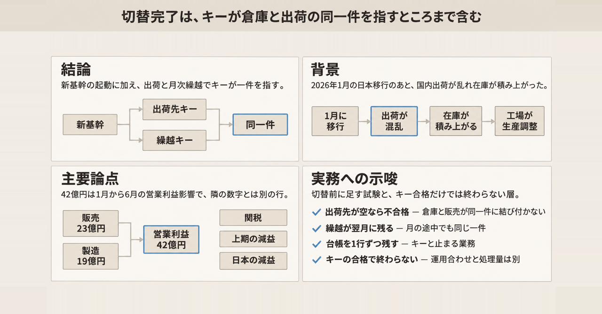
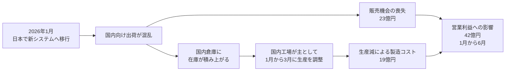
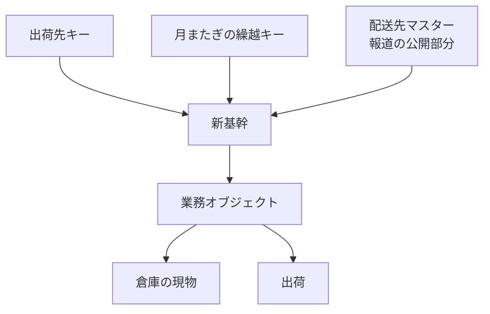

基幹システムを新版へ切り替えたあと、何をもって切替完了とするかを、TOYO TIRE の日本拠点を題材に整理します。切替の受入条件を決める人が、開示された金額の範囲と、切替前に置ける試験項目を判断できる状態が、この記事の到達点です。金額のよりどころは TOYO TIRE の決算説明資料とし、日経クロステックは公開されている冒頭の段落（リード）と次ページの見出しだけを使います。

*この記事の全体像。以下、順に解説します。*

## 切替完了の判定とは

S/4HANA は、独 SAP の基幹システムの新版です。TOYO TIRE は、2022年7月に稼働したセルビア工場へ S/4HANA を導入し、2026年1月から日本の拠点でも運用しています。製品名は、同社の DX ページにあります。

完了条件の候補は、周辺が渡すキーで業務オブジェクトを一意に追えることです。キーとは、周辺システムが基幹へ渡す識別子です。業務オブジェクトとは、倉庫の現物と出荷が同じ一件として結び付く単位です。対象の場面は、出荷と、月をまたぐ繰越です。この候補の文言は、会社の決算説明資料にはありません。公開リードと、次ページの見出しから置いたものです。

日経クロステックの公開リードは、次のとおりです。

> 独SAPの新版「S/4HANA」への切り替えで、業績に響くトラブルが目立ち始めた。TOYO TIREでは出荷先の分からないタイヤが倉庫に滞り、約42億円の影響が生じた。浮かび上がるのは、基幹システム本体よりも周辺システムとの連携に潜む落とし穴だ。

次ページの見出しは「月またぎの繰り越しが反映されず」です。繰越キーとは、この見出しに対応させて置く、月をまたぐ繰越の識別子です。

### 日本拠点で会社が書いた流れ

2026年8月7日の決算説明資料は、日本での初期のシステム問題を、次の順で書いています。

1. 2026年1月に新システムへ移行した。
2. 国内向けの出荷が混乱した。日本語資料は「国内向けの商品を中心に出荷停滞が発生」と書く。
3. 国内倉庫に在庫が積み上がった。日本語資料は「国内倉庫で在庫が滞留した」と書く。
4. 国内工場が、主として2026年1月から3月に生産を調整した。資料が新ゴム生産量として示す数量は、2026年1〜3月が23.1千トン、2025年1〜3月が28.8千トンです。
5. 6月末までに、出荷の混乱は解消した。
6. 8月7日時点では、残っていたバックオーダーの解消作業が続いていた。バックオーダーとは、ここでは解消の対象として残っていた未出荷です。

同じ資料は、1月から6月の営業利益への影響を42億円としています。日本語資料の表現は「営業損益ベースで42億円」です。英語資料は operating income 4.2 billion yen と書き、同じ増減の説明に置いています。内訳は、販売要因23億円と製造コスト19億円です。23億円は販売減少による機会損失、19億円は減産による製造コストの悪化、と資料が対応させています。2026年11月16日の第3四半期資料は、同じ二つを「システムトラブルの影響（1〜6月、内数）」として再掲しています。内数とは、会社がその列の合計の内側に含まれる、と注記した内訳です。

下の図は、8月7日の資料が書いた、日本の初期システム問題から営業利益までの流れです。23億円と19億円は、その資料が営業利益影響として示した内訳です。

販売本数の置き場所は、前年の同じ期間を100とした指数です。国内市販は、その指数の一つの列です。2025年度実績では販売本数の16%で、第2四半期の英語資料の列名は RE Japan です。第3四半期資料の指数は次のとおりです。

| 期間 | 国内市販の指数 |
| --- | ---: |
| 1〜3月 | 67 |
| 4〜6月 | 76 |
| 7〜9月 | 79 |
| 1〜9月 | 74 |
| 10〜12月の予想 | 112 |
| 通期予想（11月16日時点） | 85 |

通期予想の指数は、5月15日が110、8月7日が92、11月16日が85です。

### 同じ時期の他社の開示

関西ペイントは、2026年5月11日の説明資料に「基幹システム刷新に伴う影響」と「周辺システムとの連携課題」を置いています。スライドは、供給混乱への対応で計画外の一過性マイナスが出たと書き、セグメント利益の図に次の数を置きます。単位は億円です。

| 項目 | 億円 |
| --- | ---: |
| 実績 | 220 |
| システムベンダー支援 | 6 |
| 特別物流対応（空輸を含む） | 7 |
| 追加人件費 | 1 |
| 他社への流出 | 2 |
| 一過性を除く実力値 | 236 |
| 公表値 | 235 |

6、7、1、2の合計は16です。220から236への差と一致します。同じスライドは、周辺システムとの連携課題は解消し、4月下旬から挽回生産を本格化した、と書きます。今後の業績への影響は限定的、とも書きます。

安川電機は、2026年7月10日の質疑応答サマリーに、S/4HANA への移行を書いています。ゴールデンウィーク中に入れ替え、システム自体はほぼ安定稼働している、とあります。一方で、運用を基幹側へ合わせる必要があり、5月に一部の生産ラインを止めた、ともあります。基幹システムの移行影響による1四半期の生産利益の低下は25億円です。質疑応答は、営業利益の説明の中で、この低下を挙げています。セグメント別ではモーションコントロール15億円、ロボット10億円です。欧州の構造改革費用10億円は別行で、ロボット側に入ります。基幹がスムーズに立ち上がっていれば、売上は30億円程度上積みできた、という見立てもあります。導入コストのうち、減価償却は年間7〜8億円、導入時の費用計上は約4億円です。1四半期の稼働率は全体で75%弱です。受注は止めていません。

### 候補として追う関係

下の図は、完了条件の候補として追う対象です。出荷先キーと繰越キーは、公開リードと次ページ見出しに対応します。配送先マスターとは、関西ペイントに関する日経クロステックの公開第1ページが、物流システムで使う物流関連データとして名指しした項目です。

出荷先キーとは、出荷先を指すために周辺が渡す識別子です。公開リードの「出荷先の分からないタイヤ」に、この名前を対応させています。

## 注意点

42億円という数字は、会社が営業利益への影響として切った数字です。倉庫にあるタイヤの簿価としては開示されていません。在庫は「積み上がった」「滞留した」と書かれ、金額は利益側に置かれています。

### 42億円に見える別の行

同じ「42」でも、関税の行とは別です。第2四半期英語資料の四半期行では、関税影響が1〜3月に (4.2)、4〜6月に (4.2) と並びます。単位は10億円です。第3四半期資料の関税影響は、1〜3月が△42億円、4〜6月が△42億円、7〜9月が+9億円、1〜9月の列合計が△76億円です。5月15日の第1四半期資料には、システム問題としての42億円の表記はありません。そこにある (4.2) は、あとから第2四半期資料の1〜3月の関税行と一致します。

42億円は、上期の営業利益の減少額そのものでもありません。上期の営業利益は48,176百万円から37,497百万円になり、資料が印字している差は (10,678) 百万円、減少率は22.2%です。約107億円の減少のうち、システム影響42億円は、会社が名指しした部分です。第2四半期のブリッジ（営業利益の増減を要因別に分けた図）は、上期の関税影響を (8.5) とも置いています。単位は10億円です。

日本セグメントの営業利益の減少とも一致しません。上期の日本の営業利益は29,932百万円から26,858百万円になり、資料が印字している差は (3,074) 百万円、10.3%減です。約30.7億円です。日本の売上高は55,462百万円から50,437百万円になり、印字されている差は (5,024) 百万円、9.1%減です。1〜9月の日本の売上高は85,606百万円から79,550百万円になり、差は6,056百万円、7.1%減です。

1〜3月だけを見ると、並びは逆です。日本の売上高は26,978百万円から23,826百万円へ11.7%減ります。日本の営業利益は13,981百万円から15,474百万円へ1,493百万円増え、10.7%増です。国内市販の指数67の四半期は、日本所在地の営業利益が減った四半期ではありません。

通期の営業利益予想は二度動いています。8月7日に940億円から900億円へ、11月16日に900億円から820億円へです。11月のハイライトが修正の理由として書いたのは、実績と第4四半期の見通しです。システム影響の再掲は、ハイライト本文にはありません。予想の修正幅を、42億円と同じものとして読みません。

8月7日の適時開示「連結業績予想値と実績値との差異に関するお知らせ」は、上期の営業利益を予想42,000百万円に対し実績37,497百万円、差△4,502百万円（△10.7%）と置きます。差異の理由の段落が説明しているのは、経常利益と親会社株主に帰属する中間純利益が予想を上回ったことです。理由は、為替が想定より円安だったことです。開示の文は「主として、為替相場が想定より円安に推移したことから、経常利益及び親会社株主に帰属する中間純利益は前回発表時の予想を上回る」です。この段落に、システムトラブルの語はありません。営業利益の下振れ約45億円の説明としても、42億円の定義としても、この開示は使えません。42億円の定義は、決算説明資料の側にあります。

隣に置くと、次のように分かれます。

| 数字 | 資料が指しているもの | 期間 |
| --- | --- | --- |
| 42億円（23と19） | 営業利益への影響。販売要因と製造コスト | 2026年1〜6月 |
| 関税の (4.2) が2回 | 10億円単位の関税行。第3四半期資料では各△42億円 | 1〜3月と4〜6月 |
| (10,678) 百万円 | 上期営業利益の印字された減少 | 上期 |
| (3,074) 百万円 | 日本所在地の営業利益の印字された減少 | 上期 |
| △4,502百万円 | 上期営業利益の予想と実績の差。理由欄はシステムではない | 上期 |
| 940、900、820億円 | 通期の営業利益予想の修正 | 通期 |

### 製造コスト19億円と四半期の足し算

第3四半期の営業利益ブリッジ（1〜9月、億円）は、販売要因+3、製造コスト△36の列を持ちます。システムトラブルは、その二つの列の内数として△23と△19と注記されています。23と19の和は、8月に開示した42億円と一致します。

一方、同じページの四半期行を1〜6月で足すと、製造コストは△4+△11で△15億円です。内数の△19は、この△15より大きいです。したがって△19を「1〜6月の製造コスト列の内側」と読むと、このページの足し算とは合いません。確定できるのは、会社が営業利益影響42億円の内訳として23と19を示し、1〜9月の図では両方を内数と注記している、ということです。内訳の算術を、四半期列への按分としては使いません。

1〜9月の営業利益そのものは、72,068百万円から61,626百万円になり、差は10,442百万円です。図の721と616は、億円表示の概数です。

### 指数の残りをシステムだけに読まない

67は1〜3月、74は1〜9月です。どちらも前年の同じ期間を100とした国内市販の指数です。7〜9月は79で、6月末に出荷混乱が解消したあとも100を下回ります。第3四半期のハイライトは、この指数の残りをシステム問題とは書いていません。

1〜9月の販売要因列は+3億円で、その内数として1〜6月の△23億円がいます。7〜9月の販売要因は+59億円です。国内市販の指数が100を下回ることの全体を、システム問題の結果とは、会社は書いていません。指数67を「日本の業務が止まった大きさ」としては使えません。国内市販は、2025年度実績で販売本数の16%です。

### 出荷先と月またぎは、どの資料の文か

出荷先が分からないこと、周辺連携が本体より落とし穴であること、月またぎの繰越が反映されないことは、日経クロステックの公開リードと次ページ見出しに属します。2026年8月7日と11月16日の決算説明 PDF をテキスト化した範囲では、出荷先、周辺連携、S/4HANA、月またぎ繰越の語は、この障害の説明には出てきません。会社が書いたのは「initial system issue in Japan」と「Migrated to the new system」です。日本語では「国内システムの初期トラブル」と「新システムに移行」です。

有料の本文は、ここでは使っていません。月またぎの見出しが TOYO TIRE の障害の説明か、特集の別の節かは、見出しだけでは確定できません。

### 他社の金額の所在

関西ペイントの約16億円は、2026年5月11日の会社説明資料にあります。内訳の6、7、1、2は、そのスライドの数です。配送先マスター、2021年に導入済みの倉庫管理システム、2026年1月の S/4HANA 稼働、毛利訓士代表取締役社長の陳謝は、この PDF にはありません。それらは日経クロステックの公開第1ページの文です。掲載日は、公開第1ページの範囲では確認できていません。第2ページは、ここでは使っていません。

安川電機の25億円は、倉庫に出荷先不明の在庫が滞った、という記録ではありません。システム自体はほぼ安定稼働としたうえで、仕事のやり方を基幹へ合わせる過程でラインを止めた、という記録です。

セルビア工場が2022年7月に稼働したこと自体には、この42億円に相当する開示はありません。DX ページにも、42億円の記載はありません。会社が金額を付けたのは、日本での初期のシステム問題です。

## 完了条件はキーが一件を指すところまで含める

切替完了は、新基幹が起動したことに加え、出荷と月次繰越の場面で、周辺が渡すキーが業務オブジェクトを一意に指すことまでを条件にします。引当とは、販売側で倉庫の現物を同じ業務オブジェクトに結び付けることです。欠けると出荷やその引当が止まる項目は、値が空のとき、切替前の契約試験で不合格にします。契約試験とは、切替前に不合格へできる条件として置く試験です。

この置き方を支える記録は、三つあります。

- 会社は、移行の月に国内出荷が乱れ、倉庫在庫が積み上がり、工場が生産を落とし、システム問題の営業利益への影響額を42億円としている、と一連の流れで書いています。上期の営業利益そのものの減少は、別の行の (10,678) 百万円です。新基幹の起動だけで出荷が続いた、とは書いていません。
- 23億円と19億円は、8月7日と11月16日の二つの資料で同じ組み合わせです。期間はどちらも1〜6月です。
- 関西ペイントの2026年5月11日資料は、別会社のセグメント利益について「周辺システムとの連携課題」と書いています。費用の並びは、ベンダー支援6、特別物流7、追加人件費1、他社流出2（億円）です。配送先マスターという項目名は、日経の公開第1ページにあり、会社 PDF にはありません。

結論を弱める記録も、残します。

出荷先キーの欠落は、記事リードの文です。会社 PDF はそのキー名を書いていません。月またぎの繰越は見出しだけで、TOYO TIRE の事象かどうかは確定できません。

安川電機は、システム自体はほぼ安定稼働としている一方で、運用を合わせるためにラインを止め、生産利益25億円を移行影響としています。キーが埋まっているかを試す契約試験だけでは、この「やってみないと分からない運用差」は見えません。

江崎グリコの2024年5月1日のお詫びは、別の型です。2024年4月3日の基幹全面移行のあと、出荷の遅れを経て4月14日からチルドの出荷を止め、4月18日に一部を再開しています。物流センターの出荷データの不整合と、想定を超える受注品目数で処理が間に合わなかったことの両方を理由に、4月19日から再び止めた、と書きます。常温と冷凍は出荷を続けました。この PDF に、S/4HANA も出荷先キーもありません。キーの空欄を不合格にする試験は、再停止の理由のうち処理量の超過も、切替後に出荷を止める判断も、そのままでは拾いません。

国内市販の指数67の四半期に、日本所在地の営業利益は増えています。指数を、日本の業務が止まった大きさとしては使えません。8月7日の差異開示は、営業利益の下振れをシステムとは書いていません。製造コスト△19億円は、1〜6月の製造コスト四半期合計△15億円の内側としては揃いません。これらは、完了条件の文言を金額の大きさで支えない理由です。

## 切替前に足す三つの試験

切替の完了条件には、次の三つを足します。

1. 出荷の契約試験です。出荷指示の出荷先（配送先）が空のとき、倉庫の現物と販売の引当が同じ業務オブジェクトに結び付かないことを、切替前に不合格とします。
2. 月次の契約試験です。切替日が月の途中でも、繰越在庫と未出荷が、翌月の同じ業務オブジェクトに残ることを合格条件にします。見出しだけの項目なので、試験項目の名前は「繰越」とし、日経クロステックの本文がそう書いている、という断定には使いません。
3. 台帳です。周辺が渡すキー、そのキーが指す業務オブジェクト、キーが空のときに止まる業務を、切替前に1行ずつ残します。止まる業務は、引当、出荷、倉庫からの出庫です。関西ペイントの公開部分が示す配送先マスターは、この台帳の1行に相当します。所在は、日経クロステックの公開第1ページです。

この三つで拾えない失敗があります。安川電機の記録は、システムがほぼ安定稼働したあとに、仕事のやり方を基幹へ合わせる過程でラインが止まった、という型です。江崎グリコの2024年のお詫びは、出荷データの不整合と、受注品目数が処理に追いつかなかったことの両方で、出荷を再び止めた、という型です。キーの空欄試験の合格は、どちらの完了も意味しません。

完了条件は、次の三つに分けて置きます。

| 層 | 合格が意味すること |
| --- | --- |
| キーで追える | 周辺が渡す識別子が、倉庫の現物と出荷の同一件を指す |
| 運用が基幹の手順で回る | 仕事のやり方を基幹側へ合わせても、ラインを止めて見直す余地が残っていない |
| 切替後の処理量が実受注で回る | 想定を超える受注品目数でも、出荷を止めずに処理が追いつく |

42億円は、この試験が防ぐ在庫の評価額としては使いません。会社が切ったのは、1〜6月の営業損益です。指数67も、試験の合格で動く需要の大きさではありません。1〜3月の日本所在地の営業利益は、その指数の四半期に増えています。

金額を説明に使うときは、TOYO TIRE の事例に限ります。定義は一文に固定します。2026年1〜6月の営業利益影響42億円。販売要因23億円、製造コスト19億円。8月7日に開示し、11月16日に内数として再掲。関税の42億円、上期営業利益の約107億円減、日本セグメントの約30.7億円減、通期予想の940億円から900億円、さらに820億円とは、別の行として併記します。

逆転条件は二つです。日経クロステックの有料本文が、出荷先不明を TOYO TIRE の事象ではないと書いていた場合、出荷の契約試験は公開リード由来の仮説に戻します。会社が後の資料で42億円の定義を変えた場合、金額の引用は新しい資料の行に差し替えます。

## 公開資料がまだ分けていないこと

受入条件の文言は、次が未確定でも止めません。止めるのは、出荷先キーを会社の確定原因として書くことと、42億円を在庫の簿価、関税、日本セグメントの減益として書くことです。

- 日経クロステックの有料本文が、出荷先不明の対象期間、本数、42億円の出典段落をどう書いているかは、ここでは閉じていません。
- 「月またぎの繰り越しが反映されず」が、TOYO TIRE の障害の説明か、特集の別節かは、見出しだけでは確定できません。
- 8月7日時点で残っていたバックオーダーが、11月16日時点で残っているかは、第3四半期資料が再掲していません。
- 製造コスト△19億円が、1〜6月の製造コスト列△15億円とどう関係するかは、会社が内数と注記している一方で、四半期の足し算とは一致しません。
- 関西ペイントの配送先マスターと倉庫管理システムの導入年は、会社 PDF では確認できていません。
- 国内市販の67や74のうち、何本がシステム起因で何本が市況起因かは、会社が本数を分解していません。
- 8月7日時点の通期本数予想92が、11月16日に85へ動いた理由を、残バックオーダーと需要のどちらが占めるかは、11月資料が前者を更新していません。

## まとめ

切替完了は、新基幹が起動したことに加え、出荷と月次繰越で、周辺のキーが業務オブジェクトを一意に指すことまでを条件にします。切替前には、出荷先が空なら不合格とする試験、繰越が翌月の同じ一件に残る試験、キーと停止業務の台帳を足します。キーの合格は、運用を基幹の手順へ合わせ終えたことや、実受注の処理量で回ったことを意味しません。

TOYO TIRE の42億円は、2026年1〜6月の営業利益影響です。販売要因23億円と製造コスト19億円で、8月7日の開示を11月16日が内数として再掲しています。在庫の簿価、関税の42億円、上期の約107億円減、日本所在地の約30.7億円減、通期予想の修正幅とは別の行です。出荷先不明は公開リードの文であり、会社 PDF はそのキー名を書いていません。

この記事が少しでも参考になった、あるいは改善点などがあれば、ぜひリアクションやコメント、SNSでのシェアをいただけると励みになります！

## 参考リンク

- [日経クロステック「S/4HANAは動いた　「つなぎ目」が鬼門」](https://xtech.nikkei.com/atcl/nxt/mag/nc/18/111600582/111600001/)（公開リード）
- [同記事の次ページ見出し](https://xtech.nikkei.com/atcl/nxt/mag/nc/18/111600582/111600001/?P=2)
- [TOYO TIRE 2026年度第2四半期 決算説明資料（2026-08-07）](https://tdnet-pdf.kabutan.jp/20260807/140120260805510279.pdf)
- [TOYO TIRE Financial Results for 2nd Quarter of FY2026（2026-08-07）](https://tdnet-pdf.kabutan.jp/20260807/140120260806513357.pdf)
- [TOYO TIRE 連結業績予想値と実績値との差異に関するお知らせ（2026-08-07）](https://tdnet-pdf.kabutan.jp/20260807/140120260805510276.pdf)
- [TOYO TIRE Financial Results for 1st Quarter of FY2026（2026-05-15）](https://tdnet-pdf.kabutan.jp/20260515/140120260514535107.pdf)
- [TOYO TIRE 2026年度第3四半期 決算説明資料（2026-11-16）](https://www.release.tdnet.info/inbs/140120261113580356.pdf)
- [TOYO TIRE DX（デジタル・トランスフォーメーション）](https://www.toyotires-global.com/csr/others/dx)
- [関西ペイント 2025年度決算説明（2026-05-11）](https://asset.kansai.co.jp/uploads/2026/05/FY2025_4Q_jp-explanation.pdf)
- [日経クロステック「関西ペイント、S/4HANA稼働で16億円の影響　物流システム連携に不具合」](https://xtech.nikkei.com/atcl/nxt/column/18/00001/11728/)（公開第1ページ）
- [安川電機 2026年度第1四半期 決算オンライン説明会 質疑応答サマリー（2026-07-10）](https://www.yaskawa.co.jp/wp-content/uploads/2026/07/261Q_QA_1.pdf)
- [江崎グリコ チルド食品の出荷停止期間の延長に関するお詫び（2024-05-01）](https://www.glico.com/assets/files/NR20240501_hp__1.pdf)
