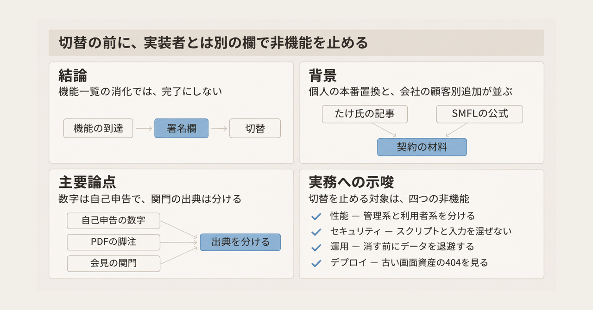
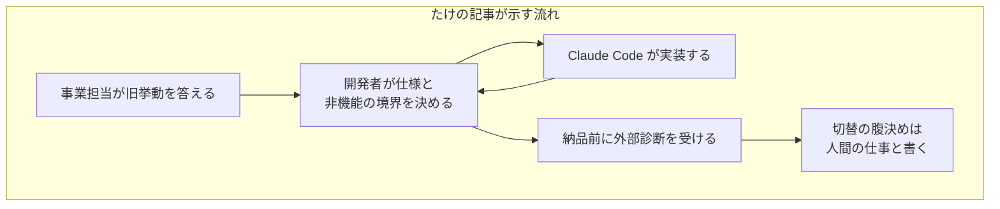
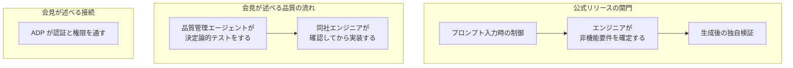

2026年11月6日、たけ氏は Zenn に記事を公開しました。業務の根幹で使っていた外部 SaaS を、この半年間で自社システムへ置き換え、本番稼働まで進んだ、と書いています。体制は開発者1人と事業部門の担当者1人です。実装の中心は Claude Code です。Claude Code は、人が出した指示に沿ってコードを書く AI エージェントです。

2026年11月4日、三井住友ファイナンス＆リース（以下、SMFL）は記者発表を開きました。自社の資産管理クラウドに、顧客別の画面や機能を足す手法を「エンタープライズ・バイブコーディング」と名付け、提供を始めています。

バイブコーディングは、人がコードを一行ずつ書く代わりに、自然言語で意図を伝え、生成 AI に実装を委ねる開発の呼び方です。この記事は、たけ氏の記事と SMFL の公式リリースが、完了と安定をどの関門に置いているかを並べます。読者は、切替の前に契約へ残す欄を決めるときの材料を持ち帰れます。

金額、社名、納品前の外部セキュリティ診断の結果の一部は、たけ氏本人の自己申告です。この置換を名指しする会社発表や診断報告書は、参照した公開資料の範囲では見つかっていません。

*この記事の全体像。以下、順に解説します。*

## SaaSの本番置換と顧客別カスタマイズとは

二つの公表は、生成 AI に実装を渡す前後で、人が持つ仕事を別の文書に書いています。たけ氏の記事は、一つの旧 SaaS の挙動を自社の実行基盤へ移した自己申告です。SMFL の公式文は、自社製品に顧客別の画面と機能を足すサービスです。

### たけ氏の記事が置き換えた実行エンジン

たけ氏が置き換えたのは、業務プラットフォームの実行エンジンです。実行エンジンとは、管理者が登録した独自スクリプトを、利用者の Web 操作に応じてサーバー側で実行し、結果を返す部分です。設定を作る側の既存ツールは流用し、JSON でランタイムとつなぎます。ランタイムとは、そのスクリプトを実際に動かす実行基盤です。この記事では、実行エンジン、ランタイム、実行基盤を、同じ実行の仕組みを指す語として使います。スクリプト実行環境は、登録済みのスクリプトを解釈するその一部で、記事は約1.8万行と書いています。約14.7万行の本体にこの1.8万行が含まれるかは、記事に書かれていません。

仕様の材料は三つです。既存案件の登録データ、SaaS の画面・出力・エラーの実挙動、利用部門へのヒアリングです。

たけ氏が条件として挙げた非機能は、性能、セキュリティ、運用、デプロイの四つです。ここでいう非機能とは、画面や出力の項目一覧とは別に、その機能が本番で耐えられるかを分ける性質です。

人間側の仕事として書かれているのは、仕様と境界の定義、テストの設計、ハーネス、脅威モデルの更新、本番切替の決断です。ハーネスとは、AI が迷走しないように先に敷く開発基盤のことで、記事では `CLAUDE.md`、Fail-Fast、自己レビュー、仕様とテストを先に書くことを指します。自己レビューとは、AI が PR を出す前に、過去の不具合リストと照合して自分で確認する手続きです。人がコードを一行ずつ読む作業としては書かれていません。`CLAUDE.md` は、プロジェクトの構成とルールを AI に渡す文書です。Fail-Fast は、想定外の入力を空文字で握りつぶさず、その場で失敗させるルールです。脅威モデルとは、誰が何を入力でき、どこを信頼するかを先に書き、その前提が変わったら更新する文書です。

セキュリティの作りとして書かれているのは四つです。保存時の静的解析、実行直前の再検証、実行時のコンテキスト分離、利用者入力と管理者スクリプトの分離です。コンテキスト分離とは、スクリプトの実行中に、サーバー内部やホスト環境へ触れさせない境界です。

記事が実績として示す数は、次のとおりです。いずれもたけ氏の自己申告です。正確な金額は記事中で伏せると明記されています。

| 項目 | 記事の記載 |
|---|---|
| 期間 | この半年間 |
| 体制 | 開発1名、事業担当1名、AI は主に Claude Code |
| 本体 | TypeScript 約14.7万行 |
| テスト | 約27.6万行、テストケース約1.9万件 |
| マージした PR | 880本以上。ピークは1日24本 |
| 本番リリース | v1.0.0 以降、約5か月で62回 |
| 設計ドキュメント | Markdown 280本超。うち設計 spec 58本 |
| スクリプト実行環境 | 約1.8万行 |
| 置換後の AWS 費用 | 年間数百万円規模 |
| 旧 SaaS 利用料 | 年間数億円 |
| LLM 以前のリプレイス見積もり | 数年ｘ数億円規模 |
| 納品前の外部診断 | ソースコード診断とブラックボックスのペネトレーションテスト。緊急・高はゼロ |

ブラックボックスのペネトレーションテストとは、内部のソースを前提にせず、外から攻撃を試みて穴を探す試験です。ソースコード診断は、ソースを読んで穴を探す試験です。

Zenn の API では、この記事は 2026-11-06 22:05 JST 公開です。記事種別 idea は、Zenn の投稿区分の名前です。主体が個人ユーザーとは、個人のアカウントによる投稿だ、という API の分類です。2026-11-07 の API 応答では、コメント数、ブックマーク数、いいね数はいずれも 0 でした。この 0 は、公開翌日の時点で反応が付いていなかった記録です。金額や診断の正しさを示す点数としては使っていません。

### SMFLの公式リリースが定義したサービス

SMFL の公式 PDF（2026-11-04）は、サービスを四つの組み合わせとして定義しています。

| 名前 | PDF の定義 |
|---|---|
| assetforce | 資産データと業務の基盤 |
| ADP | assetforce と Replit を、企業ルールに沿って接続する開発基盤 |
| Replit | 自然言語でアプリを作る環境 |
| FDE | 現場を知り、顧客が描くアプリを作るエンジニア |

FDE は Forward Deployed Engineer の略で、PDF は「資産管理の現場を知り、お客さまが思い描くアプリを作り上げるエンジニア」と書いています。ADP は assetforce Data Platform の略です。

手法の定義は、PDF 末尾の脚注にあります。原文は「プロンプト入力時の制御、エンジニアによる非機能要件の確定、ソースコード生成後の独自の検証など」です。列挙の末尾は「など」です。脚注は、この三つを例に挙げ、安全性と信頼性を担保する開発プロセスを整備したもの、と書いています。

実践事例は、企業固有の画面や機能の開発です。PDF は、従来手法で6人・約半年を要すると想定した開発を、1人・1週間で実現した、と書きます。その直前に、期間と効果は対象業務、要件、既存システムにより異なる、と断っています。

背景の規模は、営業資産約9兆円、assetforce の有償契約200社超、管理する資産400万点超です。営業資産とは、SMFL 本体がリース事業で保有する資産の規模です。200社超と400万点超は、外販している assetforce の契約数と、そこで管理する資産の点数です。デジタルサービスの売上規模を、今後5年間で10倍にする、と書きます。

手法の解説書は 2026-11-27 発売、日経BP、200ページ、税込2,970円、ISBN 978-4-296-21051-0 です。2026-11-07 時点では未刊です。この記事が参照するのは、公式 PDF と、2026-11-06 の ITmedia による会見報道です。

### 二つの公表が置いた関門

たけ氏の記事では、旧挙動の答えと非機能の境界が人に分かれ、実装は AI に渡ります。切替の腹決めは、たけ氏が人間に残る仕事として書いています。

戻り矢印は、実装の結果が開発者の仕様と境界へ戻る流れです。納品前の外部診断のあと、切替の決断を人間の仕事として書いています。

SMFL の公式文では、非機能の確定と、生成後の検証が、手法の脚注に入っています。品質管理の流れと、ADP による認証と権限の通過は、2026-11-06 の ITmedia の会見報道にあります。PDF の脚注が書くのは、プロンプト制御、非機能の確定、生成後の独自検証など、までです。ADP は、assetforce と Replit をつなぐときの認証と権限の話です。下の図では、品質確認の流れとは別の枠に置いています。決定論的テストとは、同じ条件なら何度実行しても同じ結果になるテストのことで、この語は会見報道にあります。品質管理エージェントとは、生成したコードを独立して検証する仕組みとして、その会見報道が書いているものです。

二つの公表を、同じ基準で並べると次のとおりです。

| 基準 | たけ氏の本番置換 | SMFL の顧客別カスタマイズ |
|---|---|---|
| 何を変えたか | 外部 SaaS の実行エンジンを自社実装へ置き換えた、という自己申告。設定作成側は既存流用 | 自社 assetforce に、顧客固有の画面と機能を足す |
| 機能の正解は誰か | 旧挙動を知る事業担当。受け入れテストでフィードバックする | FDE が現場と顧客の対話でアプリを作る、と公式が定義する |
| 非機能を誰が持つか | 開発者本人が性能・セキュリティ・運用・デプロイを設計する、と記事が書く。切替の腹決めは人間に残る仕事として書かれ、担当者名は無い | 公式 PDF は「エンジニアによる非機能要件の確定」と書く |
| 生成後の検査 | テスト、Lint、型、CI、自己レビュー、納品前の外部診断。結果は自己申告 | 公式 PDF は「独自の検証」。会見は品質管理エージェントの決定論的テストと、人手の最終確認を加える |
| 安定を残す境界 | 互換の差分は実行基盤側で吸収し、登録済みスクリプトは直さない、というルール | デフォルト機能を標準として残し、カスタマイズ需要は一部に取り込む、と社長が会見で述べる |
| 速度の数字 | 半年、開発1人。行数と PR 数は自己申告 | 想定6人・約半年に対し1人・1週間、と公式 PDF。200画面で従来の3分の1は、会見報道の見込み |
| 公開の裏づけ | 個人の Zenn 記事。社名も原票も公開されていない | 会社のプレスリリース PDF と会見報道 |

原票とは、行数、金額、診断結果の裏づけになる社内の記録です。比較表の「社名も原票も公開されていない」は、その記録が記事と一緒には出ていない、という意味です。

公式の脚注が挙げるのは、プロンプト制御、非機能の確定、生成後の独自検証です。assetforce と Replit の接続は、その脚注の外で、サービス構成の ADP として書かれます。会見は、認証と権限の橋、決定論的テスト、人手の確認を足します。会見では、デフォルト機能を標準として残し、カスタマイズ需要は一部だけ取り込む、と社長が述べています。たけ氏の記事が写しているのは、一つの旧 SaaS の挙動を実行基盤へ移す流れです。

## 注意点

数と到達の宣言は、契約や投資判断の根拠にする前に、定義と分母を分けて読みます。

### コードを読まない、という宣言の幅

たけ氏の記事は、到達を次の文で書いています。

> コードをほぼ読まなくても、ビジネスで耐えうる中規模システムは作れてしまいました。

同じ記事は、実験の宣言を「あえてコードを一切読まず、バイブコーディングだけで中規模システムをどこまで作り切れるか」とも書いています。別の箇所では、ステークホルダーへの宣言として「スピードを落とさないためにあえてコードを読まず、バイブコーディング中心で挑みたい」と書いています。

人間がやったと書いている作業は、仕様と境界の定義、テスト設計、ハーネス、脅威モデル、本番切替です。条件の文は、次のとおりです。

> 非機能要件（性能・セキュリティ・運用・デプロイ）を人間が最初から強く意識し、AIを制御し続けられたこと。そして何より、旧システムの「あるべき挙動」を熟知している事業部門の担当者と二人三脚で進められたことです。

コードの一行レビューをしない、という意味と、コードを見ずに完了した、という意味は、記事の中で幅があります。人間が仕様、テスト、境界を持ち続ける前提と、コードを読まずに完了した、という到達の文が、同じ記事に並んでいます。

### 金額、一致、テスト、リリース回数

次の点は、記事の数や到達宣言を、見積もりや契約の根拠にする前に分けます。

- 会社名、SaaS 名、業務ドメイン、正確な金額は、記事が伏せています。このリプレイスを名指しする会社発表や診断報告書は、参照した公開資料の範囲では見つかっていません。存在しない、とまでは言えません。
- 「年間数億円」は、旧 SaaS の利用料の自己申告です。「数年ｘ数億円規模」は、LLM 以前に社内で取ったリプレイス見積もりの自己申告です。二つの数字は、別の対象です。
- 費用の前後比較は、旧利用料と、置換後の AWS インフラ費です。開発者の人件費、AI の利用料、外部診断の費用は、記事の比較に入っていません。
- 「振る舞いは100%一致させなければならない」は、要求として書かれています。一致率の測定値は、記事にありません。コミットには、旧 SaaS の挙動へ寄せる調整が無数に残る、とたけ氏は書いています。
- テストコードは、本体のほぼ2倍と書かれます。途中から、実装差分だけをテストさせ、全体のテストは GitHub Action の CI に任せる、と変わります。全体テストを廃止した、という記述はありません。差分を誰が、どの環境で実行するかは書かれていません。
- v1.0.0 以降、約5か月で62回の本番リリースがある、と記事は書きます。同じ記事が「デプロイと並行運用で踏んだトラブル」として挙げるのは三つです。ローリングデプロイ中の古い JavaScript による 404、管理系の大量シミュレーション（管理者がテストデータをまとめて作る処理）による利用者画面の詰まり、複数タブの同時完了による重複記録です。ローリングデプロイとは、古いプロセスを残したまま新しいプロセスへ順に切り替える公開の仕方です。三件が本番切替の後かは、記事にありません。62回の内訳が障害対応か計画リリースかも、書かれていません。
- 外部診断の「緊急・高はゼロ」は、たけ氏の要約です。ベンダー名、診断基準、中・低の件数、診断を不合格にする権限が開始前から契約にあったかは、書かれていません。診断の時期は「納品前」と書かれています。
- 置換の中心はランタイムです。設定を作るツールは、既存資産の流用です。

事業担当が担ったと書かれるのは、受け入れテストです。旧システムの動きをその場で返す役割です。非機能の不合格を返す権限としては、書かれていません。

### 速度の数字と、出典が分かれる関門

SMFL の速度も、統制された比較実験の結果としては読めません。

- 公式 PDF の「1人・1週間」は、「6人・約半年を要すると想定した」開発との比較です。対象により異なる、と PDF が先に断っています。
- 200を超える画面を持つ償却計算システムで、要件定義後の開発・テストが従来の3分の1になる、は ITmedia の「見込み」です。償却計算がどの計算式かは、その報道に書かれていません。公式 PDF には、この画面数もこの比率もありません。
- 品質管理エージェントによる決定論的テストと、「最後は必ず同社のエンジニアが確認してから assetforce に実装する」「AI に最終判断を委ねない」は、同じ会見報道にあります。公式の定義は「非機能要件の確定」と「生成後の独自の検証」までです。確認者が、プロンプトを書いた人と別人だとは、PDF に書いていません。
- 同じ会見で、今枝社長は「エンジニアへの指示書などはいらない」とも説明しています。関門の話と、指示書が要らないという話は、一つの契約文にはなっていません。

＠IT が 2025-09-12 に公開した Gartner の記事（Bill Blosen、原稿は2025年6月、出典名は The Promise and Perils of Vibe Coding）は、企業に対して強く推奨しています。ツールと実践が成熟するまで、利用をプロトタイプと制御されたサンドボックスに限定すること。現段階では、バイブコーディングで作ったソフトウェアを本番にデプロイしないこと。同じ記事は、2028年までに、新規のエンタープライズ向けプロダクションソフトウェアの40%が、その技術とツールで作られるようになる、とも予測しています。

ここでの記述は、＠IT の日本語訳に限ります。英語原文の現行文面は確認していません。この勧告を撤回した公開文書は、参照した資料の範囲では確認できていません。勧告は、組織の現段階の方針として書かれたものです。たけ氏のシステムを検査した文書ではありません。

### まだ公開されていないこと

次は、公開文からは決まりません。

- たけ氏の所属、契約、診断報告書、本番切替日は公開されていません。第三者資料が参照範囲に無いことは、それらの不存在を意味しません。
- 62回のリリースのうち、障害対応がどれだけかは不明です。
- 「エンジニアによる非機能要件の確定」が、プロンプトを書いた人と別人かは、公式文からは決まりません。
- 決定論的テストの中身、つまり何を同じ入力とみなし、誰がテストを所有するかは、会見記事の範囲では分かりません。
- 2025年の「本番に出さない」推奨が、2026-11 時点の Gartner の現行文面かどうかは、有料の英語原文を読んでいないため未確認です。

社名も原票も無い数字で、自社の予算や期間を決めることはできません。関門の置き方を契約の欄に落とす判断は、この未確認が残ったままでもできます。

## 非機能の不合格で切替を止める欄

コードを人が書かない開発の完了は、機能一覧の消化では切りません。切替の前に、実装者とは別の名前を一欄置きます。この欄を、ここでは署名欄と呼びます。署名欄とは、その名前の人が、非機能の不合格だけを理由に切替を止められる契約上の記入欄です。

この欄は、二つの事例がすでに満たした条件を写したものではありません。事例を読んだあとに、発注側が足す欄です。

たけ氏自身は、条件を非機能の意識と、旧挙動を知る事業担当に置いています。記事が「デプロイと並行運用で踏んだトラブル」として書いた三件は、機能一覧の未達の話ではありません。デプロイ、性能の分離、同時実行の話です。三件が本番切替の後かは、記事にありません。事業担当が担ったと書かれるのは受け入れテストであり、非機能の不合格権限ではありません。

たけ氏の条件文は、人間が最初から意識し、AI を制御し続けた、という書き方です。別の名前の拒否権は、その文には出てきません。記事は、切替を決める別人の名前を書いていません。開発者はたけ氏1人なので、非機能の設計と切替の腹決めは、結果として本人に重なります。外部診断は別組織の作業ではあります。公開文からは、開始前からの拒否権も、中・低を止める基準も読めません。別名義の契約が無いと本番置換は失敗する、という反例は、今回の資料にありません。記事は、本番稼働まで進んだと書いています。

SMFL の公式定義は、生成の前に非機能を確定し、生成の後に独自検証する、と手順を分けています。会見は、AI に最終判断を委ねない、と方針を口にしています。SMFL の「確定」について、実装者以外が不合格にできる、という文は PDF にありません。SMFL の公表は、関門の文章と、デフォルト機能を標準として残しカスタマイズ需要は一部だけ取り込む、という会見の文章とを、別々に書いています。関門に加え、その標準を残して需要の一部だけを取り込む判断でも安定を守っています。SaaS 全体を置き換える案件へ、この分け方をそのまま移す材料は、公表の中に揃っていません。

Gartner の 2025年6月原稿は、現段階の本番投入を避けるよう推奨しています。2026年の個別事例を、この一文だけで偽にすることはできません。

### 止める対象を四つに揃える

止める対象は、たけ氏の記事が本番の前後で実際に扱った四つに揃えます。四つは、たけ氏が非機能として挙げた性能、セキュリティ、運用、デプロイです。直前のトラブル三件は、デプロイ、性能、同時実行です。同時実行の重複記録は、この四つのどれか一つに対応する、とは記事が書いていません。署名欄が不合格にするのは、この四項目です。同時実行の重複記録は、四項目への割り当てが記事に無いので、署名欄の不合格理由には足しません。

1. 性能。利用者向けの処理と、管理系の重い処理が、同じ計算資源を食い合っていないか。先のトラブルでは、管理系の大量処理が利用者画面を詰まらせています。
2. セキュリティ。サーバーで評価するスクリプトの信頼境界と、利用者入力との合流。信頼境界とは、管理者のスクリプトと利用者の入力を、同じ評価対象として混ぜない線です。先に書いた、利用者入力と管理者スクリプトの分離が、この項目です。
3. 運用。データを止めずに捨てる手順と、捨てる前の退避。捨てるとは、サービスを止めずにデータを消すことです。退避とは、消す前にそのデータを別の場所へ移すことです。これはトラブル三件の見出しには無く、たけ氏の記事が運用として書いた設計です。サービスを止めずに古いデータを消し、消す前に退避する、と記事が書いています。
4. デプロイ。稼働中の利用者が、古いフロント資産を取りにいったときの挙動。先のトラブルの、古い JavaScript による 404 が、この項目です。

事業担当をこの欄に充てるのは、たけ氏の事例の役割とはずれます。あの担当者は、機能の正解係です。非機能の欄には、実装を指示した人とは別の技術者か、診断の不合格を返す外部者を書きます。外部診断を使うなら、ベンダー名、見るレベル、中・低を止めるかどうか、診断が切替の前に拒否権を持つかを、結果の要約より先に書きます。

### SMFLを引くときの分け方

SMFL を引くときは、全置換の成功例として引きません。顧客別の差を足す案件なら、公式 PDF が書いた手順に、会見が述べた取り込み前の人手確認と、デフォルト機能を標準として残す範囲を、契約の別欄に分けます。公式 PDF の脚注が名指ししているのは、プロンプト入力時の制御、エンジニアによる非機能要件の確定、ソースコード生成後の独自の検証です。脚注は「など」で続いています。速度の「1人・1週間」と「3分の1」は、想定と見込みのまま、見積もりに写しません。

出典も分けます。公式 PDF の脚注と、会見報道の関門を、一つの出典に混ぜません。認証と権限の橋、決定論的テスト、人手の最終確認、デフォルト機能を標準として残してカスタマイズ需要は一部だけ取り込む、という四つの文は、会見報道の側です。

### 別の名前を過剰とする条件

次の場合は、別名義の署名欄を先に置かなくても、関門の置き方は揃います。

- 対象が、顧客データも金銭も扱わない試作に留まるなら、別名義の停止役より、サンドボックスに閉じる方が、2025年6月原稿の推奨に近いです。サンドボックスとは、本番の顧客データと本番の操作から隔離した試験環境です。
- 発注側の案件の差が、標準製品の外だけに留まるなら、全置換用の四項目より、本体へ取り込む前の確認者の方が、関門として一致します。SMFL の会見が述べた運営は、この条件とは別の文です。デフォルト機能を標準として残し、カスタマイズ需要の一部を取り込む、と書いています。
- 実装者本人が非機能も診断の読みも持ち、その記録が社内に残る運用をすでに選べるなら、別名義は過剰だ、という判断は残ります。今回の資料は、その判断を事故で否定してはいません。

切替の定義を動かすなら、次の三つです。

1. 完了の定義を、機能の到達から、上の四項目を不合格にできる署名欄へ移します。
2. たけ氏の行数、金額、診断結果は、社内の原票が無い限り、見積もりと契約の根拠に使いません。
3. SMFL を参照する文では、公式 PDF の脚注と、会見報道の関門を、一つの出典に混ぜません。

## まとめ

たけ氏の記事は、年間数億円規模と書かれた外部 SaaS の実行エンジンを、開発者1人と事業担当1人、実装は Claude Code で置き換え、本番まで進んだ、という自己申告です。条件として本人が挙げているのは、性能・セキュリティ・運用・デプロイを人間が制御し続けたことと、旧挙動を知る事業担当です。行数、金額、診断の「緊急・高はゼロ」は、社名も原票も公開されていない自己申告です。

SMFL の公式 PDF は、顧客別の画面と機能を足す手法を、プロンプト制御、非機能の確定、生成後の独自検証など、と定義しています。1人・1週間は、6人・約半年を要すると想定した開発との比較で、対象により異なると PDF が断っています。決定論的テスト、人手の最終確認、認証と権限の橋、200画面で3分の1という見込みは、公式 PDF の外にある会見報道です。

コードを人が書かない開発の完了は、機能一覧の消化では切りません。切替の前に、実装者とは別の署名欄を置き、性能、セキュリティ、運用、デプロイの不合格だけで止められるようにします。この欄は、発注側が切替の前に足す欄です。社名も原票も無い数字で、自社の予算や期間は決めません。

この記事が少しでも参考になった、あるいは改善点などがあれば、ぜひリアクションやコメント、SNSでのシェアをいただけると励みになります！

## 参考リンク

- たけ「年間数億円のSaaSを、開発者一人バイブコーディングでリプレイスして感じた達成感と危機感」Zenn、公開 2026-11-06 22:05 JST。[https://zenn.dev/ttake/articles/0b6c8f887b160e](https://zenn.dev/ttake/articles/0b6c8f887b160e)
- Zenn API `GET /api/articles/0b6c8f887b160e`（published_at、article_type、counts。取得日 2026-11-07）。[https://zenn.dev/api/articles/0b6c8f887b160e](https://zenn.dev/api/articles/0b6c8f887b160e)
- 三井住友ファイナンス＆リース「“エンタープライズ バイブコーディング”を用いた『企業向けパーソナライズ型 SaaS』を発表」2026-11-04。[https://www.smfl.co.jp/news/assets/261104.pdf](https://www.smfl.co.jp/news/assets/261104.pdf)
- 平 行男「エンタープライズSaaSにもバイブコーディングの波　三井住友系が顧客ごとのカスタマイズに活用　安定性をどう確保？」ITmedia AI＋、2026-11-06 08:52。[https://www.itmedia.co.jp/aiplus/article/2611/06/2000002933/](https://www.itmedia.co.jp/aiplus/article/2611/06/2000002933/)
- Bill Blosen「バイブコーディングの可能性と課題：Gartner Insights Pickup（414）」＠IT、公開 2025-09-12 05:00。原稿は2025年6月。[https://atmarkit.itmedia.co.jp/ait/articles/2509/12/news002.html](https://atmarkit.itmedia.co.jp/ait/articles/2509/12/news002.html)
