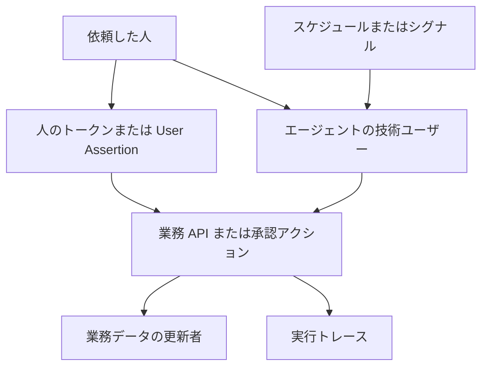

SAP、Oracle Fusion、Salesforce は、画面の外から業務エージェントや業務 API を起動する経路を公開しています。この記事は、見積、承認、取消に相当する操作について、起動の入口、実行時のアイデンティティ、業務 API、残る記録を、2026年10月時点の公開ドキュメントの範囲で整理します。起点は、日経クロステック 2026年10月21日の、会員でなくても読める冒頭です。会員限定の本文は未取得です。

*この記事の全体像。以下、順に解説します。*

## SAP、Oracle Fusion、Salesforce のエージェント経路とは

三社は、人が画面を開かなくても、業務のワークフローや業務 API を起動できる入口を公開しています。見積、承認、取消に相当する操作の多くは、新しい専用 API ではなく、既存の業務 API または承認アクションの上に載ります。

### 起動の入口

SAP では、エージェントを Cloud Identity Services 上のアプリケーションとして登録し、技術ユーザーを付けます。Cloud Identity Services は、SAP の認証とアプリケーション登録の基盤です。技術ユーザーは、人がブラウザでログインする利用者とは別で、client credentials、JWT bearer、token exchange で認証します。client credentials はクライアント ID と秘密でトークンを取る方式、JWT bearer は署名付きトークンを資格情報にする方式、token exchange は既存のトークンを別のトークンへ交換する方式です。

Oracle Fusion の AI Agent Studio は、エージェントのワークフローを作り、公開済みワークフローを起動する製品です。ここからの Oracle の手順は、文書版 26C を基本にします。26A、26B、26C、26D、25D は、Oracle の文書が示す製品の版の名前です。各記述の時点は、その文書に付いた日付で見ます。入口は、チャット、Webhook、受信メール、スケジュール、シグナルです。Webhook は、外部から HTTP で起動する入口です。スケジュールは、利用者の操作も API 呼び出しもなしに、時間間隔またはカレンダーで起動します。シグナルは、業務イベントが起きたことを表す定義で、その出来事を契機に、利用者の操作も API 呼び出しもなしに起動します。スケジュールには職務 `ORA_DR_FAI_BATCH_JOB_MANAGER_DUTY` が要ります。この職務は、スケジュールを設定する側の Fusion のロールです。実行時の User Name がこのロールだとは、文書には書かれていません。

Salesforce の Agent API は、画面の制約なしに、エージェントのセッションを開始し、メッセージを送り、終了する REST です。対象は、エージェントとの会話セッションです。type が Agentforce (Default) のエージェントには対応しません。Agentforce (Default) は、Salesforce が用意する既定種別のエージェントです。呼び出しには External Client App の client credentials を使います。External Client App は、組織の外から OAuth クライアントとして接続するアプリです。Run As は API Only 以上のユーザーです。Run As は、その呼び出しをどのユーザーとして実行するかを指します。API Only は、画面ログインではなく API 実行のためのユーザーです。

### 実行時に名指しされる主体

SAP Help の検索インデックス（2026年10月16日）は、現行ではエージェントが人間の代理として動き、エージェントの API スコープと対象ユーザーの権限の両方が揃ったときだけ成功する、と示します。検索インデックスは、Help の検索結果に出る抜粋です。Help 本文の HTML とは別のテキストです。同じインデックスは、人間のコンテキストなしの自己代理を将来リリースと書きます。

SAP Joule Agents Compliance Brief 1.0（2026年6月17日、公開 PDF、6ページ）は、エージェントを匿名でも共有システムアカウントでもなく、一意にプロビジョニングされたアイデンティティと書きます。Joule は、SAP の業務エージェントの名称です。人間の代理で動く場合、権限はそのユーザーが持つ範囲の部分集合です。監査では、誰が実行したか、何を許可されていたか、何をしたか、誰の代理かを問います。監督は既存の ERP 承認に埋め込まれ、利用者は確認、上書き、取り消しを保てる、と SAP は書きます。タスクには AI を使わない代替経路が常にある、とも書きます。文書は高レベルのブリーフィングで、法的助言ではありません。

Oracle のコンポーネント説明（公開日 2026年8月24日）は、エージェントが利用者の代理で作業し、User-proxy agent は業務ユーザーの代理で別のエージェントへ入力する、と書きます。User-proxy agent は、人の入力を別のエージェントへ渡す仲介役です。Get Started（同じ 26C）は、Business Object ツールが Fusion 内のレコードを取得、更新、作成、削除し、Fusion のネイティブなセキュリティとロールベースのアクセス制御に従う、と書きます。Business Object ツールは、Fusion の業務レコードを読み書きするツールです。使うオブジェクトと項目は選べます。式の User Name（`{{$context.$user.$name}}`）は、ワークフロー実行を開始した認証ユーザーの ID です。26B の HTML と、2026年10月15日付の 26D PDF が同文です。

Oracle の外部 REST ツールは、Require Human Approval を選ぶと、ツール実行前に人が確認します。26C の What's New（公開日表記 2026年9月29日）は、Human Approval ノードを承認プロセスへ結び、結果が出るまでワークフローを止めます。26A（公開日表記 2026年6月9日）は、Fusion の外から agent team を REST で呼べます。agent team は、複数のエージェントをまとめた呼び出し単位です。呼び出し方は polling または SSE です。polling は結果を繰り返し問い合わせる方式、SSE はサーバーからイベントを流し続ける方式です。アクセスは、agent team に割り当てたロールと User Assertion に基づきます。User Assertion は、呼び出し元のユーザーを表明するトークン上の主張です。

Salesforce Agent API の `bypassUser` が true のとき、実行ユーザーはエージェントに紐づくユーザーです。false のとき、トークンのユーザーです。client credentials の例は true で、ユースケースに応じて変える、と開発者ガイドは書きます。

Salesforce Help の検索インデックス（2026年10月20日）では、Employee エージェントはログイン中のエンドユーザーとして実行します。検証なしの Service エージェントは EinsteinServiceAgent User として実行します。「検証なし」がどの確認を指すかは、検索インデックスには書かれていません。検証済みのときの実行ユーザーも、同じインデックスにはありません。Employee エージェントは社員向け、Service エージェントは顧客対応向けの種別です。コンテキスト変数は顧客が誰かを示しますが、データアクセスは制御しません。項目レベルの必須は API を含む保存に適用され、ページレイアウトの必須は UI 編集のときだけ適用される、と Knowledge 000384974 のインデックスは書きます。入力規則は、ページレイアウトにも API 呼び出しにもその項目が無くても、新規と更新に適用される、と同インデックスは引用します。

### 見積、承認、取消に相当する業務アクション

見積書オブジェクト専用の API 名は、三社の公開ドキュメントからは特定できていません。以下は、受注、購買、会話セッションという、別の業務データでの相当操作です。

SAP の受注 API（Sales Order A2X、OData V2、技術名 `API_SALES_ORDER_SRV`、版表記 2025 FPS02 Oct 2026）は、外部システムから受注の作成、読取、更新、削除を行います。OData V2 は、エンティティを HTTP で読み書きする SAP の API 形式です。A2X と FPS02 は、Help の版表記に含まれる名前です。明細の `SalesDocumentRjcnReason` は受注を拒否する理由で、任意項目かつ更新できます。承認 API は、受注の作成や更新とは別の入口で、Release で承認し、Reject で拒否します。受注向けの外部承認サービスは、その承認を外から扱う Help 上のサービスです。そのサービスでは、社内営業担当への差戻しと、承認依頼の取下げができない、と Help が書きます。

Oracle 調達 26C（ドキュメント日付 2026年8月6日）の購買オーダー取消は、項目の汎用的な更新とは別の、公開された action/cancel です。購買オーダーは発注の伝票です。

`POST /fscmRestApi/resources/11.13.18.05/purchaseOrders/{purchaseOrdersUniqID}/action/cancel`

メディアタイプは `application/vnd.oracle.adf.action+json` です。パラメータに `cancellationReason` があります。`cancellationReason` は、取消の事由を表す文字列です。購買依頼の取消（25D、2025年11月13日）は、後続の伝票に紐づいていない依頼に限り、ステータスを Cancelled にし、document history を更新します。購買依頼は、発注に先立つ依頼です。この条件は購買依頼の取消の記述であり、購買オーダーの action/cancel へは書かれていません。document history は、その伝票の操作履歴です。ロールの例は、Preparer または Procurement REST Service Duty です。どちらも、その操作ができるロール名の例です。名前が依頼者なのか API 用ロールなのかは、文書には書かれていません。

Salesforce 側で、セッションを閉じる操作として確認できるのは Agent API の終了です。

### 起動、主体、業務 API、記録の配置

起動のきっかけ、実行時のアイデンティティ、業務 API、記録は、別の箱に分かれます。

人のトークンで業務 API を叩く経路と、エージェントの技術ユーザーで叩く経路が、同じ業務 API に合流します。スケジュールは、人の操作を待たずに技術ユーザー側へ入ります。業務データの更新者と、エージェント実行のトレースは、公式の説明では別の記録です。

## 注意点

日経クロステックの見出しは、利用者を人間から AI へ移し、画面を持たない SaaS が台頭する、という書き出しです。読めるのは公開リードと、日経クロステック IT の X 投稿（2026年10月21日、「人間向けの画面を持たない SaaS が登場しています」）です。会員限定の本文は未取得です。製品の一次情報は、画面の廃止を三社共通の完了事実としては書いていません。

SAP のコンプライアンス文書は、AI を使わない代替経路が常にある、と書きます。Oracle の公式な配置例には、サイトやアプリへのチャット埋め込みと、人が Fusion の画面で更新するためのディープリンクが残ります。ディープリンクは、該当の画面を直接開く URL です。Salesforce の Employee エージェントはログインユーザーの画面の文脈を前提にし、Agent API は Agentforce (Default) には使えません。

検索インデックスだけを根拠にした記述は、Help 本文の HTML で裏を取っていません。SAP の現行の二重認可と将来の自己代理、Salesforce の Employee と Service の実行ユーザー、項目の必須、入力規則、承認作業項目の Completed By、Agentforce Considerations、Knowledge 005314096 は、この位置づけです。二重認可は、エージェントの API スコープと、対象ユーザーの権限の両方を要求することです。

### 人間の代理を一枚の文にしない

「人間の代理が三社の既定である」は、一枚の文にはできません。

| 製品 | 起動 | 実行時に公式が名指す主体 |
|---|---|---|
| SAP Help（検索インデックス） | 技術ユーザーは client credentials、JWT bearer、token exchange のみ | 現行は人間の代理。自己代理は将来リリース |
| SAP コンプライアンス PDF | 複数ステップを、各アクションの人間の指示なしに追う | 人間の代理である場合、権限は利用者の部分集合。常に代理、という意味ではない |
| Oracle 26C のトリガー | スケジュールとシグナルは、利用者の操作も API 呼び出しもなし | 式の User Name は、実行を開始した認証ユーザー。スケジュール時に誰が入るかは未記載 |
| Oracle のコンポーネント | ワークフローへエージェントを載せて配置 | 利用者の代理、とコンポーネント説明は書く |
| Salesforce Agent API | 画面なしのセッション | `bypassUser` が true なら、エージェントに紐づくユーザー |
| Salesforce Help | チャネルと種別で分かれる。検索インデックス上の記述 | Employee はログインユーザー。検証なしの Service は EinsteinServiceAgent User |

### 人間承認は、初期状態のゲートではない

Oracle の外部 REST は、Require Human Approval を選択したときだけ、実行前に人の確認が入ります。選ばなければ、そのゲートは存在しません。公開記述は、この Require Human Approval と、26C の Human Approval ノードが同一の設定だとは書いていません。契約に書くのは、ツール側の Require Human Approval です。ベンダーブログ（2026年7月27日、Fusion CoE）は、トランザクションの POST、PATCH、DELETE が承認を要することがある、と書き、プロンプトはアイデンティティとデータセキュリティの代わりにならない、と書きます。これは公式ブログであり、製品仕様の本文ではありません。Get Started は承認を「必要な場合」と書き、メールツールの Require Human Approval は Optional です。Document ツールの Require Human Approval が任意か必須かは、公開記述からは確定していません。Document ツールが何を読むかは、同じ記述にはありません。

### 画面のガイドが API に残る範囲

ページレイアウトの必須とヘルプテキストは API の保存に乗らない、という読みは、Salesforce の Knowledge と Help の検索インデックスに限られます。SAP と Oracle の画面ガイドへ一般化しません。

SAP の受注向け外部承認サービスについて、Help の文の主語は This service です。そのサービスでは差戻しと取下げができない、という意味です。SAP の承認機能全体が差戻しを持たない、という意味には読みません。画面や社内ワークフローの別操作は、Help の本文 HTML では確認できていません。

### 監査は、依頼者と実行者の二欄を保証しない

監査を「依頼した人」と「実行したエージェント」の二欄で残す、と三社の製品が保証しているわけではありません。

SAP の PDF は、四つの問いをブリーフィングとして挙げます。どの記録のフィールド名かは、公開本文から特定できていません。

Oracle の監視は、セッション数、遅延、トークン、エラー、トレースの時系列です。ここのトークンは、認証方式の名前ではなく、公式の監視ページが遅延やエラーと並べる項目です。依頼者と実行者の対は、公式ページに定義されていません。User Name は、ワークフローを開始した認証ユーザーの ID であり、依頼者と実行者の対ではありません。

Salesforce の承認作業項目では、Completed By は承認または却下をしたユーザー名になる、と Help のインデックスは書きます。Agentforce Considerations（検索インデックス、公開表記 2026年10月20日）は、agent user が作業すると、そのユーザー名がレコードの Created By、Last Modified By、Owner、監査項目に現れうる、と書きます。agent user は、エージェントに紐づく実行ユーザーです。Created By は作成者、Last Modified By は最終更新者、Owner は所有者です。「現れうる」であり、すべての経路で依頼者名が消える、という意味ではありません。Knowledge 005314096（公開日 2026年2月10日）は、Employee の監査の帰属は本人名、外部 Service はエージェント名、と対比し、Service の例文は本番の監査証跡を反映しないかもしれない、と自ら書きます。外部 Service は、その Knowledge が Employee と対比する呼び方です。検証なしの Service エージェントと同一だとは、書かれていません。

### 手順を別の意味に読まない

Oracle の FAQ（26C の PDF、公開 2026年8月24日）は、ワークフロー作成時に LLM の Provider 一覧が空なら、作成者のカスタムロールへ AllRowsAllFields のセキュリティビュー付き権限グループを足す、と書きます。AllRowsAllFields は、全行と全項目を対象にするセキュリティビューです。これはスタジオの管理画面で一覧を出す手順であり、業務オブジェクトツールが全行を読む既定、という意味ではありません。

Salesforce の Agent Script は、エージェントの指示を書く仕組みです。サブエージェントの system ブロックが、エージェント全体の system instructions を置き換える、と 2026年6月8日の保存ページが示します。system instructions は、エージェントへ常時渡す振る舞いの指示文です。現行の開発者ガイドの URL では本文を確認できず、根拠はこの保存ページに限られます。これはデータアクセスの迂回ではありません。画面のガイドに相当する指示文が、エージェントの中で上書きされうる、という範囲に限られます。

価格、AI Units の単価、デモの割合、CVE は、一次資料の該当箇所を特定していません。見積、承認、取消の主体の判断には使いません。この記事には数値として置きません。AI Units は Salesforce の消費単位、CVE は公開された脆弱性の識別子です。

### 公式がまだ書いていないこと

設計の表を埋める前に、次は未記載のままです。

- 見積書オブジェクトの作成、承認、取消を、三社のどの API 名で行うか。本文を確認できた実例は、SAP の受注、Oracle の購買、Salesforce のエージェントセッションです。
- SAP の principal propagation のとき、変更を記録する伝票の更新者は依頼した人か、技術ユーザーか。principal propagation は、呼び出し元の人の主体を後段のシステムへ伝える仕組みです。Help の本文 HTML は確認できていません。どの記録のフィールドかは、公開本文から特定できていません。
- Oracle のスケジュールとシグナルで、`$context.$user.$name` に入るのは、公開者、バッチ用の技術ユーザー、空のどれか。その値が購買伝票の作成者と一致するかも、文書にはありません。
- Employee 経路のレコード更新で、Last Modified By が依頼した人のままになり、エージェント名が別欄に残るか。agent user の経路では、ユーザー名が Created By などに現れうると、Considerations の検索インデックスは書きます。Knowledge 005314096 の例文は、本番を保証しません。
- Salesforce Help のインデックスが挙げる Flow の System Context Without Sharing が、共有と項目レベルセキュリティを外す、という記述は、ライブの本文では再確認できていません。Flow は、そのインデックスが挙げる Salesforce の機能名です。System Context Without Sharing は、共有ルールを外してその処理を動かす実行モードの名前です。
- EU AI Act の高リスクは、SAP が SuccessFactors の雇用機能に集中し、評価は継続中と書きます。EU AI Act は欧州の AI 規則、高リスクはその中で義務が重い区分、SuccessFactors は SAP の人材管理製品です。件数の分母は PDF にありません。雇用以外の見積や承認へ、同じ分類を広げません。

## 操作ごとに実行主体を固定する

見積、承認、取消を API で開く前に、操作ごとに実行主体を固定します。候補は、依頼した人のトークンと、人ではない実行主体です。人ではない側の実体は製品で分かれ、SAP の技術ユーザー、エージェントに紐づくユーザー、スケジュール時に未記載の主体を含みます。この節では、人ではない側を技術ユーザーとまとめて呼びます。三社がすでに人間を廃し、主体をエージェントだけにした、とは読めません。同時に、起動のたびに人が画面にいる、とも読めません。

| 観点 | SAP | Oracle Fusion | Salesforce |
|---|---|---|---|
| 画面の外からの入口 | 技術ユーザーの三つの認証方式。受注は OData | Agent Studio の REST、Webhook、メール、スケジュール、シグナル | Agent API のセッション。業務の更新は、その実行ユーザーの API |
| 実行時の主体 | API スコープと対象ユーザーの権限の両方が必要。自己代理は将来。検索インデックス | チャットの例は本人。スケジュールは操作なし。式は、開始した認証ユーザーの ID | Employee はログイン中の本人。検証なしの Service は EinsteinServiceAgent User。`bypassUser` が true のときは、エージェントに紐づくユーザー。この三つを同一ユーザーだとは、文書は書いていない |
| 承認 | Release と Reject。当該の外部承認サービスは、差戻しと取下げを持たない | 外部 REST の Require Human Approval は選択。26C の Human Approval ノードは、承認プロセスへ結んでワークフローを止める | 作業項目の Completed By は、完了したユーザー。検索インデックス |
| 取消に相当 | 受注の拒否理由。承認の Reject | 購買オーダーと購買依頼の action/cancel | セッション終了。レコード取消の専用パスは未特定 |
| 監査 | PDF は、誰が実行したか、何を許可されていたか、何をしたか、誰の代理か | 開始ユーザーの ID と実行トレース。二欄の対応は未記載 | agent user の名前は Created By などに現れうる。Completed By は承認者 |

この読みを支える一次情報は、次のとおりです。

- SAP Help のインデックスは、現行の二重認可と、将来の自己代理を分けて書きます。コンプライアンスの PDF は、代理である場合に権限が利用者の部分集合であり、AI を使わない代替経路が残る、と書きます。
- Oracle のコンポーネント説明は利用者の代理と書き、業務オブジェクトツールは Fusion のロールベースのアクセス制御に従います。26A の外部呼び出しは、User Assertion と agent team のロールに基づきます。
- Salesforce の Employee はログインユーザーとして実行する、と Help のインデックスは書きます。Agent API の `bypassUser` が false のときは、トークンのユーザーを使います。
- Salesforce の入力規則は、API 呼び出しにその項目が無くても、新規と更新へ適用される、と Help のインデックスは引用します。画面のガイドのうち、この種の規則は、API の入力契約へ移さなくても残ります。

同じ読みを弱める一次情報は、次のとおりです。

- Oracle 26C は、公開済みワークフローを、スケジュールとシグナルで、利用者の操作も API 呼び出しもなしに起動します。人間の承認は、その起動条件ではありません。
- 同じ製品の User Name は「開始した認証ユーザー」の一つで、スケジュール時の中身は書いていません。主体が人間でなくなった、とこの式からは言えません。
- Oracle の人間承認は選択式であり、メールツールでは Optional です。画面のガイドを承認ノードへ移す作業は、製品の初期状態では未実施のまま残ります。
- Salesforce の未検証の Service と、client credentials の例の `bypassUser` true は、すでにエージェント用ユーザーで動く現行の仕様です。Employee と Agentforce (Default) は、人間側に残ります。
- SAP の受注向け外部承認サービスは、そのサービスに差戻しと取下げがありません。画面でできた操作のすべてが、同じ API に残るわけではありません。SAP 全体の承認が差戻しを持たない、とまでは言えません。
- 公式の監視項目は、依頼した人、実行したエージェント、業務データの更新者を、一組としては定義していません。両方残せ、は設計上の要求であり、製品がすでに二欄を保証している事実ではありません。
- Agent Script の system の上書き（2026年6月8日の保存ページ）は、検証ルールへ移す前に、エージェント内部の指示がガイドを置き換えうることを示します。データアクセスの話ではありません。

確信度を下げるべきなのは、「既定は人間の代理で、移行は未完了」という一枚の文です。操作単位で主体を固定する、という設計判断は残ります。固定先が人になるか技術ユーザーになるかは、チャネルごとに公式がすでに分けています。

## 自社の見積、承認、取消に残す契約

設計する API は、自社の見積、承認、取消です。三社の製品設定を、そのままコピーする手順ではありません。

1. 操作ごとに、実行主体を一枚の表へ書きます。列は、依頼した人、実行したエージェント、業務データの更新者、実行トレースの ID です。Oracle の式が持つのは「開始した認証ユーザー」までなので、足りない列は自前の契約で足します。
2. 金額、在庫、雇用、対外のコミットメントを変える承認は、人間の作業項目として残します。Oracle の Require Human Approval は、選ばなければ存在しません。選ぶことを契約に書きます。
3. 取消は、状態の汎用的な更新とは別に、取消アクションとして残します。理由を必須にするかは、自社の契約で決めます。Oracle の購買オーダー取消は、独立した cancel アクションで、`cancellationReason` は取消の事由を表す文字列です。必須とは書かれていません。SAP の `SalesDocumentRjcnReason` は任意の更新項目であり、必須の独立アクションではありません。自社の画面が差戻しや取下げを持つなら、参照した外部承認サービスが持たないからといって、エージェントの経路から落としません。
4. 画面のガイド文、ボタンの表示条件、レイアウトだけの必須は、API の入力規則、二重の権限検査、承認ノードのいずれかに写します。二重の権限検査は、呼び出し側の権限と、対象となる人の権限の両方を見る検査です。Salesforce では、ページレイアウトの必須は API に乗らず、入力規則は乗ります。根拠は Help の検索インデックスです。エージェントの system 指示は、2026年6月8日の保存ページでは、サブエージェントが上書きできます。ガイドの唯一の置き場にしません。
5. 監査の問い合わせは、二つのログを結合して答えます。業務データ側は更新者とアクション名、エージェント側はセッションまたはトレースの ID と、依頼の識別子です。片方の最終更新者だけで「誰の依頼か」を答えません。

表の初期値を変える条件は、次のとおりです。SAP が予告する自己代理が現行リリースになり、人間のコンテキストなしの実行が Help の本文で現行仕様になったとき、二重認可を前提にした表は作り直します。Oracle がスケジュール実行の主体を技術ユーザーと明記し、業務データの更新者もそのユーザーになると文書が変わったとき、列の初期値を変えます。

## まとめ

SAP、Oracle Fusion、Salesforce は、画面の外からエージェントや業務 API を起動する経路を公開しています。見積、承認、取消に相当する操作は、既存の業務 API か承認アクションの上に載ることが多いです。実行主体は、人のトークンと技術ユーザーの両方があり、チャネルで分かれます。スケジュールやシグナルは、人の操作なしに起動できます。人間の承認は、選ばなければゲートになりません。監査の二欄は、製品が保証する記録ではありません。自社の API では、操作ごとに、依頼した人、実行したエージェント、業務データの更新者、トレースの ID を契約へ書きます。

この記事が少しでも参考になった、あるいは改善点などがあれば、ぜひリアクションやコメント、SNSでのシェアをいただけると励みになります！

## 参考リンク

- [日経クロステック（本文は会員限定）](https://xtech.nikkei.com/atcl/nxt/column/18/03802/101900001/)
- [日経クロステック IT の X 投稿](https://x.com/nikkeibpITpro/status/2112714262061982013)
- [SAP Cloud Identity Services の Agents](https://help.sap.com/docs/cloud-identity-services/cloud-identity-services/agents)
- [SAP Joule の IAM](https://help.sap.com/docs/cloud-identity-services/cloud-identity-services/identity-and-access-management-for-joule)
- [SAP Joule Agents Compliance Brief 1.0（PDF）](https://www.sap.com/docs/download/2026/06/526001c1-567f-0010-bca6-c68f7e60039b.pdf)
- [SAP Sales Order A2X](https://help.sap.com/docs/SAP_S4HANA_ON-PREMISE/19d48293097f4a2589433856b034dfa5/00d244581efca007e10000000a441470.html)
- [SAP SalesDocumentRjcnReason](https://help.sap.com/docs/SAP_S4HANA_ON-PREMISE/19d48293097f4a2589433856b034dfa5/32dc44581efca007e10000000a441470.html)
- [SAP 承認の Release と Reject](https://help.sap.com/docs/SAP_S4HANA_CLOUD/03c04db2a7434731b7fe21dca77440da/e1988bd7bd8246e685ab92eb499f29f4.html)
- [Oracle のワークフロートリガー](https://docs.oracle.com/en/cloud/saas/fusion-ai/26c/aiaas/configure-workflow-triggers.html)
- [Oracle AI Agent Studio のコンポーネント](https://docs.oracle.com/en/cloud/saas/fusion-ai/26c/aiaas/components-of-ai-agent-studio.html)
- [Oracle Get Started](https://docs.oracle.com/en/cloud/saas/fusion-ai/26c/aiaas/get-started.html)
- [Oracle のワークフロー式（26B）](https://docs.oracle.com/en/cloud/saas/fusion-ai/26b/aiaas/variables-specific-to-workflow-agent-teams.html)
- [Oracle の外部 REST ツール](https://docs.oracle.com/en/cloud/saas/fusion-ai/26c/aiaas/add-external-rest-tool.html)
- [Oracle 26C の承認チャネル](https://docs.oracle.com/en/cloud/saas/readiness/hcm/26c/hcom26c/26C-common-wn-f50152.htm)
- [Oracle 26A の外部 REST](https://docs.oracle.com/en/cloud/saas/readiness/common/26a/common26a/26A-common-wn-f42605.htm)
- [Oracle 購買オーダーの取消](https://docs.oracle.com/en/cloud/saas/procurement/26c/fapra/op-purchaseorders-purchaseordersuniqid-action-cancel-post.html)
- [Oracle 購買依頼の取消](https://docs.oracle.com/en/cloud/saas/procurement/25d/fapra/use-case_cancel_a_requisition_header_or_line_using_REST_services.html)
- [Oracle の監視](https://docs.oracle.com/en/cloud/saas/fusion-ai/26c/aiaas/monitor-and-evaluate-ai-agents.html)
- [Oracle Fusion CoE の公式ブログ](https://blogs.oracle.com/fusioncoe/identity-and-security-in-ai-agent-studio)
- [Salesforce Agent API](https://developer.salesforce.com/docs/ai/agentforce/guide/agent-api.html)
- [Salesforce Agent API の Get Started](https://developer.salesforce.com/docs/ai/agentforce/guide/agent-api-get-started.html)
- [Salesforce の実行コンテキスト](https://help.salesforce.com/s/articleView?id=ai.agent_execution_data.htm)
- [Salesforce の入力規則](https://help.salesforce.com/s/articleView?id=platform.fields_about_field_validation.htm)
- [Salesforce の項目の必須（Knowledge 000384974）](https://help.salesforce.com/s/articleView?id=000384974&type=1)
- [Salesforce 承認の作業項目](https://help.salesforce.com/s/articleView?id=platform.automate_automated_approvals_concepts_work_items.htm)
- [Salesforce Agentforce Considerations](https://help.salesforce.com/s/articleView?id=ai.copilot_considerations.htm&language=en&type=5)
- [Salesforce Knowledge 005314096](https://help.salesforce.com/s/articleView?id=005314096&language=en_US&type=1)
- [Agent Script の保存ページ（2026年6月8日）](https://web.archive.org/web/20260608205832/https://developer.salesforce.com/docs/ai/agentforce/guide/ascript-patterns-system-overrides.html)
