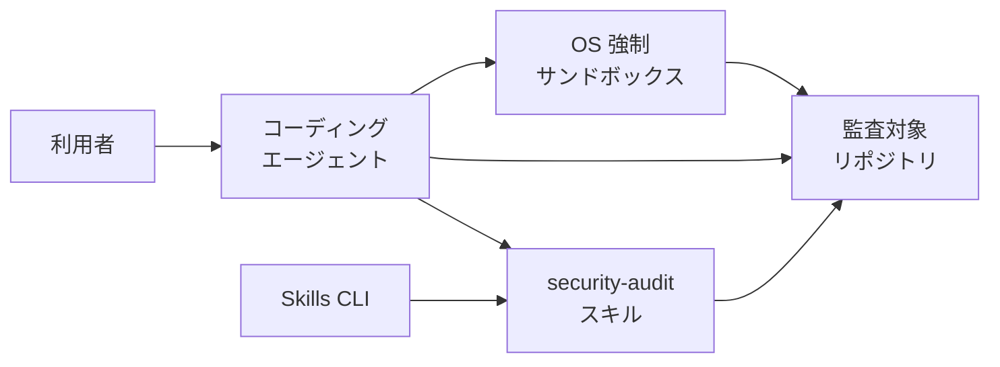
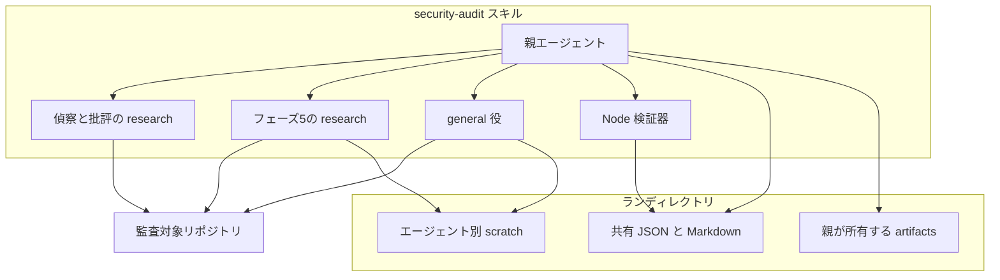
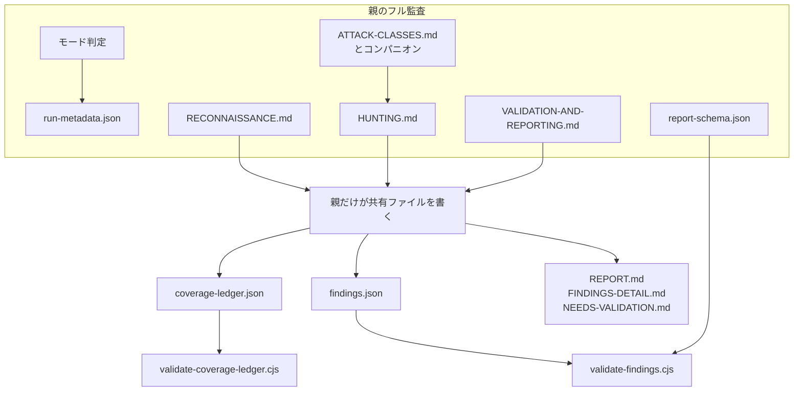
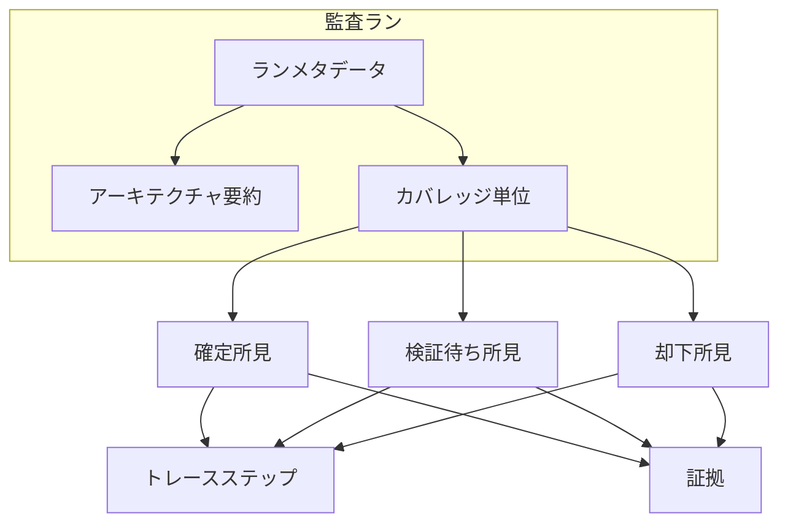
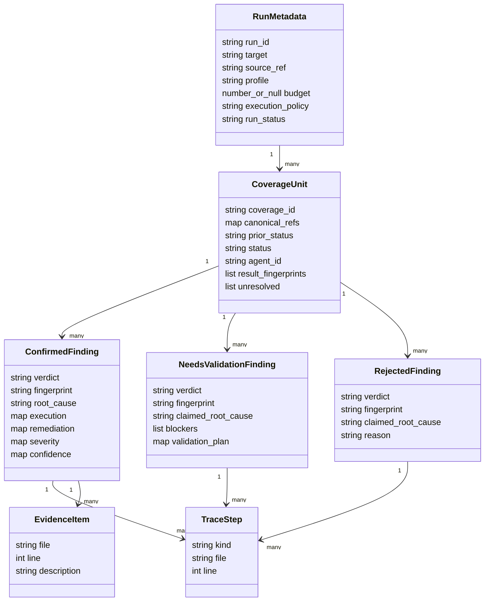

Cloudflare が公開した `security-audit-skill` は、コーディングエージェントにセキュリティ監査の手順をまるごと渡す公開スキルです。この記事では、このスキルが何を配布し、どんな構造とデータモデルで監査を進め、どう導入・運用するのかを、実装と README を照合しながら整理します。公開リポジトリの `main`（コミット `c1c8a8c`、2026-09-14 時点）を対象にしています。なお、このスキルを紹介した Cloudflare のブログは社内ハーネス（監査を回す社内の実行基盤）の話を含みますが、公開ツリーの手順とは別世代です。両者の対応関係は後半の「注意点」にまとめます。

想定読者は、AI コーディングエージェントやセキュリティ監査の一般知識はあるものの、`security-audit-skill` というスキル自体は初めて知る方です。


*この記事の全体像。以下、順に解説します。*

## security-audit-skill とは

`security-audit-skill` は、監査の進め方を書いた Markdown 群と、出力の形を検査する Node.js 検証器からなる公開スキルです。配布物の本体は `skills/security-audit/` にあり、依存パッケージを持たない検証器が 2 本同梱されています。エージェントがスキルとして読み込む名前は、`SKILL.md` の frontmatter にある `security-audit` です。

利用者は、監査したいリポジトリを開いたエージェントに監査を依頼します。依頼の内容によって、スキルは 2 つのモードを使い分けます。

- **ガイダンスモード**: 質問や限定レビューへの応答。6 相の自動実行やファイル作成はしません。
- **フル監査モード**: コードベース監査・ペンテスト・網羅レビュー・報告書成果物を明示した依頼で起動する、6 相の監査手順です。

ここで「相（フェーズ）」とは、監査を区切った工程の単位です。フル監査の 6 相は、偵察、カバレッジ台帳（何をどこまで調べたかを記録する台帳。後述）に沿った探索、候補の独立検証、構造化出力、記録の再検証、対象に中立な報告、の順に進みます。

このスキルが確認対象にするのは、**信頼境界をまたぐ具体的な結果**です。信頼境界とは、権限や入力の信頼度が切り替わる境目のことです。探索役（ハンター）と検証役（検証者）は別々のエージェントが担い、共有ファイルを書き換えてよいのは親エージェントだけです。対象コードの実行は、OS が強制するサンドボックスの中だけに限られ、条件を満たせないときは実行せず `needs_validation`（検証待ち）として残します。

GitHub API で見たメタデータは次のとおりです。リポジトリ作成は 2026-06-18、ライセンスは MIT、主言語は JavaScript です。調査日 2026-10-25 時点の star 数は約 44,900、fork は約 2,788 でした（star はライブ値です）。`git/trees/main?recursive=1` の blob は 22 件で、`LICENSE`、`README.md`、`skills/security-audit/` の 20 ファイルからなります。

## 特徴

- **手順書と検証器が分離しています**。探索の中身は Markdown が指示し、`findings.json`（所見）と `coverage-ledger.json`（カバレッジ台帳）の形は Node.js スクリプトが検査します。
- **既定はガイダンスです**。スキルを読み込んだだけでは、6 相の完走もファイル作成も始まりません。
- **フル監査の既定プロファイルは `standard` です**。幅を変えるプロファイルに `quick` と `deep` があり、パスを絞る scoped run もあります。証拠の合格線はプロファイルで下げません。
- **判定は 3 種類です**。`confirmed`（確定）は境界をまたいだ観測結果を持ち、深刻度を付けます。`needs_validation`（検証待ち）は未解決の事実を持ち、深刻度を付けません。`rejected`（却下）は棄却理由を残し、同じ主張の再報告を抑えます。
- **カバレッジは文章ではなく台帳です**。カバレッジ台帳とは、何をどこまで調べたかを機械可読な単位で記録する JSON です。単位は入口面・信頼境界・サブシステム・攻撃クラスの組で表します。入口面とは、外部入力やリクエストが入ってくる箇所（API エンドポイントなど）のことです。
- **書き込みを隔離します**。共有ファイルは親だけが更新し、ハンターと検証者が書けるのは自分の `scratch/` だけです。残す成果物は親が `artifacts/` へ昇格します。
- **前回ランは加算です**。同じソースの確定所見は指紋（同じ主張を一意に識別する文字列。後述）を保って再検証へ渡し、1 回のランで対象を尽くしたとはみなしません。
- **導入経路は Skills CLI です**。README のコマンドは `npx skills add` で、リポジトリ同梱の `package.json` はありません。

関連する手段との位置づけは次のとおりです。

| 手段 | 実行主体 | このリポジトリとの関係 |
|---|---|---|
| security-audit-skill | サブエージェントを持つコーディングエージェント | 調査対象。単一リポジトリの 6 相と 2 本の検証器 |
| Skills CLI（npm の `skills`） | `npx skills add` | 導入だけを担う。registry は `vercel-labs/skills` |
| ルール型の静的解析 | 解析エンジン | このツリーはルールパックを同梱しない。合格線は境界と結果 |
| Cloudflare の社内ハーネス | 同社のオーケストレータ | ブログが説明する後段。公開ツリーのファイルではない |

向く場面は次のとおりです。

| 場面 | 向く理由 |
|---|---|
| 手元の 1 リポジトリを、ソースとローカルのダミー主体で監査する | フル監査の出力先・台帳・所見スキーマがこの単位で定義されている |
| 脆弱性の有無を質問する、特定の指摘を追う | ガイダンスモードが 6 相と成果物作成を自動開始しない |
| 同じリポジトリを日を分けて再実行する | 前回の台帳と所見を読み、ギャップと変更ソースを次の対象にする |

逆に、複数リポジトリの依存をまたぐ継続スキャンは、ブログの社内ハーネス側の役割で、この公開スキル単体の 6 相は単一ターゲット向けです。

## 構造

### システムコンテキスト図

利用者・エージェント・スキル・監査対象・サンドボックス・導入 CLI の関係です。



| 要素名 | 説明 |
|---|---|
| 利用者 | 監査・ペンテスト・報告書・セキュリティ上の質問をエージェントに依頼する人 |
| コーディングエージェント | 親として手順を実行し、委譲で子エージェントを起動する実行環境 |
| security-audit スキル | `skills/security-audit/SKILL.md` を入口にする手順と検証器 |
| 監査対象リポジトリ | 読み取り対象のソース。フル監査の既定では出力をこの外に置く |
| OS 強制サンドボックス | 対象が制御するビルド・テスト・プロセス等を閉じ込める実行面 |
| Skills CLI | `npx skills add` でスキルをエージェントの配置へ入れる導入面 |

### コンテナ図

スキル内のエージェント・検証器と、ラン（1 回の監査実行）ディレクトリの構成です。



| 要素名 | 説明 |
|---|---|
| 親エージェント | 共有ファイルの唯一の書き手。台帳更新・予算ゲート・昇格・報告書の派生を持つ |
| 偵察と批評の research | フェーズ 1 の偵察とカバレッジ批評。ソースを読み、ファイルは書かない |
| フェーズ5の research | 最終レコードの検証者。書けるのは自分の scratch だけ |
| general 役 | 探索ハンターとフェーズ 3 の候補検証。書けるのは自分の scratch だけ |
| Node 検証器 | `validate-coverage-ledger.cjs` と `validate-findings.cjs`。正しさではなく形と台帳整合を見る |
| 共有 JSON と Markdown | `run-metadata.json`、`architecture.md`、`coverage-ledger.json`、`findings.json`、3 つの報告 Markdown |
| エージェント別 scratch | `<output-dir>/agents/<agent-id>/scratch/`。ハンター・検証者と対象プロセスが書いてよい場所 |
| 親が所有する artifacts | 同じエージェント ID の `artifacts/`。サンドボックスには渡さない |

### コンポーネント図

親エージェントが扱う手順書・検証器・成果物の流れです。



| 要素名 | 説明 |
|---|---|
| モード判定 | 質問ならガイダンス。明示的な監査・ペンテスト・網羅レビュー・報告書依頼ならフル監査 |
| 親だけが共有ファイルを書く | 台帳・所見・報告書の書き手。研究エージェントとハンターは書かない |
| run-metadata.json | ランの識別・対象・ソース参照・プロファイル・予算・実行方針・状態 |
| RECONNAISSANCE.md | フェーズ 1。偵察の研究エージェント（1a〜1d の 4 役）は事実を親へ返す |
| HUNTING.md | フェーズ 2。ハンタープロンプト・候補ゲート・構造化結果・カバレッジ批評 |
| ATTACK-CLASSES.md とコンパニオン | 通常 9 クラスと、ドメイン別コンパニオン 10 ファイル（追加攻撃クラスの Markdown。後述）。ブロック参照は `FILE.md#見出し` |
| VALIDATION-AND-REPORTING.md | フェーズ 3 から 6。候補検証・JSON 化・独立再検証・中立な報告 |
| report-schema.json | `findings.json` の 3 分岐。`additionalProperties: false` |
| coverage-ledger.json | カバレッジ主張そのもの。アーキテクチャ要約の一文はカバレッジ証拠にならない |
| findings.json | 独立に決まった確定・検証待ち・却下。指紋順 |
| REPORT.md ほか | フェーズ 6 が最終レコードと台帳から派生する 3 ファイル |
| validate-coverage-ledger.cjs | 台帳の意味フィールド・状態・`coverage_id` の辞書順・エージェント ID を検査 |
| validate-findings.cjs | スキーマ解釈と、深刻度が影響を超えないことを検査 |

## データ

### 概念モデル

監査ランが持つメタデータ・アーキテクチャ要約・カバレッジ単位と、3 種類の所見の関係です。



| 要素名 | 説明 |
|---|---|
| 監査ラン | 1 つの出力ディレクトリ。既定は `~/security-audit-skill/<repo-name>/run-<N>` |
| ランメタデータ | ランの識別・対象・プロファイル・予算・実行方針・状態。候補の中身は置かない |
| アーキテクチャ要約 | 約 1,000 語上限の `architecture.md`。コンパニオンの採否詳細は台帳側 |
| カバレッジ単位 | 入口面・境界・サブシステム・攻撃クラスの 1 組。`deep` ではライフサイクルを足す |
| 確定所見 | `verdict` が `confirmed` のレコード。深刻度と再現と修正方針を持つ |
| 検証待ち所見 | `verdict` が `needs_validation` のレコード。ブロッカーと検証計画を持つ |
| 却下所見 | `verdict` が `rejected` のレコード。棄却理由を持つ |
| トレースステップ | `entrypoint`、`propagation`、`sink` のいずれか。ファイル・行・スコープ・説明 |
| 証拠 | リポジトリ相対パス・正の行番号・説明 |

### 情報モデル

各レコードのフィールド構成です。所見は判定ごとに持てるフィールドが異なります。



| 要素名 | 説明 |
|---|---|
| RunMetadata | `execution_policy` は固定文字列 `sandboxed-source-and-local-only`。`budget` は未設定なら null、設定時は起動回数。`run_status` は開始時 `in_progress` |
| CoverageUnit | `lifecycle` は任意で、あるときは `canonical_refs.lifecycle` と組で置く。`prior_status` は 11 値、`status` は 8 値。単位は `coverage_id` の辞書順 |
| ConfirmedFinding | `severity.likelihood` と `severity.impact` は `{score, reason}`。`overall_severity` は文字列。`confidence.score` は `low`・`medium`・`high` のみ。`overall_severity` は `impact.score` の順位を超えられない |
| NeedsValidationFinding | `claimed_root_cause` を使う。深刻度・実行・修正は持たない。`validation_plan` は `local` と `deployment` の少なくとも一方 |
| RejectedFinding | `claimed_root_cause` と `reason` を使う。深刻度・実行・修正・ブロッカー・検証計画は持たない |
| TraceStep | `kind` は 3 種。1 段なら入口かシンク、複数段は先頭が入口・末尾がシンク・間はすべて `propagation` |
| EvidenceItem | パスはリポジトリ相対、行は 1 以上 |

指紋（fingerprint）とは、同じ主張を一意に識別する文字列で、パターンは `^[A-Za-z0-9][A-Za-z0-9._:/@+-]*$` です。行番号・ウェーブ（探索を区切る 1 巡）・エージェント・深刻度・判定は指紋に含めません。

深刻度の順位は informational 0、low 1、medium 2、high 3、critical 4 です。`SKILL.md` は文章でアンカーを定義します。critical は未認証のコード実行・データストア全体・任意アカウントの乗っ取り、high は認証回避やテナント横断など明示的な制御の突破、medium は影響が限られる実在の境界侵害、low は非秘密の内部情報や利得が小さい効果、informational はより大きい所見の前提になる最小の観測です。

台帳の状態と、ライブな証拠フィールドの関係は次のとおりです。

| status | agent_id | reviewed_paths と local_checks | result_fingerprints | unresolved |
|---|---|---|---|---|
| planned | null | 空 | 空 | 空 |
| not_applicable、out_of_scope、deferred | null | 空 | 空 | 理由が空でない |
| in_progress | 正規の所有者 | 空 | 空 | 空 |
| blocked | 正規の所有者 | 両方とも空でない部分証拠 | 空 | ブロッカーが空でない |
| covered | 正規の所有者 | 両方とも空でない | 空 | 空 |
| candidate | 正規の所有者 | 両方とも空でない | 空でない | 任意 |

`coverage_id` は、各正規参照を Unicode NFC にしたあと RFC 3986 のパーセントエンコードにし、`surface::boundary::subsystem::attack_class` の順で結んだ文字列です。未エスケープで残す文字は `A-Z`、`a-z`、`0-9`、`-`、`.`、`_`、`~` で、それ以外は大文字の `%HH` です。小文字の `%hh` は ID の不一致として拒否されます。

攻撃クラスは固定チェックリストではなく、`ATTACK-CLASSES.md` の通常 9 クラスに、偵察が選んだコンパニオン Markdown を足します。コンパニオンとは、ドメイン別の追加攻撃クラスを定義した 10 個の Markdown ファイルで、`MEMORY-SAFETY-AND-BINARY.md` や `AI-AND-LLM.md`、`WEB-PROTOCOL-AND-AUTH.md` などがあります。

検証器の上限はソースの `LIMITS` で定義されます。

| 検証器 | 主な上限 |
|---|---|
| findings | 入力 5 MiB、入れ子 64、配列 1,000、エラー出力 100 件 |
| coverage ledger | 入力 5 MiB、単位 10,000、入れ子 64、事前走査 500,000 値、エラー出力 100 件 |
| 台帳のテキスト長 | 可視テキスト既定 4,096、正規参照 1,024、`coverage_id` 65,536 |

台帳側の文書は、5 MiB 制限が現実的にはおおよそ 2,000 から 5,000 件で先に効き、10,000 件の上限より前に当たると書いています。

## 構築方法

### 前提条件

- ツール利用と並列のサブエージェントを持てるコーディングエージェントが必要です。
- 検証器には Node.js が必要です。README は版番号を固定せず、同梱テストは `node:test` を読みます。
- 対象コードを動かすフル監査では、外部ネットワーク無し・許可リストだけの空環境・対象とツールチェーンの読み取り専用・`scratch/` だけへの書き込み・各種資源の明示上限がそろいます。
- リポジトリに `package.json` は無く、検証器は外部パッケージを `require` しません。実行時に `report-schema.json` を読むのは `validate-findings.cjs` だけです。

### Skills CLI による導入

README の導入コマンドです。スキル名はリポジトリ名ではなく `security-audit` です。

```bash
npx skills add https://github.com/cloudflare/security-audit-skill \
  --skill security-audit
```

全プロジェクトで使うなら `--global` を足します。

```bash
npx skills add https://github.com/cloudflare/security-audit-skill \
  --skill security-audit \
  --global
```

- 導入コマンドが解決するパッケージ名は `skills`（`vercel-labs/skills`）です。2026-10-25 時点の registry `latest` は 1.7.4 で、Cloudflare の README はこの版を pin しません。
- 同日、`https://registry.npmjs.org/security-audit-skill` は HTTP 404 でした。`npm install security-audit-skill` は導入手順ではありません。

### 導入先と検証器のパス

スキルディレクトリは、エージェントが読んでいる `SKILL.md` の絶対パスのディレクトリです。検証器のパスは `<skill-dir>/validate-findings.cjs` と `<skill-dir>/validate-coverage-ledger.cjs` です。グローバル導入かプロジェクト導入かは、使っているエージェントのスキル探索に従い、このリポジトリ自体は配置先をハードコードしません。

### 検証器の単体実行

引数を欠くと、両方とも usage を標準エラーに出して終了コード 1 です。成功時の標準出力は件数入りの PASS 行です。

```bash
node <skill-dir>/validate-findings.cjs <output-dir>/findings.json
node <skill-dir>/validate-coverage-ledger.cjs <output-dir>/coverage-ledger.json
```

- findings の成功行は `PASS: <件数> findings valid` です。
- 台帳の成功行は `PASS: <件数> coverage units valid` です。
- 失敗時は各エラーが `ERROR:` で始まり、最後に `FAIL: <件数> validation error(s)` です。件数が上限の 100 なら `; output capped at 100` が付きます。

### 同梱テストの実行

README にテスト用の npm script はありません。Node のテストランナーでファイルを直接指定します。

```bash
node --test skills/security-audit/validate-findings.test.cjs
node --test skills/security-audit/validate-coverage-ledger.test.cjs
```

両テストは `fs.constants.O_NOFOLLOW` と `O_NONBLOCK` が整数かつ 0 でないときだけ、安全な入力オープンの検査を有効にします。同じ条件が無いとき、両検証器はパース前に `OS no-follow and nonblocking input protection is unavailable` を出して入力を拒否します。

### 出力ディレクトリの置き場所

- 既定は対象リポジトリの外で、パスは `~/security-audit-skill/<repo-name>/run-<N>`（`<N>` は未使用の次の整数）です。
- 対象の中へ書くのは、利用者がそのディレクトリを明示し、バージョン管理の無視対象にディレクトリ全体が入ると親が確認したときだけです。確認できなければ外部パスを求めて停止します。
- `/tmp` やホストのホームを、失敗時の書き込みフォールバックには使いません。

## 利用方法

フル監査で先に決める値は、スキルディレクトリ・ターゲットの絶対パス・リポジトリ名・出力ディレクトリ・ソース参照（コミットと、ワークツリーが dirty か）です。未レビューの生成ファイルを別リビジョンとしては扱いません。

### ガイダンスモード

セキュリティの質問・限定レビュー・方法の相談・特定所見の調査では、関係する節だけを使います。

- 6 相を自動では走らせません。
- 出力ディレクトリや監査成果物を自動では作りません。
- 焦点を絞ったエージェントを起動することはあり、結果は現在のタスクへ返します。
- ガイダンス中に対象が制御するファイルは残しません。

どちらのモードとも読める依頼では、ファイルを作る前に焦点を絞った質問を 1 つします。

### README の依頼例

README が示す依頼の形です。

```text
security audit this codebase
```

```text
find security vulnerabilities in ./src
```

```text
do a security review, output to ~/audits/my-project
```

- 1 つ目はコードベース監査の明示なのでフル監査です。
- 2 つ目は報告書を頼まない焦点を絞った調査で、README はこれをガイダンスにします。
- 3 つ目は出力先を伴う報告書成果物の依頼としてフル監査です。対象リポジトリの内側を選ぶときだけ、無視設定の確認が入ります。

### プロファイルとスコープ

プロファイルは監査の幅と検証の厚みを選ぶ設定です。

| プロファイル | 台帳の粒度 | 探索と批評 | 検証の段数 |
|---|---|---|---|
| quick | 面 × 境界 × 攻撃クラス（サブシステムは固定値） | ハンターウェーブ 1 回と最終批評 1 回。追加単位は `deferred`、2 回目のウェーブは起動しない | 候補検証と最終記録検証を同じ 1 人の新規検証者にまとめる |
| standard | 文書どおりの組 | ウェーブ後批評と、別の最終クリーン批評 | 候補検証と最終記録検証は別の新規エージェント |
| deep | サブシステムとライフサイクルで分割 | 批評が空になるまでウェーブ | 2 段を分離し、覆った単位にも独立した 2 回目を付ける |

予算を置くときは、`run-metadata.json` の `budget` を全相合計のエージェント起動回数の上限にします。数値か null であり文字列ではありません。偵察の前に、ベースラインの偵察 4 呼び出し・批評の予約・検証者 1 人以上を確保できない予算なら、エージェントを起動しません。

### カバレッジ単位の形

`RECONNAISSANCE.md` が示す単位の形です。表示用の文字列と、`canonical_refs` の安定参照は別物です。

```json
{
  "coverage_id": "src%2Frouter.ts%23POST%20%2Fusers%2F%3Aid::src%2Fauthz.ts%23requireOwner::packages%2Fapi::ATTACK-CLASSES.md%23Access%20control",
  "canonical_refs": {
    "surface": "src/router.ts#POST /users/:id",
    "boundary": "src/authz.ts#requireOwner",
    "subsystem": "packages/api",
    "attack_class": "ATTACK-CLASSES.md#Access control"
  },
  "surface": "POST /users/:id",
  "boundary": "requireOwner",
  "subsystem": "packages/api",
  "attack_class": "Access control",
  "starting_paths": ["src/router.ts"],
  "ordinary_attack_class_block": "ATTACK-CLASSES.md#Access control",
  "selected_companion_blocks": [],
  "excluded_blocks": [],
  "prior_status": "none",
  "attempts": [],
  "wave": 1,
  "status": "planned",
  "agent_id": null,
  "reviewed_paths": [],
  "local_checks": [],
  "result_fingerprints": [],
  "unresolved": []
}
```

- `coverage_id` は、例示の 4 参照を RFC 3986 でエンコードして `::` で結んだ形です。ライフサイクルが無い単位は 4 区分です。
- `starting_paths` と `reviewed_paths` は `:` を含むパスを拒みますが、正規参照は `:` を含められます。
- `ordinary_attack_class_block` が null になるのは、通常ブロックが 1 つも当てはまらないときだけです。
- 種まきの直後・親の更新のたび・フェーズ 6 の前に台帳検証器を走らせます。

### ハンター結果の形

ハンターは散文を包まず、JSON を 1 つ返します。`HUNTING.md` の契約です。

```json
{
  "units": [
    {
      "coverage_id": "one assigned ID",
      "disposition": "covered",
      "reviewed_paths": ["repo/relative/path"],
      "checks": [
        {
          "agent_id": "hunter1",
          "reviewed_paths": ["repo/relative/path"],
          "invariant": "specific control checked for this unit",
          "method": "source",
          "result": "what source established",
          "artifact": null
        }
      ],
      "candidate_fingerprints": [],
      "unresolved": []
    }
  ],
  "candidates": [],
  "hardening": ["concrete non-finding note"],
  "uncovered": []
}
```

- `disposition` は `covered`、`candidate`、`blocked` です。
- `method` が `source` のチェックは `artifact` が null、`local` のチェックは親が昇格した成果物を 1 つ指します。
- 候補オブジェクトは、フィールド名 `verdict` の代わりに `proposed_verdict` を使い、`findings.json` へはそのラッパーを持ち込みません。

批評役が返す JSON は `missing_units`、`reassign_ids`、`resolved_prior_leads`、`stop` です。`stop` が true になるのは、批評自身が欠けと再割り当てを空と見たときです。

```json
{
  "missing_units": [],
  "reassign_ids": [],
  "resolved_prior_leads": [],
  "stop": true
}
```

### 所見の 3 判定

フェーズ 4 の親は、独立に決まったレコードだけを `findings.json` に指紋の昇順で書きます。配列の要素は `report-schema.json` の `oneOf` です。

- **確定（confirmed）**: `root_cause`、`intended_behavior`、`execution`、`remediation`、`severity`、`confidence` を持ちます。`execution` は `attacker_perspective`、`payloads`、`instructions`、`observed_result` をすべて持ち、`remediation` の必須は `strategy` です。
- **検証待ち（needs_validation）**: `claimed_root_cause`、`blockers`（1 件以上）、`validation_plan` を持ちます。
- **却下（rejected）**: `claimed_root_cause` と `reason` を持ちます。

フェーズ 3 の検証者は `decision` と `record` を持つ JSON を 1 つ返し、空の `record` はスキーマを満たしません。フェーズ 5 の研究役は、`decision` が `verified` で `fingerprint` を持つか、`replace` で `reason` と `record` を持つオブジェクトを返します。

### 検証コマンド

フェーズ 4 と、フェーズ 5 で置換を適用したあとに、両方を再実行します。

```sh
node <skill-dir>/validate-findings.cjs <output-dir>/findings.json
node <skill-dir>/validate-coverage-ledger.cjs <output-dir>/coverage-ledger.json
```

- 検証器の成功は形式と台帳の整合であり、指摘が本当に境界をまたぐことは別エージェントの検証が担います。
- 未検証の候補は台帳の `candidate` に残し、`findings.json` にはどの判定でも入れません。
- 予算が候補の検証に足りないときの `incomplete_reason` は `validation_budget_exhausted` です。

## 運用

### ランメタデータの更新

委譲の前に親が書く、キー名が固定された項目の抜粋です。`budget` は未設定なら null、`execution_policy` は固定文字列です。

```json
{
  "run_id": "run-1",
  "repo": "example-repo",
  "target": "/absolute/path/to/repo",
  "source_ref": "reviewed commit and dirty flag",
  "profile": "standard",
  "scope_paths": ["src"],
  "budget": null,
  "execution_policy": "sandboxed-source-and-local-only",
  "run_status": "in_progress"
}
```

- キー名が固定されているのは `run_id`、`repo`、`target`、`source_ref`、`profile`、`scope_paths`、`budget`、`execution_policy`、`run_status` です。
- このほか、選択したコンパニオンファイル・前回ランのパス・共有ファイルの所有者もメタデータに含めます。ただしこれら 3 項目のキー綴りは `SKILL.md` も検証器もスキーマ化しません。
- 候補の状態は台帳と `findings.json` に置き、メタデータは事実が変わったときだけ更新します。
- `run_status` を `complete` にするのは、各候補が独立した最終処分を持ち、残したレコードがフェーズ 5 を通過したときです。

### 予算ゲート

支出の順は、偵察と批評を起動回数に数え、批評と検証の予約を探索より先に確保し、残りでハンターを優先順に割り当てます。

- 優先順は、信頼が低い入口、価値の高い資源を守る境界、前回のギャップと変更ソース、確認済みになりやすいクラス、同点は `coverage_id` の辞書順です。
- 予約が次のウェーブに入らないときは、ハンターを起動せず計画単位を `deferred`、理由 `budget_cannot_reserve_critics_and_validation` にします。
- 最終批評の予約を食いつぶすと `incomplete_reason` を `critic_budget_exhausted` にし、完了カバレッジを主張しません。
- 偵察開始前の最小構成を賄えないと `incomplete_reason` を `budget_cannot_fund_reconnaissance_and_reserves` にし、監査パスを走らせなかったと報告します。

### 前回ランの引き継ぎ

同じリポジトリの、互換な `coverage-ledger.json` と `findings.json` をすべて読みます。

- ソース・条件・証拠が現契約を満たす前回の確定は、同じ指紋で現在の候補集合へ運びます。ハンターの除外リストに載るのはその根本原因だけで、フェーズ 3 の検証者が所有者になります。
- 関連ソースが変わった前回の確定は、`prior_confirmed_changed_source` の再検証単位にし、除外リストには入れません。
- 前回の検証待ち・`deferred`・`blocked`・`out_of_scope`・ソース変更は、現在の作業で、抑制キーになりません。
- 前回の却下は、その失敗した主張だけを抑え、単位全体のカバレッジは残します。
- 前回が `quick` や scoped でも「残りは問題ない」とは読まず、前回台帳が無いときは最終のカバレッジ文にその旨を書きます。

### フェーズごとの検証器

| 時点 | 走らせる検証器 |
|---|---|
| 台帳の種まき直後 | coverage ledger |
| 親が台帳を更新したあと | coverage ledger |
| フェーズ 4 で `findings.json` を書いたあと | findings と coverage ledger |
| フェーズ 5 で置換を適用したあと | findings と coverage ledger |
| フェーズ 6 の前 | coverage ledger |

フェーズ 5 の置換が、より強い判定への昇格や根本原因・トレース・観測結果・深刻度を実質的に変えるときは、別の新規検証者に再確認させます。予算または独立性が足りなければ、争点のレコードを `findings.json` から外し、`run_status` を `incomplete` にします。文言や行番号だけの補正は直接適用できます。

### サンドボックスと昇格

対象が制御するプロセスに許すローカル確認は、手元の依存でのオフラインビルド・隔離ループバック・既存テスト・小さいフィクスチャ・サニタイザ・上限付きのファズ・ダミーアカウントのローカルブラウザ・モックした外部呼び出しなどです。ライブのトラフィック・この検査のために起動していないサービス・ネットワーク経由の依存インストール・実アカウント・本番データ・署名やリリース・公開は、手順が禁じます。

ここで「昇格」とは、サンドボックス内 scratch の証拠を、信頼された親側の `artifacts/` へ安全に取り込む操作です。信頼された親側コードだけがサンドボックス終了後に行い、手順は 11 段です。

1. 相対パスを検査し、絶対・空・`.`・`..`・シンボリックリンク成分を拒む。
2. 保持した scratch ルートのディスクリプタから、no-follow のディレクトリ相対で親を歩く（開き直さない）。
3. 葉を no-follow かつ非ブロッキングで開く。
4. `fstat` で通常ファイル・リンク数 1・バイト上限内を確認する。
5. 読む間にも上限を適用する。
6. 検証したサイズだけコピーし、再度 `fstat` して同一性・型・リンク数・サイズの変化を拒む。
7. 宛先は artifacts ルートから no-follow で歩き、欠けたディレクトリは排他作成してから開き直す。
8. 葉をリンクを追わず排他作成し、通常ファイルかつリンク数 1 を確認してからコピーする。
9. POSIX 以外では同等の競合に強い API を使う。
10. 再帰コピー・アーカイブ展開・各種特殊ファイル・上限超過は昇格しない。
11. 検査を強制できない・失敗したときは scratch を捨て、決定的な証拠なら昇格ブロッカーを書いた `needs_validation` にする。

### 終端状態

ランが終わってよい状態は 2 つだけです。

- フェーズ 6 の成果物がすべて書け、両方の検証器が通る。
- `run_status` が `incomplete` で、正確な理由が記録され、報告書がそのギャップを述べる。

相の途中では止めません。`quick`・scoped・予算制限・incomplete の報告書は、部分的なパスであると冒頭で述べます。確認済みが 0 件のクリーンなランは、その結果と残ったカバレッジ限界を述べ、低い深刻度の所見を作りません。フェーズ 6 の `REPORT.md` は、プロファイル・スコープ・予算・ソース参照・サンドボックス方針・前回ラン・延期と範囲外・態勢要約・確認済みの表・各確認済みの再現と修正・検証待ちの表・ハードニング・台帳の件数と最終批評を、この順で持ちます。`FINDINGS-DETAIL.md` は confirmed のうち medium 以上の完全な経路、`NEEDS-VALIDATION.md` は未解決レコードの追跡・証拠・ブロッカー・計画です。

## ベストプラクティス

### プロファイルの選び方

- 小さい対象・再実行・最初の見取りには `quick`。追加単位は `deferred` のまま残し、部分パスだと報告書に残します。
- 手順書どおりの冗長性が要る対象には `standard`。候補検証と最終記録検証を同じエージェントにまとめません。
- 影響や対象が大きいときは `deep`。ライフサイクルを単位に含め、同じソースで覆った単位にも独立した 2 回目を付けます。
- 差分や 1 サブシステムだけを見るときは scoped run。範囲外は `out_of_scope` として台帳に残します。

### 独立した検証者

- 候補を見つけたエージェントに、その候補の検証をさせません。フェーズ 3 は別の `general`、フェーズ 5 は別の `research` です。`quick` だけが 2 段を 1 人にまとめますが、その 1 人も探索役とは別です。
- 検証者には他の検証者の結論を渡しません。候補・単位のチェックと成果物パス・必要なアーキテクチャ事実・検証規則・昇格手順・実行境界・スキーマの 3 分岐・同じ指紋の前回レコードを渡します。
- 壊れた検証結果は修復せず捨て、予算が許せば新規検証者で再実行します。
- 検証待ちもフェーズ 5 の対象にします。確認済みだけを再検証すると、誤った前提が残ります。

### 証拠を最小にする

- 各候補に、信頼が低い主体・受け入れた入力・意図した制御・またいだ境界・影響を受けた資源・観測した結果を名付けます。
- ローカル実行は、間違った戻り値・権限外のダミーレコード・サニタイザの検出・ポリシー差など、境界を示す最小の効果で止めます。
- 確認済みの深刻度は示した影響を超えません。影響を文章にできない候補は低い深刻度にします。
- ベストプラクティスの欠落・推測のデプロイ・汎用のパーサクラッシュ・同一主体の自己影響は、所見へ上げず、ハードニングノートかソースで棄却する候補にします。
- 修正は、最後の信頼できる決定点で不変条件を満たす最も狭いソース変更と回帰テストとして書きます。監査は対象ソースを変更しません。

### コンパニオンの選択と複数ラン

- 言語名や依存名が出たことだけを理由にコンパニオンを選びません。偵察が、そのファイルの `When to use this file` に書いた信頼境界をソースで見つけたときに選びます。
- 見えている境界を除外せず、除外は `excluded_blocks` にソース上の理由とともに残します。
- 2 回目以降は、前回の指紋を保った再検証・変更ソースの再検証・未解決状態の再作業に予算を使います。同じ根本原因の複数入口は 1 候補にまとめ、独立した欠けた制御は別指紋にします。

## 注意点

このスキルを紹介した Cloudflare のブログ「[Build your own vulnerability harness](https://blog.cloudflare.com/build-your-own-vulnerability-harness)」は、同社内のハーネス（Vulnerability Discovery Harness など）を説明しています。公開ツリーの手順とは別世代・別物なので、ブログの数字や段数を公開スキルの仕様として読まないよう注意が必要です。

| 対象 | 資料の記載 | 実態 | 読者への影響 |
|---|---|---|---|
| 相の数 | ブログは最初のスキルを 1 セッションの 7 相、偵察 3 並列、最後に ingest API へ送ると書く | 現行 `SKILL.md` は 6 相、偵察は 4 役、ツリーに ingest API のクライアントは無い | ブログの 7 相図を、いまの導入手順として実装しない |
| スキルの行数 | ブログは出発点が約 450 行のスキルだったと書く | 照合コミットの `SKILL.md` は 192 行。`skills/security-audit` の Markdown・JSON・CJS を合わせると `wc -l` で 5,276 行 | 450 行は公開当時の単一ファイルの記憶で、現行ツリーのサイズではない |
| 1 回で半分 | README とブログは、1 回のランが繰り返しランの合計のおおよそ半分を見つけたと書く | どちらも比率の言い方で、ラベル付き再現実験の分母はリポジトリに無い。ブログは偽陰性率を主張しないとも書く | 現行スキルの再現率として百分率を足さない |
| 社内ハーネスの件数 | ブログは生候補 20,799、検証通過約 12,057、128 リポジトリなどの数字を書く | これらの語は公開リポジトリの Markdown と検証器に無い | 公開スキルを入れた 1 リポジトリの期待値として使わない |
| star 数 | 二次記事には 13.2k や 39,131 などの時点値がある | 2026-10-25 の GitHub API は約 44,900 star / 2,788 fork | 固定の公式値にしない |
| Issue 件数 | `open_issues_count` は 90 | 同時点の検索 `type:issue` は open 32、closed 3。90 は pull request を含む | 未解決の Issue が 90 件あるとは読まない |
| npm 名 | 導入例は `npx skills add` | `security-audit-skill` という registry ドキュメントは 404。解決されるパッケージは `skills` | `npm install security-audit-skill` を導入手順にしない |
| Node の版 | README は "Node.js" とだけ書く | テストは `node:test`、`package.json` の `engines` は無い | 必要な版をリポジトリの宣言としては確定できない |
| 検証器の成功 | コマンドが PASS を返す | `VALIDATION-AND-REPORTING.md` は、成功が形式と台帳整合であり正しさではないと書く | PASS を「脆弱性が実在する」の証明にしない |
| Semgrep | ブログは社内ハーネスに Semgrep を通したと書く | 公開スキルのファイル一覧に Semgrep のルールも呼び出しも無い | このスキルの必須手順に静的解析エンジンを足さない |
| サンドボックス実装 | ブログは `unshare` や Docker の `seccomp=unconfined` が要ると書く | 公開 `SKILL.md` は OS 強制サンドボックスの条件を列挙し、`unshare` のフラグは指定しない | 利用者手順にブログのコンテナフラグを必須と書かない |
| 安全なオープン | テストは `O_NOFOLLOW` と `O_NONBLOCK` が使えるときだけ一部を有効にする | 同じ定数が無いとき、両検証器は `OS no-follow and nonblocking input protection is unavailable` で入力を拒否する。関連する PR 99 は調査時点で open | 検証器自体が fail-closed になる。未マージの PR を現行の対応とは扱わない |

## トラブルシューティング

利用時に起きやすい症状です。

| 症状 | 原因 | 対処 |
|---|---|---|
| スキルを開いたのに監査ファイルができない | ガイダンスモードが既定で、6 相とファイル作成を始めない | コードベース監査・ペンテスト・網羅レビュー・報告書のいずれかを明示する |
| 監査を頼んだ直後に質問が返る | 依頼が両方のモードに読める | フル監査か質問への回答かを 1 問で確定する |
| エージェントが 1 つも起動しない | 予算が偵察 4・批評予約・検証者 1 を賄えない | `incomplete_reason` が `budget_cannot_fund_reconnaissance_and_reserves` なら予算・スコープ・プロファイルを広げる |
| ハンターウェーブが始まらない | 批評と検証の予約が残額に入らない | 計画単位は `deferred`、理由 `budget_cannot_reserve_critics_and_validation`。予約を削ってハンターを起動しない |
| 候補が `findings.json` に無い | 予算が検証を使い切った、または検証結果が散文で棄却された | 台帳の未解決候補を見る。`validation_budget_exhausted` のときは未検証を所見と呼ばない |
| 対象のテストを実行しない | サンドボックスのネットワーク・環境・書き込み・資源上限のいずれかが強制できない | 対象コードは実行せず、欠けた能力を `needs_validation` のブロッカーにする |
| 昇格した証拠が空 | シンボリックリンク・サイズ変化・上限超過で 11 段のどれかが失敗した | その scratch は捨てる。決定的なら昇格ブロッカーを検証待ちに残す |
| 出力をリポジトリ内に書けない | 無視設定がディレクトリ全体を覆うことを親が確認できない | 既定の `~/security-audit-skill/<repo-name>/run-<N>` など外部パスを指定する |
| 台帳検証が FAIL | `coverage_id` の重複・辞書順違反・状態と証拠の組み合わせ・エージェント ID・パス | `ERROR:` 行を直し、次の割り当て前に PASS にする。出力は 100 件で帽打ち |
| 所見検証が FAIL | 必須欠落・余分なプロパティ・判定ごとの禁止フィールド・深刻度が影響を超える・指紋の文字 | `report-schema.json` の分岐に合わせる。`proposed_verdict` は最終ファイルに残さない |
| 検証器が引数エラーで終わる | パスを渡していない | `node validate-findings.cjs <path>` の形で渡す。終了コードは 1 |
| 前回の確認済みが再報告される | 同じソースの確認済みをハンターの見本にしている | 除外するのはその根本原因だけにし、現在のフェーズ 3 と 5 を通す |
| 報告書と JSON の深刻度が違う | フェーズ 6 の前に散文を書いた、または散文側で判定を変えた | 散文は最終レコードから派生し、判定・深刻度・影響を変えない |
| テストの一部が走らない、または検証器が入力を拒否する | `O_NOFOLLOW` または `O_NONBLOCK` が定数として使えない | 両検証器は `OS no-follow and nonblocking input protection is unavailable` を出す。PR 99 は調査時点で open |

検証器が失敗したら、標準エラーの `ERROR:` を 1 件ずつ直します。最後の `FAIL:` の件数が 100 のときは `; output capped at 100` が付き、報告が 100 件で止まったことを示します（101 件目以降が必ずあるとは限りません）。台帳は `coverage_id` の辞書順で、ソート前の配列は通りません。入力が 5 MiB を超えると、パース前に読み取りを拒みます。

## まとめ

`security-audit-skill` は、セキュリティ監査の手順を Markdown と検証器としてコーディングエージェントに渡す公開スキルです。要点は次の 3 つです。

- **既定はガイダンス、明示でフル監査**。コードベース監査や報告書を明示したときだけ 6 相が走り、それ以外は焦点を絞って応答します。
- **検証器は形を見る、正しさは独立検証が担う**。`findings.json` と `coverage-ledger.json` の PASS は形式と台帳整合の確認であり、境界をまたぐ実在性は別エージェントが確かめます。
- **公開スキルとブログの社内ハーネスは別世代**。ブログの件数・段数・コンテナフラグを、公開スキルの仕様や 1 リポジトリの期待値として読み替えないことが大切です。

手元の 1 リポジトリを、ソースとローカルのダミー主体で監査する用途に向いており、同じリポジトリを日を分けて再実行することでカバレッジを積み増せます。

この記事が少しでも参考になった、あるいは改善点などがあれば、ぜひリアクションやコメント、SNSでのシェアをいただけると励みになります！

## 参考リンク

- [cloudflare/security-audit-skill](https://github.com/cloudflare/security-audit-skill)
- [README.md](https://github.com/cloudflare/security-audit-skill/blob/c1c8a8c1471069fb0e188eeaff69b8e8db6564a8/README.md)
- [SKILL.md](https://github.com/cloudflare/security-audit-skill/blob/c1c8a8c1471069fb0e188eeaff69b8e8db6564a8/skills/security-audit/SKILL.md)
- [RECONNAISSANCE.md](https://github.com/cloudflare/security-audit-skill/blob/c1c8a8c1471069fb0e188eeaff69b8e8db6564a8/skills/security-audit/RECONNAISSANCE.md)
- [HUNTING.md](https://github.com/cloudflare/security-audit-skill/blob/c1c8a8c1471069fb0e188eeaff69b8e8db6564a8/skills/security-audit/HUNTING.md)
- [VALIDATION-AND-REPORTING.md](https://github.com/cloudflare/security-audit-skill/blob/c1c8a8c1471069fb0e188eeaff69b8e8db6564a8/skills/security-audit/VALIDATION-AND-REPORTING.md)
- [ATTACK-CLASSES.md](https://github.com/cloudflare/security-audit-skill/blob/c1c8a8c1471069fb0e188eeaff69b8e8db6564a8/skills/security-audit/ATTACK-CLASSES.md)
- [report-schema.json](https://github.com/cloudflare/security-audit-skill/blob/c1c8a8c1471069fb0e188eeaff69b8e8db6564a8/skills/security-audit/report-schema.json)
- [validate-findings.cjs](https://github.com/cloudflare/security-audit-skill/blob/c1c8a8c1471069fb0e188eeaff69b8e8db6564a8/skills/security-audit/validate-findings.cjs)
- [validate-coverage-ledger.cjs](https://github.com/cloudflare/security-audit-skill/blob/c1c8a8c1471069fb0e188eeaff69b8e8db6564a8/skills/security-audit/validate-coverage-ledger.cjs)
- [Build your own vulnerability harness（Cloudflare Blog）](https://blog.cloudflare.com/build-your-own-vulnerability-harness)
- [Skills CLI（vercel-labs/skills）](https://github.com/vercel-labs/skills)
- [PR 99](https://github.com/cloudflare/security-audit-skill/pull/99)
