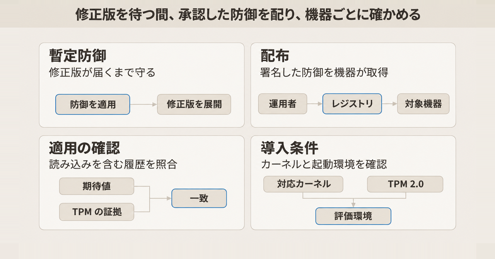
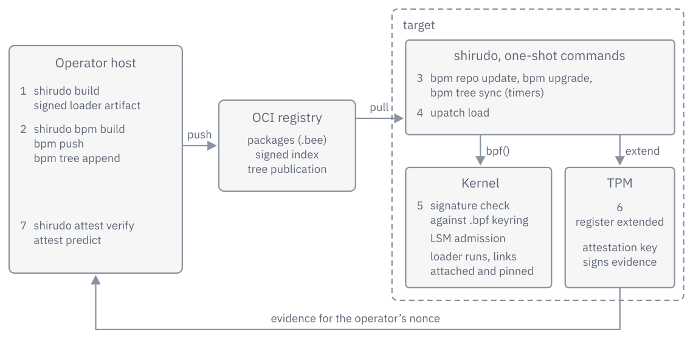
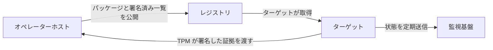
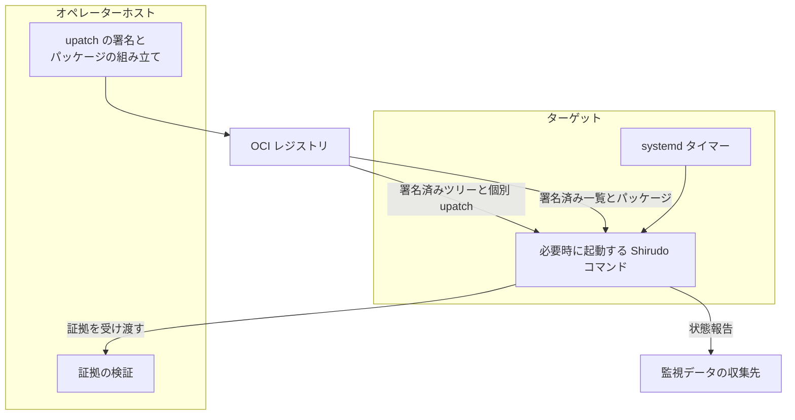
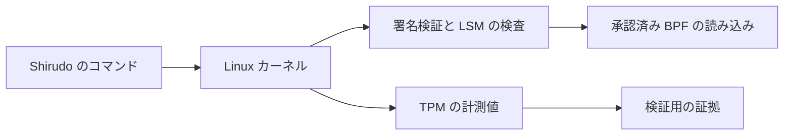
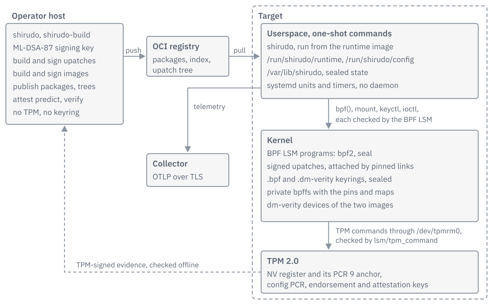
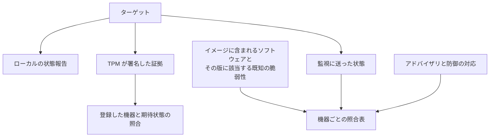
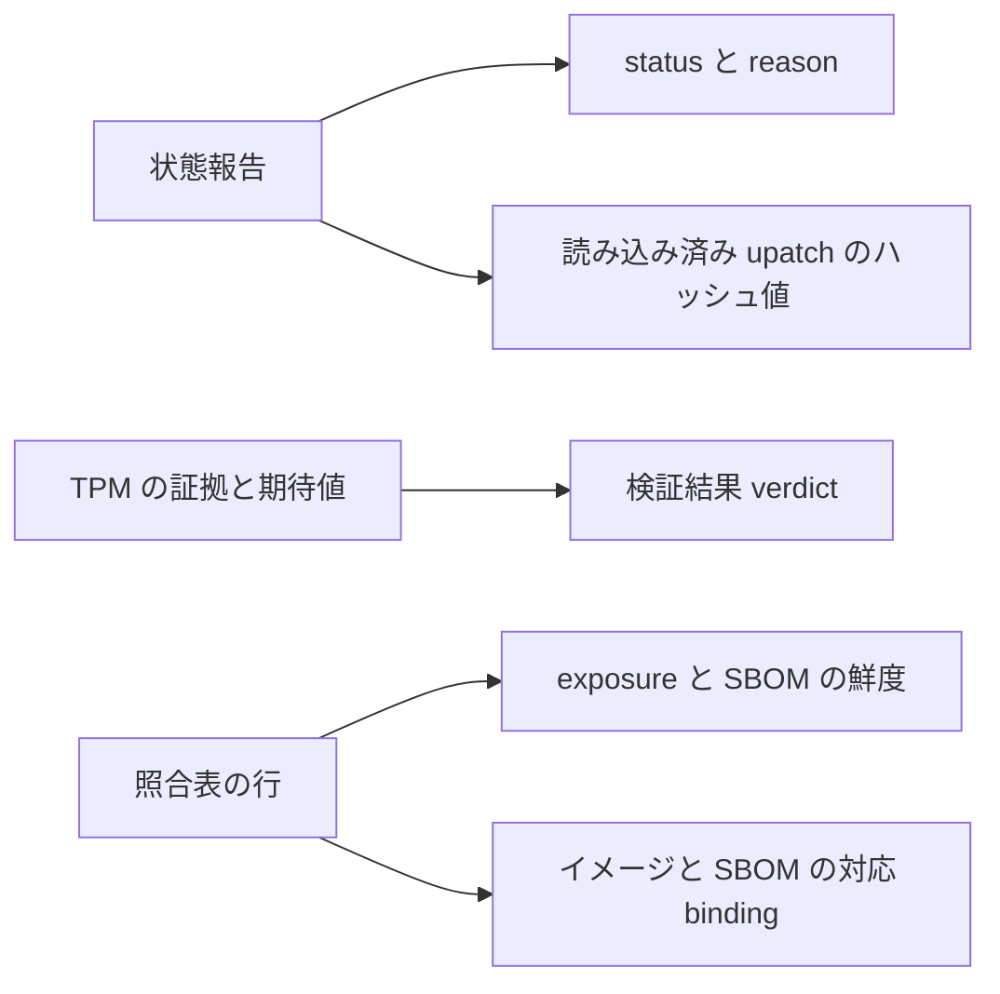

障害を避けるために修正版の動作確認をしている間も、本番サービスは動き続けます。OpenAI と Cisco が共同公開した **Shirudo** は、この待ち時間に Linux 上で暫定的な防御を適用し、どのホストに何を適用したかを後から確かめるための OSS です。運用担当者の視点で、配布の仕組みと、修正版が届くまでに手元で確認できる証拠を追います。[OpenAI の発表](https://openai.com/index/introducing-shirudo/)



## Shirudo とは

たとえば、検索サービスを止めずに、問題のある入力だけを拒みたいとします。Shirudo では、特定の動作を観測したり制限したりする小さなプログラムを署名して、稼働中のシステムに読み込ませます。両社の発表はこの防御を *shield*、プロジェクトの文書は読み込みと取り外しの対象となる成果物を *upatch* と呼びます。Linux カーネル側では **eBPF**（決められた処理箇所で小さなプログラムを動かす仕組み）を使います。[動作原理](https://docs.shirudo.dev/start/how-it-works.html)

2026年11月23日の共同発表によると、OpenAI は AI・セキュリティ・インフラの研究を、Cisco はインフラとセキュリティの技術を持ち寄りました。OpenAI が紹介した制御下の試験では、OpenAI のコーディングエージェント Codex が生成した防御を、検索エンジン Elasticsearch の稼働中の Java プロセスに適用し、サービスを再起動せずに問題のある入力を拒否しました。AI が防御の候補を作り、どの候補を配布するかは運用者が決める、という役割分担が見える例です。[OpenAI の発表](https://openai.com/index/introducing-shirudo/)・[Cisco の発表](https://newsroom.cisco.com/c/r/newsroom/en/us/a/y2026/m11/cisco-and-openai-launch-shirudo-a-new-project-to-safeguard-agentic-ai.html)

## 特徴は署名・配布・計測の分担にある

| 仕組み | 運用者が確かめられること |
| --- | --- |
| 署名 | カーネルが読み込もうとする eBPF コードを運用者が承認したか。運用者は、読み込み用プログラム（ローダー）の命令と、防御コードを含むデータにまとめて署名します。ターゲットのカーネルがその署名を検証します。以下、公式文書に合わせて eBPF を BPF とも記します。 |
| 配布 | 承認された配布物を取得できたか。配布一覧を利用する経路では、保護対象のホストが一覧の署名を確かめ、取得したパッケージのハッシュ値を一覧と照合します。 |
| 計測 | 読み込みや取り外しによって状態がどう変わったか。TPM（Trusted Platform Module）は、操作を順に反映した計測値に対して、後から検証できる署名付きの証拠を返します。 |

この分担が効くのは、配布担当が「公開した」と言ったあとです。対象ホストが実際にその版に追いついたか、どの防御が読み込まれたかを別々に確かめられます。防御を有効にしたときに正当なリクエストが通るかは、サービスごとにテストする必要があります。[セキュリティモデル](https://docs.shirudo.dev/security/security-model.html)


*公式図の上段はパッケージの配布経路、下段は証拠が戻る経路です。出典は [How it works](https://docs.shirudo.dev/start/how-it-works.html) です。*

## 構造

### システムコンテキスト図で見る信頼の境界

プロジェクトは、署名鍵を保管して検証を行うマシンを「オペレーターホスト」、保護対象のマシンを「ターゲット」と呼びます。ターゲットに渡すのは署名の検証に使う公開側の情報です。秘密鍵をターゲットから切り離すことで、対象マシンの管理者権限と、新しい防御を承認する権限を分けられます。[Operator and target](https://docs.shirudo.dev/concepts/operator-and-target.html)



### 配布と監視を担う構成要素の配置

ソフトウェアの配置を見ると、パッケージの組み立てと署名を担当するヘルパーはオペレーター側にあります。ターゲットでは systemd のタイマーが必要なコマンドをその都度起動します。ここでいう OCI レジストリは、コンテナイメージなどを格納できる配布先です。Shirudo の配布経路は二つあります。一つは、署名済みの一覧からパッケージを取得する経路です。もう一つは、機器が購読する署名済みの操作一覧（upatch tree）が、それぞれの操作で個別の upatch を指定する経路です。後半の2台の例では後者を使います。[アーキテクチャ](https://docs.shirudo.dev/internals/architecture.html)



### コンポーネント図で見るターゲットの内部

ターゲットで BPF の読み込み条件を検査するのは、Linux のセキュリティ検査を差し込む仕組みである **LSM**（Linux Security Module）とカーネルの署名検証です。TPM は署名済みのローダーを選ぶ役割とは別に、状態の変化を計測する役割を担います。Java 向け upatch の場合はユーザー空間で署名を確認し、Java 仮想マシン（JVM）内で防御が働きます。公開実装の標準経路では、JVM が起動時に指定されたエージェントを取り込みます。冒頭の Elasticsearch 試験は稼働中のプロセスに直接適用した事例です。標準経路でホストが適用済みと報告していても、対象 JVM がそのエージェントを有効にして起動したかは別に確かめます。[アーキテクチャ](https://docs.shirudo.dev/internals/architecture.html)




*右側の点線枠がターゲットです。監視の収集先と、証拠を検証するオペレーターホストには別々の経路があります。出典は [Architecture overview](https://docs.shirudo.dev/internals/architecture.html) です。*

## データ

### 概念モデルで区別する三つの記録

「いまどう見えているか」にはターゲットの状態報告を使います。「承認した防御がその機械にあるか」には TPM が署名した証拠を使います。検証側が保管する、承認済みの設定や防御に対応する値が照合の基準（期待状態）です。「どの機械に追加対応が必要か」には、バックエンドが機器と所見（該当する脆弱性の検出結果）の組ごとに計算する表を使います。同じ脆弱性の告知（アドバイザリ）でも、複数のパッケージが該当すれば複数行になります。影響を受けた機器の数を出すときは、所見のある行に絞り、機器の鍵の識別子で重複を除きます。[状態の読み方](https://docs.shirudo.dev/operate/run/read-status.html)・[バックエンドの照合表](https://docs.shirudo.dev/operate/backend/tables/vulns.html)



### 情報モデルで読む状態と所見

部品表は SBOM（Software Bill of Materials）と呼ばれ、イメージに含まれるソフトウェアと版を列挙します。スキャンでは、SBOM に載った版と既知の脆弱性を突き合わせます。起動中のカーネルの版も別途照合します。バックエンドは各所見に対する保護の状態を `exposure` 列に記録します。各記録で判断に使う項目は次のとおりです。[状態 JSON の仕様](https://docs.shirudo.dev/reference/formats/status-json.html)・[照合表のスキーマ](https://docs.shirudo.dev/operate/backend/tables/vulns.html)



| フィールドと値 | 読み方 |
| --- | --- |
| 状態報告の `status: ok` | ターゲットの総合判定は正常です。実施できなかった個別検査が警告として残る場合があり、内訳は `conditions[]` の `status` と `detail` で確認します。 |
| 照合表の `exposure: shielded` | バックエンドが、その機器・所見に対応する防御を適用済みと判定しました。 |
| 照合表の `exposure: shield_pending` | 対応する防御の配布が決まっていて、機器への適用を待っています。 |
| 照合表の `exposure: unknown` | 所見が空ならイメージ・SBOM の不足やスキャンの古さ、所見があるなら機器側の操作結果の不足などによって、保護状態が未確定です。 |
| 照合表の `binding: verified` | 機器が報告したイメージの内容を識別するハッシュ値と、SBOM 側にある値が一致しています。 |
| 証拠検証の `verdict: ok` | 検証時に指定した条件を満たしました。何を確かめたかは、渡した鍵と期待値で決まります。 |

## 導入前に確認すること

ターゲットには、署名済みローダーを検証する機能とプロジェクト指定のパッチを備えた Linux カーネル、TPM 2.0 が必要です。運用用の構成は、カーネルと初期起動用のファイルシステムなどを一つにまとめ、署名した統合カーネルイメージ（UKI）からの起動なども前提とします。オペレーターホストは署名鍵を保管し、受け取った証拠をオフラインで検証できます。そこにはターゲット側の TPM は要りません。[システム要件](https://docs.shirudo.dev/operate/plan/system-requirements.html)・[セキュリティモデル](https://docs.shirudo.dev/security/security-model.html)

ランタイムイメージとそのハッシュ値を初期設定に登録し、初期証明書を用意した評価用ターゲットで、root として次を実行します。実行中のカーネルが必要なインターフェースを提供するかなどを調べます。信頼できる起動経路や署名鍵の保管体制は、運用者が別途確認します。

```bash
shirudo init --check-only
```

## 利用方法を架空の2台で見る

2台が同じ upatch treeを購読しているとします。`applied_seq` は対象の upatch について機器が処理を終えた最新操作の番号、`next_seq` はこの一覧にある同じ upatch の最新操作の番号です。ここでは架空の操作9が今回のアドバイザリに未対応で、操作12で初めて対応する BPF upatch を読み込む例を考えます。二つの番号が一致したら機器は配布に追いついています。対象外として見送った機器も同じ番号まで進むため、結果は `exposure` 列で読み分けます。[照合表の列定義](https://docs.shirudo.dev/operate/backend/tables/vulns.html)

| 機器 | exposure | applied_seq | next_seq | 次に確認すること |
| --- | --- | ---: | ---: | --- |
| node-a | `shielded` | 12 | 12 | 適用済みの内容が承認したものと一致するか |
| node-b | `shield_pending` | 9 | 12 | 機器が最新の配布操作を取得しているか |

ターゲットは起動時に、Shirudo の実行ファイルと初期の証明書を収めた読み取り専用のランタイムイメージをマウントします。node-a で root としてこのイメージにあるコマンドを使うと、読み込み済みの upatch の名前と、署名の対象となる部分のハッシュ値（ダイジェスト）を取得できます。BPF の場合はローダーの命令とデータから計算した値です。運用側に保存した承認済みファイルを `shirudo upatch info --json` で読み、同じ `payload_sha256` フィールドと比較します。次の Bash 例では、終了コードが非ゼロなら取得または読み取りに失敗しています。成功しても対象名の行がなければ読み込みは未確認です。行があって第2列が空なら、ダイジェストを照合できません。[状態 JSON の仕様](https://docs.shirudo.dev/reference/formats/status-json.html)

```bash
set -o pipefail
/run/shirudo/runtime/usr/bin/shirudo status --json |
  jq -r '.upatches_loaded[] | [.name, .payload_sha256] | @tsv'
```

**機器の外から確認するには**、検証側が毎回新しい乱数 **nonce** を選び、ターゲットに渡します。ターゲットが返した証拠を、オペレーターホストの `shirudo attest verify` でその乱数と照合すると、以前の証拠の使い回しを識別できます。検証側で用意する値は、確かめたい事柄ごとに異なります。

| 確かめたいこと | node-a の例で照合するもの |
| --- | --- |
| 登録した機器か | 信頼する構築環境が引き渡し前に記録した TPM の署名鍵の識別子（鍵名）を `--ak-name` で指定し、証拠に署名した鍵と照合します。 |
| 承認した起動環境と設定か | 同じ UKI を信頼できる環境で起動して得た TPM の起動計測レジスタ（PCR）9・11 の値を `--expect-bind-pcr` で指定します。承認した設定のハッシュ値は `--expect-config-root`、その計測先は構成に応じて `--expect-config-pcr` または `--expect-config-nvpcr` で指定します。 |
| 防御を実際に読み込んだか | 承認済みの初期構成と操作履歴から `shirudo attest predict` で計測レジスタの期待値を計算し、`--expect-chain` で照合します。この例の期待履歴には、承認済みペイロードの読み込み、その直後の操作12のツリー記録の両方が入ります。 |

ツリー操作だけなら、必要なカーネルモジュールの不在で読み込みを見送った場合にも記録されます。node-a で新規読み込みが成功したと判断する根拠は、対象ペイロードの読み込みを含む期待履歴との一致です。[証拠の検証](https://docs.shirudo.dev/reference/cli/attest-verify.html)

## 運用で追う状態

ターゲットが定期送信する稼働報告を *keepalive* と呼びます。ローカルの `status --json` では判定が `status` に入り、keepalive では `verdict` に入ります。OpenTelemetry で受信する場合、収集先は `shirudo.keepalive` ログレコードの `body.stringValue` を JSON として読み、その中の `verdict` を取り出します。後から署名を確認できるように、受け取った本文の文字列と、署名情報を格納した同じレコードの `shirudo.quote` 属性値を対で保存します。バックエンドの照合表は5分ごとに再計算されます。展開直後は表の更新時刻と、対象機器が最後に報告した時刻を併せて見ます。[状態 JSON](https://docs.shirudo.dev/reference/formats/status-json.html)・[テレメトリ](https://docs.shirudo.dev/operate/run/telemetry.html)・[照合表](https://docs.shirudo.dev/operate/backend/tables/vulns.html)

## ベストプラクティス

- **署名の前に通常動作を確かめる。** 正当な入力を通せるか、対象サービスのテスト結果を承認時に残します。署名によって、その成果物を承認した鍵を特定できます。
- **対象機器の登録情報を残す。** 信頼する構築環境の記録などで機器と TPM の鍵を結び付けてから、鍵名と承認済みの設定・防御の期待値を検証側に保管します。ホスト名だけに頼ると、同じ名前を名乗る別の機器を区別できません。
- **暫定防御と恒久修正を別々に記録する。** 暫定防御の証拠は機器とアドバイザリにひも付けます。取り外す前には、その upatch が当該機器で保護しているすべてのアドバイザリを逆引きします。各所見のパッケージや起動中のカーネルについて、恒久修正か代替防御を確認してから外します。[セキュリティモデル](https://docs.shirudo.dev/security/security-model.html)・[他の仕組みとの比較](https://docs.shirudo.dev/concepts/comparisons.html)

## 注意点

2026年11月25日時点のプロジェクトのセキュリティポリシーでは、安定リリースとサポート対象のリリースブランチはまだありません。試験で守れたサービスと、自社のカーネル・起動構成・ワークロードの適合性は個別に評価します。リポジトリのルートは BSD-2-Clause、BPF プログラムは BSD と GPL のデュアルライセンスです。同梱の第三者コードには個別のライセンス表記があります。[セキュリティポリシー](https://github.com/shirudo-dev/shirudo/blob/main/SECURITY.md)・[公式リポジトリのライセンス説明](https://github.com/shirudo-dev/shirudo#license)

セキュリティモデルは、カーネル、TPM、署名鍵を保管するホストを信頼の前提に置いています。署名付きの証拠から確かめられるのは、検証側が選んだ機器や期待状態との一致です。ある入力を本当に防げるか、対象の業務を継続できるかについては、その防御のテスト結果が必要です。[セキュリティモデル](https://docs.shirudo.dev/security/security-model.html)

## トラブルシューティング

| 運用時の症状 | 最初に見る箇所 |
| --- | --- |
| `status` が終了コード 0 なのに `tampered` と表示される | 通常の `status` は、改ざんを示す判定でも報告を出せば 0 を返します。監視には JSON の `status` と `reason` を使います。`--check` を指定すると `tampered` で 1 になります。 |
| `exposure` が突然 `unknown` になる | まず所見の識別子 `vuln_id` を見ます。空なら `binding` と、スキャンが古いことを示す `sbom_stale` を確認します。値があれば、機器が報告した操作結果とバックエンドの操作履歴が対象 upatch の適用をカバーしているかを確認します。 |
| 証拠の検証が成功しても機器を特定できない | `--ak-name` に登録済みの TPM の鍵名を渡したかを確認します。期待状態も省略した場合、成功で言えるのは証拠が内部で整合することまでです。 |

状態の理由が計測値と記録の不一致を示す場合は、再起動に先立って理由と証拠を保全します。[状態表示の終了コード](https://docs.shirudo.dev/reference/cli/status.html)・[症状別の切り分け](https://docs.shirudo.dev/operate/troubleshoot/troubleshooting.html)

## まとめ

Shirudo を使うと、修正版を試験している間に、運用者が承認した防御を稼働中の Linux に配布できます。評価で確かめたいのは、配布後に「この機器に、承認した内容が、いま適用されている」と説明できるかです。そのためには、配布側の記録、機器の状態報告、検証側が保管した期待値と TPM の証拠を揃えます。

この記事が少しでも参考になった、あるいは改善点などがあれば、ぜひリアクションやコメント、SNSでのシェアをいただけると励みになります！

## 参考リンク

- [OpenAI と Cisco による Shirudo の発表](https://openai.com/index/introducing-shirudo/)
- [Cisco のニュースリリース](https://newsroom.cisco.com/c/r/newsroom/en/us/a/y2026/m11/cisco-and-openai-launch-shirudo-a-new-project-to-safeguard-agentic-ai.html)
- [Shirudo 公式リポジトリ](https://github.com/shirudo-dev/shirudo)
- [運用者が検証する範囲とシステムの前提](https://docs.shirudo.dev/security/security-model.html)
- [ターゲットから受け取った証拠を検証する](https://docs.shirudo.dev/operate/run/attest.html)
- [バックエンドの照合表と列の定義](https://docs.shirudo.dev/operate/backend/tables/vulns.html)
