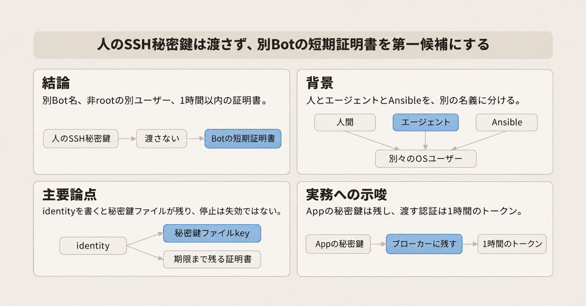
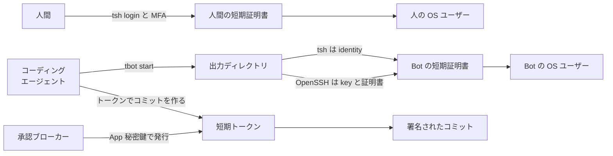

自宅のサーバへ、人間とコーディングエージェントの両方を SSH させる構成では、人の秘密鍵をエージェントから読める場所へ置くやり方が残ります。宮地慎（Atalie）氏は、イベント「自鯖缶 2026」のスライド「さようならSSH鍵、こんにちはゼロトラスト ― AIフレンドリーで快適な自宅鯖SSH」（[Speaker Deck](https://speakerdeck.com/atalie2m/goodbye-ssh-key-jisabakan-2026)、2026年11月15日公開）で、そのコピーをやめ、発行、利用、廃止の単位を人の鍵台帳から切り離した事例を示しています。

この記事では、その分け方を Teleport、OpenSSH、GitHub、Tailscale、step-ca、NIST の一次説明と突き合わせます。人の鍵を渡す案、長命の専用鍵を増やす案、別名義の短期証明書の案を、名義、期限、失効、ディスク、監査の単位で比べられます。スライドは発表者の自己申告であり、自作の承認ブローカーのソースは公開されていません。


*この記事の全体像。以下、順に解説します。*

## 人のSSH鍵を渡さない接続とは

この事例は、自宅のサーバ群へ人間とコーディングエージェントが SSH するとき、人の SSH 秘密鍵をエージェントへ渡さない構成です。サーバごとの公開鍵配布をやめ、セルフホストの Teleport が署名する短期の証明書で接続します。Teleport は、人と機械のアクセスを証明書とロールで扱うアクセス基盤です。ロールは、誰がどのサーバへ入れるかをまとめた権限の束です。人間、エージェント、Ansible は、別の OS ユーザーとして接続します。接続先へ、利用者の公開鍵は登録しません。サーバが信頼するのは、ユーザー証明書に署名した Teleport の認証局です。

ゼロトラストは、スライドの題に入っている語です。NIST CSRC の用語集は、SP 800-207 の zero trust を、侵害されたとみなすネットワークの上で、要求ごとの最小権限を不確実性を下げながら強制する概念の集まり、と説明しています。

### 自宅側に並んでいるもの

発表者の環境には、Debian、NixOS、Tailscale のメッシュ、step-ca、Ansible が含まれます。末尾のスライドは、仮想を含めて約 40 台のサーバを管理する、と読めます。

Tailscale はメッシュと Split DNS に使います。Split DNS は、名前の引く先をネットワーク側で分ける DNS の使い方です。Tailscale SSH は、Tailscale のネットワーク上で公開鍵を配らずに SSH する機能です。スライドは、Tailscale SSH を「エコシステムには乗らない」という方針で不採用、と書いています。step-ca は、Smallstep の認証局です。発表者は、Teleport 用の CA を足して、認証局が二つになった、と書いています。

### 人間、エージェント、Ansible の名義

人間は `tsh login` と本人確認で証明書を取ります。`tsh` は Teleport のクライアントです。例の OS ユーザーは `alice` です。MFA の具体として、末尾スライドは生体認証とパスキーを挙げます。MFA は、パスワード以外の確認を重ねる本人確認です。

エージェントは `tbot start -c ./tbot.yaml` を常駐させます。`tbot` は、機械向けの証明書を受け取って更新する Teleport の Bot です。スライドは、この Bot の証明書は 1 時間有効で、20 分ごとに更新する、と書きます。接続例は次です。`--proxy` は Teleport の Proxy（接続の窓口）の宛先です。値とパスはスライドの例であり、単体で動く完全な設定ではありません。

```text
tbot start -c ./tbot.yaml
tsh --proxy=... --identity=./bot/identity ssh domus-coding-agent@dns-01
```

Bot は一般ユーザーです。root ログインは、設定で禁止します。Ansible は別の専用 Bot で、管理作業用の権限を持ちます。エージェントとはユーザーを分けます。

三つの名義と、Git の発行、利用、署名は、次のように分かれます。GitHub App は、リポジトリへアプリとして権限を付ける GitHub の仕組みです。

| 名義 | 認証 | 権限・保管 | 台帳 |
| --- | --- | --- | --- |
| 人間 | MFA 付き `tsh login` | 個人の OS ユーザー | 人の SSH 鍵台帳には入れない |
| コーディングエージェント | 常駐 `tbot` の Bot 証明書 | 非 root の専用 OS ユーザー | Bot 名と OS ユーザー |
| Ansible | 別 Bot | 管理作業用。エージェントとは別 | 別 Bot |
| Git の発行元 | GitHub App の秘密鍵 | ブローカーだけが保持 | App 鍵。エージェントへ渡さない |
| Git の利用 | 短期トークン | そのトークンの権限 | installation token |
| Git の署名 | コミット署名 | 署名検証の記録 | 署名鍵。App 鍵とは別、とスライドは書く |

スライドの監査抜粋の日付は 2026年11月14日（UTC）です。抜粋は「何を: コマンドの実行」「誰が: Bot の名前」「いつ: UTC」と示します。ホスト名はマスクされています。

人の秘密鍵ファイルをエージェントへコピーする経路は、この接続にありません。人間とエージェントは別の証明書と別の OS ユーザーになります。Git の App 秘密鍵はブローカー側に残ります。



図の「短期トークン」の長さを、スライドは数値で書いていません。GitHub が installation access token と呼ぶものの失効は 1 時間です。installation access token は、GitHub App のインストール先に対して発行する短期のトークンです。スライドの SSH 接続例が指す `./bot/identity` は、ディレクトリへ書いた identity 出力のパスです。

### 証明書の寿命と、出力先のファイル

Teleport の [`tbot` 設定リファレンス](https://goteleport.com/docs/reference/machine-workload-identity/configuration/)（2026年11月16日閲覧）では、`credential_ttl` の既定は `1h`、上限は `24h` です。`credential_ttl` は、Bot が受け取る資格情報の寿命です。`renewal_interval` の既定は `20m` で、`credential_ttl` より短くなければなりません。`renewal_interval` は、期限を待たずに資格情報を更新する間隔です。one-shot（常駐せず 1 回だけ実行する起動）では、`renewal_interval` は無視されます。スライドの 1 時間と 20 分は、この既定と一致します。Getting Started の別例は `certificate_ttl: 5m` を使っています。`certificate_ttl` と `credential_ttl` が同じ設定かは、18.x の設定リファレンス本文に前者の名前が無く、Getting Started の例にだけあるため、この記事では同一と確定しません。

[SSH アクセスガイド](https://goteleport.com/docs/machine-workload-identity/access-guides/ssh/)は、`identity` 出力を ディレクトリへ書くと次のファイルができる、と列挙します。`identity` は `tsh` 用の資格情報の束です。ほかに `ssh_config`、`known_hosts`、`key-cert.pub`、`key` ができます。`key-cert.pub` は、Teleport の SSH ユーザー CA（ユーザー証明書に署名する認証局）が署名した証明書です。`key` は、その証明書に必要な秘密鍵です。`identity` ファイル自体が秘密鍵を埋め込むかは、この列挙だけでは断定しません。

`identity/key-agent` は、秘密鍵材料をメモリに置き、gRPC（別プロセスへの呼び出し）の Unix ソケットで署名します。利用先として挙がるのは `tsh`、`tctl`、Terraform provider、Go SDK です。`tctl` は、Teleport の管理 CLI です。`TELEPORT_KEY_AGENT_DIR` と `TELEPORT_IDENTITY_FILE` を使います。この二つは、key-agent と identity の場所をプロセスへ渡す環境変数です。汎用の OpenSSH `ssh`、Ansible、Git は、この節の利用先にありません。

`ssh-multiplexer` は、SSH agent ソケット `agent.sock` を開きます。SSH クライアントは、秘密鍵をディスクへ書かずに認証できます。出力先は ディレクトリ必須です。成果物は `ssh_config`、`known_hosts`、`v1.sock`、`agent.sock` です。one-shot では起動しません。接続中は、同一ホストで `tbot` が動き続ける必要があります。

destination の `memory` は、プロセス終了で成果物を残しません。`ssh-multiplexer` の destination は ディレクトリ必須なので、この memory 型は multiplexer の出力先には使えません。

未指定の storage は `/var/lib/teleport/bot` です。[アーキテクチャ資料](https://goteleport.com/docs/reference/architecture/machine-id-architecture/)は、Bot 自身のファイルが potentially renewable で、Bot に付けたロールの impersonation ができるため、exceptionally sensitive（例外的に機密）として扱え、と書きます。potentially renewable は、そのファイルから資格情報を更新し続けられる、という意味です。impersonation は、付けたロールの権限を Bot が引き受けられる、という意味です。同じページは、dynamic join（参加のたびに資格を取り直す方式）の証明書は更新できない、とも書きます。更新できる証明書は、内部データディレクトリ（既定 `/var/lib/teleport/bot`）にだけ置かれる、とも書きます。

token join（参加用トークンでクラスタに入る方式）では、証明書内の generation counter が Auth Service の保存値と違うと、renewal は失敗し、bot user（Bot を表す Teleport ユーザー）は自動でロックされます。Auth Service は、Teleport が証明書とロックを保持する中心のサービスです。generation counter は、証明書の世代を数える値です。troubleshooting は、この形のロックを token join に限ります。GitHub や AWS IAM などの provider join（トークン以外での参加）は、別インスタンスが token join を使わない限り、この形ではロックされない、と書きます。盗難のあと、正当な `tbot` が先に更新したときの勝敗表は、同じページにありません。アーキテクチャ資料は、カウンタの追跡自体は join 種別を問わないが、強制は現時点では `token` 型だけ、とも書きます。

### 公開鍵の代わりに使うユーザー証明書

OpenSSH の [`ssh-keygen(1)`](https://man.openbsd.org/ssh-keygen) は、`-V` で証明書の開始と終了を指定できる、と書いた直後に、証明書の既定は Unix Epoch（1970年1月1日）から遠い未来まで、と書きます。`-n` を省略したときの principal の既定は、同じページのその節にはありません。principal は、その証明書でログインしてよい名前です。

ユーザー証明書の `force-command` は、利用者が指定した shell や command の代わりに、指定コマンドの実行を強制します。[`sshd_config(5)`](https://man.openbsd.org/sshd_config) の `TrustedUserCAKeys` は、CA の公開鍵が載っていても、証明書の principals list にいるユーザーの認証にだけ使ってよい、と書きます。principals list が無い証明書は、認証に使えません。`AuthorizedPrincipalsFile` の既定は `none` です。そのときは、ログインするユーザー名が principals list に要ります。

### Git の秘密鍵と、短い root

Git では、Teleport がエージェントを認証します。ブローカーが GitHub App の秘密鍵で短期トークンを発行します。エージェントはそのトークンでコミットを作り、そのコミットに署名します。この署名の鍵は App の秘密鍵とは別です。種類、寿命、置き場所は、スライドが書いていません。トークンで push しただけで GitHub が自動署名する、とも引用したページは書いていません。独自の署名情報を含むと、GitHub が検証済みと示す表示（Verified）の条件から外れます。App の秘密鍵は認証用で、コミット署名鍵ではない、とスライドは補足します。図の承認ブローカーは、この短期トークンを発行する役です。root の申請を受けるブローカーと同一のプログラムかは、公開されたコードが無く、この記事では決まっていません。

GitHub の[公式手順](https://docs.github.com/en/apps/creating-github-apps/authenticating-with-a-github-app/generating-an-installation-access-token-for-a-github-app)は、installation access token を `POST /app/installations/{id}/access_tokens` で発行し、このトークンは 1 時間で失効する、と書きます。App の秘密鍵は期限切れせず、失効は手動です。その秘密鍵で署名する JWT の `exp` は、未来 10 分以内でなければなりません。JWT は期限付きの署名で、`exp` がその失効時刻です。三つの寿命は別です。

権限選択のページは、HTTP の Git 認証には Contents という repository permission を要求するよう勧めています。対象は installation token と user access token です。user access token は、installation token とは別の、ユーザー側のトークンです。`.github/workflows` を読むか編集するなら、別に Workflows 権限、とも書きます。Contents を持つことと、Bot のコミットが Verified になることは、別のページの別条件です。Verified は、GitHub がコミットの署名を検証済みと示す表示です。

root 昇格は、Teleport の Access Requests を使いません。Access Requests は、権限の一時付与を申請して承認する機能です。発表者は、ブローカーとラッパーを自作しています。申請者を認証して JWT で身元を渡し、ラッパーが再検証して root シェルを起動します。ラッパーは、渡された JWT を確かめてから root シェルを起動するプログラムです。申請者が人間かコーディングエージェントかは、スライドが書いていません。承認までの期限は 3 分、開始までの期限は 60 秒、root シェルが終了するまでの期限は 30 秒です。実行許可は 1 回です。コマンド単位の許可は今後の課題、とスライドは書きます。

## 注意点

ここからは、スライドの対比や自己申告を、一次説明の定義、分母、製品の境界と並べます。スライドの比較表は、旧来の SSH を「信頼の根拠は鍵の所持、期限は無期限、権限は鍵の持ち主と同じ」、新しい方式を「認証した身元、証明書は 1 時間、最小権限」と置きます。

### 1 時間の証明書は、用語集の定義そのものではない

NIST の用語集がいう zero trust は、侵害されたとみなすネットワークの上で、要求ごとの最小権限を不確実性を下げながら強制する概念の集まりです。1 時間の証明書へ替えたことだけを、この定義の充足とは読みません。発表者自身が「ゼロトラストは本当に 0 ではない」「接続先は証明書に署名する認証局を信頼している」「Teleport が落ちると単一障害点。家だからセーフ」と書いています。

### 接続例は、ディスクから秘密鍵を消していない

「ディスクに鍵を残さない」は、スライドの接続例からは出ません。示されている `--identity=./bot/identity` は、ディレクトリ上の identity です。公式の SSH ガイドは、同じ出力が秘密鍵ファイル `key` を書く、と列挙します。

秘密鍵をディスクに書かない公式の道は二つあります。`identity/key-agent` は秘密鍵材料をメモリに置きます。利用先は `tsh`、`tctl`、Terraform provider、Go SDK に限られます。汎用の `ssh`、Ansible、Git の「秘密鍵をディスクに残さない」方法として、設定リファレンスはこの出力を拡張していません。Git への直接適合は未確認です。`ssh-multiplexer` は `agent.sock` で、OpenSSH が秘密鍵ファイルなしに認証できる、と書きます。一方で、`tbot` の常駐と、ディレクトリ上のソケット類を必要とします。

`tbot` を止めても、既に発行された証明書は期限まで残ります。即時に止める公式の手段は、session または identity の lock と、期限前に既発行証明書を無効にする CA ローテーションです。lock は、Teleport がセッションや身分を拒否する操作です。CA ローテーションは、認証局の鍵を回して、古い証明書を無効にする操作です。人間の鍵を削除することと、Bot 証明書の失効は、別の操作です。

locking の対象一覧では、Bot については bot instance ID と、delegated join method（Bot の参加を委任する方式）の join token 名が挙がります。Teleport ユーザー名の lock は、Bot のユーザー名にも使えます。instance ID の lock は、その instance であり、Bot 全体の停止とは範囲が違います。

世代カウンタの自動ロックを、スライドの Bot に効くとは読みません。公式がこの形のロックを書くのは token join です。スライドは join 方法を書いていません。

出力先を読むプロセスには、読み取り権限が要ります。専用 Linux ユーザーを reader（出力先を読むユーザー）にし、対応環境では ACL（ファイルごとの読み取り許可）を付ける、とアーキテクチャ資料は書きます。OS ユーザー名を分けただけでは、同一ホストの読み取りは分離されません。

公式 SSH ガイドの例示ロールは `logins: ['root']` と、`node_labels`（対象のサーバを選ぶラベル）の `'*': '*'` です。同じページが、本番ではラベルを絞れ、と書いています。最小権限は、製品の既定値ではなく、ロール定義の結果です。スライドの「root では入れない」は、その設定を自分で書いた、という自己申告です。

### root の秒数と監査行は、コマンド許可の記録ではない

動的 root の 3 分、60 秒、30 秒、1 回限りは、自作ブローカーの自己申告です。実装は未確認です。30 秒の root シェルは、その間のコマンドを証明書の寿命だけでは絞りません。コマンドを絞る公式の別レイヤーとして、OpenSSH ユーザー証明書の `force-command` があります。スライドは、コマンドごとの許可を今後の課題としています。

Access Requests の概要は、Identity Governance は Teleport Enterprise だけ、と書きます。Identity Governance は、アクセス申請の承認を製品機能として扱う有償側の範囲です。Teleport Community Edition の手順は、承認ルールをロールへ設定できるのは Enterprise だけであり、Community Edition の承認は Auth Service 上で `tctl` を実行できる cluster administrator が行う、と書きます。組み込みの `admin` ロールだけ、とは書いていません。Slack プラグインのページも、Identity Governance は Enterprise だけ、と書きます。スライドの「Slack での承認は有償版だけなので自作した」は、この有償境界と矛盾しません。

監査行の「コマンドの実行」を、`session.command` と同一視しません。セッション記録のアーキテクチャは、SSH では疑似端末の出力全体を取る、と書きます。BPF（カーネルでコマンド実行などのイベントを観測する仕組み）を使う Enhanced Session Recording のガイドは、各コマンド実行が `session.command` になる、と書きます。通常録画は、難読化や echo 停止でコマンドが見えなくなる、とも書きます。通常録画から `session.command` が出る、とは書いていません。発表者のクラスタでどちらが有効かは未確認です。Enhanced Session Recording が Enterprise 専用かは、BPF ガイドの本文には書かれていません。

### Verified は、あとからの失効では消えない

GitHub は、Bot 署名の検証が働く条件を、リクエストが GitHub App または Bot として認証され、独自の author、committer、署名情報を含まないこと、と書きます。Commits API のような独自署名情報を含む場合は、この条件から外れます。ローカルの `git commit` をトークンで push しただけでは、GitHub が自動署名する、とはこのページは書いていません。Web UI のコミットは、GitHub が GPG 署名します。

Verified は、push 時に作られた検証記録です。あとから署名鍵を失効させても、既に検証されたコミットの状態は遡って変わりません。同じ認証用 SSH 鍵を署名鍵として再アップロードできる、とも書きます。これは、人の SSH 鍵台帳と署名台帳を混ぜる操作です。

### Tailscale SSH と step-ca は、機能が無いわけではない

Tailscale SSH の不採用理由としてスライドが書くのは、エコシステムに乗らない、という方針です。公式機能としては、公開鍵を配りません。check の既定は 12 時間、最短は 1 分、最長は 168 時間です。この時間がセッションの寿命か、確認の間隔かは、読んだ説明では分けて書いていません。ユーザーのアクセスを制限する policy を保存すると、クライアントは数秒以内に従い、そのユーザーの既存 SSH は止まります。Tailscale のアクセス制御を任意に編集しても、全部の SSH が止まる、とは書いていません。

tag は、Tailscale がデバイスへ付けるラベルです。tag 付きデバイスから別の tag 付きデバイスへの SSH は許されます。送信元が tag 付きデバイスの規則は、check mode にできません。ローカルの SSH 鍵ペアを認証に使わないため、クライアントマシン上の任意の OS ユーザーが、Tailscale 経由で SSH できます。範囲は、サーバ側の access control policy でなお制限されます。Benefits の「WireGuard の鍵はセッション終了後に失効する」は、ユーザー証明書の 1 時間とは別の文です。ノード秘密鍵はローカルに残ります。専用の tag 付きノードなら、鍵ファイルを配らない代替になりえます。コードを信用できないマシンからの外向き SSH や、`authorized_keys` でコマンドを制限しているマシンは、公式が向かない条件として挙げています。

Smallstep の step-ca は、短命の SSH ユーザー証明書を発行できます。Smallstep の SSH 説明にある PAM 監査は、セッション開始、sudo、終了です。コマンドごとの記録とは書かれていません。PAM は、Linux がログインや sudo のときに呼ぶ認証の枠です。OSS の step-ca 単体に「誰がどのコマンドを実行したか」があるかは未確認です。

可用性の公式ガイドは、Auth と Proxy の冗長、ロードバランサ、クラスタ状態と監査の backend、録画ストレージ、TLS 証明書の供給を挙げます。台数の採否しきい値はありません。1 台の自宅サーバと 1 体のエージェントに同じ冗長を求めると、運用そのものが負担になります。発表者は、単一障害点を「家だからセーフ」と受け入れています。

### 一次資料が数値や内部形式を書いていない点

次は、読んだ一次資料の範囲では閉じていません。

- `identity` というファイルのバイト列が秘密鍵を含むか。17.x の Getting Started は、`/opt/machine-id` の秘密鍵材料は `key` で始まるファイル、SSH 証明書は `identity`、と書きます。18.x の SSH ガイドは、`identity` を `tsh` 用の束、`key` をその証明書に必要な秘密鍵、と書きます。束の内部形式は、どちらも書いていません。
- 発表者の join 方法。generation counter の自動ロックを公式が書くのは token join です。盗難後に正当な `tbot` が先に更新したときの結果は、troubleshooting に勝敗表がありません。
- 自作ブローカーの JWT、3 分、60 秒、30 秒が、公開されたコードと一致するか。
- 監査抜粋の「コマンドの実行」が、疑似端末の出力か、BPF の `session.command` か。
- `certificate_ttl` と `credential_ttl` が同一の設定か。
- key-agent の identity ファイルに秘密鍵が残るか。Git の署名鍵を key-agent や multiplexer のメモリに置けるか。
- OSS step-ca 単体のセッション監査が、コマンド単位まで届くか。
- Enhanced Session Recording が Enterprise 専用か。
- セルフホスト `tbot` の証明書発行レート。読んだ設定リファレンス、FAQ、troubleshooting、deployment config にはありません。deployment config の `connection_limits.max_connections` の例 1000 は、クライアント IP ごと、サービスごとの接続数であり、発行レートではありません。GitHub App の rate limit のページは、この記事では読んでいません。

## 比べる接続の名義と寿命

比べる単位は、誰の名前で入るか、いつまで有効か、どう止めるか、秘密がどこに残るか、監査が誰を数えるか、です。

| 基準 | 人の SSH 鍵を渡す | 長命の専用鍵を増やす | 別 Bot の短期証明書 | 専用ノードの Tailscale SSH | 既存 step-ca の SSH 証明書 |
| --- | --- | --- | --- | --- | --- |
| 名義 | 人と同じ | 鍵ごとに分けうる | Bot 名と OS ユーザー | ノードと tag | 証明書の principal |
| 期限 | OpenSSH 証明書でなければ無期限の鍵。証明書でも既定は Epoch から遠い未来 | 同じ | `credential_ttl` 既定 1 時間、上限 24 時間 | check の既定は 12 時間。寿命か間隔かは説明が分けていない。Benefits（説明の利点の節）の WireGuard 鍵の失効とは別 | 短命にできる、と Smallstep が書く |
| 失効 | 鍵の削除は、配布済みの authorized_keys から外す作業 | 人の鍵と同じく削除で外す。台帳はその分増える | 期限、lock、CA ローテーション。`tbot` 停止は既発行分を即時失効しない | そのユーザーのアクセスを制限する policy 保存が、そのユーザーの既存 SSH を止める | 失効手順は、この記事では再確認していない |
| ディスク | 人の秘密鍵が、エージェントの読める場所に残る | 専用秘密鍵が残る | ディレクトリの identity は `key` を書く。multiplexer か key-agent なら秘密鍵ファイルを避けうる | ノード秘密鍵はローカルに残る | クライアント側の残り方は未確認 |
| 監査の単位 | 人のログインに混ざる | 鍵と OS ユーザーの対応次第 | Bot 名。コマンド単位は構成次第 | ノード。プロセス単位は公式の不向き条件に近い | コマンド単位は未確認 |
| 発表者の選択 | 採らない | 採らない | 採る | 方針として採らない | TLS 用に既存。SSH の置換先にはしていない |

表の読み方は、名義が人のままなら監査も人のログインに混ざること、寿命を切っても失効手順が別にあること、秘密鍵ファイルが残る出力と残さない出力が分かれること、です。発表者は、別 Bot の短期証明書を採り、人の鍵と長命の専用鍵は採らず、Tailscale SSH は方針として採らず、step-ca は TLS 用のままにしています。

## 短期証明書を第一候補に残す条件

現在の結論は、人の SSH 秘密鍵をエージェントへ渡さず、長命の専用鍵を人の台帳へ足すのでもなく、別 Bot、別 OS ユーザーの短期 SSH ユーザー証明書を第一候補にする、です。Git の App 秘密鍵はブローカーに残します。エージェントが持つのは、短期トークンと、App の秘密鍵とは別の署名です。その署名鍵の種類、寿命、置き場所は、スライドが書いていません。

この結論を支える事実は、次です。

- スライドの接続例は、人の秘密鍵パスをエージェントに渡していません。渡しているのは `./bot/identity` です。
- `credential_ttl` 既定 1 時間と `renewal_interval` 既定 20 分は、スライドの自己申告と公式の既定が一致します。
- 公式は、ディレクトリの identity が秘密鍵ファイル `key` を書くと列挙します。スライドの例は、この出力形態です。
- Enterprise の承認ルールと、Community の `tctl` 承認は、有償の Slack 承認を避けて自作した、という説明と並立します。
- installation access token の 1 時間失効と、Bot 署名が独自 author や独自署名情報を拒否する条件は、Git の許可範囲と署名の台帳を分ける公式の根拠になります。
- アーキテクチャ資料は、`/var/lib/teleport/bot` の Bot 自身のファイルを exceptionally sensitive として扱え、と書きます。理由は、potentially renewable であることと、付けたロールの impersonation ができることです。分離の単位は、出力ファイルだけでは終わりません。

結論が残る条件は、次を実際に運用することです。Bot の lock、内部保管、出力先の ACL を持つこと。クライアントに合う出力を選ぶこと。ディレクトリの `key`、key-agent、multiplexer のどれかです。既存の step-ca では短命の SSH ユーザー証明書かコマンド単位の監査が足りず、専用ノードの Tailscale SSH ではプロセス単位の識別が要る、と説明できることです。

結論を捨てる条件は、次です。既存の step-ca で、必要な証明書と監査が足りること。専用ノードの Tailscale SSH で、プロセス単位の識別が不要なこと。単一障害点を許容できず、高可用性（HA）も担えないことです。HA の構成要素は公式にあります。小規模で単一障害点を拒否し、その冗長を運用できないなら、Teleport を足す理由は弱くなります。短命証明書は、NIST の zero trust の定義そのものではありません。

## 渡すものと、ブローカーに残すもの

コーディングエージェントに、人の SSH 秘密鍵を読ませません。長命の専用 OpenSSH 鍵を、人の鍵台帳へ一行足す形でも置き換えません。第一候補は、別 Bot 名、非 root の別 OS ユーザー、Teleport の SSH ユーザー証明書です。`credential_ttl` は、既定の 1 時間か、それより短くします。

スライドと同じ `./bot/identity` を使うなら、秘密鍵ファイル `key` が期限までディスクに残る前提にします。reader の Linux ユーザーと ACL を、Bot 用プロセスだけに限ります。`/var/lib/teleport/bot` は、出力先より読む範囲を狭くします。OpenSSH で秘密鍵ファイルを避けたい場合の公式の形は `ssh-multiplexer` です。`tbot` の常駐が条件になります。`tsh` だけで足りるなら、`identity/key-agent` でも秘密鍵材料はメモリに置けます。

既発行証明書をすぐ無効にする手順は、別に持ちます。Bot instance または Bot user の lock、または CA ローテーションです。`tbot` の停止は更新停止であり、残った証明書の失効ではありません。

root が要る作業は、30 秒のシェルを「コマンドを許可した」とみなしません。コマンドを縛るなら、`force-command` か、それと同等の許可リストを別レイヤーで足します。発表者の自作は、このレイヤーを今後の課題としています。

Git では、App の秘密鍵をエージェントのディスクに置きません。秘密鍵は期限切れせず、手動で失効します。GitHub の認証としてエージェントが受け取るのは、1 時間で失効する installation token に留めます。HTTP の Git にトークンを使うなら、公式は Contents 権限を要求するよう勧めており、Workflows 権限は別です。Contents は Verified の条件ではありません。Bot の Verified は、リクエストが GitHub App または Bot として認証され、独自の author、committer、署名情報を含まないときだけ働きます。署名鍵を、人の SSH 認証鍵の再アップロードで兼ねません。Verified が後から消えないことを、失効の監査だとみなしません。

Tailscale SSH は、エージェント専用の tag 付きノードを分けられ、プロセス単位の身元が不要なときだけ、代替にします。送信元が tag の規則は check を使えません。その確認が要る構成には、この代替は合いません。人とエージェントが同じマシンの別 OS ユーザーである、という発表者の切り方には、ノード単位の認証は合いません。

既存の step-ca で短命 SSH 証明書が足り、コマンド監査も要らないなら、Teleport という二つ目の CA は足しません。単一障害点を受け入れられないなら、公式の HA 一式を運用できるかを先に決めます。

## まとめ

人の SSH 秘密鍵を、コーディングエージェントへ渡さない単位は、別 Bot 名、非 root の別 OS ユーザー、既定 1 時間かそれより短い SSH ユーザー証明書です。ディレクトリの identity は秘密鍵ファイル `key` を書くので、reader と ACL、内部ディレクトリ、lock または CA ローテーションをセットにします。Git の App 秘密鍵はブローカーに残し、GitHub の認証として渡すのは 1 時間の installation token です。それとは別の署名の種類と寿命は、スライドが書いていません。

専用ノードの Tailscale SSH は、プロセス単位の身元が不要なときだけ代替になります。既存の step-ca は、短命の SSH 証明書が足り、コマンド監査が不要なときだけ代替になります。単一障害点を拒否するなら、Teleport の高可用性を運用できるかを先に決めます。1 時間の証明書は、NIST の zero trust の定義そのものではありません。

この記事が少しでも参考になった、あるいは改善点などがあれば、ぜひリアクションやコメント、SNSでのシェアをいただけると励みになります！

## 参考リンク

- 宮地慎（Atalie）「さようならSSH鍵、こんにちはゼロトラスト」Speaker Deck、2026年11月15日。https://speakerdeck.com/atalie2m/goodbye-ssh-key-jisabakan-2026
- 同 PDF。https://files.speakerdeck.com/presentations/4e116e1eb42b4574aeec9453187ebec3/goodbye-ssh-key-jisabakan-2026.pdf
- Teleport, Machine & Workload Identity Configuration Reference。https://goteleport.com/docs/reference/machine-workload-identity/configuration/
- Teleport, Machine & Workload Identity with Server Access。https://goteleport.com/docs/machine-workload-identity/access-guides/ssh/
- Teleport, Machine & Workload Identity Architecture。https://goteleport.com/docs/reference/architecture/machine-id-architecture/
- Teleport, Getting Started。https://goteleport.com/docs/machine-workload-identity/getting-started/
- Teleport 17.x, Getting Started。https://goteleport.com/docs/ver/17.x/machine-workload-identity/getting-started/
- Teleport, Access Requests。https://goteleport.com/docs/identity-governance/access-requests/
- Teleport, Role Access Requests。https://goteleport.com/docs/identity-governance/access-requests/role-requests/
- Teleport, Access Requests on Teleport Community Edition。https://goteleport.com/docs/identity-governance/access-requests/oss-role-requests/
- Teleport, Slack access request plugin。https://goteleport.com/docs/identity-governance/access-requests/plugins/slack/
- Teleport, Troubleshooting Machine & Workload Identity。https://goteleport.com/docs/machine-workload-identity/troubleshooting/
- Teleport, Enhanced Session Recording with BPF。https://goteleport.com/docs/enroll-resources/server-access/guides/bpf-session-recording/
- Teleport, Session Recording architecture。https://goteleport.com/docs/reference/architecture/session-recording/
- Teleport, Session and Identity Locking。https://goteleport.com/docs/identity-governance/locking/
- Teleport, Teleport Authentication。https://goteleport.com/docs/reference/architecture/authentication/
- Teleport, Deploying a High Availability Teleport Cluster。https://goteleport.com/docs/installation/self-hosted/deployments/high-availability/
- OpenBSD, ssh-keygen(1)。https://man.openbsd.org/ssh-keygen
- OpenBSD, sshd_config(5)。https://man.openbsd.org/sshd_config
- GitHub Docs, Generating an installation access token for a GitHub App。https://docs.github.com/en/apps/creating-github-apps/authenticating-with-a-github-app/generating-an-installation-access-token-for-a-github-app
- GitHub Docs, Managing private keys for GitHub Apps。https://docs.github.com/en/apps/creating-github-apps/authenticating-with-a-github-app/managing-private-keys-for-github-apps
- GitHub Docs, Generating a JSON Web Token (JWT) for a GitHub App。https://docs.github.com/en/apps/creating-github-apps/authenticating-with-a-github-app/generating-a-json-web-token-jwt-for-a-github-app
- GitHub Docs, Choosing permissions for a GitHub App。https://docs.github.com/en/apps/creating-github-apps/registering-a-github-app/choosing-permissions-for-a-github-app
- GitHub Docs, About commit signature verification。https://docs.github.com/en/authentication/managing-commit-signature-verification/about-commit-signature-verification
- Tailscale Docs, Tailscale SSH。https://tailscale.com/docs/features/tailscale-ssh
- Smallstep, step-ca。https://smallstep.com/docs/step-ca/
- Smallstep, How SSH Certificates Work。https://smallstep.com/docs/ssh/how-it-works/
- NIST CSRC Glossary, Zero Trust。https://csrc.nist.gov/glossary/term/zero_trust
- NIST CSRC, SP 800-207。https://csrc.nist.gov/pubs/sp/800/207/final
