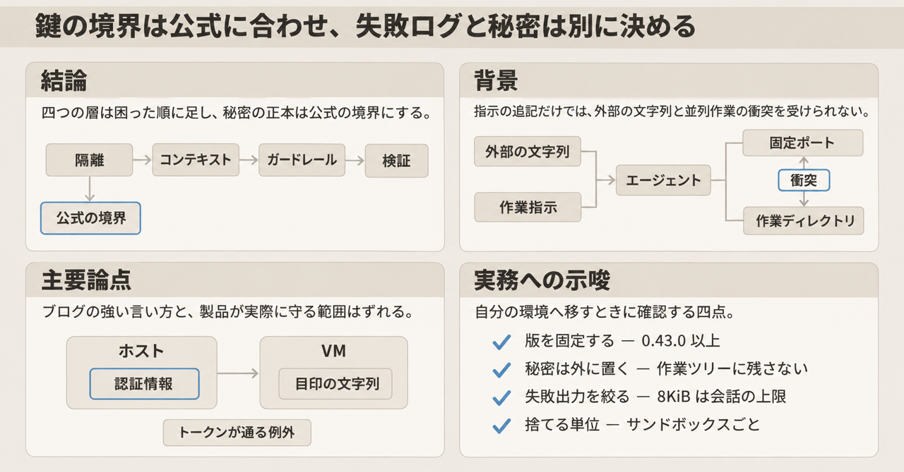
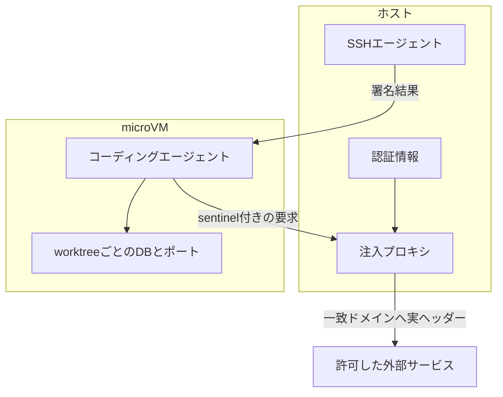

電通総研 XI本部の佐藤太一氏は、2026年11月27日のテックブログで、コーディングエージェントを日常の開発に載せる環境を四つの問いに分けています。問いは、どこで動かすか、何を見せるか、どう逸脱を止めるか、どう信じ、人が何を決めるか、です。コーディングエージェントは、指示を受けてリポジトリのファイルを読み書きし、コマンドを実行する自動の担当です。

ブログは、案件固有の事情を除いた現場の構成として書かれています。実行空間の土台は Docker Sandboxes の microVM です。Docker Sandboxes は、エージェントの作業を小さな仮想マシンへ置く Docker の機能です。microVM は、ホストの OS とは分けた、その仮想マシンです。以下は、2026年11月28日時点の公式ドキュメントとブログを並べて読んだときの整理です。

想定している読者は、指示文を足すだけではエージェントの速さと、並列作業の衝突を受け止められないと感じている開発者です。四つの層は、一度にそろえる必要はありません。困ったところから足せます。

*この記事の全体像。以下、順に解説します。*

## エージェント開発環境の4層とは

ブログが最初に置く前提は二つです。一つは、外部から来た文字列と、作業の指示との境界が弱いことです。もう一つは、固定のポートと単一のデータベースが、worktree を並べたときに衝突することです。worktree は、同じリポジトリに対して同時に開く別の作業ディレクトリです。プロンプトへ文を足すだけでは、この二つを受け切れない、という前提で四つの層が置かれています。

| 問い | 層 | ブログがそこに置いているもの |
|---|---|---|
| どこで動かすか | 隔離 | microVM、ホスト側の認証情報、外向きの許可リスト、worktree ごとの DB とポート、終了時の後始末 |
| 何を見せるか | コンテキスト | 入口は地図だけ、長い出力はログへ、コメントの中身は文書と検査へ、外部の OSS は手元のクローンを読む |
| どう逸脱を止めるか | ガードレール | ツール前後のフック、静的検査と Git フックの単一設定、依存の向き、ツールと CI の版固定 |
| どう信じ、人が何を決めるか | 検証 | 決定論の検査、プロパティベーステスト（関数が守るべき性質の検査）、画面のランダム探索、差分ミューテーション、手元のトレース、別系統のモデル、人の判断 |

### 隔離

ホストには認証情報、SSH エージェント、注入プロキシを残します。SSH エージェントは、秘密鍵を持ったまま、署名の結果だけを返すホスト側の仕組みです。注入プロキシは、VM からの要求を受け、宛先が許可と一致した HTTP にだけ、本当の認証ヘッダーを付けて外へ出します。VM の中のエージェントが見るのは sentinel です。sentinel は、本当の資格情報の代わりに渡す目印の文字列で、公式の説明では `proxy-managed` のような値です。bindings は、資格情報の注入をどの仕組みとどのドメインに許すかの承認記録です。資格情報の値は保存しません。

エージェントは microVM の中で、worktree ごとにデータベースとポートを持ちます。これは並列の衝突を避けるためです。終了時には後始末をします。環境ファイル `sbxenv.yaml` は公式の機能です。公式は、ホストで実行するコマンドを含むファイルを、マウントの外に置けと書きます。ブログが、サンドボックス定義を別リポジトリに置く、と書くのは、この環境ファイルをマウントの外に置く注意と同じ向きです。別リポジトリの中身が `sbxenv.yaml` そのものだとは、ブログは書いていません。`ports.hostIP` の既定は Loopback です。ブログは `127.0.0.1` へ公開する、と書いています。キットは、ソフトウェアと、ネットワークや資格情報などの実行要件をまとめた配布物です。取得元は絞ります。Git のキットは `ref`、コンテナイメージのキットはダイジェストで固定します。既定の許可ソースは Docker Hub です。

### コンテキスト

入口のファイルは地図に限ります。ブログは、そのファイルに何を列挙するかは指定していません。長いコマンド出力はログファイルへ退避します。コメントに書いていた中身は、文書、テスト、静的検査へ移します。外部の OSS は、手元にクローンした公開リポジトリを読ませます。

### ガードレール

ツールを実行する直前と直後に、フックを挟みます。フックは、そのタイミングで通す処理です。静的検査と Git フックは、設定を一か所にします。依存の向きを解析します。ブログは、フックで何を拒否するかと、依存のどの向きを禁じるかを書いていません。使うツールと、CI で使うアクションの版を固定します。

### 検証

決定論で繰り返せる検査は、lint、format、test、build です。そのうえに、プロパティベーステスト、画面のランダム探索、差分ミューテーション、ローカルのトレース、系統の違うモデルによる反証、人の最終判断が並びます。画面のランダム探索は、ブラウザの画面を無作為に調べる検査で、ゲートにしない側ではブラウザ探索と呼びます。系統の違うモデルによる反証は、実装に使ったモデルとは別の系統のモデルに見直させることです。

強制のゲートにするのは、静的検査、型、依存境界、シークレット検査、版ロック、単体テスト、関数のプロパティテスト、ビルドです。ゲートは、失敗したら先へ進めない検査です。ブラウザ探索、差分ミューテーション、ローカルの可観測性、異種モデルの反証は、自動では止めない手がかりにします。差分ミューテーションの手順は、ブログには書かれていません。可観測性は、手元で取る実行のトレースです。

### 四つの層の関係

四つの層は、直列の関門ではありません。隔離があるから自律実行を任せ、入口を軽くするから迷わず動き、入口から追い出した規則を機械で止め、検証で得た気づきを再び文書と検査へ戻す、という循環です。

足す順番は、実行境界、入口の地図化と高速チェック、版固定と worktree の分離、その後の重い検証、です。実行境界として最初に置くのは、microVM と認証の境界です。worktree ごとの DB とポートは、隔離の層に入りますが、導入順では版固定と同じ段で足します。高速チェックは、重い検証より前に回す短い検査です。それが lint、format、test、build のどれを指すかは、ブログが指定していません。版固定はガードレールの側です。

## 注意点

ブログに、事故件数、削減率、指示の遵守率の分母はありません。「遵守率が下がる」は、コンテキストが膨らむことの定性的な記述です。効果の測定としては、書いた人の自己申告に留まります。

「私たちの環境では」と、Docker Sandboxes の製品既定は、一致しない箇所があります。

### マウントと、VM から見える秘密

`sbx` は、Docker Sandboxes を操作するコマンドです。`sbx run` は、パスを省略するとカレントディレクトリを読み書きでマウントします。エージェントは、その中の隠しファイル、設定、Git hooks を読み書きできます。ブログの「ホストのファイルシステムを丸ごとマウントせず、専用ボリュームへチェックアウトする」は、自環境の方針です。それを再現するフラグは、本文にありません。

直接マウントは、ホストの作業ツリーを読み書きで VM に載せます。clone mode は、`--clone` によりホストの Git リポジトリを読み取り専用で VM に載せ、エージェントは VM 内の私有クローンで作業するモードです。mountless は、ホストの作業ツリーを VM に渡さず、VM 自身のファイルシステムで作業する置き方です。clone mode でも、ホストの Git ルートは読み取り専用で載ります。`.gitignore` された `.env` は読めます。公式は、改変から守るのであり、閲覧から守るのではない、と書きます。直接マウントのハードリンクは、ワークスペースの外にある実体へ届くことがあります。Git hooks は `git diff` に出ません。公式は、コミット前に `.git/hooks/` を別に見よ、と書きます。

プロキシ管理が有効なとき、本当の資格情報はホストに残ります。VM が見るのは sentinel です。ブログの「秘密情報自体が VM 内に存在しません」は、この sentinel と、次の例外を落としています。キットが OAuth の `passthrough: true` を付けると、本当のトークン応答がサンドボックスへ入ります。`passthrough: true` は、トークンの応答を置き文字にせず、そのまま通す設定です。

SSH エージェントの転送は、既定で有効です。秘密鍵はホストに残ります。ソケットを受け取ったプロセスは、認証または署名を要求できます。v3 は、資格情報の宣言を capability（キットが必要とする機能の宣言）として書くキットの形式です。v3 のキットは、SSH エージェントのソケットを受け取る宣言（`ssh-agent@1`）をしない限り、そのソケットを受け取りません。v3 以外が宣言なしでソケットを受け取るかは、公開された資格情報の説明には書かれていません。公式の用途は、Git over SSH と、コミットの署名です。ブログが書く「コミットおよびタグの署名のみ」の制限付きモードは、credentials、Git の commit signing、isolation の各ページにはありません。

### 外向き通信と、既知の不具合

プリセットは Open、Balanced、Locked Down の三段階です。Open は外向きの TCP をすべて許します。これは `sbx policy allow network "**"` と同じです。Balanced と Locked Down は、一致しない宛先を止めたうえで、承認を求めます。Locked Down でも、キットが宣言した許可は残ります。公式は、既定の許可に `*.googleapis.com` のような広いワイルドカードがあると書き、`sbx policy ls` で要らないものを消せ、と書きます。ブログの「LLM、GitHub、パッケージレジストリ、公式ドキュメントだけ」は、自環境の絞り込みです。

許可した GitHub と LLM の API は、ソースを送れる宛先のままです。組み込みの `github` 資格情報は、`gist.github.com` を含む複数のドメインへ入ります。ブログの許可はホスト単位です。メソッドとパスで、書き込みを禁じる話はありません。

同じ IP を共有するホストは、拒否した名前でも到達できる場合があります。プロキシが復号しない接続では、暗号化された中の `Host` は検査しません。

[CVE-2026-105452](https://nvd.nist.gov/vuln/detail/CVE-2026-105452) は NVD にあり、状態は Awaiting Analysis、記録元は `security@docker.com`、公開は 2026年10月8日です。egress プロキシは、サンドボックスから外へ出る通信を仲介するホスト側のプロキシです。隔離の節で書いた注入プロキシと同じものです。資格情報の注入もここで行います。このプロキシが取り除くのは、既知の sentinel と一致する資格情報だけでした。一致しない資格情報は残ります。認可済みサンドボックスの中の信頼できないコードは、その残った資格情報を、別の認証ヘッダーへ付けました。プロキシはそのヘッダーを sentinel として認識しません。ヘッダーは、注入済みの資格情報と一緒に上流へ残り、影響を受けるサービスでは攻撃者のアカウントとして認証され、要求に含まれたデータが露出し得ました。非許可ドメインへ、利用者のトークンが付く欠陥ではありません。影響バージョンは Docker Sandboxes 0.21.0 以上、0.43.0 未満です。CVSS 4.0 の基本値は 5.9（MEDIUM）です。この基本値が全体の重さです。攻撃要件は PRESENT で、攻撃に追加の条件が要る、という区分です。当該システムの機密性は HIGH で、これは基本値の内訳です。ブログは `sbx` の版を書いていないので、著者の環境がこの範囲に入るかは決まりません。ブログの「許可していないドメインには認証ヘッダーを付けない」は、この CVE では否定できません。修正後も、許可済みの宛先への送信自体は残ります。

### ブログが書いていない経路

ローカルサンドボックスのプロセスは、ホストのクリップボードへテキストを書けます。既存のクリップボードは読めません。ブログはこの経路を書いていません。

ローカルの標準入出力で動かす MCP は、ホスト上で動きます。MCP は、エージェントが外部の道具を接続する仕組みです。登録したコマンドの権限は、サンドボックスの権限ではありません。

一つのサンドボックスの中の worktree は、ツールとサービスを共有します。worktree ごとの DB とポートは、衝突を避ける仕組みです。公式が言う独立環境の単位は、サンドボックスです。VM の中の状態は、worktree の終了フックでは消えません。私有の Docker Engine は、VM の中にあり、ホストとは別の Docker です。パッケージ、このエンジン、マウントしない作業ファイルは、`sbx rm` まで残ります。直接マウントしたファイルは、`sbx rm` のあとにもホストに残ります。

### 本文から決まらないこと

著者のチェックアウトが mountless か clone か、使っている `sbx` の版は、本文から決まりません。「コミットおよびタグの署名のみ」に相当する実装が、ブログの外に実在するかは、公開された上記のページからは確認できません。上流が認証ヘッダーを応答へエコーしたとき、プロキシがそれを除くかは、参考文献に挙げた Docker の各ページには書かれていません。Balanced の許可ドメインを全件、ブログは列挙していません。公式の確認手段は `sbx policy ls` です。

## 検証が失敗したときに会話へ戻るもの

ブログは、検証が失敗したときにホストへ返してよい情報と、隔離の外へ出してはいけない情報を、一つの境界としては書いていません。近い記述は三か所に分かれ、指しているものが違います。

| ブログの節 | 境界の種類 | 返してよいと書いてあるもの | 出してはいけないと書いてあるもの |
|---|---|---|---|
| 1章「認証情報を中に置かない」 | API の資格情報と SSH の署名 | 署名の結果 | VM 内に置ける秘密は無い、という主張。許可外ドメインには認証ヘッダーを付けない。検証ログは対象外 |
| 2章「コマンドの長い出力を会話に入れない」 | 会話に載せる量 | 成否、所要時間、ログのパス。失敗時は末尾 40 行かつ最大 8KiB。足りなければ必要な範囲を開く | 書いていない。動機はコンテキストの節約 |
| 4章「自動で止める範囲と、人間が決める範囲を分ける」 | 自動で止めるか、人が決めるか | PR のコメントへ、作業計画（plan）の要約 | 本番と共有 DB は手元から直接触らず、CI へ集約する。ログの秘密は対象外 |

2章のスクリプトは、失敗時に `tail -n 40` のあと `tail -c 8192` を標準出力へ書きます。成功時もログのパスを書きます。トークンや環境変数を落とす処理はありません。保存先はリポジトリ内の `.data/task-logs` で、`umask 077`、掃除は `find -mtime +2` です。`umask 077` は、作るファイルを本人だけが読める権限にする指定です。GNU find の `+2` は、24 時間単位に切り捨てた年齢が 2 日より大きいこと、つまりおおよそ 3 日以上を指します。散文の「3日以上」は、この条件と対応します。4章は同じラッパーを、末尾から直して自己修正するための土台として、もう一度出すだけです。

公式が、microVM の境界を越えてホストへ戻ると書くのは、直接マウントしたファイルの変更、許可した宛先への外向き TCP、読み書きを許した共有 skills、です。共有 skills は、エージェント向けの指示やスクリプトを置くホスト側の共有領域です。ログの行数や 8KiB は、security、defaults、architecture、credentials の各ページにはありません。ワークスペースを直接マウントしているなら、ログファイル自体がホスト上のファイルです。mountless や clone の作業ツリーなら、ログは VM 側に残ります。末尾を会話へ載せ、足りないときに必要な範囲を開くと、その文字列は操作している人の側へ出ます。ブログは、その範囲を秘密の観点では制限していません。

8KiB は、会話を汚さない上限です。秘密を外に出さない規則は、1章の認証と署名の話にしか無く、公式より強い言い方になっています。検証の失敗出力に鍵や接続文字列が混ざったときの扱いは、このブログからは取れません。末尾で原因が分からないときは、必要な範囲を開く、と 2章は書きます。全文を会話へ貼ってよい、とは書いていません。開いた範囲にも、除去はありません。

## 自分の環境へ移すときの確認

層の名前と、足す順番は、ブログの語彙のまま使えます。鍵をエージェントに渡さない境界は、ブログの「VM 内に秘密は無い」ではなく、公式の trust boundary を正本にします。trust boundary は、秘密をどの側に残し、どの宛先へだけ出すかを公式が書く境界です。自分の環境へ移すときは、次を足します。

1. 資格情報の値は、ホストの鍵庫に置きます。VM に渡すのは sentinel だけにします。OAuth の `passthrough: true` と、値そのものを入れた環境変数は使いません。
2. `sbx run` の既定マウントに、ホームディレクトリ、鍵、`.env` を含めません。clone mode でも `.env` は読めるので、秘密は作業ツリーの外へ出します。
3. ネットワークは、Locked Down から必要なドメインだけ足すか、Balanced を `sbx policy ls` で削ります。一致しない宛先は、止めたあと承認になります。キットの許可は Locked Down でも残ります。`*.googleapis.com` のようなワイルドカードは残しません。GitHub へ書く操作と gist は、メソッドとパスで分けて考えます。
4. SSH の転送が必要でなければ切ります。使うなら、公式の転送は署名専用ではない、と扱います。v3 のキットは、`ssh-agent@1` を宣言しない限りソケットを受け取りません。受け取ったプロセスの署名要求が、Git のコミット以外に使われていないかを見ます。
5. 使う `sbx` を 0.43.0 以上に固定し、CVE-2026-105452 の範囲に入っていないことを版で確認します。
6. `sbxenv.yaml` はマウントの外に置きます。`writableEnvFiles` は、サンドボックスから共有の環境ファイルを書き換えてよいかの設定です。既定の false のままにします。
7. 鍵を持つ MCP を、ローカルの標準入出力としてホスト側で動かしません。
8. 検証コマンドの失敗出力に、環境変数、接続文字列、トークンを出さないようにします。会話へ返す末尾は、返したあとも秘密を含み得るものとして読みます。末尾で原因が分からないとき、ブログは必要な範囲を開くと書きます。その範囲にも除去は無いので、秘密が混ざるコマンドでは、開く範囲を自分で絞ります。
9. worktree ごとの DB とポートは、並列の衝突回避として採用します。秘密の廃棄は、worktree の削除ではなく、サンドボックスの削除と、直接マウント側に残るファイルの確認で行います。
10. クリップボードへ VM から書ける前提で、サンドボックス作業の直後にホストへ貼り付けません。

## 自動で止めるものと、人が決めるもの

同じモデルが実装した例示テストは、同じ見落としを繰り返します。数値のゲートは、除外のコメントで合わせにいけます。この二つが、ブラウザ探索、差分ミューテーション、ローカルの可観測性、系統の違うモデルによる反証を、自動では止めない理由です。気づきは、文書と検査へ戻します。

本番と共有のデータベースへ、手元から触らない、という 4章の線は、鍵の境界とは別の判断です。ここは CI へ集約します。検証が失敗したときに会話へ返すとブログが書くのは、成否、所要時間、ログのパス、末尾 40 行かつ 8KiB までです。その範囲から秘密を除くことはブログに無いので、自分の完了手順に、その一行を足します。

## まとめ

四つの層の名前は、環境の分け方として使えます。隔離を最初に置き、入口を地図にし、破ってはいけない約束を機械で止め、重い検証をゲートと手がかりに分ける、という順番は、先の四ステップをより粗く言ったものです。worktree ごとの DB とポートは、最初の実行境界ではなく、版固定と同じ段で足します。

鍵を渡さない仕様の正本は、Docker Sandboxes の trust boundary です。`sbx` は 0.43.0 以上に固定し、既定のマウント、OAuth の通過、SSH の転送、許可ドメインのワイルドカードを、上の確認リストで見ます。検証の失敗出力は、会話の上限と、秘密の境界を別々に定義します。

この記事が少しでも参考になった、あるいは改善点などがあれば、ぜひリアクションやコメント、SNSでのシェアをいただけると励みになります！

## 参考リンク

- [佐藤太一「さくさく作れる毎日を支える、AI 時代の開発環境 — 隔離・コンテキスト・ガードレール・検証の整理」](https://tech.dentsusoken.com/entry/2026/11/27/133501)（電通総研テックブログ、2026-11-27）
- [Docker Docs, Security model](https://docs.docker.com/ai/sandboxes/security/)
- [Docker Docs, Isolation layers](https://docs.docker.com/ai/sandboxes/security/isolation/)
- [Docker Docs, Default security posture](https://docs.docker.com/ai/sandboxes/security/defaults/)
- [Docker Docs, Architecture](https://docs.docker.com/ai/sandboxes/architecture/)
- [Docker Docs, Manage credentials](https://docs.docker.com/ai/sandboxes/configuration/credentials/)
- [Docker Docs, Use Git with sandboxes](https://docs.docker.com/ai/sandboxes/workflows/git/)
- [Docker Docs, Sandbox environment files](https://docs.docker.com/ai/sandboxes/configuration/environment-files/)
- [Docker Docs, Manage local network rules](https://docs.docker.com/ai/governance/local/network-rules/)
- [Docker Docs, Docker Sandboxes](https://docs.docker.com/ai/sandboxes/)
- [NVD, CVE-2026-105452](https://nvd.nist.gov/vuln/detail/CVE-2026-105452)
