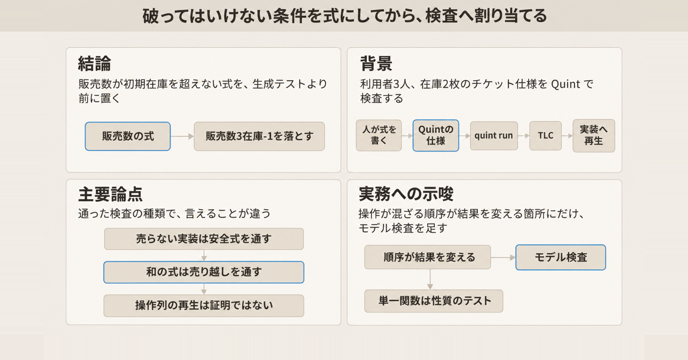
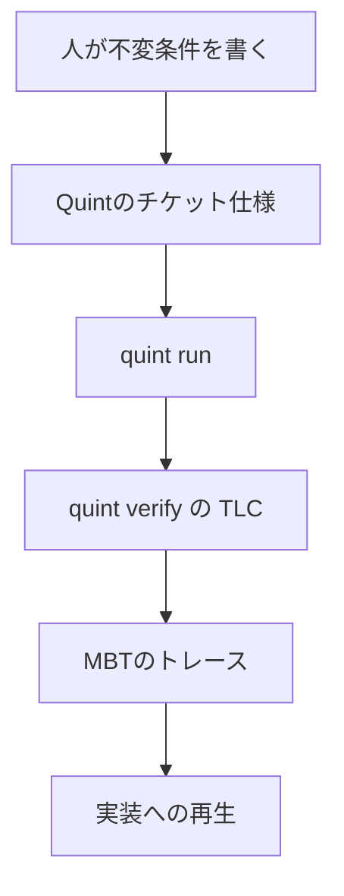

karamage 氏は 2026-11-21 に、チケット販売の小さな仕様を題材にして、破ってはいけない条件を Quint の式として先に置く手順を公開しました。Quint は、状態の遷移を実行できる仕様言語です。本文の更新日は 2026-11-22 です。この文章では、その手順が検査するものと、条件をどの検査へ割り当てるかを順に示します。状態数（モデル検査が数えた状態の個数）は 2026-11-23 に Quint 0.34.0 で再実行し、実行時間と実装再生（仕様の操作列を実装でやり直した件数）の件数は同氏の記事の記録のまま扱います。

*この記事の全体像。以下、順に解説します。*

## 生成テストの前に置くルールとは

公開記事の見出しは TLA+ です。この見出しの TLA+ は、TLA に基づく仕様を指しています。仕様の記述と検査に使っている言語は Quint です。Quint は、TLA に基づく実行可能な仕様言語です。TLA は temporal logic of actions の略で、状態がどう遷移するかを書く枠組みです。quint-co/quint の説明は "An executable specification language with delightful tooling based on the temporal logic of actions (TLA)" です。

不変条件は、初期状態から許された操作を繰り返してたどり着ける状態のすべてで、成り立っていてほしい式です。たどり着ける状態を到達状態と呼びます。操作の並びをトレースと呼びます。手順は、人が不変条件を式にし、その式を仕様の上で検査し、残ったトレースを実装へ再生する、という流れです。残ったトレースとは、検査のあと実装と比べるために取り出す操作の列です。

`quint run` はシミュレータです。ランダムな実行を試し、渡した式を破る例を探します。`quint verify` はモデル検査の入口です。モデル検査は、到達状態を機械的に調べ、式が破れる状態があるかを見る検査です。Quint 0.34.0 のヘルプでは、`quint verify` の既定バックエンドは Apalache です。Apalache は、その既定の経路で呼ばれる検査器の名前です。`--backend=tlc` を付けたときだけ、検査器は TLC になります。TLC は TLA+ のモデル検査器で、渡したモデルの到達状態を調べます。モデルベーステスト（MBT）は、検査で残ったトレースを実装へ再生し、仕様と実装の振る舞いが一致するかを見る手順です。

上の図は、式を仕様に載せ、シミュレータで反例を探し、TLC でその有限世界を調べ、残ったトレースを実装へ再生する順です。有限世界とは、利用者数と在庫を固定したモデルのことです。

### チケット仕様に書いてあるもの

世界は固定です。利用者は alice、bob、carol の 3 人で、初期在庫は 2 枚です。各利用者の状態名は Idle、Checked、Bought、SoldOut です。確認済みは Checked、在庫が尽きたあとは SoldOut です。Idle と Bought は状態名として置いてあります。1 ステップでは利用者を 1 人選んで、その人が在庫確認か購入をします。

不変条件は 1 本です。`noOversell = sold <= INITIAL_STOCK` は、販売数が初期在庫を超えない、という意味です。TLA+ として記事が置いたルールも、この 1 本です。

| 項目 | 内容 |
|---|---|
| 不変条件 | `noOversell = sold <= INITIAL_STOCK` の 1 本 |
| 世界 | 利用者 3 人、初期在庫 2、状態は Idle / Checked / Bought / SoldOut |
| 1 ステップ | 利用者を 1 人選び、在庫確認か購入をする |
| バグのある購入 | 確認済みなら在庫を見ずに、在庫を 1 減らし販売数を 1 増やす |
| 修正 | 在庫が残っていれば同じ更新。残っていなければ枚数を変えず SoldOut |

### 先に置くテストと、そのあとの検査

先に置いてあるのは、割り込みのない逐次の成功例です。ここでの割り込みは、複数の利用者の操作が順に混ざることです。記事は「という想定です」と書き、3 件成功、0 件失敗と置いています。本文が具体的に見せているのは、1 人の購入と、2 人の連続購入です。捨てた本番テストの一覧は本文にありません。捨てる対象として見せているのは、この逐次の成功例です。

そのあとの検査は、次の順です。

1. ランダム実行です。バグ仕様では販売数 3、在庫 -1 の反例が出ます。修正後は違反なし、と記事は書いています。
2. TLC です。コマンドは `quint verify --backend=tlc` です。修正仕様の表示は、状態を 55 生成し、異なる状態は 29、未探索の待ちは 0 です。55 は探索で生成した状態の数、29 は内容が異なる状態の数です。
3. 実装への再生です。1000 本のトレースです。記事は、バグ実装で不一致 578、修正後 0、と書いています。本数は実行のたびに少し動く、とも書いています。

記事の末尾は、単純な画面と入力検査ではテストケースを残す、と書いています。ケースとルールは使い分けだ、とも書いています。翌日の続編は、この検査を「利用者 3 人・在庫 2 枚」の有限世界だと位置づけています。

記事は、この実行を Quint v0.33.1 だと書いています。手順の公開先は「[【TLA+】AIにテストケースを書かせるな。ルールを書け](https://zenn.dev/karamage/articles/73027ee36796dc)」です。続編は「[なぜ、AIコーディング時代にLeanが注目されるのか](https://zenn.dev/karamage/articles/bf57c47b9e9b9b)」です。Quint のリポジトリは [quint-co/quint](https://github.com/quint-co/quint) で、2026-11-22 時点の latest は v0.34.0 です。

## 注意点

見出しの「テストケースを書かせるな」より、本文と公式文書が覆う範囲は狭いです。ここからは、信じてよい範囲と、実行で崩れた読みを分けます。

### 再実行で残ったもの

2026-11-23 に Quint 0.34.0、Temurin 25.0.3 で、記事と同じ有限世界を実行した結果は次のとおりです。Temurin は、この再実行で使った Java の実行環境です。

- バグ仕様のシミュレータは、販売数 3、在庫 -1 で `noOversell` を破りました。
- 修正仕様の TLC は `55 states generated, 29 distinct states found, 0 states left on queue` でした。記事の状態数と同じです。
- 時間は合わせていません。初回の 1281ms は、式を実行する評価器を取る時間を含んだ計測です。評価器は、その初回に Quint が取った実行部品です。記事に書かれた 12ms、1083 traces/second、382ms は、記事の記録のままにします。どのコマンドの数値かは、ここでは対応づけません。
- 1000 本中 578 件の不一致は、実装を再生していないため未再現です。記事の自己申告として読みます。

### 安全の式と、売らない仕様

公式の性質のページは、安全を「悪いことが起きない」、活性を「良いことがいつか起きる」と分けています。観察は「良いことが起きている」を見る実用的な代替で、活性そのものではない、と書いています。出典は [Checking Properties](https://quint.sh/docs/checking-properties) です。

売らない仕様では、在庫確認が常に SoldOut になり、購入がありません。この仕様でも、`noOversell` のシミュレータと TLC は違反なしでした。TLC は状態を 13 生成し、異なる状態は 8、未探索の待ちは 0 です。安全の式は、売り越しが無いことだけを見ます。1 枚も売らない実装は、その式を満たします。

同じ売らない仕様に、到達の観察 `sold == INITIAL_STOCK` を足すと、シミュレータは不変条件を通したうえで `[not observed]` になりました。20 本中 0 本で、終了コードは失敗でした。修正仕様では同じ観察に到達して止まりました。探索は 4 本中 4 本です。この観察はシミュレータが出した標本です。TLC で「その状態へ到達できる」ことを網羅したわけではありません。売らない仕様は購入動作が無いので、標本を増やしても到達しません。

`sold + stock == INITIAL_STOCK` は、karamage 氏の記事には無い式です。この式だけをバグ仕様の検査にすると、TLC は違反なしでした。その実行は状態を 55 生成し、異なる状態は 30 です。この 30 は、修正仕様で販売数の式を調べた 29 とは別の実行です。販売数 3、在庫 -1 でも和は初期在庫の 2 のままです。この式は、その売り越しを違反にしません。違反なしは、販売数 3、在庫 -1 が仕様上ありえない、という意味ではありません。在庫が負になる状態は、和の式が違反なしだった実行とは別の結果として、バグ仕様の TLC 反例に出ています。和の保存は、在庫を減らして販売数を増やす動きを止めません。

### 成功の種類

ここでいう緑は、その検査が成功終了した状態です。成功の種類で、言えることが違います。

| 緑 | 公式または再実行が言うこと |
|---|---|
| テストの成功 | 記事の 3 件は「という想定」の逐次例です。割り込みの列は含みません |
| `quint run` の OK | "it could not find a violation in the explored executions. There might still be an issue." シミュレータは検証器ではありません |
| TLC の OK | そのモデルの到達状態で、渡した性質が成り立つ、という公式の説明です。記事のモデルは利用者 3 人、在庫 2 枚です |
| トレースと実装の一致 | モデルベーステストとトレース検証は、コードが正しいことの証明にはなりません。引用は "Both of these won't give you a proof that your code is correct." です |

シミュレータの文の出典は [Understanding the Simulator](https://quint.sh/docs/simulator) です。トレース再生の文の出典は [Model-based Testing](https://quint.sh/docs/model-based-testing) です。引用の both of these は、モデルから操作列を作って実装へ再生するモデルベーステストと、実装側の記録を仕様へ照らすトレース検証の 2 つです。

`quint verify` の既定バックエンドは Apalache です。`--max-steps` は探索するステップ数の上限で、既定は 10 です。記事は `--backend=tlc` を付けています。既定のままの verify を、記事の TLC と同じ網羅だと読まないでください。

### AWS の論文が覆う範囲

記事が参照する AWS の形式手法は、TLA+ で設計を検査することです。読んだのは、Lamport のサイトにある著者 PDF「Use of Formal Methods at Amazon Web Services」です。日付は 2014-09-29、著者は Newcombe, Rath, Zhang, Munteanu, Brooker, Deardeuff です。以下はその PDF の文です。PDF は [Use of Formal Methods at Amazon Web Services](https://lamport.azurewebsites.net/tla/formal-methods-amazon.pdf) です。

- "So far we have used TLA+ on 10 large complex real-world systems." 価値の中身は、他の手段では見つけられなかったと思う微妙なバグ、または正しさを落とさずに性能の最適化へ進む自信です。"we are sure" は著者の確信です。
- 表に出ている部品は 6 行です。10 システム全部の内訳は、この表にはありません。DynamoDB の行はバグ 3 件、うち 35 ステップのトレースがある、と書いています。
- 内部のロックマネージャの行は "Failed to find a liveness bug as we did not check liveness." です。引用の liveness は、前に書いた活性のことです。
- 実行コードが検証済みの設計どおりかは、"The answer is that we don't." です。TLC で設計の端をテストにする研究はハードウェアの話で、"we have not yet tried to apply that method to software." と書いています。
- DynamoDB の節では、障害注入と実機のストレステストは "absolutely necessary" で、それでも設計の微妙な欠陥は残る、としています。
- 結論は、形式手法が扱うのはモデルであり、"All models are wrong, some are useful." と書いています。ページ 3 と結論は、当時 7 チームが使っている、とも書いています。

### 人が固定する範囲

IEEE TSE 2015 年 5 月号の Barr らの調査は、テストオラクル問題を「入力に対する望ましい振る舞いと、誤りうる振る舞いを区別すること」と定義しています。現行版の日付は 2015-05-15 です。テストオラクルは、その実行が期待どおりかを判定する基準です。要約は、仕様、契約、モデルだけでは足りないとき、最後に残る情報源が人間だ、と書いています。仕様からオラクルを機械で作れる、とも書いています。DOI は 10.1109/TSE.2014.2372785 です。

Quint のブログ "Reliable Software in the LLM Era"（Gabriela Moreira、ページ内日付 2025-11-17）は、"we are not delegating protocol design to AI." と書いています。同時に、既存仕様の変更は AI が行い、人間の時間の中心は対話的な仕様の検証だ、と書いています。"LLMs don't think, they translate. Quint's deterministic tools do the reasoning." とも書いています。仕様 2 日、コードとテスト約 1 週間という対比は、Quint チームが自分たちの開発について書いた自己申告です。出典は [Reliable Software in the LLM Era](https://quint.sh/posts/llm_era) です。

人が固定するのは、設計判断と、検査にかける式を読んだあとの文面です。式の初稿を手で書くことだけが公式手順ではありません。

### 同じ式は、モデル検査器が無くても書ける

QuickCheck（Claessen and Hughes, ICFP 2000）は、合否を形式的な性質で決め、その性質を多数のランダム入力で試します。この型のテストをプロパティベーステストと呼びます。チケットの `sold <= INITIAL_STOCK` と操作の列は、その型のテストにも書けます。QuickCheck の論文は、複数の操作が混ざる順序をすべて尽くすとは書いていません。論文は [QuickCheck: A Lightweight Tool for Random Testing of Haskell Programs](https://www.cs.tufts.edu/~nr/cs257/archive/john-hughes/quick.pdf) です。翌日の記事は、入力が多い関数にはプロパティベーステスト、複数の利用者の操作が混ざる場合にはモデル検査、と分けています。

## 条件を検査の種類へ割り当てる

要件に書いた条件は、エージェントが生成したテストの採点元に戻せます。戻す単位は、テストの一覧を捨てることではありません。条件を、落ちる検査の種類へ割り当てることです。

1. 安全の式は、悪い実装が落とす強さで書きます。示した売り越し（販売数 3、在庫 -1）は、販売数が初期在庫を超えない式で落ちます。販売数と在庫の和だけでは、在庫を減らして販売数を増やす売り越しを通します。和の式だけをバグ仕様の検査にすると、TLC は違反なしでした。
2. 起きてほしいことは、別の落ちる検査にします。売らない実装は、安全式の TLC が緑でした。Quint 0.34.0 では `quint run --observation="sold == INITIAL_STOCK"` が、売らない仕様を失敗させ、修正仕様では到達しました。これは「いつかは必ず売れる」という活性そのものではありません。
3. 逐次の例は、読み手向けの動作説明として残します。記事の末尾も、単純な画面と入力検査ではケースが足りる、と書いています。複数の利用者の操作が混ざる順序の代わりに並んでいた成功例だけが、ルールへ移す候補です。
4. 式の初稿は AI が書いても、採点に使う文面は人が読みます。公式が AI に渡していないのは、プロトコルの設計判断です。式を、実装を生成した同じエージェントの内部だけに閉じると、自作自演がルール側へ移ります。自作自演とは、実装とその合否判定を同じ生成過程が書いてしまうことです。
5. モデル検査を足すのは、複数の利用者の操作が混ざる順序が結果を変える箇所です。単一関数の境界なら、同じ式をプロパティベーステストに置けます。
6. 実装への再生は、モデルと実装が同じ振る舞いをするかの検査です。モデルが間違っていれば、両方緑になりえます。公式はこれを証明と呼んでいません。
7. 緑の CI、緑の `quint run`、弱い式の緑の TLC は、その検査が通ったこと以上の採用理由にしません。CI は、変更のたびに自動で走る検査の列です。

割り当てをやめる条件は、次の 3 つです。

- 順序が結果を変えない機能なら、有限モデルの TLC は過剰です。
- 仕様をコードの変更に追随させないなら、モデルは第二の自信になります。実装と別に「仕様を満たした」という根拠が残り、仕様が古くても緑が残ります。公式の MBT のページも、仕様がフォルダの奥で更新されないずれを先に書いています。
- 活性を安全式だけで見ると、見逃しが起きます。応答がいつか返る、といった性質は安全式の範囲外です。AWS の論文では、内部のロックマネージャの行が "Failed to find a liveness bug as we did not check liveness." です。

## まとめ

生成テストの前に置くのは、破ってはいけない条件の式です。karamage 氏のチケット仕様では、その式は `sold <= INITIAL_STOCK` の 1 本です。利用者 3 人、在庫 2 枚の有限世界を、`quint run` と TLC が検査します。

その 1 本は、販売数 3、在庫 -1 の売り越しを検出します。売らない実装と、在庫と販売数の和だけを見る式は、別の抜け方を通します。起きてほしいことは観察として分け、逐次の成功例は説明として残します。式の採点に使う文面は人が読みます。順序が結果を変える箇所にだけ、モデル検査を足します。トレースの再生は、モデルと実装の一致の検査です。公式はこれをコードの証明と呼んでいません。

この記事が少しでも参考になった、あるいは改善点などがあれば、ぜひリアクションやコメント、SNSでのシェアをいただけると励みになります！

## 参考リンク

- karamage「[【TLA+】AIにテストケースを書かせるな。ルールを書け](https://zenn.dev/karamage/articles/73027ee36796dc)」（2026-11-21）
- karamage「[なぜ、AIコーディング時代にLeanが注目されるのか](https://zenn.dev/karamage/articles/bf57c47b9e9b9b)」（2026-11-22）
- [quint-co/quint](https://github.com/quint-co/quint)（latest v0.34.0、2026-11-22）
- Quint docs「[Checking Properties](https://quint.sh/docs/checking-properties)」
- Quint docs「[Understanding the Simulator](https://quint.sh/docs/simulator)」（更新 2026-08-12）
- Quint docs「[Model-based Testing](https://quint.sh/docs/model-based-testing)」（更新 2026-08-12）
- Gabriela Moreira「[Reliable Software in the LLM Era](https://quint.sh/posts/llm_era)」（2025-11-17）
- Newcombe et al.「[Use of Formal Methods at Amazon Web Services](https://lamport.azurewebsites.net/tla/formal-methods-amazon.pdf)」（著者 PDF、2014-09-29）
- Barr, Harman, McMinn, Shahbaz, Yoo. IEEE TSE vol. 41, no. 5。現行版 2015-05-15。DOI 10.1109/TSE.2014.2372785
- Claessen and Hughes「[QuickCheck: A Lightweight Tool for Random Testing of Haskell Programs](https://www.cs.tufts.edu/~nr/cs257/archive/john-hughes/quick.pdf)」（ICFP 2000）
