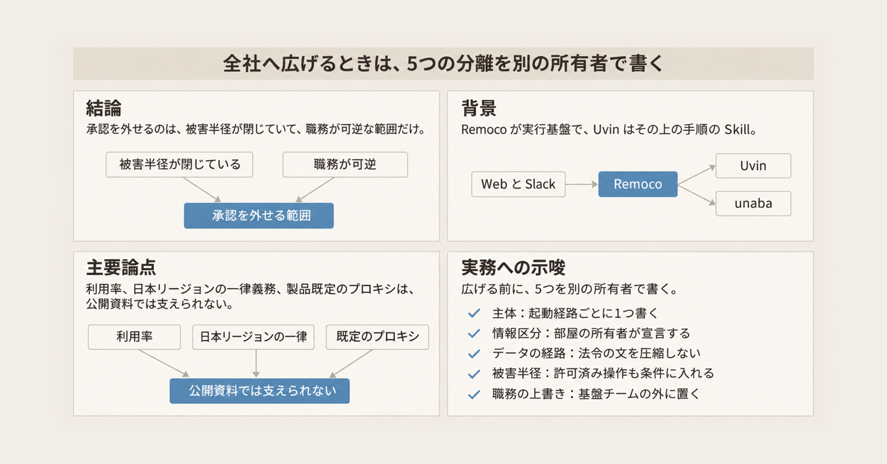
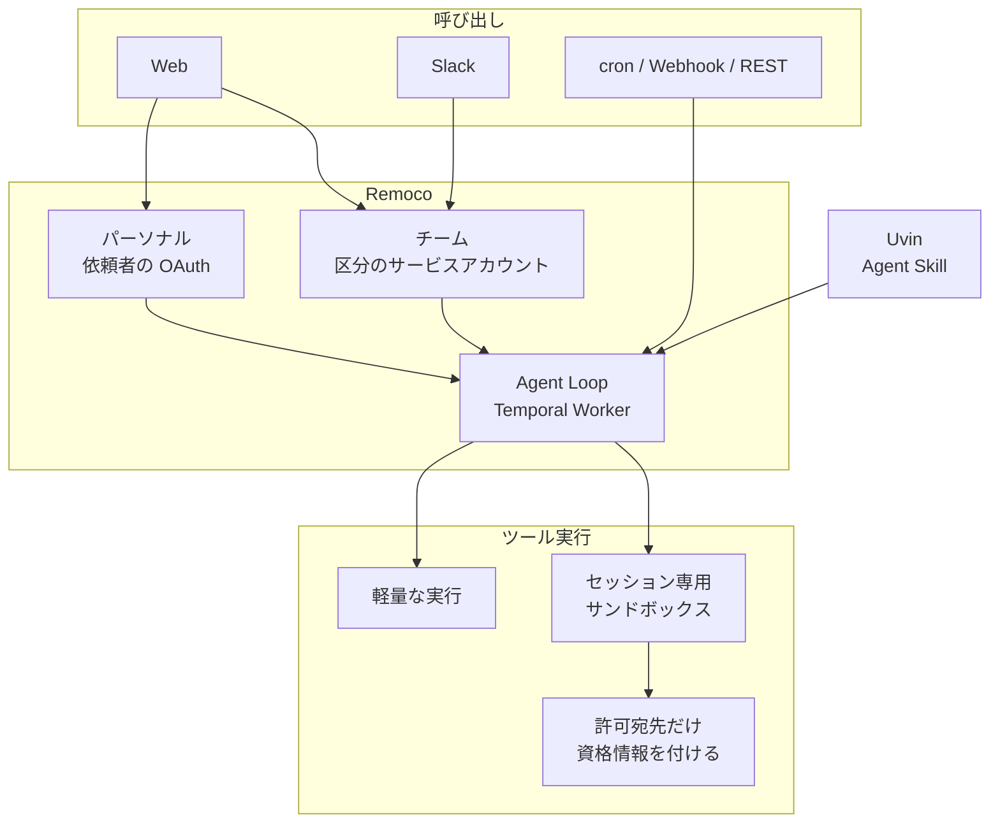

Ubie は、Web と Slack から呼ぶクラウドエージェント基盤 Remoco と、その上で動くエンジニアリングエージェント Uvin を社内で作っています。[2026年11月12日の記事](https://zenn.dev/ubie_dev/articles/45501469c9c044)は、この基盤をソフトウェア開発の工場に留めず、法務や人材開発を含む全社の仕事の土台にすると位置づけています。実装と監査ログは公開されていないため、ここでの説明は記事本文と、記事が名指しする公開資料の範囲です。

全社の仕事へ広げるときに、権限と、そこで打ち止めになる境界を、どの層で分けるかを整理します。この境界を、以下では停止と呼びます。

*この記事の全体像。以下、順に解説します。*

## Remoco と Uvin とは

Remoco のエージェントは、システムプロンプト、モデル、ツール、スキルの組です。実行は Google Cloud と Temporal の上にあります。Temporal は、長い処理を途中の状態ごと進めるワークフローの実行基盤です。必要なときだけ、セッション専用のサンドボックスが GKE 上に立ちます。GKE は、Google Cloud 上の Kubernetes です。

Uvin は、Remoco の上の Agent Skill です。Agent Skill は、モデルに渡す手順と規範の束です。Uvin は、開発の手順を playbook に、守らせたい規範を principle に置きます。playbook はユースケースごとの手順、principle は作業中に守らせる規範です。

### 呼び出しと、実行の置き場所

呼び出しは Web、Slack、cron、Webhook、REST です。記事は、ストリーミングと Generative UI、MCP 経由の実行とエージェント管理、デプロイや障害を挟む長時間ループ、複数人の同時コラボ、セッション全体の可観測性を備える、と書いています。Generative UI は、モデルの出力に合わせて画面の部品を出す表示です。MCP は、モデルが外部のツールやデータを呼ぶ接続です。

モデルは Gemini、GPT、Claude、オープンモデルです。特に機微な情報は、自社管理のオープンモデルにだけ送りたいことがある、と記事は書いています。利用するデータに応じてリージョンと送信先モデルを制限する仕組みは、別の機能として記事にあります。試験的な機能として、状態を残す小さなアプリと、単一セッションの記憶があります。

ハーネスはサンドボックスの外にあります。ハーネスは、モデルの判断とツール呼び出しを束ねる実行側です。bash やファイル操作のときだけ、サンドボックスへ委譲します。それ以外は、サンドボックスの外で行う軽量な実行です。記事はこの形を Sandbox-as-a-tool と呼び、Anthropic の “Decoupling the brain from the hands” と同型だと書いています。脳と手の分離は、判断する側と、ファイルやコマンドを触る側を分ける、という意味です。ハーネスには [Pi Durable](https://earendil.com/posts/pi-durable/) を使います。この公開記事は、出荷時点で experimental（試験的）と書いています。

セッションは Temporal の Entity Workflow として管理し、共有セッションの排他制御などを行う、と記事は書いています。Entity Workflow は、1つの対象の操作を 1 本の Workflow に集めるパターンです。

サンドボックス基盤の名前は unaba です。セッションごとに microVM を割り当てます。microVM は、そのセッション用に立つ小さな仮想マシンです。ディスクは一定期間残ります。中に資格情報は置きません。外向き通信はプロキシを通します。プロキシが許可した宛先にだけ、資格情報を付けます。プロキシの制御はホストに加え、パスと GraphQL の操作までです。GraphQL は、API へ送る問い合わせの種類を指定する方式です。例として、GitHub への write は Ubie の organization 以外に出せない、と記事は書いています。

### エージェントは2種

パーソナルは、依頼者の OAuth で動きます。OAuth は、依頼者本人の認可で外部サービスを呼ぶ方式です。Slack のような共有の場からは呼べません。セッションを他人と共有できません。

チームは、サービスアカウントで動きます。サービスアカウントは、人ではなく区分に紐づく資格情報です。Slack から呼べます。チャンネル参加者などから閲覧範囲を割り、「正社員向け」「XX 事業のパートナー込み」のような情報区分を付けます。情報区分は、その場に誰がいるかで付ける閲覧範囲のラベルです。区分ごとのサービスアカウントで、ツール呼び出しを制限します。

### Uvin が担う仕事

Uvin の仕事は、次のとおりです。

- 壁打ちとプロトタイプから要件へ落とす
- デザインシステムなどのガードレールに沿って、デリバリーできる状態まで実装する
- Sentry などのアラートからバグを直す
- コードとドキュメントを横断して調べる
- 数日単位で改善を繰り返す

中身は、Cursor が公開している [pstack](https://github.com/cursor/plugins/blob/main/pstack/README.md) を基にした Agent Skill です。pstack は、playbook と principle を Skill として公開している一式です。毎日の cron が前日のセッションを読み、つまずきと人の指摘から改善の pull request を作ります。同じ形を、法務の一次対応スキルにも回し始めている、と記事は書いています。

開発以外の例は、契約レビューの一次対応と、日報を読む人材開発の伴走エージェント「ゆびび」です。成果物の受け入れのレビューには CodeRabbit を使い、Uvin の内側のループに入っている、と記事は書いています。

### 呼び出しからツールまでのつながり

記事が書く呼び出しと実行のつながりは、次の図です。パーソナルとチームは、記事が定義する2種です。cron、Webhook、REST は、起動経路として記事にあります。

Web はパーソナルとチームの両方へつながります。Slack はチームへつながります。チャネルに紐づかない cron、Webhook、REST は、図では Agent Loop へ直接入る起動です。この起動を、ここではアンビエントと呼びます。記事は、この矢印が誰の資格情報でツールを呼ぶかを書いていません。

Agent Loop は、Temporal の Worker 上で、モデルの判断とツール呼び出しを進める実行です。Temporal Worker は、その Workflow を動かすプロセスです。図の Uvin は Remoco の枠の外に描いています。中身は Remoco 上の Agent Skill で、Agent Loop へ入ります。図では、プロキシはサンドボックスの先にだけつながっています。資格情報は、そのプロキシが許可した宛先に付けます。閲覧範囲は、チームの情報区分で決まります。playbook と principle は Uvin の Skill です。

## 注意点

記事は設計の解説であり、到達を数で宣言する箇所はほとんどありません。数、承認、製品の既定、ガイドラインは、出所ごとに分けて読みます。

### 利用率と改善幅の出所

2026年11月の記事は、Remoco の利用率も、Outer Loop の加速度も、数で示していません。Outer Loop は、pull request を作るところまでと記事が書く、セッションの外の改善です。「生産能力そのものが加速度的に上がっていく」は、測定条件の無い一文です。

系譜の記事にある数は、それぞれのシステムの自己申告です。Remoco や Uvin の成績ではありません。

| 出所 | いつ | 何の数か | 値 |
|---|---|---|---|
| [Dev Genius の記事](https://zenn.dev/ubie_dev/articles/6fd1dd202c0e07) | 公開 2025年6月24日。85% は「月間で」という自己申告で、月の明示はない。約 20% は本文の「2025/06 現在」 | Dev Genius を月間で使う社員、MCP 機能を使う社員 | 85% 程度、約 20% |
| [infra-agent の記事](https://zenn.dev/ubie_dev/articles/b712ec880ac038) | 公開 2026年5月11日 | 導入前後2週間のインフラ問い合わせ | チケット 30件→24件、解決時間の中央値 3.4時間→2.3時間、AI 単独解決 0%→12.5%、スレッド長の中央値 14→9.5 |

Dev Genius は、2025年6月時点の社内生成 AI 基盤の名前です。2026年11月の記事が書く Remoco ではありません。2026年11月の記事の「2023年から」は、著者の回顧です。2023年の公開記事を根拠にした数は、ここにはありません。Uvin の開始は、[2026年2月19日の記事](https://zenn.dev/ubie_dev/articles/9258ddaa5f8caa)が「昨年の夏ごろから」と書くので、著者の暦では 2025年夏です。

infra-agent は、unaba が考え方を拝借したと 2026年11月の記事が書く先行です。構成は同じではありません。infra-agent は、Cloud Run に NAT を付けず、すべての宛先（0.0.0.0/0）を mitmproxy へ強制する透過プロキシです。透過プロキシは、アプリに経路を意識させず通信を中継へ向ける方式です。mitmproxy は、その中継に使っているプロキシです。unaba は、セッション単位の microVM、プレースホルダー、宛先ごとに資格情報を付けるプロキシです。プレースホルダーが何を置くかは、記事には書かれていません。

### 承認を挟まない、と記事が書く範囲

記事は、資格情報を読む手段も許可外へ書く手段も無いので、サンドボックスの中では承認なしで作業させられる、と書いています。人が事前に承認する項目の一覧は、本文にありません。図がプロキシを描くのは、サンドボックスの先だけです。軽量な実行が外へ通信し、そこで資格情報が必要になるかは、記事には書かれていません。

事例1の見出しが追加で言っているのは、1点です。後戻りできる変更は、確認を挟まず、レビュー対応を含めて最後まで進めます。記事は、この後戻りできる変更を、One-Way Door ではない変更、と書いています。One-Way Door は、後戻りできない変更です。一方向の変更は確認する、とは書かれていません。何が One-Way Door かも書かれていません。

事例2の見出しは、医師がスクショで指示し、エンジニアがスレッドで結果を見る、という様子です。これは、次の法務画像とは別です。法務画像のあとのキャプションとして本文にあるのは、法務の「スレッドでの議論のコンテキストを前提に相談する様子」です。

Outer Loop は、pull request を作るところまで、と書いています。マージする主体は書いていません。

Anthropic の [Managed Agents](https://www.anthropic.com/research/managed-agents) は、同じ脳と手の分離を説明しています。セキュリティの段落が言うのは、生成コードからトークンへ届かないようにすることまでです。狭い権限は、限定トークンではできないことがある、という仮定に依存し、その仮定はモデルが賢くなると危ない、と書いています。限定トークンは、その投稿が、権限を狭く切った認証情報として扱っているものです。承認を不要にしてよい、とは書いていません。同じ投稿の Git の説明では、初期化時にトークンで clone し、サンドボックス内の remote に結線します。push と pull は中から動きます。カスタムツールは、外の vault とプロキシが資格情報を付けます。vault は、資格情報を置く保管庫です。ここまでの clone、push、vault は、Anthropic の投稿の説明です。Ubie の「承認なし」は、この投稿の結論ではありません。

Ubie 側で残る穴は、許可済みの操作の中です。プロキシが Ubie organization への GitHub write や、許可した GraphQL 操作に資格情報を付けるなら、入力に紛れた指示がその範囲を承認なしで実行しえます。プロンプトインジェクションは、モデルへの入力に紛れた指示が、許可済みのツールを本人の確認なしに呼ばせることです。これは、Anthropic が限定トークンについて書いた留保と同型の読みです。Anthropic が Ubie のプロキシを評価した文ではありません。

### サンドボックス製品の既定

[GKE Agent Sandbox の概念](https://docs.cloud.google.com/kubernetes-engine/docs/concepts/machine-learning/agent-sandbox)（2026年11月13日取得）は、カーネル分離の選択肢を GKE Sandbox の gVisor または microVM としています。この文の GKE Sandbox は、GKE Agent Sandbox の文書が挙げるカーネル分離の名前です。gVisor は、その選択肢の一つです。Kata Containers は、利用者が入れる OSS です。Google Cloud の製品ではなく、サポートと SLA は及ばない、と注記しています。ランタイムを指定しない Pod は、カーネル分離がありません。Pod は、Kubernetes 上でコンテナを動かす実行単位です。Pod snapshot は、同じ文書が gVisor を必要とし、microVM では動かない、と書く機能です。多くのエージェント負荷には Agent Substrate を推奨する、とも書いています。Agent Substrate は、同じ文書が推奨すると書く名前です。

[手順](https://docs.cloud.google.com/kubernetes-engine/docs/how-to/agent-sandbox)の例は `runtimeClassName: gvisor` です。runtimeClassName は、その Pod が使うランタイムの指定です。推奨の准入ポリシーは gVisor を要求します。准入ポリシーは、Pod を載せる前に条件を検査する Kubernetes の仕組みです。既定のネットワークは、入ってくる通信を原則拒否し、出ていく通信は公衆インターネットを許可します。拒否するのは、プライベートアドレス、クラスタ DNS、メタデータサーバです。資格情報を許可宛先にだけ付けるプロキシは、この既定に書かれていません。

記事の unaba は、GKE Agent Sandbox を入れた結果として Kata になり、出ていく通信が全部プロキシになる、という製品仕様ではありません。記事が unaba について使う語は、セッションごとの microVM です。Kata は、それとは別の文で、Ubie が自分たちで載せたと書く層です。公開資料は、その microVM の実体が Kata である、とは結んでいません。載っていることの監査は公開されていません。

### pstack が担うもの

2026年11月13日に取得した pstack の README（content SHA `bb613a100841eb7da66b0ee0eda1a4f728d0a6dd`）は、playbook を 23、principle を 24 の短い Skill と書いています。`/poteto-mode` は、作業開始時に principle の索引を読みます。モデルへの指示であり、OAuth やサービスアカウントを切り替える機構ではありません。

公開 Skill の [never-block-on-the-human](https://github.com/cursor/plugins/blob/main/pstack/skills/principle-never-block-on-the-human/SKILL.md) は、可逆な作業は確認せず進め、force-push、本番データの削除、外部メッセージの送信は確認する、と書いています。記事の事例1と同型です。Ubie がこのファイルをそのまま使っている証拠はありません。ランタイムが従わなかったときに止める、とも書いていません。

README には、検証したスタックを land する shipping と、独立した pull request を merged まで進める autopilot-full があります。land は、検証した変更を本線へ載せることです。この README には、マージまで進む playbook があります。一方で、playbook を足しても情報区分は増えません。Ubie のどの playbook がマージまで進むかは、非公開です。

企画から検証をワークフローから Skill へ切り替えた理由として、記事は「Opus 5.5 あたりの世代」でロングコンテキストとオーケストレーションが上がった、と著者の感覚を書いています。ここで Skill に移したのは、企画から検証までの手順の置き場です。セッションを動かす Temporal の Workflow をやめた、という意味ではありません。ベンチマーク表はありません。

### ガイドラインの文言

記事は、お客様から委託されたデータに 3省2ガイドラインが適用され、日本リージョンでの処理が義務付けられる、と書いています。3省2ガイドラインは、医療情報についてのガイドラインの通称です。確認した範囲では、提供者側が総務省・経済産業省、利用者側が厚生労働省のガイドラインです。条文番号は記事にありません。これは、Ubie の適用判断として読みます。

2026年11月13日に確認した一次は、次のとおりです。

- 厚生労働省「医療情報システムの安全管理に関するガイドライン」第7.0版（令和8年6月）の[案内](https://www.mhlw.go.jp/stf/shingi/0000516275_00006.html)
- 企画管理編の遵守事項⑤。[PDF](https://www.mhlw.go.jp/content/10808000/001716292.pdf) から確認できる文は、「保存された情報を格納する情報機器等が、国内法の適用及び執行の及ぶ範囲にあることを確実にする」です
- 同じ章の確認項目には、保存機器の設置場所（地域、国）と、委託先への国外法の適用可能性があります。国を日本に固定する文ではありません
- [Q&A（令和8年9月）](https://www.mhlw.go.jp/content/10808000/001752355.pdf) の Q18。生成 AI の入力が、AI の学習等のために保存されないことが契約等で担保されていれば、サーバが国内法の適用を受けることは必須ではない、と答えています

提供者側は、総務省・経済産業省のガイドライン第2.0版（令和7年3月改定）です。[PDF](https://www.meti.go.jp/policy/mono_info_service/healthcare/01gl_20250328.pdf) から確認できる 6.1 は、医療情報と当該システムが国内法の執行の及ぶ範囲にあることを確実にする、という文です。確認したテキストの範囲に、「日本リージョンでの処理」という文言はありません。画像だけの表に語句が残る可能性は、テキストの確認では閉じ切れていません。

委託データが保存される場合に、Ubie がどの契約で処理場所を日本にしているかは非公開です。データに応じてリージョンとモデルを変える制限は、会社の方針として存在する、と記事が宣言しています。法令が処理リージョンを日本に一律で義務付けている、という読みにはしません。

### Entity Workflow の上限

[Entity Workflow](https://docs.temporal.io/design-patterns/entity-workflow) の公式（2026年11月13日取得）は、エンティティあたり毎秒 100 更新を超える用途には向かない、と書いています。Continue-As-New が必須で、その入力は 2 MB 制限を受けます。Continue-As-New は、同じ Workflow を新しい実行として続け、引き継ぐ入力にサイズ制限がある操作です。1 本の Workflow が全操作を扱うので、スループットに上限があります。公式は、操作を 1 本に集めるとレースが減る、と書いています。これはパターンの性質であり、Ubie の共有セッションがその率で動いている測定ではありません。記事は「排他制御などを行っている」と書くところまでです。

### 法務スキルの更新記録

記事は、法務担当が後から補足したり判断を変えたりした記録と、エージェントの一次回答との差分で、スキルを更新する、と書いています。2026年11月13日に確認した範囲では、この更新方式を対象にした公開の批判や失敗は見つかりませんでした。見つからなかったことは、方式が説明責任を満たす証明にはなりません。品質の前後比較も、記事にありません。

### 記事が閉じていない問い

次は、公開記事と公開資料の範囲では埋まりません。埋めるには、Ubie の内部仕様が要ります。

- アンビエント実行、アラート起点、Outer Loop は、誰の資格情報でツールを呼ぶか
- One-Way Door の一覧は何か。開発の外の職務では、何が不可逆か
- Outer Loop の pull request は誰がマージするか。棄却した提案はどう記録されるか
- 情報区分は何種類あり、パートナーを含むチャネルを誰が宣言するか
- 委託データは保存されるか。保存されない契約なのか、国内法の執行が及ぶ機器に置くのか
- Uvin は、pstack の shipping や autopilot-full のように、マージまで進む playbook を持つか
- スクリーンショットの画像本文。テキストとして追えるのは、事例1と事例2の見出し、および法務画像のあとのキャプションまでです

## 権限が分かれる層

分かれている場所は、Uvin と全社基盤のあいだではありません。主体、部屋、データ、被害半径、手順は、別の層です。部屋は、情報区分を付ける共有の場です。被害半径は、資格情報がどこまで届くか、の範囲です。

| 層 | 記事が書くもの | 公開資料が示すもの |
|---|---|---|
| 誰の権限で動くか | パーソナルは依頼者の OAuth。チームは情報区分ごとのサービスアカウント。個人権限を共有チャネルで使わせない | Ubie の実装は非公開。定義はこの2種 |
| 部屋の情報区分 | チャンネル参加者などから閲覧範囲を割り、区分に合わせたサービスアカウントでツールを制限する | 区分の一覧と判定規則は非公開 |
| データの置き場とモデル | 利用データに応じてリージョンと送信先モデルを制限する | ガイドラインの確認文は「国内法の適用と執行」。日本リージョン処理の一律義務とは文言が違う |
| 被害半径 | サンドボックスに資格情報を置かず、許可宛先にだけプロキシが付ける | GKE の既定は公衆インターネットへの外向き通信を許可する。プロキシは Ubie が上に載せたと書く層 |
| 開発の手順と規範 | Uvin の playbook と principle。可逆な変更は確認しない、という事例1の見出し | pstack はプロンプト上の Skill。認可の境界ではない |

cron、Webhook、REST、Sentry アラート、毎日のセッション分析、CVE 監視ボットから Uvin への依頼について、主体がパーソナルの OAuth なのか、チームのサービスアカウントなのか、どちらでもない起動用の主体なのかは、記事にありません。CVE は、公開された脆弱性に付く識別子です。これは、第三の権限が実在する証拠ではありません。2種の定義で起動経路が閉じている、とも言えません。

パーソナルは共有の場から呼べない、と記事は書いています。チャネルに紐づかない cron は、その文のどちらにもそのまま入りません。

## 停止と、人が残している判断

記事が明示する停止は、事前の承認一覧ではありません。

1. パーソナルは、Slack のような共有の場所からは呼べません。セッションを他人と共有できません。
2. チームは、個人の OAuth を使えません。ツール呼び出しは、そのセッションの情報区分の範囲に制限されます。
3. サンドボックスの中では、資格情報を読めず、許可していない宛先へ書けません。その結果として、中では承認を挟まない、と記事は書いています。
4. GitHub の例では、Ubie の organization 以外へ write できません。
5. サンドボックスの専用 URL は Cloud IAP 経由で、そのセッションを閲覧できる人だけが開きます。Cloud IAP は、Google Cloud の認証を通した人だけに URL を開かせる入口です。
6. 利用データに応じて、リージョンと送信先モデルを変えます。
7. Uvin の事例1の見出しでは、One-Way Door ではない変更は確認を挟まず、レビュー対応を含めて最後まで進みます。

人が判断に残っている、と記事から観察できるものは、次のとおりです。一覧として記事が宣言しているわけではありません。

| 観察 | 記事のどこか | 事前の停止か |
|---|---|---|
| 法務担当が一次回答のあとで補足し、判断を変える。差分がスキル更新の材料になる | 本文 | 事後の上書き。ゲートとしては書かれていない |
| 医師がスクショで指示し、エンジニアがスレッドで結果を見る | 事例2の見出し | 例として人が見ている。必須のゲートとは書かれていない |
| Outer Loop は pull request まで | 本文 | マージは記述の外 |
| 成果物の受け入れに CodeRabbit を併用 | 本文 | 人ではなく、併用している受け入れのレビューが内側のループに入っている |
| 在りたい状態と利用ポリシーの定義が、内製の大半だった | 本文 | 基盤を作るときの人の仕事。実行時の承認ではない |

pstack の公開 principle が確認を求める不可逆操作は、force-push、本番データの削除、外部メッセージの送信です。Ubie の採用証明ではありません。類似として置きます。

## 全社へ広げるときに分ける5つ

全社へ広げるときに写す対象は、Uvin の playbook 一式ではありません。主体、情報区分、データの経路、被害半径、職務側の上書き、の5つの分離です。承認なしの作業は、被害半径が閉じていて、かつ職務が可逆だと判断した範囲に限ります。

### 記事が分けている理由

記事は、共有チャネルで依頼者の権限のまま読ませると、経営会議の情報がパートナーに見える、と書いています。これは confused deputy です。confused deputy は、権限を持つ人の資格情報を、その場にいる別の人が結果として使ってしまう問題です。対策として、個人権限と共有チャネルを分離しています。

記事は、コンテキストを落として安全側に倒すとエージェントが役に立たなくなる、とも書いています。情報区分と、リージョンとモデルの制限で、渡せる情報を残す、と書いています。開発部門のツール制限だけでは、情報区分は、その共有の場の外の職務へ広がりません。

法務の節は、基盤チームが最終判断を持たない形を書いています。担当者の普段の判断が、スキルの更新信号になります。

infra-agent から unaba へ、被害半径をネットワーク側に置く考えは続いています。リモートのヘッドレス実行では、その場の承認が難しい、と [2026年5月の記事](https://zenn.dev/ubie_dev/articles/b712ec880ac038) が書いています。ヘッドレス実行は、操作する人の画面の前にいない実行です。

### 開発の事例を、他の職務へそのまま当てない

2種の権限は、アンビエントな起動の主体を書いていません。記事はチャネル外の起動を例示します。全社の仕事のどれだけがそこから始まるかは、書いていません。主体が空欄のままでは、その起動経路では権限の分け方を部屋の外へ再利用できません。

可逆なら確認しない、は開発の事例1の見出しと、pstack のプロンプト規則です。法務の最終判断や、顧客ごとの機能公開には、記事は同じ文を当てていません。デリバリーをカスタマーサクセスと進めるエージェントは「進行中」であり、今の制御ではありません。

principle は、モデルが読まなければ効きません。情報区分のサービスアカウントは、読まなくてもツール呼び出しのたびにかかる、と記事は書いています。この2つを同じガードレールと呼ぶと、運用の単位が混ざります。

Outer Loop の加速度、法務の品質、Dev Genius の利用率は、Remoco を全社へ広げてよいかの測定には使えません。

### 広げる前に、別の所有者で書く5つ

1. 主体。依頼者の OAuth か、部屋の情報区分のサービスアカウントか、チャネルに紐づかない起動の主体か。起動経路ごとに1つ書きます。空欄の cron を、チームエージェントの説明で埋めません。
2. 部屋の情報区分。誰がその場にいると、どの区分になるか。基盤チームは区分の実装を持ち、区分の宣言は部屋の所有者が持ちます。
3. データの経路。保存するのか、どの法の執行が及ぶ機器に置くのか、どのモデルへ送るのか。ガイドラインの文を「日本リージョン必須」に圧縮しません。圧縮するなら、それは会社の選択だと書きます。
4. 被害半径。資格情報が実行環境に無いか。許可していない宛先へ資格情報が付かないか。製品のサンドボックス既定で足りると仮定しません。許可済み操作の中で何が起きうるかを、承認を外す条件に含めます。
5. 職務の上書き。何が可逆で、誰が事後に覆せるか。覆した差分をスキルへ戻すか、戻さないか。この判断は基盤チームの外に置きます。記事が「内製の大半は在りたい状態の定義だった」と書いているのは、この層です。

開発プロセスを開発部門の外へ広げるとき、評価の単位は「エンジニアが差分を受け入れたか」から離れます。記事が法務で書いている単位は、担当者の後からの判断と一次回答の差分が、スキルへ戻ったか、です。記事が監査の材料として書けるのは、セッション全体の可観測性と、前日のセッションを cron が読むところまでです。記録が会話の全文なのか、ツールの入出力なのかは、記事にはありません。開発側で記事が示している単位は、可逆な変更を確認なしで最後まで進めることと、CodeRabbit による受け入れです。この2つは同じ単位ではありません。

### コピーする候補と、移さない文

コピーの候補は、次です。

- 個人権限と共有チャネルの分離
- 情報区分ごとのサービスアカウント
- セッション全体の可観測性。前日のセッションを読んで、改善の pull request を作ること
- 被害半径をネットワーク側に置くこと
- 職務の後判断を、スキル更新の信号にすること

そのまま移さないものは、次です。

- サンドボックスの中は承認不要、という文
- pstack の playbook 一式
- Outer Loop が生産能力を上げる、という文
- Dev Genius や infra-agent の自己申告の百分率
- 3省2ガイドラインを、日本リージョン義務と読んだ一文

既製品との境界は、記事の言い方に沿います。Software Factory は、冒頭のソフトウェア開発の工場を指します。その内側の受け入れには、CodeRabbit を併用しています。誰の権限で、どの部屋に、どのデータを渡すかは、内製しています。Build と Buy の二者択一としては書かれていません。

アンビエントの主体と One-Way Door の定義が公開され、情報区分が職務の外でも同じ単位で使えると分かった場合は、上の 1 と 5 を記事の定義へ寄せてよいです。加速度の測定が出るまでは、Outer Loop を採用理由にしません。

## まとめ

Remoco は、プロンプト、モデル、ツール、スキルの組を、Google Cloud と Temporal の上で動かす社内基盤です。Uvin は、その上の Agent Skill で、開発の playbook と principle を持ちます。権限は、依頼者の OAuth と、情報区分のサービスアカウントに分かれます。資格情報はサンドボックスの中に置かず、許可した宛先にだけプロキシが付けます。

全社へ広げるときに写すのは、この5つの分離です。主体、情報区分、データの経路、被害半径、職務側の上書きを、別の所有者で書きます。承認を外せるのは、被害半径が閉じていて、職務が可逆だと判断した範囲です。

利用率、改善幅、日本リージョンの一律義務、製品を入れただけでプロキシになる、という読みは、公開資料の範囲では支えられません。アンビエントの主体と One-Way Door の一覧が空欄のままでは、開発の事例を部屋の外の職務へ再利用できません。

この記事が少しでも参考になった、あるいは改善点などがあれば、ぜひリアクションやコメント、SNSでのシェアをいただけると励みになります！

## 参考リンク

- [Ubie CTO @yukukotani、Software Factoryの先へ（2026年11月12日）](https://zenn.dev/ubie_dev/articles/45501469c9c044)
- [Ubie、Dev Genius（2025年6月24日）](https://zenn.dev/ubie_dev/articles/6fd1dd202c0e07)
- [Ubie CTO @yukukotani、クラウド型コーディングエージェント（2026年2月19日）](https://zenn.dev/ubie_dev/articles/9258ddaa5f8caa)
- [Ubie onoteru、infra-agent（2026年5月11日）](https://zenn.dev/ubie_dev/articles/b712ec880ac038)
- [Earendil、Pi Durable](https://earendil.com/posts/pi-durable/)
- [Temporal、Entity Workflow](https://docs.temporal.io/design-patterns/entity-workflow)
- [Google Cloud、Agent Sandbox の概念](https://docs.cloud.google.com/kubernetes-engine/docs/concepts/machine-learning/agent-sandbox)
- [Google Cloud、Agent Sandbox の手順](https://docs.cloud.google.com/kubernetes-engine/docs/how-to/agent-sandbox)
- [Anthropic、Managed Agents](https://www.anthropic.com/research/managed-agents)
- [cursor/plugins、pstack README](https://github.com/cursor/plugins/blob/main/pstack/README.md)
- [cursor/plugins、principle-never-block-on-the-human](https://github.com/cursor/plugins/blob/main/pstack/skills/principle-never-block-on-the-human/SKILL.md)
- [厚生労働省、ガイドライン第7.0版の案内](https://www.mhlw.go.jp/stf/shingi/0000516275_00006.html)
- [厚生労働省、企画管理編 PDF](https://www.mhlw.go.jp/content/10808000/001716292.pdf)
- [厚生労働省、Q&A（令和8年9月）](https://www.mhlw.go.jp/content/10808000/001752355.pdf)
- [経済産業省、提供者ガイドライン第2.0版 PDF](https://www.meti.go.jp/policy/mono_info_service/healthcare/01gl_20250328.pdf)
