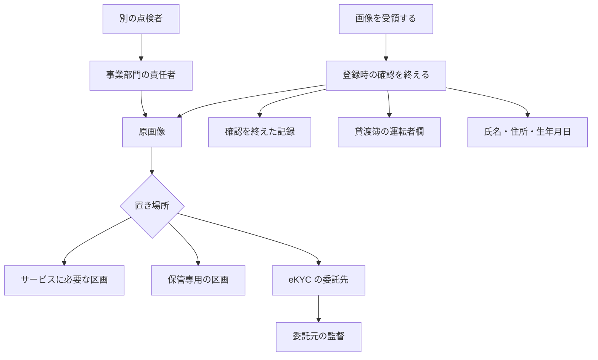

2026年10月16日、UNITIS は EGセキュアソリューションズ取締役CTOの徳丸浩氏へのインタビューを公開しました。題材は、タイムズモビリティが運営するタイムズカーで漏えいした本人確認書類の画像です。同じ日、運営会社は社内ルールを変え、会員登録の確認が終わったあとは、その画像を保有しないと発表しました。その時点で保有している画像は、申し出の有無を問わず、2026年10月末までに削除するとしています。

インタビューは、同じ日のルール変更には触れていません。この記事は、本人確認の画像を扱う手順を設計する人に向けて、保管場所、リスクの移転と回避、消去の決定者と点検者、消す原画像と残す記録を、公開された資料の範囲で分けます。

*この記事の全体像。以下、順に解説します。*

## 本人確認書類の保管と消去とは

本人確認書類の保管と消去は、券面の画像をどこに置くか、いつ捨てるか、捨てたあとに何を残すかを、別の欄にする取り決めです。タイムズカーの事案では、漏えいしたアカウントの件数と、画像を持つアカウントの件数が分かれています。ルールも、確認が終わったあとの原画像と、氏名や免許の番号のような記録とで分かれます。

### 事案と、同日に出た文書

タイムズモビリティの第2報（2026年9月28日、2026年10月1日更新）は、漏えいしたアカウント数を約660万件としています。対象には、現会員、退会済みの人、入会を申し込んだものの完了していない人が含まれます。第3報（2026年9月29日、2026年10月1日更新）は、運転免許証画像等の本人確認書類が漏えいしたアカウント数を約160万件としています。内訳は、運転免許証画像、現住所確認書類画像（公共料金の請求書等）、学生証画像（学生プラン）、家族確認書類画像（家族プラン）です。

2026年10月16日の第4報は、画像の保有ルールを見直した文書です。タイムズカー公式の対照表は、現会員の画像を「会員期間中は保有」から「登録確認完了後、即時削除」へ変えます。退会会員の「退会後7年間保有」は「ー」になります。本文は、タイムズカー公式とパーク24の両方で「会員登録完了後は画像を保有しない」と書いています。「即時」という語は、タイムズカー公式の対照表にあります。

旧ルールの保有目的は、会員登録時の本人確認、不正利用が疑われる事案への対応、問い合わせ対応、各種の本人確認業務です。期間は「当社が定めた基準」でした。新しいルールに伴い、現に保有する画像は2026年10月末までに削除します。削除は、本人からの申し出を待ちません。

同じ第4報は、外部専門機関の調査を踏まえた案内の時期を、2026年10月23日へ改めたとも書いています。画像ルールの見直しは、その調査の完了を待たずに、同日に公表した事項です。FAQ の Q11（2026年10月16日追加）も、調査と並行して決めた事項は順次公表する、と書いています。

### 徳丸氏が分けた保管と消去

徳丸氏は、運転免許証の画像のようなデータについて、事業が保管期限を決め、期限が来たら廃棄する、と整理しています。7年が長すぎたか妥当かは、詳しい事情が公表されていないので一概にいえない、とも述べています。氏が例に出す期限は「1年」「5年」のように、事業が決める期間です。

置き場所は、サービス提供に必要かどうかで分けます。サービスを運営するために必要なデータは、機微であっても、Web から届く場所に置くしかありません。保管するだけのデータは、オフラインか、通常はアクセスできない環境へ移します。それが難しければ、社内ネットワークの安全な区画へ移します。氏は、クラウドストレージに預かりデータを置きたくなる気持ちに触れたうえで、できれば社内の安全な区画に置く、と述べています。

クラウドストレージの暗号化について、氏は透過型暗号という言葉で説明しています。読み取り権限がある人がアクセスすると、操作なしで復号され、元の形で読める、という仕様です。暗号化していても、読み取り権限を奪われると元の形で読まれる、という過去の事件があると、定性で述べています。使うために残すデータは検索もできる必要がある、とも述べています。検索に使う項目は残し、機微な画像は暗号化し、鍵を管理する、という分け方です。

法令が原本の保管を求める場合、氏は生データで持つ、と述べています。求めない場合の選択肢として、確認結果だけを残すことと、元に戻せないハッシュで照合することを挙げています。ハッシュは、同じ入力から同じ値が出るので照合はでき、ログから元の情報そのものは読めません。

リスクの移転は、eKYC のように本人確認とデータ管理を委託し、自社が機微情報を持たないことです。リスクの何割かを外部へ移し、自社から直接は漏れないようにする、というセキュリティ上の扱いです。リスクの回避は、機微情報を持たない方法を選ぶことです。氏は、本件では回避が難しいと述べています。移転を選んでも、多段のサプライチェーンは狙われるので、外部が安全だとはいえない、とも述べています。

消去の判断は、事業部門の責任者が、法律等の根拠に基づいて行います。事業部長は、扱っている情報の報告を受け、期限を最終的に決めます。現場に任せると「消すのが怖いから残す」になりやすい、と氏は述べています。点検は、判断者とは別の人が、半年から1年に1回、運用を見て記録します。情報システムとセキュリティは、点検担当の候補です。監査部門の担当者は、どのデータを消してよいかの判断はできない、と氏は明示しています。棚卸しは、どこに何があるかを把握することです。データが入ってから、バックアップを取り、利用を終え、廃棄するまでのライフサイクルにルールを置く、という整理です。

UNITIS は、台帳が無いと調査が遅れる例として、エイチ・アイ・エスの公表を引いています。侵害の認知は2025年12月11日、公表は2026年10月7日で、約10か月です。理由として、ファイルサーバに内容も形式も異なるデータが混在し、手作業を含む調査が必要だった、と UNITIS は同社の公表を紹介しています。

### 法令と通達が書く事項

個人情報保護法第22条は、利用する必要がなくなったときは、当該個人データを遅滞なく消去するよう努めなければならない、と定めています。個人情報保護委員会のガイドライン（通則編、令和8年6月一部改正）3-4-1 は、そのときを二段で書いています。一段目は、利用目的が達成され、当該目的との関係では当該個人データを保有する合理的な理由が存在しなくなった場合です。二段目は、利用目的が達成されなかったものの、当該目的の前提となる事業自体が中止となった場合です。同じ項の注は、消去を、個人データとして使えなくすることとし、削除のほか、特定の個人を識別できないようにすることを含めています。

第25条は、個人データの取扱いの全部または一部を委託する場合、委託先に対する必要かつ適切な監督を行わなければならない、と定めています。ガイドライン 3-4-4 は、委託元が自ら講ずべき安全管理措置と同等の措置が講じられるよう監督する、としています。

国土交通省のレンタカー通達は、別記1の貸渡簿を、貸渡しの終了日から2年間保存する、と書いています。運転者欄の記載は、氏名、住所、運転免許の種類、運転免許証の番号です。

### 確認のあと、記録は別の置き場所へ分かれる

本人確認のあと、原画像と、残しうる記録は別の置き場所へ分かれます。消去の期限を決める人と、その実行を点検する人も分かれます。

原画像の行だけが、第4報の「登録確認完了後は保有しない」の対象です。貸渡簿の欄は、通達が書く氏名、住所、免許の種類と番号です。氏名、住所、生年月日の欄は、FAQ の Q8 が法人税法等に基づく7年とした項目です。画像を委託先へ移しても、監督の矢印は委託元に残ります。

| 記録 | 資料が置いている期間 | 中身 |
|---|---|---|
| 本人確認書類の原画像 | 旧ルールは会員期間中と退会後7年で、期間は社内基準。新ルールは登録確認完了後に保有しない。現に保有する分は2026年10月末まで | 画像 |
| 確認を終えたという記録 | 徳丸氏が、法令が原本を求めないときの選択肢として挙げる。期間の条文はインタビューに無い | 記録 |
| 氏名、住所、生年月日 | FAQ の Q8 が、法人税法等に基づく7年とする | 記録 |
| 運転免許情報 | FAQ の Q8 が、画像と一緒に、なりすまし対策と問い合わせのため7年と書く | Q8 は情報と画像を併記する |
| 貸渡簿の運転者欄 | 通達が、貸渡しの終了日から2年。記載は氏名、住所、免許の種類と番号 | 記録 |

## 注意点

件数、主体、法令の効き方は、次の範囲で読みます。

### 件数と期間

約660万件は、漏えいしたアカウントの件数です。免許証画像の件数ではありません。本人確認書類の画像が漏えいしたアカウントは約160万件で、第3報の数です。ITmedia NEWS（2026年10月16日 19:09、梅林日奈子）の本文は、約660万アカウントのうち約160万アカウントに本人確認書類の画像が含まれる、と第2報・第3報に揃えます。見出しは免許証画像と書き、本文の分母は本人確認書類です。Infoseek は同じ記事の転載です。朝日新聞（2026年10月16日 16:51、篠健一郎）は、約660万件の会員情報と、本人確認書類の流出160万件を報じています。朝日の160万件に「約」は付いていません。件数の正は、企業の第2報と第3報です。

「退会後7年間」は、退会会員についての旧ルールです。現会員の旧ルールは、会員期間中の保有です。在籍中の上限が7年だとは、第4報の対照表は書いていません。

### インタビューと、当日のルール変更

即時削除と、10月末までの削除は、運営会社が2026年10月16日に発表した運用です。UNITIS のインタビューは同じ暦日ですが、このルール変更を扱っていません。徳丸氏は、7年の長短を判断していません。氏の例示は事業が決める期限であり、確認が完了した時点ではありません。

### 消去の条文が指定する時刻

第22条の消去は、努力義務です。引き金は「利用する必要がなくなったとき」です。確認が終わった時点で目的が消える、とは書いていません。第4報が旧来の保有目的に残している不正利用への対応と問い合わせは、確認のあとも目的として残り得ます。ガイドラインが挙げる二段は、目的達成後に合理的な理由が無くなった場合と、前提の事業が中止された場合です。保存期間を法令が定めている場合は、努力義務の対象から外れます。

第148条第1項の勧告の対象は、第18条から第20条まで、第21条の一部、第23条から第26条まで、と続きます。第3項の緊急命令の対象は、第18条から第20条まで、第23条から第26条まで、と続きます。どちらの列挙も、間に第22条を含みません。確認後も原画像を残すことを、勧告や緊急命令の対象になる義務違反と同じ強さでは扱えません。

ガイドラインの注がいう「識別できないようにすること」は、消去の定義です。徳丸氏が挙げる不可逆なハッシュは、その定義に近い選択肢です。ガイドラインは、免許証画像のハッシュを名指してはいません。ハッシュの作り方次第で、特定の個人を識別できる状態が残ることもあります。

### 同日の公式文書

第4報は、これからの原画像を「保有しない」へ変えています。同日の FAQ（表紙は2026年10月1日、最終更新は2026年10月16日）の Q8 は、なお次のように分けています。氏名、住所、生年月日は、法人税法等に基づき7年間保管する。運転免許情報および画像は、なりすまし対策や問い合わせ対応のため、7年間保管する。更新履歴は、同日の追加を Q11 と Q12 とし、Q8 の改訂を書いていません。二つの文書は併存しています。Q8 が更新漏れかどうかは、公表からは読めません。

Q12 は、画像を削除したあとのなりすまし対策を、防犯上の理由から詳述しません。不正利用対策を緩和するものではなく、適切な本人確認を行うなど、対策は継続する、と書いています。新ルールで、画像を持つ目的がすべて終わった、と一枚岩には読めません。

乗りものニュース（2026年10月16日）が、画像の保持を法人税法上の措置と書いた記述は、Q8 の切り分けと食い違います。この記事では採用しません。画像と、氏名・住所・生年月日の切り分けは、2026年10月16日の Q8 を正とします。

日経クロステック（2026年10月16日、市川大地）は、広報によると新ルールは同日から運用している、と書いています。「広報によると」が直接かかるのは、同日運用までです。続く文は、10月末までの削除対象に、退会者や入会手続き未完了者の画像のほか、バックアップとして保存されたものも含む、という伝聞です。パーク24版とタイムズカー版の第4報本文に、「バックアップ」という語はありません。公式文書が、バックアップまでの消去を約束した、とは書けません。

### 貸渡簿、暗号化、委託先

貸渡通達が2年残させるのは、貸渡しの終了日から、別記1の記載事項です。会員登録の確認が完了した日からではありません。運転者欄にあるのは、氏名、住所、免許の種類、番号です。画像、写し、券面は、この欄に含まれません。レンタカー型カーシェアリングの例外は、貸渡証の交付についてであり、貸渡簿には付きません。タイムズカーの貸渡しが、この許可の対象かどうかは、許可文書を確認していません。当てはめは、中程度の確度に留まります。

透過型暗号について、インタビューに個別の事件番号はありません。本件がクラウドで起きたかは、インタビュー自身が未公表だと断っています。

氏名を特定した eKYC 事業者の漏えい事案は、ここで根拠にしていません。存在しない、とは書きません。ガイドラインが再委託を説明する箇所は、氏名のある事案の記録ではありません。

## 手順に置く五つの欄

委託先へ保管を移すことは、リスクの一部の移転です。消去の決定と、法第25条の監督は、委託元に残ります。手順には、次の五つの欄を置きます。

### 保管場所

原画像が、次のどれにあるかを書きます。

- Web から届く場所。サービス提供に必要なので、そこからアクセスできる区画です。
- 保管専用の区画。オフラインか、社内の安全な区画です。
- 委託先。eKYC 事業者が保管する場合です。

サービスに必要なデータと、保管するだけのデータを、同じ区画に置いたままにしない、というのが徳丸氏の分け方です。検索が必要な項目と、暗号化する画像と、鍵の置き場も、この欄の隣に書きます。

### 移転と回避

移転は、自社が機微情報を持たず、本人確認とデータ管理を委託することです。回避は、機微情報を持たない方法を選ぶことです。徳丸氏は、本件では回避が難しいと述べ、移転も一部だと述べています。

この「移転」「回避」は、セキュリティ上の扱いです。個人情報保護法上の責任が委託先へ移ることを意味しません。委託しても、委託元は法第25条の監督を残します。ガイドラインは、自ら講ずべき安全管理と同等の措置を、委託先に求めます。外部が安全だとは置かず、サプライチェーンも点検の対象にします。

### 決定者と点検者

期限と消去は、事業部門の責任者が決めます。根拠は、法律等と、自社が公表した保有目的です。別の人が、半年から1年に1回、実行を点検して記録します。監査部門に、消去の決定を渡しません。情報システムとセキュリティは、点検担当の候補です。

現場が「消すのが怖い」と残す理由は、インタビューが挙げています。怖い、を期限の代わりにしないために、決定者と点検者を分けます。棚卸しの欄は、どこに何があるかの台帳です。HIS の例は、混在したファイルサーバの調査に約10か月かかった、という UNITIS の紹介です。台帳の有無が、事後の速さに効く、という例として読みます。

### 消す原画像と残す記録

消す対象の既定値は、確認が終わった原画像です。これは第4報が選んだ運用です。残す候補は、次のとおりです。

- 確認を終えた、という記録。法令が原本を求めないときの、徳丸氏の選択肢です。期間の条文はインタビューにありません。
- 氏名、住所、生年月日。FAQ の Q8 が、法人税法等に基づく7年とした項目です。
- 運転免許の種類と番号。通達が貸渡簿の運転者欄に名指す記載です。この事業が許可の対象だと確認できたときに、残す欄へ入れます。

FAQ の Q8 が「運転免許情報」と呼ぶ項目は、画像と一緒に7年と書かれています。第4報の本文が消すと書いているのは画像です。情報の項目まで消すかは、公式本文からは決まりません。未確認のまま、情報も消える、とは書きません。

### 完了条件と、後から覆る条件

画像については、登録確認の完了を「原画像を保有しない」の運用上の完了条件に置けます。対照表の語は「登録確認完了後、即時削除」です。本文の語は「会員登録完了後は画像を保有しない」です。どちらも2026年10月16日の公表です。これは第4報の選択であり、第22条が時刻を指定した義務ではありません。現に持っている画像の削除期限は、別の日付で、2026年10月末です。

貸渡しがある事業では、もう一つの時計として、貸渡しの終了から2年の貸渡簿を別に置きます。登録確認の完了と、貸渡しの終了は、別の起点です。許可の対象かが未確認の間は、この2年を必須欄にはしません。

手順や説明で、次の四つは書きません。約660万件を画像の件数にすること。7年を、画像についての税法上の義務にすること。徳丸氏が即時削除を求めたとすること。委託すれば監督も移るとすること。

後から覆る条件は、次の三つです。同社が FAQ の Q8 を改訂し、画像の目的が確認完了で終わると明文化した場合、運用上の完了条件は公式の目的と一致します。許可文書で、この通達の対象だと分かった場合、種類と番号の2年は、必須の残す欄になります。公式が、バックアップを削除対象に含めると文書化した場合、日経クロステックの談話は、範囲の根拠として一次の文書に代わります。それまでは、バックアップを削除範囲に含めません。

## まとめ

本人確認書類の原画像は、確認が終わったあとに保有しない、という運用を、2026年10月16日の第4報が置いています。現に保有する画像の削除は、2026年10月末までです。徳丸氏が整理したのは、事業が期限を決めて廃棄すること、サービスに必要なデータと保管専用のデータを分けること、移転を選んでも監督は委託元に残ること、決定者と点検者を分けることです。氏は、即時削除の時刻を指定してはいません。

残す記録は、確認を終えたという記録、Q8 が法人税法等とした氏名・住所・生年月日、そして許可の対象だと分かったときの免許の種類と番号です。第22条の消去は努力義務で、確認完了の時刻を義務づけていません。同日の Q8 は、運転免許情報および画像の7年を、なりすまし対策と問い合わせのためにまだ書いています。手順は、この併存を隠さず、五つの欄に分けて置きます。

この記事が少しでも参考になった、あるいは改善点などがあれば、ぜひリアクションやコメント、SNSでのシェアをいただけると励みになります！

## 参考リンク

- [徳丸浩「徳丸浩氏に聞く、タイムズカー事案から考えるユーザーデータ管理」（UNITIS、2026年10月16日）](https://unitis.jp/articles/24665/)
- [タイムズモビリティ「第2報」（2026年9月28日、2026年10月1日更新）](https://share.timescar.jp/news/2026/0928/1815.html)
- [タイムズモビリティ「第3報」（2026年9月29日、2026年10月1日更新）](https://share.timescar.jp/news/2026/0929/1816.html)
- [タイムズモビリティ「第4報」（2026年10月16日）](https://share.timescar.jp/news/2026/1016/1826.html)
- [パーク24「第4報」（2026年10月16日）](https://www.park24.co.jp/news/2026/10/20261016-1.html)
- [タイムズモビリティ「ご質問と回答」（表紙 2026年10月1日、最終更新 2026年10月16日）](https://corp.timescar.jp/mail/announce/faq.pdf)
- [個人情報の保護に関する法律（平成15年法律第57号）第22条、第25条、第148条](https://laws.e-gov.go.jp/law/415AC0000000057)
- [個人情報保護委員会「ガイドライン（通則編）」（令和8年6月一部改正）3-4-1、3-4-4](https://www.ppc.go.jp/personalinfo/legal/guidelines_tsusoku/)
- [国土交通省「レンタカーの取扱いについて」（自旅第138号、最終改正 令和4年5月31日）](https://www.mlit.go.jp/jidosha/content/001485360.pdf)
- [日経クロステック（2026年10月16日、市川大地）](https://xtech.nikkei.com/atcl/nxt/news/24/03428/)
- [ITmedia NEWS（2026年10月16日 19:09、梅林日奈子）](https://www.itmedia.co.jp/news/article/2610/16/2000002346/)
- [朝日新聞（2026年10月16日 16:51、篠健一郎）](https://www.asahi.com/articles/ASVBJ2GTZVBJULFA01CM.html)
- [乗りものニュース（2026年10月16日）](https://trafficnews.jp/post/719378)。画像の保持を法人税法上の措置とする記述は、FAQ の Q8 と食い違うため、この記事では採用していません。
