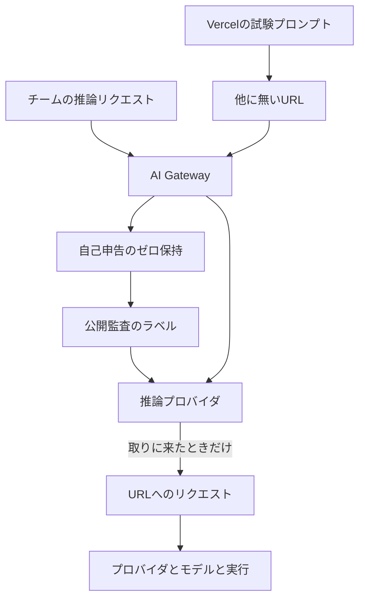
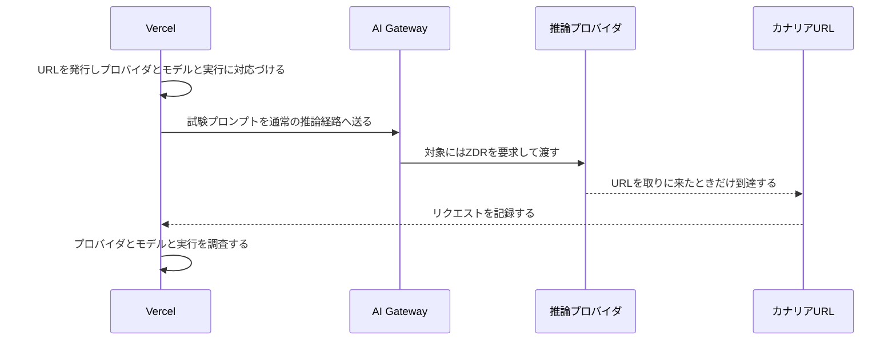

2026年11月23日、VercelはAI GatewayにAudited ZDRというラベルと、監査と監査のあいだを見るカナリア監査を公開しました。AI Gatewayは、複数のモデルを一つのAPIで呼び、利用量と費用を追い、再試行と別のプロバイダへの切り替えを設定する窓口です。推論プロバイダは、モデルの推論を実行する事業者です。Audited ZDRは、独立したセキュリティ企業がゼロ保持の主張を調べ、報告書を公開したプロバイダに付くラベルです。ゼロ保持（Zero Data Retention、以下ZDR）は、応答を返したあとにプロンプトや補完を残さない、という約束です。

この記事では、ラベルが何を確認するか、カナリアが何を記録するか、発注側がいま触れる設定はどれかを整理します。記述は2026年11月24日時点の公開資料に基づきます。ローンチパートナーの監査報告書は、この時点では公開されていません。

## AI GatewayのAudited ZDRとは

発表は二本です。ラベルはブログ（Harpreet Arora、Talha Tariq、2026年11月23日）です。カナリアは変更ログ（Walter Korman、同日）です。

Audited ZDRは、AI Gateway上の推論プロバイダへ付くラベルです。独立したセキュリティ企業が、そのプロバイダのコード、インフラ、ライブトラフィックに対してゼロ保持の主張を調べ、報告書を公開したプロバイダに付きます。ローンチパートナーはBaseten、Modal、Waferです。監査は開始済みで、報告書の公開予定は2026年12月8日までです。プロバイダは、報告書の公開と同時にAudited ZDRの対象へ入ります。

### 監査が確認する範囲

顧客データとして確認する対象は、プロンプト、補完、システムプロンプト、埋め込み、ファイル、画像と音声、ツールと関数呼び出しのペイロード、それらを識別しうる派生データです。見る場所は、リクエストログ、トレース、メトリクス、クラッシュダンプ、プロンプトキャッシュ、不正利用監視、分析、バックアップ、サポートツール、学習・微調整・評価データセットです。プロンプトキャッシュは、同じ入力を再利用するため、プロバイダがプロンプトの表現を持つ仕組みです。

ブログが確認すると書く項目は、次のとおりです。

- 応答をAI Gatewayへ返したあとに、推論プロバイダ側から内容を消す。
- KVキャッシュなどは、リクエストのあいだだけ揮発ストレージに置き、耐久ストレージへ書かない。KVキャッシュは、推論の途中計算をリクエストのあいだだけメモリに置く一時領域です。
- ZDR指定のリクエストが、ZDRではないエンドポイントやツールや機能へ切り替わらない。ここでの切り替えは、先の宛先が使えないときに次の宛先へ渡すことです。
- リクエスト処理以外の人や自動処理が、顧客データに触れない。
- サブプロセッサも同じ条件を満たす。サブプロセッサは、プロバイダが処理を再委託する先です。
- 顧客データで学習しない。

監査人は、提供経路のソースコードとインフラ設定を見て、ライブ試験をします。印を付けたプロンプトをAI Gateway経由で送り、ログ、キャッシュ、ストレージに痕跡が無いかを探します。

報告書は監査人の名前で公開します。中身は範囲、手法、日付、発見、修正状況です。例外は開示し、編集は悪用手順の詳細に限ります。AI Gatewayは報告書へ直接リンクします。

### カナリア監査の1回

カナリア監査は、他のどこにも無いURLを試験プロンプトへ埋め、そのURLへのリクエストを記録する検査です。ブログは、独立監査が時点のコードとインフラを見るのに対し、本番は変わるため、監査と監査のあいだの検知層としてカナリアを足す、と書いています。

1回の手順は4段です。

1. 一意なURLを発行し、プロバイダ、モデル、監査の実行へ、公開しない対応づけをする。
2. そのURLを含む試験プロンプトを、通常の推論経路へ送る。対象プロバイダにはZDRを要求する。ZDRではない組は、リクエストが来てよい対照として同じ実行に混ぜる。
3. トラフィックを監視する。変更ログは、ZDRのプロバイダはプロンプトを保持も検査もクロールもしない、という前提で、カナリアURLはリクエストを受け取らないはずだ、と書きます。
4. URLへのリクエストがあれば記録し、プロバイダ、モデル、実行を調査する。

変更ログは、カナリアを、契約上のゼロ保持と時点の独立監査に重なる検知層として書いています。

### 顧客の経路と試験の経路

顧客のリクエストが通る制御と、Vercelが別に流す試験は分かれます。



上段の矢印は、二つのフィルタを別々の選択肢として並べたものです。自己申告のゼロ保持と、公開監査のラベルは、それぞれ「どこへ寄せるか」です。下段は、Vercelが送る試験です。プロバイダからURLへの矢印は、取りに来たときだけ到達します。URLの対応づけのキーは、プロバイダ、モデル、監査の実行です。

時間順は次のとおりです。



### 発注側が触る設定

発注側が触るAudited ZDRの設定は、チーム向けのトグルです。オンにすると、AI Gatewayは、公開された監査が基準を満たすプロバイダだけへ、そのチームのリクエストと切り替え先を寄せます。

既存のゼロ保持ルーティングは、別の制御です。リクエスト単位は`providerOptions.gateway.zeroDataRetention: true`です。チーム単位はダッシュボードの設定です。どちらかがオンなら、そのリクエストはZDRになります。既存のZDRドキュメントが書く制御は、自己申告のゼロ保持ルーティングです。

ドキュメントが示すリクエスト単位の指定は、次のとおりです。モデル名は、そのページの例です。

```typescript
import { generateText } from 'ai';

const { text } = await generateText({
  model: 'anthropic/claude-sonnet-5',
  prompt: 'Analyze this example business data: revenue grew by 5%.',
  providerOptions: {
    gateway: {
      zeroDataRetention: true,
    },
  },
});
```

ZDRドキュメントは、プロバイダのZDRをself-reportedと書きます。self-reportedは、プロバイダ自身の方針、またはVercelとの合意に基づく自己申告です。プロバイダ表のZDR列にあるチェック印は、「自己申告のZDRをAI Gateway上で提供する」印です。印があっても、モデルやツールやリクエスト種別は対象外になりえます。合意が無いプロバイダは、ZDRではないものとして扱います。

## 注意点

変更ログは、カナリアを契約上のゼロ保持と時点の独立監査の代わりには置かない、と書きます。ブログは、ディスクに書いて一度も読まないプロンプトを、カナリアでは検知できない、と書きます。

変更ログの書き出しは、推論経路の外でプロンプトが読まれたことを検知する、と書きます。同じページの記録条件は、カナリアURLへの任意のリクエストです。試験プロンプトは通常の推論経路を通ります。禁止として並ぶ動詞は、retainだけでなくinspectとcrawlです。推論中のツールやURL展開が同じURLを取っても、公開文はそれを経路外と区別しません。見出しの「経路外」は、記録される事象の定義ではありません。

カナリアが見るのは、Vercelが送る試験プロンプトに埋め込んだURLです。顧客のプロンプトを標本にする、という文は公開資料にありません。顧客のチームを、URLの対応づけへ写す、という文もありません。顧客データが経路の外で読まれたかは、そのURLが一緒に運ばれ、かつ誰かが取りに来たときだけ、間接に触れます。取りに来なければ見えません。ディスクに書いて読まないコピーは、ブログが検知できないと書いています。

ヒットを、違反と陽性対照のどちらに数えるかの分類規則は、変更ログにもブログにもありません。陽性対照は、リクエストが来てよいものとして混ぜるZDRではない組です。

2026年11月24日時点では、ローンチパートナーの報告書URLは見つかっていません。ブログは「監査を開始した」と「報告書を公開したらAudited ZDRの対象に入る」を分け、公開予定を2026年12月8日としています。トグルを入れたとき対象が空なら失敗するのか、監査を通っていないプロバイダへ落ちるのかは、公開資料にありません。既存ZDRの`no_zdr_providers_available`（HTTP 400）は、自己申告のZDR先が無いときのエラーです。Auditedトグルの仕様としては書かれていません。

ISO/IEC 42001:2023は、AIマネジメントシステムの規格です。プロバイダのゼロ保持の証明ではありません。Vercelの2026年11月20日のブログは、自社のAIマネジメントシステムが、基盤と中核AI製品を覆うと書きます。中核AI製品として挙がるのは、AI Gateway、Vercel Agent、v0、AI系のOSSとフレームワーク、人とプロセスです。証明書は3年で、あいだに年次サーベイランスがあります。証明書番号としてブログが示すのは、Schellmanディレクトリの`1929712-1`です。同ディレクトリは、2026年11月24日の非JS取得では検索画面だけで、証明書本文の範囲は未確認です。年次サーベイランスを、プロバイダ向けカナリアの周期と読まないでください。

出荷中のゼロ保持は、経路全体がゼロ、という状態ではありません。2026年11月24日に取得したZDRドキュメントの本文に、Audited ZDRとカナリア監査の節はありません。セキュリティ概要（最終更新表示2026年9月8日）の “verified ZDR agreements” は、自己申告のZDRページを指しています。2026年11月23日の独立監査と同じ語として読む根拠は、概要ページにありません。

同じZDRページが、ゼロ保持を有効にしても残す穴と、投入時に拒否する種別を書いています。

| ケース | AI Gatewayの扱い |
|---|---|
| プロバイダが実行するweb searchやgrounding | リクエストを止めない。groundingは、検索結果を回答へ結びつける処理である。別サービスが自社の条項で処理し、保持しうる |
| AI Gatewayが実行するsearchやfetch | ツールの提供元にZDRの約束が無いとき、HTTP 400で失敗する。エラーはツールと提供元の名前を含む |
| プロンプトキャッシュ | 止めない。キャッシュヒットのため、プロバイダはプロンプトの表現をキャッシュ寿命のあいだ持つ。寿命は最大24時間になりうる。AI Gatewayはこれを保持に数えない |
| バッチ | 投入時に拒否する。バッチの寿命のあいだ、入力と結果を保存するからである。ゼロ保持のバッチになる、とは書いていない |
| 非同期の動画ジョブ | 投入時に拒否する。ZDRにはまだ対応しない |
| BYOK | 既定でZDRの経路から外れる。BYOKはBring Your Own Keyで、利用者自身のプロバイダ鍵を持ち込むことである。利用者がZDRと印を付けても、その印は経路への参加であり、契約の確認は利用者側である。Vercelは利用者とプロバイダの契約を見ていない、とページが書く |
| Claude Fable系 | AnthropicのFableというモデル群である。ZDRの対象外で、プロンプトと出力を30日保持する。コード実行と、プログラムからツールを呼ぶ機能（programmatic tool calling）は除外で、コンテナのデータは最大30日保持する。脚注の対象はFable系だけで、Anthropic、Google Vertex、Amazon Bedrockを含むどのプロバイダでもZDRに対応せず、Claudeの学習には使わない、と書く |
| OpenAI | ポリシー欄は “ZDR with safety retention” である。画像とファイル入力を児童の性的虐待素材（CSAM）のために走査し、フラグの付いた画像を人手レビューのために保持する、と表が書く |

2026年4月8日のチーム向けZDRブログは、「ZDRを有効にすれば学習オプトアウトは既に含まれる」と書きます。2026年11月24日のZDRページは、チームのZDRとチームの学習禁止を別設定とし、片方を入れてももう片方は入らないと書きます。チーム設定の現行は、このZDRページを採ります。学習禁止の追加料金は無い、とページが書きます。

カナリアの実行間隔、結果の保存先、顧客への通知、ヒット時の自動停止、追加料金、専用のリクエストパラメータ、専用のエラー型は、ブログ、変更ログ、ZDRページ、Rate Limits（最終更新表示2026年9月8日）にありません。追加料金が無い、とは書きません。既存のチームZDRは1,000リクエストあたり$0.10です。リクエスト単位のZDRは追加料金なしです。これはカナリアの料金ではありません。推論トークンへのプラットフォーム上乗せは無い、と紹介ブログとFAQが書きます。

不適格なチームがZDRを要求するとHTTP 403になります。メッセージは有料アカウントが必要だという文で、例は無償プランのhobbyです。2026年11月24日のZDRドキュメントでは、`type`は`permission_denied`です。ZDR先が残らないときはHTTP 400で、`type`は`no_zdr_providers_available`です。

二次情報で、一次とずれるものは採用しません。iMastersの英語版（2026年11月23日）は、報告書の予定を2026年12月9日とし、Baseten、Modal、Waferをすでに監査済みの小さな集合として書きます。一次の予定日は2026年12月8日で、公開前にAudited ZDRの対象へ入ったとは書いていません。同じ記事の “continuous” と “immediate investigation” も、一次の周期や即時性としてはありません。別の投稿が並べた「Dragosが7月から11月に送った約200万のカナリアプロンプト」は、Vercelのブログと変更ログにありません。Vercelの規模としては採用しません。

## 依頼を止める単位

委託先の境界は、条項、時点の検査、実行時の検査で役割が違います。

| 層 | 何を固定するか | 2026年11月24日に一次で言えること | 言えないこと |
|---|---|---|---|
| 条項 | 保持しない、という約束 | 既存ZDRは自己申告、またはVercelとの合意に基づき経路を絞る。合意が無いプロバイダは非ZDRとして扱う | 本番が変わったあとも約束どおりか |
| 時点の検査 | その日のコード、設定、ライブ試験 | 独立監査の報告書が公開されたプロバイダだけをAudited ZDRと呼ぶ。顧客はチームトグルでそこへ寄せられる | 報告書の採点表。2026年11月24日に公開済みの報告書 |
| 実行時の検査 | 監査と監査のあいだの変化 | Vercelが試験URLを送り、URLへのリクエストをプロバイダ、モデル、実行つきで記録して調査する | 周期、保存先、顧客通知、ヒットで自動停止するか |

発注側がいま使える止め方は、カナリアの失敗ではなく、経路のフィルタです。自己申告のZDRで先が無ければ、リクエストは400で失敗します。リージョンを指定して守れなければ、別リージョンへ落とさず失敗します。紹介ブログは、地域を守れないリクエストは他の場所で実行しない、と書きます。regional inferenceのドキュメントはHTTP 400、`invalid_request_error`です。プロバイダの許可リストは、チームオーナーが対象を制限し、許可先が無ければ403になります。対象プランは、Vercelの有料プランであるProとEnterpriseです。モデルの許可リストはモデル単位です。これらは顧客が自分で持つ停止単位で、カナリアの結果とは別です。

チームZDRの例外キーは、チームオーナーが期限付きで作れます。例外は、チームのZDRだけに寄せる制限から外す鍵です。

```bash
vercel ai-gateway api-keys create --name escape-hatch --zdr-exempt --expiration 7d
```

確認コマンド`vercel ai-gateway api-keys inspect`の出力に、`zdr exempt`行が出ます。例外の有無は、経路の監査と別に見ます。

公開文が名指しする単位と、顧客が止められる単位は次のとおりです。

| 問い | 一次にある単位 | 一次に無いもの |
|---|---|---|
| カナリアが名指しする単位 | プロバイダ、モデル、監査の実行 | 顧客のチーム。自動でその単位のトラフィックを止めること |
| 顧客がトラフィックを止める単位 | チーム。公開監査を満たすプロバイダだけへ経路と切り替え先を寄せる。既存の許可リストはプロバイダ単位、モデルの許可リストはモデル単位 | カナリアが鳴ったことを条件に、誰が止めるか |
| 独立監査の成果物 | 監査人名の公開報告書。AI Gatewayからリンク | 2026年11月24日時点の実ファイル |
| カナリアの成果物 | リクエストを記録し、調査する | 保管システム、保持期間、顧客が受け取る手段 |
| 顧客リクエストのログ | AI Gatewayはプロンプト本文を残さない。ZDRページが例示する記録は、モデル、プロバイダ、トークン、費用、時間である | この記録をカナリア結果の保存先と読むこと |

検知の識別単位は、プロバイダ、モデル、実行まで公開されています。停止の権限は、公開文のうえでは顧客のチームトグルと、顧客自身の許可リストに残ります。カナリアが鳴ったあとにプロバイダを外す権限者が、Vercelの調査担当なのか、顧客のチームオーナーなのかは、一次が書いていません。結果を委託先境界の証拠にするなら、保存先が顧客の手元に無いままでは、境界の確認はVercel側の記録を信じることに戻ります。

## 選定を4つの問いに分ける

選定条件は、非保持の条項の有無だけで閉じません。次の4問に分けます。

1. 条項は自己申告か、Vercelとの合意か。ZDRページは自己申告と書き、プロバイダの既定方針とGateway上の状態が合意でずれうると書きます。
2. 時点の検査は、Vercel自身のISO/IEC 42001ではなく、そのプロバイダの提供経路を見た公開報告書か。2026年12月8日より前に、Baseten、Modal、Waferを監査済みプロバイダとして扱わないでください。
3. 実行時の検査は、URLへの任意リクエストを見る試験か。経路外だけを見ると説明された検知としては扱わないでください。周期と、ヒットの分類（違反か陽性対照か）が書面にあるかを見ます。
4. 失敗したときに止める人は、どの単位を止められるか。結果は誰の保管庫に、どれだけ残るか。これが空なら、カナリアは委託先境界の確認手段ではなく、Vercel側の調査の予告です。

いまのAI Gatewayで敏感なリクエストを寄せるなら、既存のチームZDRか、リクエスト単位の`zeroDataRetention`を使い、プロバイダの許可リストを顧客側の停止単位として残します。チームZDRは1,000リクエストあたり$0.10です。主則では、リクエスト単位もチーム単位も、Pro、Enterprise、または購入したクレジットが要ります。購入したクレジットは、チームが代金を払って買ったAI Gatewayの残高です。無償プランのhobbyと、Proの試用期間は、その残高を購入すると使えます。代金なしで付いたクレジットは、対象に入りません。リクエスト単位は追加料金なしで、有効なToken Passがあるあいだは、そのパスの月ごとの利用枠を使い切ったあとでも使えます。Token Passは、月ごとの利用枠を使い切ったあとも、有効なあいだはリクエスト単位のZDRを使えるパスです。チーム単位のダッシュボード設定は、そのToken Passの例外の対象外です。Auditedのトグルは、公開報告書と、空集合のときの失敗仕様を見てから入れます。

学習禁止はZDRと別に見ます。キャッシュをゼロ保持の定義から外す契約なら、最大24時間のプロンプト表現が残る前提を条項に書きます。プロバイダ実行の検索、バッチ、非同期動画、BYOK、Fable系、OpenAIの安全保持は、ゼロ保持の経路の外か、そもそも通りません。

逆転条件は次です。公開報告書がプロバイダごとに出て、カナリアの周期と保存先と通知と、ヒット時に誰がプロバイダを外すかが同じ一次に書かれたら、第3問と第4問は「有無」から「その書面を満たすか」に進めてよいです。それまでは、条項と時点監査の二段に、実行時検査は予告された層として添えます。

未解決のまま残る問いは、次のとおりです。

- カナリアの実行間隔、保存先、顧客通知、ヒット時の自動停止。
- Auditedトグルの対象が空のときの失敗仕様と、操作できるロール。
- ヒットを違反と陽性対照に分ける規則。経路内のURL取得を除外するか。
- 独立監査の「基準を満たす」の採点と、例外の残り方。
- カナリアとAudited ZDRの追加料金。
- Schellman証明書`1929712-1`の本文上の範囲。ブログが示す番号であり、証明書本文は未確認です。
- BYOKの経路をカナリアが試験するか。公開資料にはありません。

## まとめ

Audited ZDRは、独立監査の報告書が公開された推論プロバイダへ付くラベルです。カナリアは、その監査と監査のあいだに、他に無いURLへのリクエストをプロバイダ、モデル、実行つきで記録する試験です。2026年11月24日時点では報告書は未公開で、周期、保存先、顧客通知、ヒット時の自動停止は書かれていません。

敏感なリクエストをいま寄せる単位は、既存のチームZDRかリクエスト単位の`zeroDataRetention`と、顧客側の許可リストです。Auditedのトグルは、公開報告書と、対象が空のときの失敗仕様を見てからにします。

この記事が少しでも参考になった、あるいは改善点などがあれば、ぜひリアクションやコメント、SNSでのシェアをいただけると励みになります！

## 参考リンク

- [Vercel, Introducing Audited ZDR on AI Gateway（2026-11-23）](https://vercel.com/blog/introducing-audited-zdr-on-ai-gateway)
- [Vercel, AI Gateway now runs canary ZDR audits（2026-11-23）](https://vercel.com/changelog/ai-gateway-now-runs-canary-zdr-audits)
- [Vercel, AI Gateway Zero Data Retention (ZDR)](https://vercel.com/docs/ai-gateway/security-and-compliance/zdr)
- [Vercel, AI Gateway Security and Compliance](https://vercel.com/docs/ai-gateway/security-and-compliance)
- [Vercel, AI Gateway FAQ](https://vercel.com/docs/ai-gateway/faq)
- [Vercel, AI Gateway Rate Limits](https://vercel.com/docs/ai-gateway/rate-limits)
- [Vercel, AI Gateway Regional Inference](https://vercel.com/docs/ai-gateway/security-and-compliance/regional-inference)
- [Vercel, Zero Data Retention on AI Gateway（2026-04-08）](https://vercel.com/blog/zdr-on-ai-gateway)
- [Vercel, Vercel completes ISO/IEC 42001:2023 certification（2026-11-20）](https://vercel.com/blog/vercel-completes-iso-iec-42001-2023-certification)
- [Vercel, AI Gateway Disallow Prompt Training](https://vercel.com/docs/ai-gateway/security-and-compliance/disallow-prompt-training)
