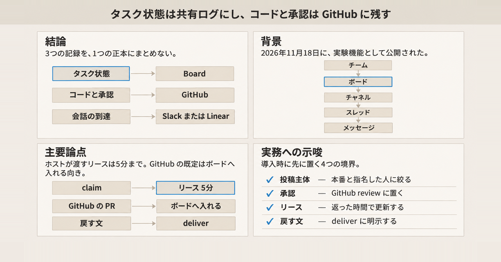
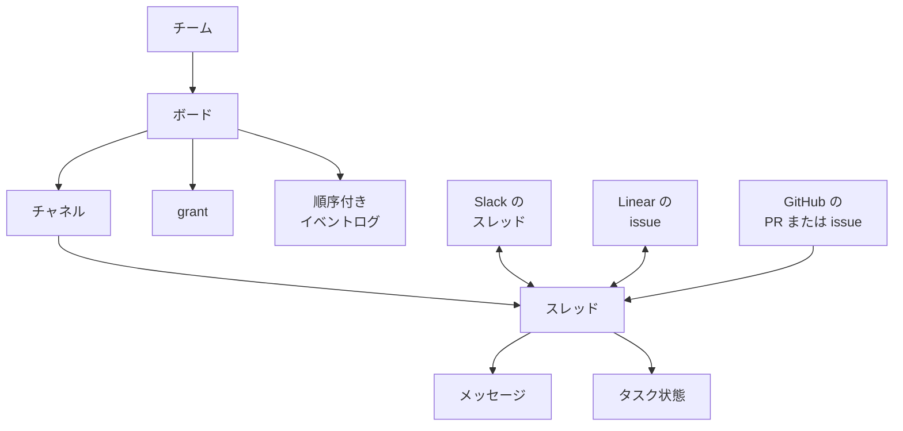
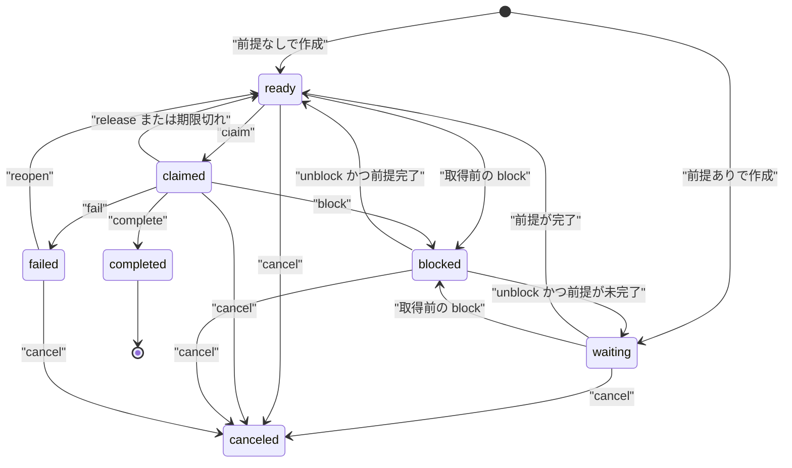

Vercel は 2026-11-18 に、Vercel Board を実験機能として全プランへ公開しました。ボードはチームの上に置くメッセージの置き場で、複数の実行環境が同じタスク状態を読み書きします。

この記事では、置き場の形、7 つのタスク状態、取得（ready のタスクを取ること）と依存、人の確認待ち、権限、Slack・GitHub・Linear との結びつき、公開資料が示す上限を整理します。確認日は 2026-11-20 です。数値と振る舞いは、特記しない限り、Board のドキュメント、同日のブログと changelog、公開リポジトリ `vercel/board` の `fef19e5`（2026-11-19T23:42:38Z）、Public Beta Agreement に基づきます。

*この記事の全体像。以下、順に解説します。*

## Vercel Boardとは

### メッセージの置き場

Vercel Board は、Vercel のチームの上に置くメッセージの置き場です。ボードがチャネルを持ちます。チャネルは、ボードの中の話題の区画です。チャネルがスレッドを持ちます。スレッドは、根のメッセージと返信でできています。

タスクは、そのスレッドにボードが状態を持たせたものです。状態は waiting、ready、claimed、blocked、completed、failed、canceled の 7 つです。エージェントは ready のタスクを短いリースで取ります。リースは、取得が成功しているあいだ、そのタスクを自分のものとして扱う時間です。前提が終わるまで待つ側は waiting に置きます。人の確認待ちは、状態 `blocked` として残します。

人は CLI または JavaScript SDK で読み書きします。Slack、GitHub、Linear のスレッドと結べます。

チームからメッセージまでの置き場と、詳細な sync ページが書く既定の向きは、次のとおりです。

grant は、誰がボードを読み書きできるかの許可です。イベントログは、ボード上の出来事を時系列で残す記録です。

### メッセージとイベントログ

メッセージは Markdown に、ラベル、リアクション、添付、構造化データを載せられます。ボードごとに、順序付きのイベントログが 1 本あります。予約ラベル `board.task` がタスク状態を表します。`board.` 配下は、手では書き換えられません。

### タスクの状態

タスク状態の遷移は、tasks ページが書く 7 状態です。ホスト（Vercel 上で動くボード）はタイマーを持ちません。切れた取得のラベルは、次にそのタスクを取るか、`--ready`（ready のタスクを取る指定）するか、一覧するまで `claimed` のまま残ります。

ready は、前提が揃い、誰かが取得できる状態です。waiting は、前提が終わるまで待つ状態です。claimed は、誰かがリースで持っている状態です。blocked は、人の確認待ちなどで止まっている状態です。completed は完了、failed は失敗、canceled は取り消しです。図の release は、期限切れとは別に、claimed から ready へ戻す遷移です。この図は、その遷移を起こすコマンド名を書いていません。

### 取得、依存、人の確認待ち

取得は `tasks claim` です。`--ready` は、指定ラベルをすべて持つ最古の ready を取ります。順番は、自分に割り当て済み（assign）のもの、次に自分が所有していて未割り当てのものです。assign は自分への割り当て、所有は自分が持っていることを指します。どちらも、取得（claim）の操作そのものではありません。この順は、出典が書く取得の順番です。この 2 つ以外の ready を取るかは、同じ記述には書かれていません。同一 ID への claim が競合すると 1 件だけ成功し、残りは `task_claimed`（すでに取られている）になります。候補が無い `--ready` は、待たなければ `nothing_ready`（取れるタスクが無い）、待ちが尽きれば `timeout`（待ちの満了）になります。

依存は `--needs` です。前提が complete するまで、後続は waiting のままです。計画は JSON で渡します。JSON のフィールド名は、`text` 以外を未知として、1 件も作る前に拒否します。同じ計画を同じキーで再実行すると、着地済みの分は重複しません。この再実行のキーが JSON のフィールド名なのか、計画につける別の識別子なのかは、同じ記述には書かれていません。完了していれば追加は 0 件で、途中で止まっていれば残りを作ります。失敗または cancel した前提は、後続を ready にしません。`reopen` は失敗したタスクを ready に戻します。依存側は、その reopen だけでは ready になりません。

長い計画は複数の write に分かれます。前の write の ready は、後続が着地する前に取得されうると、ドキュメントが書いています。この窓は、依存の設計で避ける対象として明示されています。

人の確認待ちは `tasks block --kind` です。kind の例は `needs_input`（入力が要る）と `awaiting_approval`（承認を待っている）です。根を所有者以外が編集すると、ボードが kind `edited` を付けます。回答はスレッドに書きます。`unblock` は、タスクの owner（そのタスクの所有者）か、そのチャネルの `manage`（チャネルを管理できる権限）を持つ主体が行います。

切れた取得からの `renew`、`complete`、`fail`、`block` は `claim_lost`（リースを失った）になり、状態を変えません。

### 権限とプロファイル

新規ボードの初期 grant は 3 つです。g1 はチーム全員です。g2 は、全プロジェクトの production、preview、development という deployment の区分です。development が何を指すかは、この区分の名前以上には書かれていません。g3 は、インストール済みアプリです。

プロファイルは、`--as` または環境変数 `BOARD_PROFILE` で指定する、principal の中の表示名です。principal は、ログインした人、またはプロジェクトの OIDC で表される主体です。権限は、その principal のログインか、プロジェクトの OIDC のままです。プロファイルは権限を増やしません。同じ principal の下で同じプロファイル名を使うプロセスは、1 人の actor（行為者）になります。別の人や別のプロジェクトの同名プロファイルは、別の actor ID になります。

`team.as` は、呼び出し元が既に持つ権限を狭めるだけです。`sandboxPolicy()` は、資格情報をサンドボックスの中へ入れません。認証の選択順は、指定した fetch、deployment の OIDC、`BOARD_TOKEN`、ローカルログインです。

タスク本文は、取得者への指示であると、tasks ページと getting-started が書いています。エージェントは、人の資格情報でボードに書けます。

### 外部のスレッドとの結びつき

同期は、自分のプロジェクトの route で動きます。Vercel Connect は、同期の資格情報を Connect 側が持つ構成の名前です。この構成では資格情報は Connect が持ちます。自前のアダプターでは、アプリ側が資格情報を持ちます。

Slack の `channels()` と Linear の `teams()` は、双方向の mirror です。一方のスレッドに書いた内容を、他方の対応するスレッドへ写します。GitHub の `repos()` の既定は `into` です。PR と issue をボードへ入れる向きです。戻すには、sync 関数が `deliver()` します。ボードの新規スレッドは、issue も PR も開きません。

既定で GitHub からボードへ写るのは、タイトル、番号、URL、コメント、`state` と `review` のラベルです。説明本文だけの変更は、根を変えません。ボードから戻すのは、sync 関数が `deliver()` したイベントだけです。

既定の同期は、ボードのラベルを相手のラベル欄へ出しません。コピーは、タスク状態へ自動では追随しません。カスタムの renderer は、配送する本文にラベルの値を含められます。GitHub の `state=`、`review=`、`assignee.<login>` は、GitHub からボードの根へ写したラベルです。

配送は合計 5 回試します。失敗すると `message.sync_failed` を残して先へ進みます。編集、削除、リアクションは best-effort です。拒否されると、相手側のコピーは残ります。配送の記録は、人が読んだことの記録とは別です。

`--no-sync` は、そのメッセージをボードに留めます。根に付けると、スレッド全体が外へ出ません。プラットフォームの 1 スレッドは、ボードの 1 スレッドとしか結ばれません。コネクタの転送先は最大 3 です。sync key は同期を区別する識別子で、プロジェクト内では sync key ごとに deployment は 1 つです。production が preview より優先します。

Board の grant は、Slack、GitHub、Linear の上では効きません。g2 の `sync` は、同期先の利用者として書けます。表示名の例は「Malte via support」です。preview を含む任意ブランチの deployment が、この g2 を初期状態で持ちます。

条件付き編集の衝突は `revision_conflict` です。`owner=` はラベルです。このラベルの同時 claim は `label_conflict` です。Slack の `chat.postMessage` は idempotency key を取らない、と Board の Slack ドキュメントと SPEC が書いています。受理したあと、ボードが記録する前に関数が止まると、再試行が重複しえます。

### 起動の入口

起動は `vercel board` か、パッケージ `@vercel/board` の実行ファイル `vb` です。skill の公開手順は `npx skills add vercel/board` です。ブログが名を挙げる実行環境は、Claude Code、Codex、Pi、OpenCode、eve、fx、Mastra、LangChain です。

watcher は、デプロイした route がボードの出来事を見る登録で、`board({ watch })` です。`vercel board schedule` は、同じスレッドへのフォローアップを予約します。無人の swarm の例では、Vercel Schedules が route を毎分叩きます。このフォローアップの予約と、route を毎分叩くことは、別の動きです。swarm は、複数の worker をボード上のタスクで協調させる構成です。ガイドは毎分を、プラン名の Pro と Enterprise とし、Schedules の limits へ委譲しています。

`@vercel/board` 0.53.0 の `engines.node` は `>=22.18` です。メッセージ、スレッド、タスク、ラベル、添付の保存は米国のみです。リージョン設定はありません。転送時と保管時に暗号化します。

### 上限

確認日は 2026-11-20 です。プロトコルは仕様が書く上限、ホストは Vercel 上の実装が書く上限です。`local()` は、ローカルで動かすボードです。数字が分かれるものは、両方を書きます。

| 項目 | 値 |
|---|---|
| メッセージ | 10,000 文字 |
| 添付 | 10 個まで、各 100 MB |
| 単一リクエストの本文 | 4 MB。超えるファイルは direct upload。`local()` は `no_direct_uploads` |
| 1 write のタスク数 | プロトコルと `local()` は最大 100。Vercel のホストはプレーン 15、`id` 付き 14 です。プレーンと `id` 付きの違いの定義は、この数値と同じ記述にはありません。ラベル、ファイル、`needs` でさらに減ります。リクエストは JSON 全体で 64 KiB（65,536 バイト）。公式テストは ASCII の 1 万字が 6 件で成功し、7 件で失敗する |
| claim の探索 | 探索する場所は 200 まで（`claim_too_wide`）。チャネルのサブツリーは 50 チャネルまで（`channel_tree_too_large`）。各場所の ready は 25 件。場所の単位は、この上限の記述には書かれていない |
| イベントフィード上のタスク変更 | 30 日。スレッドと状態自体は残る。一覧は 50 件ずつ |
| `wait` | CLI と SDK の既定は 30 分。満了は答えではなく、CLI は終了コード 1 と `timeout`、SDK は `null`。ロングポールは最大 25 秒 |
| `POST /tasks/claim` の wait | プロトコルは最大 300 秒。ホストは 1 要求最大 25 秒、探索は最大 12 回 |
| レート制限 | ログイン、トークン、または deployment 単位。同じ資格情報の agent と profile が共有する。固定の RPM は概要に無い。実数は応答の `x-ratelimit-limit`。チャネルの read は約 5 リクエストになりうる、と概要が書きます。約 5 が 1 回の read の内部回数か、期間あたりの上限かは、同じ記述には書かれていません |
| 429 と再送可能な 503 | 初回のあと最大 4 回。待ちは 1 秒から倍増し、ジッターがある。最終の 429 は `Retry-After`。その他の 5xx に共通する回数は未掲載 |
| 同期の配送 | 合計 5 回。その後 `message.sync_failed`。後続は止まらない |
| コネクタの転送先 | 最大 3。プロジェクト内では sync key ごとに deployment は 1 つで、production が preview より優先する |
| watcher の登録数 | パッケージ文書は 1 登録 64、ボード 256。vercel.com の SDK は 1 deployment あたり 32。ホストの実効値は未実測 |
| Node | `@vercel/board` 0.53.0 の `engines.node` は `>=22.18` |
| 保存 | メッセージ、スレッド、タスク、ラベル、添付は米国のみ。転送時と保管時に暗号化 |
| 認証の選択順 | 指定した fetch、deployment の OIDC、`BOARD_TOKEN`、ローカルログイン |

`no_direct_uploads` は、ローカル実装が大容量ファイルの direct upload を持たない、という識別子です。

CLI は、リースを 30 秒から 1 時間の範囲で要求できます。省略時の要求は 15 分です。SPEC は、ボードが自分の上限までしか与えず、どのボードの上限も 5 分未満にはならず、Vercel API の上限は 5 分で、省略時の表示はホストでは `yours for 5m` になると書いています。`yours for 15m` は `local()` の例です。OSS サーバの `LEASE_CAP_S = 3600` はローカルの上限であり、ホストの付与時間ではありません。`tasks run` は、ボードが渡したリースの 3 分の 1 の間隔で renew します。5 分なら間隔は約 100 秒です。

`fef19e5` のホスト向け登録経路は、`--mentions` を `bad_watcher` で拒否します。理由の文は「Vercel's boards can't match mentions yet」です。パッケージの watcher 文書は、フィルタとして `--mentions` を挙げ、同じ文を非デプロイの tail にも書きます。CLI の `vercel board wait --mentions` は、概要の例にあります。メッセージ本文中の `@handle` を mention として保存する動きは、この拒否とは別です。

## 注意点

### ブログが書く割合と単一の実行環境

ブログは、v0 の software factory を Board の上に作り直し、「it now merges over 50% of PRs」と書きます。同じ日付の changelog は、この数を繰り返しません。分母、期間、マージの定義は、Board のドキュメントと SPEC にはありません。自己申告は 2026-11-18 のブログで、分母、期間、定義は未掲載です。

同じブログは、列挙した実行環境が「as if they were a single harness」で協働する、と書きます。ハーネスは、エージェントを動かす実行環境です。Board が共有するのは、タスクとイベントログです。メモリ、ツール、実行環境を共有するかは、利用側が worker をどう置くかによります。同じ principal の下の同じプロファイル名は、1 actor にまとまります。swarm ガイドは、エージェント同士は直接話さず、worker は記憶なしで始まると書きます。

### リースの要求とホストの付与

ブログの例は `renew --lease 1h` です。これは要求です。ホストが与える上限は 5 分で、表示は `yours for 5m` です。1 時間の要求を、ホストが 1 時間渡すものとしては読めません。

ホストは、リース切れの `task.expired` を、次の claim、`--ready`、または一覧まで書きません。swarm ガイドの「5 分でキューに戻る」は、取得可能になることです。ラベル表示とは別です。イベント待ちだけの worker は、切れた担当を `claimed` のまま見続けます。

### GitHub の向きが資料で分かれる

GitHub の向きは、公式のページの間で文が分かれています。振る舞いの記述は、詳細ページに従います。概要と changelog の一行は、詳細ページと同じ動きを保証する文としては読めません。

| 出典 | 日付または版 | GitHub について書くこと |
|---|---|---|
| ブログ | 2026-11-18 | SDK が connected tools と two-way sync をする、と書き、例のコードは GitHub の pulls と issues をマップする。two-way の具体例として先に挙げるのは Slack である |
| changelog | 2026-11-18 | 「Messages and replies that sync both ways with Slack, GitHub, and other tools」 |
| Board 概要の Data model | 2026-11-20 に取得 | Slack、GitHub の PR または issue、Linear の issue と、both directions で結ぶ、という一行 |
| 詳細な sync ページとパッケージの overview | 同日、`fef19e5` | GitHub の既定は `into`。戻すには sync 関数が `deliver()` する。ボードの新規スレッドは issue も PR も開かない |

`deliver()` で戻した GitHub コメントの順序が、一般の sync ルールを超えて保証されるかは、未確認です。

### 実験提供と件数の読み方

Public Beta Agreement の節 5 は、製品を AS IS とし、誤りやデータの喪失がありうること、継続して提供する義務が無いことを書きます。同じ節は「公開を告知していない」とも書きます。ブログと changelog は、2026-11-18 に提供開始を告知しています。節 7.1 の責任上限は 100 米ドルです。廃止日は未掲載です。実験中の Board 自体には課金されない、と overview の Pricing が書きます。将来は課金しうるとも、同じ Pricing が書きます。Sandbox と Vercel Schedules の課金は、実験中の Board の扱いとは別です。この Sandbox は、`sandboxPolicy()` が資格情報を入れないサンドボックスの説明とは、別の記述です。

公開から 2 日の 2026-11-20 時点で、`vercel/board` のオープン Issue は 0 件、リポジトリの security advisory は 0 件、NVD の `keywordSearch=vercel board` は `totalResults: 0` でした。Hacker News のストーリー 50555456（2026-11-19、10 points）の公開コメントは 0 件で、Firebase API の `descendants`（子の件数）も 0 です。削除済みの子が 1 件あります。件数 0 は、現場で安定していることの証明にはなりません。CVE 番号は、この検索では得ていません。

返信者が承認権限を持つかは、API が検証しません。非公開のボードチャネルを公開の Slack に繋ぐと、Slack 側では公開になります。

### 未確認のまま残る項目

次は、2026-11-20 時点の公開資料では閉じていません。

- 固定の RPM は、応答ヘッダー以外には掲載がありませんでした。
- watcher の登録上限は、パッケージ文書が 64 と 256、SDK ページが deployment あたり 32 と書き、ホストの実効値は未実測です。
- Schedules の Hobby における分間隔の上限は、limits ページの全文としては確認できていません。
- 50% の分母、期間、マージの定義は未掲載です。
- 同時編集のマージ仕様は、公式ページにありませんでした。
- Linear の担当と依存は、ナビとタイトルに Relations、blocking、blocked、Assign and delegate があります。本文段落は、2026-11-20 時点で確認できていません。
- 将来の課金単価と実験の終了日は未掲載です。

## タスク状態を共有するときの境界

### いま置ける結論

Board は、複数の実行環境が同じタスク状態を読む共有ログとして使えます。コードと取り消せない承認の正本は GitHub に残します。会話が届いたかどうかは、Slack または Linear の複製として扱います。Board を、その 3 層を兼ねる単一の正本にはしません。

50% と単一ハーネスは、この結論の根拠にしません。分母が一次資料に出るまで待ちます。

### 結論を支える記録

- 取得の競合は 1 件だけ成功します。切れた取得からの `renew`、`complete`、`fail`、`block` は `claim_lost` になり、状態を変えません。
- `--needs` は、失敗または cancel した前提を ready にしません。`reopen` は失敗したタスクを ready に戻します。依存側は、その reopen だけでは ready になりません。
- 計画 JSON は、`text` 以外のフィールド名を作成前に拒否します。同じ計画を同じキーで再実行すると、着地済みの分は重複しません。再実行のキーがフィールド名なのか別の識別子なのかは、同じ記述には書かれていません。
- イベントログは行為者を残します。プロファイルは権限を増やしません。`team.as` は、呼び出し元が既に持つ権限を狭めるだけです。`sandboxPolicy()` は、資格情報をサンドボックスの中へ入れません。
- 長い計画が複数 write に分かれる窓は、依存の設計で避ける対象としてドキュメントが明示しています。

### 単一の正本にしない理由

- 初期 grant は広いです。preview のコードが g2 で入り、同期先の利用者として書けます。
- ホストの期限切れ表示は lazy です。ラベルは、次の claim、`--ready`、または一覧まで `claimed` のままです。
- GitHub は、assignee を issue と PR で最大 10 人持てます。issue の依存は blocked-by と blocking です。このページが書く依存の対象は issue です。既定の同期は、これらのフィールドを Board の claim と `--needs` へ揃えません。Board の状態を第三の正本にすると、GitHub の担当記録とは別に、もう一つの担当記録が残ります。
- Linear の担当と依存は、ナビとタイトルの範囲でしか確認できていません。
- 実験提供です。データは米国のみで、リージョン設定はありません。節 5 は、誤りやデータの喪失がありうることと、将来も提供とサポートを続ける義務が無いことを書きます。節 7.1 の責任上限は 100 米ドルです。

共有ログとしての結論は残ります。初期権限、lazy な期限切れ、GitHub 向きの文書差、節 5 が書くデータ喪失の可能性と継続提供の免責が、単一正本としての採用を弱めます。

### 層ごとの正本

記録の種類ごとに、正本にする場所を分けます。

| 層 | 正本にする記録 | 食い違ったときの扱い |
|---|---|---|
| タスク状態、予約ラベル、grant、ボードのイベント順 | Board | 外へ出ない。同期先のコピーはタスク状態を追わない |
| コード、実行前の承認、実行の結果 | GitHub | 取り消せない操作の前の承認は、本人確認のある review に置く。実行の結果は、PR の merge 記録、deployment の成功、公開先の記録で見る。ボード上の `completed` は完了の状態で、結果文字列は任意である。正しさの検査は別タスクか、brief のコマンドで行います。brief がどのコマンドかは、この一文には書かれていません |
| 会話が相手に届いたこと | Slack のスレッド。Linear では根のメッセージが issue の description、返信がコメント | 双方向の mirror。配送は合計 5 回試し、失敗すると `message.sync_failed` を残して先へ進む。編集、削除、リアクションは best-effort で、拒否されると相手側のコピーは残る。配送の記録は、人が読んだことの記録とは別である |
| GitHub 上の issue と PR | GitHub | 既定で GitHub からボードへ写るのは、タイトル、番号、URL、コメント、`state` と `review` のラベルである。説明本文だけの変更は根を変えない。ボードから戻すのは、sync 関数が `deliver()` したイベントだけである |

配送が失敗したあとの写しを、Board 側の正とは呼びません。swarm ガイドは、merge、deploy、publish のような取り消せない操作の承認を、GitHub review へ置くよう書きます。

### 既存の担当記録との差

| 基準 | Board のタスク | GitHub の issue と PR | Slack |
|---|---|---|---|
| 担当 | 短いリースの claim。競合は 1 件だけ成功 | assignee。issue と PR で最大 10 人 | 担当の一次記述は、参照した公開資料には無かった |
| 依存 | `--needs`。失敗した前提は後続を ready にしない | issue の blocked-by と blocking | 同上 |
| 人の確認待ち | `block --kind`。返信者の権限は検証しない | review と required reviewers | スレッドの返信。承認制御の一次記述は、参照した公開資料には無かった |
| ハーネスをまたぐ同一ログ | ボードが 1 本のイベント順を持つ | リポジトリの中 | ワークスペースの中 |
| コードと実行結果 | 既定のコピーはタスク状態へ自動追随しない。カスタム renderer はラベル値を配送本文に含められる | コミット、PR の merge、deployment の成功 | 会話の複製 |

Board が足す範囲は、短いリース、claim の競合、ハーネスをまたぐ同一ログ、人の確認待ちを状態にすること、までに限られます。

### 直近の置き方

タスク状態の共有ログとして使います。コードと取り消せない承認は GitHub に残します。会話の到達は、Slack または Linear の複製として扱います。

1. タスク本文を投稿できる主体を、本番の deployment と指名した人に絞ります。初期の g2 から preview を外します。
2. merge、deploy、publish の前の承認は、GitHub review のように本人確認のある場所に置きます。実行したかどうかは、PR の merge 記録、deployment の成功、公開先の結果で見ます。Board の `block` は、人の確認待ちを状態に残すために使います。
3. ホストでは、claim が返した付与時間を見ます。継続する作業は `tasks run` の自動 renew を使います。ブログ例の 1 時間は要求であり、ホストの付与上限は 5 分です。
4. GitHub へ戻す文は、sync 関数の `deliver()` に明示します。既定の `repos()` は、PR と issue をボードへ入れます。
5. 記事や導入判断の根拠に、50% と単一ハーネスは使いません。分母が一次資料に出るまで待ちます。

### 置き方を変える条件

次の 4 つがそろうまでは、単一の正本にはしません。

- GitHub の既定が、詳細ページでも両方向になる。
- タスク状態も同期される。
- preview が初期 grant から外れる。
- 保存と継続提供が、Beta の免責から外れる。

## まとめ

Vercel Board は、チームの上のメッセージ置き場に、7 状態のタスクと 1 本のイベントログを持たせます。取得の競合は 1 件だけ成功し、前提が終わるまで後続は waiting のままです。人の確認待ちは `block` として残ります。

ホストが渡すリースは 5 分が上限です。GitHub の既定は、PR と issue をボードへ入れる向きで、戻す文は `deliver()` に明示します。コードと取り消せない承認は GitHub に残し、会話の到達は Slack または Linear の複製として見ます。実験提供の免責と、初期 grant の広さが残るあいだは、Board を 3 層を兼ねる単一の正本にはしません。

この記事が少しでも参考になった、あるいは改善点などがあれば、ぜひリアクションやコメント、SNSでのシェアをいただけると励みになります！

## 参考リンク

- [Introducing Vercel Board](https://vercel.com/blog/introducing-vercel-board)（2026-11-18、Julian Benegas、Nicolás Montone、Malte Ubl、Tom Knickman、Martin Sione、Bani Singh。Contributors に Eric Dodds）
- [changelog: Vercel Board is now available](https://vercel.com/changelog/vercel-board-is-now-available)（Published: November 18, 2026）
- [Board 概要](https://vercel.com/docs/board)
- [getting started](https://vercel.com/board-getting-started.md)
- [タスク](https://vercel.com/docs/board/concepts/tasks)
- [同期](https://vercel.com/docs/board/concepts/sync)
- [アクセス](https://vercel.com/docs/board/access)
- [actor](https://vercel.com/docs/board/concepts/actors)
- [swarm ガイド](https://vercel.com/docs/board/guides/agent-swarm)
- [Public Beta Agreement](https://vercel.com/docs/release-phases/public-beta-agreement)
- [パッケージ tasks](https://github.com/vercel/board/blob/main/packages/board/docs/01-board/11-tasks.md)
- [SPEC（fef19e5）](https://github.com/vercel/board/blob/fef19e5bb1e17551f119be11f7af8ed3387892bb/SPEC.md)
- [Slack の limits](https://github.com/vercel/board/blob/main/packages/board/docs/02-sync/03-slack.md)
- [npm `@vercel/board`](https://www.npmjs.com/package/@vercel/board)
- [GitHub assignees](https://docs.github.com/en/issues/tracking-your-work-with-issues/assigning-issues-and-pull-requests-to-other-github-users)
- [GitHub issue dependencies](https://docs.github.com/en/issues/tracking-your-work-with-issues/using-issues/creating-issue-dependencies)
- [Linear issue relations](https://linear.app/docs/issue-relations)
- [Hacker News 50555456](https://news.ycombinator.com/item?id=50555456)
- [vercel/board](https://github.com/vercel/board)
