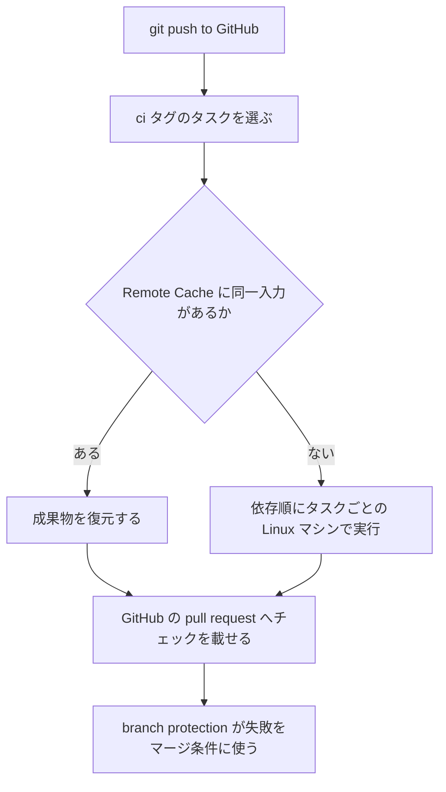

Vercel CI は、2026-10-28 にベータとして公開された CI です。GitHub へ `git push` した変更に対し、Turborepo のタスクグラフから実行するタスクを選び、選ばれたタスクを Linux の別マシンで走らせます。Turborepo は、`turbo.json` にタスクと依存を書くツールです。速度と完了件数は Vercel の自己申告で、計測条件は公開されていません。この記事では、何が選ばれてどこで走り、何に課金され、既存の CI をどの条件で残すかを整理します。


*この記事の全体像。以下、順に解説します。*

## Vercel CIとは

Vercel CI の設定の入口は、`turbo.json` のタスクへ付ける `"tags": ["ci"]` です。Remote Cache は追加設定なしで有効になります。Remote Cache は、入力が変わっていないタスクの成果物を復元する仕組みです。変わったタスクと、その依存だけが計算を使います。失敗すると GitHub の pull request にチェックが付きます。既存の branch protection で、その失敗をマージの条件にできます。branch protection は、指定したチェックが成功しないと保護ブランチへマージできない GitHub の設定です。

対象は、Turborepo 2.11.7 以降でタスクを定義でき、リポジトリが 1 つの Vercel チーム上のプロジェクトに接続されている場合です。Vercel のチームはプロジェクトの所属先で、プロジェクトは GitHub リポジトリの接続先です。公開日は 2026-10-28 です。ブログと changelog の著者は Anthony Shew、Jeffrey Arneson、Cody Wong です。状態は Beta です。ドキュメントは "Features and configuration may change" と書きます。前提は Turborepo 2.11.7 以降と Vercel CLI 64.3.1 以降です。有効化は、リポジトリで `vercel ci enable` を実行します。単一パッケージのリポジトリでも、`turbo.json` を置けば使える、とブログが書きます。パッケージは、`package.json` の名前で指すリポジトリ内の単位です。

### どのタスクが走るか

実行対象は、`ci` タグの付いたタスクです。`!ci` は選択から外します。`!ci` は `ci` より優先します。依存先が `!ci` でも、CI 対象のタスクがそれに依存するなら、依存は先に走ります。依存のキーは `dependsOn` です。

資源、OS、除外は、同じ `tags` 配列に並びます。次は、ドキュメントが名指しするタグを 1 つのタスクに並べた最小例です。`ci:cpus:4` は 4 CPU です。メモリは 1 CPU あたり 2 GB なので、この例は 8 GB です。CPU の上限は 32 で、32 CPU のときメモリは 64 GB です。OS は Ubuntu 24.04 です。1 つのタスクに Amazon Linux と Ubuntu の両方は付けられません。

```json
{
  "tasks": {
    "build": {
      "tags": ["!ci"]
    },
    "test": {
      "dependsOn": ["build"],
      "tags": ["ci", "ci:cpus:4", "ci:os:ubuntu"]
    }
  }
}
```

各タスクの既定資源は 2 CPU と 4 GB です。イメージは Amazon Linux 2023（`ci:os:amazonlinux`）と Ubuntu 24.04（`ci:os:ubuntu`）です。パッケージ単位の `turbo.json` は、ルートの宣言を上書きできます。上書き後もルートのタグを残すときは、その `tags` に `$TURBO_EXTENDS$` を書きます。

タスクの前に、clone と依存インストールの bootstrap があります。既定は 4 CPU と 8 GB です。キー `ci.bootstrapping.resources.vcpus` は 1 から 32 です。bootstrap の install は Amazon Linux です。

選択の単位としてドキュメントが名指ししているのは `package#task` です。`package` はパッケージ名、`task` はそのパッケージのタスク名です。ブログは、一般提供に向けて "More granular test selection" を足す、と書きます。

### 環境変数と課金

環境変数は Turborepo の Strict Mode です。タスクへ届くのは、`env`、`passThroughEnv`、`globalEnv`、`globalPassThroughEnv` のいずれかに宣言した変数だけです。これらに無い変数は届きません。`globalEnv` と `globalPassThroughEnv` は、すべてのタスクへ届ける変数の宣言です。`env` の値は、キャッシュを引くハッシュ（入力の識別子）に入ります。`passThroughEnv` の値はハッシュに入りません。

課金単位は CPU minute です。1 CPU が 1 分で 1 です。計測は開始から停止までで、停止処理を含みます。秒は切り上げ、最小は 1 秒です。Pro は 1 CPU minute あたり $0.0035 です。Enterprise は Custom です。キャッシュ復元と、変更の影響外として走らなかったタスクは、CPU minute を使いません。bootstrap は使います。

デプロイの完了を待ってから行うエンドツーエンドテスト（e2e）は、依存先 `<package>#deployment` とタグ `ci:oidc:deployments` を使います。`<package>#deployment` は、同じコミットのそのパッケージのデプロイ完了を待つ先です。`ci:oidc:deployments` は、アクセスを制限したそのデプロイへも、テストのリクエストを通すタグです。トークンは環境変数には入りません。タスクが自分のパッケージのデプロイ先ホスト名へリクエストするとき、Vercel CI がヘッダ `x-vercel-trusted-oidc-idp-token` を付けます。ヘッダが付く宛先は、そのデプロイ先ホスト名です。別名とカスタムドメインは、そのホスト名とは別の宛先なので、ヘッダは付きません。他のプロジェクトへ送るときは、タグ `ci:oidc:project:<id>` を最大 5 件まで足します。`<id>` は、そのプロジェクトの識別子です。

### 操作と、push からチェックまで

操作の入口は、ダッシュボード、CLI、Vercel MCP、OpenAPI です。Vercel MCP は、コーディングエージェントから Vercel CI を操作する入口です。ここでのエージェントは、タスクの選定や設定、pull request の作成を行う実行役です。CLI のサブコマンドは `ls`、`inspect`、`logs`、`grep`、`rerun` です。`inspect` と `rerun` の `--wait` は最大 10 分です。失敗時の終了コードは 1 です。一覧は既定 20 件、最大 100 件です。ログは既定 10 タスク、最大 25 タスクです。横断検索は既定 20 run、最大 50 run で、上限の前に打ち切ることがあります。セットアップ用の案内は、エージェントに `npx skills use vercel/ci@setup` を実行させるプロンプトです。

push からチェック投稿までの流れは、次のとおりです。



## 注意点

ここからは、ブログの数字、選択の粒度、キャッシュが緑になる条件、保護ブランチが見る範囲、文面のずれ、実行できる場所を分けます。

### 速度と件数

ブログは、Vercel 社内で `git push` から "CI passed" までが、以前の 2〜6 倍速い、と書きます。同じ記事は、自社リポジトリと非公開ベータ（private beta）を合わせて nearly 8 million のタスクを完了した、とも書きます。比較した旧 CI、リポジトリ、人が待つ経過時間（壁時計）かタスク時間か、分布、独立した計測は、記事にありません。同じページの動画アセットの title は `ci-indicators-gauges-107-6-4-2.5x`、fileName は `ci-indicators-gauges-70-2-4-2.5x` です。これは内部の名前の差であり、公表された計測値ではありません。計画の所要時間には、自チームで push から緑までの壁時計を測った値を使います。2〜6 倍と約 800 万タスクを否定する第三者の計測は、公開資料の範囲にはありません。数字が偽だとは言えません。再現条件が非公開のままです。

### 選択の粒度

「影響のあるテストだけが走る」と読むのは、今のドキュメントより先です。今書かれているのは、タグ付きタスクのうち、変更の影響を受ける `package#task` と、その依存です。関数単位という語は、ブログにありません。

この段の `--affected` は、Turborepo CLI の既定です。Vercel CI が同じ規則で選ぶかは、Vercel CI のドキュメントに書かれていません。Turborepo 自身の `--affected` は、既定でパッケージ単位です。パッケージ内の 1 ファイルが変わると、そのパッケージの全タスクが選ばれます。`inputs` は、タスクのファイル入力にする glob（ファイル名のパターン）です。この指定で絞るかどうかは `futureFlags.affectedUsingTaskInputs` です。既定は false です。Vercel CI のドキュメントは、この flag をオンともオフとも書いていません。lockfile、ルートの `package.json`、`turbo.json`、`globalDependencies` の変更は、flag をオンにしても全タスクが対象になる、と Turborepo が書きます。`globalDependencies` は、リポジトリ全体の入力に含めるファイルの指定です。clone の深さが `--affected` に足りるかは、Vercel CI のドキュメントにありません。浅い checkout では全パッケージが変更扱いになる、という記述は Turborepo CLI 側にあります。

### キャッシュが緑になる条件

キャッシュ復元は、ハッシュが一致した過去の成果物です。`passThroughEnv` と `globalPassThroughEnv` は、実行時には渡りますが、ハッシュに入りません。`globalEnv` の値がハッシュに入るかは、`env` とは分けて書かれていません。`inputs` を書くと、その glob（ファイル名のパターン）だけがファイル入力になります。落としたファイルの変更では、キャッシュはミスしません。そのファイルが変わっても、タスクは再実行されません。`.env` は、`inputs` か `globalDependencies` に入れない限り、ハッシュに乗りません。

`remoteCache.signature` の既定は false です。Turborepo は "This is not a security feature" と書き、部分的な転送に対する完全性確認だと限定します。Vercel CI は Remote Cache をゼロ設定で有効にする、と書きます。署名をオンにする、とは書いていません。

公式の e2e ガイドは、`VERCEL_DEPLOYMENT_URLS` を `passThroughEnv` に置き、`cache: false` を付けません。`VERCEL_DEPLOYMENT_URLS` は、パッケージ名とデプロイのホスト名を対応させた JSON で、プロトコルは含みません。このホスト名が、トークンのヘッダを付ける宛先です。Turborepo の `cache` 既定は true です。`web#deployment` は、パッケージ名が `web` のときの `<package>#deployment` です。これが毎コミット、下流のハッシュを変えるかは、Vercel CI のドキュメントにありません。変えない場合、ソースのハッシュが同じ再実行では、前回の e2e 結果が返りえます。

### 保護ブランチが見るもの

GitHub の required status checks（マージの条件にしたチェック）は、失敗したチェックのマージを止めます。GitHub では、スキップされたジョブは状態を Success と報告します。required でも、スキップはマージを止めません。`skipped` と `neutral` も、保護ブランチではマージを許す状態の名前です。どちらも、失敗としてマージを止める状態には含まれません。Vercel CI は、影響外とキャッシュ復元を失敗にしません。走らなかったタスクや、古い成果物の復元は、チェックが成功のままなら保護を通ります。

CI のドキュメント、configuration、CLI、e2e ガイドには、protection に入れるチェック名がありません。同じ GitHub のドキュメントでも、Code Owners のページはチェック名を書いています。CI 側に名前が無いのは、読み落としだけではありません。タスクをスキップしたときに、どの conclusion（チェック結果の区分）が付くかも、ドキュメントにありません。

### プランと公開状態の文面

公開範囲の文面は、ページでずれています。ブログは "available in Beta today on all plans" と書きます。`/docs/ci` は 2026-10-28 更新で Beta です。CLI ページは `last_updated: 2026-10-07` のまま、"Private Beta" と "Your team must have access" と書きます。料金ページの表は、Pro の $0.0035 と Enterprise の Custom だけです。Hobby の行はありません。Hobby は、その料金ページに単価が無いプラン名です。誰向けの契約かは、ページからは読めません。all plans から、Hobby の金額は読めません。Hobby の単価も、含まれる無料枠も、料金ページにありません。

### 実行できる場所

使える場所の境界は Limitations にあります。ベースイメージは Linux のみです。ソースは GitHub のみです。トリガーは `git push` のみです。GitHub Actions の手動起動 `workflow_dispatch` と、定期実行 `schedule` は、書かれたトリガーに含まれません。リポジトリは Vercel プロジェクトに 1 つ以上接続され、複数チームにまたがる接続はできません。fork からの pull request を除外する文は、Limitations にありません。扱いは未確認です。macOS や Windows が要るジョブは、Linux のみという境界の外です。install コマンドがホームディレクトリや `apt` / `dnf` に入れたものは、タスクのマシンから見えません。

## どの条件なら足すか

いまの判断は、次の一文です。GitHub 上の Linux タスクに限り Vercel CI ベータを足し、失敗は branch protection で止め、影響判定の漏れは別のテストで見ます。

| 条件 | Vercel CI を足す | 既存の CI を残す |
|---|---|---|
| ソース | GitHub | GitHub 以外 |
| ジョブの OS | Linux で足りる | macOS や Windows が要る |
| 起動 | `git push` で足りる | 手動実行と定期実行。fork の pull request は未確認 |
| リポジトリ | 単一 Vercel チームのプロジェクトに接続済み | 未接続、または複数チームに接続 |
| タスクの表現 | `turbo.json` のタスクにできる | シェルの手順がリポジトリ外のツールに依存する |
| プランの金額 | Pro の $0.0035 / CPU minute で見積もれる | 料金ページに単価が無いプランで金額を決める必要がある |

変更されたパスでジョブを分ける既存の path フィルタや、別のタスクランナーの affected（変更の影響を受ける範囲だけを選ぶ機能）は、上の「残す」列でそのまま使えます。Vercel CI は、それらを廃止する条件をドキュメントに書いていません。

タスクグラフ、タグ、キャッシュ、失敗時のチェック投稿は、ブログと `/docs/ci` が同じ構造で書いています。スキップとキャッシュ復元が CPU minute を使わない、という料金ページの文は、小さい差分の待ちと費用を同時に下げる設計と整合します。既存の branch protection を、GitHub Actions の失敗と同じように使える、と CI のドキュメントが書きます。失敗した実行を止める手段は、新しく発明しなくて済みます。エージェント向けに、CLI、MCP、セットアップ skill のプロンプトが同時に出ています。

速度の 2〜6 倍は、条件の無い自己申告です。導入の可否は、速度以外で決めます。保護は、投稿された失敗を見ます。見落としは、別検証が残ります。全面置換は Limitations とぶつかります。残す CI があります。CLI の Private Beta の文面は残っています。`vercel ci enable` が権限で失敗するチームは、2026-10-28 のブログだけでは入れません。

エージェントが増やす pull request に対しては、Vercel CI を、失敗を早く返す Linux タスクの実行系として足します。GitHub の branch protection は、その失敗をマージの条件にします。影響の見落としは、保護が成功を返したあとに残ります。次節の 2 と 3 を、導入の完了条件に入れます。2〜6 倍は、採用理由に使いません。Linux 以外、GitHub 以外、push 以外の検査は、今の CI に残します。

次のときは、足す判断をひっくり返します。

- 必要なジョブが、Linux と `git push` に収まらない
- リポジトリを、単一の Vercel チームに接続できない
- 料金ページに単価が無いプランで、金額が確定するまで課金を許せない
- 見落としの検証を置く人がいない。この場合、Vercel CI のチェックが成功として投稿されれば、走らなかったタスクがあっても required check はマージを止めません

## 有効化したあとに確認すること

名前とキャッシュの穴は、ドキュメントから写せません。最初の pull request で、次を確認します。

1. GitHub に出たチェック名を記録してから required にします。可能なら、そのチェックのソースを Vercel の GitHub App に限定します。限定したときにマージ判定がどう変わるかは、参照したドキュメントには書かれていません。名前はドキュメントから写せません。
2. `inputs` を狭めたタスクに、そのパターンの外のファイルだけを変える変更を 1 件入れます。タスクが走らない、またはキャッシュヒットのまま緑なら、そのファイルは保護の対象外です。
3. 成否や成果物が変わる変数を、`passThroughEnv` から `env` へ移します。e2e は、同一ソースの `vercel ci rerun` でキャッシュヒットするかを見ます。ヒットするなら、`cache: false` を検討します。
4. lockfile とルート設定の変更では、全タスクが選ばれうると Turborepo が書きます。エージェントが依存をまとめて変える pull request では、待ち時間が小さくならない前提で所要時間を見ます。
5. 速度は、自チームの壁時計で前後比較します。bootstrap は、タスクが全部スキップでも残ります。
6. `vercel ci enable` が "must have access" で失敗したら、CLI ページの 2026-10-07 の文面が現役だと扱って止めます。

## まとめ

Vercel CI ベータは、GitHub への `git push` に対し、`ci` タグのタスクを選んで Linux の別マシンで実行します。入力が同じタスクは Remote Cache から復元し、失敗は pull request のチェックとして branch protection に渡せます。選択の単位は `package#task` で、課金は CPU minute です。

GitHub 上の Linux タスクに限り足します。失敗は branch protection で止め、影響判定の漏れは別のテストで見ます。2〜6 倍は採用理由にしません。Linux 以外、GitHub 以外、`git push` 以外の検査は、今の CI に残します。チェック名の記録、`inputs` の外側の変更、`passThroughEnv` のハッシュ漏れは、有効化したあとの完了条件です。

この記事が少しでも参考になった、あるいは改善点などがあれば、ぜひリアクションやコメント、SNSでのシェアをいただけると励みになります！

## 参考リンク

- [Introducing Vercel CI](https://vercel.com/blog/introducing-vercel-ci)（Vercel、2026-10-28）
- [Vercel CI is now in beta](https://vercel.com/changelog/vercel-ci-is-now-in-beta)（Vercel、2026-10-28）
- [Vercel CI](https://vercel.com/docs/ci)（Vercel Docs、last_updated 2026-10-28）
- [Vercel CI Configuration Reference](https://vercel.com/docs/ci/configuration)（Vercel Docs、2026-10-28）
- [Vercel CI Environment Variables](https://vercel.com/docs/ci/environment-variables)（Vercel Docs、2026-10-28）
- [Vercel CI Pricing](https://vercel.com/docs/ci/pricing)（Vercel Docs、2026-10-28）
- [Images](https://vercel.com/docs/ci/image)（Vercel Docs、2026-10-28）
- [Running End-to-End Tests in Vercel CI](https://vercel.com/docs/ci/guides/end-to-end-tests)（Vercel Docs、2026-10-28）
- [vercel ci](https://vercel.com/docs/cli/ci)（Vercel Docs、last_updated 2026-10-07）
- [run](https://turborepo.dev/docs/reference/run)（Turborepo Docs、`--affected`）
- [Configuring turbo.json](https://turborepo.dev/docs/reference/configuration)（Turborepo Docs、`inputs`、`passThroughEnv`、`affectedUsingTaskInputs`、`remoteCache.signature`）
- [About protected branches](https://docs.github.com/en/repositories/configuring-branches-and-merges-in-your-repository/managing-protected-branches/about-protected-branches)（GitHub Docs）
- [Status checks](https://docs.github.com/en/pull-requests/reference/status-checks)（GitHub Docs）
