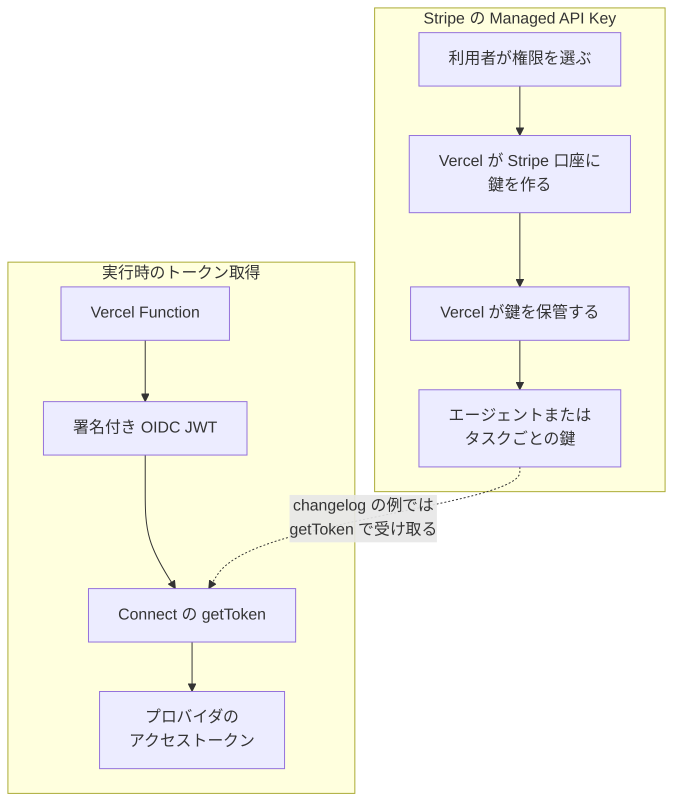

Vercel は2026年10月22日のブログ「Death to long-lived static credentials」で、期限を付けずに使い回す API キーやデータベースパスワードを、署名付きの短命トークンへ置き換える、と書きました。翌23日の changelog では、Vercel Connect が利用者の Stripe 口座に、エージェントまたはタスクごとの制限付き API キーを作る「Managed API Key」（Vercel が代行して作り、保管する管理鍵）を発表しています。

この記事では、まず論考が説明する認証の形と、Stripe 向けに出荷された鍵の発行の形を、公式ページの文言で並べます。続けて、両者を同じものとして読むとずれる箇所を注意点にまとめ、最後に、エージェントに渡す鍵を台帳（製品の機能ではなく、利用者が自分で持つ鍵の発行管理表）で管理するときに、どの列に何を書けばよいかの判断材料を示します。数値と仕様は2026年10月24日時点の公開資料に基づき、論考の数字の一部は Vercel の自己申告です。


*この記事の全体像。以下、順に解説します。*

## Vercel の「長寿命な静的認証情報の廃止」論とは

### 論考が置き換えたいもの

論考は、長寿命の静的認証情報を「アプリが期限なしで使い回す API キーやデータベースパスワード」と定義しています。機械どうしの認証の現状を、2010年頃の HTTPS にたとえています。著者は Malte Ubl、協力は Kevin Corbett です。

代替として示すのは OIDC の署名付き短命トークンです。OIDC（OpenID Connect）は、発行者が署名した JWT（JSON Web Token、署名付きの JSON 形式のトークン）で「誰が要求しているか」を相手に示す仕組みです。受け側はトークンの署名と中身を検証してから、権限を決めます。

論考は、置き換えの手段として次の3つを挙げます。

- **OIDC federation**: Vercel のデプロイが発行する OIDC トークンを、AWS、Google Cloud、Azure の一時的な認証情報へ交換する仕組みです。論考は2024年から一般提供と書いています（月の記載はありません）。信頼の単位は Vercel の project（プロジェクト）と environment（development、preview、production の実行環境）です。
- **Vercel Connect**: デプロイの身元で、実行時に外部サービスのトークンを取る機能です。論考のコード例は Linear 向けで、`getToken('oauth/linear', { subject: { type: 'user', id: 'user_123' }, scopes: ['read'] })` です。カスタム audience（トークンを受け取ってよい相手を示す値）で、トークンの受け手を特定のサービスに限定できる、とも書いています。
- **Marketplace の掲載条件**: Marketplace は、Vercel に連携を提供する外部ベンダーの掲載一覧です。2026年11月30日までに Vercel からの OIDC に対応せず長寿命の秘密で認証する掲載には “Not secure” を付け、2027年1月（日の記載はありません）に、安全な認証を出さないベンダーを掲載から外す、と書いています。Vercel API と自社のネイティブ連携も同じ基準に従う、としています。

論考はさらに、1,000を超える SaaS ベンダーを調べたところ、安全な認証方式に対応していたのは8.4%だった、と書いています。

### OIDC トークンの期限

Vercel の [OIDC リファレンス](https://vercel.com/docs/oidc/reference)（Last updated 2026-09-17）は、トークンの有効期限を次のように定めています。

| 発行される場面 | 有効期限 |
|---|---|
| Build | 1時間 |
| preview と production の Function | 2時間 |
| development | 12時間 |

Function では実行のたびに新しいトークンを作らず、同じトークンを最大90分再利用します。[OIDC の説明](https://vercel.com/docs/oidc)によると、有効期限2時間との差の30分は、Function の最大実行時間を覆うためです。

トークンの `sub`（subject、誰のトークンかを示す項目）は、`owner`（team）、`project`、`environment` から作られます。個人を示す `user_id` が付くのは development だけです。

### Connect の実行時トークン

Connect の[トークン概念](https://vercel.com/docs/connect/concepts/tokens)（Last updated 2026-08-20）は、トークン取得の仕様を次のように書いています。

- 1回の `getToken` 呼び出し、または CLI の `vercel connect token` が、外部サービス（プロバイダ）のトークンを1つ返します。
- subject（誰の名義でトークンを取るかの指定）は4種類です。アプリ自身の `app`、個々の利用者の `user`、JWT を差し出して取る `jwt-bearer`、既存のトークンを交換する token exchange です。
- 任意で scopes、resources、authorization details を指定できます。
- プロセス内のキャッシュは100件で、期限の30秒前になると既定で取り直します。

[Limits](https://vercel.com/docs/connect/limits)（Last updated 2026-08-26）によると、読み取りは team（Vercel のチーム）あたり200リクエスト/分、失効操作を含む書き込みは50リクエスト/分で、超えると 429 が返ります。Connect は[全プラン](https://vercel.com/docs/connect)で使えます。[料金ページ](https://vercel.com/docs/connect/pricing)が2026年9月25日発効と書く料金表は、token request（`getToken` など、プロバイダのトークンを返す Connect API の呼び出し1回）単位で、Hobby は月500回まで追加料金なし、Pro は1,000回あたり $3.00、Enterprise は個別見積もりです。

### Stripe の Managed API Key

2026年10月23日の changelog「[Vercel Connect adds managed Stripe API keys](https://vercel.com/changelog/vercel-connect-adds-managed-stripe-api-keys)」（Dima Voytenko、Hedi Zandi）は、Connect の Stripe コネクタに新しい接続方法を加えました。コネクタは、Connect で外部サービスごとに作る接続設定です。Connect の認証方式には一般に、OAuth と、利用者が作成時に静的な API キーを渡す API key 方式があります。

- 接続方法の名前は Managed API Key です。エージェントまたはタスクごとに、別々の [restricted Stripe API key](https://docs.stripe.com/keys/restricted-api-keys) を作ります。restricted key（制限付きキー）は、Stripe の resource ごとに None / Read / Write を選べる API キーで、口座の全権限を持つ secret key とは別物です。
- Vercel が利用者の Stripe 口座に鍵を作り、権限は利用者が選んだものに限ります。
- Vercel が鍵を保管し、利用者が貼り付ける秘密は無い、と書いています。
- コネクタ設定から再デプロイなしでローテーションでき、切り替え中は旧鍵が最大24時間有効です。
- Stripe コネクタの既存の接続方法である MCP（Model Context Protocol、エージェントが外部ツールを呼ぶための標準）と、自分で持ち込む API キーの方式は変えません。

changelog の例は、日次売上を集計するエージェントには charges の読み取りだけ、オンボーディングのエージェントには customers の書き込みだけ、というものです。

changelog のコード例は、`getToken` の戻り値を Stripe の SDK に渡す形です（import 行は省略しています）。

```ts
const key = await getToken('stripe/acme-stripe', { subject: { type: 'app' } });
const stripe = new Stripe(key);
```

キャプションは “Call getToken with the connector’s UID to get the restricted key at runtime” です。一方、[Stripe コネクタの案内ページ](https://vercel.com/connect/stripe)の例は `subject: { type: 'user', id: userId }` で、subject の型が異なります。この案内ページには Managed API Key の記載が無く、どちらの例が Managed API Key の鍵の分け方に対応するかは書かれていません。

### 全体像

論考が描く実行時のトークン取得と、changelog が描く Stripe 鍵の作成は、図にすると別の流れです。changelog のコード例が、保管された鍵を実行時の `getToken` で受け取る形で両者をつないでいます（図の点線）。左側の流れは、論考と Connect の文書が書く一般的な取得の説明で、Stripe の鍵に限った説明ではありません。`getToken` が保管済みの鍵をそのまま返すのか、呼び出しごとに発行するのかは、changelog の例には書かれていません。



OIDC の身元は team、project、environment です。Connect の subject は app、user、jwt-bearer、token exchange です。changelog の「エージェントまたはタスク」は鍵を分ける単位として書かれており、subject の型の名前ではありません。トークン概念の表に、task や agent という型はありません。

### Stripe 側の別の短命経路

Stripe には、これとは別に [Workload Identity Federation](https://docs.stripe.com/workload-identity-federation)（WIF）があります。WIF は private preview で、AWS または Google Cloud が発行したワークロードの身元トークンを、1時間で切れる Stripe の access token に交換します。ワークロードは静的な API キーを持ちません。発行できる相手は信頼したワークロードに限られますが、発行後のトークンはどこからでも API を呼べる、と WIF ページの比較表に書かれています。SDK の対応は、Node.js が AWS、Ruby が Google Cloud です。

### 同じ時期の支出制御

鍵の発行の説明には金額の上限が出てこないため、金額を止める仕組みは別の発表を見る必要があります。同じ10月23日には「[Vercel CLI adds Spend Management](https://vercel.com/changelog/vercel-cli-adds-spend-management)」も出ています。チームの On-Demand Budget（従量課金分の予算）を `vercel budgets` で確認でき、`--pause` を付けると、支出が100%に達したとき全プロジェクトの本番デプロイを止めます。予算を置いただけでは使用は止まりません。追加料金なしの対象は Pro と、一部の契約形態の Enterprise で、操作には Owner または Billing ロールが必要です。

2026年7月31日の「[AI Gateway の予算](https://vercel.com/changelog/ai-gateway-spend-budgets-and-alerts)」は、AI Gateway（Vercel 経由のモデル呼び出し）の team、project、API key にドルの上限を付け、どれか1つでも超えると要求を拒否します。BYOK（利用者が自分のモデル API キーを持ち込む方式）の支出は、既定では予算に数えません。50% / 75% / 100% の通知メールは既定でオフです。更新周期は daily、weekly、monthly（既定）、none から選べます。

## 注意点

### 2つの発表は別の日の、別の内容です

論考は2026年10月22日、Stripe の changelog は10月23日の公開です。ニュースでは同日の出来事として扱われることがありますが、論考は方針と期限を、changelog は Stripe コネクタの1機能を説明しています。

### 8.4% と「数千時間」は自己申告です

8.4% はブログの一文です。母集団の作り方、`secure authentication methods` の定義、調べた日、内訳、元データへのリンクは書かれていません。方法論を説明した公開文書も見当たりません。The New Stack（Amanda Caswell、2026年10月23日）も同じ数字を載せていますが、ブログの再掲であり、独立した測定ではありません。

論考は、Vercel が過去の鍵ローテーションに「thousands of engineering hours」をかけた、とも書いています。これも自己申告で、計測条件は書かれていません。

### Managed API Key は「期限で止まるトークン」とは書かれていません

論考は、盗まれたトークンが期限で止まることと、長寿命のプロバイダ秘密を環境変数に置かないことを、Connect の性質として書いています。一方、changelog が Stripe について書いているのは、Vercel が制限付き鍵を作って保管し、ローテーション時に旧鍵を最大24時間残すことです。鍵に既定の有効期限があるとは書いていません。Stripe の WIF のページも、“How WIF differs from API key authentication” の比較表で、API キーには既定の失効が無いと書いています。

changelog のコード例は `getToken` の戻り値を restricted key と呼んでいます。ただし、次の点はその例にも Stripe コネクタの案内ページにも書かれていません。

- 戻り値の接頭辞が restricted key の `rk_` か
- 呼び出しのたびに新しい鍵を作って捨てるのか
- 戻り値そのものの寿命

### Stripe の「managed keys」と changelog の鍵が同じかは未確定です

Stripe の [API キーの説明](https://docs.stripe.com/keys)は “Managed keys are secret API keys that a hosting platform delivers directly to your hosted applications.” と書いています。changelog は restricted key と書き、制限付きキーの文書へリンクしています。どちらも managed と呼んでいますが、secret と restricted が同じ鍵だと確定する文は見当たりません。

Stripe の [managed keys のページ](https://docs.stripe.com/keys/managed-api-keys)が Vercel の例としてリンクしているのは、10月23日の changelog ではなく、[Marketplace の Stripe 連携](https://vercel.com/docs/integrations/ecommerce/stripe)（Last updated 2026-03-02）です。この連携は API キーを環境変数として配り、秘密鍵の名前は `STRIPE_SECRET_KEY` で、本番用（ライブモード）の鍵を使うには再デプロイが必要です。論考がやめたいと書いた形の公式手順が、まだ公開されていることになります。

managed keys のページには、次の記述もあります。いずれも、Connect の10月23日の鍵に同じ扱いが適用されるとは書かれていません。

- 利用者は managed key の中身を表示できません。
- expire（失効）を選ぶと、その鍵のアクセスは直ちに切れます。
- 連携をアンインストールするとき、鍵を直ちに切るか残すかを選べます。残した鍵は口座所有者の責任です。
- 機能は preview で、利用には登録が必要です。

### “Not secure” と掲載除外は Vercel 自身の掲載基準です

Marketplace の “Not secure” 表示と掲載除外は、ブログが Chrome の表示にたとえて Vercel 自身が置く掲載期限です。法令の引用はありません。同じ10月23日の changelog は、持ち込みの API キー方式を残すと書いています。Connect の API key コネクタは、作成時に渡した静的な長寿命キーを保管し、実行時に付ける方式です（[Connect の説明](https://vercel.com/docs/connect)、[認証の表](https://vercel.com/docs/connect/concepts/authentication)）。

### 短命の OIDC にも、タスク終了より長い窓があります

- development のトークンは12時間有効です。`vercel env pull` は、この development のトークンを `.env.local` に書き出します。
- preview と production の Function は2時間有効で、同じトークンを最大90分再利用します。
- Connect の OAuth では、refresh token（アクセストークンを取り直すための長めの鍵）をインストール時に Vercel が保管します。アプリのコードはその refresh token を扱いません。
- プロバイダに失効エンドポイントが無い場合、Connect は自分の写しを消すだけで、プロバイダ側の認証情報は自然な期限まで有効なままになりうる、とトークン概念のページが書いています。

### Vercel 自身へのデプロイ認証は、まだ静的トークンです

論考は「API と CLI へ OIDC を広げる」と未来形で書いています。[GitHub Actions のガイド](https://vercel.com/kb/guide/how-can-i-use-github-actions-with-vercel)（last_updated 2026-10-16）は “No OIDC for deploy authentication, yet.” と書き、出荷までは `VERCEL_TOKEN` を使う、としています。このガイドで OIDC が動くと書かれているのは、Functions から AWS または GCP へ出る方向と、GitHub Actions が Deployment Protection（デプロイへのアクセス保護）を通過してプレビューなどにアクセスする方向（Vercel の Trusted Sources 機能）です。後者の代替手段は、静的な `VERCEL_AUTOMATION_BYPASS_SECRET` です。

### Stripe の通信元制限は、金額の上限ではありません

Stripe の access policy（アクセスポリシー）は、通信元を IP、ASN、国、脅威カテゴリ（匿名 VPN、公開プロキシ、住宅プロキシ、Tor）で限定します。複数のルールは AND で評価されます。金額の上限ではありません。

Stripe の keys ページによると、制限付きキーにはエージェント用の印を付けられます。印を付けた鍵の認証と権限は他の制限付きキーと同じで、出金、返金、口座設定の変更に承認ルール（実行の前に承認を求めるルール）が掛かります。changelog は、Connect がこの印や access policy を付けるとは書いていません。

金額を止める仕組みは、Vercel 側では AI Gateway の予算（モデル利用の支出）と Spend Management の `--pause`（本番デプロイの停止）です。どちらも Stripe の制限付きキーで支払いを止めるものではありません。

### 料金・SLA・保管地域は確認できていません

Connect の料金ページは、token request などの新しい料金が2026年9月25日に発効し、それまでは現行条件、と書いています。2026年10月24日時点でもこの文はページに残っており、発効済みかは別の告知で確認できていません。[利用条件](https://vercel.com/docs/connect/legal)は第三者基盤の可用性や稼働時間を保証しない、と書いています。SLA の数値と、鍵の保管地域は確認できていません。

### CVE-2026-44479 は Managed API Key とは別の問題です

CVE-2026-44479 は、今回の Stripe 鍵の方式に関する脆弱性ではありません。[NVD](https://nvd.nist.gov/vuln/detail/CVE-2026-44479) の公開は2026年5月13日、CVSS 3.1 は5.5（`CVSS:3.1/AV:L/AC:L/PR:N/UI:R/S:U/C:H/I:N/A:N`）です。内容は、Vercel CLI が非対話では完了できないコマンドの提案文に、引数 `--token` または `-t` の値を含めてしまうというものです。影響は50.16.0以上52.0.1未満で、修正版は52.0.1です。

ベンダーの advisory [GHSA-pgf8-2hgj-grqg](https://github.com/vercel/vercel/security/advisories/GHSA-pgf8-2hgj-grqg) は、次の3つが揃ったときだけトークンが出力に出る、と書いています。

- トークンを引数で渡した
- 非対話モード、またはエージェントとして自動検出された
- コマンドが自力で完了できない

環境変数 `VERCEL_TOKEN` で渡した場合は対象外です。NVD の英文要約は、この除外を書いていません。

## 認証方式を並べると何が違うのか

ここまでの方式を、渡すもの、保管場所、寿命、主体、金額の上限で並べます。

| 方式 | 渡すもの | 保管 | 寿命の記載 | 主体 | 金額の上限 |
|---|---|---|---|---|---|
| Vercel の OIDC | 署名付き JWT | 長寿命のクラウド秘密を環境変数に置かない。development は `.env.local` にトークンを書く | Build 1時間、Function 2時間（最大90分再利用）、development 12時間 | team、project、environment | このトークンには無い |
| Connect の OAuth トークン | プロバイダのアクセストークン | refresh token は Connect が持ち、コードは見ない | short-lived。固定の秒数の記載は無い | app、user、jwt-bearer、token exchange | このトークンには無い |
| Connect の Managed API Key | 制限付き Stripe キー（changelog の表現） | Vercel が作成して保管。貼り付ける秘密は無い | 既定失効の記載は無い。ローテーション時の旧鍵は最大24時間 | エージェントまたはタスク（subject の型ではない） | この発表には無い |
| Marketplace の Stripe 連携 | `STRIPE_SECRET_KEY` など | 環境変数 | 寿命の記載は見当たらない。本番用の鍵への切り替えには再デプロイ | プロジェクト | このページには無い |
| 持ち込みの API key コネクタ | 作成時に渡す静的キー | Connect が保管し、実行時に付ける | コネクタに TTL は無い | コネクタ | この説明には無い |
| Stripe の WIF | 1時間の access token | ワークロードは静的秘密を持たない | 1時間（private preview） | 信頼したワークロード。IdP は AWS と Google Cloud | ページには無い |
| AI Gateway の予算 | モデル呼び出し | team、project、API key ごとの予算 | 日、週、月、または累計 | そのスコープ | 超えた予算が1つでもあれば拒否。BYOK は既定で対象外 |
| Spend Management | チームの On-Demand 支出 | 請求設定 | 請求周期の予算 | チーム | `--pause` のとき100%で本番デプロイを止める |

ローテーション時の重ね期間にも差があります。Stripe のダッシュボードで鍵をローテーションすると、旧鍵と新鍵は最大7日ともに有効です、と keys ページが書いています。7日より長く重ねたいときは、新しい鍵を作って移行し、その後に古い鍵を expire します。Expiration で Now を選ぶと旧鍵は直ちに無効になります。Connect の「最大24時間」は、changelog がこれより短い重ね期間として書いているもので、ダッシュボードの7日を置き換えるものではありません。Managed API Key を Stripe のダッシュボードからローテーションした場合にどちらの期間が適用されるかは、changelog には書かれていません。

## エージェント用の鍵を台帳でどう管理するか

2026年10月24日時点の公開資料では、1つの鍵の設定の中に、金額のハード上限と操作の権限を一緒に持つ仕組みは見当たりません。利用者側の発行台帳の1行に次の列をまとめて書くと、ベンダーが別々の場所に置いた制御を、1件の発行として扱えます。

| 列 | 公式資料から埋まるもの | 空欄になるもの |
|---|---|---|
| 名前 | コネクタ名、鍵の名前 | タスク単位の識別子。OIDC の `sub` にも Connect の subject にも無い |
| 権限 | 制限付きキーの resource ごとの None / Read / Write。例は charges の読み取り、customers の書き込み | Connect の `scopes` がこの権限に対応するか |
| 失効 | Connect のローテーション重ねは最大24時間、Stripe ダッシュボードは最大7日、expire は即時。OIDC は1時間・2時間・12時間 | Managed API Key の既定の有効期限 |
| 発行者と保管 | Vercel が Stripe 口座に作り、Vercel が保管する。例では `getToken` の戻り値をプロセス内の Stripe クライアントへ渡す | 接頭辞が `rk_` か、環境変数にも出るか、利用者が再表示できるか |
| 束縛 | OIDC は audience と project、environment。WIF は信頼したワークロードへの発行 | 制限付きキーを盗まれた先で使わせない束縛は、access policy を付けたときだけ |
| 金額の上限 | AI Gateway の予算、または Spend Management のデプロイ停止を、別システムとして参照する | Stripe のこの鍵が金額で要求を拒否する項目 |
| 通信元 | access policy の IP、ASN、国、脅威カテゴリ | Connect が access policy を付けるか |
| 人の鍵との分離 | エージェントに口座の secret key を渡さず、制限付きキーを分ける | Connect がエージェント用の印と承認ルールを付けるか |

## Managed API Key をどう採用するか

### 公式資料と一致する読み、一致しない読み

権限を分け、口座の secret key をエージェントと共有しない、という使い方は changelog と一致します。changelog は secret key の全権限と、エージェントごとの制限付きキーを対比しています。作成と保管は Vercel 側にあり、利用者が貼り付ける秘密はありません。失効の単位はその鍵のローテーションまたは expire で、口座の secret key 全体より小さくなります。

一方、この鍵を、論考が言う「保管せず、期限で止まる」トークンとして扱う読みは、公式資料と一致しません。理由は次のとおりです。

- 鍵を保管しているのは Vercel です。アプリが環境変数に持たないことと、秘密がどこにも無いことは別です。
- 旧鍵はローテーション時に最大24時間残ります。Stripe ダッシュボードの手順では最大7日残ります。
- WIF の比較表は、API キーに既定の失効が無いと書いています。
- subject はタスク ID ではなく、development の OIDC は12時間有効です。
- 金額のハード上限は、この鍵の発行説明にはありません。

呼び出しごとに新しい `rk_` を作って捨てるという文、Vercel を WIF の発行元に含める文、鍵のレコード上の金額上限、8.4% の方法論、掲載除外を義務づける法令は、2026年10月24日時点の公開資料には見当たりません。

### 実務での扱い方

1. エージェントには、人や口座全体の secret key を渡しません。Stripe では、仕事に必要な resource だけを許可した制限付きキーを分けます。Managed API Key は、この分離と、再デプロイ不要のローテーションを Vercel が代行する手段として使えます。
2. ただし、その鍵を短命のアイデンティティとしては扱いません。台帳の寿命の列には「既定失効の記載なし。ローテーション時は旧鍵が最大24時間有効」と書きます。
3. 金額のハード上限は、同じ行の別の列に書きます。AI Gateway を使うなら2026年7月31日の予算、Vercel の本番を止めるなら Spend Management の `--pause` を参照します。Stripe の支払いを金額で自動的に拒否する仕組みは、今の公式資料にはありません（エージェント用の印の承認ルールは、操作の種類で承認を挟むもので、金額の上限ではありません）。
4. Stripe を身元トークンで呼びたい場合の公式経路は、Stripe の WIF です。private preview で、信頼先は AWS と Google Cloud です。Vercel の OIDC を Stripe が直接受けるという記述はありません。Marketplace の OIDC 期限を、Stripe 鍵の短命化が完了する日として扱わないでください。
5. 2026年3月2日更新の Marketplace の Stripe 連携は、`STRIPE_SECRET_KEY` を環境変数に置く手順のままです。採用する場合は、長寿命の鍵として台帳に載せます。
6. 長寿命の鍵が残るのは、相手が OIDC も WIF も提供しないとき、GitHub Actions から Vercel へデプロイするとき、Connect の API key コネクタを選んだときです。その行には、静的キーであることと、誰が保管するかを書きます。

### 判断を変える条件

次のどちらかが公式に書かれたら、台帳の寿命と束縛の列を書き換えます。

- Vercel の Stripe 向け changelog か Stripe コネクタの仕様が、`getToken` の戻り値を呼び出しごとに発行して捨てる短命トークンだと書いたとき
- Stripe が Vercel の発行元を WIF の信頼先に加えたとき

2026年10月24日時点の changelog は、`getToken` の戻り値を restricted key と呼んで Stripe クライアントへ渡していますが、呼び出しごとに発行して捨てるとは書いていません。金額の上限は、公式文書がドルまたは利用量による拒否を鍵に付けたと書くまで、別の列のままにします。

### まだ答えが出ていない問い

- `getToken` の戻り値の接頭辞は `rk_` か、呼び出しごとに発行して捨てるか、戻り値そのものの寿命はどれくらいか
- changelog の restricted key と、Stripe の “managed keys are secret API keys” は同じ鍵か
- Connect は Stripe のエージェント用の印と承認ルールを付けるか
- この鍵の作成は、Connect の token request 課金とは別に数えるのか
- Connect の2026年9月25日発効の料金は、すでに適用されているか
- SLA と、鍵やトークンの保管地域
- 8.4% の定義と母集団

これらが未解決でも、権限を分けるという判断は止まりません。止まるのは「短命化が終わった」「金額の上限も鍵に載った」という判断です。

## まとめ

Vercel の論考は、期限なしで使い回す API キーを、OIDC の署名付き短命トークンと Connect の実行時取得へ置き換える方針と、Marketplace の掲載期限を示しました。翌日の Stripe 向け Managed API Key は、エージェントまたはタスクごとに制限付きキーを Vercel が作って保管し、再デプロイなしでローテーションできるようにするものです。

この鍵で実現するのは、権限の分離と、口座の secret key をエージェントに渡さないことです。一方で、既定の有効期限、呼び出しごとの破棄、金額の上限は、公式資料には書かれていません。台帳では、権限・失効・保管・束縛・金額の上限・通信元を別々の列に書き、Managed API Key は「権限を絞った保管型の鍵」として載せるのが、2026年10月24日時点の公開資料と一致する扱いです。

この記事が少しでも参考になった、あるいは改善点などがあれば、ぜひリアクションやコメント、SNSでのシェアをいただけると励みになります！

## 参考リンク

- [Death to long-lived static credentials（Vercel ブログ、2026年10月22日）](https://vercel.com/blog/death-to-long-lived-static-credentials)
- [Vercel Connect adds managed Stripe API keys（Vercel changelog、2026年10月23日）](https://vercel.com/changelog/vercel-connect-adds-managed-stripe-api-keys)
- [Vercel CLI adds Spend Management（Vercel changelog）](https://vercel.com/changelog/vercel-cli-adds-spend-management)
- [AI Gateway spend budgets and alerts（Vercel changelog、2026年7月31日）](https://vercel.com/changelog/ai-gateway-spend-budgets-and-alerts)
- [Vercel OIDC](https://vercel.com/docs/oidc)
- [Vercel OIDC リファレンス](https://vercel.com/docs/oidc/reference)
- [Vercel Connect](https://vercel.com/docs/connect)
- [Vercel Connect トークン](https://vercel.com/docs/connect/concepts/tokens)
- [Vercel Connect 認証](https://vercel.com/docs/connect/concepts/authentication)
- [Vercel Connect Limits](https://vercel.com/docs/connect/limits)
- [Vercel Connect Pricing](https://vercel.com/docs/connect/pricing)
- [Vercel Connect 利用条件](https://vercel.com/docs/connect/legal)
- [Vercel Connect の Stripe コネクタ](https://vercel.com/connect/stripe)
- [Vercel Marketplace の Stripe 連携](https://vercel.com/docs/integrations/ecommerce/stripe)
- [How can I use GitHub Actions with Vercel?](https://vercel.com/kb/guide/how-can-i-use-github-actions-with-vercel)
- [Stripe API keys](https://docs.stripe.com/keys)
- [Stripe restricted API keys](https://docs.stripe.com/keys/restricted-api-keys)
- [Stripe managed API keys](https://docs.stripe.com/keys/managed-api-keys)
- [Stripe Workload Identity Federation](https://docs.stripe.com/workload-identity-federation)
- [Stripe service principals](https://docs.stripe.com/service-principals)
- [NVD CVE-2026-44479](https://nvd.nist.gov/vuln/detail/CVE-2026-44479)
- [GHSA-pgf8-2hgj-grqg（Vercel CLI advisory）](https://github.com/vercel/vercel/security/advisories/GHSA-pgf8-2hgj-grqg)
- [The New Stack（2026年10月23日）](https://thenewstack.io/vercel-oidc-static-credentials/)
