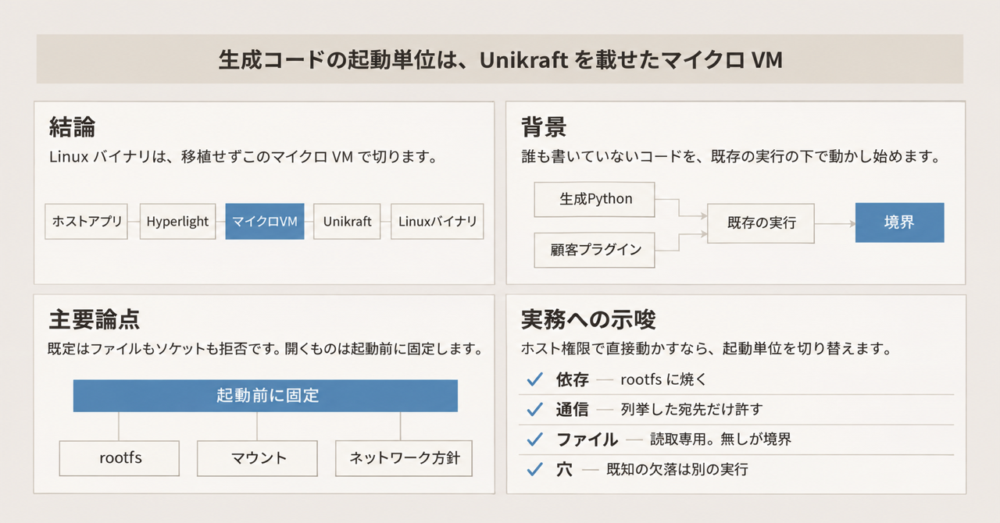
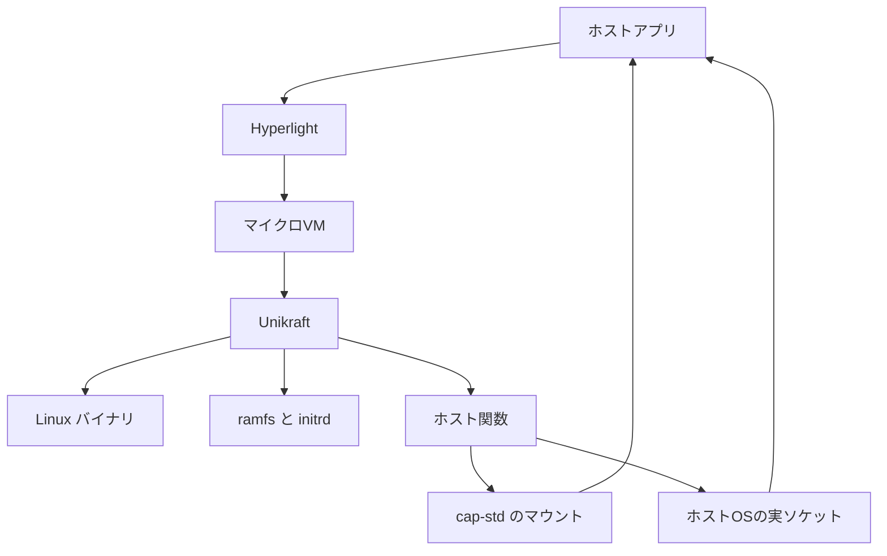
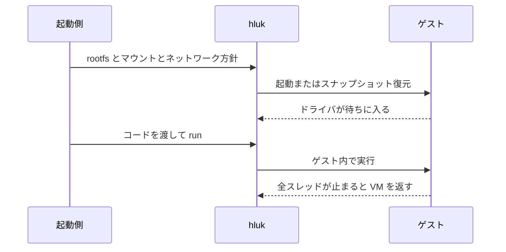

エージェントが直前に書いた Python や、顧客が上げたプラグインは、チームの誰も中身を書いていないコードです。既存のコンテナ実行や、エージェントがコードを動かす実行枠の下で動かし始めるとき、その 1 本をどの境界で切るかが先に決まります。

Hyperlight は、アプリケーションに組み込む仮想マシンモニタです。仮想マシンモニタは、ゲストの仮想マシンを作って制御するソフトウェアです。Linux のバイナリを移植も再コンパイルもせずに載せる経路が hyperlight-unikraft で、その CLI 名は `hluk` です。

この記事では、その境界の中身、起動前に固定できるもの、起動時間の数字がどの区間を測っているか、既知の欠落を整理します。起動時間の表は、CNCF（Cloud Native Computing Foundation。クラウドネイティブのプロジェクトを置く財団）のブログの筆者が 1 台で測った中央値です。

*この記事の全体像。以下、順に解説します。*

## Hyperlightとは

Hyperlight は、ホストプロセスにリンクするライブラリです。ホストのハイパーバイザの上に、デバイスを持たない小さな仮想マシン（マイクロ VM）を作ります。ハイパーバイザは、仮想マシンを動かすホスト側の機構です。Linux では KVM（Kernel-based Virtual Machine）、または機能フラグで有効にする MSHV（Microsoft Hypervisor）です。Windows では WHP（Windows Hypervisor Platform）、Apple silicon の macOS では Hypervisor.framework です。

ここでのコアは、Unikraft を載せる前の Hyperlight 本体です。そのゲストは、OS を持たない実行ファイル（ELF）です。ゲストが呼べるのは、ホストが登録した関数だけです。QEMU や Firecracker のように、別プロセスの仮想マシンモニタとして常駐しません。

コアは Rust のライブラリで、1.0 より前（pre-1.0）です。最新リリースは v0.19.0（2026-11-04）です。2026-11-10 時点の GitHub では、星は約 4,800、archived ではなく、default branch `main` の最新コミット日は 2026-11-09 です。CNCF が Sandbox という採択区分で採った日は 2025-03-04 です。この Sandbox は、後で書く隔離単位のマイクロ VM とは別の語です。

### Linux バイナリを載せる経路

hyperlight-unikraft は、同じマイクロ VM に Unikraft を載せます。Unikraft は Linux Foundation のユニカーネルで、単一のアプリ向けに組んだ小さなカーネルです。`hluk` が rootfs（ゲストのルートファイルシステム）をマウントし、実行し、ランタイムの初期化が終わって待っている状態をスナップショットします。スナップショットは、その時点のメモリの写しです。

最新リリースは v0.21.0（2026-11-05）です。ライセンスは Apache-2.0 です。2026-11-10 時点の GitHub では、星は約 50、archived ではなく、default branch `main` の最新コミット日は 2026-11-09 です。

README がゲストランタイムとして挙げるのは、Python、Node.js、.NET（実行時にコンパイルする JIT と、実行前にネイティブコードへする Native AOT）、Java、PHP、Go、Rust、C、Bash、PowerShell、QuickJS（JavaScript エンジン）、Wasmtime（WebAssembly という中間コードのランタイム）です。シェルは BusyBox（小さい UNIX コマンドをまとめたもの）に含まれる小さいシェル hush であり、GNU bash ではありません。

サポート段階は次のとおりです。Python だけが、上流のテストとベンチを CI で追う Tier 1 です。

| 段階 | ランタイム |
|---|---|
| Tier 1 | Python |
| Tier 2 | Node.js、.NET、Java、PHP、Bash（BusyBox）、Agent、Python-Shell |
| Tier 3 | C、Rust、Go、PowerShell、QuickJS、Wasmtime |

表の Agent と Python-Shell は、コードを書いたエージェントとは別の、README のランタイム名です。中のプログラムは、この区分名以上には書いていません。Tier 2 と Tier 3 の差も、README が段階の名前を分けていることまでで、テスト条件の差として書いてあるのは Tier 1 の「上流のテストとベンチを CI で追う」だけです。

既定では、ホストのファイルもネットワークも渡しません。マウント、ネットワーク方針（`NetworkPolicy`）、待ち受けポートは、起動側が付けます。`NetworkPolicy` は、ゲストがソケットを作って届いてよい範囲の指定です。

ランタイムが初期化を終えて待っている境界でスナップショットを取り、次の実行はその復元から始めます。マウントはスナップショットに焼かず、復元のたびにホストが渡します。

macOS では、Hypervisor.framework の制約で、1 プロセスにつき VM は 1 つです。

### ゲストの中の配置

ホストプロセスが Hyperlight をリンクし、マイクロ VM を 1 つ作ります。その中で Unikraft が initrd をメモリ上の `/` に展開し、ランタイムドライバかエントリポイントを動かします。ランタイムドライバは、ランタイムを起動したあと、ホストからの次の実行を待つ側です。図の「ドライバが待ちに入る」が、その待ちです。initrd は、起動時にメモリへ展開する初期のルートイメージです。ゲストの Linux システムコールは、まずユニカーネルが受けます。ホストのファイルとソケットだけが、登録されたホスト関数として VM の外に出ます。ホスト関数は、ゲストが VM の外へ呼ぶためにホストが登録した関数です。

ramfs はメモリ上のファイルシステムです。cap-std は、ディレクトリを capability（渡された範囲だけを操作できる権限）として扱う Rust のファイル API です。Linux 5.6 以降のマウントは `openat2` の `RESOLVE_BENEATH` で、起点より上のパスへ解決しません。`openat2` はディレクトリを起点にファイルを開くシステムコールです。

1 回の実行は、イメージと能力を決めてから VM に入ります。

ゲストがアイドルのとき、ホストはゲストの実ソケットにイベントが来るまで待ちます。この実ソケットは、図の「ホストOSの実ソケット」です。タイマ割り込み（決まった間隔で VM を起こす通知）は VM の中にはありません。スリープは、ソケットのイベントではなく、スレッドに付けた期限で起きます。全員が止まると、ホストがその期限まで停止して待ちます。

## ゲストから外へ出る経路

境界は二層です。

コアのゲストはシステムコールを持ちません。ホスト関数だけを呼びます。コアの README は今も、システムコールやネットワークやファイルシステムが要るフルの Linux ゲストは対象外、と書いています。Linux アプリは、コアの README が関連プロジェクトとして置く Related Projects の hyperlight-unikraft が Unikraft を足して受けます。

unikraft 経路では、ゲストの Linux ABI をユニカーネルが処理します。Linux ABI は、Linux のシステムコールの呼び出し規約です。ホストカーネルのシステムコールには、そのまま落ちません。外に出るのはホスト関数です。ファイルは `fs_read_bytes` や `fs_write_bytes` などです。ソケットは `net_socket` から `net_poll` までで、IPv4 と IPv6 の TCP と UDP だけがホストへ出ます。raw ソケット（IP より下のパケットを自分で組むソケット）は出ません。`AF_UNIX`（同じマシンの中のプロセス同士をつなぐソケット）は、ゲスト内の `socketpair`（つながった 2 つのソケット）に限ります。未知の整数ソケットオプションは `-ENOPROTOOPT`（そのオプションをプロトコルが受け付けない）です。

### CPython 3.12 の既知の失敗

CPython は Python の標準の処理系です。ここでの既知の失敗は、その 3.12 です。`known_failures.toml` は、ユニカーネルでは落ちる上流テストを理由つきで残しています。エージェントのスクリプトが当たりやすいものは次です。

- `os.fork()` を直接使う処理はクラッシュする、とファイルが書きます。子プロセスの全部が無理、とは書いていません。`subprocess.run()` の一部は、vfork と posix_spawn で通るようになった、とも書きます。どちらも、親のアドレス空間を複製せずに子を起動する経路です。
- 端末と PTY（疑似端末）はありません。
- epoll、poll、Python の selectors は未完成で、asyncio（このイベント待ちを使う Python の非同期実行）が壊れます。epoll は、複数のファイル記述子のイベントをまとめて待つ Linux の機構です。poll は、それより前からある同じ種類の待ちです。selectors は、その待ちを Python から使う層です。issue 158 は 2026-11-10 時点で OPEN です。シグナルは、プロセスへ届く非同期の通知です。epoll の待ちがシグナルを無視し、`alarm()`（指定時間のあとシグナルを届ける呼び出し）はスタブです。スタブは、中身が未実装の呼び出しです。期限どおりに届くとは書いていません。
- スレッドは一部動きます。join（スレッドの終了を待つ操作）やライフサイクル（生成から終了までの状態遷移）でクラッシュする区分があります。どの呼び出しが落ちるかは、この区分名以上には書いていません。issue 157 は 2026-11-10 時点で OPEN です。題名は、短い sleep を続けるスレッドがいると、寝ているスレッドが時間どおり起きない、という `test_gc` の症状です。メモリ不足は題名ではなく本文が書きます。
- `MAP_SHARED`（変更を他のプロセスと共有するファイルのメモリ割り当て）、fcntl のロック（ファイルの範囲を排他するロック）、ioctl（デバイス固有の制御呼び出し）、rlimit（プロセスが使える資源の上限）は不足またはスタブです。

ホストへ出るファイル操作の上限は、マウント 32 個、マウント表 3.5 KiB、マウント以下のパス 1,023 バイト、転送の目安 64 KiB です。コアの `MAX_MEMORY_SIZE` は 16 GiB から 0x4000 バイトを引いた値で、security.md は約 16 GiB と書きます。これは 1 ゲストの実用メモリの推奨値ではありません。ELF が大きな確保を要求すると、VM を作る前のホストプロセスがメモリを取ります。

### ネットワーク方針

`NetworkPolicy` を付けず、待ち受けポートも無いとき、`net_*` はすべての `socket()` を `EACCES`（権限が無い）で拒否します。関数自体は登録されているので、方針無しで保存したスナップショットを、方針ありで復元できます。

方針を付けたあとの規則は net.md のとおりです。

| 設定 | 届く範囲 |
|---|---|
| なし | ソケットを作れない。ポート指定だけなら、そのポートで待ち、外には出ない |
| AllowAll（`hluk run --net`） | 外向きは原則すべて。ループバックも可。クラウドのインスタンス情報（メタデータ）用の `169.254.0.0/16`、`fe80::/10`、`fd00:ec2::254` は拒否 |
| AllowList | 列挙した名前とアドレスだけ。ループバックと未指定アドレスは拒否 |
| BlockList | 列挙した名前と、その名前が今解決するアドレスを拒否。別経路で得た、名前が今示さないアドレスは拒否できない |
| ListenPorts なし | port 0 の一時ポート以外の bind は `EACCES` |

ループバックは、自分自身を指す `127.0.0.1` や `::1` です。未指定アドレスは `0.0.0.0` と `::` です。

メタデータ用の `169.254.0.0/16`、`fe80::/10`、`fd00:ec2::254` の拒否は、全方針に書かれています。ループバックと未指定アドレスの拒否は、AllowList、BlockList、Filter に共通します。AllowAll だけがループバックを許します。Filter は、上の表には許可範囲を書いていない第 4 の方針名です。ループバックと未指定アドレスを拒否することだけが、net.md からここに写せます。表の「なし」は 2 つの場合です。方針も待ち受けポートも無いときはソケットを作れません。待ち受けポートだけを指定したときは、そのポートで待って外には出ません。ListenPorts なしは、方針を付けたあとに待ち受けポートの指定が無い場合で、port 0 の一時ポート以外の bind は `EACCES` です。

ゲストのソケットは、ホスト OS の実ソケットです。AllowAll がループバックを許す理由を、net.md は「ホストのサービスが `127.0.0.1` を信頼するから」と書いています。ネットワーク名前空間（ソケットをホストのネットワークから分ける仕組み）も、入方向のフィルタも、レート制限も、この方針にはありません。名前空間が無いので、ゲストのソケットをホストのネットワークから切り離す隔離は、この方針では作れません。ソケット数の上限は、サンドボックス（ここでの隔離単位であるマイクロ VM）あたり 1,024 です。1 回の write と sendmsg は 69,620 バイト、recvfrom は 69,593 バイトまでです。

名前解決ファイルは、イメージ同梱の `/etc/resolv.conf` が初期値です。実行時に `--resolv-conf` か `resolv_conf` で差し替えます。スナップショットを別のマシンで起こすときは、起こす側のリゾルバを渡します。

## 起動前に固定する境界

エージェントに許したホスト側の操作の名前では、実行の瞬間に現れたスクリプトの中身は区切れません。`hluk` が実行前に書けるのは、ゲストに入る前の 3 つです。

| 固定するもの | 既定 | 開いたときに増えるもの |
|---|---|---|
| 依存 | イメージの rootfs。`hluk build` は Dockerfile で pip や npm を焼ける。ブログは Python の rootfs を 14 MB と書く | ネットワークを付けた Python は、ゲスト内から `pip install` できる。ramfs は常に書き込み可で、書いたものは VM が終わるか復元すると消える |
| ファイル | ホストのディレクトリは見えない | `--mount` は cap-std。Linux 5.6 以降は `openat2` の `RESOLVE_BENEATH`。`:ro` は VFS が先に `EROFS` を返す |
| ネットワーク | ソケットは `EACCES` | 上の表。AllowAll はホストのループバックに届く |

`openat2` は、ディレクトリを起点にファイルを開く Linux のシステムコールです。`RESOLVE_BENEATH` は、その起点より上のパスへ解決しないフラグです。これは Linux 5.6 以降の話です。macOS のマウントが同じ境界を持つかは、ここには書いていません。マウントしない既定は、どのホストでもホストファイルの境界のままです。VFS はカーネルのファイルシステム層です。`EROFS` は、読み取り専用のファイルシステムへの書き込みを拒否するエラーです。

呼び出しごとに汚れを残したくない形と、セッションの変数を残す形が、ブログには並んでいます。

- データベースの ClickHouse との連携は、処理のひとかたまり（ブロック）ごとにスナップショットから復元します。呼び出しのあいだに状態を残しません。
- エージェント枠の smolagents との連携は、セッションにつき 1 つのマイクロ VM を維持し、捨てるときに温かいスナップショット（ランタイムの初期化が終わったあとのメモリの写し）のコピーへ戻します。

どちらの形でも、マウントとネットワークは復元のたびに起動側が渡します。

スナップショットはメモリごとなので、乱数の状態も写ります。復元（resume）でカーネルの生成器は再シードされます。Python ランタイム側のドライバが次の呼び出しで再シードするのは、random.md の表にあるものに限られます。このドライバは、上のランタイムドライバと同じ、初期化のあと次の実行を待つ側です。例は、`random` のモジュール関数や tempfile の名前です。コードが作って持っている `random.Random()`、`multiprocessing` の authkey（プロセス間通信の認証キー）、文字列のハッシュシード、呼び出しと呼び出しのあいだで動き続けるスレッドは、対象外です。

## 起動時間の区間

Linux アプリで見る数字は、CNCF ブログ（2026-11-09、Danilo Chiarlone）の表です。条件は、8 vCPU の Azure VM の中でさらに KVM を動かしている入れ子、hluk 0.20.1、2026 年 11 月、筆者計測です。`hluk` の列はスナップショットからで、プロセスを起動してから終わるまでの実時間（壁時計）の中央値です。プロセス起動を含みます。

| ワークロード | hluk（スナップショットから） | ネイティブ |
|---|---|---|
| Python hello world | 22 ms | 17 ms |
| Node.js hello world | 39 ms | 22 ms |
| ゲスト内の Roslyn（.NET の C# コンパイラ）で C# をコンパイル | 95 ms | 1,549 ms（dotnet run） |
| numpy、pandas、scikit-learn を import する Python | 45 ms | 1,119 ms |

hello world では固定費が勝つので、マイクロ VM の方が遅いです。ランタイムの初期化が重いほど、その作業をスナップショットに閉じ込めた復元が短いです。同じ機械で、1 つの Python スナップショットを 8 つのマイクロ VM が共有するとき、ブログは約 850 calls/s（1 秒あたりの呼び出し回数）と書きます。計測に使ったハーネスは [danbugs/hluk-startup-bench](https://github.com/danbugs/hluk-startup-bench) です。

この表とは区間が違う数字が、別に 3 つあります。

- 1 から 2 ms は、従来型 OS をブートしないコアのマイクロ VM 生成です。出典は Microsoft Open Source Blog（2024-11-07）です。同じ投稿は、ゲストを専用カーネルとランタイムを束ねたプログラムとも書きます。hyperlight.org は「ゲスト OS のオーバーヘッドは無い」「1 から 2 ms」と書きます。Linux アプリの時間ではありません。
- 約 3 ms は、ライブラリが既にいるプロセスでのスナップショット復元です。コードコメントと、2 回目の `hluk run` の説明がこの区間です。上の表の壁時計（プロセスを起動してから終わるまでの実時間）とは違います。
- issue 207 は、agent イメージの warm restore（初期化済みスナップショットからの復元）が約 5 から 6 倍になった、と題に書きます。対象は WHP と HVF で、KVM は横ばいです。HVF は、前に書いた macOS の Hypervisor.framework です。issue は 2026-11-10 時点で OPEN、対象は v0.19.1 以降です。イメージの名前は scratch で、大きさは 1536 MiB です。これは README のランタイム名 Agent ではなく、issue が測った大きなイメージです。WHP は windows-arm64 でおおよそ 25 ms から 150 ms へ、windows x86 で 7 ms から 40 ms へ伸びたと issue が書きます。この「から」は、遅くなった前後であり、通常のばらつきの幅ではありません。HVF の macos-arm64 は約 0.3 ms から約 1.5 ms です。issue の tiny は、この絶対値が小さいという注記であり、scratch とは別のイメージ名ではありません。倍率は WHP も HVF も題名の約 5 から 6 倍ですが、絶対値は同じではありません。KVM の linux x86 は約 12 ms のままです。小さな python イメージは、どのハイパーバイザでも横ばいと本文にあります。生成した小さな Python に当てるのは、上の表の Python hello world の 22 ms と、numpy などを import する 45 ms の両方です。どちらも入れ子の KVM 1 台の中央値であり、他の機械の時間としては書いていません。横ばいは、そのミリ秒を他の機械へ写すことではなく、小さな python イメージがハイパーバイザを変えても伸びなかった、という issue の記述です。

## 注意点

上の数字は、区間を混ぜると別のものを Linux アプリの起動時間として読んでしまいます。Linux アプリの壁時計として使うのは、プロセス起動を含む表の列だけです。1 から 2 ms と約 3 ms は、その表の区間ではありません。現行コア README は、この 1 から 2 ms の測定を載せていません。

hyperlight.org の比較表（2026-11-10 時点）は、コアについて「無改変アプリは動かない」「暗黙の syscall はゼロ」と書いています。暗黙の syscall は、プログラムが明示せずに出るシステムコールです。比較表がゼロと書くのはコアについてであり、前の「コアのゲストはシステムコールを持たない」と同じ側の記述です。Linux アプリの unikraft 経路は、この表に含まれません。Firecracker は約 125 ms です。この 125 ms の条件は、API を呼んでからゲストのカーネルではない側（ユーザー空間）の初期化（init）が終わるまで、シリアルコンソール（画面の代わりの文字の入出力）無効、最小カーネルです。仮想マシンモニタ自体の時間は、それとは別に約 6 から 60 ms です。Wasmtime は事前コンパイル（AOT）で sub-millisecond（1 ms 未満）とだけ書き、0.03 ms 未満とは書いていません。0.03 ms 未満は、2024-11-07 の Microsoft ブログの Wasmtime 行です。この表は hyperlight-unikraft の Linux 経路を含みません。

別のサイトの記事（ComputingForGeeks、2026-11-09）は、Python の warm 81.5 ms、cold 339.6 ms と書きます。warm は初期化済みからの復元、cold はそうでない起動、というその記事の対比です。条件は 4 vCPU の入れ子 KVM、hluk 0.21.0 です。上の筆者の表と混ぜません。

22 ms や約 850 calls/s の第三者による再現は、一次資料としては確認できません。筆者の表は、1 台の中央値です。

「無改変の Linux バイナリ」は、そのバイナリ形式が載るという意味です。CPython 3.12 の既知の失敗は、前の節のとおり残っています。対応するシステムコール番号の一覧は、2026-11-10 に見た README と `docs/` にはありません。`known_failures.toml` に無い CPython テストが実際に通るかは、公開された conformance（適合試験）の結果としては示されていません。

CVE-2023-26489 は、Wasmtime と Cranelift の脆弱性です。Wasmtime は WebAssembly のランタイム、Cranelift はそのコード生成器です。脆弱性データベースの NVD では 2023-03-08 公開、x86_64 のアドレス計算で、既定のコード生成だと Wasm の線形メモリ（連続したメモリ領域）の外を読み書きしえます。影響は wasmtime 0.37.0 以上 4.0.1 未満、5.0.0、6.0.0 です。修正は 4.0.1、5.0.1、6.0.1 です。AArch64（64 ビット ARM。前に書いた Apple silicon や windows-arm64 の系統）はこのバグの対象外です。対象として NVD が書くのは x86_64 です。ブログのデモは、その後に修正されたこのバグの exploit（悪用コード）を見せるもので、修正後のビルドでも秘密が読める、という話ではありません。ホスト上で動かすとホストプロセスの秘密を読め、hyperlight-unikraft の中ではマイクロ VM のメモリまでだった、とブログが書きます。デモの手順と結果はブログの記述です。独立した再実験の記録は、公開資料にはありません。hluk 自体の CVE ではありません。

Mini Shai-Hulud（2026 年 5 月、CI と開発者マシンで資格情報の既知の置き場を読んだ npm のワーム）と PHP2Shell（2026 年 10 月、PHP ランタイムのメモリ処理の不具合で、認証なしにサーバ上のコード実行へつながりうるとされたもの）は、境界が薄いと被害が広がる、という記事の動機です。Hyperlight が止めた事故としては書かれていません。

コアの脅威モデルは、デバイスなし、動的な追加メモリなし、共有バッファだけ、です。hostfs（ホストのファイルをゲストへ見せる経路）と hostsock（ホストの実ソケットをゲストへ見せる経路）は、この脅威モデルに含まれません。ブログの「特権コンテナ（通常より強い権限で動かすコンテナ）は不要」はブログの記述です。urunc は、このゲストを containerd の下で動かす側のプロジェクトです。containerd はコンテナの実行を管理するランタイムです。urunc の PR 632（merged、2026-08-07）と PR 1058（merged、2026-10-19、hluk v0.18.0）は、containerd からこのゲストを駆動する変更として実在します。この 2 つの PR は、特権コンテナが不要であること自体の検証記録ではありません。

ネットワークを開くと、依存を rootfs に固定した境界と、ホストのループバックからゲストを離す境界が、同時に弱くなります。BlockList は名前ベースの穴を、net.md が自分で書いています。大きなイメージの復元時間は、issue 207 のとおりハイパーバイザで分かれます。

## 生成された1本の起動単位

生成された 1 本を切る境界にするなら、起動単位は hyperlight-unikraft のマイクロ VM です。起動前に固定するのは rootfs、マウント、ネットワーク方針です。コア Hyperlight の「1 から 2 ms、syscall ゼロ」は、この経路の説明に使いません。

この置き方を支える事実は次です。

- 既定が default-deny です。許可を付けない限り、ファイルもソケットも通りません。根拠は unikraft の README、net.md、fs.md です。
- 能力は起動側の allow-list（許した範囲だけを渡す一覧）です。最初から付いている権限を後で剥がす形ではありません。根拠は CNCF ブログです。
- 重い import をスナップショットに閉じると、筆者の表ではネイティブの再 import より短いです。
- 統合は既存の器の下に置いています。上の urunc の 2 つの PR は、containerd からこのゲストを駆動する変更としてマージされています。

同じ資料が、この置き方を弱める事実も書いています。

- hello world のプロセス込み時間は、同じ自己計測でネイティブより遅いです。
- Linux 互換は、CPython 3.12 の既知の失敗の範囲で欠けています。fork の直呼び、PTY、epoll、スレッドの起床がそれです。issue 157 と 158 はどちらも OPEN です。
- ネットを開くと、依存の固定とホスト loopback の隔離が同時に弱くなります。
- コアの脅威モデルは、hostfs と hostsock を含みません。
- 大きなイメージの復元時間は、ハイパーバイザで変わります。

エージェントが書いた Python を、毎回ホストのツール権限で直接動かしているなら、次の起動単位へ切り替える判断材料は足りています。足りているのは、そのコードが既知の失敗の外で通ることではなく、ホスト権限で直接動かすのをマイクロ VM の起動単位へ切り替える判断です。既知の失敗に無いテストが通るかは、適合試験の結果としては示されていません。

1. 依存は rootfs に焼きます。実行中の `pip install` が要る仕事だけ、ネットワークを付けます。
2. ネットワークを付けるなら AllowList にします。AllowAll は、メタデータアドレス以外のホスト loopback に届きます。
3. 入力ディレクトリは読み取り専用マウントにします。マウント無しが既定で、それがホストファイルの境界です。
4. 呼び出しのあいだに状態を残したくないなら、温かいスナップショットから毎回復元します。変数を残すセッションは VM を維持し、捨てるときにスナップショットへ戻します。
5. `fork` の直呼び、疑似端末、epoll 頼みの asyncio、スレッドの時間精度に依存するコードは、このゲストの既知の穴に入ります。そこは unikraft 経路の対象外として、別の実行に分けます。同じ既知の欠落には、`MAP_SHARED`、fcntl のロック、ioctl、rlimit もあります。子プロセスは一部の経路だけが通ります。この 4 つを避ければ動く、とは書いていません。
6. 時間の見積もりは、一つにまとめません。生成した小さな Python に当てるのは、筆者の表の Python の行と、小さな python イメージはどのハイパーバイザでも横ばい、という側です。WHP の大きな agent イメージは、README のランタイム名 Agent ではなく、scratch（1536 MiB）です。windows-arm64 はおおよそ 25 ms から 150 ms へ、windows x86 は 7 ms から 40 ms へ伸びています。これは遅くなった前後で、通常のばらつきの幅ではありません。HVF（macOS の Hypervisor.framework）の同じイメージは、約 0.3 ms から約 1.5 ms です。これらを一つのミリ秒にはしません。

逆転条件は 2 つです。スクリプトが通常の Linux サーバと同じプロセスモデル（fork、PTY、完全な epoll）を要するなら、ゲスト OS 付きの VM に戻します。逆に、Linux の実行ファイルを載せず、ゲストが呼ぶものをホストが登録した関数だけにして足りるなら、OS の無いコア Hyperlight の方が攻撃面は小さいです。コア README は、その形を今も本線にしています。

## まとめ

Hyperlight は、ホストプロセスに組み込む仮想マシンモニタです。生成された Linux バイナリを切る境界にするときは、OS の無いコアではなく、Unikraft を載せた hyperlight-unikraft のマイクロ VM を起動単位にします。

起動前に固定できるのは、rootfs、マウント、ネットワーク方針の 3 つです。マウントとネットワークはスナップショットに焼かず、復元のたびに起動側が渡します。既定はファイルもソケットも拒否です。AllowAll はホストのループバックに届きます。

Linux アプリの起動時間は、プロセス込みの筆者計測で見ます。hello world はネイティブより遅く、重い初期化をスナップショットに閉じた復元はネイティブの再初期化より短い、という自己申告です。1 から 2 ms は、この経路の時間ではありません。

fork の直呼び、疑似端末、epoll 頼みの asyncio、スレッドの時間精度に依存するコードは、このゲストの既知の穴です。`MAP_SHARED`、fcntl のロック、ioctl、rlimit も同じ欠落で、子プロセスは一部の経路だけが通ります。そこは別の実行に分けます。この穴を避けたコードが、既知の失敗の外で通るかは示されていません。

この記事が少しでも参考になった、あるいは改善点などがあれば、ぜひリアクションやコメント、SNSでのシェアをいただけると励みになります！

## 参考リンク

- CNCF Blog, Danilo Chiarlone, 2026-11-09. [Run Linux applications in hypervisor-isolated micro-VMs with Hyperlight](https://www.cncf.io/blog/2026/11/09/run-linux-applications-in-hypervisor-isolated-micro-vms-with-hyperlight/)
- CNCF. [Hyperlight project](https://www.cncf.io/projects/hyperlight/)（Sandbox、2025-03-04）
- [hyperlight-dev/hyperlight](https://github.com/hyperlight-dev/hyperlight) README、`docs/security.md`。リリース v0.19.0
- [hyperlight-dev/hyperlight-unikraft](https://github.com/hyperlight-dev/hyperlight-unikraft) README、`docs/net.md`、`docs/fs.md`、`docs/execution.md`、`docs/clock.md`、`docs/random.md`、`docs/guest-support-tiers.md`、`conformance/python/known_failures.toml`。リリース v0.21.0
- Microsoft Open Source Blog, 2024-11-07. [Introducing Hyperlight](https://opensource.microsoft.com/blog/2024/11/07/introducing-hyperlight-virtual-machine-based-security-for-functions-at-scale/)
- [hyperlight.org](https://hyperlight.org/)（2026-11-10 に比較表を確認）
- NVD. [CVE-2023-26489](https://nvd.nist.gov/vuln/detail/CVE-2023-26489)
- GitHub issues: [hyperlight-unikraft#157](https://github.com/hyperlight-dev/hyperlight-unikraft/issues/157)、[#158](https://github.com/hyperlight-dev/hyperlight-unikraft/issues/158)、[#207](https://github.com/hyperlight-dev/hyperlight-unikraft/issues/207)（いずれも 2026-11-10 時点で OPEN）
- urunc PR [632](https://github.com/urunc-dev/urunc/pull/632)、[1058](https://github.com/urunc-dev/urunc/pull/1058)（どちらも merged）
- [danbugs/hluk-startup-bench](https://github.com/danbugs/hluk-startup-bench)
- ComputingForGeeks, 2026-11-09. [Hyperlight on Ubuntu](https://computingforgeeks.com/hyperlight-linux-micro-vms-ubuntu/)
