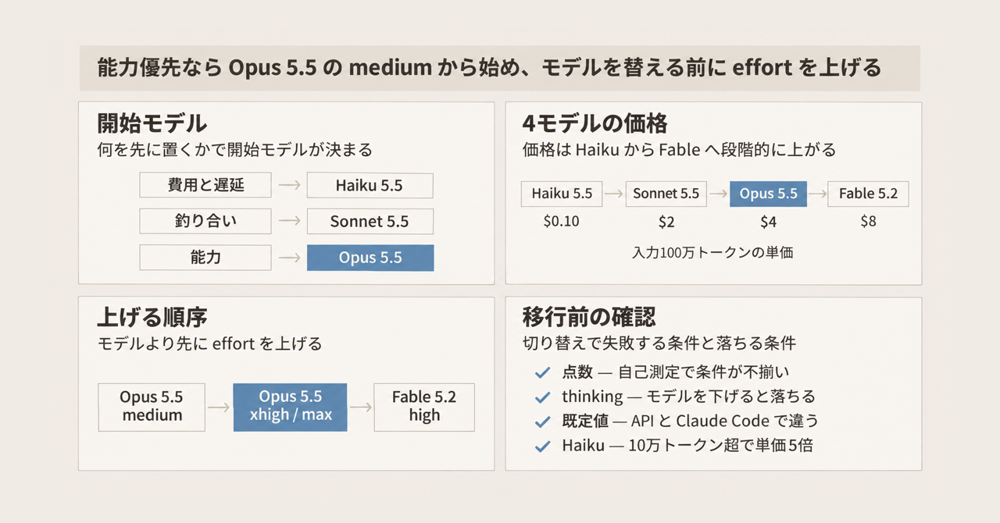
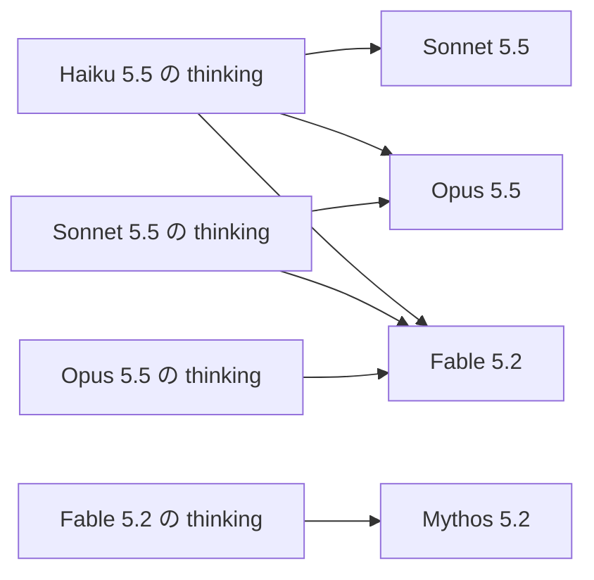
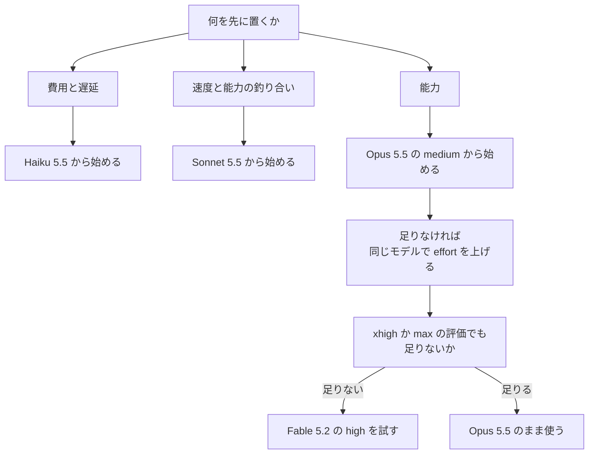

2026年11月9日に Fable 5.2 が公開され、Claude API の一般提供モデルは Haiku 5.5、Sonnet 5.5、Opus 5.5、Fable 5.2 の4つになりました。同じ日に Addy Osmani 氏が、どのモデルから作り始めるかを整理した解説記事 [Which Claude model should you build with?](https://claude.dev/blog/which-claude-model-should-you-build-with/) を公開しています。

この記事では、その解説記事を公式の価格表、ドキュメント、システムカード (Anthropic がモデルごとに公開する評価結果の文書) と突き合わせます。Claude API と Claude Code (Anthropic のコーディングエージェント) で実装する人が、次の3点を判断できるようにします。

- どのモデルと、どの設定から始めるか
- 公開されているベンチマークの点数を、どこまで判断に使ってよいか
- モデルを切り替えたときに、リクエストが失敗する条件と、エラー無しで情報が落ちる条件

価格と制限は、2026年11月10日に公式ページで確認した値です。組織ごとの実際の制限は Console (Claude API の管理画面) に表示されます。本文に出てくる 4.x 系、Opus 5、Sonnet 5、Fable 5.1 は、いずれも現行4モデルより前の世代です。

*この記事の全体像。以下、順に解説します。*

## Claudeの現行4モデルとは

### 4モデルの位置づけ

4モデルは、価格と能力の順に Haiku、Sonnet、Opus、Fable と並びます。

| モデル | モデル ID | 公開日 | 公式の位置づけ |
| --- | --- | --- | --- |
| Haiku 5.5 | `claude-haiku-5-5` | 2026-10-07 | 最低遅延、最低価格 |
| Sonnet 5.5 | `claude-sonnet-5-5` | 2026-09-28 | 日常のコーディングとエージェント |
| Opus 5.5 | `claude-opus-5-5` | 2026-09-22 | 複雑なエージェント的コーディング |
| Fable 5.2 | `claude-fable-5-2` | 2026-11-09 | 最高能力 |

共通の仕様は次のとおりです。

- コンテキスト: 1M tokens
- 同期 Messages API の最大出力: 128K tokens
- 入力: テキストと画像。出力: テキスト
- 知識の基準日 (Reliable knowledge cutoff): 2026年6月
- 状態: 4つとも Active。退役は、それぞれ公開日の1年後より前には行わないと暫定で示されています

同じ日に公開された Mythos 5.2 (`claude-mythos-5-2`) は、仕様と価格が Fable 5.2 と同じで、検証プログラムに加入した組織向けのモデルです。

### 価格

2026年11月10日の[公式価格表](https://platform.claude.com/docs/en/about-claude/pricing)の値です。単位は USD / 100万トークンです。

cache read は、プロンプトキャッシュ (同じ入力の先頭部分を再利用する仕組み) に保存済みの入力を読むときの単価です。cache write は、キャッシュへ保存するときの単価です。5分と1時間は、キャッシュを保持する時間です。

| モデル | 入力 | 出力 | cache read | 5分 cache write | 1時間 cache write |
| --- | --- | --- | --- | --- | --- |
| Haiku 5.5 (prompt が 100,000 tokens まで) | $0.10 | $0.50 | $0.01 | $0.125 | $0.20 |
| Haiku 5.5 (100,000 tokens 超) | $0.50 | $2.50 | $0.05 | $0.625 | $1 |
| Sonnet 5.5 | $2 | $10 | $0.10 | $2.50 | $4 |
| Opus 5.5 | $4 | $20 | $0.20 | $5 | $8 |
| Fable 5.2 | $8 | $40 | $0.20 | $10 | $16 |

- prompt の長さで単価が分かれるのは、4つのうち Haiku 5.5 だけです。
- Message Batches API (非同期でまとめて処理する API) は、入力と出力が 50% 引きです。
- fast mode (出力を速くする有料オプション) の価格表には、Fable 5.2 (入力 $16、出力 $80) と Opus 5.5 (入力 $8、出力 $40) があります。
- キャッシュの対象になる最小の長さは、4モデルとも 512 tokens です。これより短いプロンプトは、キャッシュの指定を付けてもキャッシュされず、エラーにもなりません。

### effort と thinking

モデルの選択と並ぶ、もう1つの調整軸が effort です。

- **effort**: 応答にどれだけの仕事量を使うかを伝えるパラメータ (`output_config.effort`) です。値は `low`、`medium`、`high`、`xhigh`、`max` の5段階です。厳密なトークン予算ではありません。
- **thinking**: モデルが回答の前に行う推論で、応答に thinking ブロックとして含まれます。4モデルとも、必要なときだけ考える adaptive が既定です。thinking のトークンは `max_tokens` (1回の応答で生成するトークン数の上限) に含まれます。

effort は仕事量の信号で、thinking のオンオフとは別の設定です。

effort の既定値は、モデルと、呼び出す面 (API か Claude Code か) で違います。

| モデル | API の既定 effort | Claude Code が送る既定 effort |
| --- | --- | --- |
| Haiku 5.5 | `medium` | `medium` |
| Sonnet 5.5 | `high` | `medium` |
| Opus 5.5 | `medium` | `medium` |
| Fable 5.2 | `high` | `medium` |

既定と同じ値を明示して送ることは、パラメータを省くことと同じ扱いです。

### thinking ブロックの引き継ぎ

複数ターンの会話では、過去の応答に含まれる thinking ブロックを、次のリクエストでそのまま送り返します。会話の途中でモデルを切り替えると、それまでの thinking ブロックは、移動先のモデルが読めるときだけ残ります。

同じモデルで続ける場合は、どのモデルでも残ります。別のモデルへ切り替える場合、Claude API の表では、読める方向は下位モデルから上位モデルだけです。次の図は、別のモデルへ切り替えたときに thinking を読める先を示します。

| thinking を作ったモデル | 読めるモデル |
| --- | --- |
| Haiku 5.5 | Haiku 5.5、Sonnet 5.5、Opus 5.5、Fable 5.2 |
| Sonnet 5.5 | Sonnet 5.5、Opus 5.5、Fable 5.2 |
| Opus 5.5 | Opus 5.5、Fable 5.2 |
| Fable 5.2 | Fable 5.2、Mythos 5.2 |

読めないブロックは、エラーにならずに落とされます。切り替え先のモデルは、それまでの推論を引き継がずに続きを処理することになります。落とされた分は請求されず、`input_tokens` にも入りません。

## 注意点

解説記事と、[Fable 5.2 / Mythos 5.2 の公開記事](https://www.anthropic.com/claude-fable-and-mythos-5-2)は、到達点と点数を多く載せています。どこまで判断に使ってよいかを、測定条件ごとに分けます。

### 公式の開始点は一つではない

解説記事は、公式ドキュメントが Opus を開始点として勧めていると要約しています。この要約は、半分だけ合っています。[Choosing a model](https://platform.claude.com/docs/en/about-claude/models/choosing-a-model) は、開始の仕方を2つ並べています。

| 始め方 | 開始モデル | 対象 |
| --- | --- | --- |
| efficiency-first (効率優先) | Haiku 5.5 から実装し、足りない能力だけ上げる | 試作、厳しいレイテンシ、費用に敏感な実装、大量の単純な処理 |
| capability-first (能力優先) | Opus 5.5 から始め、`xhigh` か `max` の評価でも足りないときだけ Fable 5.2 へ移る | 能力を先に確保したい実装 |

同じページには "Most workloads start with Claude Opus 5.5." という文があります。Opus 5.5 は、多くのワークロードの開始点、かつ能力優先の開始点として書かれています。唯一の開始点としては書かれていません。"Most" が何を母数にしているかも示されていません。

### 点数は自己測定で、分母が違う

次の点数は、いずれも Anthropic が書いた測定です。問題集合、effort、試行数が測定ごとに違うので、別の表の数字を並べて比べることはできません。

| 測定 | 値 | 判断に使うときの条件 |
| --- | --- | --- |
| Terminal-Bench 3.0 | Opus 5.5 の `high` が 58.9%、1つ前の版である Fable 5.1 の `max` が 58.0%。Opus 5.5 側のトークンは半分 | 社内での実行。同じ 70 タスク、1タスク5試行。公開リーダーボードとは一致しないと脚注にあります。出典は [Spending your effort](https://claude.dev/blog/spending-your-effort/) の図です |
| FrontierCode 2.0 | Fable 5.2 の `high` が 45.3%、Opus 5.5 の `max` が 45.5%。Fable 5.2 側のタスク単価はおよそ半分 | 公開記事の早期テスト。問題数はその文にありません。各点は単一の結果で区間が無く、0.2 点差は意味が無い可能性があるとシステムカードが書いています |
| FrontierCode 2.0 の effort 別 | Fable 5.2 は `low` 34.2%、`medium` 37.6%、`high` 45.3%、`xhigh` 49.1%、`max` 45.7% | 山は `max` ではなく `xhigh` です |
| SWE-bench Pro (478問の部分集合) | Opus 5.5 の `high` が 95.3% で1タスク $0.29。`medium` は約 2.5 点低く、費用は `high` の約 70% | 公開リーダーボードとは比べられないとページが書いています。出典は [Optimizing for cost and intelligence](https://platform.claude.com/docs/en/about-claude/models/optimizing-for-cost-and-intelligence) です |
| SWE-bench Pro (システムカード) | Opus 5.5 が 89.9%、Fable 5.2 が 93.0% | 上の 95.3% とは別の問題集合です。同じ分母の上積みとして読めません |
| AutomationBench | Fable 5.2 が 51.4%、Opus 5.5 が 42.5%、Gemini 4 Carbon が 53.9% | Fable が全行で最高とは、この表は書いていません。他社の行には effort が揃っていないものがあります |
| GDPval-AA v2.1 の Elo | Fable 5.2 が 1831、Opus 5.5 が 1866 | 知識作業のこの指標では Opus が上です。システムカードは、取り上げた 16 の評価結果のうち 14 で Fable が最高で、残りの2つ (この Elo を含む知識作業の Elo) では Opus が上だと書いています |
| DeepResearch Bench II | 既定 effort で、Fable 5.2 は Opus 5.5 の 2.9 倍の費用で 1.9 点低い | 採点できた 44 タスクでの値です |
| Terminal-Bench 4.0 | Fable 5.2 が 67.6% (±1.8、10試行、`max`)、Opus 5.5 が 66.4% (±2.6、5試行、`xhigh`) | 差は誤差の範囲です。effort と試行数が揃っていません |

SWE-bench Pro の部分集合では、`low` で失敗した問題だけを `high` でやり直すと、約 97%、1タスク約 $0.17 になるという数字もあります。これは別に走らせた実験ではなく、固定 effort の実行結果からの事後計算です。

解説記事が挙げる事例のうち、フェルマーの最終定理を 30 時間で証明した話は、条件付きです。システムカードによると、採点器が完全な証明を受理したのは、公開版より早いスナップショットを 1,000 体並べ、既存の形式化の上で実行した場合です。1つのモデルがゼロから 30 時間で証明した、という意味ではありません。

### 上位モデルを助言役に足しても伸びにくい

advisor は、作業するモデルが上位モデルに助言を求める構成です。公式の費用ガイド (前の表で出典にした Optimizing for cost and intelligence) が、370 のリポジトリ課題で測った結果は次のとおりです。

| 構成 | 正答率 | 1タスクの費用 |
| --- | --- | --- |
| Opus 5.5 の `high` 単独 | 88.4% | $1.38 |
| Opus 5.5 の `high` + Fable 5.1 の advisor | 90.1% | $2.92 |

+1.7 点は実行ごとのばらつきの端で、費用は約 2.1 倍だとページ自身が書いています。

一方、役割を分ける構成には費用の利点が示されています。公開 Python パッケージの欠陥探索では、Opus が指揮して Sonnet が作業する構成が $139 で F1 0.831 でした。単独構成は $200 から $236 で F1 0.827 から 0.850 でした。この差は「約3分の1安い」と紹介されますが、単独構成を既定 effort で動かした場合との比較です。

### effort を上げても知識は増えない

解説記事は、高い effort はモデルが持っていない知識や技能を与えないと書いています。この文は解説記事が付けた但し書きで、公式の [Effort](https://platform.claude.com/docs/en/build-with-claude/effort) ページに同じ文はありません。ただし、公式の記述と矛盾もしません。

公式が書いているのは次の内容です。

- effort は応答に使うトークン量を制御する
- `low` はトークンを大きく減らし、能力もいくらか下がる
- `max` はトークン支出の制約が無い最大能力である
- Fable 5.2 では、能力の上積みの大部分は `high` にすでにあり、それより上は不均一でタスクによる
- `max` は、天井を測るときと、時間とトークンを問わない稀なタスクに残す

知識の基準日はモデルの属性で、effort でこの日付が動くとは書かれていません。

### effort を変えるとキャッシュが切れる

公式のキャッシュ無効化の表にあるのは、effort を変えると、会話履歴 (`messages`) の部分のキャッシュが無効になることです。会話の途中で effort を上げると、その回は履歴のキャッシュを使えず、作り直すことになります。モデル既定と同じ effort を明示しても、無効にはなりません。

モデルを変えるとキャッシュが分かれるかどうかは、同じ表に行がありません。モデル ID がキャッシュのキーに含まれるかは、公式ドキュメントでは確認できません。

### 長い Haiku は短い Haiku の単価ではない

Haiku 5.5 は、prompt が 100,000 tokens を超えると、入力、出力、cache write、cache read のすべてが 5 倍になります。

- prompt の長さは入力トークン全体で数えます。cache read と cache write も含みます。
- 一部がキャッシュに当たっても、閾値を超えたリクエストは高い方の単価です。
- ちょうど 100,000 tokens は安い方です。

[Haiku 5.5 の移行ガイド](https://platform.claude.com/docs/en/models/haiku-5-5/migration-guide)は、同じ文章が Haiku 4.5 よりおよそ 30% 多いトークンになると書いています。100,000 tokens を超えても、単価は Sonnet 5.5 の $2 / $10 より低いままです。問題になるのは、短い Haiku の単価のまま長文も見積もることです。

## どのモデルから始めるか

条件ごとの開始モデルと、effort の置き方です。

| 条件 | 開始モデル | effort の置き方 |
| --- | --- | --- |
| コーディングと知識作業の多く。能力を先に置く | Opus 5.5 | API も Claude Code も既定は `medium`。足りなければ同じモデルで上げる |
| 試作、遅延、費用、大量の単純な処理を先に置く | Haiku 5.5 | 既定は `medium`。prompt が 100,000 tokens を超える前に単価を見る |
| 日常のコーディングで、速度と能力の釣り合いが要る | Sonnet 5.5 | API の既定は `high`。仕様が明確なエージェント作業は `medium`、チャットや遅延に敏感な作業は `medium` か `low` が目安 |
| Opus 5.5 を `xhigh` か `max` まで上げた評価が、まだ足りない | Fable 5.2 | API の既定は `high`。`high` より上の利得はタスクによる |
| Microsoft Foundry 上の Claude Code を既定のまま使う | 旧世代の Sonnet 4.5 になる (推奨ではなく、既定の挙動) | 既定は Opus 5.5 ではない (後述) |
| ゼロデータ保持を維持したまま上位モデルが要る | Opus 5.5 まで | Fable 5.2 は 30 日のデータ保持が必要 (後述) |

進め方は次の順です。

モデルを替える前に effort を上げる理由は2つあります。

- Fable に上げたあとで Opus 以下に戻すと、Fable の thinking がエラー無しで落ちます。上げる判断は、気軽に行き来できるものではありません。
- リスト価格で Opus は Fable の半分です。

Fable 5.2 を使う場合も、`max` を既定にする理由はありません。FrontierCode 2.0 では、`max` は `xhigh` より低い結果でした。

自分の課題での確認も必要です。478 問の部分集合で出た「`medium` は `high` より約 2.5 点低い」という差は、その問題集合の値です。自分の課題で Opus 5.5 の `medium` と `high` を少数回比べて決めます。

## 価格とレート制限はどう見積もるか

### 割引と割増

- Batch の入力 / 出力は、Haiku が 100,000 tokens まで $0.05 / $0.25、超えると $0.25 / $1.25 です。Sonnet は $1 / $5、Opus は $2 / $10、Fable は $4 / $20 です。
- fast mode は Batch では使えません。
- 推論を米国内に限定する指定 (`inference_geo: "us"`) は、入力、出力、cache write、cache read に 1.1 倍が掛かります。Haiku の高い方の単価にも掛かります。

### 公開されているレート制限

[Rate limits](https://platform.claude.com/docs/en/api/rate-limits) の公開表は、利用ティア (支払い実績に応じた利用段階) ごとの上限です。RPM は1分あたりのリクエスト数、ITPM は1分あたりの入力トークン数、OTPM は1分あたりの出力トークン数です。

| ティア | Fable 5.2 (RPM / ITPM / OTPM) | Opus 5.5、Sonnet 5.5、Haiku 5.5 (それぞれ) |
| --- | --- | --- |
| Start | 4,000 / 500,000 / 100,000 | 4,000 / 2,000,000 / 400,000 |
| Build | 10,000 / 1,500,000 / 300,000 | 10,000 / 5,000,000 / 1,000,000 |
| Scale | 13,000 / 4,000,000 / 800,000 | 13,000 / 10,000,000 / 2,000,000 |

数え方には次の特徴があります。

- ITPM は、キャッシュされていない入力だけを数えます。cache read は入りません。
- OTPM は、実際に生成されたトークンで数えます。`max_tokens` の指定値は計算に入りません。
- 短時間に集中したリクエストは、分平均の内側でも 429 になることがあります。
- Fable 5.2 のトークン上限は、他の3モデルより小さい枠です。Start では4分の1、Scale でも4割です。
- Scale より上のティアと fast mode の数値は、公開表にありません。Console の Rate limits で確認します。

### 429 の扱い

429 (`rate_limit_error`) は、レート制限のほか、月次の利用上限でも起きます。

| 原因 | `retry-after` ヘッダ | 対応 |
| --- | --- | --- |
| レート制限 | あり | 示された秒数を待ってから再試行する |
| 月次の利用上限 (spend cap) | なし | アクセスが再開するまで、再試行しても失敗する |

公式 SDK は、接続エラー、レート制限、5xx を既定で2回、指数バックオフで再試行します。

## APIとClaude Codeでモデルの解決先はどう違うか

Claude Code では、`opus` や `sonnet` のような alias (短い別名) でモデルを指定できます。alias が実際にどのモデルを指すかは、接続先のクラウドで違います。表の「アカウントの既定」は、モデルを指定しないときに使われるモデルです。出典は [Claude Code model configuration](https://code.claude.com/docs/en/model-config) です。

| 接続先 | `opus` | `sonnet` | `haiku` | アカウントの既定 |
| --- | --- | --- | --- | --- |
| Anthropic API | Opus 5.5 | Sonnet 5.5 | Haiku 5.5 | Opus 5.5 |
| Claude Platform on AWS | Opus 5.5 | Sonnet 4.6 | Haiku 4.5 | Opus 5.5 |
| Amazon Bedrock、Google Cloud's Agent Platform | Opus 5.5 | Sonnet 4.5 | Haiku 4.5 | Opus 5.5 |
| Microsoft Foundry | Opus 4.6 | Sonnet 4.5 | Haiku 4.5 | Sonnet 4.5 |

この表から、次のことが分かります。

- Microsoft Foundry では、アカウントの既定が Sonnet 4.5 です。`opus` と書いても Opus 4.6 になります。
- `haiku` が Haiku 5.5 になるのは Anthropic API だけです。
- Fable は、どの契約プランでもアカウントの既定ではありません。`fable` の alias は Claude Code v2.1.321 以降で使えます。

alias の解決先は、環境変数 `ANTHROPIC_DEFAULT_OPUS_MODEL`、`ANTHROPIC_DEFAULT_SONNET_MODEL`、`ANTHROPIC_DEFAULT_HAIKU_MODEL`、`ANTHROPIC_DEFAULT_FABLE_MODEL` で固定できます。

### サブエージェントのモデル

サブエージェント (メインの会話から切り出して動く作業用エージェント) のモデルは、次の優先順で決まります。

1. 呼び出しごとの `model` 指定
2. エージェント定義ファイルの先頭に書く設定 (frontmatter)
3. 環境変数 `CLAUDE_CODE_SUBAGENT_MODEL`
4. メイン会話のモデル

組み込みの Explore (コードベースを探索するサブエージェント) は、通常はセッションのモデルで動きます。常に Haiku で動くわけではありません。探索を安いモデルに任せたいときは、`Explore` という名前の自前定義で組み込みを上書きし、`model: haiku` を指定します。

### Claude Code の effort

Claude Code は、4モデルのどれにも既定で `medium` を送ります。API の既定が `high` の Sonnet 5.5 と Fable 5.2 は、Claude Code では一段低い effort で動くことになります。

effort は次の順で、先に当たったものが使われます。

1. 環境変数 `CLAUDE_CODE_EFFORT_LEVEL`
2. セッション中の `/effort` または `/model`
3. 起動時の `--effort`
4. 保存した設定
5. Claude Code 自身の既定 (`medium`)

## リクエストが失敗する条件と、思考が落ちる条件は何か

旧モデルから移行するときに、400 エラーになる指定がいくつかあります。

### thinking の指定

| モデル | `thinking` を無効にする指定 (`disabled`) |
| --- | --- |
| Opus 5.5、Fable 5.2 | 400。どの effort でも不可 |
| Sonnet 5.5 | 400。代わりに `between_tools` を使う。ただし `xhigh` と `max` では `between_tools` も 400 |
| Haiku 5.5 | `high` 以下なら可。`xhigh` と `max` は 400 |

`between_tools` は Sonnet 5.5 専用の指定です。事前の thinking を行わず、ツール呼び出しの間の短い更新だけを thinking ブロックとして返します。

### tool_choice と computer use

- `tool_choice` (モデルにツールの使用を強制する指定) の `any` と、名前を指定する `tool` は、Sonnet 5.5、Opus 5.5、Fable 5.2 で 400 になります。`auto` と `none` は使えます。出力の形を固定したいときは、`auto` に `strict: true` (ツール入力をスキーマどおりに保証する指定) を組み合わせるか、JSON 出力を使います。
- Haiku 5.5 がこの指定を拒むかどうかは、公式ドキュメントの対象一覧に記載がありません。
- computer use (画面操作ツール) は、4モデルとも `computer_toolset_20260801` を使います。Claude API で旧版の `computer_20251124` を送ると 400 になります。

### 安全分類で別モデルに移る

4モデルのうち Fable 5.2、Opus 5.5、Sonnet 5.5 は、安全分類器 (危険な用途の要求を検出する仕組み) を載せています。分類器が拒むと、API は HTTP 200 のまま `stop_reason: "refusal"` を返します。

Claude Code は、このとき自動で別のモデルに切り替えます。

| 選んだモデル | サイバーセキュリティの場合 | 生物学の場合 |
| --- | --- | --- |
| Fable、Opus 5.5 | Opus 4.8 で再実行 | Opus 5 で再実行 |
| Sonnet 5.5 | Sonnet 5 で再実行 | 切り替え先が無く、拒否で終わる |

切り替わったあと、セッションは切り替え先のモデルのまま続きます。元に戻すには `/model` の操作が必要です。セキュリティや生物学に触れるリポジトリでは、選んだモデルが最後まで答えているとは限りません。

API にも同じ仕組み (`fallbacks: "default"`、beta) があります。Fable 5.2 の切り替え先として許可されているのは Opus 4.8 と Opus 5 の2つです。Haiku 5.5 にはサーバー側の切り替えがありません。

### thinking ブロックが 400 になる場合と、落ちる場合

thinking ブロックは、それより前の入力と結び付いています。Fable 5.2 では、thinking ブロックより前の `system`、`tools`、過去の `messages` を書き換えると 400 になります。メッセージは `The block is bound to a different conversation` を含みます。

- `effort`、`max_tokens`、`tool_choice`、`cache_control` の変更は、この確認の対象外です。
- Opus 5.5、Sonnet 5.5、Haiku 5.5 で同じ 400 になるのは、2026年8月31日以降に作成したアカウントです。
- beta ヘッダ `thinking-binding-controls-2026-08-01` を付け、`thinking.block_binding.prefix_mismatch_behavior` に `"drop_block"` を指定すると、失敗したブロックを落として続行する動作に変えられます。

モデルを下げたときは、400 にならず、ブロックが静かに落ちます。

| 操作 | thinking ブロック |
| --- | --- |
| Fable から Opus、Sonnet、Haiku へ下げる | Fable のブロックが落ちる |
| Opus から Sonnet、Haiku へ下げる | Opus のブロックが落ちる |
| Sonnet から Haiku へ下げる | Sonnet のブロックが落ちる |
| Haiku、Sonnet、Opus から Fable へ上げる | 残る |
| 安全分類で旧モデルへ切り替わる | 切り替え先が読めないブロックが落ちる |

落としたことは、既定では応答に出ません。確認するには beta ヘッダが必要です ([Preserved thinking](https://platform.claude.com/docs/en/build-with-claude/preserved-thinking) を参照)。

### データ保持と稼働率

- Fable 5.2 は、30 日のデータ保持が必要なモデルです。ZDR (ゼロデータ保持。入出力を保存しない契約) では、Anthropic の明示的な承認が無い限り使えません。Opus 5.5、Sonnet 5.5、Haiku 5.5 は、この制約の対象として書かれていません。
- [Service tiers](https://platform.claude.com/docs/en/api/service-tiers) の Priority Tier (稼働率の目標が示されているサービス枠) は 99.5% の稼働を目標にしています。ただし対象モデルの一覧は、現行4モデルを除外しています。この 99.5% は4モデルには当てはまりません。

## Opus 5.5のmediumから始める判断は、どこまで支持されるか

ここまでの内容から、能力を先に置く実装は Opus 5.5 の `medium` から始める、という判断が導けます。この判断を支える根拠と、適用範囲を狭める条件を分けて示します。

支える根拠:

- 公式の "Most workloads start with Claude Opus 5.5." と、能力優先の開始点の記述
- 主要な接続先で、Claude Code のアカウント既定が Opus 5.5、effort 既定が `medium` であること
- Opus 5.5 の API 既定 effort も `medium` であること
- 478 問の部分集合で、`medium` が `high` より約 2.5 点低く、費用が約 70% であること
- リスト価格で Opus が Fable の半分であること

適用範囲を狭める条件:

- 同じ公式ページが、Haiku からの開始と、日常作業向けの Sonnet を残している
- Microsoft Foundry の既定は Sonnet 4.5 である
- Claude Code では、サイバーセキュリティと生物学の分類で、選んだモデルが旧モデルに切り替わる
- 知識作業の Elo と DeepResearch Bench II では、Fable が Opus より低い
- ZDR を維持する組織は、Fable 5.2 をそのまま使えない
- 上位モデルを助言役に足す構成は、測定では費用に見合う上積みが出にくい

判断が変わるのは、次の場合です。

| 状況 | 選ぶモデル |
| --- | --- |
| Opus の `max` が自分の評価で足りず、失敗の原因が推論の量にある | Fable 5.2 |
| 接続先が Foundry で、alias を固定していない | 既定は Sonnet 4.5 になる |
| データ保持の要件が ZDR | Fable 5.2 を候補から外す |

失敗の原因が知識の基準日やツールの権限にあるときは、Fable に上げても解決しません。

## まとめ

- 能力を先に置くなら、Opus 5.5 の `medium` から始めます。足りなければ、モデルを替える前に effort を上げます。`xhigh` か `max` でも足りないときだけ、Fable 5.2 の `high` を試します。
- 費用と遅延を先に置くなら Haiku 5.5、日常の釣り合いなら Sonnet 5.5 から始めます。Haiku は prompt が 100,000 tokens を超えると単価が 5 倍になります。
- 公開されている点数は自己測定で、問題集合と effort が測定ごとに違います。自分の課題で少数回比べて決めます。
- effort の既定は、API と Claude Code で違います。alias の解決先は、接続先のクラウドで違います。
- モデルを途中で下げると、thinking がエラー無しで落ちます。effort を変えると、メッセージ側のキャッシュが切れます。
- 移行前に、`tool_choice` の `any` と名前指定、`thinking` の `disabled`、旧版の computer use を送っていないか確認します。

この記事が少しでも参考になった、あるいは改善点などがあれば、ぜひリアクションやコメント、SNSでのシェアをいただけると励みになります！

## 参考リンク

- [Which Claude model should you build with?](https://claude.dev/blog/which-claude-model-should-you-build-with/)
- [Spending your effort](https://claude.dev/blog/spending-your-effort/)
- [Claude Fable 5.2 / Mythos 5.2 公開記事](https://www.anthropic.com/claude-fable-and-mythos-5-2)
- [Claude Opus 5.5 公開記事](https://www.anthropic.com/claude-opus-5-5)
- [Claude Opus 5.5 システムカード](https://www.anthropic.com/document/claude-opus-5-5-system-card)
- [Claude Fable 5.2 / Mythos 5.2 システムカード](https://www.anthropic.com/document/claude-fable-5-2-mythos-5-2-system-card)
- [Choosing a model](https://platform.claude.com/docs/en/about-claude/models/choosing-a-model)
- [Optimizing for cost and intelligence](https://platform.claude.com/docs/en/about-claude/models/optimizing-for-cost-and-intelligence)
- [Pricing](https://platform.claude.com/docs/en/about-claude/pricing)
- [Model deprecations](https://platform.claude.com/docs/en/about-claude/model-deprecations)
- [Models overview](https://platform.claude.com/docs/en/models/overview)
- [Effort](https://platform.claude.com/docs/en/build-with-claude/effort)
- [Preserved thinking](https://platform.claude.com/docs/en/build-with-claude/preserved-thinking)
- [Prompt caching](https://platform.claude.com/docs/en/build-with-claude/prompt-caching)
- [Refusals and fallback](https://platform.claude.com/docs/en/build-with-claude/refusals-and-fallback)
- [Fast mode](https://platform.claude.com/docs/en/build-with-claude/fast-mode)
- [Rate limits](https://platform.claude.com/docs/en/api/rate-limits)
- [Errors](https://platform.claude.com/docs/en/api/errors)
- [Service tiers](https://platform.claude.com/docs/en/api/service-tiers)
- [API and data retention](https://platform.claude.com/docs/en/manage-claude/api-and-data-retention)
- [Haiku 5.5 migration guide](https://platform.claude.com/docs/en/models/haiku-5-5/migration-guide)
- [Fable 5.2 migration guide](https://platform.claude.com/docs/en/models/fable-5-2/migration-guide)
- [Claude Code model configuration](https://code.claude.com/docs/en/model-config)
- [Claude Code sub-agents](https://code.claude.com/docs/en/sub-agents)
