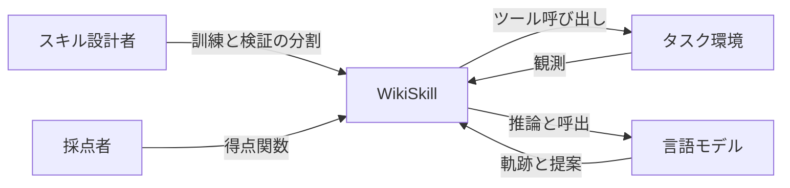
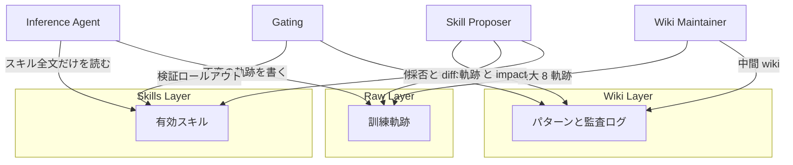
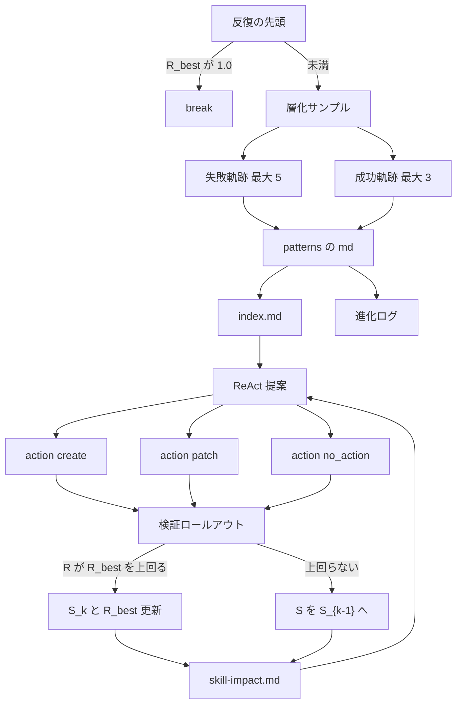
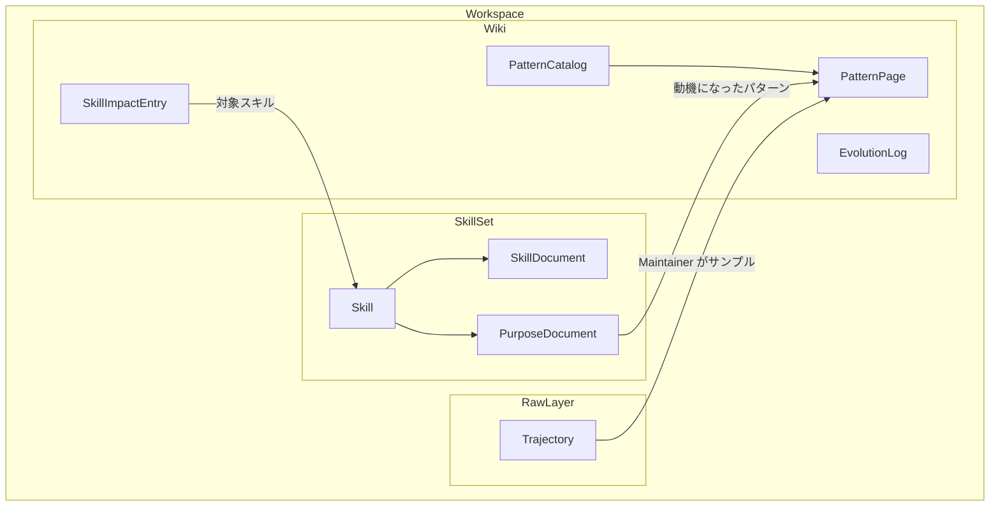
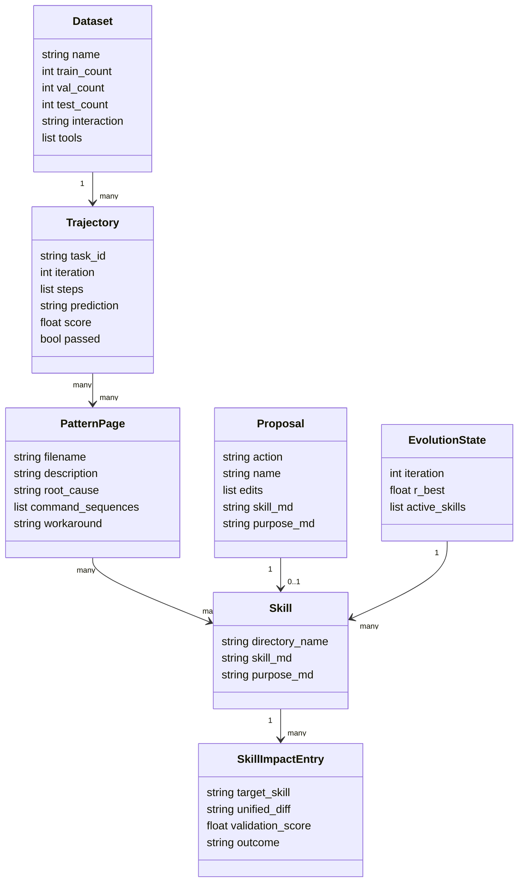

WikiSkill は、エージェントの実行経験を永続的な知識ベース（wiki）にまとめ、その知識を使って手続きスキルを進化させる Google Research と Virginia Tech の論文（arXiv:2608.27454v1、Tang et al.、2026-08-27 提出、CC BY 4.0）です。この記事では、三層ワークスペースと 4 要素のループ、データの持ち方、実験結果、実装時に迷いやすい点を整理します。数値は論文 HTML を基にしています。

論文には公式コードリポジトリへの案内がありません。後半で示すコマンドは、論文の Algorithm 1 と Appendix E を独立に実装したコミュニティ実装の例です。


*この記事の全体像。以下、順に解説します。*

## WikiSkill とは

スキルは、モデルのパラメータを更新せず、ディレクトリに手順・スクリプト・資源をまとめた再利用単位です。既存のスキル進化手法は、「何を学んだか」が最適化履歴の中に散らばったままになります。WikiSkill は、生の軌跡、蓄積した知識、実行可能なスキルを三層に分け、知識層だけを反復をまたいで残します。

### 状態と記号

状態は反復 k の組 (S_k, W_k) です。S_k は有効なスキル集合、W_k は wiki で、初期値は (S_0, W_0) = (空集合, 空集合) です。

- データ集合 D は訓練・検証・テストに分割する
- エージェント π はツール集合 U とスキル集合 S を持ち、タスク x_i に対して軌跡 τ_i を出す
- 最終行動が予測 ŷ_i を出し、ドメインごとの得点関数 f(ŷ_i, y_i) は [0, 1] を返す
- 分割の成績 R は、その分割に含まれる全タスクの平均点

### 1 反復の 4 要素

| 要素 | 役割 |
|---|---|
| Inference Agent | 現在のスキルだけで訓練タスクを実行し、生の軌跡を残す |
| Wiki Maintainer | サンプルした軌跡を wiki のパターンへ統合する |
| Skill Proposer | wiki と軌跡を読み、スキル 1 件の作成または差分編集を提案する |
| Gating and Rollback | 検証点がこれまでの最良 R_best を上回ったときだけ採用し、それ以外はスキルだけを直前の採用状態へ戻す |

wiki は不採用でも巻き戻しません。検証点が 1.0 に達すると、その時点で進化ループを早期終了します。

### 評価の設定

- ベンチマークは 5 種類です。数学の LiveMathematicianBench、ウェブ検索の SealQA（2026 年 7 月版）、表計算の SpreadsheetBench、長文の OfficeQA、対話型家庭作業の ALFWorld
- モデルは Qwen-3.5-4B-Instruct、Qwen-3.5-9B-Instruct、Qwen-3.6-27B、Gemma-4-31B-It、Gemini-3.5-Flash。オープンウェイトは vLLM で動かす
- 比較対象はスキルなし、Trace2Skill、EvoSkill、SkillOpt。汎用プロンプト最適化の GEPA は直接比較に入れていない。論文は、専用のスキル進化が汎用プロンプト最適化を上回るという先行結果（Yang et al., 2026）に従っている
- 各手法の進化プロセス全体を独立に 3 回走らせ、3 つのスキル集合のテスト成績を平均する。有意差はペア・ブートストラップ 1,000 回、有意水準 p < 0.05

### 主結果

WikiSkill の 5 ベンチマーク平均は、Qwen-3.5-4B で 38.5、9B で 47.4、Qwen-3.6-27B で 63.3、Gemma-4-31B で 54.9、Gemini-3.5-Flash で 68.1 です。スキルなしの平均は順に 26.2、29.9、39.4、41.3、49.5 です。Qwen 系列の平均の上積みは 4B で +12.3、9B で +17.5、27B で +23.9 ポイントです。Qwen-3.5-9B に WikiSkill を付けた平均 47.4 は、スキルなしの Qwen-3.6-27B の 39.4 を上回ります。

系譜は Karpathy（2026）の LLM Wiki です。経験を複利の知識へコンパイルするという見方を、スキルの外側に独立した wiki 層として実装しています。

## 特徴

- 生軌跡、wiki、スキルを別ディレクトリに置く。スキルの巻き戻しが知識の削除にならない
- 訓練ロールアウト中の Inference Agent は wiki を読まない。既定はスキル全文をシステムプロンプトへ注入する
- Wiki Maintainer は失敗の根因と成功手順をパターンページへ書き、index を全置換し、進化ログへ追記する
- Skill Proposer は ReAct でファイルを自分で読み、1 反復につきスキル 1 件の原子的提案だけを出す
- 採用条件は検証スコアが R_best を厳密に上回ること。同点は不採用になる
- 不採用時も skill-impact に提案メタデータ、対象スキル名、unified diff、検証点、採否を残す
- 最適化用 LLM 呼び出しは、実験設定のフルバッチでは訓練件数 N_train に対して定数になる。1 反復あたり 1 + T_ReAct 回で、実測の ReAct ターン数は 10 以上 20 以下
- 進化したスキルはモデル族をまたいで移せる。発見したモデルと実行するモデルは別能力として分かれる
- パターン数に反復ごとの上限はない。Maintainer が軌跡と現在の wiki から更新要否を決める

### スキル進化手法の違い

| 手法 | 説明 |
|---|---|
| WikiSkill | 三層を分離する。wiki は残し、スキルだけを R_val > R_best で採用する。実験はフルバッチで、最適化呼び出しは 1 + T_ReAct |
| Trace2Skill | 成功分析と失敗分析を並列に走らせ、階層マージでパッチを 1 つにまとめる。各軌跡 1 回の分析、サイズ B のパッチ写像、c 分木の縮小と最終整形 1 回の 3 段。分析段が N_train 回あるため、B を変えても下限は N_train のまま |
| EvoSkill | 失敗軌跡と過去提案の平坦な履歴を提案器へ渡す。検証後に上位プログラムのフロンティアへ入れる。呼び出しは 2 N_train / B |
| SkillOpt | ReflACT の 6 段（Rollout, Reflect, Aggregate, Select, Update, Evaluate）で単一のスキル文書を更新する。1 ステップあたり K_opt 回で、論文は K_opt をおおよそ 6 から 8 とする |
| スキルなし | S を空のままテストする。進化ループのベースライン検証の起点でもある |
| GEPA | 汎用の自動プロンプト最適化。WikiSkill の実験表には入っていない |
| Karpathy LLM Wiki | 経験を複利の知識へコンパイルするという 2026 年の見方。WikiSkill はこれを独立した wiki 層として実装している |

### モデル別の平均

5 ベンチマーク、3 ラン平均で、値の単位は % です。手法間の差は「ポイント」で表します。

| モデル | スキルなし | Trace2Skill | EvoSkill | SkillOpt | WikiSkill |
|---|---|---|---|---|---|
| Qwen-3.5-4B | 26.2 | 32.1 | 33.7 | 35.2 | 38.5 |
| Qwen-3.5-9B | 29.9 | 36.7 | 42.3 | 40.2 | 47.4 |
| Qwen-3.6-27B | 39.4 | 47.3 | 53.3 | 50.7 | 63.3 |
| Gemma-4-31B | 41.3 | 45.8 | 43.4 | 49.1 | 54.9 |
| Gemini-3.5-Flash | 49.5 | 55.6 | 56.1 | 55.9 | 68.1 |

WikiSkill 平均と最強の競合手法との差は、4B で +3.3、9B で +5.1、27B で +10.0、Gemma-4-31B で +5.8、Gemini-3.5-Flash で +12.0 ポイントです。単一ベンチマークの大きい移動の例は、Gemini-3.5-Flash の LiveMath が 33.0 から 72.6、同モデルの SpreadSheet が 50.5 から 76.6、Qwen-3.6-27B の ALFWorld が 52.8 から 77.6 です。

### 向く作業

| 作業 | 理由 |
|---|---|
| 手続きが繰り返し失敗する作業 | 失敗軌跡を最大 5 件、成功軌跡を最大 3 件サンプルし、パターンへ根因を残せる |
| 採点関数がある作業 | f が [0, 1] を返し、検証分割で R を比較できることがゲートの前提になる |
| モデルをまたぐ手順の再利用 | LiveMath のように一般的な手順は転移しやすい。Qwen-3.5-4B 由来スキルが Gemini-3.5-Flash の LiveMath を 33.0 から 67.5 へ上げる |
| 長文の多段検索 | 大きいモデルは OfficeQA で検索手順を実行できる。Qwen-3.6-27B は +11.6、Gemini-3.5-Flash は +12.1 ポイント |

## 構造

論文の Figure 2 は、Raw Layer、Wiki Layer、Skills Layer と、スキルだけを注入する Inference Agent、wiki を更新する Maintainer、ReAct の Proposer を 1 枚にまとめています。


*論文 Figure 2（CC BY 4.0）*

### システムコンテキスト図

コンテキストは役割名で描きます。特定の製品名は次のコンポーネント図で扱います。



| 要素 | 説明 |
|---|---|
| スキル設計者 | 空のスキル集合から進化を始め、データ分割と反復を渡す人または外側ハーネス |
| 採点者 | 予測と正解から [0, 1] の得点を返すドメインごとの関数 f |
| WikiSkill | 三層ワークスペースと 4 要素のループを持つ提案フレームワーク |
| タスク環境 | シェル、検索、ファイル読取、シミュレータの行動空間など、ツール U の実行先 |
| 言語モデル | Inference、Maintainer、Proposer が呼ぶ LLM。実験ではオープンウェイトとクローズドの両方 |

### コンテナ図



| 要素 | 説明 |
|---|---|
| Raw Layer | 反復ごとの訓練軌跡。推論、ツール呼び出し、出力、最終回答を含み、追記後は不変 |
| Wiki Layer | パターン目録、進化ログ、skill-impact。反復の間でリセットしない |
| Skills Layer | Inference Agent が読める手続き。各スキルは SKILL.md と PURPOSE.md |
| Inference Agent | 反復 k で S_{k-1} をシステムプロンプトへ全文注入し、訓練集合を実行する |
| Wiki Maintainer | サンプル軌跡と現行 wiki からパターンを増補し、index とログを更新する |
| Skill Proposer | wiki の索引と skill-impact、訓練の合否要約から開始し、read_file で中身を読む |
| Gating | 候補 S'_k を検証集合で採点し、R > R_best なら採用、それ以外はスキルのみ戻す |

### コンポーネント図

ALFWorld の事例（Qwen-3.6-27B、Figure 3）では、反復 0 でパターン `take-examine-move-loop.md` ができ、提案 `goal-directed-action` は検証を改善せず不採用になります。反復 1 で `break-repetition-loop` が「Never Return an Item to Its Origin Location」として採用されます。その後 `multi-operation-loop.md` が溜まり、反復 4 で「Each Operation Type ONCE Per Item」が追記されます。


*論文 Figure 3（CC BY 4.0）*



| 要素 | 説明 |
|---|---|
| 反復の先頭 | R_best が 1.0 なら訓練ロールアウト、Maintainer、Proposer を走らせず break する。Gemini-3.5-Flash の ALFWorld は検証 100% でこの枝に入り、テストは 85.9 のまま |
| 層化サンプル | 1 反復あたり最大 8 軌跡。各ログはプロンプト投入前に 15,000 文字で切る |
| patterns の md | 失敗モードまたは成功戦略と、回避策。パッチは append、replace、insert_after |
| index.md | パターン 1 行の目録。更新があるたびに Maintainer が全文を書き出す |
| 進化ログ | Maintainer の append_log。反復の発見の要約 |
| skill-impact.md | 外側ハーネスが検証後にプログラムで追記する。不採用提案の diff も残る |
| ReAct 提案 | ツールは read_file と finish。プロンプトは変更前に実行軌跡を 4 件以上読むよう求める |
| action create | 新規ディレクトリ。skill_md と purpose_md を全文で返す |
| action patch | 既存スキルへの edits 配列。大部分を変えるなら create にするようプロンプトが指示する |
| action no_action | 変更不要。Algorithm 1 は行動の種類にかかわらず候補を検証する。差分が空なら点数は通常 R_best を上回らず、採否は不採用になり、skill-impact へ記録する |
| 検証ロールアウト | 候補スキルで D_val を実行し R を計算する。R_best の初期値は空スキルの検証点 |

## データ

### 概念モデル

エンティティ名は論文の層とファイルに合わせます。所有は入れ子、参照は矢印です。



| 要素 | 説明 |
|---|---|
| Workspace | raw/、wiki/、skills/ を持つ 1 回の進化作業領域 |
| Trajectory | 観測と行動の列。末尾の行動が予測を出す。訓練軌跡は不変 |
| PatternCatalog | index.md。パターン名と、問題・根因・対処を 1 から 2 文で書く |
| PatternPage | wiki/patterns/ の 1 ファイル。プロンプトは 10 から 30 行を目安にする |
| EvolutionLog | 時系列の発見要約。本文 §3.1 のファイル名は logs.md、Appendix E.2 のプロンプト例は wiki/log.md |
| SkillImpactEntry | 提案、unified diff、検証点、採否。Proposer が次反復で失敗の繰り返しを避けるために読む |
| Skill | ディレクトリ 1 つ。実験の注入単位 |
| SkillDocument | SKILL.md。frontmatter の name と description、適用条件、手順 |
| PurposeDocument | PURPOSE.md。Origin、Patterns Addressed、Evolution History |

### 情報モデル

属性は論文と Appendix E に現れるものに限ります。型名は概念名です。



| 要素 | 説明 |
|---|---|
| Dataset | 分割件数、単段か多段か、環境ツール（論文 Table 6） |
| Trajectory | 合否、予測、正解比較前のログ本文。15,000 文字で切って Maintainer へ渡す |
| PatternPage | 何が起きるか、なぜ起きるか、正しいまたは誤ったコマンド列、回避策 |
| Skill | create 時は skill_md と purpose_md が必須。name はプロンプト上 snake_case |
| Proposal | action は create、patch、no_action。patch の op は append、replace、insert_after。replace の target は現行本文の完全一致部分文字列 |
| SkillImpactEntry | 採否にかかわらず検証のたびに追記する。wiki 巻き戻しの対象外。フィールド名は論文の散文（提案メタデータ、対象スキル、unified diff、検証点、採否）を整理したもので、公開された JSON スキーマではない。Algorithm 1 の採否は Accepted と Rejected |
| EvolutionState | R_best と有効スキル。R_best が 1.0 なら次反復の推論へ進まず break する |

### ベンチマークの分割

論文 Table 6 の分割です。先行研究（Yang et al., 2026; Alzubi et al., 2026）と分割・ツールを揃えています。

| ベンチマーク | 相互作用 | 訓練 | 検証 | テスト | ツール |
|---|---|---|---|---|---|
| LiveMath | 単段 | 35 | 18 | 124 | なし。直接推論 |
| SealQA | 多段 | 16 | 10 | 85 | web_search、read_file。検索は Google Search API |
| SpreadSheet | 多段 | 80 | 40 | 280 | bash。Python 実行と表変換 |
| OfficeQA | 多段 | 50 | 24 | 172 | glob、grep、read。プロンプトに解析済みの参照ページを置く |
| ALFWorld | 多段 | 39 | 18 | 134 | シミュレータの admissible actions |

### 進化で増えるスキルと wiki の規模

論文 Table 4 の全データセット平均です。スキルは提案数 / 採用数、長さは Markdown 行です。wiki の作成と編集はすべて保持されます。

| モデル | スキル作成 | スキル編集 | スキル行数 | パターン作成 | パターン編集 | パターン行数 |
|---|---|---|---|---|---|---|
| Qwen-3.5-4B | 3.1 / 1.6 | 4.9 / 1.3 | 126.2 | 8.8 | 18.4 | 48.2 |
| Qwen-3.5-9B | 4.6 / 1.4 | 3.4 / 0.7 | 128.6 | 7.3 | 10.9 | 26.6 |
| Qwen-3.6-27B | 4.4 / 1.5 | 3.6 / 0.8 | 118.9 | 6.5 | 17.9 | 47.7 |
| Gemma-4-31B | 4.8 / 1.3 | 3.2 / 0.8 | 45.1 | 6.3 | 13.7 | 23.7 |
| Gemini-3.5-Flash | 2.3 / 1.2 | 5.7 / 1.1 | 81.2 | 8.9 | 7.0 | 18.1 |

## 構築方法

### 論文が固定している作業領域

外側ハーネスは次の三層を用意します。推論エージェントへは skills だけを見せ、wiki と raw は Maintainer と Proposer に開きます。

```text
workspace/
  raw/
    traces/             # 軌跡の実体。不変。read_file の traces/ はこの配下への別名
  wiki/
    index.md            # パターン目録。Maintainer が全文更新
    patterns/*.md       # 1 パターン 1 ファイル
    skill-impact.md     # ハーネスが検証後に追記
    logs.md             # §3.1 の進化ログ。Appendix E.2 の例は log.md
  skills/
    <skill-name>/
      SKILL.md
      PURPOSE.md
```

- `traces/` は別ディレクトリではなく、`raw/traces/` を指す読み取り用の別名
- 初期スキル集合と初期 wiki は空
- ベースラインとして、空スキルで検証分割を 1 回実行し、その R を R_best にする
- 論文の実験はバッチサイズ B を訓練件数 N_train に固定する。このとき最適化 LLM 呼び出しは反復あたり 1 + T_ReAct

### Algorithm 1 に沿ったループ

次の疑似コードは論文 Appendix A の手順を段にしたものです。閾値は論文の不等式に合わせています。

```python
def evolve(train, val, score, K, agent, maintainer, proposer):
    skills = []
    wiki = empty_wiki()
    r_best = score(rollout(agent, val, skills))
    for k in range(1, K + 1):
        if r_best == 1.0:
            break
        traces = rollout(agent, train, skills)  # wiki は注入しない
        sample = stratified(traces, max_fail=5, max_pass=3, cap_chars=15000)
        wiki = maintainer.update(wiki, sample)  # 中間 wiki。後で impact を足す
        proposal = proposer.react(wiki, traces)
        candidate = apply(skills, proposal)
        r_val = score(rollout(agent, val, candidate))
        if r_val > r_best:
            skills = candidate
            r_best = r_val
            outcome = "accept"
        else:
            outcome = "reject"  # skills は維持。wiki は維持
        wiki = append_skill_impact(wiki, proposal, r_val, outcome)
    return skills, wiki
```

- 反復番号は Algorithm 1 が k = 1 から K、事例と Table 5 が Iteration 0 から 7。K の整数は本文に書かれていない
- サンプルは最大 8 件。失敗を優先して根因を取り、成功は最大 3 件で退行を見る
- proposal が no_action でも、Algorithm 1 の段取りは Apply と検証を省かない。差分が空なら検証点は通常 R_best を上回らず、採否は不採用になり、その後 skill-impact を追記する。R_best は維持される

### Maintainer の出力契約

論文 Appendix E.2 は増分編集の JSON を返させます。update_index と append_log はパターンがゼロでも必須です。

```json
{
  "create_patterns": [
    {"name": "pattern-name.md", "content": "full markdown"}
  ],
  "update_patterns": [
    {
      "name": "existing-pattern.md",
      "edits": [
        {"op": "append", "content": "new evidence"},
        {"op": "replace", "target": "exact span", "content": "refined span"},
        {"op": "insert_after", "target": "exact span", "content": "inserted span"}
      ]
    }
  ],
  "update_index": "full index.md",
  "append_log": "one iteration summary"
}
```

- index の各行は、プロンプトが指定する形。`[pattern-name](wiki/patterns/pattern-name.md)` のあとに、問題、根因、対処を 1 から 2 文で書く
- パターンページには、説明、根因、軌跡からのコマンド列、回避策を含める。成功パターンと失敗パターンの両方を残す

### Proposer の finish 契約

Appendix E.3 のツールは `read_file(path)` と `finish(proposal)` の 2 つです。新規作成の戻りは次の形です。

```json
{
  "action": "create",
  "name": "break_repetition_loop",
  "skill_md": "---\nname: break_repetition_loop\ndescription: ...\n---\n# When to Apply\n...\n# When NOT to Apply\n...\n# Instructions\n...",
  "purpose_md": "# Origin\n...\n# Patterns Addressed\n...\n# Evolution History\n..."
}
```

- パッチは action を patch にし、edits に Maintainer と同じ 3 操作を並べる
- 変更が不要なら `{"action": "no_action"}` だけを finish する
- プロンプトは、wiki/index.md、wiki/skill-impact.md、関連パターン、失敗タスクの軌跡の順に読むよう指示する

### 実験ランタイム

- クローズドモデルは Gemini-3.5-Flash
- オープンウェイトは Qwen-3.5-4B-Instruct、Qwen-3.5-9B-Instruct、Qwen-3.6-27B、Gemma-4-31B-It を vLLM でホストする
- Inference Agent のスキル注入は全文。スキル検索やトリガは実験の交絡から外している
- 有意差はベンチマーク内のペア・ブートストラップ 1,000 回。横断平均はベンチマークごとに復元抽出したマクロ平均で、各ベンチマークを等重みにする
- 単独首位は、首位が他の全手法へ p < 0.05 で勝つときだけ。勝てない相手がいるときは、首位と p ≥ 0.05 で区別できない手法を同率首位として太字にする

## 利用方法

### スキルを推論へ渡す

論文の利用単位は、進化後の skills/ を Inference Agent のシステムプロンプトへ結合することです。wiki は推論時の入力にしません。

```text
system:
  <タスク用の固定プロンプト>
  <各スキルの SKILL.md 全文>
user:
  <タスク x_i>
```

- ALFWorld のプロンプトは、admissible actions を列挙し、推論を `<think>`、行動を `<action>` に入れさせる
- LiveMath は外部ツールなしの単段で、最終回答を `<answer>` に入れ、中身は選択肢ラベルだけ
- SealQA は web_search と read_file を使い、最終回答を `<answer>` に入れる。Appendix E.1 は、回答のあとツールを止めるとは書いていない
- OfficeQA は、プロンプト初期に解析済みの参照ページを置き、ディスク上の全文は glob、grep、read で引く。証拠が揃ったら `<answer>` を出し、追加のツール呼び出しをしないよう指示する
- SpreadSheet は bash で `output_path` へ表を書き出す。Appendix E.1 に `<answer>` はない

### 1 反復で Proposer が読むもの

Proposer の初期コンテキストは、wiki 全文ではありません。

```text
inputs:
  wiki/index.md
  wiki/skill-impact.md
  train_summary: [{task_id, passed, prediction, gold}]
# キー名は論文の「合否、予測、正解」の記述を整理したもので、公開スキーマではない
tools:
  read_file("wiki/patterns/<name>.md")
  read_file("traces/<task_id>")  # Appendix E.3 のパス表記
```

- 軌跡を全部埋め込まず、合否と予測と正解の要約から自分でファイルを選ぶ
- skill-impact には不採用提案の全文が入る、とプロンプトが述べている。同じ差分を再提案しないための監査
- 1 反復の提案はスキル 1 件。複数スキルの同時改変は Algorithm 1 の 1 ステップに含まれない

### ゲートの判定

採用は検証点の厳密改善だけです。

```python
def gate(r_val: float, r_best: float) -> str:
    if r_val > r_best:
        return "accept"
    return "reject"
```

- 採用時は候補スキルを S_k にし、R_best を r_val に更新する
- 不採用時はスキルディレクトリを直近の採用状態へ戻す。wiki のパターンとログはそのまま
- いずれの場合も skill-impact.md に diff と点数と採否を追記してから反復を閉じる
- ループ先頭で R_best が 1.0 なら、その反復の訓練ロールアウトを実行しない

### コミュニティ実装での起動例

論文は公式リポジトリを案内していません。次は ashutoshsinghpr7/wikiskill（PyPI 名 `wikiskill`、MIT、Python 3.10 以上）が README に書く起動です。論文の 5 ベンチマークではなく、同梱の 22 タスク（訓練 13、検証 9）を回します。

```bash
pip install wikiskill
wikiskill init demo --backend hermes
wikiskill status
wikiskill evolve --iters 3 --model google/gemini-2.5-flash-lite --provider openrouter
```

- 作業領域はカレントディレクトリの `workspaces/<domain>/`。生軌跡は `raw/traces/iter-01/{train,val}/`、wiki は `index.md`、`log.md`、`skill-impact.md`、`patterns/`、スキルは `skills/active/`
- バックエンドは hermes、claude、codex、copilot を `wikiskill init <domain> --backend` でピンする
- 不採用時の巻き戻しは README が `git reset --hard` と書いている。論文はスキル集合を S_{k-1} へ戻すとだけ述べ、git コマンドは指定していない
- 同 README の公開ランでは、検証がベースラインを上回って採用されたスキルはまだなく、不採用と no_action が記録されている。論文 Table 1 の点数とは別の実験
- 同 README の no_action は「nothing to gate」で検証に入らず、r_best を維持する。論文の Algorithm 1 は no_action でも検証し、空の差分は通常不採用として skill-impact に残す

### 自分の採点タスクを載せる例

同じコミュニティ実装は、自動採点できる JSON タスクを受けます。論文の f に相当するのは grader です。

```json
{
  "id": "spec-format1-1",
  "split": "train",
  "title": "Format products according to spec",
  "prompt": "Read spec.md and products.json",
  "sandbox": {"spec.md": "...", "products.json": "..."},
  "grader": {"type": "exact", "file": "output.txt", "expected": "alpha|35|active\n"}
}
```

- grader の type は README によると exact、contains、json_field、code_stdout
- 成果物がないタスクは 0 点
- この JSON はコミュニティ実装の入力であり、論文 Table 6 のツール構成ではない

## 運用

### 反復を続ける

論文 Table 5 は受理された更新の時期を、初期（Iteration 0–1）、中期（2–4）、後期（5–7）に分けています。モデル別の初期比率は 39% から 52% で、中期と後期にも受理が残ります。SealQA は中期 33%、後期 28% です。

```text
stage_bins = {
  "early": [0, 1],
  "middle": [2, 3, 4],
  "late": [5, 6, 7],
}
```

- パターン作成数の全モデル平均は 6.3 から 8.9、編集は 7.0 から 18.4
- スキル長は Qwen が 118.9 から 128.6 行、Gemma-4-31B が 45.1 行、Gemini-3.5-Flash が 81.2 行
- ベンチマーク別では SpreadSheet のスキルが 142.5 行でパターン作成 9.8、LiveMath のスキルが 84.6 行でパターン作成 4.4

### 呼び出し回数を見積もる

WikiSkill の 1 バッチあたりは、Maintainer 1 回と Proposer の T_ReAct 回です。

```text
C_WikiSkill = (1 + T_ReAct) * N_train / B
# 実験設定 B = N_train なので
C_WikiSkill = 1 + T_ReAct
# 10 <= T_ReAct <= 20
```

- EvoSkill は C = 2 N_train / B で、最良設定は B < N_train
- SkillOpt は C = K_opt * N_train / B で、K_opt はおおよそ 6 から 8
- Trace2Skill は各軌跡の分析が N_train 回あり、その後パッチ写像と c 分木の縮小が乗る。下限は N_train に線形
- 1 + T_ReAct が数えるのは最適化呼び出しだけ。内訳は Wiki Maintainer の 1 回と、Skill Proposer の ReAct ターン。各ターンが LLM 呼び出し 1 回。訓練ロールアウトと検証ロールアウトはこの数に入らない
- 論文は、定数回の追加計算が、評価した範囲では先行手法に対する一貫した利得と一緒に現れた、と述べている

### 転移を別ランで測る

論文 Table 2 は、スキルを作ったモデルと、そのスキルを注入してテストするモデルを交差させます。注入はシステムプロンプト全文です。自己進化の行は、作成元と実行元が同じ行です。Gemini-3.5-Flash を ALFWorld の作成元にするマスは、検証満点のためスキルがないことを示すダッシュです。

```text
# 例: Qwen-3.5-9B が実行、スキル作成元が Qwen-3.6-27B
# SpreadSheet テスト: スキルなし 24.3 / 自己進化 33.6 / 27B 由来 50.5
# ALFWorld テスト: スキルなし 34.7 / 自己進化 63.4 / 27B 由来 70.2
```

- 同じ 27B 由来の SpreadSheet スキルを Qwen-3.5-4B、9B、27B へ載せたときのスキルなしからの上積みは、論文が 18.4、26.2、40.9 ポイントと報告している
- Qwen-3.5-4B の OfficeQA スキルは、自分のテストを 30.2 から 28.5 へ下げ、Qwen-3.6-27B のテストを 42.1 から 52.9 へ上げる
- Qwen-3.5-4B の SpreadSheet スキルは Gemini-3.5-Flash を 50.5 から 18.1 へ下げる。同じターゲットに 27B 由来スキルを載せると 63.4

### アブレーションの設定を固定する

論文 Table 3 は Gemini-3.5-Flash の 4 ベンチマーク（LiveMath、SealQA、SpreadSheet、OfficeQA）の平均です。ALFWorld はこの表に入っていません。Proposer に wiki がない条件では Maintainer も外し、反復をまたぐ知識蓄積を止めます。

| Inference の wiki | Proposer の wiki | 4 ベンチマーク平均 |
|---|---|---|
| なし（スキルなし行） | なし | 40.4 |
| あり | なし | 45.3 |
| なし | なし | 48.7 |
| あり | あり | 60.9 |
| なし | あり（既定） | 63.7 |

- 推論側の wiki を閉じたまま提案側に wiki を足すと、平均は 48.7 から 63.7 へ上がる。差は +15.0 ポイント。LiveMath は 51.3 から 72.6、SpreadsheetBench は 49.9 から 76.6
- 提案側に wiki がある状態で推論側にも wiki を開くと、平均は 63.7 から 60.9 になり、LiveMath は 72.6 から 64.8 になる
- 論文の仮説は、訓練中に推論エージェントが wiki から直接解くと、軌跡がスキル開発の材料として弱くなる、というもの

### ログを残す

外側ハーネスが検証後に書く skill-impact の 1 エントリは、提案メタデータ、対象スキル名、unified diff、検証点、採否を含みます。次のキー名は論文の散文を整理したもので、公開された JSON スキーマではありません。

```text
iteration: k
target_skill: <directory name>
unified_diff: <skill markdown diff>
validation_score: <R>
outcome: accept | reject
```

- パターンページと進化ログは、このエントリより前に Maintainer が書いている。不採用でもそれらを削除しない
- 監査を読むのは次反復の Proposer。Inference Agent のプロンプトには入れない

## ベストプラクティス

### 訓練ロールアウトでは wiki を閉じる

- 論文の既定は、Inference Agent にスキル全文だけを渡し、wiki を渡さないこと
- Table 3 の最高平均は、その既定の 63.7。推論へ wiki を開いた 60.9 より高い
- スキルの品質を測る実験では、検索やトリガを混ぜず、全文注入のまま比較する。論文が交絡を外した理由は Limitations に書かれている

### ゲートは厳密改善のまま監査を残す

- 採用は R_val > R_best だけにする。同点や下回る提案はスキルへ残さない
- 不採用の diff は skill-impact に残し、次の Proposer が同じ修正を再提案しないようにする
- 検証点が 1.0 になったらループを止め、それ以上の訓練ロールアウトを走らせない
- 中立な編集を将来の足場として残したい場合は、論文が「今後の課題」としている別基準。比較実験を論文と揃えるときは厳密改善のままにする

### 軌跡は層化して短く渡す

- Maintainer へは失敗最大 5、成功最大 3、各ログ 15,000 文字
- Proposer には全軌跡を初期プロンプトへ入れず、合否要約と read_file にする
- プロンプトは、スキル変更の前に実行軌跡を 4 件以上読むよう求めている
- パターンページは、症状ではなく根因、コマンド列、回避策を 10 から 30 行に収め、既存ページがあれば新規作成より追記する

### 転移前に手順の粒度を見る

- 数学手続きのようにモデル非依存の手順は、小さいモデルが作ったスキルでも大きいモデルのテストを上げている
- 表計算で負の転移が起きた理由として、論文は 2 点を挙げる。小さいモデル向けの 1 行 Python や文字列変換が、強いモデルのまとまったスクリプトを妨げること。断片的な診断がツール呼び出しを増やし、Gemini-3.5-Flash の相互作用予算を使い切ること
- 長文検索では、スキルを発見できることと、その多段手順を実行できることを分けて測る
- 公開する前に、作成元と実行先の組で検証分割を別に取る。自己進化の点数を他モデルの点数として扱わない

### 再現は 3 ランとフルバッチで揃える

- 報告値は進化パイプライン全体の 3 ラン平均。検証分割は LiveMath 18、SealQA 10、ALFWorld 18 と小さい
- 比較のバッチ設定は手法ごとに違う。WikiSkill は B = N_train、EvoSkill と SkillOpt の最良はミニバッチ
- 首位の宣言は p < 0.05 のペア検定に通ったときだけにする
- コミュニティ実装のデモ点数は、論文の 5 ベンチマーク平均とは別表として残す

## 注意点

論文の記述どうしの差や、実装に写すときにずれやすい点です。

| 対象 | 資料の記載 | 実態 | 読者への影響 |
|---|---|---|---|
| 進化ログのファイル名 | §3.1 は logs.md。Appendix E.2 のプロンプトは wiki/log.md | 論文の本文とプロンプト例で単複が割れる。ashutoshsinghpr7/wikiskill の作業領域は log.md | 両方を同一視すると、Proposer の read_file が 404 になる |
| 軌跡パス | §3.1 の層名は raw/。Appendix E.3 は traces/task_id を読むと書く | 同じ Appendix E.3 の注記は、実体を raw/traces/ に置き、read_file の traces/ を raw/ 配下へ解決する別名だと書く | プロンプトのパスをそのまま新ディレクトリにすると、別名解決を二重に実装することになる |
| 反復番号 | Algorithm 1 は k = 1 から K | Figure 3 と Table 5 は Iteration 0 から 7。K の値は本文にない | 0 始まりの事例を 1 始まりの疑似コードへそのまま足すと 1 段ずれる |
| 平均の単位 | 導入は 12.3%、17.5%、23.9% と書く | §4.2.1 は同じ差を +12.3、+17.5、+23.9 ポイントと書く。Table 1 の平均の差と一致する | 相対比ではなく差のポイントとして読む |
| ベンチマーク名 | 導入は LiveMathematicanBench と SpreadSheetBench | Appendix B は LiveMathematicianBench と SpreadsheetBench。本文は SpreadSheet と SpreadsheetBench が混在 | 引用文字列を検索するときは両方の綴りが必要 |
| アブレーション平均 | Table 1 の Gemini 平均は 49.5（5 ベンチマーク） | Table 3 の平均は OfficeQA までの 4 ベンチマーク。スキルなしは 40.4 | 49.5 と 40.4 を同じ母数の比較に使えない |
| 公式実装 | 論文 HTML に github.com のコード URL はない（参考文献の Karpathy gist を除く） | 2026-10-15 時点で確認したリポジトリは独立実装（ashutoshsinghpr7、Stahl-G、poweredbyGEN、kenhuangus の各 wikiskill） | 論文 Table 1 の再現物としては未保証 |
| スキル検索 | 導入は progressive disclosure に触れる | Limitations は全文注入のみを評価し、検索とトリガは未評価と書く | スキル数が増えたあとの選択精度は論文の結果に含まれない |
| ゲート | 採用は検証点の改善が必要 | 同点の提案は棄却される。中立だが後続で効く編集は入らない。論文はこれを今後の課題とする | すぐ点数が動かないリファクタはスキル側に残らない。知識は wiki に残る |
| wiki の成長 | パターン、ログ、diff を保持し続ける | 自動剪定はない。長い進化では必要になり得ると Limitations が書く | コンテキストへ wiki 全文を戻す実装は、論文の Proposer 手順からも外れる |
| 検証分割 | 先行研究と同じ小さい検証集合 | Appendix B はゲートのノイズを認め、3 ラン平均とブートストラップで対処すると書く | 単一ランの採否を安定した改善とみなさない |
| 負の転移 | スキルは転移すると要約できる | Table 2 で Qwen-3.5-4B の SpreadSheet スキルは Gemini-3.5-Flash を 50.5 から 18.1 へ下げる | 作成元が小さいモデルの手順を、強いモデルへ無条件では載せない |
| コミュニティの採用実績 | README は Algorithm 1 の実装と書く | 同 README の live 表は不採用、早期停止、no_action が中心で、ゲート採用の実例は未達と書く | デモの点数を論文の 68.1 や 63.3 と並べない |
| 評価の時間幅 | 5 ベンチマークは多段ツール利用を含む | Limitations は、数百アクションまたは数時間に及ぶ超長ホライズンを含まず、1 回の実行の途中で手続きを直すオンライン適応は今後の課題だと書く | セッションをまたぐ進化の結果を、1 本の長い実行の途中適応としては使わない |
| 比較のバッチ | WikiSkill の実験は B = N_train。EvoSkill と SkillOpt の最良はミニバッチ | Appendix D は、WikiSkill の最適化呼び出しが訓練件数に対して定数になる一方、データによっては推論コストが高くなり得ると書く | 点数差と呼び出し回数を、同じバッチ設定の比較として読まない |
| コミュニティの no_action | README は no_action を「nothing to gate」とし、検証へ入らず r_best を維持する | 論文の Algorithm 1 は行動の種類にかかわらず検証する。空の差分は通常不採用として skill-impact に残る | コミュニティ CLI のログに検証点がないことを、論文の手順どおりとはみなさない |
| プロンプト内の読者 | E.2 は index を「推論エージェントがパターン全文を読むため」と書く | 実験プロトコルは訓練中の Inference Agent から wiki を隠す | プロンプト文面を、推論時に wiki を注入する仕様として実装しない |

## トラブルシューティング

利用時に起きる症状です。

| 症状 | 原因 | 対処 |
|---|---|---|
| ループが訓練を 1 回も走らせない | 空スキルの検証点が 1.0。Algorithm 1 が先頭で break する | その分割は進化対象から外す。Gemini-3.5-Flash の ALFWorld がこの形で、テストは 85.9 のまま |
| 提案のたびにスキルが戻る | R_val が R_best 以下。同点も不採用 | skill-impact の diff を見て、同じパッチを出していないか確認する。検証件数を増やせるなら分割設計を見直す |
| wiki だけが増え、スキルが空のまま | 不採用でもパターンとログは残る。no_action もあり得る | 期待どおりの分離。スキルを残したい場合だけゲート条件を緩める。論文比較では緩めない |
| 強いモデルへ移すと点数が落ちる | 小さいモデル向けの低レベル回避が、強いモデルの手順を制約する | 作成元と実行先を分けて測る。SpreadSheet の 4B から Gemini への 18.1 が実例 |
| 小さいモデルが長文スキルを無視する | 長い文書に注意を取られ、既定の読み方へ戻る | OfficeQA の 4B は 30.2 から 28.5。実行モデルを上げるか、スキルを短い行動規則へ分ける |
| Maintainer の入力が窓を超える | 全訓練軌跡を 1 プロンプトへ入れている | 失敗 5、成功 3、各 15,000 文字へ戻す |
| Proposer が不採用案を再提案する | skill-impact を初期入力にしていない | index の次に skill-impact を読ませ、不採用の全文を残す |
| 推論が wiki 依存になり、スキルが育たない | 訓練ロールアウトで wiki を開いている | Table 3 の既定へ戻す。推論はスキルのみ、提案は wiki あり |
| コミュニティ CLI の点数が論文と合わない | デモは 22 タスクの別ベンチ。論文は 5 ベンチマークの 3 ラン平均 | 比較表を混ぜない。論文値は Table 1 のモデルと手法の交点だけを使う |
| index を更新したのにパターンが増えない | update_index だけ書いて create_patterns の name がディレクトリにない | JSON の name を wiki/patterns/ 上の実ファイルと一致させる |
| patch が当たらない | replace の target が完全一致ではない | Appendix E は EXACT substring を要求する。短い節を target にする |

### 検証が満点で止まる

- 症状は、進化開始直後にログが「早期終了」だけになること
- 原因は R_best = 1.0 の break
- 対処は、検証曲線を残し、満点の分割を転移実験の作成元にしないこと。論文 Table 2 のダッシュはこの状態

### ゲートが改善を捨てる

- 症状は、手で読むと妥当な手順がスキルディレクトリに残らないこと
- 原因は、即座の検証点が上がらない提案を棄却する設計
- 対処は、その内容を wiki のパターンと skill-impact に残し、次反復の材料にすること。中立提案を採用する規則は論文の比較条件から外れる

### 転移先で相互作用予算を使い切る

- 症状は、強いモデルが診断のツール呼び出しを繰り返し、最終回答の前に停止すること
- 原因は、断片的な診断手順が転移先の相互作用上限と衝突すること。論文は Gemini-3.5-Flash と SpreadSheet の負の転移でこの要因を挙げている
- 対処は、スキルに「いつ適用しないか」を書き、単一行の回避と、まとまったスクリプトを分けて検証すること

### ログ名の取り違えで監査が空になる

- 症状は、Proposer が過去の採否を見ずに提案すること
- 原因は、logs.md と log.md、raw/ と traces/ の併記
- 対処は、実装で 1 つのパスに決め、プロンプトの read_file 文字列をそのパスへ合わせること。論文本文の層の意味は変えない

## まとめ

WikiSkill は、生軌跡・wiki・スキルの三層を分け、スキルだけを検証点の厳密改善で採用し、wiki は不採用でも残すフレームワークです。5 ベンチマーク・5 モデルの平均で、スキルなしと既存のスキル進化手法を上回る結果が報告されています。一方で、検証分割が小さいこと、スキル検索が未評価であること、公式実装が公開されていないことは、導入時の前提として押さえておく必要があります。

この記事が少しでも参考になった、あるいは改善点などがあれば、ぜひリアクションやコメント、SNSでのシェアをいただけると励みになります！

## 参考リンク

### 一次論文

- [WikiSkill: Compiling Agent Experience into Persistent Knowledge for Skill Evolution（arXiv アブストラクト）](https://arxiv.org/abs/2608.27454)
- [同 HTML 全文 v1](https://arxiv.org/html/2608.27454v1)
- [DOI](https://doi.org/10.48550/arXiv.2608.27454)
- [論文 Figure 2 PNG](https://arxiv.org/html/2608.27454/wikiskill-diagram.png)
- [論文 Figure 3 PNG](https://arxiv.org/html/2608.27454/wiki-demo.png)

### 系譜と関連手法

- [Karpathy, LLM Wiki（2026 gist）](https://gist.github.com/karpathy/442a6bf555914893e9891c11519de94f)
- [ReAct（Yao et al., ICLR 2023）](https://openreview.net/forum?id=WE_vluYUL-X)
- [EvoSkill（Alzubi et al., arXiv:2603.02766）](https://arxiv.org/abs/2603.02766)
- [SkillOpt（Yang et al., arXiv:2605.23904）](https://arxiv.org/abs/2605.23904)
- [Trace2Skill（Ni et al., arXiv:2603.25158）](https://arxiv.org/abs/2603.25158)
- [GEPA（Agrawal et al., ICLR 2026）](https://openreview.net/forum?id=RQm2KQTM5r)

### ベンチマーク

- [ALFWorld（Shridhar et al., 2021）](https://openreview.net/forum?id=0IOX0YcCdTn)
- [SpreadsheetBench（Ma et al., 2024）](https://openreview.net/forum?id=KYxzmRLF6i)
- [LiveMathematicianBench（He et al., arXiv:2604.01754）](https://arxiv.org/abs/2604.01754)
- [SealQA（Pham et al., ICLR 2026）](https://openreview.net/forum?id=zWb7ueH16c)
- [OfficeQA（Singhvi et al., Databricks Blog）](https://www.databricks.com/blog/introducing-officeqa-benchmark-end-to-end-grounded-reasoning)

### コミュニティ実装

- [ashutoshsinghpr7/wikiskill](https://github.com/ashutoshsinghpr7/wikiskill)
- [PyPI wikiskill](https://pypi.org/project/wikiskill/)
- [Stahl-G/wikiskill](https://github.com/Stahl-G/wikiskill)
- [poweredbyGEN/wikiskill](https://github.com/poweredbyGEN/wikiskill)
- [kenhuangus/wikiskill](https://github.com/kenhuangus/wikiskill)

### 二次解説

- [VentureBeat: Google's WikiSkill（2026-10-01、二次解説）](https://venturebeat.com/orchestration/googles-wikiskill-gives-ai-agents-a-memory-of-what-went-wrong-without-putting-it-in-the-prompt)
