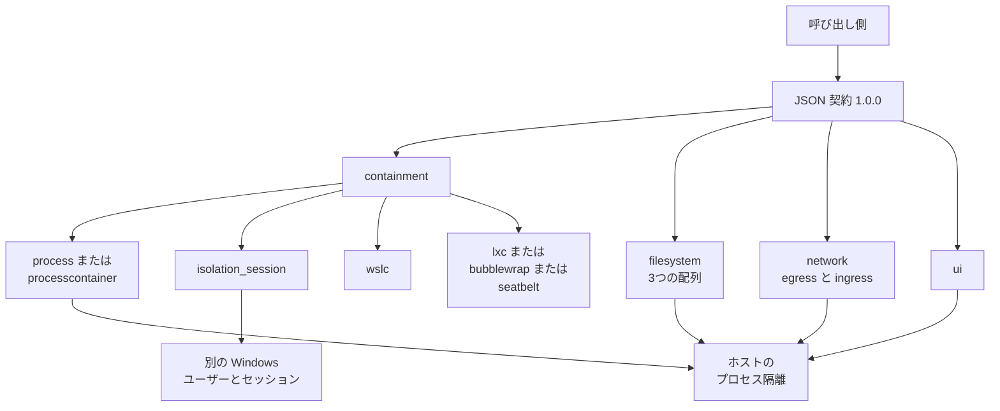

Microsoft Execution Containers（MXC）は、AI エージェントやモデルが生成したコードの実行範囲を、呼び出し側が書いたポリシーで実行時に制限する仕組みです。2026年10月7日、Logan Iyer は [Windows Developer Blog](https://blogs.windows.com/windowsdeveloper/2026/10/07/microsoft-execution-containers-policy-driven-containment-for-ai-agents/) で MXC を generally available と宣言しました。

この記事では、安定契約 `1.0.0` の境界と、ファイル・通信先・画面をどのキーに書くかを、公式ブログと公開リポジトリ [microsoft/mxc](https://github.com/microsoft/mxc) の契約から整理します。想定する読者は、エージェントへの承認を、作業の自己申告から、コンテナへ渡した資源へ移すかを判断する人です。

2026年10月7日のブログが generally available としたのは封じ込めの層と Windows 365 の MXC 対応で、Intune によるプロセスコンテナの管理と Entra による活動の区別は同じ記事が soon と書いています。


*この記事の全体像。以下、順に解説します。*

## Microsoft Execution Containersとは

呼び出し側は JSON を渡します。`containment` が器を選び、`filesystem`、`network`、`ui` が横断の境界を書きます。安定して渡せる契約の `version` は `1.0.0` です。SDK は Rust、.NET、Node です。高レベルの SDK は内部でこの契約を対象にします。JSON を直接渡す呼び出し側は、バージョン文字列を正確に `1.0.0` にする必要があります。

公開リポジトリは archived ではありません。SDK の GitHub release `v1.0.0`（name は MXC SDK v1.0.0）の publishedAt は 2026-10-07T05:54:01Z です。この記事がピンする契約と schema のコミットは `8188df6a8b`（2026-10-14、"Migrate release pipelines to 1ES and shared ESRP configuration"）です。

### ポリシーはワークロードの外にある

2026年10月7日の公式ブログは、ポリシーがエージェントのワークロードの外にあり、エージェントや生成コードは自分で追加アクセスを付与できない、と書いています。開発者と IT 管理者は、エージェントが使うファイルやネットワーク上の宛先を宣言し、MXC が選んだコンテナがその宣言を実行時に強制します。

同じブログは、好きなコーディングエージェントに SDK 統合と初期ポリシーの下書きをさせ、その後にレビュー、テスト、調整せよ、とも書いています。

### ブログが分ける5つの領域

2026年10月7日のブログがポリシー領域として挙げるのは、次の5つです。

| 領域 | 役割 |
|---|---|
| Containment | どの器で切るか |
| Process | 何を実行するか |
| File system | どのパスを読み書きできるか |
| Network | どの通信を許すか |
| User interface | 画面、クリップボード、入力をどう扱うか |

資格情報とユーザープロファイルは、この5領域の表にも、契約 `1.0.0` のトップレベルにも独立の節がありません。近い場所は、ファイル許可、環境変数、macOS の keychain、セッションの別アカウントです。

### バックエンド

2026年10月7日のブログが示すバックエンドは次のとおりです。

| バックエンド | ブログが書く対象 |
|---|---|
| プロセスコンテナ | Windows 11、macOS、Linux。AppContainer、Seatbelt、Bubblewrap |
| セッションコンテナ | Windows 11 |
| WSL コンテナ | Windows 11 |
| MicroVM | Windows 11 と Linux。experimental |

プロセス系はプロセス隔離です。セッションは別の Windows ユーザーとセッションです。WSLc は WSL 上のコンテナです。

`process` は、Windows では ProcessContainer、Linux では Bubblewrap、macOS では Seatbelt に解決します。

### 契約1.0.0で選べる値

[契約 1.0.0 のガイド](https://github.com/microsoft/mxc/blob/8188df6a8b211e5be99dd8d825a901cb6abea7e3/docs/containment-policy/1.0.0/policy.md) が受け付ける `containment` は、`process`、`processcontainer`、`lxc`、`bubblewrap`、`seatbelt`、`isolation_session`、`wslc` の7つです。

リクエストは閉じた JSON です。未知のフィールドと、選んだ phase がサポートしないフィールドは拒否されます。schema に通っても、選んだバックエンドやホストが強制できなければ拒否されます。experimental の認可は、契約の選択とは別です。

`schema.md` は、`processcontainer` が実行時にホスト能力と `--experimental` に応じて AppContainer（legacy）か BaseContainer かを選ぶ、と書いています。10月7日のブログの表は AppContainer だけを挙げます。

IsolationSession のリクエストは、egress、ingress、hostLoopback の3つをすべて `allow` にします。ルールとプロキシは付けられません。空の `network` は拒否されます。`provision` では filesystem と ui を受け取れません。

WSLc のネットワークは、全 deny か全 allow だけを受け取ります。宛先単位のルールと、混在した姿勢は拒否します。filesystem は provision で指定できます。port mapping は create-and-run の `portMappings` にあり、provision のフィールドには含まれません。

`ui` を実装するのは Windows の ProcessContainer と macOS の Seatbelt です。IsolationSession と WSLc は `ui` を渡すと拒否し、省略しても UI 制限の既定を適用しません。

### 3つのモード

2026年10月7日のブログが書くモードは3つです。

| モード | ブログが書く動作 |
|---|---|
| Enforcement | 未許可は拒否する。活動レポートは無い |
| Learning | 拒否して記録する |
| Permissive | 許可して記録する。他の OS 制限や組織制限までは迂回しない |

契約側のスイッチは別の名前です。`processContainer.learningMode: true` は拒否したまま記録します。`processContainer.captureDenials.mode` の既定は `block` です。`allow` にすると、ポリシーが拒否する操作を許可して記録します。`wxc-exec --audit` も、ポリシーが拒否する操作を許可して記録します。

[学習モードの文書](https://github.com/microsoft/mxc/blob/8188df6a8b211e5be99dd8d825a901cb6abea7e3/docs/logging-access-denied.md) は、2つの capability を混ぜない、と書いています。`learningModeLogging` は失敗したアクセスを記録し、アクセス自体は拒否したままです。`permissiveLearningMode` はアクセス検査を記録し、許可します。有効範囲は Windows の AppContainer と BaseContainer です。他のプラットフォームでは capability 文字列を無視します。パーサは、この2つの名前を `processContainer.capabilities` に書くと拒否します。deny-and-record は `learningMode: true` で有効にします。permissive の監査は `wxc-exec --audit` です。

### リクエストの形

create-and-run では `phase` と `sandboxId` を省略します。必須は `version` と、空でない `process.commandLine` です。契約ガイドが示す最小例は次です。コマンドは、選んだサンドボックスで実行できるものに置き換えます。

```json
{
  "version": "1.0.0",
  "containment": "process",
  "process": { "commandLine": "echo hello" }
}
```

`filesystem` は `readwritePaths`、`readonlyPaths`、`deniedPaths` です。既定は空配列です。readwrite の grant は、通常そのディレクトリと子孫を見せます。`deniedPaths` の強制と grant との相互作用はバックエンド依存です。

`network` を省略すると、egress の default、ingress の default、hostLoopback は deny になります。`to` は数値の CIDR です。ホスト名で絞るフィールドはありません。ホスト名で絞るなら `runtimeConfig.networkProxy` を使い、宛先の選別はプロキシの責務です。契約ガイドが示す、CIDR とポートを明示する形は次です。

```json
{
  "version": "1.0.0",
  "process": { "commandLine": "echo hello" },
  "network": {
    "egress": {
      "default": "deny",
      "allow": [{
        "to": [{ "cidr": "203.0.113.0/24" }],
        "ports": [{ "protocol": "tcp", "port": 443 }]
      }]
    },
    "ingress": { "default": "deny", "hostLoopback": "deny" }
  }
}
```

deny のルールは allow に勝ちます。ルールは直接のネットワークポリシーであり、ホスト名フィルタではありません。

`ui.disable` の既定は true です。`clipboard` の既定は `none` で、`none`、`read`、`write`、`all` を受けます。`injection` の既定は false です。

`process.timeout` は 0 から 4294967295 ミリ秒です。0 は無制限です。`process.cwd` を省略すると、バックエンドが使える既定を選びます。呼び出し側のディレクトリとは限りません。明示したパスが使えなければ、フォールバックせず失敗します。Windows ProcessContainer は、省略時に実在する最初の readwrite ディレクトリ、無ければ最初の readonly、無ければ `%SystemDrive%\` を作業ディレクトリにします。`schema.md` は Never NULL と書いています。

供給した環境から `SYSTEMROOT` または `LOCALAPPDATA` が欠けると、Windows ProcessContainer は拒否します。IsolationSession は `inheritDefaultEnv: true` が必須で、エージェントユーザーの既定環境を空にできません。

`fallback.allowDaclMutation` の既定は true です。false にすると、Windows のホスト DACL フォールバックを拒否します。

### 呼び出しから器までの流れ

呼び出し側が渡す JSON と、器の関係は次のとおりです。ファイル、ネットワーク、UI の線は、プロセス隔離の側へ集まっています。セッションは別の箱です。



### 公式サンプル

[ファイルのサンプル](https://github.com/microsoft/mxc/blob/main/samples/run-with-containment-of-filesystem/README.md) は、サンプルディレクトリを読み取り専用で一時コンテナに渡し、そこを作業ディレクトリにします。読み取りは成功し、ファイル作成は拒否されます。期待する標準出力は `filesystem read succeeded` と `write access blocked by policy` です。それ以外のホストパスは、選択したバックエンドの既定のファイル制限のままです。

[ネットワークのサンプル](https://github.com/microsoft/mxc/blob/main/samples/run-with-containment-of-network/README.md) は、ホストプロセスで一時的な loopback の HTTP 端点を立て、outbound、inbound、host loopback を明示的に拒否したコンテナで `curl` を走らせます。含まれた `curl` は失敗する必要があり、成功するとサンプル自体が失敗します。期待する標準出力は `network access blocked by policy` です。ホストのプロセス隔離がすべてのネットワーク拒否をサポートしない場合、ポリシーはコンテナ作成前に失敗します。

### 対応する Windows のビルド

プロセス隔離は、SDK の GA より前の 2026年8月27日 Preview である [KB5120998](https://support.microsoft.com/en-us/servicing/os/windows-11/2026/08/kb5120998-windows-11-24h2-25h2-update)（OS Builds 26200.9278 and 26100.9278）の本文が導入を書いています。本文は、ファイル、ネットワーク、ユーザーインターフェース、その他の OS 能力へのアクセスをポリシーに従って制限する、と書いています。

同じ KB の別項目「Agentic processes」は、認可されたコンポーネントがプロセスへ不透明な agent identifier を付け、子プロセスへ引き継ぎ、Web Account Manager の認証要求に含める、という preview です。identifier の形式は将来変わり得る、と KB が書いています。これは Entra の soon とは別の項目です。

セッション隔離の最小ビルドは、リポジトリの [os-version-support.md](https://github.com/microsoft/mxc/blob/8188df6a8b211e5be99dd8d825a901cb6abea7e3/docs/backends/process-container/os-version-support.md) と [KB5124010](https://support.microsoft.com/en-us/servicing/os/windows-11/2026/09/kb5124010-windows-11-24h2-25h2-update) のタイトル（September 22, 2026 Preview。26300.9550、26200.9550、26100.9550）で一致します。リポジトリの表は次のとおりです。

| 系統 | 24H2 | 25H2 | 26H2 | 26H1 |
|---|---|---|---|---|
| プロセス隔離 | 26100.9278 | 26200.9278 | 26300.9550 | 28000.2804 |
| セッション隔離 | 26100.9550 | 26200.9550 | 26300.9550 | 28000.3086 |

26H1 のプロセス隔離側のビルド 28000.2804 は KB5120996、セッション隔離側の 28000.3086 は KB5124006 のタイトルと対応します。OS ビルドだけで全バックエンドが使える、とはこの表は書いていません。

### ブログが名指しする製品

2026年10月7日のブログが already と名指しするのは、GitHub Copilot、OpenClaw、OpenAI Codex、Replit、LM Studio、Unsloth AI です。will be releasing と名指しするのは、Anthropic Claude Code、Box、Egnyte、Heidi Health、Hermes Agent by Nous Research、Manus、Perplexity、Raycast、Simular です。NVIDIA は OpenShell を MXC に統合し、資格情報管理はその補完として書かれます。

## 注意点

前節は、契約とブログが書いている境界です。正式提供の文言、器の差、許可の広げ方を同じ承認単位として読むと、一次資料より強くなります。

### 正式提供が指す範囲

2026年10月7日のブログが generally available としたのは、封じ込めの層と、Windows 365 support for MXC です。同じ記事は、Intune による MXC プロセスコンテナの管理を "will soon be available"、Entra によるエージェント活動とユーザー活動の区別を "soon" および "Coming soon" と書いています。提供済みの設定手順は、2026年10月15日時点の公開範囲では見つかっていません。

2026年8月20日の [Windows Experience Blog](https://blogs.windows.com/windowsexperience/2026/08/20/windows-365-turns-five-cloud-pcs-enable-workspaces-at-scale/) は、同じ Windows 365 support for MXC を "becoming generally available in the coming months" と書いていました。10月7日の Developer Blog が "now generally available" と宣言しました。Windows 365 の製品ドキュメント上の専用ページは、同じ時点では見つかっていません。

MicroVM は 10月7日の表で experimental です。契約 `1.0.0` は、VM、MicroVM、Hyperlight、Windows Sandbox をこの契約の選択値ではない、と書いています。README は `windows_sandbox`、`microvm`、`hyperlight` を experimental とします。`docs/schema.md` の containment 表は契約をまたいでこれらを含むので、`1.0.0` の enum と混ぜません。

KB5124010 の本文が Session Isolation を説明するかは、タイトルとビルド番号の一致以上には確認できていません。26H1 の KB5120996 と KB5124006 も、サイドバーのタイトルとビルド番号の対応までです。本文が MXC に言及するかは閉じていません。

ブログが名指しした各製品の設定画面に、MXC のポリシーがあるかは閉じていません。Intune が soon の間、境界の中身は、そのアプリが渡した JSON です。

宛先を CIDR で実際に絞るのは、[networking.md](https://github.com/microsoft/mxc/blob/8188df6a8b211e5be99dd8d825a901cb6abea7e3/docs/backends/process-container/networking.md) が書く PSEC 側です。PSEC が使えない downlevel では AppContainer へ落ち、明示の egress ルール、proxy peer、host-loopback allow は typed unsupported-policy error で失敗します。AppContainer が CIDR ルールを無視して通す、という読みにはしません。フラグの有無だけで AppContainer と BaseContainer のどちらになる、という完全な判定表も閉じていません。安定の `processcontainer`、IsolationSession、WSLc は experimental の opt-in を要しません。

### 公開記事が一次より広く読める点

[Publickey（新野淳一、2026年10月15日）](https://www.publickey1.jp/blog/26/windowsaimicrosoft_execution_containersmxc.html) は、次の3点で一次より広い読みになります。

- MicroVM を使用可能と書き、実験と呼びません。一次のブログは experimental で、`1.0.0` の enum にはありません。
- それぞれにおいてファイルやネットワークのポリシーを設定できる、と読めます。IsolationSession はファイルポリシーを拒否し、ネットワークは全 allow だけを受けます。WSLc は宛先単位のルールを拒否します。
- OpenClaw と Claude Code を並べて対応の発表とします。一次のブログは OpenClaw を already、Claude Code を will be releasing に分けます。

Intune を可能になる予定と書く点は、ブログの will soon と揃っています。セッションを別アカウント、デスクトップ、クリップボード、UI、入力の分離と説明する点も、ブログの Session container 行と揃っています。

[Microsoft Q&A](https://learn.microsoft.com/en-us/answers/questions/5930562/microsoft-execution-containers-mxc) にある Host Routed の手順は、2026年6月26日のコミュニティ回答です。質問者は Ayu Lestari、回答者は Wilson Wang です。`1.0.0` の network にその値はありません。公式手順には使いません。Windows ドキュメント全体での不存在は閉じていません。

### 承認単位がそのまま乗らない器とモード

「渡したファイルと通信先の外を、環境が落とす」は、プロセスコンテナで Enforcement、または拒否したまま記録する Learning のときの説明です。契約 `1.0.0` は、省略した節が、すべてのバックエンドが制限を強制する証拠にはならない、と書いています。

セッションコンテナは、別アカウントによるユーザー分離です。開発者向けの [oneshot.md](https://github.com/microsoft/mxc/blob/8188df6a8b211e5be99dd8d825a901cb6abea7e3/docs/development/architecture/backends/isolation-session/oneshot.md) は、エージェントが新しい隔離アカウントであり、system-wide resources には届き、呼び出しユーザーの per-user data には届かない、と書いています。GUI は表示サーバが無く、標準出力と標準エラーだけを捕捉します。この到達範囲の文はアーキテクチャ文書です。同文書のサンプル JSON は `"version": "0.9.0-alpha"` なので、`1.0.0` のリクエスト例としては使いません。2026年6月2日の [Windows Developer Blog](https://blogs.windows.com/windowsdeveloper/2026/06/02/windows-platform-security-for-ai-agents/) がセッション初期を非対話と書いたこととは揃います。セッションは、ユーザーのデスクトップをエージェントへ渡す器というより、ユーザーのデスクトップから分かれた別セッションです。

`1.0.0` の IsolationSession provision は、ネットワークをすべて allow にした次の形です。

```json
{
  "version": "1.0.0",
  "phase": "provision",
  "containment": "isolation_session",
  "network": {
    "egress": { "default": "allow" },
    "ingress": { "default": "allow", "hostLoopback": "allow" }
  }
}
```

lifecycle の `provision`、`start`、`exec`、`stop`、`deprovision` は、この契約では IsolationSession と WSLc だけにあります。`exec` では両方のバックエンドが、渡された network を拒否し、provision 時の姿勢を引き継ぎます。

Permissive、`captureDenials.mode: allow`、`wxc-exec --audit` は、未許可の操作を許可して記録します。既定モードまで無効、という意味ではありません。README は `--audit` について、解析対象のサンドボックスセキュリティを全部外すので、信頼できないコードには使うな、と警告します。

### 許可を広げると残る到達

次の書き方は、隔離したつもりでホストに近い権限や、ホストへの一時変更が残ります。

| 書き方 | 一次が書く結果 |
|---|---|
| プロファイルルートや HOME を `readwritePaths` に足す | `schema.md` は、readwrite の grant がそのディレクトリと子孫を見せるので、広い profile roots は over-permissioning になる、と警告する。Bubblewrap は、許可パスに入れるまで `$HOME` 配下の `~/.aws/credentials`、`~/.ssh`、ブラウザクッキーを読めない、と書く |
| `egress.default` を allow にする | 省略時の deny が外れる。downlevel の AppContainer では、この allow が `internetClient` になる、と networking.md が書く |
| AppContainer で `ingress.default` を allow にする | `privateNetworkClientServer` は双方向である。私設網の outbound だけを許し inbound を拒む、は ProcessContainer ではできない、と networking.md が書く |
| プロキシを ProcessContainer で使い、peer を省略する | `ingress.default: allow` と `hostLoopback: allow` が要り、host loopback の両方向が開く。policy.md は、協調的なプロキシ設定だけでは任意の直接ソケットを止める保証はない、と書く |
| Permissive、`--audit`、`captureDenials.mode: allow` | 未許可の操作を許可して記録する |
| `seatbelt.profileOverride` | 生成プロファイルを置換し、リクエストの filesystem、network、ui は組み込まれない |
| `fallback.allowDaclMutation` を既定の true のまま、Tier 3 のホストで動かす | ホストの DACL を実行前に変え、終了時に戻す。false にすると、Tier 3 が必要なマシンでは実行が失敗する |
| IsolationSession を選ぶ | ネットワークは全 allow が必須である。oneshot.md は system-wide resources に届く、と書く |

`allowDaclMutation` の対象に、IsolationSession の one-shot は入りません。全実行が DACL を触るわけではありません。

Node SDK の `getAvailableToolsPolicy`（コミット `8188df6a8b` の [`sdk/node/src/v1/policy/filesystem.ts`](https://github.com/microsoft/mxc/blob/8188df6a8b211e5be99dd8d825a901cb6abea7e3/sdk/node/src/v1/policy/filesystem.ts)）は、PATH に `pwsh.exe` があるとき、`SystemDrive` のルート（環境変数が無ければ `C:`）を `readonlyPaths` に足し、ユーザープロファイル配下の PSReadLine 履歴ディレクトリを `readwritePaths` に足します。コメントは、対話的 PowerShell のためだと書いています。これは作業フォルダだけの許可より広い範囲です。[microsoft/mxc#1455](https://github.com/microsoft/mxc/issues/1455)（open、2026-10-09）は、この grant が BaseContainer でサブツリー全体になり、プロファイルや `.aws`、`.ssh` が読める、と報告しています。`schema.md` が子へカスケードしないと書くのは readwrite のボリュームルートです。readonly のボリュームルートが同じ例外かは閉じていないので、Issue の影響範囲はこの記事では採用しません。採用するのは、公式ヘルパーがドライブルートをポリシーへ足す、というコードです。

`cwd` の省略で選ばれる作業ディレクトリは、許可リストへパスを足す操作とは別です。空の `filesystem` が、Windows プロセスコンテナのユーザープロファイルと資格情報ファイルを隠すかは閉じていません。公式が明記するのは、3配列の既定が空であることと、profile roots を広く足すな、という警告です。

### 資格情報の独立キー

資格情報の独立キーは、`1.0.0` のスキーマにはありません。開発中の `1.1.0-alpha` についても、確認したスキーマファイル 1 件にはありません。alpha 全体への一般化はしません。近いキーは、filesystem のパス、`process.env` と `inheritDefaultEnv`、macOS の `seatbelt.keychainAccess` です。`keychainAccess` はスキーマ例で false です。AppContainer profile はサンドボックスの識別子で、ユーザーの Windows プロファイルとは別の語です。

## 現場の言い方を契約のキーへ置く

現場の言い方を、2026年10月7日ブログの領域と、契約 `1.0.0` のキーへ写すと次のとおりです。

| 現場の言い方 | 公式ブログの領域 | 1.0.0 で書くキー | 既定と読み替え |
|---|---|---|---|
| ファイル | File system | `filesystem.readwritePaths`、`readonlyPaths`、`deniedPaths` | 既定は空配列。readwrite は通常そのディレクトリと子孫を含む。BaseContainer ではボリュームルートへの readwrite が子へカスケードしない |
| ネットワーク | Network | `network.egress`、`network.ingress.default`、`network.ingress.hostLoopback`。`to` は CIDR | 省略時は deny。ホスト名で絞るなら `runtimeConfig.networkProxy` |
| 資格情報 | 5領域の表には無い。OpenShell の補完として credential management が書かれる | 独立キーは無い。近いのは filesystem のパス、`process.env` と `inheritDefaultEnv`、macOS の `seatbelt.keychainAccess` | 空の filesystem が Windows の資格情報ファイルを隠すかは閉じていない |
| ユーザープロファイル | 5領域の表には無い。Session container は別アカウント | 独立キーは無い。`schema.md` の profile roots 警告が、プロセスコンテナ側の注意である | IsolationSession は呼び出しユーザーの per-user data に届かない、と oneshot.md が書く |
| 画面と入力 | User interface | `ui.disable`、`ui.clipboard`、`ui.injection`。追加で `processContainer.ui` | 実装は Windows ProcessContainer と macOS Seatbelt。IsolationSession と WSLc は `ui` を渡すと拒否する |
| どの器で切るか | Containment | `containment` | `1.0.0` の選択値は7つ。MicroVM と Windows Sandbox は選択値ではない |
| 何を実行するか | Process | `process.commandLine`、`cwd`、`timeout`、`env` | `timeout` の 0 は無制限。Windows ProcessContainer は `SYSTEMROOT` か `LOCALAPPDATA` が欠ける供給環境を拒否する |

直接の宛先は CIDR です。ホスト名で絞るときのプロキシは `runtimeConfig.networkProxy` です。ProcessContainer で身元付きの loopback プロキシを使うときは、空でない `processContainer.network.allowedProxyPeer`、`hostLoopback: deny`、`network.ingress.default: allow` を同時に書きます。peer を省略すると `hostLoopback: allow` になり、host loopback の両方向が開きます。

## ファイルと通信先を承認単位にする条件

承認の単位を「このコンテナに渡したファイルと通信先」へ落とせるのは、プロセスコンテナで、未許可を拒否する Enforcement か Learning のときです。2026年10月7日の正式提供は、その単位を全バックエンドと組織ポリシーへ同時に広げた、という宣言ではありません。

10月7日のブログは、エージェントや生成コードが自分で追加アクセスを付与できない、と書いています。境界は、呼び出し側が渡した JSON と、選んだバックエンドが強制できる範囲です。

エージェントに許可リストの中身を自己申告させず、ホストがレビューしたファイルと通信先だけをプロセスコンテナへ渡します。デスクトップをエージェントへ渡す話は、セッションコンテナの別デスクトップであり、渡した範囲の外側を切る問いとは別です。

### 渡すときの書き方

1. 承認単位をファイルと通信先に落とす作業は、Windows の ProcessContainer、または Bubblewrap、Seatbelt を使います。モードは Enforcement か、拒否したまま記録する Learning にします。
2. `filesystem` には作業ディレクトリだけを書きます。profile roots、HOME、ドライブルートは足しません。Node の `getAvailableToolsPolicy` は、PowerShell 7 が PATH にあるとドライブルートを足すので、本番の許可リストをその戻り値のまま採用しません。
3. ネットワークは egress の default を deny にし、必要な CIDR とポートだけを allow します。ホスト名で絞るならプロキシを使います。ProcessContainer では、空でない `allowedProxyPeer` と `hostLoopback: deny` と `ingress.default: allow` をセットにします。プロキシを使わないときは、ingress の default を deny のままにします。
4. `captureDenials.mode` は `block` のままにします。`--audit` と Permissive は、境界を確認する調査に限ります。
5. Tier 3 の DACL 変更を受け入れないホストでは `fallback.allowDaclMutation` を false にします。そのマシンでは実行が失敗し得ます。
6. IsolationSession は、別アカウントと別セッションの分離として扱います。ファイル許可と宛先制限の承認モデルとしては使いません。WSLc は、全 deny か全 allow のどちらを渡したかで承認します。
7. Intune が soon の間、境界はアプリが同梱したポリシーです。ブログが勧めるエージェント下書きは、人間がファイル、CIDR、プロキシ、モードを見てから渡します。

### この単位を使えないとき

次のいずれかなら、ファイルと宛先の承認単位は使えません。置き場所を変える条件も同じ一覧に置きます。

- セッション分離か、WSLc の全 allow が要件である。
- 調査のために Permissive や `--audit` を本番の実行へ残す。環境が未許可を落とす前提は外れます。
- Intune または Entra の設定が公開され、アプリの JSON を上書きする。承認の置き場所を組織ポリシーへ移します。
- 公式が、空の filesystem でもプロファイルや資格情報が見える、と書いた。ファイル境界の説明をその範囲へ狭めます。
- 公式が、readonly のボリュームルートも子へカスケードしない、と書いた。#1455 の影響範囲の読みを弱めます。逆にカスケードすると書いたら、PowerShell 付きの公式ヘルパーは本番ポリシーから外します。

空の filesystem、セッション、Permissive は、プロセスコンテナの Enforcement とは別の承認単位です。ファイルと CIDR を明示した Enforcement を選ぶ判断は、空 filesystem の可視範囲が文書で閉じていなくても進められます。

## まとめ

MXC の契約 `1.0.0` は、呼び出し側が書いたファイル、CIDR、UI を、選んだ器が実行時に強制する JSON です。ファイルと通信先の外を落とす承認単位として使えるのは、プロセスコンテナの Enforcement か、拒否したまま記録する Learning です。セッションは別アカウントの分離、WSLc は全 deny か全 allow、Permissive と `--audit` は未許可を許可して記録します。Intune と Entra の組織側の置き場所は、2026年10月7日時点では soon です。

許可リストの中身は、エージェントの下書きのあとで、人間がファイル、CIDR、プロキシ、モードを見てから渡します。

この記事が少しでも参考になった、あるいは改善点などがあれば、ぜひリアクションやコメント、SNSでのシェアをいただけると励みになります！

## 参考リンク

- Logan Iyer, "Microsoft Execution Containers: Policy-driven containment for AI agents", Windows Developer Blog, 2026-10-07. https://blogs.windows.com/windowsdeveloper/2026/10/07/microsoft-execution-containers-policy-driven-containment-for-ai-agents/
- Dana Huang, Logan Iyer, "Windows platform security for AI agents", Windows Developer Blog, 2026-06-02. https://blogs.windows.com/windowsdeveloper/2026/06/02/windows-platform-security-for-ai-agents/
- Stefan Kinnestrand, "Windows 365 turns five", Windows Experience Blog, 2026-08-20. https://blogs.windows.com/windowsexperience/2026/08/20/windows-365-turns-five-cloud-pcs-enable-workspaces-at-scale/
- microsoft/mxc, containment policy 1.0.0（`8188df6a8b`, 2026-10-14）. https://github.com/microsoft/mxc/blob/8188df6a8b211e5be99dd8d825a901cb6abea7e3/docs/containment-policy/1.0.0/policy.md
- microsoft/mxc, JSON Schema 1.0.0. https://github.com/microsoft/mxc/blob/8188df6a8b211e5be99dd8d825a901cb6abea7e3/schemas/stable/mxc-config.schema.1.0.0.json
- microsoft/mxc, schema.md. https://github.com/microsoft/mxc/blob/8188df6a8b211e5be99dd8d825a901cb6abea7e3/docs/schema.md
- microsoft/mxc, logging-access-denied.md. https://github.com/microsoft/mxc/blob/8188df6a8b211e5be99dd8d825a901cb6abea7e3/docs/logging-access-denied.md
- microsoft/mxc, process-container networking.md. https://github.com/microsoft/mxc/blob/8188df6a8b211e5be99dd8d825a901cb6abea7e3/docs/backends/process-container/networking.md
- microsoft/mxc, os-version-support.md. https://github.com/microsoft/mxc/blob/8188df6a8b211e5be99dd8d825a901cb6abea7e3/docs/backends/process-container/os-version-support.md
- microsoft/mxc, isolation-session oneshot.md. https://github.com/microsoft/mxc/blob/8188df6a8b211e5be99dd8d825a901cb6abea7e3/docs/development/architecture/backends/isolation-session/oneshot.md
- microsoft/mxc, Node `sdk/node/src/v1/policy/filesystem.ts`. https://github.com/microsoft/mxc/blob/8188df6a8b211e5be99dd8d825a901cb6abea7e3/sdk/node/src/v1/policy/filesystem.ts
- microsoft/mxc, filesystem sample. https://github.com/microsoft/mxc/blob/main/samples/run-with-containment-of-filesystem/README.md
- microsoft/mxc, network sample. https://github.com/microsoft/mxc/blob/main/samples/run-with-containment-of-network/README.md
- microsoft/mxc, release v1.0.0, published 2026-10-07. https://github.com/microsoft/mxc/releases/tag/v1.0.0
- Microsoft Support, August 27, 2026—KB5120998 (OS Builds 26200.9278 and 26100.9278) Preview. https://support.microsoft.com/en-us/servicing/os/windows-11/2026/08/kb5120998-windows-11-24h2-25h2-update
- Microsoft Support, KB5124010 のタイトル（September 22, 2026 Preview。本文の機能説明は未確認）. https://support.microsoft.com/en-us/servicing/os/windows-11/2026/09/kb5124010-windows-11-24h2-25h2-update
- 新野淳一, Publickey, 2026-10-15. https://www.publickey1.jp/blog/26/windowsaimicrosoft_execution_containersmxc.html
- Microsoft Q&A 5930562, 2026-06-26. https://learn.microsoft.com/en-us/answers/questions/5930562/microsoft-execution-containers-mxc
- microsoft/mxc#1455. https://github.com/microsoft/mxc/issues/1455
