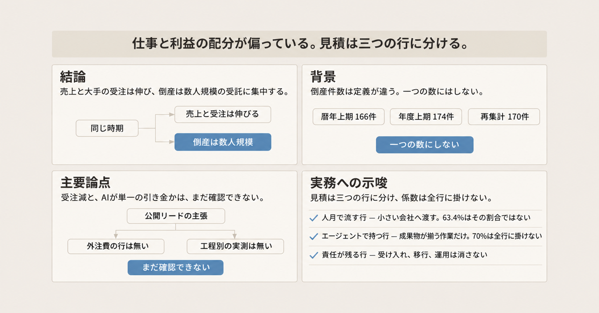
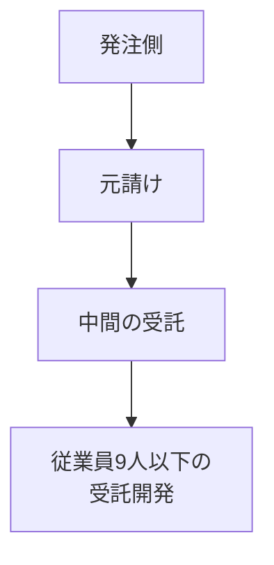
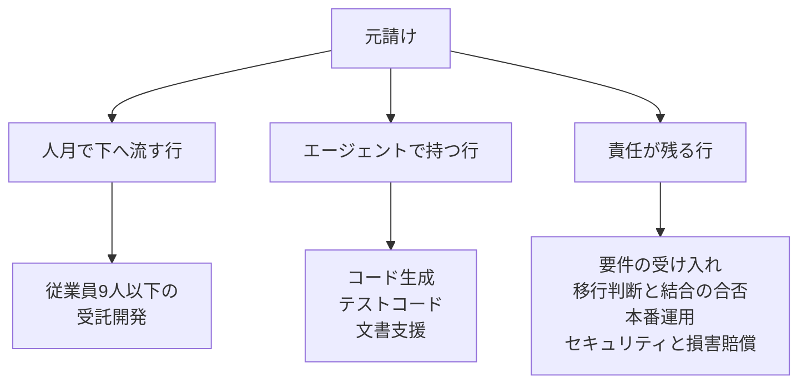

2026年の日本の情報サービス業では、月次の売上と大手の受注が伸びています。同じ時期に、負債1,000万円以上の法的倒産は、従業員が数人の受託開発に集まっています。

この記事は、日経クロステック連載の公開リードが指す商流と、見積に残る行を、統計の定義つきで整理します。公開リードは、有料本文の前に公開されている書き出しです。見積の行と工期を組み直す発注側と元請けが、集計の定義と期間を残したまま見積を分けるための材料です。

連載第1回の有料本文は、この記事の材料に含めていません。

*この記事の全体像。以下、順に解説します。*

## 多重下請けの同時進行とは

同時進行は、月次の売上と大手の受注が伸びることと、従業員が数人の受託開発への法的倒産の集中が、同じ時期に起きていることです。ここでいう多重下請けは、発注側から元請け、中間の受託、従業員9人以下の受託開発へと仕事が渡る商流です。元請けは、発注側から直接仕事を受ける事業者です。中間の受託は、元請けから仕事を受け、さらに別の会社へ渡す層です。

日経クロステックの連載第1回の公開リードは、この同時進行を次のように置いています。大手が堅調な裏で倒産が最多であり、引き金はAIであり、大手から中小への受注が減り、実装が消えて工期を短縮できる、という整理です。記事の題は「大手堅調の裏で倒産最多のIT業界、AIが引き起こす多重下請け構造の崩壊」です。

### 倒産の件数

東京商工リサーチは、日本標準産業分類の「情報サービス業」のうち、負債1,000万円以上を数えています。2026年1月から6月は166件です。前年の同じ期間より18.5%多く、同社は2017年以降の10年で最多だと書いています。公表は2026年7月14日です。

同じ東京商工リサーチは、2026年度上半期を174件とも書いています。前年の同じ期間より41.4%多く、2017年度以降の10年で最多だとします。公表は2026年10月27日です。原文は月の範囲を書いていません。会計年度の上半期なら4月から9月です。暦年の1月から6月とは別の期間です。

情報サービス産業協会（JISA）は、東京商工リサーチのリストを再集計しています。2025年通年は284件です。同協会が表示している2014年から2025年の範囲では、件数が最多です。2026年1月から6月の編成表の件数は170件です。東京商工リサーチのリストをJISAが再集計したもので、2026年7月22日付です。一部はJISAの推計です。JISAの区分は「情報関連サービス業」です。日本標準産業分類の「情報サービス業」とは別の区分です。

件数の中身は、受託開発ソフトウェア業に寄っています。2025年は220件で、284件の77.5%です。2026年1月から6月は129件で、170件の75.9%です。従業員0人から9人は、2025年の284件のうち91.9%、2026年1月から6月の170件のうち94.7%です。2026年1月から6月の50人以上は0件です。法的倒産の件数は、商流のいちばん下の層に集中しています。

### 売上と受注

東京商工リサーチが比較できるとする4,417社の2025年度（2025年4月から2026年3月）は、売上高32兆6,569億円です。前年度より7.7%多いです。当期利益は3兆2,755億円で、28.9%増です。従業員300人以上が、当期利益の86.3%を占めています。公表は2026年10月27日の稿です。全数調査ではありません。

総務省のサービス産業動態統計をJISAが要約した2026年6月の情報サービス業の売上は、前年の同じ月より7.7%多く、51か月連続の増加です。JISAの掲載は2026年8月24日です。2025年1月に、特定サービス産業動態統計とサービス産業動向調査が統合されています。51か月の連続は、その母集団の変更をまたぎます。

NTTデータグループの2026年度第2四半期（4月から9月）の決算説明資料では、連結売上高が2兆6,168億円、連結受注高が2兆9,448億円です。日本セグメントの受注高は1兆3,208億円です。日本の売上高は1兆243億円、営業利益は988億円です。

連結受注高は2兆7,497億円から2兆9,448億円です。資料上の増減は1,952億円です。日本セグメントの受注高は1兆227億円から1兆3,208億円です。資料上の増減は2,980億円です。日本の営業利益は805億円から988億円です。連結営業利益は2,690億円から1,442億円です。資料は、海外のデータセンター譲渡益1,295億円の反動などを減益要因に挙げています。

日本の受注は、三分野の合計では増えます。ここでの受注は、顧客から受けた注文です。協力会社への発注額ではありません。法人分野の受注は2,046億円から1,984億円へ減っています。公共・社会基盤と金融の大型案件が、合計を押し上げています。通期予想は売上高5兆1,900億円、営業利益4,700億円です。前期の売上高5兆46億円からの増分は、資料上1,854億円です。

### 商流と外注費

仕事の渡り方は、次の並びです。

JISA基本統計の2025年版は、2024年度の実績です。刊行は2026年4月30日です。概要編の有効回答は300社です。対象468社に対する有効回答率は64.1%です。売上高外注費率の加重平均は33.54%です。同じ図の中央値は29.01%です。図表番号は2-31です。売上高外注費率は、売上高に占める外注費の割合です。

指標の時系列は、1991年度20.99%、2023年度30.50%、2024年度33.54%です。詳細編は、売上高の大きい5社を除いた295社です。売上高外注費率は、全体34.18%、SIサービス型38.95%、ソフトウェア開発型29.69%です。33.54%と34.18%は、母集団が違います。

同業者向けの売上は、概要編の金額構成で748,826百万円、構成比7.0%です。合計は10,669,487百万円です。資料は、7,488億円と10兆6,695億円と読み替えています。詳細編の取引先比率では、同業者が全体の9.1%、ソフトウェア開発型が14.5%です。7.0%は全回答の金額比です。9.1%と14.5%は、上位5社を除いた295社の比率です。

JISA白書2026の動向ページでは、生成AIの現在の使い方が、コード補完、コード生成、テストコード作成、ドキュメント作成支援と並びます。会員の雇用は、不足が続いています。

2026年1月1日から、下請法は中小受託取引適正化法として施行されています。略称は取適法です。プログラムの作成委託は、対象に残っています。

## 注意点

公開リードの「過去10年で最多」「引き金はAI」「大手から中小への受注減」「実装が消えて工期を短縮できる」は、定義と期間を落とすと別の事実になります。

### 倒産件数は一つの数にまとまらない

前節の166件は、暦年2026年1月から6月の、日本標準産業分類「情報サービス業」です。174件は2026年度上半期です。170件は、JISAの「情報関連サービス業」の編成表で、一部に推計を含みます。2025年通年も、東京商工リサーチの276件とJISAの284件で一致しません。どれか1件を「IT業界の倒産」とは書きません。

### 2026年通年の最多はまだ確定していない

2026年11月16日の時点で、2026年通年が10年で最多だとは確定しません。10年最多と言い切れるのは、次の範囲までです。東京商工リサーチの暦年上期166件は、2017年以降の10年です。同社の年度上期174件は、2017年度以降の10年です。原文は月の範囲を書いていません。JISAの2025年通年284件は、同協会の2014年から2025年の表です。

JISAの2026年7月から9月の月次は、30件、30件、22件です。1月から6月の編成170件に足すと、1月から9月は252件です。2025年1月から9月は、JISAの12月報の月次合計で206件です。4月は、見出しの34件と時系列セルの35件が1件ずれます。JISAは、月別件数が実際の発生月と違うことがある、と注記しています。読める範囲は、約250件で、前年の同じ9か月よりおよそ2割多い、までです。

### 件数の増加と負債の増加は別である

JISAの2025年は284件、負債総額249億円、1社平均約8,753万円です。2024年は269件、負債総額532億円です。件数は増えて、負債総額は減っています。

東京商工リサーチの2026年1月から6月も、負債1億円未満が147件です。166件の88.5%で、前年の同じ期間より22.5%多いです。1億円以上は19件で、5.0%減です。従業員5人未満は135件で、166件の81.3%です。

### 法的倒産より休廃業・解散が多い

東京商工リサーチは、2025年の倒産276件に対し、休廃業・解散を3,014件と書いています。合計は3,290件で、前年より20.8%多いです。新設法人は11,138件で、前年より1.8%少なく、4年連続で1万件を超えます。退出が増えても、入口は大きいです。

### 50人以上の二次受けが倒産している姿ではない

JISAの2026年1月から6月は、50人以上が0件、10人から49人が9件です。9件は5.3%です。2025年通年の50人以上は2件で、0.7%です。従業員不明は、0人から9人に含めています。この集計は、50人以上の二次受けが倒産している、という姿ではありません。

### 原因の記述は調査会社の間で割れている

JISAが再集計した原因コードの筆頭は、販売不振です。2025年は196件で69.0%、2026年1月から6月は96件で56.5%です。金利負担の増加は、どちらも0件です。2026年1月から6月は、他社倒産の余波が23件まで増えています。23件は13.5%です。

東京商工リサーチの2026年7月14日の稿は、ノーコード、ローコード、生成AIによる簡易な開発の内製化と、下請け・小規模案件で利益を残しにくい構造を並べます。同じ東京商工リサーチの2026年10月27日の稿は、ソフトウェア開発、テスト、ドキュメント作成のニーズは拡大し、AIエージェントによる期間短縮は期待、と書きます。このAIエージェントは同稿の語です。後の見積でいうエージェントは、コード生成、テストコード、文書の支援を、人月で外へ出さずに持つやり方です。人月は、人数と月数を掛けて積む見積の単位です。同稿は、この二つが同じものだとは書いていません。

帝国データバンクの2026年3月9日の稿は、2025年度のソフトウェア業の倒産を2月末時点で195件とし、うちソフト受託開発を157件とします。ソフトウェア業は、前に書いた情報サービス業や情報関連サービス業とは別の区分です。166件、174件、284件とは足しません。情報サービス業の景気DIは2021年10月以降50以上で、同稿は受注環境が良好だとしています。この景気DIは、後に書くJISA-DIとは別の調査の指数です。原因は、多層委託で賃上げを価格転嫁できないこと、と置いています。2026年4月以降の加速は、この3月時点の説明には含まれません。

### 大手から中小への発注減は決算では未確認である

NTTデータグループの2026年度第2四半期説明資料（2026年11月4日）と、TISの同日付の説明資料には、外注費、協力会社への発注、業務委託費の行がありませんでした。減ったとも、減っていないとも書けません。富士通、NEC、日立、SCSK、BIPROGY、CTC、NSSOLの2026年4月から9月の外注費も、確認できていません。富士通の国内ITサービス受注が前年の同じ期間の109%だという報道は、受注の話であり、外注費ではありません。二次情報はITmediaの2026年11月2日の記事です。

### 2024年度の会員調査では外注構造は崩れていない

前節の外注費率も、同業者向けの売上も、下請けが小さい証拠にはなりません。時点は2024年度までです。2026年4月から9月は測っていません。外注費率が2024年度まで上がっていた事実は、人月の行が消えた証拠にもなりません。

### 工数の最大70%減は自社支援案件の上限である

2026年11月4日のPwCコンサルティングの発表は、要件定義、設計、開発、テストの各工程で、最大70%の工数削減を確認した、としています。対象は同社の自社支援案件です。内訳は、基本設計レビューが70%減、基幹移行のインターフェース項目解析が70%減、インターフェース開発が40%減です。テストケースとテストデータの生産性は60%向上です。リバースエンジニアリングは約2か月から約1週間です。運用、移行、結合の全体の削減率は出していません。AI-Readyなデータや人材が足りず、部分適用にとどまる企業が多い、とも書いています。業界の計画係数ではありません。

### 日本IBMの30%は目標の報道である

日経新聞の2026年11月12日の報道は、SAPのオンプレミスからクラウドへの移行で、AIによる既存業務の分析を最短4週間にし、設計から開発・テストの工数を従来比30%削減することを目指す、と伝えています。日本IBMの発表原文は、この記事では確認していません。移行工数がゼロになる数字ではありません。

### 既存資産は生成AIがそのまま読める状態ではない

NTTの2026年10月23日の発表は、長年運用したシステムでは文書、コード、テストが一致せず、生成AIが理解しにくい、としています。埋め込んだ41件の誤りについて、従来手法の検出は11件で27%、提案手法は33件で80%です。今後、実際の開発と保守へ適用する、とあります。本番の工数削減の実績ではありません。

### 取適法は多重構造を解消する法律ではない

公正取引委員会のページと、2026年10月9日付の講習資料では、プログラム作成委託の資本金の線は次のとおりです。発注側が3億円超なら、受け側は3億円以下です。発注側が1,000万円超3億円以下なら、受け側は1,000万円以下です。資本金の線に当たらないときの従業員の線は、発注側が300人超、受け側が300人以下です。線の上どうしの再委託は、対象外です。

従業員の線は、資本金が小さいだけで実質が大きい事業者や、減資で対象外になる例を捕捉するために足した、と講習資料が説明しています。エージェントで内製した作業には、外へ流していない限り、この法律は掛かりません。まだ人月で小さい会社へ流す行には、2026年1月1日以降も、書面と支払期日が残り得ます。

## 原因の説明は一つに戻らない

同じ時期の倒産に、調査主体は別の原因を置いています。

| 説明 | 誰が、いつ | 何を見ているか | 置いている原因 |
|---|---|---|---|
| 公開リード | 日経クロステック、2026年11月16日。有料本文は未読 | 連載第1回の冒頭 | AIによる開発効率化。大手から中小への受注減。人月モデルの転換点 |
| 東京商工リサーチ | 2026年7月14日 | 暦年2026年1月から6月、166件 | 簡易な開発の内製化と、下請け案件で利益を残しにくいこと |
| 東京商工リサーチ | 2026年10月27日 | 4,417社の2025年度業績と、年度上期174件 | ニーズは開発、テスト、文書で拡大。利益の8割超が従業員300人以上 |
| 帝国データバンク | 2026年3月9日 | 2025年度、2月末まで195件 | 受注環境は良好。多層委託で人件費を価格転嫁できない |
| JISAの原因コード | 2025年通年と、2026年1月から6月 | 東京商工リサーチのリストの再集計 | 販売不振が筆頭。金利負担は0件 |

同じ時期の同じ倒産を、一つの引き金には戻せません。需要が消えた、と読めるのは公開リードの側です。東京商工リサーチの10月の稿、帝国データバンク、月次売上のプラスは、需要が拡大したまま配分と採算が偏っている、という側に寄ります。

## 需要が消えたのか、配分が偏ったのか

現時点で資料と矛盾が少ない読みは、次のとおりです。業界の売上と大手の受注が伸びるのと同時に、負債1,000万円以上の倒産は小規模の受託開発に集中し、上半期は過去10年で最多のペースにあります。壊れているように見えるのは、市場の大きさではありません。仕事と利益の配分です。AIは、東京商工リサーチが簡易な開発の内製化として名指しする要因の一つです。公表された統計だけでは、引き金を一つには決められません。減っているのが実装の工数か、試験や移行の工数かは、工程別の時間では測られていません。

### 売上と利益の偏り

2026年6月の情報サービス業の売上は、JISAの要約で前年同月より7.7%多いです。2025年1月に、特定サービス産業動態統計とサービス産業動向調査が統合されています。長い時系列は、その母集団の変更を伴います。総務省の2026年8月速報は、情報通信業全体で6兆4,017億円、前年同月より3.3%です。情報サービス業だけではありません。公表は2026年10月23日です。

4,417社では、従業員300人以上が売上の83.6%、当期利益の86.3%です。2021年度比の当期利益は82.0%増で、赤字企業率は4.2%です。従業員49人以下は2,448社で、当期利益の1.0%です。2021年度比は33.5%増で、赤字企業率は21.7%です。全数調査ではありません。

### 景況と人材の不足

JISA-DIは、理事と主要会員への景況調査です。2026年10月29日の公表では、2026年10月から12月の売上見通しDIが+32.0です。雇用判断DI（不足から過剰を引いた値）は60.0で、6月末は59.3です。従業者は、不足60.0%、適正40.0%、過剰0.0%です。受注ソフトウェアのプラス幅は拡大する、とリリースが書いています。セキュリティサービスDIの48.0は、業務別の指数として確認できた値です。人数ではありません。売上見通しDI、雇用判断DI、セキュリティサービスDIは、同じ調査の別の指数です。前に書いた景気DIの50以上とは比べません。母集団は、従業員5人未満の倒産企業とは別です。

白書2026の動向ページは、直近3年の課題として約9割が人材不足、と要約します。特にプロジェクトマネジャー、シニアSE、アーキテクトです。プログラマーと運用の技術者は、相対的に足りていますが、過剰ではありません。プログラミングスキルの重要性低下を予測するのは5割です。要件定義とアーキテクチャの重要性は高まると見ています。標本サイズは、ページに書かれていません。

### 受注減とは読めない材料

帝国データバンクの3月の稿は、少なくとも2026年2月までは、受注が良いのに価格へ転嫁できない、という説明です。公開リードの「受注減」と衝突します。所定内給与は、2025年平均で383,755円です。前年より2.5%多いです。2026年1月の情報サービス業の正社員不足は69.2%で、同社の人手不足調査を引用しています。

### 人手不足の倒産に占める受託開発

帝国データバンクの人手不足倒産（2026年10月7日）は、2026年4月から9月が225件です。前年の同じ期間は214件です。うち受託開発ソフトウェア業は8件で、前年の同じ期間は2件です。本文は、AIなど技術変化に対応できる人を雇えない、と書きます。愛知の一例は、採用と育成の資金がなく、AIやノーコードへの自社対応が追いつかなかった、という整理です。建設業の70件が最多です。8件は、情報サービスの倒産全体を説明しません。ここではAIの役割が、「発注が消えた」ではなく「対応する人を雇えない」側に置かれています。

### 内製と外部委託の割合

JUASは、日本情報システム・ユーザー協会です。『企業IT動向調査報告書2026』は、ユーザー企業のIT部門への調査です。アンケートは2025年9月5日から10月24日です。対象は4,500社、回収は957社、有効回答率は21.3%です。図表7-2-3は企業数の割合です。nは、システム企画886、機能要件定義884、設計・実装・テスト884、運用・保守903です。

「ほぼ内製」と「内製が多い」の合計は、システム企画が70.9%、機能要件定義が46.1%です。「設計・実装・テスト」は、「ほぼ外部委託」と「外部委託が多い」の合計が63.4%です。運用・保守は、内製と外部委託が拮抗する、と本文にあります。63.4%は企業数の割合であり、工数の63.4%ではありません。移行工程だけの集計は、この図表にありません。2026年後半の変化は、この調査の後なので追っていません。

### この業種の件数として見つからなかったもの

金利、物価、ゼロゼロ融資の返済、後継者難を、情報サービス業だけで数えた件数は見つかりませんでした。全産業の帝国データバンク集計を、この業種の原因としては使いません。JISAの金利負担0件は、そのコードに載らなかった、という事実にとどまります。

谷島宣之の2026年11月5日の公開リードは、多重下請けは約60年続き、AIでは揺るがない、と置いています。木村岳史の2026年8月17日の公開リードは、人売りベンダーのコーダーより、SIerのSEのキャリアが先に細る、と置いています。どちらも有料本文は確認できていません。公開リードの範囲を超えては引用しません。

日銀短観2026年9月の全産業の雇用人員判断は、情報サービスに限定できないため使いません。

## 見積に残す三つの行

業界に共通する実測としては、工程別の時間が減ったかは、確認できていません。IPA、経済産業省、JISA白書に、2026年の試験、移行、結合の工数変化を示す実測は見つかりませんでした。倒産が集中する「受託開発ソフトウェア業」は業態であり、実装の工程ではありません。

その制約のうえで、見積の行は三つに分けるのが、いまの資料と矛盾が少ない分け方です。これは統計がそのまま示した構造ではありません。見積を組むための分け方です。

人月で下へ流す行は、人数と月数で積み、より小さい会社へ渡す行です。エージェントで持つ行は、コード生成、テストコード、文書の支援のように成果物が揃っている作業を、人月で外へ出さずに持つ行です。責任が残る行は、要件の受け入れ、移行の判断、結合の合否、本番運用、セキュリティ、損害賠償の境界です。

図の下向きの矢印は、人月で流す行の行き先です。63.4%は、ユーザー企業が設計・実装・テストを外部へ出す企業数の割合であり、従業員9人以下へ渡る割合ではありません。

| 行 | いま資料が示すこと | 見積での扱い |
|---|---|---|
| 人月で下へ流す行 | ユーザー企業のIT部門が、設計・実装・テストを外部へ出す企業数の割合が63.4%です。従業員9人以下へ渡る割合ではありません。運用・保守は内製と外部が拮抗します | 流すなら行を残します。人月のまま一本にはしません。取適法の資本金と従業員の線に当たる相手なら、書面と支払期日を外しません |
| エージェントで持つ行 | 会員アンケートの現在の利用は、コード生成、テストコード、文書支援です。PwCの自己申告には、設計レビュー、移行の項目解析、テストデータにも、上限の削減例があります。この上限は、別行にする分類先ではありません | 成果物が揃っている作業に限って別行にします。70%や30%を全行の係数にはしません |
| 責任が残る行 | 機能要件定義の内製側は46.1%で、過半ではありません。既存システムの文書の不一致は、NTTの実験が示します。雇用のDIは不足のままです。この三つは、残す項目への一対一の対応ではありません。人月削減の余りとして消す材料にはしません | 要件の受け入れ、移行の判断、結合の合否、本番運用、セキュリティ、損害賠償の境界は、人月削減の余りとして消しません |

これは解釈です。残工数を測った結果ではありません。人月を削ったことは、試験の行や移行の行が消えた証拠にはなりません。下請けの稼働率を前提に積んだ工期を、エージェントを入れたあとの計画にそのまま使わない理由は、需要が消えたからではありません。どの行を誰が持つかが変わると、期間の前提が古くなるからです。

対価の分け方との接続も、解釈にとどめます。人月で積む行、利用料で持つ行、成果に連動させる行は、前の三つの行の言い換えではありません。対応関係は、資料が示していません。この三つは、供給側の採算が偏ったあとの発注設計の話です。見積の五つの手順では使いません。2024年度まで外注費率が上がっていた事実は、人月の行を直ちに廃止する根拠にはなりません。

## まだ見積に使えない問い

次は、資料が答えていません。

- 2026年通年の倒産が、東京商工リサーチとJISAのそれぞれの定義で、10年最多になるか。10月以降の月次が要ります。
- 大手から、会員外の小さい会社への発注額が、2026年4月から9月に減ったか。開いた決算資料には外注費の行がありませんでした。
- 減っている時間があるとして、実装か、試験か、移行か、結合か。工程別の実測は確認できていません。
- 移行工程だけの内製比率。図表7-2-3にはありません。
- 情報サービス業に限った、金利、物価、ゼロゼロ返済、後継者難の件数。
- 日経クロステック第1回、谷島稿、木村稿の有料本文。公開リードと本文が同じ主張かは、確認できていません。
- 日本IBMの30%削減が、どの案件の実績で、どの範囲の目標か。報道のままです。

## 見積と工期を組み直す

見積を出すときの扱いは、次の五つです。

1. 見積を、前節の三つの行に分けて出します。下へ流す行だけを人月にします。エージェントで持つ行は、成果物の単位にします。責任が残る行は、期間と責任者を別に書きます。
2. 70%、60%、40%、30%は、出典が「最大」「目標」「自社案件」と書いた係数として、欄外に置きます。全行には掛けません。60%は工数の削減率ではなく、テストケースとテストデータの生産性が向上した、という値です。
3. 工期は、下請けの稼働を前提にした以前のカレンダーをコピーしません。残る行ごとに、誰が待ちになるかを書き直します。
4. まだ小さい会社へプログラム作成を流す契約は、取適法の線を確認します。内製に戻した行と、流す行を、同じ扱いにはしません。
5. 倒産件数を、多重下請けが崩れた量として計画に使いません。使うなら、定義（東京商工リサーチかJISAか）、窓（暦年か年度か）、規模（従業員5人未満が8割前後）を添えます。

読みが変わる条件は、次のとおりです。大手の外注費が決算で明確に減り、JUASの次回調査で設計・実装・テストの外注割合が下がり、工程別の時間が実装だけでなく試験と移行でも減っていれば、人月で下へ流す行を狭めてよいです。逆に、外注費率が2025年度も上がり、試験と移行の外注割合が残るなら、三つの行のうち下へ流す行を維持します。

## まとめ

2026年の情報サービス業は、売上と大手の受注が伸びるのと同時に、負債1,000万円以上の倒産が従業員数人の受託開発に集まっています。上半期の件数を過去10年で最多と言えるのは、東京商工リサーチの暦年上期166件、年度上期174件、JISAの2025年通年284件までです。2026年通年は、まだ確定しません。

公開リードの「受注減」と「AIが単一の引き金」は、開いた決算の外注費と、工程別の時間では確認できていません。2024年度の会員調査では、外注費率は上がったままです。需要が消えた、と読むより、仕事と利益の配分が偏っている、と読む方が、月次売上と10月の東京商工リサーチ、3月の帝国データバンクに寄ります。

見積は、人月で下へ流す行、エージェントで持つ行、責任が残る行に分けます。70%や30%は全行の係数にしません。倒産件数は、定義と窓と規模を添えずに、多重下請けが崩れた量としては使いません。

この記事が少しでも参考になった、あるいは改善点などがあれば、ぜひリアクションやコメント、SNSでのシェアをいただけると励みになります！

## 参考リンク

- [日経クロステック「大手堅調の裏で倒産最多のIT業界、AIが引き起こす多重下請け構造の崩壊」（公開リード、2026年11月16日取得）](https://xtech.nikkei.com/atcl/nxt/column/18/03792/110500001/)
- [同連載の扉](https://xtech.nikkei.com/atcl/nxt/column/18/03792/)
- [東京商工リサーチ、2026年7月14日](https://www.tsr-net.co.jp/data/detail/1203052_1527.html)
- [東京商工リサーチ、2026年10月27日](https://www.tsr-net.co.jp/data/detail/1203376_1527.html)
- [JISA 倒産動向 2025年（2026年1月29日）](https://www.jisa.or.jp/Portals/0/resource/news/1505/101.pdf)
- [JISA 2026年1月から6月の編成（2026年7月22日）](https://www.jisa.or.jp/Portals/0/resource/news/1529/101.pdf)
- [JISA 2026年7月から9月](https://www.jisa.or.jp/Portals/0/resource/news/1542/101.pdf)
- [JISA サービス産業動態統計の要約（2026年8月24日）](https://www.jisa.or.jp/Portals/0/resource/statistics/dotai202606.pdf)
- [総務省 サービス産業動態統計 2026年8月速報（2026年10月23日）](https://www.stat.go.jp/data/mbss/kekka/pdf/m202608rprt.pdf)
- [JISA-DI 令和8年9月期（2026年10月29日）](https://www.jisa.or.jp/public_info/press/tabid/4181/Default.aspx)
- [JISA-DI 調査票](https://www.jisa.or.jp/Portals/0/resource/statistics/jisa-di202609.pdf)
- [JISA 白書2026 動向](https://www.jisa.or.jp/explain/tabid/757/Default.aspx)
- [JISA 基本統計 指標](https://www.jisa.or.jp/Portals/0/report/basic2025topic.pdf)
- [JISA 基本統計 報告書](https://www.jisa.or.jp/Portals/0/report/basic2025report.pdf)
- [帝国データバンク、2026年3月9日](https://www.tdb.co.jp/report/industry/20260309-softwaretousan/)
- [帝国データバンク、2026年10月7日](https://www.tdb.co.jp/report/economic/20261007-laborshortage-br26fy-h/)
- [NTTデータグループ 2026年度第2四半期決算説明](https://www.nttdata.com/global/ja/-/media/nttdataglobal-ja/files/investors/ir_events/2026/2q/20272qpre_j01.pdf)
- [TIS 2026年11月4日 説明資料](https://pdf.irpocket.com/C3626/xoA3/f6yw/ngnA/JtjN.pdf)
- [JUAS『企業IT動向調査報告書2026』](https://juas.or.jp/cms/media/2026/04/JUAS_IT2026.pdf)
- [PwC Japanグループ、2026年11月4日](https://www.pwc.com/jp/ja/press-room/2026/ai-driven-development-transformation.html)
- [ZDNet転載](https://japan.zdnet.com/article/35254430/)
- [NTT、2026年10月23日](https://digitalpr.jp/r/146570)
- [公正取引委員会 取適法](https://www.jftc.go.jp/partnership_package/toritekihou.html)
- [公正取引委員会 講習資料（2026年10月9日）](https://www.jftc.go.jp/event/kousyukai/r8toriteki_261016shiryo1.pdf)
- [日本経済新聞、2026年11月12日](https://www.nikkei.com/article/DGXZQOUC125MK0S6A111C2000000/)
- [ITmedia、2026年11月2日](https://www.itmedia.co.jp/enterprise/articles/2611/02/news053.html)
- [谷島宣之（公開リード、2026年11月5日）](https://xtech.nikkei.com/atcl/nxt/column/18/00166/110300211/)
- [木村岳史（公開リード、2026年8月17日）](https://xtech.nikkei.com/atcl/nxt/column/18/00148/073100448/)
