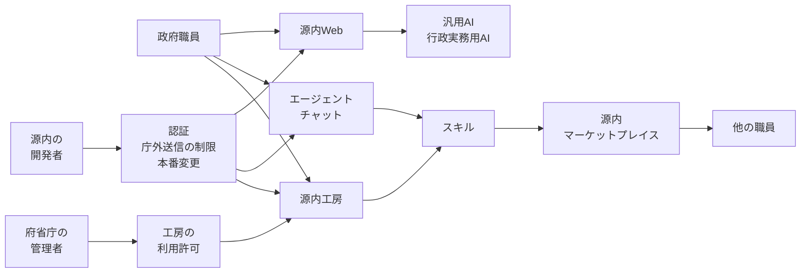

デジタル庁のガバメントAI「源内」は、政府職員が使う生成AIの利用環境です。2025年5月にデジタル庁内で運用が始まり、2026年5月からは全府省庁の約18万人を対象とする大規模実証に入っています。2026年9月18日の説明会報告は、職員が業務に応じてAIエージェントを構築し活用する環境を、本年10月頃に源内へ導入する予定だと書いています。

2026年10月6日、日経クロステックは試験提供を始める、と報じました。記者は大豆生田崇志です。公開リードは、単純なチャットから発展し、専門的知識がなくてもAIアプリケーションをつくり、エージェントが複数の業務工程を実行できるようにする、と書いています。

この記事では、源内Web、エージェントチャット、源内工房、スキルの共有、大分市のサービス、公開されているOSSを、公開資料の日付つきで並べます。あわせて、利用可能人数、用意されたアプリ、工房の利用許可、スキルの作成、共有後の実行を、別々の問いとして並べます。

日経クロステックの全文は、2026年10月19日時点で購読なしには開けていません。以下は、公開リードと、デジタル庁および大分市の公開資料に基づきます。

*この記事の全体像。以下、順に解説します。*

## 源内とは

源内は、デジタル庁が内製している政府職員向けの生成AI利用環境です。方針ページは、政府統一基準に沿ったセキュリティのもと、デジタル庁においては機密性2情報を含むプロンプトに対応する、と書いています。ログインは、ガバメントソリューションサービス（GSS）のシングルサインオンです。

方針ページの展開スケジュールは、次の順です。

- 2025年5月から、デジタル庁内で職員向けに運用を開始した
- 2026年1月から、一部省庁で試験的利用（リリース1.0）に入った。規模は全体で数百人、と書かれている
- 2026年5月頃から年度末にかけて、希望省庁への大規模導入実証（リリース2.0）を行う
- 2026年12月頃に、高度な生成AIアプリケーションの試験提供（リリース2.2）を予定している
- 2027年度から、利用省庁が予算措置する本格利用（リリース3.0）を予定している

同じページの最終更新日は、2026年10月15日です。概要は、2026年度中に全府省庁約18万人の政府職員が生成AIを利用可能とする予定、とも書いています。2026年3月6日のプレスは、約18万人を対象とした大規模実証の開始を告知しています。

職員がいま触る画面のアプリは、方針ページが二つに分けています。汎用AIは、対話、文章作成、要約、校正、翻訳です。行政実務用AIは、行政の業務に特化したアプリ群です。

### エージェントチャットと源内工房

2026年9月18日の説明会報告は、令和9年2月頃に公開予定の源内OSS Ver 2.0の予告として、二つの利用環境を説明しています。

エージェントチャットは、チャット画面から自然言語で指示し、ウェブ検索、資料生成、コード実行、スキルの作成と実行を組み合わせる環境です。2026年9月29日公開のワーキング・グループ報告は、これを通常のチャットの発展形とし、複数タスクの自動実行と、結果のファイル出力を挙げています。

源内工房は、個人専用サーバー上のコーディングAI環境です。説明会報告は、複数サイトを直接参照するDeep Research、動作するプロトタイプの開発、スキルのカスタマイズを挙げています。ワーキング・グループの画面イメージは、任意サイトの直接読み取り、ファイル操作、コマンド実行、Web取得を数十から数百ステップ、他人のスキルのカスタマイズ、と並べています。同じ報告は、工房をClaude Code相当の環境、とも書いています。

2026年10月19日に確認したデジタル庁の「エージェントチャット 導入編」は、エージェントチャットを源内の機能の一つと書き、源内のWeb画面から使う、と説明しています。スキルはプログラミング言語ではなく日本語の文章で書かれる、とも書いています。同じページは、作業後に「作業内容をスキルとして保存しておいて」と指示すると、`SKILL.md` がマイドライブの `skills` フォルダへ書き出される、と説明しています。源内工房については、より高度なエージェントを作り使う仕組みとして、デジタル庁が提供している、と現在形で書いています。

### スキル

説明会資料は、スキルを実行単位として定義しています。業務手順、判断基準、参照資料、関連データ、確認方法、出力形式、例外処理を、エージェントが実行できる形にしたものです。一つの法律から複数のスキルが生じることも、複数の法律を一つのスキルにまとめることもある、と資料は書いています。

同じ資料は、規模感のイメージとして、政府全体で1万から数万件、と置いています。前提は二つです。e-Govで表示される法律が約2,100件です。令和7年7月1日現在の人事統計で、行政職俸給表（一）の8級から10級に当たる職員が約4,000人です。そこから、法律・制度に基づく業務スキルを6,000件、課・室単位の業務スキルを4,000件、と置いています。見出しは「規模感の推測」です。

### 層の関係

いま職員が触れる源内と、エージェントの二つの環境と、共有の仕組みは、層が分かれています。図の共有と共通部品は、2026年9月の説明と、源内基準の目次案です。

源内基準の骨子は、関わる主体を利用者、管理者、源内開発者の三つに分けています。利用者は源内を使う政府職員です。管理者は、各府省庁のAI統括責任者、府省内の管理組織、情報システム管理者です。源内開発者は、デジタル庁で源内の企画、開発、提供、運用に携わる職員です。工房の利用許可と、開発者側の本番変更の承認は、この基準の目次に項目があります。

源内マーケットプレイスは、説明会報告が企画・構想段階と書いています。政府職員が作ったスキルを組織横断で共有する資材、という位置づけです。説明会のデモ画面は、共有して他の職員がダウンロードする流れを示しています。

### 政府のテナントと公開OSS

2026年4月24日に公開されたOSSは一部です。中身はWebインターフェースと、行政実務用RAGなどの開発テンプレートです。説明会報告は、行政実務用RAGについて、すでに20以上のアプリが府省庁の業務で稼働しており、Ver 2.0での大幅更新は予定していない、と書いています。エージェントチャットと源内工房は、令和9年2月頃公開予定のOSS Ver 2.0の資材として説明されています。当日の公開予定内容は開発中であり、変更があり得る、とも書かれています。

説明会FAQは、デジタル庁が自分で提供する源内と、OSSを自分で立てた環境を分けています。OSSは利用者を限定せず、民間や大学が使ってよい、と答えています。デジタル庁自身が提供するサービスについては、独立行政法人への提供時期は未定、令和9年度は原則として中央省庁の有償利用、機密性3を扱う予定は現時点でない、と答えています。

## 職員が触れる面

公開資料が並べている面は、次のとおりです。時期も、作るものも、共有の単位も違います。

| 面 | いつ | 誰が運用するか | 職員が作るもの | 共有 |
|---|---|---|---|---|
| いまの源内 | 庁内は2025年5月から。大規模実証は2026年5月から | デジタル庁が提供し、府省庁がテナントを持つ | デジタル庁などが内製したアプリを使う。説明会報告は、行政実務用RAGが府省庁の業務で20以上稼働、と書く | アプリの横展開はデジタル庁側の仕事 |
| エージェントチャットと源内工房 | 2026年9月の説明は10月頃の導入予定、9月末以降の順次試験提供予定。導入編は2026年10月19日時点で現在形 | 同じ政府環境の上。工房は管理者の利用許可が基準の目次にある | 職員がスキルを作る。工房ではプロトタイプも作る、と説明資料は書く | 個人の利用と、組織へのインストールは別 |
| 源内マーケットプレイス | 企画・構想。ワーキング・グループは年内リリース予定。審査の仕組みは検討中 | 未稼働 | 共有する単位はスキル | 審査を通った件数は、公開資料にない |
| Oita GENAI | 2026年10月1日から | 大分市が導入し、川口弘行合同会社が提供。LGWAN、国内のさくらクラウド | 市の発表は、用意された機能の利用。コード生成は用途の一つ | スキル共有の記載はない |
| 公開OSS | 一部は2026年4月24日。Ver 2.0は2027年2月頃の予定 | 立てた組織 | Ver 2.0で工房相当を公開する予定。現行の公開範囲はWebと一部アプリ | マーケットプレイスの資材は、Ver 2.0でも企画・構想段階と説明 |

説明会資料の別の箇所は、40種類以上のAIアプリケーションを使える、とも書いています。展開スケジュールの説明は、法制度調査支援AIや国会答弁検索AIなど約30種類をデジタル庁内で内製して源内で提供、とも書いています。20以上は府省庁業務で稼働する行政実務用RAG、約30種類はデジタル庁内の内製、40種類以上は使えるアプリ、と箇所が分かれています。

## 注意点

### 試験提供の開始日

日経クロステックの公開リードは、試験提供を始める、と書いています。掲載日は2026年10月6日です。開始日、対象人数、府省庁の範囲は、公開リードだけでは決まりません。全文は購読なしには開けていません。

デジタル庁の一次資料は、日付を予定で置いています。2026年9月18日の説明会報告は「本年10月頃に導入する予定」です。2026年9月8日のワーキング・グループを報告した2026年9月29日の資料は、「9月末〜10月以降順次」の試験提供予定であり、正式実装の前に統制を確認する、と書いています。

2026年10月19日時点の導入編と中級編は、エージェントチャットを源内の機能として説明し、源内工房も提供している、と現在形で書いています。どちらのページの本文にも、開始日、対象の府省庁、利用人数はありません。方針ページ（最終更新2026年10月15日）の展開スケジュールには、2026年5月頃からの大規模導入実証と、2026年12月頃の高度なアプリの試験提供はあります。エージェント環境の開始日そのものは、このスケジュールの項にはありません。

したがって、大規模実証そのものは発表済みです。エージェント環境について公開資料が示しているのは、9月時点の予定と、10月19日時点で使い方のページが現在形になっていることです。どの府省庁の何人に、いつから試験提供されたかは、これらのページには書かれていません。

### 約18万人と約16万人

約18万人は、大規模実証の対象です。2026年9月29日の資料は、2026年8月下旬時点で約16万人が利用可能、と書いています。約16万人は、その時点で利用可能だとされた人数です。アカウントを渡した件数とも、エージェントを作った人数とも、実行した人数とも、資料は書いていません。

「源内の試験がまだ始まっていない」とは読めません。約18万人を対象にした大規模実証は、2026年5月から2027年3月までの予定で、すでに発表されています。この人数を、スキルの作成数に読み替えない、という区別だけが要ります。

### 専門的知識は不要、という説明の範囲

「専門的知識は不要」は、操作を自然言語で行える、という公式の説明です。導入編も、専門的な知識は必要ない、と書いています。同じワーキング・グループ資料は、工房をファイル操作とコマンド実行を含む環境だと説明しています。

ワーキング・グループでは、研修を受けた人に限る案や、人の確認を当面原則にする、という議論があります。研修限定は、確定した入場条件としては書かれていません。事務局は、源内を行政の内部事務など、国民への処分性がない業務を前提にする、と説明しています。処分性のある行為には人の判断を挟む、という指摘に対し、事務局は当面は原則として人の確認を必須とする、と答えています。

導入編は、生成された内容が正しいとは限らないため、最終確認は職員自身が行う、と書いています。中級編は、出力誤り、信頼性の不明なファイル、機密性の三つを注意事項に挙げ、機密性2相当まで扱える一方、何を入力するかは所属機関のルールに沿って判断する、と書いています。

### 1万から数万件は規模感の推測

スキル「1万〜数万件」は、説明資料が規模感の推測と見出しを付けた推計です。法律約2,100件と、課長・室長クラス約4,000人から、法律系6,000件と課室業務4,000件を置いたものです。作成済みの件数ではありません。一つの法律から複数のスキルが生じ、複数の法律を一つのスキルで処理する場合もある、と資料自身が断っています。

### 自由に共有できる、はデモ画面の文言

「自由に共有・入手できる」は、説明会資料のデモ画面の文言です。同じ説明会の報告は、マーケットプレイスを企画・構想段階としています。9月29日の報告は、年内リリース予定であり、共有過程の審査の仕組みは検討中だと書いています。審査を通った共有の実績は、公開資料にはありません。

業務環境へインストールするものは、その環境のアプリ導入審査、または標準ガイドラインでの確認、という答えがあります。職員間の共有と、業務システムへのインストールは、同じ口ではありません。

### 庁外への通信は三つの文に分かれる

外に出る通信は、資料の間で言い方が揃っていません。工房の画面イメージは、任意サイトの直接読み取りとDeep Researchを機能に挙げています。同じ説明会のFAQは、ファイル操作は個人専用領域の中で行え、外部通信は不可、と答えています。ワーキング・グループの方向性は、源内工房ではMCPやAPI連携の制限は既に導入済みで、無断ではできない、と書いています。議論の回答本文は、制限される、と書くだけで、工房に限るとは明示していません。

三つの文が同じ口を指しているとは限りません。ウェブの読み取り、個人領域からの外部通信、MCPやAPIの無断送信を、一つの禁止にまとめないでください。ウェブの読み取りまで基盤が止めている、とまでは資料は書いていません。

### 大分市が導入した範囲

大分市の発表は、中核市で初めて、源内OSSをLGWAN上の生成AIサービスとして2026年10月1日に導入する、という範囲です。サービス名はOita GENAIです。提供は川口弘行合同会社です。国内のさくらクラウドで管理する、と市は書いています。

用途には、RAG、文字起こし、翻訳、画像、スライド、分析、政策立案の補助、プログラミングコードの生成があります。エージェントチャット、源内工房、スキルの庁内共有は、市の発表にありません。例規、答弁、マニュアルは「利活用が想定される業務」の中にあります。市が載せ終えた、とは発表は書いていません。

受託者の発表が「自治体で初めて」と書く場合、市の「中核市で初めて」より広いです。数えるときは市の文を優先します。川口弘行合同会社は2026年9月28日のリリースで、構造化RAGの構築を同社が担当した、と書いています。誰が例規や答弁を搭載したかは、市の発表だけでは決まりません。

### GSSの事案と源内のログイン

2026年9月11日に公表された個人情報の漏えい可能性は、GSSの事案です。漏えいした可能性がある個人情報は約24.6万件です。検知は2026年6月25日、侵入の判明は2026年7月9日です。源内はGSSでログインします。源内のプロンプトやスキルが漏れた、という記載は、この公表にはありません。

### 公開リポジトリの日付

2026年10月7日時点の公開リポジトリでは、genai-webのstarが566、genai-ai-apiのstarが354でした。genai-webの `pushedAt` は2026年10月4日で、defaultブランチ main の最新コミットは2026年8月14日でした。任意ブランチへのpushと、公開版の更新は別です。このstar数は、エージェント環境の利用人数でも、スキルの作成数でもありません。

## 何を1件と数えるか

非エンジニアのAI開発を件数にするとき、源内では次の5段が混ざりやすいです。2026年10月19日の公開資料で実数として言えるのは、上の2段までです。

| 段 | 問い | 2026年10月19日時点で言えること |
|---|---|---|
| 1. 使える | 源内に入れる職員は何人か | 約18万人が対象。8月下旬時点で約16万人が利用可能。実行者数ではない |
| 2. 用意されたアプリが動く | デジタル庁などが載せたアプリは何本か | 行政実務用RAGは20以上が府省庁業務で稼働、約30種類を庁内で内製、40種類以上を使える、という三つの書き方がある。定義は未照合 |
| 3. 作る許可がある | 工房の利用許可は何人か | 基準の目次に項目がある。人数は未公表 |
| 4. 作った | スキルは何件できたか | 1万から数万は潜在規模の推測。導入編は保存の手順を書く。作成数は未公表 |
| 5. 共有のあとで動く | 審査を通り、他者が実行しているスキルは何件か | マーケットプレイスは未稼働。審査の仕組みは検討中。実行回数は未公表 |

作成数だけを数えると、個人領域の下書きが開発になります。共有後も動いている数だけを数えると、共有の仕組みができるまで件数はゼロのままです。どちらを主指標にするかは、政策の主張で先に決まります。仕組みが無い段階のゼロを、定着の失敗の証拠にはできません。母数が無いゼロは、失敗の数ではありません。

導入編が現在形であることは、4段目の作成数を埋めません。使い方のページは、スキルを `SKILL.md` として個人のマイドライブへ保存する手順を説明しています。保存された件数、組織を越えて実行された件数は、そのページにありません。

## 作成と共有と基盤変更を分ける

共通部品の責任は、職員の作成権とは別です。認証はGSSを使います。本番の変更承認とデプロイ権限は、源内開発者の責務として基準の目次にあります。これは、職員が作ったスキルの公開承認そのものではありません。

職員の成果物を他人に渡す口は、検討中のマーケットプレイス審査と、業務環境への導入審査です。作成、組織内での利用、政府横断の共有、基盤の変更は、四つの承認です。

「すでに権限が分かれて実装されている」とは書けません。分かれる、と基準の目次と審査の検討が示しています。実装の確認は、源内基準の本文と、マーケットプレイスの稼働後です。2026年10月上旬の策定・公表が予定されていました。2026年10月19日にデジタル庁サイトを確認した範囲では、源内基準の確定本文のURLは特定できていません。方針ページの最終更新は2026年10月15日ですが、取得したスケジュール本文に基準の全文へのリンクはありませんでした。

共通部品の変更を基盤側に残す、と書いてよい根拠は三つです。GSSによる認証、源内工房におけるMCPやAPIの外部送信制限、源内開発者のデプロイ権限の分離です。方向性の箇条書きは、工房以外の面まで同じ制限だとは書いていません。

トークンを使い切る課題は、ワーキング・グループで挙がっています。上限の数値は、公開資料のこの範囲では取れていません。デジタル庁内では、各職員が利用状況をダッシュボードで確認できる、と説明資料にあります。画面は庁内専用です。府省庁展開後の源内全体にある、とまでは書いていません。説明会は、利用実績の書き出しをVer 2.0の資材にする、と言っています。

## 大分市は共通OSSの別環境

大分市は、共通OSSと自治体差分の対として置きます。差分は、LGWAN、市の保有情報を参照するRAG、受託事業者による運用、コード生成という用途です。政府側が足そうとしている差分は、エージェントチャット、個人用の工房、横断のスキル共有です。

市がコード生成を用途に含めているので、チャットだけの派生、と切ると市の発表に反します。工房とスキル共有の記載がない、という区別は残ります。市が国の工房を運用し始めた、という書き方は、市の発表の範囲を超えます。政府のエージェント工房を、市がそのまま動かしているわけではありません。

## 公開資料がまだ分けていない問い

次は、2026年10月19日の公開資料ではまだ一つにできません。

- エージェントチャットと源内工房は、どの府省庁の、何人に、いつから試験提供されたか。日経クロステックの有料本文に日付がある可能性はあります。デジタル庁の開始を告げるプレスは、方針ページのスケジュールと、導入編・中級編の本文には見当たりません
- 源内基準は、2026年10月上旬の公表予定どおり出たか。確定本文のURLは、今回確認した方針ページの範囲では特定できていません
- FAQの「外部通信は不可」と、工房イメージの「任意サイトを直接読む」は、同じ環境の同じ口か
- 大分市の調達仕様に、エージェントやスキル共有が含まれるかは、市の報道発表の範囲では分からない
- GSS事案の製品名とCVEは、2026年9月11日の公表の範囲ではこの記事では確認していません。源内テナントへの波及は、この公表からは言えません

## まとめ

源内で「職員が作った」と数える前に、五つの段を分けます。今日の実数として使えるのは、利用可能にした約16万人と、デジタル庁側のアプリが稼働していることです。アプリの本数は、20以上、約30種類、40種類以上と、資料によって母数が違います。

職員発のスキル件数は、まだ母数がありません。1万から数万は、法律と課長・室長の人数から置いた規模感の推測です。導入編が現在形でも、作成数と共有後の実行数は出てきません。マーケットプレイスは企画・構想で、審査を通った件数はまだ数えられません。仕組みが無い段階のゼロを、定着の失敗と書かないでください。

作成と公開は分けます。ただし、すでに権限が実装で分かれている、とは書きません。分ける、と基準の目次と審査の検討が示しています。庁外送信は、ウェブの読み取り、個人領域からの外部通信、MCPやAPIの無断送信を、一つの禁止にまとめません。大分市は、LGWAN上の源内OSS派生であり、国の工房の稼働開始ではありません。

この記事が少しでも参考になった、あるいは改善点などがあれば、ぜひリアクションやコメント、SNSでのシェアをいただけると励みになります！

## 参考リンク

- [デジタル庁「ガバメントAI『源内』」（最終更新 2026-10-15）](https://www.digital.go.jp/policies/genai)
- [デジタル庁「エージェントチャット 導入編」](https://www.digital.go.jp/policies/genai/agentchat-introduction)
- [デジタル庁「エージェントチャット 中級編」](https://www.digital.go.jp/policies/genai/agentchat-intermediate)
- [デジタル庁「全府省庁の約18万人の政府職員を対象としたガバメントAI（源内）の大規模実証を開始します」（2026-03-06）](https://www.digital.go.jp/news/2d69c287-2897-46d8-a28f-ea5a1fc9bce9)
- [デジタル庁「ガバメントAI『源内』をOSSとして公開しました」（2026-04-24）](https://www.digital.go.jp/news/907c8e5d-2f4f-4bd7-9400-37c9f4221d7d)
- [デジタル庁「ガバメントAI 源内OSS Ver 2.0の計画に関する全国オンライン説明会を開催しました」（2026-09-18）](https://www.digital.go.jp/news/e525db0b-eac1-49e2-9ef4-6d2e24208498)
- [説明会資料 PDF（2026-09-18）](https://www.digital.go.jp/assets/contents/node/information/field_ref_resources/e525db0b-eac1-49e2-9ef4-6d2e24208498/159b5309/20260918_news_gennai_outline_01.pdf)
- [説明会 FAQ PDF（2026-09-18）](https://www.digital.go.jp/assets/contents/node/information/field_ref_resources/e525db0b-eac1-49e2-9ef4-6d2e24208498/5264b35c/20260918_news_gennai_faq_03.pdf)
- [先進的AI利活用アドバイザリーボード第3回 WG 実施報告 PDF（2026-09-29）](https://www.digital.go.jp/assets/contents/node/basic_page/field_ref_resources/162953b0-3dc0-46a6-a24c-0e3a335e0495/7545ff68/20260929_meeting_ai-advisory_outline03.pdf)
- [デジタル庁「GSSへの不正アクセスによる職員等の個人情報の漏えいの可能性について」（2026-09-11）](https://www.digital.go.jp/news/2026-0911-01)
- [大分市「源内を活用した生成AIサービスを中核市で初めて導入します」（2026-09-18）](https://www.city.oita.oita.jp/o252/seiseiai/hodo/hodo.html)
- [日経クロステック、大豆生田崇志「ガバメントAI基盤『源内』、職員は専門知識不要でAIエージェント内製可能に」（2026-10-06、公開リード）](https://xtech.nikkei.com/atcl/nxt/column/18/03777/100200002/)
- [GitHub digital-go-jp/genai-web](https://github.com/digital-go-jp/genai-web)
- [GitHub digital-go-jp/genai-ai-api](https://github.com/digital-go-jp/genai-ai-api)
