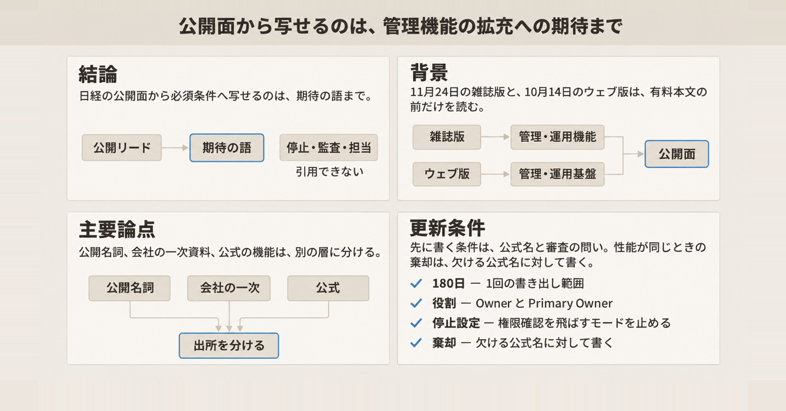
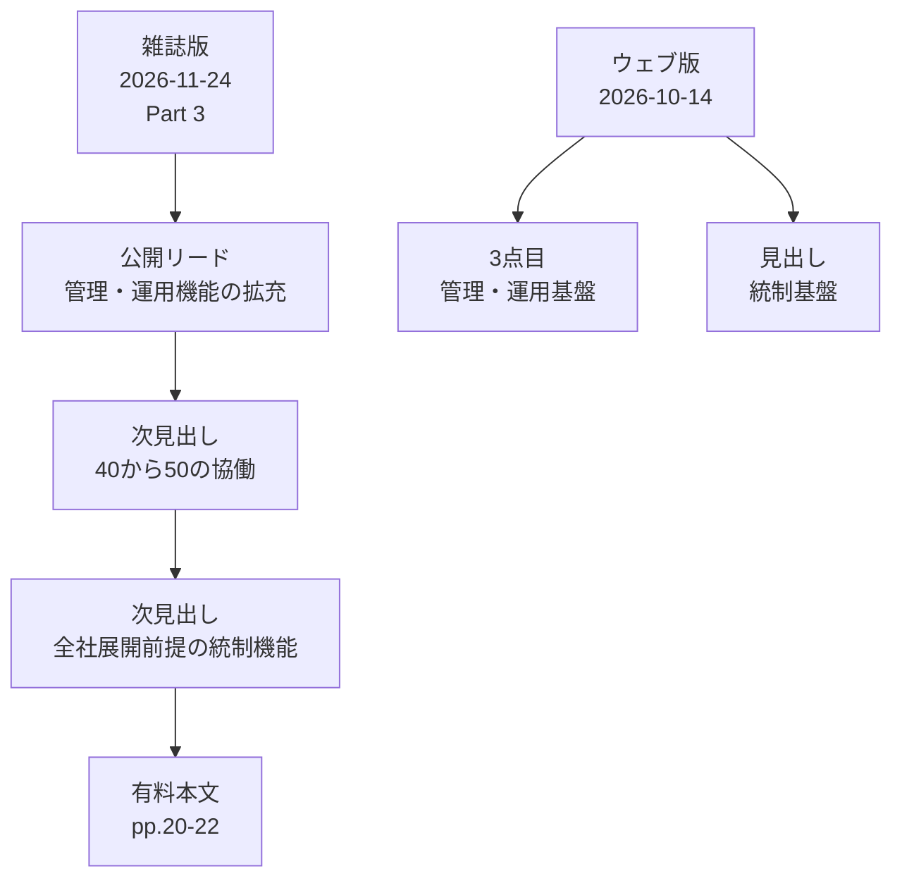
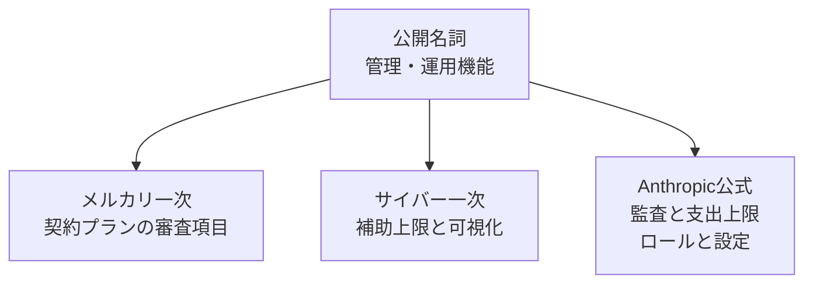

2026年11月24日、日経クロステックは、日経コンピュータ連載「膨張アンソロピック」の［Part 3］「サイバーにメルカリ　活用企業の本音」を公開しました。公開リードは、有料本文の前に画面で読める冒頭です。そこには、サイバーエージェントとメルカリが Claude を全社展開して事業向けシステム開発に使い、今後はモデルの性能向上よりも AI エージェントの管理・運用機能の拡充を期待する、と書いています。Claude は、このリードが名指しする米 Anthropic（アンソロピック）の生成 AI です。同じ期待は、2026年10月14日のウェブ版「Claude拡大の理由」の3点目にもあります。ウェブ版の語は「管理・運用基盤」です。

この記事では、公開面が置いている語、両社の一次資料が置いている数字と審査項目、Anthropic の公式が置いている管理機能を、出所ごとに分けます。分けたあとで、契約更新の条件にどの文を写せるかを表にします。日経の本文は有料会員限定であり、ここで読むのは公開面までです。想定する読者は、自社の契約更新条件を書く発注側です。

*この記事の全体像。以下、順に解説します。*

## 管理・運用機能とは

管理・運用機能は、2026年11月24日の公開リードが、モデルの性能向上よりも拡充を期待する、と書いた語です。リードの原文は、次のとおりです。

> Claudeを全社展開し、事業向けシステム開発に生かすサイバーエージェントとメルカリ。他の大手AI（人工知能）企業に比べて、アンソロピックの企業重視の姿勢に注目した。今後はモデルの性能向上よりもAIエージェントの管理・運用機能の拡充に期待する。

雑誌版の URL は [日経クロステックの Part 3](https://xtech.nikkei.com/atcl/nxt/mag/nc/18/111500581/111500003/) です。画面の日付は 2026.11.24、読了目安は 7 分、回の表示は［Part 3］です。画面の署名は山端宏実と太田萌枝です。ページに埋め込まれた著者名は山端宏実のみです。公開日時と更新日時は、どちらも `2026-11-24T07:02:00+09:00` です。

画面のページ送りは、1、2、3 の3ページです。1ページの次見出しは「40～50のAIエージェントが協働」です。2ページの次見出しは「全社展開前提の統制機能に魅力」です。3ページの出典行は「日経コンピュータ、2026年11月26日号 pp.20-22」です。連載全体の出典行は pp.10-29 です。公開面にある管理の名詞は、リードの「管理・運用機能」と、次ページ見出しの「統制機能」です。タグは #アンソロピック #生成AI #AIエージェント です。

ウェブ版の URL は [Claude拡大の理由](https://xtech.nikkei.com/atcl/nxt/column/18/03757/100600003/) です。画面の日付は 2026.10.14、読了目安は 8 分、第3回、著者は太田萌枝のみです。見出しは「Claude拡大の理由　『ミスなし』評価のサイバー、メルカリは統制基盤に信頼」です。3点目は「両社が米Anthropicへ期待するのはモデル性能よりもエージェントの『管理・運用基盤』」です。次ページ見出しは「メルカリは全社展開前提の統制機能に魅力」です。ページ送りは 2 までです。ページに埋め込まれた更新日時は `2026-11-06T16:16:00+09:00` です。

ウェブ版は、2025年10月の東京オフィス開設、2026年6月の「Code w/ Claude」東京開催、幹部の「実際、日本にはアーリーアダプターが多い」を、記事の記述として置いています。アーリーアダプターは、新しいものを早く取り入れる人、というこの発言の語です。東京開催は、サンフランシスコ、ロンドンに続く3都市目、と書かれています。

公開面は3層に分かれます。読めるのはリードと次ページ見出しまでで、見出しの中身は有料本文にあります。

リードの「管理・運用機能」の下には、別々の出所が並びます。記事の公開名詞、両社の一次資料、ベンダー公式は、別々の層です。

メルカリの一次資料が契約プランに尋ねている項目は、SSO（SAML、OIDC）、監査ログの有無、DWD や権限混同の抑止、MCP サーバなど接続先の制限、ポリシーの一斉配信です。出典は市原尚久の 2026年5月25日の資料です。SSO は、社内のアカウントでその製品へログインできるか、という審査項目の名前です。SAML と OIDC は、スライドが SSO の括弧内に並べた接続方式の名前です。DWD と権限混同は、スライドが抑止できるかを問うときに使った呼称です。MCP サーバは、接続先の制限の例としてスライドが挙げた名前です。

サイバーエージェントの一次資料が置いているのは、開発AIエージェントの費用補助と、利用状況の可視化です。[2026年7月9日の公式ニュース](https://www.cyberagent.co.jp/news/detail/id=33582) の対象は、開発業務のエンジニア約1,200名への費用補助です。1人あたり月額200米ドル、年間約4億円規模の見込み、と書かれています。[2026年6月18日の社内ブログ](https://developers.cyberagent.co.jp/blog/archives/64334/) は、執筆時点の現在として、社内の Claude Code ユーザー約2,000人と、利用状況、コスト、権限、設定、セキュリティの可視化を書いています。Claude Code は、このブログがユーザー数を数えている、開発向けの Claude の名前です。

Anthropic の公式が置いている管理機能には、監査ログの Export logs、Compliance API、Spend Limits、メンバー一覧と組織ロール、SSO / SCIM、Claude Code の managed settings があります。Export logs は、監査ログをまとめて書き出す操作の公式名です。Compliance API は、そのログをボタン以外から出す経路の公式名です。Spend Limits は、支出の上限を扱う公式名です。managed settings は、Claude Code を組織の設定で配る公式の仕組みの名前です。SCIM は、公式が SSO と並べているメンバー管理の名前です。

## 注意点

### 公開面にある語と、見出しだけの数

雑誌版とウェブ版の公開面に、停止、監査、担当、可視、ベンチマークの語はありません。ここで無いのは、日経の公開面に書かれた語です。後で条件に書く監査ログは、メルカリが契約プランに尋ねる項目と、Anthropic 公式の制約です。この5語の言い換えではありません。これらの語で必須条件を書くと、日経記事からの引用にはなりません。有料本文は未読なので、記事全体がそれらの語を欠く、とまでは言えません。見出しの「統制機能」と「40～50」は、本文が規模と統制に触れている兆候であり、機能名の証拠ではありません。

「40～50」は、雑誌版の次ページ見出しにだけあります。ウェブ版の公開面にも、両社の一次資料にも、この数は確認できていません。連載一覧の「2兆ドル（約300兆円）」と、姉妹カードの「4700兆円超」は、Part 3 の公開リードにはありません。

### リードの動詞は「注目した」である

「他の大手より企業向けの姿勢を選んだ」は、公開リードより強い言い方です。リードの動詞は「注目した」です。ウェブ版は「なぜ選ぶのか」と問い、見出しで両社の理由を分けます。サイバーエージェントは「ミスなし」評価、メルカリは「統制基盤」です。公開されている答えは「注目」と「期待」までです。

雑誌版の「管理・運用機能」と、ウェブ版の「管理・運用基盤」は、別の公開面の語です。同じ本文だとは書けません。公開リード、見出し、ページ数は、二つの記事で違います。本文がどこまで同じかは、有料部分を読んでいません。

### 全社展開という語の出所

「Claudeを全社展開」は、日経のリードの言葉です。サイバーエージェントの公式ニュースが書く対象は、開発業務のエンジニア約1,200名への開発AIエージェントの費用補助です。Claude 専用とは書かれていません。長瀬慶重氏は、年間約4億円規模を想定した投資が計画を大幅に超えた、と書いています。約4億円は、実績額の確定値ではありません。書けるのは、方針と想定規模、そして実績は計画を超過した、までです。

2026年6月18日の社内ブログが約2,000人と書くのは、執筆時点の現在の Claude Code ユーザーです。2026年6月12日は、Boris Cherny 氏との Q&A の日付であり、人数の基準日とは書かれていません。同じブログは、全社統一の使い方にはしない、とも書いています。

### 対外成果として出ている開発量

対外に出ている成果は、まだ開発量です。同じ公式ニュースは、一部の開発組織で開発量が約2倍、本文ではゲーム部門のモック制作量が約3倍速、長瀬氏の発言ではモック制作量が約3倍、と置き方が揺れます。GitHub Copilot のコード補完の採用回数は約75%減で、注記は「AI活用の縮小ではない」と書きます。各数値は代表事例であり、全社平均ではない、と注記があります。

[2025年6月19日の開発者ブログ](https://developers.cyberagent.co.jp/blog/archives/57194/) は、企業向けの管理機能が後追いになりがちなので待たず、エンジニア1人あたり月額200米ドルの個人予算を渡した、と書きます。この記述は、「すでに揃った企業向け管理機能を選んだ」とは噛み合いません。「今後、拡充を期待する」とは両立します。確認日の 2026年11月25日から見ると、約17ヶ月前です。

対外成果が開発量であることは、「買う対象がすでに運用面へ移った」を弱めます。リードの「今後は性能より管理」と、いま出している成果指標は別です。

### 決算資料の倍率と利用率

メルカリの 1.9倍は、[FY2026.6 2Q の決算説明資料](https://pdf.irpocket.com/C4385/YpwX/xtlo/KPhB.pdf) p.9 の脚注2です。FY2026.6 は、2026年6月期の決算資料の表記です。1.9倍は、FY2025.6 2Q と FY2026.6 2Q のコード変更量を、当時のエンジニア人数で割った、1人あたり開発量です。

同じ頁の利用率100%は脚注1です。時点は 2026年1月末です。対象は、ChatGPT、Gemini、Claude Code、Cursor、LiteLLM、Notion AI のいずれかです。休職者、退職確定者、鹿島アントラーズ雇用者を除きます。Claude 単独の利用率でも、1.9倍の分子でもありません。

7.6倍は、[FY2026.6 の通期資料](https://storage.googleapis.com/disclosed-file-bucket-d4575ee/20260804508835/1/general.pdf) の本文「エンジニア1人あたり開発量はAI化前(FY2024.6)比 7.6倍」と、脚注3の同じ定義です。定義は、コード変更量を人数で割ったものです。49.5万時間は別の脚注2で、利用率100%を前提にした業務削減の推定であり、コード変更量ではありません。2026年11月12日の FY2027.6 1Q 資料を検索した範囲では、7.6倍とコード変更量の再掲はありませんでした。

### メルカリの審査項目

監査ログは、メルカリの審査項目としてはあります。[市原尚久の 2026年5月25日の資料](https://speakerdeck.com/naoichihara/agentic-aishi-dai-niokeru-merukarinoaigabanansutogadorerushi-zhuang) は、契約プランに次を尋ねます。表記はスライドのままです。

- 「SSO対応有無 (SAML, OIDC) / 監査ログの有無」
- 「想定する契約プランに含まれるか ?」
- 「“DWD”や”権限混同問題 ”を抑止できる管理機能があるか ?」
- 「MCPサーバなど接続先を制限する管理機能があるか ?」
- 「ポリシーの一斉配信・適用が可能か ?」

これは、Claude の監査ログを取得し保管している、という宣言ではありません。停止と、担当の可視性は、この抜粋にありません。DWD、権限混同、MCP サーバの中身も、この行には書かれていません。一次資料にベンダーへの問いが無い、とは言えません。審査項目そのものが、契約プランへの問いです。

### 公式ドキュメントが書く制約

公式側の制約は、機能名ごとに分かれます。2026年11月25日に開いた [Access audit logs](https://support.claude.com/en/articles/9970975-access-audit-logs) は、監査ログを Enterprise のみとし、Owner と Primary Owner が Export logs で過去180日分を集約する、と書きます。180日は、1回の書き出しで集約する範囲です。ログを何年残す保持期間の数値は、ここには入れていません。Owner と Primary Owner は、監査ログを出せる組織の役割の名前です。ダウンロードリンクは24時間です。ファイル形式の語は、そのページにはありません。

監査ログでは、チャットとプロジェクトのタイトルおよび本文は出ず、識別子だけです。チャットの入出力は、Primary Owner の data exports では出せる、と同じページが書きます。data exports は、そのページがチャットの入出力を出す経路として書く名前です。顧客が管理する暗号鍵を使う組織は、Export logs のボタンでは出せず、Compliance API 側です。

実行中のエージェント1本だけを止める単一の機能名は、同日に開いた管理ページでは未確認です。近い別名は、メンバーの `Sign out everywhere`、Managed Agents の `user.interrupt`、事前に用意された作業役向けの Stop Work です。`Sign out everywhere` は、メンバーを一斉にサインアウトする操作の名前です。Managed Agents は、`user.interrupt` という操作名が付いていた箇所の呼び名です。3つとも、1本だけを止めるボタンとして確認できた名前ではありません。

2026年11月25日に開いた [Workspace roles](https://platform.claude.com/docs/en/manage-claude/workspaces) の表は、Workspace User、Workspace Limited Developer、Workspace Developer、Workspace Admin、Workspace Billing です。Workspace は、公式が権限を分ける単位として置く名前です。owner というワークスペース役割は、その表にはありません。監査ログを出せる組織ロールは、上のサポート記事が書く Owner と Primary Owner です。メンバー一覧と組織ロールは、[ユーザー管理](https://platform.claude.com/docs/en/manage-claude/user-management) のページが扱う項目です。支出の上限は、[Spend Limits](https://platform.claude.com/docs/en/manage-claude/spend-limits-api) として公式が置いています。

bypass permissions を組織設定で止める書き方は、[managed settings](https://code.claude.com/docs/en/managed-settings) の公式サンプルにあります。設定名は `disableBypassPermissionsMode`、値は `"disable"` です。bypass permissions は、権限の確認を通さずに動かすモードの名前です。この値は、そのモードを組織設定で止める書き方です。

### ベンダー発表の日付

2026年11月5日の Claude Enterprise の可視性と制御、2026年11月23日のゼロデータ保持は、ベンダー側が管理を強める発表です。ゼロデータ保持は、その日の発表の名前です。両社の購買基準が移った証拠ではありません。2026年11月9日の Claude Fable 5.2 と Mythos 5.2 は、雑誌版と同じ週ではなく、2週間前の性能発表の名前です。個別記事の URL は確認時に 404 で、使ったのはニュース一覧と製品ページの見出しだけです。

### 本文を読むまで残る問い

有料本文が、停止、監査、担当、ベンチマーク、40～50 の中身をどう書いているかは、未読のままです。実行中のセッションを1本止める機能が、今回開いていないページにあるかも、未確認です。監査ログの6年保持、稼働率のパーセント、CSV の保管リージョンは、ここには入れていません。2026年11月12日以降のメルカリ資料が、コード変更量を再掲するかも、未確認です。

## 公開リードを更新条件にどこまで写せるか

現在の結論は、公開面だけでは、契約更新の必須条件を「停止、監査、担当の可視性」へ置き換える根拠に足りない、です。

支持する材料は、次の3点です。

- 公開リードが期待として名指しするのは、「管理・運用機能の拡充」までです。ウェブ版の3点目は「管理・運用基盤」です。
- 停止、監査、担当、可視、ベンチマークの5語は、両記事の公開面と、連載一覧の公開要約にありません。
- 両社の一次資料に、そのうち停止、監査、担当の可視性を、契約更新の必須条件として並べた文は確認できていません。

結論を弱める材料は、前節のとおりです。有料本文は未読で、次ページ見出しは統制と規模に触れます。メルカリは、監査ログと管理機能が契約プランに含まれるかを尋ねています。対外成果は開発量です。11月のベンダー発表は、購買基準が移った証拠ではありません。

写せる文と、写せない文は、次の表で分けます。

| 書きたい文 | 転記 | 出所 |
| --- | --- | --- |
| 両社は性能より管理・運用機能の拡充を期待する、と日経の公開リードが書く | 可。公開リードの引用として | 雑誌版 2026-11-24 |
| 期待の語は管理・運用基盤である | 可。ウェブ版の3点目として。雑誌版と同一本文とは書かない | ウェブ版 2026-10-14 |
| 必須条件は停止、監査、担当の可視性である | 不可。公開面からの転記としては不可。自社の提案として書くなら、提案だと明記する | 雑誌版とウェブ版の公開面 |
| 性能が同点でも管理機能の欠如で棄却する | 記事には無い。棄却するなら、欠ける公式機能名を先に書く | 発注側の基準 |
| 監査ログが契約プランに含まれるか | 可。メルカリの審査項目として | 市原スライド 2026-05-25 |
| SSO 対応の有無、接続先を制限できるか、ポリシーを一斉に配れるか | 可。審査項目の問いとして。DWD、権限混同、MCP サーバは、問いの中の例の名前で、中身は文言に無い | 同上 |
| 監査ログを180日分、Owner が Export logs で出す。リンクは24時間 | 可。Anthropic 公式の制約として。プランは Enterprise。ファイル形式はそのページに無い | サポート記事。確認日 2026-11-25 |
| bypass permissions を組織設定で止める | 可。`disableBypassPermissionsMode` の値 `"disable"` は公式サンプルにある | managed settings |
| 実行中のエージェント1本を止めるボタンがある | 不可。開いた公式ページでは未確認 | 2026-11-25 |
| 担当の可視性という単一機能がある | 不可。ワークスペース側は公式表の5ロール。監査ログを出せるのは Owner と Primary Owner | Workspace roles と監査ログのサポート記事 |
| 1.9倍、7.6倍、利用率100%は Claude の効果である | 不可。定義は上の脚注 | 決算 PDF |
| 40～50体を運用している | 不可。見出しのみ。会社の一次資料では未確認 | 雑誌版の次ページ見出し |
| 約4億円を使った | 不可。方針と想定規模。実績は計画超過とだけ書ける | 公式ニュース id=33582 |

## 契約更新の条件に先に書く項目

自社の更新条件に先に書くなら、記事のカテゴリ名ではなく、公式名か自社の審査項目です。並べるのは、次の6つです。

1. 監査ログを書き出せる役割と、1回で集約できる範囲。Enterprise の Owner または Primary Owner が、Export logs で過去180日分を集約します。180日は保持期間ではありません。ダウンロードリンクは24時間です。顧客管理の暗号鍵を使う組織は、Compliance API 側です。
2. 支出上限の有無。公式名は Spend Limits です。
3. 組織ロールの一覧。監査ログを出せるのは Owner と Primary Owner です。Workspace の表に owner という役割はありません。
4. `disableBypassPermissionsMode`。公式サンプルの値 `"disable"` は、bypass permissions（権限の確認を通さずに動かすモード）を止めます。managed settings で拒否できる操作のうち、ここに中身があるのはこの1つです。
5. 接続先の制限。メルカリの審査項目は、接続先を制限できるかを尋ね、例として MCP サーバを挙げます。MCP サーバが何のサーバかは、その問いの文言にはありません。写すなら、サーバの定義ではなく、接続先を制限できるか、という問いとして写します。
6. ポリシーを一斉に配れるか。同じ審査項目が、一斉配信と適用を尋ねます。どの規則を指すかは、その問いの文言にはありません。写すなら、一斉に配れるか、という問いとして写します。

性能の表が同点のときに棄却するなら、その棄却は、上のリストの欠落に対して書きます。「管理・運用機能が無い」とは書きません。欠ける公式名を先に書きます。

条件文は、出所を分けて二つ書きます。一つは報道の引用です。「日経クロステックの 2026年11月24日の公開リードは、サイバーエージェントとメルカリが、モデルの性能向上よりも AI エージェントの管理・運用機能の拡充を期待する、と書いています。」もう一つは自社のゲートです。「更新の必須条件は、Owner または Primary Owner が Export logs で過去180日分を書き出せること、Spend Limits の有無、組織ロール、`disableBypassPermissionsMode` で bypass permissions を止めること、接続先を制限できるか、ポリシーを一斉に配れるか、とする。」停止、監査、担当の可視性は、日経記事の引用としては書きません。

具体のゲートは、メルカリが審査項目にしている監査ログ、接続先を制限できるか、ポリシーの一斉配信と、Anthropic 公式のプラン差、Export logs の過去180日分、リンクの24時間、`disableBypassPermissionsMode` を、出所を分けて書きます。SSO 対応の有無は、この6項目とは別に、メルカリの審査項目の問いとして残します。SAML と OIDC のどちらを必須にするかは、この記事では決めません。有料本文を読んだあとで、見出しの「統制機能」が上の公式名のどれを指すかを切り直します。本文を読むまでは、記事全体が根拠にならない、とも、記事がすでに停止、監査、担当の可視性を必須条件にした、とも書きません。

## まとめ

2026年11月24日の公開リードが期待として名指しするのは、管理・運用機能の拡充までです。2026年10月14日のウェブ版は、同じ位置を管理・運用基盤と呼びます。停止、監査、担当の可視性は、公開面の引用にはできません。40～50、約4億円の実績、1.9倍、7.6倍、利用率100%も、見出しや脚注の定義を外して Claude の効果としては書けません。

契約更新の条件に先に書くのは、Owner または Primary Owner が Export logs で過去180日分を書き出せること、Spend Limits、組織ロール、`disableBypassPermissionsMode`、接続先を制限できるか、ポリシーの一斉配信です。180日は保持期間ではなく、1回の書き出しで集約する範囲です。性能が同点のときの棄却は、このリストの欠落に対して書きます。有料本文を読むまでは、見出しの統制機能を、これらの公式名へ対応づけません。

この記事が少しでも参考になった、あるいは改善点などがあれば、ぜひリアクションやコメント、SNSでのシェアをいただけると励みになります！

## 参考リンク

- [日経クロステック、雑誌版、2026-11-24](https://xtech.nikkei.com/atcl/nxt/mag/nc/18/111500581/111500003/)
- [連載一覧](https://xtech.nikkei.com/atcl/nxt/mag/nc/18/111500581/)
- [日経クロステック、ウェブ版、2026-10-14](https://xtech.nikkei.com/atcl/nxt/column/18/03757/100600003/)
- [サイバーエージェント公式ニュース id=33582](https://www.cyberagent.co.jp/news/detail/id=33582)
- [サイバーエージェント開発者ブログ、2025-06-19](https://developers.cyberagent.co.jp/blog/archives/57194/)
- [サイバーエージェント開発者ブログ、2026-06-18](https://developers.cyberagent.co.jp/blog/archives/64334/)
- [メルカリ FY2026.6 2Q](https://pdf.irpocket.com/C4385/YpwX/xtlo/KPhB.pdf)
- [メルカリ FY2026.6 通期](https://storage.googleapis.com/disclosed-file-bucket-d4575ee/20260804508835/1/general.pdf)
- [市原尚久、2026-05-25](https://speakerdeck.com/naoichihara/agentic-aishi-dai-niokeru-merukarinoaigabanansutogadorerushi-zhuang)
- [Access audit logs](https://support.claude.com/en/articles/9970975-access-audit-logs)
- [Deploy managed settings](https://code.claude.com/docs/en/managed-settings)
- [Spend Limits API](https://platform.claude.com/docs/en/manage-claude/spend-limits-api)
- [User management](https://platform.claude.com/docs/en/manage-claude/user-management)
- [Workspace roles](https://platform.claude.com/docs/en/manage-claude/workspaces)
