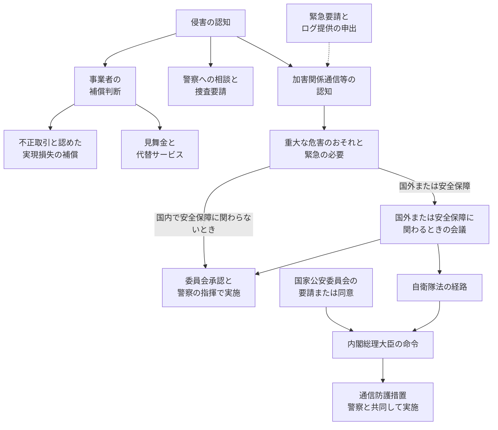

2026年10月1日から、攻撃に使われるサーバー等へ電気通信回線を介して働きかけるアクセス・無害化措置を、警察官職務執行法と自衛隊法に基づいて実施できます。この記事が扱う能動的サイバー防御は、このアクセス・無害化措置です。2026年10月24日、GMOインターネットは「お名前.comデスクトップクラウド」への不正アクセスに関する第4報で、損失の補償とあわせ、政府へこの措置の緊急要請をしたと公表しました。お名前.comデスクトップクラウドは、契約中の顧客にWindowsデスクトップを提供するサービスです。読売新聞は同日、政府関係者の説明を伝えています。

この記事では、アクセス・無害化措置が何をするか、誰が要件を認定し、どの承認と指揮で実施されるかを、公開された法令と運用指針に沿って整理します。侵害が起きたときに、補償、警察への相談、政府への具申（実施を求める申出）を、同じ記録欄へ混ぜないための分け方も示します。日本経済新聞が伝える政府高官の発言は、会見録を確認していない二次情報です。

*この記事の全体像。以下、順に解説します。*

## アクセス・無害化措置とは

能動的サイバー防御のうち、攻撃に使われるサーバー等へ電気通信回線を介して働きかける部分を、アクセス・無害化措置と呼びます。2026年10月1日から、警察官の職務執行を定める警察官職務執行法（以下、警職法）第6条の2と、自衛隊の組織と行動を定める自衛隊法第81条の3に基づく実施が可能です。根拠の整備は、重要電子計算機に対する不正な行為による被害の防止に関する法律（令和7年法律第42号。政府資料ではサイバー対処能力強化法。以下、強化法）と、その整備法（令和7年法律第43号）です。整備法は、警職法第6条の2の改正元です。重要電子計算機は、強化法が被害防止の対象として扱う計算機です。自衛隊法は、この定義をさらに限定して対象にします。

### 法令と施行日

政令第46号は、強化法の附則第1条本文の施行日を、令和8年（2026年）10月1日と定めたものです。附則は、施行日などを定める、法律本体に付く規定です。本則は、附則以外の法律本体の規定です。通信情報の取得と取扱いを定める第3章から第7章は、公布から2年6月を超えない範囲で、別の政令が定める日に施行されます。第31条は第5章にあり、通信情報を扱います。第8章は、2026年10月1日の本則施行に含まれます。第8章の第37条は、内閣総理大臣が情報を整理し、分析すると定める規定です。アクセス・無害化を実施する権限は、警職法第6条の2と自衛隊法第81条の3です。

### 警察が措置をとるとき

サイバー危害防止措置執行官は、警察庁長官が、必要な知識と能力を有する警察官の中から指名します。執行官が、情報技術利用不正行為に用いられる電気通信もしくは電磁的記録、またはその疑いを認めたときが起点です。情報技術利用不正行為は、警職法第6条の2がこの通信または記録の前提として挙げる不正行為です。後述の特定不正行為とは別の語です。この通信と記録を、加害関係電気通信、加害関係電磁的記録と呼びます。放置すれば人の生命、身体または財産に重大な危害が発生するおそれがあり、そのために緊急の必要があるときに、措置ができます。

命じる相手は、加害関係電子計算機の管理者その他の関係者です。加害関係電子計算機は、その加害関係の通信または記録に用いられる計算機です。攻撃に使われるサーバー等がこれに当たります。内容は、消去その他の通常必要と認められる措置です。接続して、動作に係る電磁的記録を確認することを含みます。執行官は、この措置を命じるか、自ら実施します。実施は、警察庁長官等の指揮を受けます。

原則として、実施前にサイバー通信情報監理委員会の承認を得ます。この委員会は、アクセス・無害化措置について実施前の承認を行う機関です。重要電子計算機に対し機能の重大な障害を生じさせ、または生じさせるおそれのある通信が現に送信されている場合など、承認を得るいとまがない特段の事由があるときは、実施後に委員会へ通知します。

国内に設置されていると認める相当な理由がない計算機への処置は、警察庁の警察官である執行官に限られます。あらかじめ、警察庁長官を通じて外務大臣に協議します。

警職法第6条の2第2項が守る対象には、財産が含まれます。業種を重要インフラに限る文言は、この項にはありません。

### 自衛隊が通信防護措置をとるとき

通信防護措置は、アクセス・無害化措置のうち、自衛隊法第81条の3に基づき内閣総理大臣が部隊等に命ずるものです。アクセス・無害化措置の運用に関する指針（2025年12月26日、国家安全保障会議決定。以下、運用指針）は、自衛隊の措置を、警職法第6条の2を準用する自衛官の措置として扱います。準用は、この指針が警職法の措置の枠組みを自衛官の措置に当てて扱うことです。実施を命ずる条文は、自衛隊法第81条の3のままです。対象は、重要電子計算機に対する特定不正行為です。特定不正行為は、電気通信回線を介するもので、本邦外にある者による特に高度に組織的かつ計画的な行為と認められるものです。次のすべてに該当し、自衛隊が対処する特別の必要があると総理大臣が認めるときに、命令ができます。

- 特定重大支障が生ずるおそれが大きいこと。特定重大支障は、機能の停止または低下により、事務または事業の安定的な遂行に容易に回復できない支障が生じ、国家および国民の安全を著しく損なう事態です。
- 防止に、自衛隊の特別の技術または情報が必要不可欠であること。
- 警察を管理する国家公安委員会からの要請またはその同意があること。

ここでの要請は、国家公安委員会から内閣総理大臣への要請または同意です。命ぜられた部隊等は、警察庁または都道府県警察と共同して実施します。自衛隊法上の重要電子計算機は、強化法の定義をさらに限定したものです。防衛秘密等を扱う契約事業者の計算機などが、その範囲に含まれます。

国外の計算機を対象にする場合、または国内でも国家安全保障に関わると判断する場合は、国家安全保障会議が対処方針を審議します。国内であり、かつ国家安全保障に関わらない事案を、運用指針は国家安全保障会議の必須審議にはしていません。

対処方針の案は、国家安全保障局が国家サイバー統括室と連携し、警察庁、外務省、防衛省等と調整して作成します。国家サイバー統括室は、対処方針に基づく総合調整を担う室です。実施では、警察は警職法、自衛隊は自衛隊法の手続と指揮に従います。

### 情報の整理と警察・自衛隊への提供

強化法第37条は、内閣総理大臣が、届出や報告などの情報、協議会を通じて得た情報その他を整理し、分析すると定めます。協議会は、対策のために情報を把握する場です。2025年12月23日に閣議決定された基本方針は、そうして整理した情報のうち、無害化の実施に資するものを、警察と防衛省・自衛隊へ提供する、と書きます。

### 2026年10月に公表された事案の流れ

GMOインターネットの第4報は、2026年10月24日11時50分時点の公表です。対象サービスは「お名前.comデスクトップクラウド」です。同報は、不正取引の損失補償とあわせ、政府へ能動的サイバー防御の措置を緊急要請したと書いています。経緯では、10月21日4時に全プランのサーバーを順次停止し、10月22日に警察へ相談し、証拠の提出と捜査の要請も書いています。警察が捜査を開始した時点は、第4報にはありません。

補償として同報が書いているのは、次の三つです。見舞金は一律5,000円で、金銭被害の有無を問いません。代替サービスは6か月無償です。実現損失の補償は、同社が不正取引と認めたものが対象です。補償の申請案内は2026年11月6日まで、見舞金と代替サービスの連絡は2026年10月30日23時59分まで、と同報が期限を切っています。第5報は、顧客の端末確認とパスワード変更が中心です。

侵害の認知のあと、事業者が開くゲートと、国が法令上開くゲートは並びます。

点線は、事業者による緊急要請とログ提供の申出が、加害関係通信等の認知へ材料としてつながり得ることを示します。警察への相談と捜査要請は、実施手続とは別の枝です。「国内で安全保障に関わらないとき」の矢印は、委員会の承認と警察の指揮で実施へ進む線です。国外の計算機、または国家安全保障に関わると判断する事案は、「国外または安全保障」の矢印で国家安全保障会議を経てから、警察の経路へ進みます。国外の計算機では、警察庁の執行官に限り、警察庁長官を通じて外務大臣に協議します。自衛隊法の経路は、国家公安委員会の要請または同意を要件に、内閣総理大臣が命じます。通信防護措置は、その命令の後に、部隊等が警察と共同して実施します。国家公安委員会のノードに事案側から入る矢印が無いのは、この要件が、事案の認知から分かれる枝ではないからです。

## 注意点

ここからは、2026年10月24日の公表と報道を、法令の文言より広く読んだときにずれる点を集めます。

### 同社が書いた「発動第1号」

GMO第4報は、本件を能動的サイバー防御の「発動第1号」事案と位置付け、政府関係機関へ具申した、と書いています。これは同社の位置付けです。政府が第1号と指定したこと、または措置を実施したことは、同報にありません。第5報は、要請の受否も、実施の有無も書いていません。

### 被害の発生と条文の要件

読売新聞が伝える「被害発生後では意義が乏しい」は、別の政府関係者の説明です。警職法第6条の2第2項は、すでに一部の被害が出たことを除外していません。要件は、放置すれば重大な危害が発生するおそれと、緊急の必要です。2025年4月24日の参議院内閣委員会で、平将明国務大臣は、国や重要インフラ等への重大なサイバー攻撃による被害の未然防止に加え、攻撃が発生した場合の拡大防止を目的に含む、と答弁しています。損害が確定し、これ以上の危害のおそれがなければ、第2項は満たしません。この事案がどちらに当たるかは、政府が認定した一次資料がなければ決まりません。

### 実施の有無と公表

読売新聞の「政府は原則、実施したかどうかを事案ごとに公表しない方針だ」は、同紙の記述です。運用指針の本文に「公表」の語はありません。近い一次資料は、同じ2025年4月24日の平大臣答弁です。アクセス・無害化の都度、内容を国会に報告して対外的に明らかにすることは、どのキャンペーンに日本が措置したかを自ら発表することになり、手の内を明かす、として拒否しています。キャンペーンは、一定期間に特定の主体が特定の手法で繰り返すサイバー攻撃のまとまりです。制度の枠組みを国際社会に説明すること自体は、手の内を明かすことにはならない、とも述べています。個別事案の実施有無を、報道や企業公表から確定することはできません。

### 証券会社・FX会社等の数

「国内外の70を超える証券会社・FX会社等」は、第4報が、攻撃者とみられる者からの連絡内容として書いた数です。同社が70社の被害を確定した件数ではありません。影響を受けた利用者数と損失総額は、第4報と第5報にはありません。

### 政府高官の発言として報じられた内容

日本経済新聞（2026年10月24日）は、政府高官が要請を受けたと明らかにしたうえで、「防御のための支援はする。無害化につながるかは解析を進めなければいけない」と話した、と伝えています。あわせて、国家サイバー統括室の幹部が「個別の企業からの要請を受け付ける仕組みはない」としつつ、情報提供や相談を受けて措置の実施を検討することはある、と説明したと書きます。会見録は未確認です。これは二次情報です。方向は、法令上の切り分けと整合します。要請を受けたことと、無害化の実施を決めたことは、別です。

### 特別社会基盤事業者の報告義務

特別社会基盤事業者は、経済安全保障推進法の特定社会基盤事業者のうち、特定重要電子計算機を使用する者です。経済安全保障推進法は、特定社会基盤事業者を指定する法律です。特定社会基盤事業者は、同法に基づき指定された事業者です。特定重要電子計算機は、その報告義務の対象になる計算機です。前に書いた重要電子計算機とは別の語です。強化法と自衛隊法が被害防止の対象として扱う計算機と同一であるとは、ここで用いた一次資料は書いていません。特別社会基盤事業者は、特定重要電子計算機に係る特定侵害事象、またはその原因となり得る事象として主務省令で定めるものの発生を認知したとき、所管大臣と内閣総理大臣へ報告します。特定侵害事象は、強化法第5条が報告の対象として挙げる事象です。どの事象が当たるかの列挙は、ここで用いた資料にはありません。この報告は、無害化の実施を申し込む申請ではありません。整理と分析の入力です。

クラウドサービス上で機能が実装されている計算機も、特定重要電子計算機になり得ます。その整理は、当該のデスクトップクラウドが、誰かの特定重要電子計算機であることの立証ではありません。

令和8年7月1日現在の内閣府の特定社会基盤事業者一覧と、令和8年8月3日現在の金融庁一覧では、GMOインターネット、お名前.com、GMOクリック証券の記載は確認できませんでした。GMOクリック証券は、第4報が証券会社・FX会社等への不正操作の予告を書くため、同じ一覧で名を確認した金融分野の事業者です。このデスクトップクラウドの顧客であるとは、第4報は書いていません。金融庁一覧の65者は、同日現在の金融分野の数です。全業種の合計ではありません。令和8年8月3日より後の指定追加は、未確認です。確認できた一覧の範囲では、この三つの名は見当たりません。特別社会基盤事業者の報告義務が、このデスクトップクラウドの事案で実施が始まる経路になった、とは現時点の一次資料では言えません。第4報が脅迫内容として書く証券会社・FX会社等に、指定事業者が含まれるかも、一次資料では未確認です。含まれていたとしても、このデスクトップクラウドが当該事業者の特定重要電子計算機である、という届出や報告の記載は見つかっていません。

### 一次資料がまだ無い点

次の点は、政府の認定または公表がなければ埋まりません。

- 政府がこの事案で、危害のおそれと緊急の必要を認めたか。認めたとしても、実施したかを対外的に確認する一次資料はありません。
- お名前.comデスクトップクラウド上の計算機、または第4報が不正操作の予告として書く証券・FX会社等の計算機が、自衛隊法が限定する重要電子計算機に当たるか。あわせて、本邦外にある者による特に高度に組織的かつ計画的な特定不正行為に当たるか。この二つが未確認である間は、自衛隊経路に乗るかは決まりません。同じ計算機が、報告義務の対象である特定重要電子計算機に当たるかも未確認です。特定重要電子計算機かどうかは、自衛隊経路の条文上の分岐ではありません。警察経路は、財産への重大な危害のおそれがあれば、条文上は業種を限りません。
- 10月21日4時に順次停止した全プランのサーバーの後も、不正操作、情報公開、ランサムウェアの予告が、第6条の2の「放置すれば重大な危害のおそれ」を満たすと政府が見るか。予告の記載は第4報にあります。政府の認定は未公表です。
- 2026年10月24日の政府高官発言の会見録。

## 企業の求めは、実施を決める申請ではない

アクセス・無害化を実施するかは、企業の求めに応じて決まる申請制度ではありません。実施を決めるのは、警察経路では執行官の認定、緊急の必要、原則としての委員会承認、警察の指揮です。国外の計算機では、外務大臣との協議が加わります。自衛隊経路では、内閣総理大臣の命令と、その前提になる国家公安委員会の要請または同意です。GMOが補償を始めること、警察に捜査を求めること、政府に措置を具申することは、三つの別の行為です。具申した事実は、措置が動いた事実ではありません。

読売新聞が伝える政府関係者の説明は、「個別企業の求めに応じて発動を決める制度ではない」というものです。この説明は、次の条文および運用指針と同じ方向です。

- 警職法第6条の2に、民間事業者の申請または要請を要件とする文はありません。
- 自衛隊法第81条の3第1項第3号の「要請」は、国家公安委員会から内閣総理大臣への要請または同意です。被害企業から政府への申請ではありません。
- 運用指針は、キャンペーンの発生または予兆の認知、国家安全保障会議の対処方針、法令上の手続を定めます。企業の申請窓口は書いていません。平素から関係府省庁が国家サイバー統括室へ攻撃、脅威、脆弱性の情報を提供する、とは書いています。
- GMO第4報は、見舞金、代替サービス、実現損失の補償を、政府への具申とは別の節に書いています。10月22日の警察への相談は、10月24日の能動的サイバー防御の具申より前です。

企業からの情報は、決定権ではありません。無関係でもありません。強化法第37条、基本方針第7章第3節、および飯島秀俊政府参考人の2025年4月24日答弁は、基幹インフラ事業者のインシデント報告、協議会、公開情報などを、警職法の要件を満たすかの判断材料に挙げます。基幹インフラ事業者は、この答弁がインシデント報告の主体として挙げる事業者です。特定社会基盤事業者と同一かは、答弁の範囲では示されていません。GMOが「全ログおよび侵害情報の提供」と書く部分は、この材料側に落ちます。事業者の緊急要請は、警察が危害のおそれを認定する材料にはなり得ます。決定そのものではありません。

被害がすでに出ていることは、それだけでは法的な対象外になりません。読売新聞の「意義が乏しい」は、政策上の説明です。法定の除外ではありません。

二次情報の範囲では、政府側が要請を受け、防御のための支援と、解析の要否を口にした、と報じられています。「検討という作業が存在しない」とまで言うのは、この報道と衝突します。実施を決めたことと、検討したことは、同じ報道が分けています。

この整理がひっくり返るのは、法令または運用指針が、民間事業者の申出に応じて政府が実施を義務づけたと改正されたときです。この事案について政府が実施または非実施を一次資料で示した場合は、未確認の欄を更新します。欄を一つに戻す理由にはなりません。

## 侵害対応の記録は、欄を分けて残す

侵害対応のランブックでは、次の欄を分けます。政府の反応を、補償の開始条件にしないでください。無害化を具申したことを、実施の記録にしないでください。

| 欄 | 誰が開くか | この事案で公表されていること | 開いたと扱ってよい条件 |
| --- | --- | --- | --- |
| 補償 | 被害を受けたサービスを提供する事業者 | GMOが、同社の認定を条件に実現損失を補償すると発表 | 認定基準と申請受付の開始。政府の反応は条件にしない |
| 警察への相談・捜査要請 | 被害を受けたサービスを提供する事業者 | 10月22日に相談し、第4報で証拠提出と捜査要請を記載 | 相談または捜査要請を書いた一次資料。無害化の実施とは分けて記録する |
| 捜査の開始 | 警察 | 第4報には、開始した時点はない | 警察が開始を示した一次資料があるときだけ |
| アクセス・無害化 | 警察。条件を満たすとき自衛隊。総合調整は国家サイバー統括室 | 事業者が実施を具申した。政府の実施決定は一次公表なし | 政府が実施を認めた一次資料があるときだけ。無い間は「具申済み、実施は未確認」 |

要請文を出した事実、新聞が政府関係者のコメントを伝えた事実、補償案内を出した事実は、それぞれその欄にだけ書きます。

事案を文章にするときは、攻撃に使われたツールの解説と、起動主体の解説を章で分けます。起動主体の章で書くのは、誰が要件を認定し、誰の承認と指揮で実施し、企業の公表がどの欄の証拠になるかです。

## まとめ

アクセス・無害化措置は、攻撃に使われるサーバー等へ電気通信回線を介して働きかける措置です。2026年10月1日から、警職法第6条の2と自衛隊法第81条の3に基づいて実施できます。通信情報の取得を定める強化法の第3章から第7章は、この日の施行対象ではありません。

警察経路では、執行官が加害関係の通信または記録を認め、放置すれば生命、身体または財産に重大な危害が生ずるおそれがあり、緊急の必要があることが起点です。原則として委員会の承認と、警察庁長官等の指揮が要ります。国外の計算機では、警察庁の執行官と外務大臣との協議が加わります。業種を重要インフラに限る文言は、第6条の2第2項にはありません。

自衛隊経路は、重要電子計算機に対する、国外主体による特に高度に組織的かつ計画的な特定不正行為に限られます。特定重大支障のおそれが大きく、自衛隊の特別の技術または情報が必要不可欠で、国家公安委員会の要請または同意があるときに、内閣総理大臣が命じます。部隊等は警察と共同して実施します。

企業の求めは、この実施を決める申請ではありません。情報提供は、要件を満たすかの判断材料にはなり得ます。GMOの第4報が示すのは、補償の発表、10月22日の警察への相談、10月24日の政府への具申です。政府が実施を決めた一次資料は、現時点ではありません。記録は、補償、相談、捜査の開始、アクセス・無害化の四つの欄に分け、無い一次資料を、実施の記録で埋めないでください。

この記事が少しでも参考になった、あるいは改善点などがあれば、ぜひリアクションやコメント、SNSでのシェアをいただけると励みになります！

## 参考リンク

- [読売新聞「ＧＭＯの『能動的サイバー防御』緊急要請、政府関係者『求めに応じ発動決める制度ではない』」（2026-10-24）](https://www.yomiuri.co.jp/politics/20261024-GYT1T00257/)
- [GMOインターネットグループ「お名前.com デスクトップクラウドサービスに対するサイバー攻撃について（第4報）」（2026-10-24 11:50時点）](https://group.gmo/info/alert/20261024/)
- [GMOインターネットグループ「『お名前.com デスクトップクラウド』ご利用のお客様へ改めてのお願い（第5報）」](https://group.gmo/info/alert/2026102402/)
- [政令第46号（施行期日を令和8年10月1日とする）](https://www.cao.go.jp/cybersecurity/pdf/sekoukijitsu.pdf)
- [警察官職務執行法第6条の2](https://laws.e-gov.go.jp/law/323AC0000000136)
- [自衛隊法第81条の3](https://laws.e-gov.go.jp/law/329AC0000000165)
- [重要電子計算機に対する不正な行為による被害の防止に関する法律](https://laws.e-gov.go.jp/law/507AC0000000042)
- [アクセス・無害化措置の運用に関する指針（令和7年12月26日 国家安全保障会議決定）](https://www.cas.go.jp/jp/siryou/pdf/20251226_unyoshishin.pdf)
- [重要電子計算機に対する特定不正行為による被害の防止のための基本的な方針（令和7年12月23日閣議決定）](https://www.cao.go.jp/cybersecurity/pdf/kihonhoushin.pdf)
- [参議院内閣委員会第11号（令和7年4月24日）平将明国務大臣、飯島秀俊政府参考人](https://kokkai.ndl.go.jp/simple/txt/121714889X01120250424/70)
- [日本経済新聞「能動的サイバー防御をGMO要請　適用は政府判断、重大・緊急性考慮」（2026-10-24、二次情報）](https://www.nikkei.com/article/DGXZQOUA241IB0U6A021C2000000/)
- [内閣府「特定社会基盤事業者として指定された者」（令和8年7月1日現在）](https://www.cao.go.jp/keizai_anzen_hosho/suishinhou/infra/doc/infra_jigyousya.pdf)
- [金融庁「特定社会基盤事業者一覧」（令和8年8月3日現在）](https://www.fsa.go.jp/news/r5/economicsecurity/tokuteishakaikiban.pdf)
