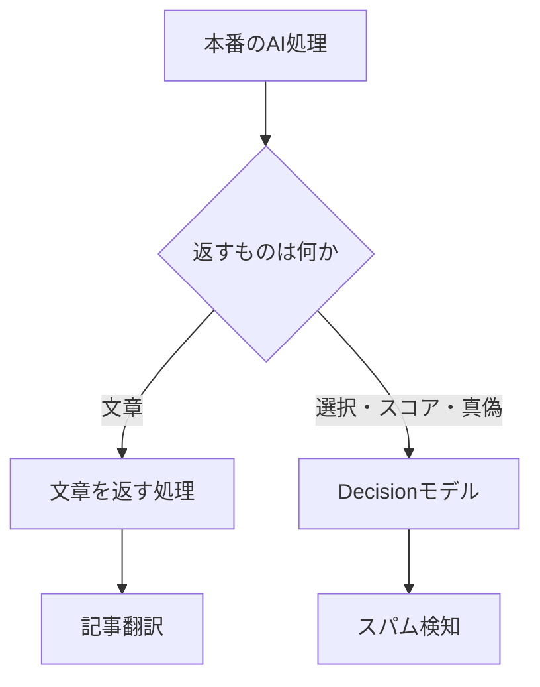

クラスメソッドの Zenn チームは、記事翻訳、AI レビュー、画像とテキストの同期処理とバッチ、スパム検知が混ざる本番の AI 処理を、モデルの置き方ごと公開しました。公開日は 2026-10-14、著者は dyoshikawa です。本文の更新時刻は、公開ページの表示ではなく Zenn API の `body_updated_at` で、2026-10-09 です。規模は 1 日あたり約 4000 万トークンです。振り分けの単位は製品名ではなく、その処理が文章を返すか、選択・スコア・真偽を返すかです。請求額は運営チームの自己申告です。

この記事では、公開された処理の分け方、Decision モデルの入出力、2026-10-15 に開いた公式ページの表示単価、自社の台帳へ落とす順序を整理します。

*この記事の全体像。以下、順に解説します。*

## 出力の形で分ける本番AI処理とは

対象は、Zenn の本番で既に動いている AI 処理です。記事翻訳、AI レビュー、テキストや画像を読む同期処理とバッチ、スパム検知が同じ請求の中にあります。これまでは米国のクローズドモデルを使い、利用料が嵩んだため、オープンウェイトを試し、処理ごとに切り替えている、と公開記事は書いています。

月額は、2026 年 5 月の 424 米ドル、9 月の 168 米ドル、10 月は 129 米ドル程度の見込みです。公開記事は、5 月と比べて約 70% の削減になると書いています。10 月の見込みには、Decision モデルの導入と、細かな最適化の両方を併記しています。

オープンウェイトは、米国企業 Fireworks AI の推論基盤から使っています。専用マシンのプランもあります。公開記事がまず挙げるのは Serverless で、トークン数に応じた従量課金です。Serverless には、グローバルで処理するモードと、米国内だけで推論する US-only があります。

### 文章を返す翻訳

安い生成モデルへ長文の記事を一度に渡すと、Markdown の書式が揃わなくなり、情報が抜けることがあります。Zenn チームは、複数段落に分けて翻訳させています。翻訳結果の全体には、不自然な箇所や欠落を見る AI 評価を別に置いています。

比較は、翻訳前後の Markdown をそのまま見ません。プログラムで HTML に変換し、表示を比べます。公開記事が挙げる例は、日本語の文中で太字の末尾に句読点があり、閉じた直後にも文字が続くケースです。Markdown 上は太字に見え、Zenn の描画では太字にならず、記号が残ります。HTML の表示で比べると、この崩れに気づきやすくなる、と書いています。

試した安い生成モデルのうち、DeepSeek V4.1 Flash が崩れと欠落が最も少ない、という印象を公開記事は書いています。掲載単価は、キャッシュミスの入力が 100 万トークンあたり 0.30 米ドル、出力が 1.20 米ドルです。同じ記事は、この Standard 料金が DeepSeek 公式 API のピーク時間帯と一致する、とも書いています。価格に対して高い性能がある、と感じているモデルとして、DeepSeek V4.1 Flash と GLM 5.3 Flash を挙げています。

### タスク単位の切替

切替はタスクごとです。コーディングエージェントの Skills に、数十件程度のテストケースを載せます。旧モデルと新モデルに同じケースを判断させ、結果の乖離を見ます。乖離が大きいときは、どのケースでどれだけ違うかを人が見ます。旧の結果へ寄せるときは、プロンプトの変更と評価を繰り返します。新の判断の方が人から見てもよければ、そのまま切り替えます。

モデル間の差を抑えるため、判定基準と具体例をプロンプトへ細かく書いています。公開記事は、OpenAI と Anthropic が、作り込みすぎない方が性能を引き出せる、と書いていることを認識したうえで、この運用では詳細側を採っています。理由は、モデルを変えたときの結果の差を抑えるためです。

### Decision モデルが返すもの

Decision モデルは、公開記事の脚注では、文章生成ではなく選択や判定に特化したモデルの総称です。脚注が挙げるのは、TypeSafe の Jev、Cloudflare の Clef と Clef-flash、OpenAI の Decisions API です。翻訳のように文章を返す処理には向かず、スパム検知のような判定には合う、と公開記事は書いています。

入出力は、状態と型付きの質問を渡し、質問ごとに構造化された答えが返る形です。Jev と Clef の型は `noul`、`choice`、`score` です。OpenAI Decisions の型は `predicate`、`choice`、`score` です。`predicate` は条件の真偽で、主結果は 0 から 1 の確率です。`choice` は選択肢から一つを選びます。`score` は段階の点数です。

Jev の docs では、1 リクエストの中の質問は並列かつ独立です。複合の判断は、質問を分け、コード側で合成します。公開記事が書く Jev の単価は、入力 100 万トークンあたり 0.042 米ドルです。出力については「出力は無料」と書いています。公開記事は、Jev の発表を 2026 年 9 月と書いています。Claude Haiku 5.5 は 2026 年 10 月 7 日発表、と書いています。

### 二系統の流れ

公開記事が明示している枝は、文章側が記事翻訳、判定側がスパム検知です。AI レビュー、画像処理、翻訳結果の AI 評価をどのモデルへ置いたかは、この図には入っていません。

## 注意点

公開記事の数字と、2026-10-15 に開いた公式ページの表示は、そのまま自社の目標や保証にはなりません。分母と条件を分けます。

### 約70%の分母

約 70% は、5 月の 424 米ドルと、10 月見込みの 129 米ドルを比べた自己申告です。検算は、424 から 129 を引いて 424 で割ると 69.6% で、公開記事の「約 70%」と整合します。9 月の 168 米ドルまでで止めると、424 から 168 を引いて 424 で割ると 60.4% です。168 米ドルから 129 米ドルは 39 米ドルです。5 月の請求に対して約 9 ポイント、9 月の請求に対して約 23% です。

公開記事はこの差を「Decision モデルの導入や細かな最適化」と併記しています。Decision だけの額ではありません。月次のトークン量は公開記事にありません。ドルが減った理由は、単価の変更でも、使用量の減少でも起きます。

### 1日約4000万トークンの読み方

1 日約 4000 万トークンは、規模の自己申告です。5 月と 9 月の使用量を比べた数字ではありません。測定日と、入力・出力・処理種別の内訳は公開記事にありません。4000 万トークンを 30 日に伸ばして 129 米ドルで割る計算は、期間が揃っていないので単価になりません。

### 値上げと同じ月に重なる

Fireworks は 2026-10-01 00:00 UTC に、DeepSeek V4.1 Flash の Standard を、入力 0.22、キャッシュ入力 0.007、出力 0.66 から、入力 0.30、キャッシュ入力 0.006、出力 1.20 へ上げています。単位はいずれも 100 万トークンあたりの米ドルです。公開記事が引用する単価は、値上げ後と一致します。

9 月の 168 米ドルが旧単価の期間を含むなら、10 月の見込み減は、値上げと Decision と最適化と使用量が同時に効いた結果として読む必要があります。量の内訳が無いので、どれが主因かは決まりません。

### 品質の根拠

品質を保った削減、という読みには、公開記事の根拠が足りません。あるのは「価格に対して非常に高い性能があると感じています」「Markdownの崩れや情報の欠落が最も少ない印象です」と、数十件の乖離評価です。品質が落ちた本番処理を元のモデルへ戻した、という記述は本文にありません。本文に戻しの記録が無いことは、戻しが世の中に無いことと同じではありません。

旧の結果へ寄せるプロンプトの反復は、旧モデルの誤りを固定しえます。これは手順の読みであり、公開記事が失敗したという意味ではありません。切替の前に、どの指標で元へ戻すかを書いておく材料は、公開記事にはありません。

HTML 比較が拾う崩れの一つは、CommonMark の仕様議論です。[commonmark/commonmark-spec#650](https://github.com/commonmark/commonmark-spec/issues/650) は open で、作成は 2020-05-26 です。CJK の句読点の直後で強調が壊れる話です。Zenn の描画でこの種の崩れを見つける手順であり、訳抜けや誤訳一般の証明ではありません。

### 生成モデルの単価順

2026-10-15 の表示価格では、オープンウェイトが安い生成層だ、という順序は固定できません。プロンプトが短い帯では、GPT-6 Luna と Claude Haiku 5.5 の入力 0.10、出力 0.50（いずれも 100 万トークンあたり）が、Fireworks 上の DeepSeek V4.1 Flash Standard（入力 0.30、出力 1.20）より低いです。公開記事自身も、クローズドモデルが価格で競争できる例として Luna と Haiku 5.5 を挙げています。

100k トークンを超える Haiku 5.5 は出力 2.50 です。長文では DeepSeek の出力 1.20 の方が低いです。順序は、長さ、キャッシュ、時間帯、データの置き場所で入れ替わります。

DeepSeek 公式のピークは、月曜から金曜の 1:00 から 4:00 までと、6:00 から 10:00 まで（UTC、中国の祝日を除く）です。日本時間へ読み替えると、10:00 から 13:00 までと、15:00 から 19:00 までです。この読み替えは、Zenn のトラフィック比率ではありません。オフピークなら、DeepSeek 直のキャッシュミスは Fireworks Standard の半額になります。Fireworks の表示は、ピーク半額にはなっていません。

### Decision の表示価格の留保

Jev の出力を課金しない表示は、2026-10-15 に公式ページへ書かれた価格です。同じページは early access であり、補助金でないことは証明できない、価格は下がると期待している、と書いています。速度の 70ms から 500ms は、西海岸のノート PC からの自社測定です。ワークフロー評価も自社チームの作成で、参照は GPT-6 Astra と Fable 5.1 の平均です。

Clef-flash のホスト側コンテキストは、2026-10-09 の changelog で 64K から 24K へ縮み、同時に入力が 0.090 から 0.038 へ下がっています。24K を超えるリクエストは利用の 0.24%、は Cloudflare の自己申告です。重みを自分でホストする場合は 256K、と同じ changelog が書いています。10 月 1 日の changelog の「両方 64K」は、その日の記載です。

Jev の発表月は、一次情報のあいだで揃いません。公開記事は 2026 年 9 月と書きます。公式ブログの本文に暦日は無く、ページの Framer 書き出し時刻は 2026-10-14 です。Cloudflare の 2026-10-01 changelog は、同じブログ URL の Jev を既存として比較しています。第三者の [powerpuff-kitty/agentic-harness-cli#77](https://github.com/powerpuff-kitty/agentic-harness-cli/issues/77)（open、作成 2026-09-18）は実装の作業票であり、TypeSafe の発表文ではありません。初出の暦月は未確認です。docs が書く「Jev 1.14 は October 14, 2026 から」は、版の提供開始日であり、初出日ではありません。

[SamuelSacco/jev-exploration#10](https://github.com/SamuelSacco/jev-exploration/issues/10)（open、作成 2026-09-19）は、Vercel AI Gateway 経由の自己測定で、choice と score が過信、boolean が過小、と書いています。ベンダーのインシデントではなく、再実行もしていません。二次情報です。確率をそのまま本番の閾値にする根拠には使いません。

### データの保持と所在

Fireworks の Zero Data Retention は、オープンモデルで、明示の opt-in が無いときのプロンプトと生成結果の話です。学習に使わない、も明示 opt-in が無いときです。プロンプトキャッシュが有効なら、数分は揮発メモリに残ることがあります。Response API は `store=True` が既定で、会話を 30 日保持します。`store=False` で止められます。Batch や学習は内容を保存しえます。法律上または不正防止のための保持は残ります。プライバシーポリシーの User Content は、入出力をサービスの一部として保存・収集する、とも書いています。専用ページの方が範囲が狭いです。

US-only は 2026-09-01 以降、ベースの 1.5 倍です。データを米国内に固定する読者へ、公開記事と同じ削減率はそのまま移りません。

マルチテナントの Serverless には、遅延と可用性の保証も SLA も無い、と service levels のページが書いています。予約スループットの内側はスループット SLA の対象、と reserved throughput のページが書いています。パーセント値は、開いたページにありません。

課金の丸め単位は、開いた Fireworks、Jev、Cloudflare、Decisions のページに数値がありませんでした。

公開記事がモデルの置き先を書いていない処理もあります。AI レビューと画像処理がどのモデルか、翻訳の AI 評価が文章を返すモデルか Decision かは、本文が結んでいません。9 月の 168 米ドルがグローバルか US-only かも書いていません。

## 同じ日の表示単価

単価は 2026-10-15 に開いた公式ページの表示です。単位は 100 万トークンあたりの米ドルです。以後変わりえます。Decision の「出力を課金しない」は、生成モデルの出力単価と並べる量ではありません。返すものが文章ではないためです。

| 置き場 | 入力 | キャッシュ入力 | 出力 | 条件 |
|---|---:|---:|---:|---|
| DeepSeek 公式 `deepseek-flash` ピーク | 0.30 | 0.006 | 1.20 | キャッシュミス入力。オフピークは半分 |
| DeepSeek 公式 オフピーク | 0.15 | 0.003 | 0.60 | ピーク窓の外 |
| Fireworks DeepSeek V4.1 Flash Standard | 0.30 | 0.006 | 1.20 | 2026-10-01 の値上げ後 |
| Fireworks 同 US-only | 0.45 | 0.009 | 1.80 | 2026-09-01 以降 1.5 倍 |
| Fireworks GLM 5.3 Flash Standard | 0.15 | 0.03 | 0.50 | 公開記事は単価を書いていない |
| GPT-6 Luna 生成、272K 入力以下 | 0.10 | 0.01 | 0.50 | キャッシュ書き込みは 0.125。272K 超は入力 2 倍、出力 1.5 倍 |
| Claude Haiku 5.5、100k 以下 | 0.10 | 読み 0.01 | 0.50 | 発表日は 2026-10-07。書き込みは 0.125 |
| Claude Haiku 5.5、100k 超 | 0.50 | 読み 0.05 | 2.50 | 書き込みは 0.625 |
| Jev 1.14 / 1.13 | 0.042 | ページに無し | 課金しない | early access の留保あり |
| Clef | 0.240 | ページに無し | 課金しない | ホスト文脈は changelog の 64K、モデルページは 65,536 |
| Clef-flash | 0.038 | ページに無し | 課金しない | 2026-10-09 以降のホスト文脈は 24K |
| OpenAI Decisions | 0.10 | 課金しない | 課金しない | モデルは `gpt-6-luna` のみ。public beta |

Batch に対応するモデルでは、Fireworks の pricing が serverless の 50%（入力と出力）と書き、batch のページはキャッシュされたトークンにさらに 50% の節約が乗るとも書いています。全モデルが Batch 対応ではありません。US 行に 50% を掛けた計算例はページにありません。Luna の Batch と Flex は Standard の 50% です。Decisions のガイドに Batch 割引は書かれていません。

質問数の上限は、Clef が 1 リクエスト 64 まで、OpenAI Decisions が 1 から 200 です。Jev は質問数の独立上限が無く、コンテキストに従います。コンテキストは 64k、質問あたり 32k、ヘッダで 262k です。`choice` の上限は Jev と Decisions が 255 で、Decisions の `choice` は 2 以上です。Jev の `score` は 2 以上 10 以下です。

レートは、ページにあった数値だけを置きます。DeepSeek 公式の同時実行は 2500 です。Fireworks のアカウント全体は、支払い方法が無い、またはクレジットが無いと 10 RPM です。支払い方法と有効なクレジットがあると、アカウント全体の固定上限は 6,000 RPM です。この 6,000 は適応では動きません。上限の内側でも、混雑時は 503 で load shed されうると、rate limits の FAQ が書いています。Small の表の 216M / 54M / 2.16M TPM は、Tier 3 以上が到達できる最大天井です。Tier 3 未満の天井はそれより低く、実効値は支出ティアと適応制限の内側で動きます。開始 TPM は未確認です。Jev の毎秒トークンと毎秒リクエストはコンソールにあり、docs 本文の数値は未確認です。Decisions 専用の RPM は未確認です。Luna の生成 API 用レート表を Decisions に当てはめません。

## 自社の台帳に落とす順序

残る結論は、振り分けの単位を処理の出力の形にすることです。文章が要る処理は生成モデルに残し、選択・スコア・真偽に閉じる処理から Decision へ移します。切替前に数十件で乖離を見ます。約 70%、品質を保ったこと、オープンウェイトが常に安いこと、の三つは写しません。

### 三つの箱

自社の 1 日トークンを、文章生成、分類・判定、検索の前処理の三つに分けます。三つ目は公開記事の分類ではなく、台帳用の箱です。判定だけで足りる割合が出てから、その箱だけを Decision へ移します。説明文、翻訳、翻訳の良し悪しを文章で返す評価は、生成モデル側に残します。

Decision に限るのは、入出力の形が既に `choice`、`score`、`predicate`（Jev と Clef では `noul`）である処理です。理由文が要る判定は、文章生成の箱に残します。

### 上限の置き場所

ハードな予算上限は、振り分けたあとに残る文章生成の額へかけます。振り分け前の総額へかけると、判定を移した分まで生成側の上限に見えます。文章生成だけの上限では、Decision 側の増加は止まりません。総額か、判定側の別上限を併記します。

約 70% は Zenn チームの請求の自己申告であり、移植するベンチマークにしません。写してよいのは切替の順序です。タスクごとに数十件で乖離を見てから替えます。公開記事に無いものとして、品質が落ちた処理をどの指標で元へ戻すかを、切替前に書いておきます。

### 生成モデルの並べ方

2026-10-15 時点では、オープンウェイトだから安い、では固定しません。自分のプロンプト長が 100k 以下なら、Luna と Haiku 5.5 の表示単価を、DeepSeek V4.1 Flash と GLM 5.3 Flash と並べてから置きます。日中の日本時間が DeepSeek 公式のピークに重なる読みは、トラフィックを測るまでの仮説に留めます。データを米国内に固定するなら、Fireworks は 1.5 倍として計算します。

### Decision の並べ方

表示価格では、Clef-flash の入力 0.038、Jev の入力 0.042、OpenAI Decisions の入力 0.10 の順に低いです。Jev は、出力を課金しない留保と early access を見積もりに残します。Clef-flash は、ホスト文脈 24K を超える入力が 2026-10-09 以降の対象外になりえます。

OpenAI Decisions は public beta です。対象顧客には ZDR と HIPAA があり、データの所在は米国と欧州（EEA とスイス）とガイドが書いています。地域プレミアムと長コンテキストの倍率は、出力課金が無くても入力に乗るとガイドが書いています。

### 着手の四手順

1. 直近のログから、三分類のトークン割合を出します。無ければ 1 日分をサンプリングします。
2. 分類・判定のうち、理由文が不要なものの一覧を台帳にします。
3. その台帳の先頭だけ、数十件の乖離と、戻す条件を書いてから移します。
4. 残った文章生成の月額に上限を置き、70% 減は目標にしません。

結論がひっくり返る条件は三つです。月次トークンが公開され、使用量が横ばいのまま単価だけで約 70% 落ちていた場合は、使用量不明だから単価効果と言えない、を弱めます。9 月時点で Decision がすでに主因だった内訳が出た場合は、10 月の 39 米ドルを Decision だけに切らない、を弱めます。短文の生成割合が小さく、長文とキャッシュミスが大半なら、オープンウェイトの出力単価が再び安い側に戻ります。

## まとめ

Zenn チームの公開記録が残した単位は、モデルの製品名ではなく、処理が返すものの形です。文章が要る処理は生成モデルに残し、選択・スコア・真偽に閉じる処理だけを Decision の候補にします。切替はタスクごとに数十件の乖離を見てから行い、戻す指標は先に書きます。

約 70% は、5 月実績と 10 月見込みを比べた自己申告です。トークン量の内訳が無く、10 月には Fireworks の値上げも重なります。自社の目標値にはしません。予算の上限は、振り分けたあとに残る文章生成へ置き、Decision 側は別枠で見ます。生成モデルの安さは、2026-10-15 の表示では、長さとキャッシュとデータの置き場所で入れ替わります。

この記事が少しでも参考になった、あるいは改善点などがあれば、ぜひリアクションやコメント、SNSでのシェアをいただけると励みになります！

## 参考リンク

- [4000万tokens/dayの本番AIワークロードコストを70%削減](https://zenn.dev/team_zenn/articles/production-ai-workload-cost-reduction)（Zenn Tech Blog、dyoshikawa。公開 2026-10-14。本文更新 2026-10-09 は Zenn API の `body_updated_at`）
- [DeepSeek API pricing](https://api-docs.deepseek.com/quick_start/pricing)
- [Fireworks serverless pricing](https://docs.fireworks.ai/serverless/pricing)
- [Fireworks changelog](https://docs.fireworks.ai/updates/changelog)（2026-10-01 の値上げ、2026-10-07 の TPM 天井）
- [Fireworks US-only](https://docs.fireworks.ai/serverless/us-only-serverless)
- [Fireworks account quotas](https://docs.fireworks.ai/guides/quotas_usage/account-quotas)
- [Fireworks serverless rate limits](https://docs.fireworks.ai/serverless/rate-limits)
- [Fireworks data handling](https://docs.fireworks.ai/guides/security_compliance/data_handling)
- [Fireworks privacy policy](https://fireworks.ai/privacy-policy)
- [Fireworks Serverless service levels](https://docs.fireworks.ai/faq/deployment/serverless/service-levels)
- [Fireworks Reserved Throughput](https://docs.fireworks.ai/serverless/reserved-throughput)
- [Introducing System One models and Jev](https://typesafe.ai/blog/introducing-system-one-models-and-jev)
- [TypeSafe docs models](https://docs.typesafe.ai/models)
- [TypeSafe docs introduction](https://docs.typesafe.ai/introduction)
- [Cloudflare changelog 2026-10-01 Clef](https://developers.cloudflare.com/changelog/post/2026-10-01-clef-workers-ai/)
- [Cloudflare changelog 2026-10-09 Clef-flash](https://developers.cloudflare.com/changelog/post/2026-10-09-clef-omni-workers-ai/)
- [Cloudflare Workers AI pricing](https://developers.cloudflare.com/workers-ai/platform/pricing/)
- [OpenAI Decisions ガイド](https://developers.openai.com/api/docs/guides/decisions)
- [OpenAI Decisions create](https://developers.openai.com/api/reference/resources/decisions/methods/create)
- [GPT-6 Luna](https://developers.openai.com/api/docs/models/gpt-6-luna)
- [Claude Haiku 5.5](https://www.anthropic.com/claude-haiku-5-5)
- [OpenAI reasoning best practices](https://developers.openai.com/api/docs/guides/reasoning-best-practices#how-to-prompt-reasoning-models-effectively)
- [Anthropic effective context engineering](https://www.anthropic.com/engineering/effective-context-engineering-for-ai-agents#the-anatomy-of-effective-context)
- [commonmark/commonmark-spec#650](https://github.com/commonmark/commonmark-spec/issues/650)
- [powerpuff-kitty/agentic-harness-cli#77](https://github.com/powerpuff-kitty/agentic-harness-cli/issues/77)
- [SamuelSacco/jev-exploration#10](https://github.com/SamuelSacco/jev-exploration/issues/10)
