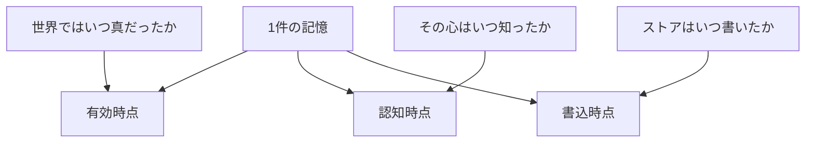

過去の会話や社内文書を、その会話が起きたときよりあとに、エージェントの記憶へ入れることがあります。この記事では、これを後入れと呼びます。後入れの1件の事実には、3つの時刻が付きます。現実でその事実が成り立っていた期間、そのエージェントがその事実を知った時点、記憶のストアがその行を書いた時刻です。ストアとは、記憶の行を保持するデータベースやファイルです。

SurrealDB Agent Memory は、SurrealDB がエージェント向けに用意した記憶の仕組みです。この仕組みは、上の3つを有効時間、認知時間、システム時間として記憶のモデルに置いています。谷口氏の Zenn 記事は、この3つを1つの日付にまとめたときの読み方を、後入れの見取り図として説明しています。

この記事では、その3つの時刻を、5つの保存先のどのフィールドに置くかを、公開されている定義に対応づけます。保存先は、SurrealDB Agent Memory、Zep の知識グラフである Graphiti、会話の要約を作る Mem0、文書を保管する Letta、それにファイルです。対応づけは2026年10月31日時点の公開文書に限り、谷口氏の記事にある青葉社の数字は記事自身が架空だと書いています。

*この記事の全体像。以下、順に解説します。*

## 記憶の3つの時刻とは

1件の記憶は、3つの問いに、それぞれ別の時刻で答えます。有効時点は、現実でその事実が成り立っていた区間です。認知時点は、その心が事実を持った瞬間です。ここでの心は、事実を保持する主体です。会話に参加していたエージェントと、あとから取り込むストアは、別の心です。書込時点は、ストアがその行を持った瞬間です。

時点を指定した質問は、問いに応じて使う時刻が変わります。世界の真には有効区間を使います。そのときの信念には認知時点を使います。監査には書込時点を使います。

SurrealDB のモデル名では、同じ3つを有効時間、認知時間、システム時間と呼びます。この記事の書込時点は、ストアが行を持った瞬間です。有効時点のフィールドは `valid_from` と `valid_until` です。`valid_until` が空なら、その事実はまだ成り立ちます。認知時点は、取り込み時の `observed_at` です。派生事実とは、原文から抽出した記憶の1件です。その known time として、`observed_at` が `created_at` に入ります。known time とは、その心が事実を持った時刻の、SurrealDB 側の名前です。`observed_at` を省略すると、取り込みの壁時計が入ります。壁時計とは、その操作が起きたときの実際の現在時刻です。

書込時点は、製品によって置き場所が違います。SurrealDB のアーキテクチャ文書では、MVCC が「その瞬間にデータベースは何を含んでいたか」に答えます。MVCC とは、同じ行の過去の版を残す同時実行制御です。Graphiti の事実エッジでは、`created_at` が、Zep がそのエッジを作った時です。Graphiti は、Zep が公開している時系列の知識グラフです。Zep は、そのグラフをホストするサービスです。事実エッジとは、グラフ上の「A は B である」のような1本のつながりです。

本文に日付が無いとき、SurrealDB は、解けない日付を uncertainty として残してよい、としています。uncertainty とは、推測で埋めない未解決の日付です。Zep の公式例では、日付の無い現在形 “Bob works at Acme.” の `valid_at` が、内容と `reference_time` から推論されて基準日になります。`valid_at` は、世界でその事実が成り立ち始めた時点です。`invalid_at` は、それが終わった時点です。`reference_time` は、そのエピソードが述べる出来事の基準日時です。エピソードとは、グラフへ取り込む会話や文書の1件です。

後入れで3つが分かれる流れは、次のとおりです。4月に成り立っていた事実を、7月の会話が述べ、10月にストアへ書きます。

ライブの会話では、知った瞬間と書いた瞬間が同じになることが多いです。SurrealDB の2026年8月4日の説明は、known time がしばしば ingest time と等しい、としています。ingest time とは、ストアが行を取り込んだ時刻です。分かれるのは、再再生、後入れ、物語のカレンダーへスタンプする場合だと限定しています。再再生とは、過去の作業をもう一度走らせることです。物語のカレンダーへスタンプするとは、行を書いた日ではなく、物語の中の日付を時刻として記すことです。SurrealDB の導入ブログ（2026年10月14日）も、1月に真、3月に言及、4月に保存、という分かれ方の例を置いています。

## 保存先が持つ時刻のフィールド

保存先ごとに、3つの問いがどのフィールドへ入るかを、2026年10月31日時点の公開文書に対応づけます。各フィールドの意味は、保存先ごとに先に書き、最後に表へまとめます。

Graphiti のリポジトリは、2026年10月31日時点で約3.2万 star であり、アーカイブではありません。

### SurrealDB Agent Memory の3つの欄

施行日とは、ルールが効力を持つ開始日です。施行日は `valid_from` に置きます。まだ終わっていなければ `valid_until` は空です。心が知った日は `observed_at` に置きます。REST は、この値を known time として派生事実の `created_at` に刻みます。省略時は、取り込みの壁時計です。有効区間は、これとは別のフィールドです。

`observed_at` を渡したあとの `created_at` は、壁時計の書込時刻ではありません。書込の壁時計は、省略時の `created_at`、生パッセージのアップロード時刻、MVCC のシステム時間、の側に残る、と文書は分けています。生パッセージとは、要約する前の原文の1件です。

既定の現在読取は、有効区間が現在時刻を含む属性を返します。属性とは、1件の事実が持つ性質です。文書はこの有効区間を validity と呼びます。`asOf` は、指定した時点の信念を読む読み方です。関係とは、事実どうしのつながりです。属性の `asOf` は、質問時点以前の `created_at` のうち、新しい記録を優先して見ます。関係の `asOf` は、認知時点が質問時点以前で、かつ有効区間が質問時点を含むときだけ、その関係を出します。

### Graphiti と Zep の2本の時刻

Graphiti の MCP は、各エピソードが「取り込まれた時」と「記述された出来事が起きた時」を記録する、と書いています。MCP とは、エージェントが外部ツールを呼ぶためのプロトコルです。Graphiti の MCP は、記憶の追加や検索をツールとして出しています。

`add_memory` の `reference_time` は、出来事が起きた時の ISO-8601 です。ISO-8601 とは、`2020-03-01T00:00:00Z` のような日時の書き方です。省略すると現在時刻になります。2020年に合併が閉じた、という過去の出来事には `2020-03-01T00:00:00Z` を渡す例が、ソースの説明にあります。

`search_memory_facts` が絞れるのは、`valid_at` と `invalid_at` の範囲です。このツールの引数に、`created_at` の範囲はありません。無効化を記録した書込時刻は `expired_at` です。`invalid_at` とは別です。

Issue [getzep/graphiti#1489](https://github.com/getzep/graphiti/issues/1489) は、2026年7月31日に完了で閉じています。求めていたのは、セッションの日付を出来事側の `reference_time` として MCP に通すことです。セッションとは、一連の会話のまとまりです。認知用の第三フィールドではありません。対応は、変更を取り込む提案（PR）[#1553](https://github.com/getzep/graphiti/pull/1553) として、2026年6月8日に既定ブランチ main へ merge されました。Issue が挙げていた不足は2つです。`add_memory` が `reference_time` を捨てて取り込み時刻を刻むことと、エピソードを消す操作の不足です。Issue 1489 のクローズコメントは、リリース v0.29.2（2026年6月8日公開）で、この2つが解消したと述べています。2026年10月31日時点の main の `mcp_server/src/graphiti_mcp_server.py` には、`reference_time` があります。

Zep の現行 Facts は “two timelines” と書きます。Facts は、グラフから出した事実の説明です。二時制とは、世界の有効期間と、記録を作った時刻の2本です。日付の無い “Bob works at Acme.” は、`reference_time` が 2025-05-15 なら `valid_at` もその日になります。“one week ago” はその7日前になります。

Adding Episodes のコメントは、`reference_time` を “when this episode occurred or was created” と並べて呼びます。この記事では、後入れの `reference_time` を、出来事またはセッションの基準日時として扱います。本文に日付がある事実の `valid_at` は、本文と `reference_time` から推論します。呼び出し側がセッション日を渡すと、それは出来事側の基準日時になります。日付の無い現在形の公式例では、その日が `valid_at` にもなります。

### Mem0 の作成時刻と観測日

Mem0 は、会話から記憶の要約を作るサービスです。timestamp 機能は、実際に追加した時とは別に、記憶が作られた時を指定する、と書いています。渡した Unix 秒は、現在時刻の代わりに使われます。Unix 秒とは、1970年起点の秒数です。同じページの用途には、歴史データの取り込みと、出来事が起きた時が並びます。v3 の add は、この `timestamp` を `created_at` のバックデートだと明記します。バックデートとは、実際に追加した時刻より前の時刻を、作成時刻として書き込むことです。

同じ add は、`observation_datetime` を別フィールドとして受けます。これは、会話を観測したときの ISO 8601 です。temporal reasoning は、記憶が述べる出来事の日を抽出して、検索順位に使います。文書はこの日を event date と呼びます。Platform v3 では自動です。OSS SDK にはありません。Platform v3 は Mem0 のクラウド版、OSS SDK は手元で動かす版です。検索の `reference_date` は、その検索の「現在」をシミュレートする基準日です。保存された書込時刻ではありません。

2025年8月22日、[mem0ai/mem0#3350](https://github.com/mem0ai/mem0/issues/3350) でメンテナは、当時のフィルタが `created_at` に掛かり、`timestamp` ではない、と答えています。Issue は2025年9月4日に完了で閉じています。2026年10月の add 文書は、`timestamp` が `created_at` をバックデートすると書きます。2つの名前が残っても、バックデート後にどちらが壁時計の書込を保持するかは、この add 文書からは決まりません。

### Letta の archival が検索に使う時刻

Letta の archival は、エージェントに残す文書の保管です。1件を passage と呼びます。作成時に `created_at` を渡せます。省略すると、現在の UTC です。検索の `start_datetime` と `end_datetime` は、その作成時刻で passages を絞ります。

公開されている作成 API には、有効区間のフィールドがありません。`metadata` とは、passage に添える付随データです。`updated_at` や `metadata` が、過去の `created_at` を渡したあとも実挿入の壁時計を残すとは、公開されている文書には書いていません。

### ファイルに置く3つの欄

ファイル記憶には、3つの時刻を持つ決まったスキーマはありません。対応は、次の3つの欄として置きます。

ルール本文の施行日から終了日を、frontmatter の `valid_from` と `valid_until` にします。frontmatter とは、ファイル先頭に書くメタデータです。エージェントが実際に読んだ時、または記憶へ入れた時を、`known_at` にします。`known_at` は、その心が事実を持った日です。元の会話が起きた日は、ファイルをあとから読む心の `known_at` にはしません。閲覧できるようになっただけでは、その心はまだ知っていません。不明なら空のまま残し、ファイルの更新日で埋めません。行を書いた時刻は、git の committer date か、明示した `written_at` にします。committer date とは、git がそのコミットをリポジトリへ入れた時刻です。

対応を表にすると、次のとおりです。

| 保存先 | 有効時点 | 認知時点 | 書込時点 | 後入れで過去日を入れる場所 |
| --- | --- | --- | --- | --- |
| SurrealDB Agent Memory | `valid_from` / `valid_until`。文書は施行日をここに置く | `observed_at`。派生事実の `created_at` になる | MVCC のシステム時間。`observed_at` を渡すと `created_at` は認知側 | 施行日は `valid_from`。心が知った日は `observed_at`。両方を `observed_at` に入れない |
| Graphiti / Zep のグラフ | 事実の `valid_at` / `invalid_at`。本文と `reference_time` から推論 | 公式の第三フィールドは、公開されている MCP と Facts には無い | エッジの `created_at`。無効化の記録は `expired_at` | `reference_time` は出来事またはセッションの基準日時。このストアが知った時は `created_at` に残る |
| Mem0 の会話要約 | temporal reasoning が抽出する event date。ランキングに使う。返却列として書込時刻を保持するとは、公開ページには無い | 入力の `observation_datetime` は「会話を観測した時」 | `timestamp` は `created_at` をバックデートする。バックデート後に壁時計が別列で残るとは書いていない | 1つの `timestamp` に、出来事の日と作成の日の両方を載せない。観測日は `observation_datetime` |
| Letta の archival | 文書化された有効区間は、公開されている作成 API には無い | 検索が使うのは作成時刻 | `created_at` を省略すると現在 UTC。過去を渡すと検索の作成時刻がその値になる | 出来事の日を `created_at` に入れると、検索の時間窓は出来事側になる。もう一方を `metadata` に置く運用は、時間フィルタの対象として定義されていない |
| ファイル | frontmatter の `valid_from` / `valid_until`。本文の施行日 | frontmatter の `known_at`。実際に読んだ、または記憶へ入れた時。不明なら空 | git の committer date、または明示の `written_at` | ファイルの更新日と本文の日付を、同じ問いの答えにしない |

## 注意点

谷口氏の記事は、SurrealDB Agent Memory の設計説明を、後入れの見取り図として紹介しています。記事自身が否定しているのは、これが全製品の標準機能であること、日付を自動で正しく読むこと、取り込む前のログの正しさを保証すること、の3つです。青葉社の数字は架空です。Graphiti の Issue 1489 は、2026年7月に完了で閉じています。現行の欠陥の証拠ではありません。

SurrealDB の文書のあいだで、システム時間の言い方がずれています。2026年8月4日のブログは、system time を、実用上は取り込み時刻だと書きます。アーキテクチャ文書は、system time を MVCC の履歴とし、known time を「信念を最初に記録した時」とします。REST は `observed_at` を派生事実の `created_at` に入れます。`created_at` を、書込と認知の両方だと思わないでください。

`asOf` は認知フィルタという名前でも、関係については有効区間も見ます。認知フィルタとは、知った時点で読む、という公開文書の呼び方です。認知時点が質問時点以前でも、有効区間がその時点を含まなければ、関係は出ません。forget した事実は、時点を指定した読取からも外れます。forget とは、その事実を記憶から外す操作です。

Zep の Facts は、`valid_at` と `invalid_at` が、ソースや派生事実が真であることを確立しない、と書いています。日付の無い現在形の公式例では、`valid_at` は `reference_time` になります。年だけを1月1日 00:00:00 にする抽出指示が、2024年10月2日のベンダーブログにあります。粒度は本文より細かいです。日付の無い文のすべてが同じ結果になる、とは Facts は書いていません。

`search_memory_facts` の日付引数は、世界の有効期間です。「そのとき知っていたか」のフィルタとして使うと、信念を世界の有効期間で切ることになります。

Graphiti の `pushedAt` は2026年10月28日です。`pushedAt` とは、GitHub がそのリポジトリへの最後の push として示す時刻です。これは任意ブランチへの push であり、default ブランチ `main` の最新コミット日とは限りません。git の author date は、あとから改変できることがあり、書込の監査時刻としては弱いです。author date とは、作者がコミットに記した時刻です。

導入ブログにあるベンチマークの得点は、ベンダーの自己申告です。フィールドの対応づけの根拠にはしていません。

次の4点は、公開されている文書からは決まっていません。

- Mem0 の `observation_datetime` と、temporal reasoning の event date が、保存後の取得結果に別フィールドで残るか。入力とランキングまでは文書にあります。
- Letta の `updated_at` が、過去の `created_at` を渡したあとも、実挿入の壁時計を保つか。
- SurrealDB のバッチメッセージの `ts` が、`created_at` と `valid_from` と MVCC のどれに入るか。バッチメッセージとは、複数のメッセージをまとめて送る入力です。公開されている REST の説明には、`ts` の入り先がありません。
- Graphiti のカスタム属性に認知時刻を足したとき、事実検索がその属性で絞れるか。カスタム属性とは、利用側が足す追加の属性です。公開されている `search_memory_facts` の日付引数は、世界側だけです。

## 時点の質問を候補と真偽に分ける

「時点 T で何を知っていたか」に、認知時点が T 以前の行だけを返す、では足りません。その集合は候補です。置換版とは、旧規則を置き換える新しい規則です。候補のあとで、T の時点で置換版をすでに知っていたかを見ます。それとは別に、問うのが信念なのか、世界の真なのかを分けます。

次の表は、架空の規則です。製品の定義から作った見取り図であり、実測のダンプではありません。旧規則は、2026年1月1日に知ります。有効区間は2026年6月1日以上、2026年7月1日より前です。置換版は、2026年7月1日に知ります。有効区間は2026年7月1日以上、2026年9月1日より前です。

| 質問時点 | 問い | 候補の切り方 |
| --- | --- | --- |
| 2026-03-01 | 何を知っていたか | 旧規則は候補に入る。施行はまだ先だと知っている。置換版はまだ知らない |
| 2026-03-01 | 何が真だったか | 旧の有効区間が3月を含まないので、旧規則は真ではない |
| 2026-07-15 | 何を知っていたか | 旧と新の両方を、その時点までに知っている |
| 2026-07-15 | 何が真だったか | 新の有効区間が7月15日を含む。旧の区間は7月1日で終わっている |
| 2026-10-01 | 何がいま真か | どちらの有効区間も10月1日を含まない |

認知時点が T 以前、という1条件だけでは、未来の施行を「真」と返し、期限切れを「まだ真」と返しえます。関係の `asOf` は、有効区間も要求します。

新しいストアが10月に、3月の会話を初めて入れるなら、このストアが知ったのは10月です。3月は、会話が起きた時です。認知を3月に置くと、4月時点の `asOf` が「このストアは4月に知っていた」と返します。`observed_at` は、その置き方を許す API です。元の会話の参加者の心と、新しいストアの心は別です。

時間データベースの用語集（1998年、Snodgrass 共著）は、valid time と transaction time を、システムが支援する2軸としています。valid time は、この記事の有効時点です。transaction time とは、データベースがその事実を記録していた期間です。それ以外の日付は user-defined time です。特別な問い合わせ支援が無い属性に置きます。過去のトランザクション時刻を書き換えることは、用語集が拒否しています。認知時刻を `created_at` に上書きすると、`created_at` が書込時刻である保存先では、記録の時刻が消えます。SurrealDB の派生事実では、`observed_at` を渡したあとの書込の壁時計は、MVCC と生パッセージに残ります。

1つの日付に、2つの問いを載せません。学習時刻とは、認知時点のことです。学習時刻が、出来事の時刻でも書込の時刻でもないときだけ、認知の欄を足します。時点の質問では、「世界で真だったか」と「そのとき知っていたか」を、別々に答えます。

三つの欄を常に埋めると、ライブでは同じ時刻が2つの意味に見えます。SurrealDB 自身が、通常は known time と ingest time が等しいと書いています。Graphiti の後入れで、元のセッションの認知時点と出来事の日が同じなら、認知欄は複製になります。Mem0 を「時計が1本」と言い切ると、`observation_datetime` と、フィルタ名としての `timestamp` を落とします。ただし、それらが壁時計の書込を保持する返却列だとは、確認できていません。

生成を止める「いま」を壁時計だけにすると、別の取り違えが起きます。5月の作業を10月に再生するとき、7月に知った置換で、5月の規則を止めてしまいます。5月のエージェントは、その置換を知りません。

残すのは、ずれている問いを同じ日付に載せないことです。常に3欄を必須にすることと、認知フィルタだけで切ることは、残しません。

## 作業領域の3層と、古いルールを止める条件

WikiSkill（arXiv:2608.27454v1、2026年8月27日）は、作業領域を3層に分ける論文です。Raw は、不変の実行トレースです。Wiki は、反復をまたいで残る知識です。Skills は、検証点がこれまでの最良を超えたときだけ採用される手順です。検証点とは、その手順を採用するかを、これまでの最良と比べて決める点です。不採用のときは、スキルだけが戻り、Wiki は戻りません。論文は、有効時点と認知時点のフィールドを定義していません。層ごとの寿命が違うことだけが、日付の前提になります。

| 層 | ファイルの日付が答えやすい問い | 後から編むときの置き方 |
| --- | --- | --- |
| Raw | その実行が起きた時 | 軌跡の中の実行時刻を出来事側に置く。取り込み日を実行日にしない |
| Wiki | パターンを編んだ時。これは認知に近い | 失敗が起きた日は、元トレースの実行時刻であり、パターンファイルの更新日ではない |
| Skills | その版を採用した時 | 手順ファイルの更新日は、ルールの施行期間ではない。不採用で戻った版は、いまの手順ではない |

古い社内ルールを参照した生成を止める条件は、本文の日付が古いことでは決まりません。条件は2つに分けます。

1. 適用するなら、決定時点が `valid_from` 以上、かつ `valid_until` より前です。決定時点とは、そのルールを適用するかどうかを判断する対象の時刻です。過去の時点 T を再生するときの決定時点は T です。ライブの会話では、壁時計のいまです。未来の施行日は、知っていても適用しません。決定時点が旧規則の区間内で、置換の施行がまだ先なら、置換を知っていても旧規則は止めません。本文が最近でも、区間の外なら適用しません。
2. 過去の時点 T のエージェントを再生するなら、認知時点が T 以前の規則を、その時点の知識として使います。ファイルでは、その欄が `known_at` です。置換版の認知時点が T より後なら、その置換で T の規則を止めません。壁時計のいま知っている置換で、T の規則を止めません。

日付が空の欄は、比較に使いません。SurrealDB が uncertainty を残すのと同じで、空を更新日で埋めません。

ルールの新旧は、本文に書いた日だけでは決まりません。新しいファイルがディスクにあっても、エージェントが読んでいなければ、そのエージェントの認知時点はまだ来ていません。止めてよいのは、置換を知ったあと、問う時点がその知識のあと、かつ問う時点が置換の有効区間に入っているときです。問う時点は、決定時点と同じです。

## 既存の引数をどの問いに固定するか

保存先が既にあるなら、新しい時制エンジンを先に入れません。今の引数が、どの問いに答えるかを固定します。時制エンジンとは、有効時点と認知時点と書込時点をデータベースの機能として持つ仕組みです。

- SurrealDB Agent Memory を使うなら、施行日は `valid_from`、心が知った日は `observed_at` にします。監査の壁時計は、MVCC と生パッセージを見ます。`created_at` を、書込と認知の両方だと思いません。
- Graphiti を使うなら、後入れの `reference_time` は、セッションまたは出来事の基準日時にします。このストアが書いた時は、`created_at` に残ります。学習時刻が、出来事の時刻でも書込の時刻でもない再生だけ、認知時刻をエピソードの外に置きます。公開されている MCP には、その認知時刻のフィールド名はありません。カスタム属性で事実検索を絞れるかは、公開文書からは決まっていません。公開されている MCP の事実検索は、世界側の範囲だけです。「知っていたか」を `valid_at` のフィルタで代用しません。
- Mem0 を使うなら、取り込みの元会話の時刻を `timestamp` に入れると、その `created_at` が過去になります。会話を観測した時は、`observation_datetime` に分けます。event date が別列で返ると仮定して、時点照会を書きません。
- Letta の archival を使うなら、検索の時間窓は `created_at` です。出来事の日をそこに入れると、窓は出来事側になります。
- ファイルなら、`valid_from`、`valid_until`、`known_at` を frontmatter に足します。書込は committer date か `written_at` です。空は空のまま残します。

逆転条件があります。ライブの会話だけで、再再生も後入れも未来の施行も無いなら、認知と書込は同じ時刻で足ります。その場合に3欄を必須にすると、同じ瞬間が2つの意味に見えます。

## まとめ

後入れでは、出来事が真だった期間、心が知った時点、ストアが書いた時点を、同じ日付に載せません。ライブの取り込みでは、知った時点と書いた時点が一致することが多く、3欄を常に必須にはしません。時点を指定する質問は、候補を認知時点で切ったあと、「世界で真だったか」と「そのとき知っていたか」を別々に答えます。

保存先が既にあるなら、新しい時制の仕組みを足す前に、今の引数がどの問いに答えるかを固定します。学習時刻が出来事の時刻でも書込の時刻でもないときだけ、認知の欄を足します。日付が空の欄は、比較にも更新日による穴埋めにも使いません。

この記事が少しでも参考になった、あるいは改善点などがあれば、ぜひリアクションやコメント、SNSでのシェアをいただけると励みになります！

## 参考リンク

- 谷口, 「古い記録をAIに渡すとき、3つの日付を分ける理由」, Zenn, <https://zenn.dev/build_anotherme/articles/c433b4055e025d>
- SurrealDB, Tri-temporal model, <https://surrealdb.com/docs/agent-memory/architecture/tri-temporal-model>
- SurrealDB, Temporal validity, <https://surrealdb.com/docs/agent-memory/reasoning/temporal-validity>
- SurrealDB, REST API, <https://surrealdb.com/docs/agent-memory/reference/rest-api>
- Dave MacLeod, “Agent memory needs three clocks”, SurrealDB blog, 2026-08-04, <https://surrealdb.com/blog/spectron-insights-how-tri-temporal-belief-history-works>
- Tobie Morgan Hitchcock, “Introducing SurrealDB Agent Memory”, 2026-10-14, <https://surrealdb.com/blog/introducing-surrealdb-agent-memory>
- getzep/graphiti#1489, <https://github.com/getzep/graphiti/issues/1489>
- getzep/graphiti#1553, <https://github.com/getzep/graphiti/pull/1553>
- Zep, Facts, <https://help.getzep.com/facts>
- Zep, Adding Episodes, <https://help.getzep.com/graphiti/core-concepts/adding-episodes>
- Daniel Chalef, “Beyond Static Graphs”, Zep blog, 2024-10-02, <https://www.getzep.com/blog/beyond-static-knowledge-graphs/>
- Mem0, Memory Timestamps, <https://docs.mem0.ai/platform/features/timestamp>
- Mem0, Add Memories, <https://docs.mem0.ai/api-reference/memory/add-memories>
- Mem0, Temporal Reasoning, <https://docs.mem0.ai/platform/features/temporal-reasoning>
- mem0ai/mem0#3350, <https://github.com/mem0ai/mem0/issues/3350>
- Letta, Create Passage, <https://docs.letta.com/api/resources/agents/subresources/passages/methods/create/>
- Letta, Search Archival Memory, <https://docs.letta.com/api/resources/agents/subresources/passages/methods/search/>
- Jensen and Dyreson, eds., The Consensus Glossary of Temporal Database Concepts, February 1998 version, LNCS 1399, <https://www2.cs.arizona.edu/~rts/pubs/LNCS1399.pdf>
- Liyan Tang et al., WikiSkill, arXiv:2608.27454v1, 2026-08-27, <https://arxiv.org/html/2608.27454v1>
