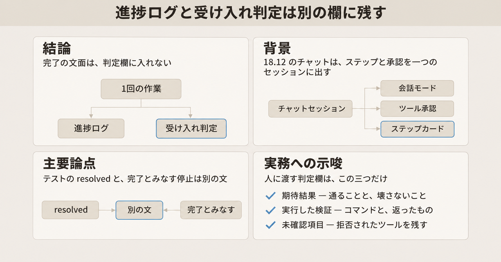
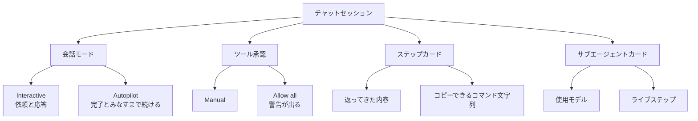
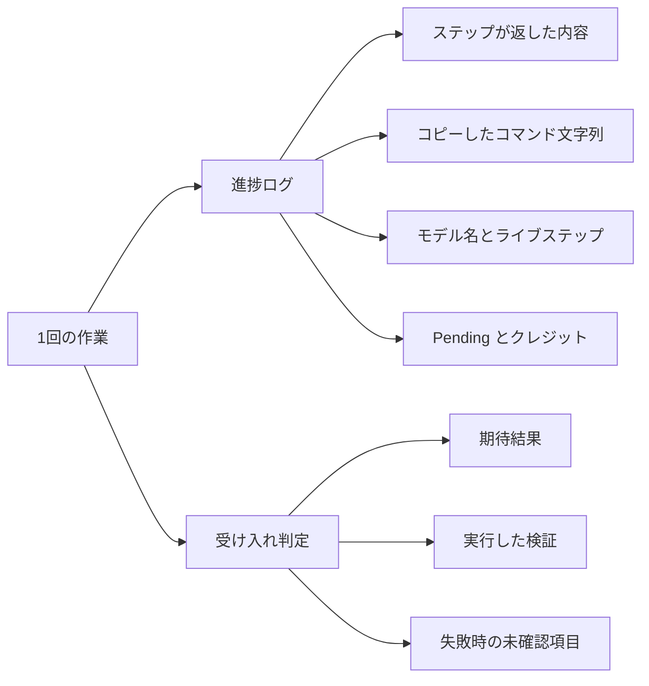

Visual Studio 2026 version 18.12 の Copilot Chat は、2026年11月10日から新しいチャット体験を既定で有効にしています。画面には、各ステップが返した内容、実行したコマンド、サブエージェントのモデルとライブステップ、リクエストごとのクレジットが出ます。この記事では、その表示のどれがもう一度実行する材料で、どれが進行中または事後の説明かを切り分け、レビューに渡す成果物の欄を決めます。ベンチマークの数値は Microsoft の自己申告であり、ここでの独立計測ではありません。

*この記事の全体像。以下、順に解説します。*

## Visual Studio 2026 の新しい Copilot Chat とは

新しいチャット体験は、1回のセッションに会話モード、ツール承認、ステップカード、サブエージェントカードを載せます。Learn は、Microsoft Learn に公開されている Visual Studio の公式ドキュメントです。Learn は、この体験が Microsoft Copilot harness の上で動き、その基盤が Microsoft Copilot SDK を使うと書いています。harness はチャットが動く実行基盤の名前です。ブログは、同じ技術が GitHub Copilot CLI、GitHub Copilot app、VS Code を動かしていると書いています。GitHub Copilot app は、その文が CLI および VS Code と並べるもう一つのクライアントです。

18.12 では新しい Copilot Chat が既定です。18.11 では同じ体験を手動で有効にします。有効化には Visual Studio の再起動が要ります。Learn の Chat ページは、表示用の日付（ms.date）が 2026-11-10、文書の更新時刻（updated_at）が 2026-11-12 です。

会話モードとツール承認は、別々に選びます。会話モードは Interactive と Autopilot です。Interactive は依頼と応答です。Autopilot は、エージェントがタスクを完了とみなすまで続けます。ツール承認は Manual と Allow all で、会話モードとは別に選びます。Manual は、ツールを実行する前に確認を待つ側です。Allow all はまとめて許す側で、選ぶと警告が出ます。Autopilot と Manual を同時に選ぶと、自動承認の設定が無いツールは待たずに拒否されます。自動承認は、この二つの選び方とは別に、ツールにあらかじめ付いている設定です。既定は、Visual Studio の設定画面 Options にある Default Conversation Mode と Default Tool Permissions で変えられます。リリースノート 18.12.0（Released on November 10, 2026）は、選んだモードをセッションへ保存し、戻ったときに復元する、と書いています。

各ステップは、試したことだけでなく、返ってきた内容を示します。展開して結果を見ること、エディタで開くこと、実行したコマンド文字列をコピーできます。ブログの文は次のとおりです。

> Every step shows what came back, not just what Copilot tried. Expand a step to see the results, open them in the editor, or copy the exact command Copilot ran.

サブエージェントは、作業の一部を引き渡したときの別カードです。使っているモデルと、実行中の各ステップを出します。

> When Copilot hands off part of a task to a subagent, the subagent gets its own card showing which model it’s using and every step it takes, live.

実行中に次の指示を Enter すると、取り込まれるまで Pending と出ます。Pending は、まだセッションに入っていない入力です。X でその入力を取り戻せます。

チャットヘッダーから作業ディレクトリを指定できます。作業ディレクトリは、そのセッションが作業するフォルダです。ソリューションは、Visual Studio で開いている solution のフォルダです。作業ディレクトリとは別で、この solution の外のフォルダもコンテキストに付けられます。

ここで選ぶ Agent は、組み込みコマンドを呼ぶときのチャット上の選択です。会話モードの Autopilot でも、作業を渡したサブエージェントでもありません。Agent を選んだ状態で `/security-review` と `/rubber-duck` を呼べます。ブログは、`/security-review` を変更のセキュリティレビュー、`/rubber-duck` を別モデルが計画を批判するコマンド、と書いています。説明のリンク先は Copilot CLI のマニュアルです。

設定「Use new Copilot chat experience」を切ると、以前のチャット体験へ戻せます。ブログは、plan mode と chat export を以前の体験からまだ移しきっていない、と書いています。plan mode は計画を先に作るモード、chat export はチャットの書き出しです。

## 画面の表示と、もう一度実行する材料

人が画面で見るものを、公式の文に沿って並べます。results はステップが返した内容、exact command はコピーできるコマンド文字列、credit cost はリクエストごとのクレジットです。cloud agent は、github.com 上で動く Copilot coding agent で、Visual Studio のチャット窓ではありません。session log はその作業記録です。enterprise は GitHub Enterprise Cloud の組織向けの利用で、usage records はその監査データです。mission control は、GitHub 上の cloud agent をレビューするときの並びです。Checks は、その並びでテストが通るかを見る欄です。旧 agent mode ページは、以前のチャット体験の手順が残る Learn のページです。前節で選ぶ Agent というチャット上の選択とは別です。再実行との関係は、そのページが再実行を述べているかどうかです。

| 表示 | 製品面 | 公式が言う中身 | 再実行との関係 |
|---|---|---|---|
| ステップの results | Visual Studio Chat 18.12 | what came back。展開し、エディタで開く | 見る操作。results が exit code やテストの stdout だとは書いていない |
| exact command | 同上 | Copilot が実行したコマンド文字列をコピーできる | 人がその文字列を再実行する材料。セッション全体の再生ではない。同じ結果になる、作業ディレクトリや環境や承認や終了状態が文字列に含まれる、とは書いていない |
| サブエージェントのモデルとライブステップ | 同上 | カードにモデルと、実行中のステップ | 実行中の表示。終了後に同じステップを再生する、とは書いていない |
| Pending | 同上 | まだ取り込んでいない次の指示。X で取り戻す | 実行記録ではない |
| credit cost | 同上 | リクエストごとの費用。9.0 credits はチャット画面の図の説明文 | 費用の表示。単価、含まれる回数、尽きたときの挙動は、今回読んだページに無い |
| Keep / Undo、チェックポイントの Restore | 旧 agent mode ページ（ms.date 2026-05-11、updated_at 2026-10-13） | 編集の採用、破棄、そのプロンプトより前へ戻す。段階的 undo / redo は無い | 編集の巻き戻し。セッションの再実行ではない。新体験の一覧にはこの項目が無い |
| plan mode、chat export | ブログ | 新体験へ未移植。設定を切ると戻せる | 既定画面の記録手段ではない |
| session log | GitHub Docs「Manage agent sessions」（取得 2026-11-22） | internal reasoning と、リポジトリの理解、変更、検証に使ったツール | 閲覧。Visual Studio Chat のステップとは同一視しない。bash が見える、とはこのページは書いていない |
| bash コマンドの表示、Continue in Copilot CLI | github.com の Agents tab。changelog 2026-01-26 | bash コマンドが見える。Continue in Copilot CLI でコマンドをコピーし、ターミナルで続きから行う | 人が継続用のコマンド文字列をコピーする。過去のステップ列の再生ではない |
| Finish in Copilot CLI | 同じ Manage agent sessions | 同じセッションを履歴ごと再開する | 継続コマンドのコピーとは、このページは書いていない |
| usage records | enterprise。クライアントの一つに Visual Studio を含む | prompts、responses、tool calls。changelog（2026-07-02）は REST が直近 48 時間と言う | 監査の取得 |
| Checks | github.com の mission control（Matt Nigh、2025-12-01） | テストが通るか。session log、変更ファイルとは別項目 | 検証の欄。ログの文面そのものではない |

mission control は session log、変更ファイル、Checks を別項目のまま置きます。Checks はテストが通るかの確認で、ブログの文は "Verify that tests pass" です。

今回読んだ公式ページの HTML と、2026-11-22 の GitHub changelog 検索（search=rerun、per_page=10、および search=replay）には、Visual Studio Chat のステップ列を再実行する API の記載がありませんでした。rerun に当たった題名は GitHub Actions の再実行回数（2026-04-10）でした。

## 注意点

到達に見える数値と、「完了」に見える語は、文の位置で意味が違います。この表は、新しいチャットを採るかどうかの採点ではありません。数値を、どの文の範囲で読んでよいかを分けます。次の表は、どこに書いてあるかを先に見ます。

| 見える値 | どこに書いてあるか | 読んでよい範囲 |
|---|---|---|
| over one hundred、every model、up to 21 more tasks | ブログ本文の導入 | 新旧体験を、試した全モデルで比べ、新しい方が最大 21 タスク多く resolved した、という要約。157 と同一セットだとは本文が結んでいない |
| 157 | ブログ本文。C# の別段落 | .NET チームが実 issue から作ったタスク数。新旧の両方に通した |
| resolved の定義 | 同じ段落 | 失敗していたテストが通り、既に通っていたテストを壊さない。画面のステップ数や完了文面の定義ではない |
| 103、124、差 21、GPT-5.6 Sol | 棒グラフの説明文（alt）だけ | 本文は 103、124、GPT-5.6 Sol を書いていない。図の説明文では previous 103、new 124、両方のモデルは GPT-5.6 Sol |
| 9.0 credits、worked on 19 tasks | チャット画面の説明文（alt）だけ | 本文は "see what each request costs"。Learn は "credit cost"。19 は 157 件のベンチマーク件数ではない |
| The harness keeps Copilot going until the task is actually done | ブログの別の箇条書き | テスト通過には接続していない |
| Autopilot は the agent considers the task complete まで続ける | リリースノート 18.12.0 | エージェントが完了とみなす、という停止条件。resolved の言い換えではない |
| Autopilot と Manual を同時に選ぶ | 同じ節の次の文 | 自動承認されていないツールは、確認を待たずに拒否される |

resolved の定義文は、ベンチマークの段落に閉じています。

> A task counts as resolved only when its failing tests pass without breaking any that already passed.

チャットの停止は別の文です。

> Choose Interactive for the usual request-and-response flow or Autopilot to keep working until the agent considers the task complete. Select Manual or Allow all independently for tool permissions.

> With Autopilot and Manual together, tools that aren't configured for automatic approval are rejected rather than waiting for a prompt. Choosing Allow all shows a warning.

Autopilot と Manual の組合せは、ツールを走らせないまま「完了とみなした」になりえます。ハーネスの "actually done" は、上の resolved の文に接続していません。

図の 103 と 124 は、[heftykoo の Zenn 記事](https://zenn.dev/heftykoo/articles/3cf9c142df8f81) が「同じモデルで 103 対 124」と書くときの図 alt と一致します。同記事が「この記事で行ったベンチマークではない」と断るのも、出典が Microsoft のブログであることと一致します。本文の "every model" の全数値は、公開された本文にはありません。

plan mode と chat export は、新体験の既定画面の保存仕様ではありません。旧 agent mode ページの表示用日付（ms.date）は 2026-05-11、文書の更新時刻（updated_at）は 2026-10-13 です。計画 markdown と内部 JSON の例示パスは `C:\Users\username\AppData\Local\Temp\VisualStudio\copilot-vs` です。セッション終了で消します（手動保存を除く）。この一時ファイルを、18.12 既定画面の受け入れ記録にしません。同じページの FAQ は、ファイル操作を開いているソリューションディレクトリとそのサブディレクトリに限ります。続けて、ターミナルコマンドは Visual Studio プロセスと同じ権限で、その制限の外でも動く、と書いています。2026-11-10 の新体験は、作業ディレクトリとソリューション外のフォルダを言います。表示された進捗を、触ってよい範囲の証明にしません。

ブログは同じ技術基盤だと書き、同時に画面が一つに揃うとは書いていません。CLI のマニュアルは `/security-review` を active local code changes の focused review と書き、full repository security audit とは分けています。rubber duck の概念ページは、対象を CLI と Copilot app と書いています。`/session` は CLI のセッション情報の表示と管理、`/resume` は別セッションへの切り替えです。これらを Visual Studio の画面項目として読みません。Visual Studio 側で公式が言っているのは、ブログの「別モデルが計画を批判する」までです。

隣接製品の「完了」も、18.12 のチャット停止へ移植しません。

- Antigravity は Google のエージェント環境です。2026-11-10 のブログは、`/swarm` を preview とし、coordinator が isolated git worktrees でワーカーを起動し、adversarial verifiers がテストと diff の異議を担当する、と書いています。isolated git worktree は、作業コピーを分けた Git の作業ツリーです。Docs（取得 2026-11-22）は役割名を `@verifier` とし、"adversarial" とは書きません。Workers share your workspace by default であり、同時に編集やビルドが重なるときだけ working copy を渡します。この workspace の説明は、ブログの isolated git worktrees と一致しません。Carbon は、そのブログが扱うモデル名です。ブログは Carbon を Google AI Ultra というプラン向けとし、`/swarm` は preview として Antigravity の App と CLI に出す、と書いています。`/swarm` 自体を Ultra 限定だとは書いていません。Docs は Swarm の Plan tier を All plans とします。Graph は、Antigravity 上で誰が誰に言及したかを並べた投稿列です。replay controls はその列を再生します。作業の再実行ではありません。append-only board は、追記だけする投稿の並びです。test results は進捗と同じ並びに載ります。Docs は、`@verifier` が sign-off の前に diff とテストを見る、と書いています。sign-off は、その確認の名前です。出荷条件だと定義してはいません。coordinator は技術作業をせず、人に結果を報告します。
- Epic のフォーラム投稿（Flak、2026-11-09）のページタイトルは "[Preview 2] Unreal Engine 5.9 Preview" です。本文は、この Preview を "This UE 5.9 MegaJam Preview" と呼びます。MegaJam は本文中の呼び名で、タイトルの Preview 2 とは字が違います。既知問題の投稿（RaghibK、同日）は "Preview 1" と書いています。本文は約 1 週間の開発、通常より短い QA、web renderer の一部は full 5.9 の前に refactor する prototype、と分けています。Preview を full release の完了とは呼んでいません。この投稿は、短い QA を完了と呼んでよいという材料には使えません。
- 18.12.0 の "These initial tools provide review context; they don't imply autonomous code review or automatic comment resolution." は、Reviews subagent の節です。Reviews subagent は、番号を指定して pull request を Visual Studio で開く組み込みの担当です。この文はステップカードの合否ではありません。

まだページから決まらないこともあります。

- ステップの results は、生の stdout か、要約か、終了コードを含むか。
- コピーしたコマンドに、作業ディレクトリが埋まるか。
- 18.12 の既定画面に Keep / Undo / Restore が残るか。旧ページと新ブログの沈黙は、残ることも消えたことも証明しません。
- Autopilot が「完了とみなす」内部条件。
- Antigravity の workspace とプラン範囲は、ブログと docs で一致していません。
- 棒グラフの alt が、本文と独立に生成された説明文か。
- 根拠は公開ページです。Visual Studio 18.12 を起動して画面を確認してはいません。

## レビューに渡すとき、進捗ログと受け入れ判定を分ける

18.12 のステップ結果、コマンドコピー、モデル名、ライブステップは、追跡用の表示です。人が approve する欄には、期待結果、実行した検証、失敗したときに未確認のまま残った項目だけを書きます。完了報告の文面は、その欄に入れません。進捗ログは残します。

分ける理由は、公式の文が別々だからです。

- resolved はベンチマークの段落に閉じています。失敗していたテストが通り、既に通っていたテストを壊さない、という定義です。
- チャットの停止は別文です。Autopilot はエージェントが完了とみなすまで続けます。ハーネスの "actually done" はテスト定義に接続していません。
- Autopilot と Manual では、未承認ツールは拒否されます。ツール未実行のまま完了とみなしえます。
- exact command はコピーできます。終了状態や作業ディレクトリまでは、公式が一つの記録に束ねていません。
- mission control は session log、変更ファイル、Checks を並べ、log と Checks を一つの欄に畳みません。
- 完了文面が実行コマンドと期待結果を構造化して引用し、その文面自体を判定にしてよい、という公式例は、読んだページにはありませんでした。

限定も残します。ステップを捨てると、公式が results と呼ぶものまで落ちます。判定欄だけを見て進捗ログを廃止しません。GitHub Docs の session log は、cloud agent が検証に使ったツールを示します。18.12 のチャット完了文面へ、この手順をそのまま移植する根拠は、読んだページにはありません。ログを読むことは、完了文面を受け入れ理由にすることではありません。Antigravity では test results が進捗と同じボードに載ります。軌跡を捨てると、ボードにしか無いテスト結果が落ちます。これは Visual Studio のステップ仕様ではありません。Antigravity の sign-off を、製品の出荷条件だと定義してはいません。

人へ渡す成果物は、二つの欄に分けます。

| 欄 | 残すもの | 残さないもの |
|---|---|---|
| 進捗 | 実行したステップ、コピーできるコマンド、使ったモデル、未取得の途中状態 | この欄だけを approve の理由にしない |
| 判定 | 期待結果、実行した検証、失敗時の未確認項目 | 「12ステップ完了」「テスト実行済み」「作業が完了しました」という文面 |

判定欄に書くのは、次の三つだけにします。

1. 期待結果。テストが通ること、壊してはいけない既存の成功、画面や API の観測可能な状態。
2. 実行した検証。コマンド、対象、いつ、どの環境で、何が返ったか。返ったものがログにしか無いときは、進捗側の該当ステップを参照します。判定欄へログ全文を写しません。
3. 失敗したとき、またはツールが拒否されたときに、未確認のまま残った項目。Autopilot と Manual の組合せでは、拒否されたツール名をここに残します。

進捗欄には、ステップが返した内容、コピーできるコマンド、モデル名、ライブステップ、Pending、クレジットを残してよいです。これらは追跡用です。

次の文面は、判定欄の本文にしません。

- 作業が完了しました
- 12ステップ完了
- テスト実行済み
- エージェントがタスクを完了とみなした

形状だけを見る検査は、期待結果を見ていません。ファイルがあること、本文が一定以上あること、見出しが一定数あることは、構造のゲートです。完了文面を検索して合否にする検査は足しません。それは、完了報告の文面を判定に使うことになります。足すなら、人へ渡す成果物に判定欄があり、その欄が期待結果、実行した検証、未確認項目を持つか、です。進捗欄だけ、または完了の一文だけでは、その検査を満たしません。

[はてなブログの記事（2026-06-14）](https://sakuratakashi.hatenablog.com/entry/2026/06/14/122212) は二次情報です。session log を説明責任のログとし、免罪符ではない、と書いています。順序の例は diff、preview、screenshot、test / lint / typecheck、session log、未確認です。公式の mission control が log と Checks を分けることと向きは同じで、18.12 の仕様そのものではありません。

逆転条件は一つです。公式が、ステップの results を exit code とテスト stdout の保存形式だと定義する、または完了文面が期待結果と実行コマンドを構造化して引用すると定義する。その定義が 18.12 のチャットに付くまで、完了文面は判定に使いません。

## まとめ

Visual Studio 2026 18.12 の新しい Copilot Chat は、会話モード、ツール承認、ステップカード、サブエージェントカードを一つのセッションに出します。ステップの結果とコマンド文字列は見たりコピーしたりできます。モデル名、ライブステップ、Pending、クレジットは、進行中または費用の表示です。ベンチマークの resolved は、失敗していたテストが通り、既に通っていたテストを壊さない、という採点です。Autopilot の停止は、エージェントが完了とみなすことであり、その採点の言い換えではありません。

レビューに渡すときは、進捗ログと受け入れ判定を別欄にします。判定欄には、期待結果、実行した検証、失敗時の未確認項目だけを書きます。完了の文面は、その欄に入れません。進捗ログは残します。

この記事が少しでも参考になった、あるいは改善点などがあれば、ぜひリアクションやコメント、SNSでのシェアをいただけると励みになります！

## 参考リンク

- [AIエージェントの「進捗」は証拠ではない。レビューできる作業面を設計する](https://zenn.dev/heftykoo/articles/3cf9c142df8f81)（heftykoo）
- [Visual Studio Blog（November 10, 2026）](https://devblogs.microsoft.com/visualstudio/copilot-in-visual-studio-just-got-a-major-upgrade/)
- [Learn の Copilot Chat ページ](https://learn.microsoft.com/en-us/visualstudio/ide/visual-studio-github-copilot-chat?view=visualstudio)
- [Learn の agent mode ページ](https://learn.microsoft.com/en-us/visualstudio/ide/copilot-agent-mode?view=visualstudio)（ms.date 2026-05-11、updated_at 2026-10-13）
- [github.com の Agents tab（changelog 2026-01-26）](https://github.blog/changelog/2026-01-26-introducing-the-agents-tab-in-your-repository/)
- [Visual Studio 2026 リリースノート](https://learn.microsoft.com/en-us/visualstudio/releases/2026/release-notes)（18.12.0 は November 10, 2026。18.12.1 は November 17, 2026）
- [GitHub Docs「Manage agent sessions」](https://docs.github.com/en/copilot/how-tos/copilot-on-github/use-copilot-agents/manage-and-track-agents)（取得 2026-11-22）
- [changelog「Copilot Chat now sees your agent sessions」（2026-06-10）](https://github.blog/changelog/2026-06-10-copilot-chat-now-sees-your-agent-sessions/)
- [changelog「Copilot agent session streaming」（2026-07-02）](https://github.blog/changelog/2026-07-02-copilot-agent-session-streaming-is-now-in-public-preview/)
- [How to orchestrate agents using mission control](https://github.blog/ai-and-ml/github-copilot/how-to-orchestrate-agents-using-mission-control/)（Matt Nigh、December 1, 2025）
- [Antigravity ブログ（November 10, 2026）](https://antigravity.google/blog/gemini-4-carbon-in-google-antigravity)
- [Antigravity Docs「Swarm」](https://antigravity.google/docs/swarm)（取得 2026-11-22）
- [Unreal Engine フォーラム（本文 November 9, 2026）](https://forums.unrealengine.com/t/unreal-engine-5-9-megajam-preview/2852840)
- [はてなブログ（2026-06-14、二次情報）](https://sakuratakashi.hatenablog.com/entry/2026/06/14/122212)
