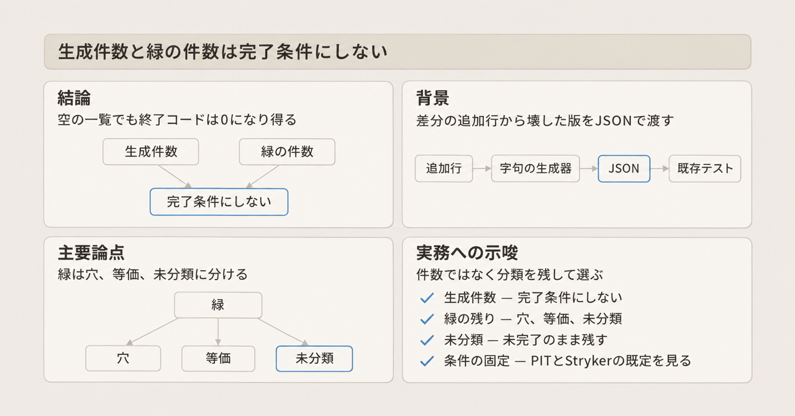
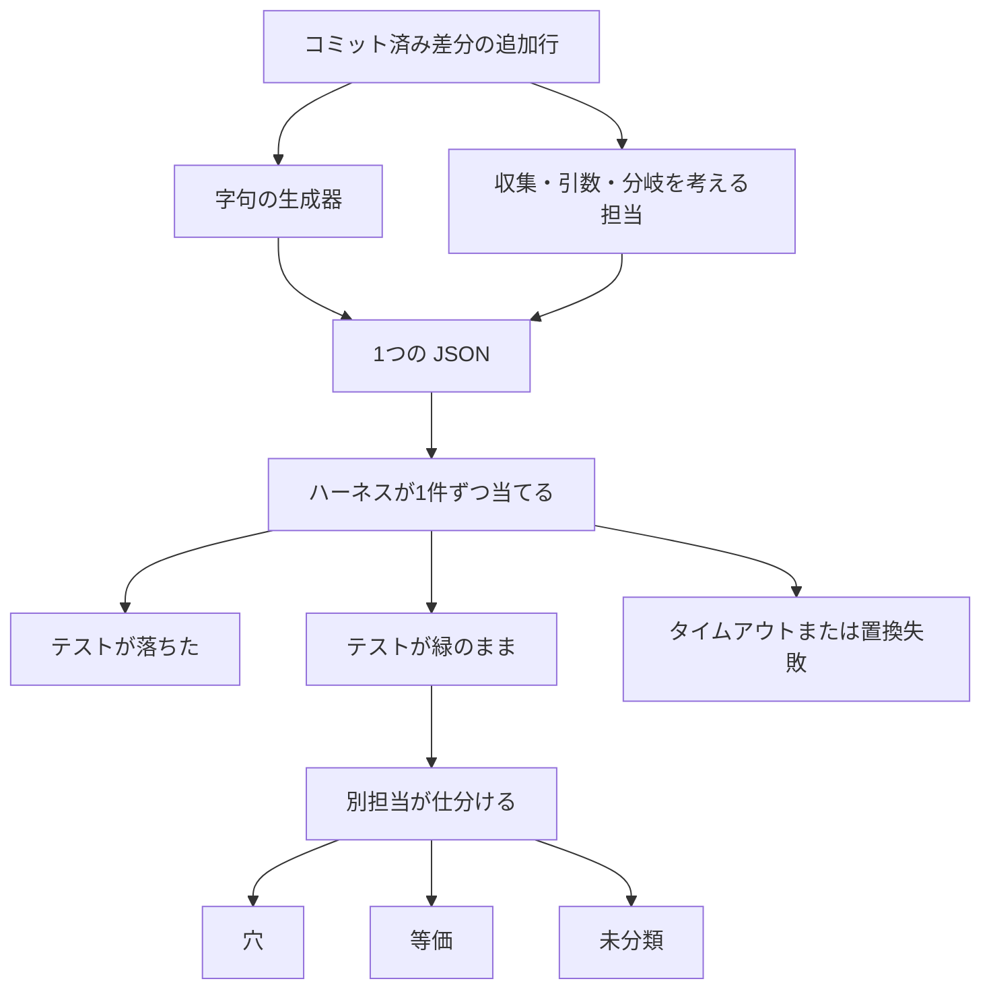

コミット済み差分の追加行から、コードを意図的に壊した版を JSON で作り、既存のテストへ渡す仕組みの話です。miyakona 氏が Zenn で公開した解説を、Python、Git、論文の一次資料と突き合わせて整理します。掲載コードは、miyakona 氏によれば業務実装の転載ではなく、Python 3.14 で動作確認した独立した例です。読み終えると、差分のどこを壊し、緑が残った記録をどの3分類で残すかが分かります。


*この記事の全体像。以下、順に解説します。*

## 差分の変異生成とは

変異とは、動いているコードを意図的に壊した版です。変異テストは、その版を既存のテストに渡し、テストが落ちるかを見ます。落ちた変異は検出です。落ちずにテストが緑のまま残った変異は生き残りです。

ここで扱う仕組みは、実装する担当とは別に、壊した版を JSON で作ります。読み手は、差分に対するテストが変更を守っているかを、生成した件数以外の手続きで見たい人です。

壊し方は2系統あります。

1つ目は字句の生成器です。字句とは、Python 標準ライブラリの `tokenize` がソースを切ったトークンです。入力は `git diff` の追加行です。通常の unified diff（1つの親との差分）の hunk 見出しから、追加された行番号だけを読みます。hunk 見出しとは、`@@ -旧開始,旧行数 +新開始,新行数 @@` の行です。

最小例が入れ替えるのは、比較演算子だけです。`<` と `<=`、`==` と `!=` のような対です。実運用の表には、論理演算、真偽値、算術、10進の整数リテラルも含まれます。

2つ目は、何を集めるか、どの引数を渡すか、どの分岐を通すか、を考えて壊す担当です。通すかは、その分岐を実行させるか、外して消すかの選択です。この担当は差分の意味を見て変異を作ります。生成器の置換表には、この3種の操作は載っていません。

### 置換位置を1か所に決める

f-string は、式を文字列へ埋め込む Python の記法です。t-string は、Python 3.14 で入ったテンプレート文字列です。`tokenize.FSTRING_START` と `tokenize.TSTRING_START` は、CPython 3.14.6 に存在します。生成器は、どちらも開始から対応する終了まで深さを数えて飛ばします。文字列とコメントの中も、置換の対象外です。

置換する文字列は、前後の行を広げることで、ソース中に1回だけ現れる形にします。数えるメソッドは `str.count` ではありません。重なりを見る `str.find` を使います。

`str.count` は、重ならない出現だけを数えます。Python 標準ライブラリの文書にもその旨があり、確認時の版表示は 3.15.2 です。`x = 1` が3行あり、探す文字列がその2行分のとき、`count` は 1 です。開始位置を1文字進めた `find` は index 6 を返します。2行分の範囲は、3行の中で重なって2回取れます。`count` はその重なりを1とだけ返します。

```python
source = "x = 1\nx = 1\nx = 1\n"
before = "x = 1\nx = 1\n"
print(source.count(before))
print(source.find(before, 1))
```

CPython 3.14.6 では、この2行の表示は `1` と `6` です。

### 出す前に見ること

生成器は、JSON を出す前に次を見ます。

- パスが相対の `.py` であること
- テストコマンドが空でないこと
- `git show HEAD:path` で、そのファイルが `HEAD` にあること。`HEAD` は、今のブランチが指す最新コミットです
- 元のファイルと、置換後のソースの両方が `compile` できること。`compile` は、ソースを構文として解釈する Python の組み込み関数です
- `before` がそのファイルに1回だけ現れること

成功時の JSON は、テストコマンドの配列と、変異の配列です。各変異は `id`、`file`、`before`、`after` を持ちます。トップレベルのキー名として記事が使っているのは `tests` と `mutations` です。変異ごとに `tests` を書く形もあります。

失敗の扱いは次のとおりです。

- 生成そのものの失敗は、終了コード 2 で返します
- 構文が壊れる1候補は除外して、生成を続けます。stderr の例は `構文が壊れる候補を除外: path:line` です
- 一意にできない1件は、その件だけ飛ばしません。生成全体を止めます

`case` の mapping pattern（`match` のマッピングパターン）でキーを重複させると、CPython 3.14.6 は `SyntaxError: mapping pattern checks duplicate key` になります。`compile` が `SyntaxError` または `ValueError` になる候補は、置換対象から外します。

### 作る対象と外す対象

記事にあるのは、作る対象と外す対象の対応です。種類ごとの件数は掲載されていません。

| 対象 | 作る | 外す |
|---|---|---|
| 比較 | `<` と `<=`、`==` と `!=`、`in` と `not in` など | `for x in values` の `in` |
| 論理・真偽値 | `and` と `or`、`not` の除去、`True` と `False` | 文字列とコメントの中 |
| 算術 | 二項の `+` と `-`、`*` と `/` など | 単項の `-x`、`*args`、`case -1:` の `-` |
| 整数 | `0` と `1` の入替。それ以外は 1 増やす | 10進整数以外。変異後の構文も見る |

最小例のコードが実際に入れ替えるのは、比較演算子だけです。`in`、`and`、`not`、`True` は、Python では `OP` トークンではなく、名前やキーワードです。`OP` は、`tokenize` が演算子に付ける種類です。最小例の `SWAPS`（入れ替え表）には入りません。実運用の表のその行は、掲載されている最小例とは別のコードが必要です。

そのほか、f-string と t-string の全体も除外します。

### ハーネスが1件ずつ当てる

ハーネスとは、変異をテストへ当てて結果を分ける側です。生成器の最小例に、テスト実行と、テストの絞り込みは含まれません。1件ずつ当てるのはハーネスの仕事です。

ハーネスの定義は散文だけです。実装コードは掲載されていません。散文が定義しているのは、次の3点です。

- 当てる前に、基準のテストが緑であること
- 絞ったテストが緑なら、全体も再実行すること
- タイムアウトと置換失敗を、検出にも緑にも混ぜないこと。置換失敗は、1件の変異をソースへ当てられなかったことです。一意にできず生成全体を止める失敗とは別です

手書きの変異 JSON でも、一意判定はハーネス側で見ます。手書きとは、生成器ではなく人が書いた変異です。

実行記録とは、ファイルごとに、絞り込みへ使うテストの結果を残したものです。記録が読めない、形式が不正、記録したテストに失敗があるときは、絞り込み付きの生成を止めます。止めるのがハーネスか生成器かは、掲載されていません。正常な記録に、あるファイルが無いときは、そのファイルだけ絞りません。

緑が残ったら、別の担当が「穴」「等価」「未分類」のいずれかにします。入力の範囲と、何を観測するかも残します。

- 穴は、テストが守っていない壊れ方です
- 等価は、壊しても、観測する振る舞いが変わらない変異です
- 未分類は、穴か等価か、まだ付けていない残りです

### 全体の流れ

差分から1つの JSON を作り、ハーネスが1件ずつテストし、緑だけを別担当が分けます。



## 注意点

ここからは、件数の読み方、掲載されていない実装、既存ツールへ広げられる範囲です。

### 件数は miyakona 氏の概数である

記事の規模は、miyakona 氏が書いた概数です。ページングの修正2件について、次のように書かれています。

- 修正Aは、初期も最終も「数十件」生成して、「十件程度」が緑だった
- 修正Bは、「二十件程度」生成して、緑は「少数」だった
- 生成器自身の差分では、「数百件のうち十数件」が緑だった

時間、トークン、見つかった穴の増分は測っていない、と miyakona 氏自身が書いています。このトークンは、前に書いた字句の切れ目ではなく、計測しなかった量です。何個で数えるかは書かれていません。手書きの変異 JSON は消失しています。同じ変異集合で、検出率を前後比較した数字ではありません。

修正Aの最終版に残った緑は、穴か等価か未分類のままです。穴が残っていたのか、等価だったのかは、記事から決まりません。

修正Bで手書きが見つけ、生成器が再現しなかった操作は、次の3つに限られます。順に、何を集めたか、どの引数を渡したか、どの分岐を消したか、です。3つ目は、分岐を実行させることではなく、その分岐を消す操作です。指定グループは、その操作が対象にするグループです。中身が何の分類かは、記事には書かれていません。

- 窓へ、指定グループだけを積む。窓は集める先で、積む中身をそのグループだけにします
- 読み直しへ、指定グループだけを渡す。読み直しは引数の渡す先で、渡す相手をそのグループだけにします
- 指定グループの分岐を外す。そのグループ用の分岐を消します

空の `mutations` は、終了コード 0 で返ります。miyakona 氏は、これを検出力を測った結果にはしない、と書いています。生成件数も、緑の件数も、この生成器が仕事を終えた印にはなりません。

### 掲載されていないものと、日付の読み方

前の節にある、作る対象と外す対象の表は、棄却の種類の対応です。1回の実行で、種類ごとに何件捨てたかという内訳は、記事にありません。構文が壊れる候補は、先の stderr の例があるだけです。

JSON を見る層は、記事の中で次のように分かれます。

| 層 | 記事での位置 | 見ているもの |
|---|---|---|
| 生成器 | 掲載コード。出す前 | 相対 `.py`、空でないテストコマンド、`HEAD` のファイル、元と変異後の `compile`、`before` が1回だけ現れること |
| 生成器 | 失敗時 | 生成そのものの失敗は終了コード 2。構文が壊れる1候補は除外して続ける。一意にできない1件は生成全体を止める |
| ハーネス | 散文のみ | 基準テストが緑。手書き変異でも一意判定。絞ったテストが緑なら全体を再実行。タイムアウトと置換失敗は検出に数えない |
| 記録 | 散文のみ | 記録が読めない、形式が不正、記録したテストに失敗があるときは絞り込み付き生成を止める。正常な記録にファイルが無いときは、そのファイルだけ絞らない |
| スキーマ | 呼び出しが無い | トップレベル `tests` を空のまま、変異ごとの `tests` だけを書くと、当て直す全体が無くなる、という実運用上の注意が散文である |

JSON Schema（JSON の形を宣言する仕様）や、`jsonschema` の呼び出しは、記事にありません。記事の外にハーネス実装があるかは、この公開記事からは分かりません。

`gh api search/repositories?q=mutation+user:miyakona` は、2026-11-09 時点で items が空でした。公開リポジトリとしての所在は確認できていません。実装が私的に無い、とまでは言えません。

Zenn API の `published_at` は 2026-11-08 22:55 JST です。`body_updated_at` は 2026-10-26 です。本文のタイムスタンプを、公開日として読まないでください。

差分の正規表現は、通常の `@@ -l,s +l,s @@` 用です。combined diff は、複数の親を1つの差分にまとめた Git の形式です。Git の文書は、その見出しが親の数より1つ多い `@` だと書いています。記事は、自分のパーサーが combined diff 用ではない、と明記しています。

### 生成器一般へは広げない

「字句の生成器は、構造の変異を出せない」は、生成器一般には広がりません。PIT は、Java 向けの変異テストツールです。条件を `true` または `false` に固定する `REMOVE_CONDITIONALS` を持ちます。Stryker は、複数言語向けの変異テストツールです。`BlockRemoval` は、ブロックの中身を空にします。どちらも公式の演算子説明に例があります。先の3操作を、それらの演算子がそのまま出す、とまでは公式の例は書いていません。

ファイルに緑が集まることは、構造の穴以外でも起きます。Google の論文（arXiv:2102.11378v2）は、演算子ごとに生き残りやすい変異を、報告から外す対象にしています。ログ、時間、設定フラグのような arid なコードも、報告から外します。arid なコードとは、その論文が、テストで守る優先度が低いと置いている種類です。

等価であることの完全な証明を、レビュー完了の門にすると、手続きが終わりません。Wang らの論文（arXiv:2406.09843v5）は、equivalent mutant（等価な変異）の判定は undecidable だと書いています。undecidable とは、一般の入力に対して、止まる手続きだけでは判定し切れない、という意味です。同論文は Budd and Angluin 1982 を引いています。

同じ Wang 論文の要旨は、851 件の実バグで、LLM 系の実バグ検出を 76.47%、規則ベースを 44.15% としています。内訳は Defects4J 2.0 が 605 件、ConDefects が 246 件です。どちらも実バグを集めたデータセットです。要旨は差を 32.99 ポイント、約 1.75 倍と書きます。76.47 から 44.15 を引くと 32.32 ポイント、比は約 1.73 倍です。要旨の 32.99 と 1.75 とは一致しません。ここは要旨の記載値であり、2つの検出率から検算した値ではありません。

同時に要旨は、LLM 系が規則ベースより、コンパイルできない率、重複率、等価変異率でそれぞれ 32.73、9.38、3.64 ポイント悪い、と書きます。本文のツール別は、LLMut (DS-671b) が 91.1%、PIT が 40.1%、Major が 66.9%、LEAM が 63.9% です。これらは論文が比較している生成方法の名前です。要旨の 44.15% は、PIT 単体の検出率ではありません。

StrykerJS は、Stryker の JavaScript 向け実装です。設定 `thresholds` の既定は `{ high: 80, low: 60, break: null }` です。`high` と `low` は mutation score（変異のうち、テストが検出した割合）の色分けです。`break: null` は、しきい値未満でもビルドを落とさない既定です。この色分けは、「件数を完了条件にしない」という規則の反例にはなりません。空の一覧を結果とみなさない、という指標とも別です。

構造を考える担当を LLM にしても、無効な変異と等価な変異が消える、とは Wang 論文の数字は示していません。無効な変異とは、ここではコンパイルできない変異です。先の要旨の 32.73 ポイントは、その率です。その担当が「等価」または「穴は無い」と誤って書き、それが通った事例は、公開資料の範囲では見つかっていません。見つからなかったことは、誤申告が起きない証拠にはなりません。

性質テスト（個々の入力ではなく、守るべき性質を書くテスト）や例を足せば、演算子の入れ替えだけで足りて、構造のレビューが過剰になる、という条件を直接示した一次研究も、公開資料の範囲では見つかっていません。

## 条件を固定するツールとの違い

見たい操作ごとに、この字句生成器、既存ツール、差分上の人のレビューは次のように分かれます。

| 見たいもの | この字句生成器 | 条件削除やブロック削除を持つ既存ツール | 差分上の人のレビュー |
|---|---|---|---|
| 比較演算子の入替 | 最小例がこれを出す。定数の入替は実運用の表にあり、最小例のコードには無い | PIT の関係演算子（大小の比較）、Stryker の等価演算子（`==` のような、等しいかどうかの比較）が近い | 件数が多いと見切れない |
| 分岐を必ず通す、または空にする | 掲載の置換表には無い | PIT の `REMOVE_CONDITIONALS` は条件を `true` または `false` に固定する。既定では無効。Stryker の `BlockRemoval` はブロックの中身を空にする | 先の3操作はこの形に近い。3つ目だけが分岐を消す操作で、1つ目は集める先、2つ目は渡す引数を指定グループだけにすること |
| 呼び出しを、型の合う引数に置き換える | 掲載の置換表には無い | PIT の `EXPERIMENTAL_ARGUMENT_PROPAGATION` がその説明を持つ。実験的で、既定グループとは別の ALL グループ側。ALL が既定で有効かは、この欄には無い | 引数を指定グループだけにする、とは同じ操作ではない |
| 完了の印 | miyakona 氏は件数を印にしていない | StrykerJS の既定は色分けであり、ビルド失敗の `break` は `null` | Google の論文は、リポジトリ全体のスコアを開発者へ見せる方式を採らなかった |
| 既存 JSON ハーネスへの接続 | miyakona 氏の目的そのもの | 別の報告形式であることが多い | ハーネスを経由しない |

PIT が `REMOVE_CONDITIONALS` を既定にしない理由は、公式ページでは、条件境界の演算子を検出するテストと大きく重なるから、と書かれています。条件境界の演算子とは、`<` と `<=` のように、比較の境界を入れ替える操作です。生き残った比較演算子を、ただちに「分岐を消す穴」と読む材料にはなりません。

Google の論文は、変更リストだけを対象にしています。当初は、報告した変異の 85% を unproductive としました。定義は、自明に等価か、検出できてもそのテストを足してもスイートは良くならない、です。productive の比率は、報告する変異を抑えたあと 15% から 89% になった、とも書きます。抑制が arid なコードの除外だけなのかは、この数値の文では分かれていません。同じ論文は、全体の mutation score を開発者に見せる方式を、具体的でも行動可能でもないとして採りませんでした。1行につき1変異に絞り、生き残ったものをレビューに出しています。

自作の小さな生成器を選ぶ理由は、既存の JSON ハーネスへ載せることと、対象を差分に限ることです。条件の強制や、ブロックを空にすることだけが目的なら、PIT や Stryker の該当演算子が既にあります。それらを既定グループのまま使うと、条件削除は PIT では既定外です。

## 差分確認で完了とみなす条件

この種の字句生成器を、差分のテスト確認に使うときの規則は次のとおりです。

1. 生成件数と、緑の件数を完了条件にしません。`mutations` が空でも終了コード 0 になり得ます。空は「穴が無かった」ではありません。掲載の置換表に、修正Bの3操作が無いことと、空一覧の終了コードが、この規則の根拠です。
2. 緑は別担当が、穴、等価、未分類のいずれかにします。入力の範囲と観測対象を残します。未分類は未完了のまま残します。生成器の「問題ない」では通しません。
3. 等価の証明が終わるまで、レビューを止めません。判定は一般に決定できません。証明が無いものを等価として通すことと、未分類のまま残すことを分けます。Google の運用は、件数を絞ってレビューに出し、完全な判定は待っていません。
4. 緑がファイルや分岐に偏っていたら、構造を見る担当の入力にします。偏りは、構造の穴そのものではありません。仕分けのきっかけです。同時に、そのファイルへ比較演算子が密集しているだけか、ログや定数のような arid なコードか、も見ます。偏り自体を穴の認定にしません。
5. 既知の穴は、掲載の比較演算子表からは出ません。何を集めたか、どの引数を渡したか、どの分岐を消したか、の3種は、別担当が差分に対してまだ作ります。
6. 載せる先が既存の JSON ハーネスであり、対象を差分に限るなら、小さな生成器に理由があります。条件の固定やブロックの空文化だけなら、既存演算子を、既定グループの有無まで見て選びます。
7. JSON は、生成器が出す前の検査に加えて、ハーネス側でも一意性と基準の緑を見ます。トップレベルの `tests` を空にし、変異ごとの `tests` だけを書く形は、記事が実運用の落とし穴として書いています。スキーマ検証器は記事に無いので、有無を実装の自己申告で補いません。

実行した件数や、担当の自己申告は、守られていることの印にはしません。テストが業務の状態変化を見ている場合も、テスト自身の穴を壊し方の偏りから見る場合も、残すのは件数ではなく、入力範囲と観測対象です。

## まとめ

差分の追加行から比較演算子などを入れ替える生成器は、壊した版を JSON で既存テストへ渡すための仕組みです。テストが落ちた変異は検出です。緑が残った変異は、別担当が穴、等価、未分類に分け、入力範囲と観測対象を残します。

生成件数と緑の件数は、完了条件にしません。空の `mutations` が終了コード 0 でも、穴が無かったことにはなりません。等価の完全な証明は待たず、証明が無いものを等価として通すことと、未分類のまま残すことを分けます。緑の偏りは仕分けのきっかけであり、穴の認定そのものではありません。条件の固定やブロックの空文化が目的なら、PIT と Stryker の該当演算子が既にあり、PIT の条件削除は既定では無効です。

この記事が少しでも参考になった、あるいは改善点などがあれば、ぜひリアクションやコメント、SNSでのシェアをいただけると励みになります！

## 参考リンク

- [miyakona「変異は生成できても、テストの穴はそれだけでは見つからない」](https://zenn.dev/miyakona/articles/mutation-generator-needs-structural-review)（Zenn API の `published_at` は 2026-11-08T22:55:46.441+09:00。本文は 2026-11-09 に確認）
- [Python `str.count`](https://docs.python.org/3/library/stdtypes.html#str.count)（2026-11-09。版表示は 3.15.2）
- [Git diff format（Combined diff format）](https://git-scm.com/docs/diff-format)（2026-11-09 に確認。ページは last updated in 2.55.0。その版の日付表示は 2026-06-29）
- [PIT Mutation operators](https://pitest.org/quickstart/mutators/)（2026-11-09 に `REMOVE_CONDITIONALS` と `EXPERIMENTAL_ARGUMENT_PROPAGATION` を確認）
- [Stryker Supported mutators](https://stryker-mutator.io/docs/mutation-testing-elements/supported-mutators/)（2026-11-09 に Block Statement と Method Expression を確認）
- [StrykerJS Configuration `thresholds`](https://stryker-mutator.io/docs/stryker-js/configuration/)（2026-11-09。既定は `{ high: 80, low: 60, break: null }`）
- [Practical Mutation Testing at Scale: A view from Google（arXiv:2102.11378v2 HTML）](https://arxiv.org/html/2102.11378v2)（2026-11-09 に 85%、15% から 89%、1行1変異、スコアを採用しなかった箇所を確認）
- [A Comprehensive Study on Large Language Models for Mutation Testing（arXiv:2406.09843v5 HTML）](https://arxiv.org/html/2406.09843v5)（2026-11-09 に要旨の 851、76.47%、44.15%、32.99、1.75 倍、32.73、9.38、3.64 と、本文の 91.1%、40.1%、66.9%、63.9% を確認）
