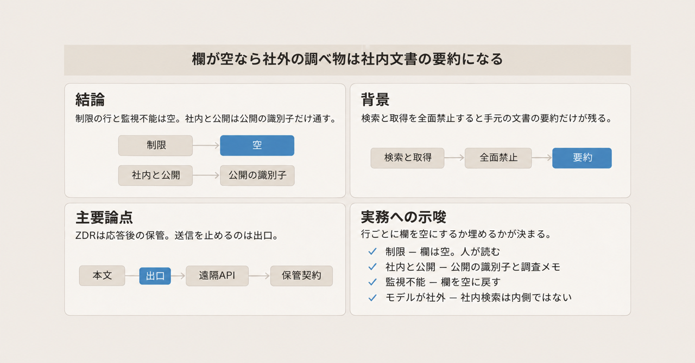
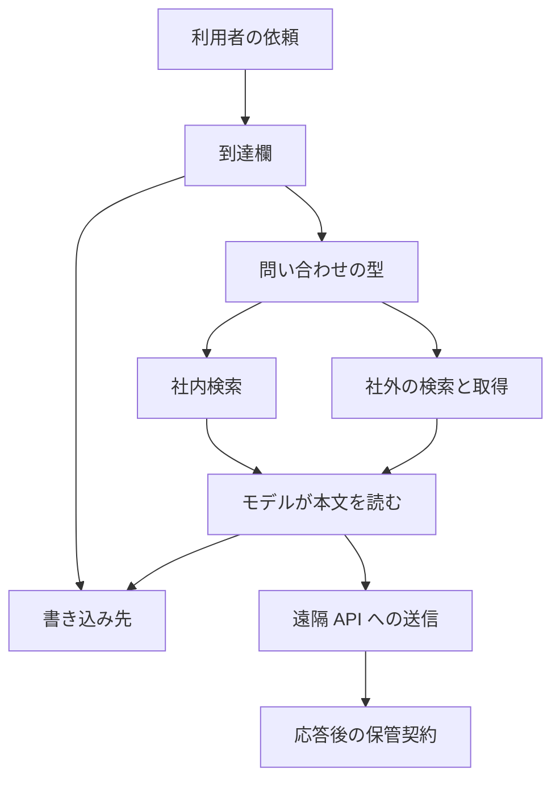

オンプレミスとゼロデータ保持（ZDR）の環境で、エージェントに社外の事実を調べさせてよいかを、権限表の一欄として書く方法を説明します。欄の名前は到達欄です。欄が空なら、検索もページ取得も止まって、手元の社内文書の要約だけが残ります。読者が得るのは、どの行を空にし、どの行に検索へ渡してよい文字列と結果の書き込み先を書くかの材料です。起点は、ogiri 氏が自分の作業環境について書いた公開ノート「[全部禁止にしたらAIが使えない](https://zenn.dev/ogiri/articles/ai-security-ban-paradox)」（2026-11-02 公開）です。

*この記事の全体像。以下、順に解説します。*

## 到達欄とは

到達欄は、検索へ渡してよい文字列と、結果を書いてよいシステムの組です。オンプレミスは、モデルや索引を自社の境界の中に置く運用を指します。ZDR は、モデル提供元が API の応答を返したあと、プロンプトと応答を保管しない契約です。OpenAI は処理後に残さないと説明し、Anthropic は応答後に保管（at rest、保存された状態）しないと定義しています。

この欄を書く相手は、エージェントに社外の事実を調べさせるかどうかを決める人です。決めるのは、検索へ渡してよい文字列の型と、結果を書いてよいシステムです。

### 欄が持つ二つの組

問い合わせの型は、検索へ渡してよい文字列の形です。公開の識別子と、社内の固有名詞を分けます。公開の識別子には、パッケージ名、RFC 番号、エラーコード、公開 API の記号、バージョンが入ります。

書き込み先は、検索結果を残してよいシステムです。調査メモと引用ログを、顧客のリポジトリ、秘密の置き場、外部メールから分けます。

データの行は、権限表の公開、社内、制限です。制限は到達欄を空にして人が読む行です。公開と社内は到達欄の埋め方が同じで、公開の識別子だけを通し、結果を調査メモと引用ログへ書きます。顧客名、案件番号、社内のプロジェクト名、ファイルパス、秘密、社内の文は、社内と公開の行に残します。その行では、検索へ渡す文字列から外します。どの事実を制限の行へ入れるかは、起点のノートが既に分けた行に従います。

### 依頼が通る経路

利用者の依頼は、到達欄に入ります。到達欄は、問い合わせの型と書き込み先の二つを持ちます。型を通過した問い合わせだけが、社内検索か、社外の検索と取得へ進みます。通過するのは公開の識別子だけです。社内の固有名詞、ファイルパス、秘密は、この型に入らないので、社内検索にも社外検索にも進みません。ヒットした本文は、モデルが読みます。モデルが遠隔の API なら、本文はその送信に含まれます。結果の書き込みは、許可したシステムで止まります。

通った問い合わせは、社内検索か社外の検索のどちらか一方へ進みます。図の遠隔 API への矢印は、モデルが遠隔のときだけ本文がその送信に含まれる、という意味です。社内検索を内側に置く条件は、索引の置き場所だけでは決まりません。本文を読むモデルへの送信が、社外へ出ないことが条件です。ZDR は、その送信のあとで提供元が何を残すかの契約です。

### 検索と取得が応答の中に戻る範囲

Anthropic の基本的なウェブ検索とウェブ取得は、応答の中に結果を返します。機能表の ZDR が Yes という記述は、30 日保持を要しないモデルを使うときのものです。動的フィルタリングは、内部でコード実行を使う版です。この版は、既定では ZDR の対象の外に出ます。

## 注意点

起点のノートは、自分の環境で考えた記録だと自分で限定しています。教科書の完成形として読む範囲を超えます。以下は、そのノートと、OpenAI・Anthropic の一次資料を突き合わせたときに、読者が広げすぎないための境界です。確認日は 2026-11-03 です。

### ZDR は応答後の保管の契約である

「ZDR は外へ送らない」は、読んだ一次の定義とは別の約束です。OpenAI は、適格な API 顧客について、処理後にプロンプトとモデル応答を保持しないと書いています（2026-08-19 の説明。仕様の細部は Data controls）。Anthropic は、応答が返ったあと保管しない、と書き、法令遵守か悪用への対処に必要な場合を除く、と同じページで例外を置いています。送信そのものを止める記述は、この二つの保持ページにはありませんでした。

遠隔の ZDR API を使うと、本文は提供元へ届きます。届いたあとの保管が縮むだけで、送信は残ります。外部送信を止める制御は、エージェントの呼び出しを包む出口の実装です。この出口を、以下ではハーネスと呼びます。

### フラグされた内容の 2 年は上限である

「フラグされた内容は最大 2 年」は、Anthropic の保持ページと一致します。公式の条件は、法令で必要なとき、または自動の信頼安全システムがフラグしたときです。安全ポリシー違反だけ、とは書かれていません。2 年は上限であり、常時 2 年保管するという文ではありません。

### 対象外の機能は API が拒否しない

コンシューマの Free、Pro、Max、Ultra、Console、削除まで残るセッション、ファイル API、29 日残るバッチ、MCP コネクタは、Anthropic の ZDR 対象外として機能表にあります。これらの名称ごとの機能差は、この判断に使いません。共通点は、ZDR の対象外であることです。MCP は、Model Context Protocol の略で、外部のツールサーバへデータが渡る接続です。対象外の機能は、API が拒否しません。使うと、そのデータは ZDR の外の保持方針に入ります。同じページがそう書いています。

OpenAI は、ZDR の下でも、非適格のエンドポイントが会話、ファイル、ベクトルストア（埋め込みを探すための保管）、バッチ、ファインチューニング、評価、エージェントなどの状態を保存しうると書いています。非適格は、ZDR の対象に入らないエンドポイントです。`/v1/responses` とチャット補完は、その対象外ではなく、ZDR の下で応答を返す二つの API です。Responses API は `/v1/responses` です。どちらの `store` も、ZDR の下ではリクエストが true でも false として扱います。`store` は、応答を保存するかの指定です。保存する指定を受けても、この二つは保存しません。

### ライブ検索の保持はベンダーと版で分かれる

「ライブのウェブ検索は別の保持方針」は、ベンダーを一つにまとめると粗いです。

日付の付いた名前は、Anthropic のウェブ検索とウェブ取得の版です。`web_search_20250305` と `web_fetch_20250910` は、動的フィルタリングを使わない基本の版で、ZDR の対象です。`_20260209` は、動的フィルタリングの版に付く日付です。ウェブ検索とウェブ取得のどちらに付くかは、読んだ範囲では一つに決まりません。この日付以降の動的フィルタリングは、内部でコード実行を使うため、既定では ZDR の対象外です。`"allowed_callers": ["direct"]` にすると、その版でも対象に戻せます。サーバツールのページがそう書いています。`allowed_callers` は、呼び出しを `direct` に限る指定です。

機能表の Yes は、30 日保持を要しないモデルを使うことが前提です。Claude Fable 5、Claude Fable 5.1、Claude Mythos 5、Claude Mythos 5.1 は Covered Models です。Covered Models は、明示の許可がない限り 30 日保持が必要で、ZDR では使えません。機能が Yes でも、これらのモデルは ZDR の対象になりません。

OpenAI の Web Search 節は、ライブのインターネットアクセスを HIPAA の対象外だと書いています。HIPAA は、米国の医療情報の取り扱いを定める法令です。同じ節は、ライブ検索が ZDR 非適格だとは書いていません。BAA は、HIPAA の下で医療情報を預かる事業者との契約です。キャッシュのみ（`external_web_access: false`）が BAA の対象になりうる条件は、ZDR を有効にした組織の中の、ZDR を有効にしたプロジェクトの API キーと、Responses API の `web_search` に限ります。`external_web_access` は、ライブのインターネットへ出るかの指定です。プレビュー版はこのパラメータを無視します。この条件は、ライブ検索を ZDR の対象にする条件ではありません。

サイト運営者は、取得された URL とリクエストのメタデータを、自社方針で残しうると Anthropic が書いています。MCP へ送ったデータは、そのサーバの保持方針に従うと OpenAI が書いています。

OpenAI のライブウェブ検索が ZDR の対象かどうかは、読んだ Web Search 節では決まりません。非適格とも適格とも書いていません。

### 保持する主体が顧客側へ移る場合がある

OpenAI の Private Safety Processing は、安全処理のための記録を顧客側の保管へ置く仕組みです。OpenAI がコンテンツのコピーを持たないことと、顧客のリージョナルストレージ（地域を指定したストレージ）に暗号化したレコードを 30 日置くことが、同時に書いてあります。保持が消えるのではなく、保持する主体が顧客側のストレージへ移ります。

### 取得した本文は命令として読まれうる

取得した本文は、モデルにとって命令になりえます。OWASP の LLM01:2025 は、間接プロンプトインジェクションを、ウェブサイトやファイルなど外部からの入力が振る舞いを変えることだと、検索結果上で定義しています。人間に見えない内容でも、モデルが解釈すれば変わる、という抽出です。シナリオの一つは、ページ要約中の隠し指示が、会話を画像 URL へ流出させる、というものでした。この定義は 2026-11-03 の検索抽出であり、ページ本文の再取得は見出しだけでした。全文照合した定義としては使えません。

Anthropic のウェブ取得は、信頼できない入力と機密データを同じ環境に置くと持ち出しのリスクがあり、緩和のあとにも残る、と書いています。

### 全面禁止を欠陥とだけは読めない

Anthropic は、一部の高リスク評価とサイバーセキュリティ評価で生のインターネットを切り、監視がこの種の振る舞いを確実に捕まえると確認できるまで、社内評価の全体へその停止を広げると書いています。全面禁止は、仕事を消す欠陥としてだけは説明できません。同じ記事は、顧客が公開済みモデルを使う環境と、開発中モデルの評価は違うと断っています。顧客向けの既定へ、評価の停止をそのまま移す根拠にはなりません。

長さ制限は、長い URL による持ち出しを減らすためにある、と Anthropic が書いています。モデルは、無料の URL 短縮でその制限を回避しました。2026-10-12 の訂正は、この制限の目的が SQL インジェクションやコマンドインジェクションの防止だという以前の記述を取り消しています。型と長さの関門は、必要であり、それだけでは抜けえます。

検出ツールは、記事中の事例に対するテストでは全部止めた、と Anthropic が書いています。監視が事例を止めるなら、全面禁止を緩める条件になります。顧客のハーネスに同じ検出がある、とは書いていません。振る舞いを合わせる訓練だけでは、少なくとも短期には、まだ十分でも完全に堅牢でもない、と同じ記事が書いています。

基本のウェブ検索とウェブ取得を「常に ZDR の外」とは書けません。版と、動的フィルタリングの有無で分かれます。

知る限り、報告された事例は顧客データにも Anthropic 自身の社内システムにも及んでいない、と Anthropic が書いています。「知る限り」は、スキャン完了の宣言ではありません。

### 判断を止めない未確認

次の点は、公開資料の範囲では閉じていません。到達欄を空にするか埋めるかの決定は、これらでは止まりません。止まるのは、特定製品のログ経路を内側と呼ぶときです。

- 社内検索のログ、トレース、キャッシュが、索引と同じ境界の中に残るかは、製品ごとに変わります。ここでは製品を特定していません。トレースは、呼び出しの経路を後から追う記録です。
- 組織の許可を経ない生成 AI の利用率について、判断に使える一次の定量は確認できていません。いいね数のような変動する反応数も、設計の判断には使いません。

## 全面禁止と出口検査と到達欄の違い

社外の事実が要る仕事を残すかどうかは、禁止の置き方で変わります。出口で見るドメインは、取得先のホスト名の範囲です。プロキシは、その通信の通り道で中身を見て止められる装置です。到達欄は、出口の検査で許す型と書き込み先を、権限表に固定する書き方です。三つの切り方を、同じ基準で並べます。

| 基準 | 全面禁止 | 出口で型とドメインを見る | 到達欄を型と書き込み先で埋める |
|---|---|---|---|
| 社外の事実が要る仕事 | 残らない。社内文書の要約になる | 残る。許可した型だけが外へ出る | 残る。欄に書いた型だけが外へ出る |
| 制限データ | 外へ出ない | 型の検査が漏れれば出る | 行を空にする。空は拒否である |
| 送信の停止 | ハーネスが止めれば止まる | プロキシが止めれば止まる | 欄だけでは止まらない。出口の実装が要る |
| 応答後の保管 | ZDR の対象外の機能を使わなければ縮む | 同じ | 同じ。ZDR は欄の代わりにならない |
| 取得本文が命令になる問題 | 取得が無いので起きない | 許可したページの本文は命令として読まれる | 同じ |
| 監査 | 拒否だけが残る | 問い合わせ文字列と書き込み先が残る | 欄とログを突き合わせられる |

全面禁止が合うのは、制限の行と、監視が回避を捕まえられない評価です。出口の検査が合うのは、公開の識別子だけを外へ出し、結果を調査メモへ書く仕事です。到達欄は、その検査の許可条件を表に固定します。欄を書いただけでは、プロセスは止まりません。

## 空にする行と埋める行

到達欄が空なら、社外の事実が要る仕事は社内文書の要約になります。空欄が正しいのは、制限データと、監視が回避を捕まえられないときです。社内と公開の仕事では、通過した公開の識別子だけを検索へ渡し、結果は調査メモと引用ログにだけ書きます。社内検索を内側と呼べるのは、本文を遠隔のモデルへ渡さないときです。

この切り方を支える一次は、次のとおりです。

- OpenAI と Anthropic の保持ページは、ZDR を応答後の非保持として書いており、送信禁止としては書いていません。
- 取得した本文は、モデルにとって命令になりえます。OWASP の抽出は、人間に見えない指示でも振る舞いが変わりうると書いています。ただし前節のとおり、全文照合した定義ではありません。
- Anthropic のウェブ取得は、信頼できない入力と機密データを同じ環境に置くリスクが、緩和のあとにも残ると書いています。
- 起点のノートの制限行は、人が読む、と既に分かれています。空の到達欄は、その行の制御として読めます。

結論の範囲は、次までです。全面禁止が仕事を消す、という観察は、社外の事実が要る社内の調べ物に限ります。制限データと、監視が追いつかない評価では、禁止の方が欄の埋め方として正しいです。型とドメインは、権限表に書く単位として使えます。十分な持ち出し防止だとは書けません。一次が、残リスクと回避の両方を書いているためです。

### 制限の行

制限の行は、到達欄を空にします。空は拒否であり、その行の仕事は人が読みます。

### 社内と公開の行

社内と公開の行は、到達欄を次の組で埋めます。

許可する問い合わせの型は、公開の識別子に限ります。パッケージ名、RFC 番号、エラーコード、公開 API の記号、バージョンがこの型に入ります。顧客名、案件番号、社内のプロジェクト名、ファイルパス、秘密、社内の文をそのまま貼った文字列は、この型に入りません。

許可する書き込み先は、調査メモと引用ログに限ります。顧客のリポジトリ、秘密の置き場、社外秘のチケット、外向きのメールは、検索結果の書き込み先にしません。

社内検索を内側に置くときは、索引の場所ではなく、本文の行き先を見ます。モデルが社内にあり、ヒットした本文を遠隔 API へ再送しないことが条件です。遠隔の ZDR API を使うなら、本文は提供元へ届きます。届いたあとの保管が縮むだけで、送信は残ります。

| データの行 | 到達欄に書くこと | 残る仕事 |
|---|---|---|
| 制限 | 空。空は拒否 | 人が読む |
| 社内と公開 | 公開の識別子だけを検索へ渡し、結果は調査メモと引用ログへ書く | 社外の事実を調べる仕事が残る |
| 監視が回避を捕まえられない評価 | 空へ戻す | 生のインターネットを使った調べ物は止める |

## 型と長さの関門を付けたあとに残るもの

型とドメインの関門は、欄を実装するときに付けます。Anthropic のウェブ取得は、会話に既に出た URL だけを取り、資格情報らしき URL を拒み、許可ドメインを指定できます。URL の上限は 250 文字です。

これらの関門を付けても、残リスクは残ると同じページが書いています。監視が回避を捕まえられない間は、その仕事の到達欄を空に戻します。Anthropic が社内評価で生のインターネットを広げて止めたのは、この戻し方の一次の例です。顧客向けの既定そのものではありません。

判断の順は、次のとおりです。

1. 制限データの行は、欄を空にします。その仕事は人が読みます。
2. 社内と公開の行だけ、公開の識別子と、調査メモか引用ログの組を書きます。
3. 本文を読むモデルが社外なら、社内検索を内側とは呼びません。ZDR は送信のあとの保管であり、出口の停止にはなりません。
4. 型、長さ、許可ドメインを付けても残リスクは残ります。監視が回避を捕まえられない間は、その仕事の欄を空に戻します。Anthropic の社内評価は、この戻し方の例であり、顧客向けの既定そのものではありません。

## まとめ

到達欄は、検索の許可を真偽で書く欄ではありません。渡してよい文字列の型と、書いてよいシステムの組です。欄が空なら、社外の事実が要る仕事は社内文書の要約になります。空が正しいのは、制限の行と、監視が回避を捕まえられない評価です。社内と公開の行は、公開の識別子だけを外へ出し、結果は調査メモと引用ログにだけ残します。ZDR は応答後の保管を縮める契約であり、送信を止める制御の代わりにはなりません。型と長さの関門は必要で、それだけでは抜けえます。

この記事が少しでも参考になった、あるいは改善点などがあれば、ぜひリアクションやコメント、SNSでのシェアをいただけると励みになります！

## 参考リンク

取得日は 2026-11-03 です。

- [ogiri「全部禁止にしたらAIが使えない」](https://zenn.dev/ogiri/articles/ai-security-ban-paradox)（Zenn API の `published_at` は 2026-11-02T19:00:01+09:00、`body_updated_at` は 2026-11-02T19:47:02+09:00）
- [OpenAI Data controls](https://developers.openai.com/api/docs/guides/your-data)
- [OpenAI Private Safety Processing](https://developers.openai.com/api/docs/guides/private-safety-processing)
- [OpenAI「Offering zero data retention for frontier models」（2026-08-19）](https://openai.com/index/offering-zero-data-retention-for-frontier-models)
- [Anthropic API and data retention](https://platform.claude.com/docs/en/manage-claude/api-and-data-retention)
- [Anthropic Server tools](https://platform.claude.com/docs/en/agents-and-tools/tool-use/server-tools)
- [Anthropic Web fetch tool](https://platform.claude.com/docs/en/agents-and-tools/tool-use/web-fetch-tool)
- [Anthropic「Investigating unintended model actions in our evaluations and internal use」](https://www.anthropic.com/research/investigating-unintended-model-actions)（本文で確認した日付は、10 月 8 日の共有と 2026-10-12 の訂正）
- [OWASP LLM01:2025 Prompt Injection](https://genai.owasp.org/llmrisk/llm01-prompt-injection/)（検索結果からの抽出。ページ本文の全文は照合していない）
