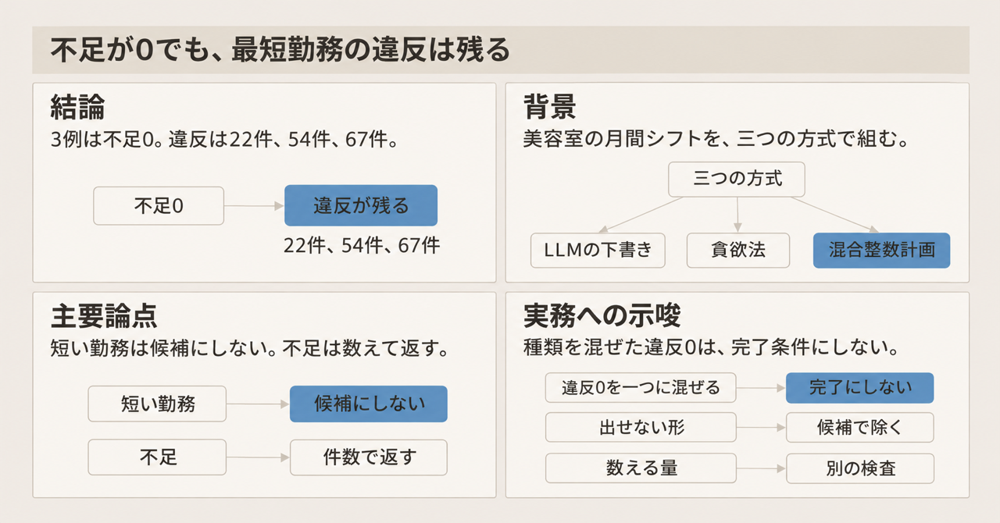
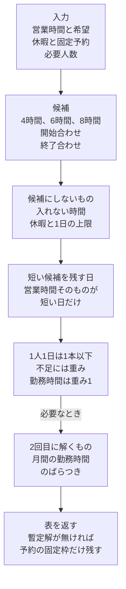
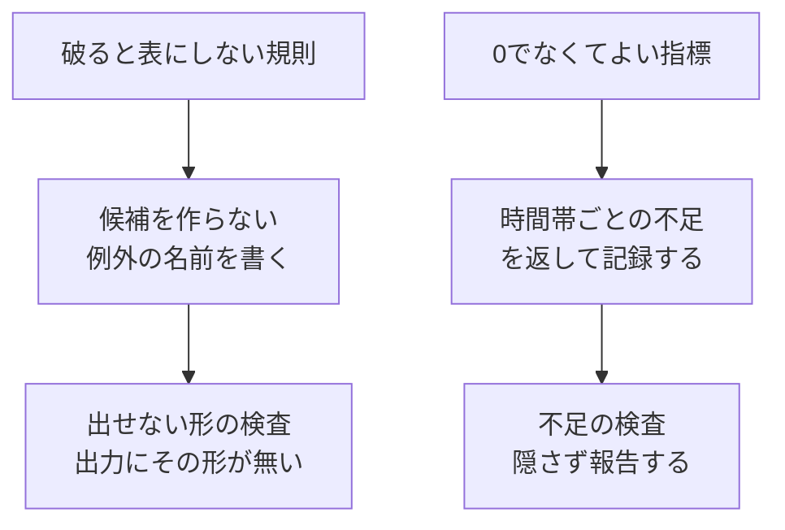

美容室の月間シフトを、LLM の下書き、枠を順に埋める貪欲法、混合整数計画の三つで組んだ比較が、合同会社 playpark の技術記事として公開されています。本稿では、三つの作り方、変数の置き方、著者が報告した件数と秒数を、公開された記述の範囲で追います。

月次の件数と秒数は著者の計測であり、入力データは公開されていません。

*この記事の全体像。以下、順に解説します。*

## 三方式のシフト作成とは

比較の対象は、美容室の1か月分のシフトです。会社のブログには 2026年10月15日付で載り、Zenn の playpark が 2026年11月4日に短い転載を公開しています。製品は Shift Bud で、playpark のシフト作成の製品です。ソルバは、式を解くプログラムです。実装は npm の `highs` を、Node.js のプロセスの中で呼びます。`highs` は、オープンソースの線形計画・混合整数計画ソルバ HiGHS を包むパッケージです。

混合整数計画は、一部の変数を 0 か 1 に限り、制約と目的を一次式で書いて、目的の値を最も良くする解を探す定式化です。スロットは、時間帯ごとの必要人数の枠です。貪欲法は、スロットを、その時点の得点が高い順に埋める手続きです。この記事では、その手続きをスロット埋めと呼びます。全体が最適である保証は持ちません。

候補は、スタッフがその日に取りうる勤務の開始と終了の組です。長さは、出勤できる範囲に収まる 4時間、6時間、8時間に限ります。開始合わせは、勤務の開始を基準の時刻に揃えた候補です。終了合わせは、勤務の終了を基準の時刻に揃えた候補です。基準の時刻が何時かは、出勤できる範囲へ収める、とだけ書かれています。

### 入力から表までの流れ

入力から候補を作り、混合整数計画で選び、必要なら勤務時間のばらつきを2回目に解きます。時間切れで暫定解が無いときは、予約で人をあらかじめ固定した枠だけを返します。暫定解は、最適だと証明し終わる前に手元にある実行可能な解です。1日の上限は、候補を作らない条件の一つです。上限が時間なのか本数なのかは、比較記事に書いてありません。

### LLMの下書きと貪欲法

LLM は、月間のシフト案を YAML で出します。YAML は、人が読める字下げのテキストです。読めなければ捨てます。読めたら、貪欲法の初期値に入れ、残りを埋めます。1枠でも必要人数に届かなければ、LLM の案を捨てて、貪欲法で組み直します。ブログは、LLM の案が使われるのは、貪欲法で残りを埋めたあと、必要人数の不足が1枠も無いときだけ、と書いています。生の YAML が、そのまま出荷する表になる道はありません。

貪欲法の採点は、名前の無い定数 25 個です。最短勤務は、長さが下限を下回る勤務です。下限の時間と、違反を何単位で1件と数えるかは、比較記事に書いてありません。次の件数は、その内訳が無い報告値です。ブログの表（2026年10月の1か月）は、次のとおりです。

| 規模 | 時間 | 不足 | 最短勤務の違反 | 勤務時間の標準偏差 |
|---|---:|---:|---:|---:|
| 5人 | 50ms | 0 | 22件 | 11.6時間 |
| 15人（予約の固定4、休暇3） | 104ms | 0 | 54件 | 4.8時間 |
| 40人（予約の固定6、休暇5） | 259ms | 0 | 67件 | 4.9時間 |

予約の固定は、予約に合わせて人を枠へあらかじめ固定する入力です。括弧の 4 と 3、6 と 5 の単位は、比較記事に書いてありません。playpark の記事の書き出しは、手元の計測ではソルバが 40人×31日を 2.4秒で最適解まで解き、違反を 0 にした、と書いています。この 0 が、上の表の最短勤務の違反 22件、54件、67件と同じ入力だとは、記事は書いていません。

### 混合整数計画の式

0/1 変数は、0 か 1 しか取らない変数です。ここでは「スタッフ s が候補 c に入る」です。1人1日のシフトは、合計 1 本以下です。

必要人数はソフトです。ソフト制約は、破れても解を返し、破った量を目的の罰則に入れる書き方です。足りない1人時は、記事が不足1つに置く単位で、重みは 1000 です。勤務1時間の重みは 1 です。目的値は、この罰則と勤務時間を足した値です。例の目的値 1012 は、後の最小例でスタッフ C を欠勤させたときの値です。10時台を欠く案と 18時台を欠く案が、同じ値になります。記事は、`highs` 1.15.3 が `short_10` を返す、と書いています。`short_h` は、時刻 h の不足を表す変数です。`short_10` は、10時台の不足です。

必要人数をハードにすると、人が足りない月は `Infeasible` だけが返ります。ハード制約は、破った解を許さない書き方です。`Infeasible` は、書いた式を全部満たす解が無い、という状態です。時間帯の優先は、重みを変える例があります。18時台だけを 2000 にします。

短すぎる候補は、営業時間そのものが短い日を除いて作らない、とブログの箇条書きにあります。「最短何時間」の数字は、比較記事にありません。4時間は、最小例の候補の長さです。

カバー制約は、各区間の出勤人数が必要人数に届くかを書く式です。15分ごとではなく、候補の境界で切った区間ごとです。型6は、比較記事が変数の本数を分けるときの名前です。4時間、6時間、8時間の開始合わせと終了合わせの6通りと同じものとは、記事は書いていません。型6で、営業時間が1本の日は、1日最大7区間になります。約1,700本と約220本は、その区間の本数です。営業時間が1本であることと、7区間になる理由は、比較記事に書いてありません。

月間の勤務時間のばらつきは、2回目の求解です。許容ギャップは、暫定の最良値（上界）と、これより良い解は無いと分かった値（下界）の相対差が、この割合以下なら探索を終えてよい、という停止条件です。HiGHS の `mip_rel_gap` は `|上界-下界|/|上界|` です。許容ギャップ 5% では証明に 8.15秒を使い、10% では 3.8〜4.1秒で終わり、ばらつきは同じだった、とブログは書いています。

### 候補の本数と最小例

4時間、6時間、8時間の、開始合わせと終了合わせは、6通りです。40人×31日×6通りは、7,440 本です。比較記事の型6は 6,786 本で、7,440 より 654 本少ないです。少ない理由は、記事に書いてありません。型12は 13,572 本で、6,786 のちょうど2倍です。12通りの中身は、記事に書いてありません。

15分刻みで勤務を全部変数にすると、634,891 変数になります。ヒープ 12GB でもメモリ不足だった、とブログと Zenn の転載は書いています。30分刻みは 173,043 変数です。3秒では解が無く、63秒で実行可能解が出ます。型12の最適解は 3.15秒で、目的値の差は 0.2% だった、とも書いています。0.2% がどの二つの目的値の差かは、記事に書いてありません。

最小例は、公開されている式を npm `highs@1.15.3` と Node v22.17.0 で1回解いた結果です。比較記事の本番の記述は、Node.js 24 です。`Optimal` は、探索を終えて最適だと証明できた状態です。

全員が出勤できる例では、状態は `Optimal`、目的値は 14、選ばれた変数は `x_A_13_19`、`x_B_10_14`、`x_C_15_19` です。`x_A_13_19` は、スタッフ A の 13時から19時と読めます。長さは6時間です。B は 10時から14時の4時間、C は 15時から19時の4時間です。合計は14時間で、目的値 14 と一致します。14 は勤務時間の合計と読めます。この 14 は、比較記事のコンソール出力にはありません。選ばれた変数は、記事と同じです。

C を欠勤させると、状態は `Optimal`、目的値は 1012、変数は `short_10`、`x_A_11_19`、`x_B_15_19` です。A は 11時から19時の8時間、B は 15時から19時の4時間で、合計12時間です。不足の重み 1000 と合わせると 1012 です。記事が表示する変数名と、C 欠勤の目的値 1012 は一致しました。記事は、10時台を欠く案と 18時台を欠く案を同値だと書いています。返ったのは `short_10` の側です。

### 報告された秒数

秒数は、三つの条件に分かれます。

| 条件 | 報告された時間 |
|---|---|
| 実装後のベンチ。入れない日のある人を含む | 約0.85秒 |
| 実装前の試作。型6、6,786変数、Mac Studio | 2.4秒で最適解 |
| 検証環境。1 vCPU、512MiB。40人全員が終日入れる月 | 9秒台。呼び出し期限は8秒 |

時間制限が縛るのは、探索だけです。これは比較記事の計測の説明です。モデルの読み込みと結果の変換は、検証環境で約1.1万変数に対し 1〜1.5秒だった、と記事は書いています。9秒台が、探索とその外側のどちらを含むかは、記事に書いてありません。後の指示表にある「呼び出し全体」は、エージェントへの指示の文言で、この計測の説明とは別の文です。

解が無いときの返し方は、予約で固定した枠だけを残し、残りを不足にします。これとは別に、貪欲法で組み直す切り替えを、本番に残しています。期限の確認は、本番相当の40人の月を1回流した、と著者は書いています。本番の件数が少なく、件数からは学べない、という理由です。

比較記事が固定している版は、npm `highs@1.15.3` です。公開日は 2026-09-11 です。2026-11-04 時点の npm 上の最新は `1.15.4` で、公開日は 2026-10-16 です。リポジトリ [lovasoa/highs-js](https://github.com/lovasoa/highs-js) の star は約90（2026-11-04時点）です。ライセンスは MIT で、アーカイブされていません。

## 注意点

### 計測が届く範囲

月次の表は、著者の計測です。入力と、採点定数 25 個の中身は、公開されていません。2026年11月4日時点で、公開されているコードを変数本数 634,891 で検索しても、シフトのモデルには当たりません。当たるのは、文字の座標データや会計の数値など、シフトと無関係な行です。`it-all-playpark` は、GitHub 上で公開リポジトリを持つアカウント名です。その公開リポジトリに対する `highs` の検索は 0件です。`playpark-llc/shift-bud` は、GitHub 上でリポジトリとして解決できません。これは、外から見えないコードが無い証明ではありません。件数 22、54、67 を、別のデータで否定する材料もありません。

Zenn の転載は、標準偏差の列が無く、シナリオ名から「予約の」が落ちます。時間、不足、違反件数は、ブログと一致します。短すぎる候補を、営業時間そのものが短い日を除いて作らない、という文は、ブログの箇条書きにあり、Zenn の対応箇所にはありません。

書き出しの 2.4秒は、実装前の試作（型6、Mac Studio）として報告された秒数と同じです。検証環境の重い月は 9秒台で、呼び出し期限は 8秒です。三つの秒数は、条件が違う計測です。

### 比較表が本文より強いところ

playpark の比較記事にある表の「制約に書いたルールは必ず守る」「同じ入力なら同じ結果（時間切れを除く）」は、その記事の本文より強いです。ソルバが守るのは、書いた式と、作った候補です。必要人数は `short_h` に逃がせます。ギャップ 10% で止めた2回目は、ギャップの内側の別解を含みえます。目的値 1012 の二案は、記事自身が書いています。

HiGHS の stable の [options](https://ergo-code.github.io/HiGHS/stable/options/definitions/) には、`mip_rel_gap`、`time_limit`、`random_seed` があります。解の列は、選ばれて返る変数の組です。解の列が一意だ、という文は、確認した options と [enums](https://ergo-code.github.io/HiGHS/stable/structures/enums/) にはありません。同じ入力でも、時間切れ、ギャップ、同値な目的値、ソルバの版で、返る列は変わりえます。`kTimeLimit` は、最適とは別の状態です。時間制限で止まったことを表します。

### 最短勤務の話が届く範囲

「貪欲法は最短勤務を破る」は、このスロット埋めの3シナリオの話です。貪欲法一般の話ではありません。

Google OR-Tools の[従業員スケジューリングの例](https://developers.google.com/optimization/scheduling/employee_scheduling)は、決まった長さのシフトを割り当てます。短い勤務を、変数に出しません。[`shift_scheduling_sat.py`](https://github.com/google/or-tools/blob/stable/examples/python/shift_scheduling_sat.py) は、`hard_min` 未満の連続を禁止し、`soft_min` 未満を罰則にします。`hard_min` は、連続がこの本数未満になる割当を許さない下限です。`soft_min` は、未満でも割当は許し、罰則を付ける下限です。最短勤務を、組んだあとの検査だけに置かない書き方は、この比較記事より前から公式の例にあります。

### Node.jsから公式ソルバを呼ぶ経路

「Node なら別プロセスか別サービス」は、公式の CP-SAT の例の話としては、2026-11-04 に取得した stable の README と整合します。CP-SAT は、OR-Tools の制約プログラミング用ソルバです。README は、ラッパを Python、C#、Java、実装を C++ と書きます。コード例の言語一覧は、C++、Python、Java、C#、Go です。比較記事は Go を書いていません。2026-10-15 時点の README が Go を含んでいたかは、確認できていません。該当する記述は [sat の README](https://github.com/google/or-tools/blob/stable/ortools/sat/docs/README.md) と [リポジトリの README](https://github.com/google/or-tools/blob/stable/README.md) にあります。

公式ではない npm の包は、ブログより前にあります。[`cpsat-js@1.0.0`](https://www.npmjs.com/package/cpsat-js) は 2026-04-16 公開です。`@ortools-node/cp-sat@9.15.0-node.0-rc.0` は 2026-05-08 公開です。どちらも、Google の公式の例の一覧にはありません。

### パッケージの版と内包するHiGHS

npm の包の版 1.15.3 は、内包する HiGHS の版 1.15.1 と一致しません。highs-js の `v1.15.3` と `v1.15.4` が取り込む HiGHS のコミット（submodule）は、同じ SHA `04024d701f79feb8e2f18bc3df0dffc04ef05088` です。HiGHS の tag `v1.15.1` が、その SHA を指します。GitHub API は、HiGHS の tag `v1.15.3` を 404 で返します。highs-js v1.15.2 のリリースノートは、内包する HiGHS を v1.15.1 に更新した、と書いています。v1.15.4 の README は、major と minor を内包する HiGHS に合わせ、patch は JavaScript の修正だけでソルバの版を変えない、と書いています。この記述と、patch 3 と 4 が HiGHS 1.15.1 を含むことは、両立します。

v1.15.4 の修正は、`mipUserSolution` が解を捨てる件です。比較記事は、この API 名を書いていません。ブログの日には 1.15.3 が latest で、Zenn の公開日には 1.15.4 が既に出ていました。最小例の再実行は、1.15.3 だけです。`highs@1.15.4` で同じ最小例が `short_10` を返すかは、解いていません。内包する HiGHS のコミットは、1.15.3 と同じです。

### 別ページの自己申告

製品紹介（2026-01-20、[`/blog/shift-bud`](https://www.playpark.co.jp/blog/shift-bud)）は、休憩時間、連勤上限、週次労働時間を、生成前の制約として渡す、と書いています。同じページには、作成時間、予約のミスマッチ、8割の下ごしらえ、という別々の自己申告が並びます。シフト作成時間は、月10時間から月2時間（80%削減）です。予約とのミスマッチは、月3〜5件から月0件です。別に「AI が 8 割の下ごしらえをして、店長が 2 割の暗黙知で味付けする」と書いています。

協働の記事（`datePublished` 2026-03-28）は、「木曜午後は常連の田中さんが来るからAさんは外せない」、差分の確認、「この変更はいいね」「ここは元のままで」、「店長の判断が最終決定」を書いています。これらは、比較記事のベンチとは別の系列です。2026-10-15 の式に、休憩や連勤や週次労働時間が入っていることの台帳ではありません。週40時間という数字は、比較記事が式に入れたものとしては書かれていません。

### まだ閉じていない点

次は、比較記事と公開資料の範囲では閉じていません。

- 3シナリオの入力、採点定数 25 個の中身、本番の最短勤務の下限の数字は、公開されていません。
- 6,786 が 7,440 より 654 少ない理由は、記事が書いていません。
- 製品の画面やヘルプに、規則の台帳があるかは、見ていません。
- 同じシードで解の列が必ず一致するかは、確認した HiGHS のページに直接の文が無く、繰り返しては測っていません。
- 18時台を欠く同値の案は、最小例の1回では確認していません。

## ソルバに渡した規則

「ソルバへ移した規則」と「人が例外として残した規則」という見出しは、ブログにも Zenn の転載にもありません。散らばった記述を集めると、ソルバ側は次になります。

| 規則 | 記事での置き方 |
|---|---|
| 入れない時間、休暇、1日の上限 | 候補を作らない |
| 短すぎる勤務 | 営業時間そのものが短い日を除き、候補を作らない |
| 1人1日1シフト | 合計が 1 以下の線形制約 |
| 必要人数 | ソフト。不足に重み。ハードだと `Infeasible` のみ |
| 時間の刻み | 候補の境界で切った区間。約1,700本を約220本へ |
| 月間時間のばらつき | 2回目の求解。ギャップ 5% と 10% |
| 予約の固定枠 | 入力。時間切れで解が無いときは、固定枠だけを残す |

人が例外として残した労働規則の一覧は、この2本にはありません。近い記述は、時間帯の重みを人が決めること、LLM を要望の解析や結果の説明に置くのは比較記事の著者の見方で未検証であること、貪欲法を本番の退避として残したこと、です。店長の上書きは、前節の別ページの話です。

### エージェントへの指示と、不足の完了条件

ブログが実装側へ渡している指示は、次です。ここでのエージェントは、シフト案の YAML を出す LLM ではなく、式と検査を指示される側です。

| 指示 | 内容 |
|---|---|
| 違反の数え方 | 種類ごとに数える。小、中、大の固定シナリオで、違反 0 を完了条件にする。小中大が 5人、15人、40人と同じシナリオかは、記事に書いていない |
| 変数の見積もり | 定式化の前に、0/1 変数の数を見積もる |
| 必要人数 | ソフトにする。不足を、時間帯と人数で返す |
| 時間制限 | 呼び出し全体にかける。解が無いときの返し方を決める |
| 旧方式 | 残す。消す前に、本番相当の最大規模を1回流す |

「候補を作る段階で規則を吸収する」は、ソルバの節にあります。指示表の行にはありません。指示表の旧方式が、本番に残した貪欲法と同じものを指すかは、記事が書いていません。

指示の「違反0」と「必要人数はソフト」は、人が足りない月では両立しません。不足を違反の件数に入れて 0 を完了条件にすると、ソフト制約が意図した「不足つきの表」が、テストの失敗になります。

## 三つのシナリオで支持できる範囲

主要な結論は、この貪欲法について、不足 0 が最短勤務の違反を隠した、という事例として使える、というものです。使える範囲は、上の3シナリオと、記事が書いたソルバの手順までです。

支持できる読みは、次です。

- ブログの表は、3シナリオとも不足 0 で、最短勤務の違反が 22件、54件、67件と報告しています。playpark の比較記事の表にある貪欲法の 0.26秒は、上の 40人の 259ms と桁が合います。同じ計測を丸めたものとは、記事は書いていません。
- 最小例の式は公開されています。1回の再実行が、C 欠勤の割当と目的値 1012 を再現しました。
- 変数を候補の型に絞ると、全列挙のメモリ不足を避けられた、という著者の表があります。40×31×6 との差 654 の理由は、不明のままです。
- playpark の記事は、不足だけを見ると最短勤務に気づかない、と書いています。上の指示表の行には、その文はありません。

広げると弱くなる読みは、次です。

- 貪欲法一般が最短勤務を破る、という一般化は、公式のシフト型の変数と `hard_min` で弱くなります。
- 「必ず守る」「同じ結果」は、ソフト制約、ギャップ、時間制限、同値な目的値で弱くなります。
- 月次の件数は、再計算できません。本番相当の期限確認は、著者によれば1回です。
- 「解空間の外に置いた」は、記事のソルバの節の手続きとしては読めます。エージェントへの指示文としては、記事は書いていません。製品全体の労働規則がすべて外に置かれた、とは読めません。別ページが、店長の修正を残しているためです。

## 業務テストを二つの一覧に分ける

この比較は、エージェントの業務テストを二つの一覧に分ける実例として残せます。記事がエージェントに渡している指示は、数える検査の方です。出せない形にする手続きは、ソルバを書く節にあります。

表に出してはいけない側の例は、最短勤務より短い枠です。例外は、営業時間そのものが短い日、とブログが名指ししています。書ける側の例は、時間帯ごとの不足です。不足が 0 でも、最短勤務の検査は別です。単一の「違反はすべて 0」は、この記事の表が両方を併記しているので、完了条件にしません。

判断の基準は二つです。その形が表に出たら不合格なら、候補を作る段階で除外し、例外の名前を書きます。0 でも表にしてよい量なら、時間帯と人数で返し、件数は別の検査にします。

検査と生成器は、別の制御です。この貪欲法の失敗は、検査が最短勤務を見ているのに、生成器が短い枠を出し続けることです。テストが数える指標を増やしても、生成器がまだその形を出せるなら、同じ失敗は残ります。

## まとめ

美容室の月間シフトを三方式で組んだ比較では、貪欲法の3シナリオは不足 0 のまま、最短勤務の違反を 22件、54件、67件と報告しています。混合整数計画の側は、必要人数をソフトな不足にし、短すぎる勤務は候補を作らない側に置いています。

完了条件を、種類を混ぜた「違反 0」の1本にすると、人が足りない月では、不足つきの表が失敗になります。検査が最短勤務を見ていても、生成器が短い枠を出せるなら、同じ失敗は残ります。使える範囲は、この3シナリオと、記事が書いたソルバの手順までです。

この記事が少しでも参考になった、あるいは改善点などがあれば、ぜひリアクションやコメント、SNSでのシェアをいただけると励みになります！

## 参考リンク

- playpark「LLM vs 貪欲法 vs 混合整数計画」（ブログ、ページ表記 2026-10-15） <https://www.playpark.co.jp/blog/shift-scheduling-llm-vs-greedy-vs-mip-solver>
- Zenn の転載（`published_at` 2026-11-04） <https://zenn.dev/playpark/articles/shift-scheduling-llm-vs-greedy-vs-mip-solver>
- npm `highs` <https://www.npmjs.com/package/highs>
- lovasoa/highs-js <https://github.com/lovasoa/highs-js>
- HiGHS options（stable） <https://ergo-code.github.io/HiGHS/stable/options/definitions/>
- HiGHS enums（stable） <https://ergo-code.github.io/HiGHS/stable/structures/enums/>
- OR-Tools sat README（stable、2026-11-04 取得） <https://github.com/google/or-tools/blob/stable/ortools/sat/docs/README.md>
- OR-Tools README（stable） <https://github.com/google/or-tools/blob/stable/README.md>
- `shift_scheduling_sat.py`（stable） <https://github.com/google/or-tools/blob/stable/examples/python/shift_scheduling_sat.py>
- Employee scheduling <https://developers.google.com/optimization/scheduling/employee_scheduling>
- npm `cpsat-js` <https://www.npmjs.com/package/cpsat-js>
- Shift Bud の紹介（2026-01-20） <https://www.playpark.co.jp/blog/shift-bud>
- AI と店長の協働（`datePublished` 2026-03-28） <https://www.playpark.co.jp/blog/shift-bud-ai-human-collaboration>
