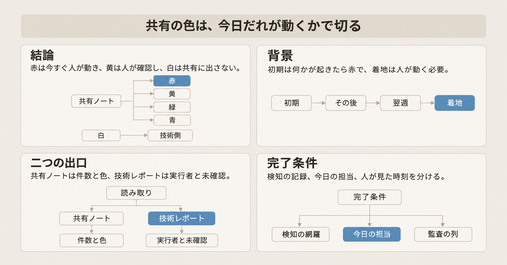
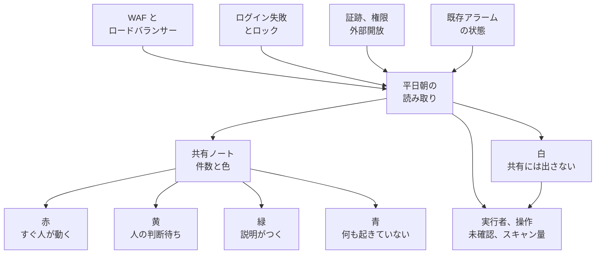

平日の朝、本番に攻撃の兆候が来ていないかをエージェントへ読ませ、色付きの報告を社内へ出す運用があります。株式会社Stockの武田峻一が、2026年11月6日 21:01 JST に公開した記録です（[毎朝のセキュリティ確認をAIに任せたら、判定の基準が「人が動く必要があるか」に変わった](https://zenn.dev/stock_inc/articles/ai-daily-security-check-criteria)）。公開時刻は Zenn の `published_at` です。

色の定義は、運用の初期の「何かが起きたら赤」から、着地の「人が動く必要があるか」へ移っています。

本稿で扱うのは、朝の読み取りが何を見て何を出すか、色がどの順で動いたか、公開本文から言える範囲、自社の完了条件に何を分けるかです。これは1社の運用記録であり、他社で再現した測定データセットではありません。

読者が持ち帰るのは、共有する色、技術側に残す記録、監査の列を分けるときの材料です。想定する読者は、エージェントの業務判定に「今日だれが動くか」を完了条件として入れたい人です。

*この記事の全体像。以下、順に解説します。*

## 朝の読み取りエージェントとは

朝の読み取りエージェントは、平日の朝に起動する指示書1枚に従って、許可された読み取りだけを行い、二つの報告を書く仕組みです。観測窓は、前回の実行から今回までです。月曜は、金曜の実行から72時間になります。

### 読む操作と止まる操作

実行できるのは、許可リストに載った読み取りだけです。例は次のとおりです。

- CloudWatch のメトリクスとアラーム履歴。CloudWatch は、AWS のメトリクスとログを置く監視サービスです。
- Logs Insights のクエリ。Logs Insights は、CloudWatch Logs に対するクエリです。
- CloudTrail の `lookup-events`。CloudTrail は、アカウントの管理操作を残す記録です。`lookup-events` は、その直近のイベントを引く読み取りです。
- セキュリティグループの参照。セキュリティグループは、通信を許す範囲の設定です。

作成、更新、削除、コンテナやデータベースへの接続、権限変更は、「要判断」と書いて止まります。書き込みは、社内の共有ノート1件だけです。共有ノートへ書くためのキーは、読み取りの許可とは別に置きます。

比較の基準は、同じ長さの窓について、直近7日の中央値です。証跡は、アカウントの管理操作の記録です。前に書いた CloudTrail が、その記録です。証跡の停止のように、1件で赤にするものだけは、固定の閾値を残します。平均を避ける理由は、1日だけ大きい攻撃があると、翌週の基準が引きずられる、という説明です。

指示書には、レポートの時刻を日本標準時（JST）にすること、Logs Insights の `statistics.bytesScanned` を合計し、上限を超えそうなら残りを未確認にすること、を書いておきます。`bytesScanned` は、クエリが走査したログの量です（[GetQueryResults](https://docs.aws.amazon.com/AmazonCloudWatchLogs/latest/APIReference/API_GetQueryResults.html)）。この未確認は、走査が届かなかった残りです。見られていない範囲として、技術レポートに残します。

起動場所は、手元の PC です。開いていない日は走らず、次に動いた日の窓が空いた分をまとめて見ます。著者は、リアルタイムの監視をアラームの役目に置き、このルーティンを前日分の見直しに置いています。

共有ノートは、これまで人が下書きを承認して出していました。今後は自動投稿にし、総合判定が赤の日だけ承認に戻す、と書かれています。総合判定は、その日の色を一つにまとめた結果です。手元の PC から、別の実行環境へ読み取り権限を出すかは、未決です。

### 五つの色

共有ノートの色は、5状態です。赤の「すぐ動く」と、黄の「被害はまだ分からない」と、白の「観測そのものが届いていない」は、別の状態です。

| 色 | 共有ノートでの意味 | 公開本文にある例 |
|---|---|---|
| 赤 | すぐ人が動く | 証跡の停止。外部への新たな開放。社外からの多要素認証（MFA）なしのログイン成功 |
| 黄 | 人の確認待ち。被害は未確認 | 社外回線からの想定外の権限変更。アプリまで届いて、原因が分からない失敗の増加 |
| 緑 | 何かあった。防げているか、説明がつく | 入口で遮断された急増。社内回線での誤入力によるロック |
| 青 | 何も起きていない | 公開本文の例示は、赤・黄・緑が中心 |
| 白 | 見られていない範囲。共有ノートには出さない | 技術レポートに残す |

MFA は、パスワードに加えて別の確認を求める認証です。走査上限で残した未確認は、黄の「被害は未確認」とは別です。見られていない範囲として、白と同じく共有ノートには出さず、技術レポートに残します。

### 二つの出口

出口は二つです。共有ノートは、件数と色です。技術レポートは、実行者、操作、未確認、スキャン量です。技術レポートには、緑にしたものも含めて、実行者と操作を残します。共有ノートには、送信元 IP と利用者の識別子を書きません。

観測は4系統です。入口は、WAF とロードバランサーです。WAF は、ウェブの入口でリクエストを遮断する仕組みです。ロードバランサーから何を読むかは、公開本文には書かれていません。ログイン失敗とロックです。アカウントの兆候は、証跡、権限、外部開放です。既存アラームの状態です。白は、共有ノートに出さず、技術レポートへ残します。

## 色の基準が動いた順

公開本文に書かれている順は、次のとおりです。固定の閾値から7日中央値への変更は、この色の回数とは別の節にあります。

| 時点 | 公開本文に書かれている基準 |
|---|---|
| 初期 | 何かが起きたら赤。アカウント変更のアラームは、権限の付け替えや S3 バケットの作成など、社員の通常作業でも鳴り、毎週赤になった。S3 バケットは、オブジェクトを置く保存容器 |
| その後 | 実行者、送信元、MFA を引く。すべてが社員の IAM ユーザー、社内回線、MFA ありなら緑。それ以外が1件でもあれば赤。証跡の停止のように、だれがやっても赤のものは例外として列挙する。IAM ユーザーは、AWS アカウントに置く人の識別子 |
| 翌週 | 在宅や出張を見込み、社外回線でも想定内は緑。想定内は、リリース、調査の読み取り、MFA ありのコンソールログイン。黄は、社外回線かつ想定外。想定外は、権限変更、秘密情報の読み出し、外部開放、実行者や目的が不明 |
| 着地 | 色の意味を「人が動く必要があるか」に揃えた5状態。防げているもの、原因が分かっているものは黄にしない |

コンソールログインは、AWS の管理画面へのログインです。

同じ時期に、検知器側の誤りが2件書かれています。

1件目は、`PutBucketPublicAccessBlock` を API 名だけで数えた場合です。この API は、S3 バケットの公開ブロック設定を書く操作です。公開ブロックを有効にする「塞ぐ」操作でも、名前だけで数えるとアラームが鳴ります。著者は、4つの設定値が false のときと、ブロック設定の削除だけを数える形を例示しています。false は、公開を塞いでいない側です。`requestParameters` は、次の re:Post の例が示す、呼び出しに付いた設定値の置き場です。そのパスは、自分の環境のイベント1件で確かめよ、と書かれています。設定項目の公式の形は [PublicAccessBlockConfiguration](https://docs.aws.amazon.com/AmazonS3/latest/API/API_PublicAccessBlockConfiguration.html) にあります。AWS re:Post の例は、eventName に `PutBucketPublicAccessBlock` を挙げつつ、`requestParameters` を `publicAccessBlock: ""` と示しています（[Block Public Access の例](https://repost.aws/knowledge-center/s3-block-public-access-setting)）。公開記事のフィルタが仮定する形とは違います。

2件目は、エージェントが「WAF のログが無い」と書き、ログ出力を足す課題を起票し、後で別の保存先に既にあったと訂正した、という記録です。著者は、AI の「無い」は、見た範囲に無かった、という意味だと書いています。

## 注意点

公開本文から確認できる範囲と、確認できない範囲を分けます。確認日は 2026年11月8日です。

### 冒頭の「3回」と費用差は、定義が本文に無い

「1週間で基準を3回変えた」は、公開記事の冒頭にある著者の要約です。3回それぞれの日付と定義は、本文に列挙されていません。「翌週、さらに一段緩めています」は、社外回線の想定内作業を緑にした緩和です。その緩和が、冒頭の1週間の内側だとは書かれていません。

「月額が2桁以上違いました」は、WAF ログの出し方を比べた著者の自己申告です。円額、分母、料金表の引用は、公開記事にありません。

### 5状態と「赤以外は記録」の差

「赤は出動で、それ以外は記録だけ」と読むと、5状態より粗くなります。黄は、人の判断待ちであり、記録だけではありません。緑は、共有ノートに出ます。共有ノートに出さないのは、白です。

### 時刻の混線は、著者環境の観察である

「CLI の返す時刻は JST、Logs Insights の `@timestamp` は UTC」は、著者環境の観察です。AWS CLI v2 の公式は、応答の DateTime を ISO 8601 にすると書き、JST 固定とは書いていません（[CLI v2 の変更点](https://docs.aws.amazon.com/cli/latest/userguide/cliv2-migration-changes.html)）。`@timestamp` の元である `InputLogEvent.timestamp` は、1970-01-01 00:00:00 UTC からのミリ秒です（[InputLogEvent](https://docs.aws.amazon.com/AmazonCloudWatchLogs/latest/APIReference/API_InputLogEvent.html)）。レポート時刻を JST と指示書に固定する対策は、この混線への対処として公開記事にあります。

### 編集リンクの先は、引用の正本にしない

記事末尾の GitHub 編集リンク先 `articles/ai-daily-security-check-criteria.md` は、2026年11月8日時点で `Shunichi-Takeda/cto-tech-blog` の公開ツリーにありませんでした。引用の正本は、Zenn の公開ページです。

### 監査の3点は、公開本文では揃っていない

監査したい項目を、色としての判定、その材料、人が見た時刻、の3つに分けると、公開記事にあるのは次までです。色としての判定はあります。材料として、実行者、送信元、MFA、操作はあります。色と材料を1件の記録として対応づける欄名は、ありません。人が見た時刻も、ありません。あるのは、これまで下書きを人が承認していたことと、赤の日だけ承認に戻す予定です。承認のゲートと、閲覧時刻の記録は、別です。

### 遮断ログの読み方

緑にした遮断の急増を「捨ててよい」と読むのは、公開記事より強い読みです。NIST SP 800-61 Rev. 2（2012年8月。2025年4月の Rev. 3 が後継）の §3.2.3 は、ファイアウォール等の遮断ログについて、活動の中身はほとんど分からない、と書いたうえで、ネットワークの傾向と、他の装置が検知した事象との相関には有用だ、と両方書いています（[SP 800-61r2](https://doi.org/10.6028/NIST.SP.800-61r2)）。

### 中央値と遅い増加

直近7日の中央値を、見逃しが無い方式としては読めません。NIST SP 800-94（PDF 作成 2007年2月）の §2.3.2 は、動的な平常プロファイルについて、攻撃者が悪性の活動を少しずつ増やすと、変化が十分遅い場合に検知器がそれを平常へ取り込む、と書いています（[SP 800-94](https://nvlpubs.nist.gov/nistpubs/Legacy/SP/nistspecialpublication800-94.pdf)）。この記述は、侵入検知・防止システム（IDPS）一般です。この公開記事の中央値が見逃した実測ではありません。公開記事は、証跡の停止を1件で赤にする例外を残しています。

### IAM ユーザーと MFA の外形

社員 ID と書くときは、社員の IAM ユーザーを指します。社員の IAM ユーザー、社内回線、MFA あり、を、主体が本人である証明としては読めません。MITRE ATT&CK の T1550.004 は、盗んだ Web セッションクッキーで、既に認証されたセッションとして、一部の MFA を迂回できる、と書いています（取得 2026年11月8日。[T1550.004](https://attack.mitre.org/techniques/T1550/004/)）。対象は、クラウド基盤（IaaS）、業務アプリ（SaaS）、Office の Web セッションです。この公開記事の AWS 操作で、その迂回が起きた記録ではありません。

### 公開本文に無いもの

次は、公開本文からは決まりません。

- 冒頭の「3回」が、本文のどの変更を指すか。日付は、記事にありません。
- 技術レポートの実ファイルに、色と材料と閲覧時刻が既にあるか。公開記事からは、実行者と操作の全件までしか読めません。
- 黄の自動投稿に、担当と期限と再通知があるか。記事は、未記載です。
- 複数の色を、1日の総合判定へどう一つにするか。記事は、未記載です。
- `requestParameters` の実パス。記事が環境ごとの確認を求め、AWS の例示とも形が違います。
- WAF ログの費用差の円額。著者の自己申告だけです。
- 手元の PC をやめて、読み取り権限を別の実行環境へ置くか。記事は、未決です。

## 動くか、重要度、調べたかは別の軸

出動の色と、検知の重要度と、調べたかどうかは、公式側でも別の軸です。SRE は、Google が本にまとめたサイト信頼性の運用（Site Reliability Engineering）です。AWS Security Hub は、検出を重要度と、調査の進行に分けて置くサービスです。公開記事の5状態を、その軸に置くと次のようになります。

| 軸 | 記事の5状態 | Google SRE の監視出力 | AWS Security Hub | NIST の事件対応 |
|---|---|---|---|---|
| 今すぐ人が動くか | 赤 | Page。今、人が何かをする | 調査の進行（Workflow）だけでは表さない。Severity（重要度）が CRITICAL や HIGH（高い重要度）でも、それ自体は調査の進捗ではない | SP 800-61 Rev. 3 の RS.MA-02 は、重大度と、対応の緊急度を別に見積もる |
| 人が後で判断するか | 黄 | Ticket。数日以内に人が何かをする | NOTIFIED は、所有者へ知らせた状態。期限のフィールドではない | SP 800-61 Rev. 2 §3.2.6 は、先着順ではなく、機能影響、情報影響、復旧手間で対応順を決める |
| 何かあったが今は動かさない | 緑 | ログに近い。SRE のログはすぐ見ない。記事の緑は共有ノートに出る | SUPPRESSED は、見て行動不要と判断した状態。検知の生成は止まらない | 遮断ログは中身が薄く、傾向と相関には使う（800-61 Rev. 2 §3.2.3） |
| 何も無い、または見えていない | 青、白 | ログ | 記録の有無とは別 | 見えていない範囲を共有から隠す、という指示は、NIST の文面には無い |

Page は、今すぐ人を呼ぶ通知です。Ticket は、あとで人が処理する記録です。Google SRE の監視の記述は、人に触れるなら今すぐの page か、バグとしてチケットに入れるかのどちらかにし、メールに流して誰かが重要なものに気づくのを期待するやり方は、やがて無視される、と書いています。当番1シフトで扱う事象の目安は2件、とも書かれています。これは page だけの定数ではなく、運用負荷の目安です（[Monitoring Distributed Systems](https://sre.google/sre-book/monitoring-distributed-systems/)、[Production Services Best Practices](https://sre.google/sre-book/service-best-practices/)）。

Security Hub の Severity は、発見の重要度です。Workflow status は、調査の進行です。値は NEW（新規）、NOTIFIED（通知済み）、SUPPRESSED（対応不要）、RESOLVED（解決）です。SUPPRESSED や RESOLVED にしても、同じ問題の新しい検出（finding）は生成されます（[workflow status](https://docs.aws.amazon.com/securityhub/latest/userguide/findings-workflow-status.html)、[Severity](https://docs.aws.amazon.com/securityhub/latest/userguide/asff-required-attributes.html)）。公開記事の緑「対処済み」は、先の表の緑です。遮断されただけで未調査の事象と、人が見て説明がついた事象を、同じ色に置けます。

CloudTrail の `LookupEvents` は、アカウントごと、リージョンごと、毎秒2リクエストです。対象は直近90日で、1回最大50件です（[LookupEvents](https://docs.aws.amazon.com/awscloudtrail/latest/APIReference/API_LookupEvents.html)）。公開記事が、呼び出しの間を空ける、と書くのは、この制限と整合します。この毎秒2は、公開記事の文ではなく、公式の制限です。

NIST SP 800-61 Rev. 3（2025年4月）は、報告の重大度と、対応の緊急度を、別々に見積もります（[SP 800-61r3](https://doi.org/10.6028/NIST.SP.800-61r3)）。

## 状態と担当を分ける

共有の色は、「今日だれが動くか」で切ります。検知の網羅は、色が赤でなくても、技術レポートに残します。5状態を、赤と「それ以外の記録」の二つに縮めません。

この切り方を支えるのは、次の対応です。公開記事は、毎週赤だとだれも赤を読まなくなる、と書き、正規作業を赤から外しています。SRE は、今すぐ人が動くものだけを page にします。NIST の現行寄りの文面は、重大度と緊急度を分けます。公開記事は、緑でも実行者と操作を技術レポートに残す、と書き、記録まで緩めたわけではない、と説明しています。遮断の急増を赤にしないことは、遮断ログの中身は薄い、という NIST SP 800-61 Rev. 2 の前半と矛盾しません。

次の失敗が、この会社で起きた証拠は、公開本文にはありません。余地として残るのは、次です。

- 緑の「説明がつく」は、盗んだセッションのように、本人に見える操作を通す余地があります。T1550.004 の一般論であり、当該環境の事例は未確認です。
- 直近7日の中央値だけに寄せると、遅い増加が平常へ入る余地があります。SP 800-94 §2.3.2 の記述であり、この中央値の実測ではありません。
- 黄を、担当も期限も無い共有投稿の自動掲載にすると、SRE が無視されるとしたメール型に近づきます。公開記事は、黄の担当と期限を書いていません。自動投稿は、赤以外が対象、とだけあります。
- 重要度と「調べたか」を1色にすると、未調査の高重要度が緑に混ざります。Security Hub が Severity と Workflow を分けている理由です。
- 白を共有から外すと、見えていない範囲は、技術レポートを開く人にしか届きません。公開記事がその理由として書くのは、技術職以外が中身を想像して不安になるから、です。

### 完了条件

エージェントの業務判定の完了条件は、検知の網羅と、今日の担当を、別の出力にします。

1. 状態の出力は、検知の網羅です。観測した事象、実行者、送信元、MFA の有無、どの規則でその色にしたか、見られていない系統を残します。色が赤でなくても残します。公開記事の技術レポートが、これに近いです。
2. 担当の出力は、今日だれが動くかです。赤は、今すぐの担当です。黄は、人の確認待ちです。緑と青は、担当を付けません。この緑は先の表の緑であり、説明がついたものと、遮断されただけの未調査を含み得ます。白は、「見えていない」という未処理として技術側に残し、共有の不安の文面にはしません。赤が今すぐの担当であること、黄が人の列であること、緑と青に担当を付けないこと、白を技術側に残すことは、公開記事に合わせられます。黄に期限のある確認担当を付けることは、公開記事には書かれていないので、ここでの完了条件として足します。
3. 監査の列は、判定、その判定の材料、人が承認または閲覧した時刻です。公開記事は、材料の一部として実行者と操作の全件と、赤の日だけの承認ゲートまでです。閲覧時刻は、公開本文にありません。この完了条件を、公開記事が満たしているとは読みません。

### 採用しないもの

- 初期の「何かが起きたら赤」を、共有ノートの完了条件に戻しません。
- 「赤以外は記録だけ」に縮めません。黄は、人の列です。
- 7日中央値だけを、異常の定義にしません。1件で人が動く事象は、固定のまま残します。加えて、窓の外の水準を技術レポート側に残します。前月の量と、その量の変化の向き（傾き）です。中央値がゆっくり上がったことを、後から見られるようにするためです。この追加は、SP 800-94 の遅い増加への対処であり、公開記事が既に前月の量を残している、という意味ではありません。
- この朝のルーティンを、リアルタイムのアラームの代わりにしません。公開記事がそう位置づけており、PC が開いていない日は動きません。
- API 名だけのメトリクスと、「ログが無い」というエージェントの断定を、色の規則で吸収しません。前者は、設定値を見る検知器の修正です。後者は、見た範囲の限定です。

### 判断が逆になる条件

次のときは、上の完了条件をそのまま採用しません。

- 規制や契約が、対象ログの日次レビューを人の閲覧として要求し、自動判定では足りない場合です。ここでは PCI DSS（カード情報を扱うときのセキュリティ基準）の条文行を再抽出していません。対象組織なら、要件書を別に見ます。
- 正規アカウントの悪用を、社員の IAM ユーザーと MFA の外形で緑にしてよい、と想定する攻撃の筋書きが許さない場合です。そのときは、緑の条件に、端末、経路、操作の種類のずれを残します。T1550.004 は、その余地の一般論であり、この環境の事故報告ではありません。
- 朝の要約を、進行中の侵害の唯一の検知にする場合です。公開記事の位置づけは、前日分の見直しです。

## まとめ

朝の読み取りは、許可された読み取りだけを行い、共有ノートには件数と色を、技術レポートには実行者と操作と未確認とスキャン量を出します。赤は今すぐ動く人、黄は確認を待つ人、緑は説明がつくもの、青は何も無いこと、白は見えていない範囲です。

共有の色は、今日だれが動くかで切ります。検知の網羅と、人が見た時刻は、色が赤であることに寄せず、別の列に残します。7日中央値、IAM ユーザー、MFA は、見逃しが無いことや本人であることの証明としては読みません。

この記事が少しでも参考になった、あるいは改善点などがあれば、ぜひリアクションやコメント、SNSでのシェアをいただけると励みになります！

## 参考リンク

- 武田峻一. 毎朝のセキュリティ確認をAIに任せたら、判定の基準が「人が動く必要があるか」に変わった. Zenn, 公開 2026-11-06 21:01 JST. https://zenn.dev/stock_inc/articles/ai-daily-security-check-criteria
- Zenn API `published_at`（取得 2026-11-08）. https://zenn.dev/api/articles/ai-daily-security-check-criteria
- NIST. SP 800-61 Rev. 2, Computer Security Incident Handling Guide. 2012-08. https://doi.org/10.6028/NIST.SP.800-61r2
- NIST. SP 800-61 Rev. 3, Incident Response Recommendations and Considerations for Cybersecurity Risk Management. 2025-04. https://doi.org/10.6028/NIST.SP.800-61r3
- NIST. SP 800-94, Guide to Intrusion Detection and Prevention Systems (IDPS). PDF 作成 2007-02. https://nvlpubs.nist.gov/nistpubs/Legacy/SP/nistspecialpublication800-94.pdf
- Google SRE. Monitoring Distributed Systems. https://sre.google/sre-book/monitoring-distributed-systems/
- Google SRE. Appendix, Production Services Best Practices. https://sre.google/sre-book/service-best-practices/
- AWS Security Hub. Setting the workflow status of findings. https://docs.aws.amazon.com/securityhub/latest/userguide/findings-workflow-status.html
- AWS Security Hub. Severity の必須属性. https://docs.aws.amazon.com/securityhub/latest/userguide/asff-required-attributes.html
- AWS CloudTrail. LookupEvents. https://docs.aws.amazon.com/awscloudtrail/latest/APIReference/API_LookupEvents.html
- AWS CloudWatch Logs. GetQueryResults. https://docs.aws.amazon.com/AmazonCloudWatchLogs/latest/APIReference/API_GetQueryResults.html
- AWS CloudWatch Logs. InputLogEvent. https://docs.aws.amazon.com/AmazonCloudWatchLogs/latest/APIReference/API_InputLogEvent.html
- AWS CLI. Version 2 migration. https://docs.aws.amazon.com/cli/latest/userguide/cliv2-migration-changes.html
- Amazon S3. PublicAccessBlockConfiguration. https://docs.aws.amazon.com/AmazonS3/latest/API/API_PublicAccessBlockConfiguration.html
- AWS re:Post. Use the Amazon S3 Block Public Access feature. https://repost.aws/knowledge-center/s3-block-public-access-setting
- MITRE ATT&CK. T1550.004 Web Session Cookie. https://attack.mitre.org/techniques/T1550/004/
