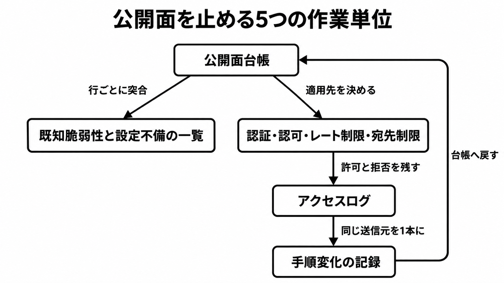
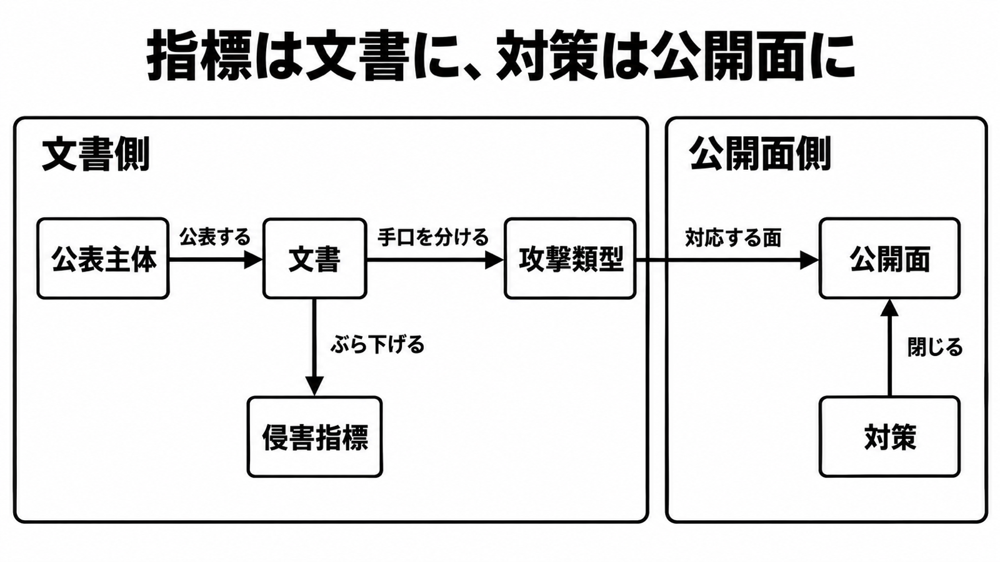

# 連続不正アクセスの公開APIを台帳と認可で止める

元記事: [連続不正アクセスの公開APIを台帳と認可で止める](../../../../../articles/ai-api-blogs-jpcert-or-jp-p6_20261016.md)

## ひとことで言うと

インターネットから応答する面の台帳を先に作り、未修正や認可なしの公開を停止条件にする。公表された送信元は、文書ごとのリストのまま照合する。

## 核心ポイント

| # | ポイント | なぜ判断に効くか | 根拠 (元記事の節) |
|---|---|---|---|
| 1 | 台帳に行が無いと、レート制限、認可、トークン寿命、不要な公開の停止の適用先が決まらない | 行の単位は、インターネットから応答する面 | 公開面台帳の構築 / 公開APIの台帳を先に作る |
| 2 | 停止条件は、侵入の成功ではなく、未修正、認可なし、または設定やバックアップを露出したまま応答している時点 | 既知の穴と設定不備を試す行為を、成功のあとで追わない | ベストプラクティス / 停止条件を侵入口の公開時点に置く |
| 3 | 送信元は文書ごとのリストのまま、IP として完全一致で照合する。一致しても IP 単独では侵害を確定しない | リストを結合すると、正規利用の注記と、別の観測が落ちる | 概念モデル / 公表された送信元を自社ログで探す |
| 4 | アプリ内の秘密、署名、難読化はサーバ認可の代わりにしない。外部 URL の取得は、許可ホストをリダイレクトのたびに再判定する | 記事が番号まで照合したのは API1（主体・操作・対象）と API7（宛先を検証せずに取得する欠陥） | アプリ内の秘密を認可の根拠にしない / オブジェクト単位の認可をサーバで決める / 外部URLを取得するAPIの宛先を固定する |
| 5 | 同じ送信元の手順の変化は、前後 8 時間の 1 本の時系列にする。他社のエージェント判定は自社ログへ輸入しない | 1 種類の欠陥名や、単発のシグネチャで「終わった」にしない | 検知は手順の変化を1本の記録にする / しきい値は観測値を調査開始の目安にする / 週次で公開面と既知脆弱性を突き合わせる |

注意喚起は、操作を誰に許すかと、どのオブジェクトに許すかの両方を一文では書いていない。主体・操作・対象の 3 つは、ケース B の報告を API1 の点検へ落とすときの、記事の読み方である。

## メンタルモデル

伝えたいことは 2 つある。作業単位の循環と、指標を文書に付けたままにすることである。

台帳が、既知の穴と設定不備の突合先と、ゲート（認証・認可・レート制限・宛先制限）の適用先を決める。ゲートの許可と拒否はアクセスログに残り、同じ送信元の変化は 1 本の手順変化になり、週次の差分として台帳へ戻る。

この図から外したもの:

- 公表主体、文書、攻撃類型、侵害指標（次の図）
- クライアント、攻撃元のサーバ、WAF 製品、組織の内側の面の見取り図（届くリクエストの図であり、5 つの作業単位ではない）
- 委託先のリリース担当とログの保管先（台帳の行の属性）
- レート制限の数値、宛先の許可リスト、オブジェクト認可の中身（ゲートの中にある）

左の文書側では、公表主体が文書を出し、文書が手口（攻撃類型）と侵害指標を分ける。右の公開面側では、対策がその面を閉じる。グループをまたぐ矢印は、攻撃類型から公開面への「対応する面」だけである。侵害指標から公開面や対策への矢印は無い。

この図から外したもの:

- 自社ログとの照合結果だけを公開面の行へ付ける、という本文の規則。情報モデルは文書側の指標と公開面側の対策を線でつながないので、矢印にはしていない
- 段階観測。段階と件数を持つのは WAF Tech Blog だけで、Eyes は段階表を持たない
- ITmedia。WAF Tech Blog の要約であり、箱を増やすと「指標は文書ごと」がぼやける

## 具体例

記事が台帳の形として置いた例であり、実在の被害組織の行ではない。

| 行 | 記事が置いた値 | 読み方 |
|---|---|---|
| member-profile | 所有者は自社、operator は委託先、mobile-backend、audience は customer、埋め込み秘密は false、外部 URL の取得は false、認可は object-level | 委託先がホストしても、所有者の台帳からは消さない |
| staff-bi | audience は employee、internet_exposed は true、認可は network-only | 点検を求められた組み合わせは、インターネット公開かつ従業員向け。network-only は例の認可欄 |

staff-bi の Metabase 行は、自社運用を未棚卸のまま置いた例である。使っていなければ作らない。本文が CVE 番号まで書いたのは CVE-2026-72898 だけで、使っている行に限って突合する。Metabase Cloud は、[JPCERT-AT-2026-0023](https://www.jpcert.or.jp/at/2026/at260023.html) が「対策済みだと Metabase が案内している」と書くため、同じ CVE の未確認行にはしない。自社運用の詳細手順の正本は同別紙である。

台帳に同じ形で入れる面は、モバイルアプリの接続先、OpenAPI に載ったルート、画面にボタンが無い管理 API、従業員向け、BI、公開 Web から届くアプリサーバ、委託先がホストする同種の面である。公開 Web から届くアプリサーバの行が持つ記録は、配置経路とファイル整合である。NICT のプレスリリースは、対象が Android に限らず、iOS アプリと Web サービスのバックエンド API でも起こり得る、と広げる。

## 適用と判断

**向くとき**

- 自社または委託先が、インターネットからアプリ、API、管理系、BI を応答させている
- 同じ時期に、複数の公表主体から送信元リストが届く
- 公開クライアントは解析される前提で、バックエンドの認証、認可、宛先制限を点検する

**決めること**

| 確認すること | 満たさないときの扱い |
|---|---|
| audience が employee または admin で、internet_exposed が true か | 顧客向け API より先に見る。公開を続けるなら、認可、レート制限、トークン寿命、ログの所在を埋める |
| 週次で、本番ルートと台帳、本番バージョンと修正版、公表リストの差を見たか | 増えたルートは、認可とレート制限が付くまで公開しない。修正版がある行を未適用のまま残さない。設定ファイルとバックアップの露出は、CVE が無くても停止条件に含める |
| バージョンは本番で応答しているものか | リポジトリの宣言とずれていれば、本番を書く |
| CVE-2026-72898 を、使っていない製品へ広げていないか | Metabase を使っている行だけ。Cloud は未確認のまま残さない |
| 送信元の照合は、文書グループ内の完全一致か | 部分文字列では当てない。Eyes Appendix B の 3 件のうち 2 件は、注意喚起ケース B の 9 月リストと重なる。残る 1 件は 2026-10-09 時点の注意喚起本文に無い。ビットフォレストの 3 件は、Eyes にもその本文にも無い。9 月組とビットフォレストの 3 件には正規利用の注記があり、Eyes Appendix B にはその文が無い。重なる 2 件では注記を落とさない。ヒットしても、期間と User-Agent とパスをセットで見る |
| レート制限は機能ごと、かつ拒否も数えるか | 閾値は注意喚起が指定していない。正規利用を見て決める。ログイン、パスワード再設定、SMS 送信は閲覧 API と別カウンタにする。コストが利用者に出る操作では、鍵に操作名を含める |
| 署名に通ったことを、オブジェクトの操作許可と別判定にしているか | 正規アプリ以外を、レート制限の例外にしない。トークンは最小権限と有効期限を持ち、疑わしいものは失効する。所在は `secret_in_client` と失効手順に紐づける |
| 外部 URL を取得する行で、接続の直前に許可を見ているか | 許可ホストは行ごとに固定する。リダイレクトのたびに再判定する。ホスト名だけを見て、別のアドレスへ接続しない。許可外には接続する前に拒否する |
| ログは自社で引けるか | 委託先の WAF にしか無い行は、公表された送信元の照合が自社だけでは終わらない |
| 短い窓の未存在パス、同じ送信元での User-Agent の切り替わり、ログインの集中を、調査開始の目安にしたか | 桁は WAF 観測から借り、固定のシグネチャにはしない。超えたら前後 8 時間を 1 本にし、活動の種類が変わった回数を数える。1 種類の欠陥名では閉じない |
| 画面の操作履歴に無い権限変更やアカウントが残っているか | 画面から実行できない内部 API も台帳に載せ、主体と操作の許可が無い組み合わせを拒否する。ID の一致だけを認可にしない |
| URL 取得のログに、内部ホストやメタデータ用アドレスへの自サーバ発信が残っているか | 取得先の制限が無いか、最初の URL だけを許可してリダイレクト後を見ていない。許可ホストを行ごとに固定し、リダイレクトのたびに再判定し、許可外には接続しない |

保存期間を過ぎたデータは残さない。地域が限定されるサービスでは、アクセス元の地域制限も、注意喚起の汎用対策に含まれる。

ビットフォレストが「自社の仕掛けで検知した場合はエージェントと断定できる」と書いた判定は、自社ログへ輸入しない。検証に名前が出た Qwen 3.8 Flash Next と GLM-5.3 Flash Next は、攻撃者が使ったモデルではない。

## 限界・注意点

- 注意喚起は、すべての事案で同一の手法が使われていることを示すものではない、と書く。類型は共通キャンペーンの ID ではない。話し手は少なくとも、JPCERT/CC の注意喚起、Eyes、NICT、ビットフォレストの 4 つである
- Eyes は AI の利用を確認したと書くが、判定手順とモデル名は本文に無い。CYNEX は、解析や脆弱性探索が効率化され、より多くのシステムに及ぶ可能性を書く。プレスリリースは、解析や脆弱性の発見が効率化され、広がる可能性を書く。確認と可能性を同じ強さにせず、二つの語句を一つの引用に混ぜない
- ビットフォレストは、自社の仕掛けで検知した場合に限りエージェントと断定できると書き、漏れはあり得ると同じ文章で書く。判定の方法は公開していない
- Eyes Appendix B の IP と、本文のサーバその 1〜3 の対応表は無い。その 3 は、今回の攻撃と直接関係しない、と Eyes が書く
- ビットフォレストが検出した 3 件に、スマホアプリの User-Agent は無い。NICT が 2026-10-13 に名付けた A2B は、公開アプリの解析を起点にバックエンドを狙う類型の名前である。NICT は、アプリ本体に脆弱性が無くても、バックエンドの認証・認可・入力検証の不備で漏えいし得る、と書く。プレスリリースは、対象を iOS アプリと Web サービスのバックエンド API にも広げる。この 3 件を A2B の実例として結合しない。A2B は Eyes の IP リストとは別文書である
- ITmedia の要約は、8 時間弱の観測にある高速な探索、既知の欠陥への試行、ログインの集中を続けて書く。ブログの表では、それらは 10 段階の 1 件の中の別段階である。問い合わせフォームへの連投は別の IP、スキャンのみは 3 件目である
- 記事中のレート制限の数値、調査開始の目安の桁、`203.0.113.10` は例示である。注意喚起の指定値でも、公表された侵害指標でもない
- NICT の PDF に書かれた侵害指標と、脆弱性ごとの確認手順は、この記事が本文に採用していない。マクニカの記事と、セキュアスカイ・テクノロジーの実践ガイドの中身も、根拠にしていない
- 対象プロトコルを Eyes の本文に限ると、名前があるのは HTTPS と、その上の API である。ビットフォレストの表にある GraphQL や、段階の途中のメソッドを、Eyes の対象として書かない
- 外部 URL の取得について、記事が一次情報だと区切るのは、リダイレクトを追う取得処理が点検対象になるところまでである

**2026-10-16 時点で、元記事の本文に無いこと**

- Eyes が AI 利用と判断したログ、モデル、ツール出力
- Appendix B の IP と 3 台のサーバの対応
- ビットフォレストの判定アルゴリズム（意図的に非公開）
- 検証した 8 モデルのうち、名前が無い 6 つ。名前があるのは Qwen 3.8 Flash Next と GLM-5.3 Flash Next だけである。ITmedia は GLM の語尾とベンダー名がブログとずれる
- 注意喚起に例として出る User-Agent の版文字列が、そのパッケージの実在版か。記事は観測された User-Agent に留める

## 参考

- 元記事: [notes/zenn/articles/ai-api-blogs-jpcert-or-jp-p6_20261016.md](../../../../../articles/ai-api-blogs-jpcert-or-jp-p6_20261016.md)
- [JPCERT/CC Eyes「連続不正アクセス事案の攻撃手法に関する調査」（2026-10-15）](https://blogs.jpcert.or.jp/ja/2026/10/web_api_attacks.html)
- [JPCERT-AT-2026-0030（公開 2026-10-08、更新 2026-10-09）](https://www.jpcert.or.jp/at/2026/at260030.html)
- [JPCERT-AT-2026-0023 Metabase の SQL インジェクション（CVE-2026-72898）](https://www.jpcert.or.jp/at/2026/at260023.html)
- [NICT プレスリリース（2026-10-13）](https://www.nict.go.jp/press/2026/10/13-1.html)
- [NICT CYNEX Library（2026-10-13）](https://cynex.nict.go.jp/library/261013-01.html)
- [ビットフォレスト WAF Tech Blog](https://www.scutum.jp/information/waf_tech_blog/2026/10/waf-blog-085.html)
- [ITmedia AI+ の要約（2026-10-15）](https://www.itmedia.co.jp/aiplus/article/2610/15/2000002284/)（ブログの要約。語尾と、観測のまとめ方がブログとずれる）
- [OWASP API Security Top 10 2023](https://owasp.org/API-Security/editions/2023/en/0x11-t10/)
- [OWASP API1:2023 Broken Object Level Authorization](https://owasp.org/API-Security/editions/2023/en/0xa1-broken-object-level-authorization/)
- [OWASP API7:2023 Server Side Request Forgery](https://owasp.org/API-Security/editions/2023/en/0xa7-server-side-request-forgery/)
- [OWASP REST Security Cheat Sheet](https://cheatsheetseries.owasp.org/cheatsheets/REST_Security_Cheat_Sheet.html)
